# AgentFlow 软件架构设计文档

| 字段 | 内容 |
|------|------|
| 项目名称 | AgentFlow |
| 文档版本 | v2.1 |
| 编写日期 | 2026-02-19 |
| 架构状态 | 已批准 |
| 适用范围 | AgentFlow 核心引擎（开发编排框架 + 运行框架），版本 0.1.x |

## 架构摘要

> AgentFlow 采用**双框架分离架构**——开发编排框架负责 Agent/Workflow/Node/Edge 的定义与装配，运行框架通过三层 Master-Worker 调度引擎完成Workflow实例中DAG图或子图的并发执行；核心技术栈为 C++17 + Actor 反应式模型（Protoactor-cpp 必选）；首要质量目标是高吞吐（单机 > 10000 节点/秒）、低延迟（P99 节点调度 < 10ms）和热重载零停机。

### 设计目标

| 目标 | 描述 |
|------|------|
| **高性能** | Agent内零拷贝数据传输、并行调度、高效事件处理 |
| **可扩展** | Agent内多Workflow、Node等支持分布式部署、多语言节点执行、插件化架构 |
| **高可用** | Node可执行代码支持热重载、故障转移、优雅降级 |
| **易用性** | Workflow支持DSL 编排、可视化监控、丰富 API |
| **标准化** | 遵循行业规范、开放接口协议 |

---

## 一、用例视图（Use Case View）

### 1.1 系统上下文模型

#### 系统定位
AgentFlow 是一个面向开发者的 **Agent开发编排与执行引擎**，提供 DAG 工作流的定义、调度、执行、Node可执行代码的热重载和监控能力，可内嵌于各类 AI Agent 应用或自动化平台中。

#### 系统边界

- **系统内**：Agent建模与持久化、DAG 拓扑解析、三层 Master-Worker 调度与执行引擎、Agent内分布式高速数据总线（DataBus）、执行代码热重载/代码动态替换、运行时指标采集、网络通信适配层（可定制通信通道）
- **系统外**（外部服务对接）：持久化存储后端（文件系统/数据库）、外部执行载体（Shell 环境、Python 解释器、.so 动态库、外部可执行文件）、消息推送/告警运维等系统

#### 外部接口清单

| 接口 | 方向 | 协议 | 数据格式 | 说明 |
|------|------|------|----------|------|
| 开发者 | 入 | JSON流程文件 / Node开发框架 | JSON / Shell/Python/C++/Java/Go等多语言 | 创建Agent包 |
| 运维控制台 | 入/出 | Restful/gRPC | 私有二进制协议 / JSON | Agent实例运行时监控与控制 |
| 基础设施 | 出 | Restful/gRPC/WebSocket等协议 | JSON / Protobuf Binary /流式 | Agent依赖南向服务：数据库、分布式文件系统、LLM推理服务、记忆服务、工具服务等；Agent依赖的治理中心服务 |

#### 外部角色定义

| 角色 | 描述 | 交互方式 |
|------|------|----------|
| **应用开发者** | 使用 AgentFlow 构建Agent应用的开发人员 | DSL 定义Workflow、多语言实现Node |
| **运维人员** | 负责Agent系统部署、监控和维护的人员 | OM系统 |
| **外部系统** | 与 Agent 集成的第三方系统（如 LLM API、Agent治理中心等） | gRPC/REST/WebSocket（规划） |

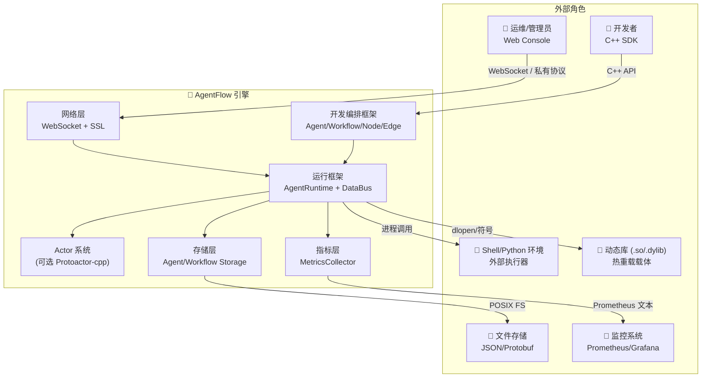

---

### 1.2 关键场景

| S1场景 | S2场景 | S3场景 | 能力等级 | 优先级 | 描述 |
|--------|------|--------|------|------|------|
| S1-01 Agent开发 | S1-01-S2-01 Agent包开发 | S1-01-S2-01-S3-01 Workflow开发 | L0 | P0 | 开发Workflow流程文件，编排已经实现的Node |
| S1-01 Agent开发 | S1-01-S2-01 Agent包开发 | S1-01-S2-01-S3-02 Node定制开发 | L0 | P0 | 集成Node daemon，使用Shell/C++/Java/Pyhon等多语言开发执行部分 |
| S1-01 Agent开发 | S1-01-S2-01 Agent包开发 | S1-01-S2-01-S3-03 Agent包构建 | L0 | P0 | 将实现的Workflow和Node按照一定规范打包到Agent发行包中 |
| S1-02 Agent运行 | S1-02-S2-01 Agent实例管理 | S1-02-S2-01-S3-01 Agent实例生命周期管理 | L0 | P0 | Agent实例创建、注册等管理，Agent运行、暂停、停止、销毁等状态管理 |
| S1-02 Agent运行 | S1-02-S2-01 Agent实例管理 | S1-02-S2-01-S3-02 Agent实例部署 | L0 | P0 | Agent实例分布式部署 |
| S1-02 Agent运行 | S1-02-S2-02 Agent执行 | S1-02-S2-02-S3-01 Agent消息管理 | L0 | P0 | Agent请求消息与Agent任务映射  |
| S1-02 Agent运行 | S1-02-S2-02 Agent执行 | S1-02-S2-02-S3-02 Agent任务管理 | L0 | P0 | Agent任务与Agent实例、Workflow实例映射  |
| S1-02 Agent运行 | S1-02-S2-02 Agent执行 | S1-02-S2-02-S3-03 Agent任务调度 | L0 | P0 | Agent任务对应的Workflow实例调度  |
| S1-02 Agent运行 | S1-02-S2-02 Agent执行 | S1-02-S2-02-S3-04 Agent任务执行 | L0 | P0 | Agent任务对应的Workflow、Node执行引擎  |

### 1.3 S1-01 Agent开发场景关键用例与交互模型

#### 用例优先级列表

| S3场景 | 用例 | 参与者 | 描述 | 优先级 |
|--------|------|--------|------|------|
| S1-01-S2-01-S3-01 Workflow开发 | S1-01-S2-01-S3-01-UC-01 Workflow、Node和Edge定义 | 开发者 | 定义Workflow、Node和Edge数据结构 | P0 |
| S1-01-S2-01-S3-01 Workflow开发 | S1-01-S2-01-S3-01-UC-02 Workflow、Node和Edge解析工具 | 可视解析工具，Workflow | 实现JSON低码化解析器 | P0 |
| S1-01-S2-01-S3-02 Node定制开发 | S1-01-S2-01-S3-02-UC-01 Node控制面 | 开发者 | 所有Node的统一控制面，实现运行面的生命周期管理、运维、可靠性等 | P0 |
| S1-01-S2-01-S3-02 Node定制开发 | S1-01-S2-01-S3-02-UC-02 Node运行面 | 开发者，Node | Shell/C++/Java/Pyhon等不同语言定制开发运行面 | P0 |
| S1-01-S2-01-S3-02 Node定制开发 | S1-01-S2-01-S3-02-UC-03 Node运行面热加载 | 开发者、HotReloadManager | 运行面支持可执行代码热更新 | P1 |
| S1-01-S2-01-S3-03 Agent包构建 | S1-01-S2-01-S3-03-UC-01 Agent包构建发布 | 开发者、构建者 | 定义Agent包格式，按照规范打包Agent依赖的Workflow流程文件及定制Node | P0 |

---

#### S1-01-S2-01-S3-01-UC-01 Workflow、Node和Edge定义

- **参与者**：开发者（调用方）
- **前置条件**：已有Workflow、Node和Edge的标准规范
- **主成功流程**：按照业务场景完成主业务路径编排
- **异常流程**：无法使用已有标准规范描述业务流程
- **质量目标**：业务流程100%可描述，遵从规范标准

#### S1-01-S2-01-S3-01-UC-02 Workflow、Node和Edge解析工具

- **参与者**：可视解析工具，AgentRuntime
- **前置条件**：离线实现可视解析工具，在线依托Workflow对象实现DSL文件解析
- **主成功流程**：成功解析可视，或者转换为树形数据结构
- **异常流程**：解析失败
- **质量目标**：100%解析成功

#### S1-01-S2-01-S3-02-UC-01 Node控制面

- **参与者**：开发者
- **前置条件**：已经实现Node控制面代码Adapter
- **主成功流程**：集成Node控制面（Adapter），支持运维等经过Adapter打通，Adapter支持运行面的生命周期管理
- **异常流程**：无控制面
- **质量目标**：控制面集成及运行成功

#### S1-01-S2-01-S3-02-UC-02 Node运行面

- **参与者**：开发者
- **前置条件**：已经实现业务处理Workflow流程定义
- **主成功流程**：Node运行面实现业务定制处理逻辑
- **异常流程**：无运行面
- **质量目标**：运行面集成及运行成功

#### S1-01-S2-01-S3-02-UC-03 Node运行面热加载

- **参与者**：开发者、HotReloadManager
- **前置条件**：已经实现Node的运行面
- **主成功流程**：Node运行面可支持在线更新
- **异常流程**：无法更新
- **质量目标**：热更新时长<1s

#### S1-01-S2-01-S3-03-UC-01 Agent包构建发布

- **参与者**：开发者、构建者
- **前置条件**：已经实现Workflow流程文件及Node代码
- **主成功流程**：将Agent依赖的Workflow及Node定制代码按照Agent包规范打包，并发布
- **异常流程**：包构建格式不正确，遗漏关键文件
- **质量目标**：控制Agent包大小（比如<500M）


### 1.4 S1-02 Agent运行场景关键用例与交互模型

#### 用例优先级列表

| S3场景 | 用例 | 参与者 | 描述 | 优先级 |
|--------|------|--------|------|------|
| S1-02-S2-01-S3-01 Agent实例生命周期管理 | S1-02-S2-01-S3-01-UC-01 Agent包加载 | 运维者、Agent治理中心 | Agent包加载 | P0 |
| S1-02-S2-01-S3-01 Agent实例生命周期管理 | S1-02-S2-01-S3-01-UC-02 Agent实例生命周期管理 | AgentManager、Agent治理中心 | Agent实例创建、注册发现等 | P0 |
| S1-02-S2-01-S3-01 Agent实例生命周期管理 | S1-02-S2-01-S3-01-UC-02 Agent状态管理 | AgentManager | Agent状态机及运行、暂停、停止、销毁等状态跃迁管理 | P0 |
| S1-02-S2-01-S3-02 Agent实例部署 | S1-02-S2-01-S3-02-UC-01 Agent实例部署 | AgentRuntime | 支持Agent单服务单实例、单服务多实例、多服务多实例分布式方式部署 | P0 |
| S1-02-S2-02-S3-01 Agent消息管理 | S1-02-S2-02-S3-01-UC-01 Agent接收消息 | Agent | Agent接收消息缓存及路由处理 | P0 |
| S1-02-S2-02-S3-01 Agent消息管理 | S1-02-S2-02-S3-01-UC-02 Agent发送消息 | Agent | Agent发送消息缓存及路由处理 | P0 |
| S1-02-S2-02-S3-02 Agent任务管理 | S1-02-S2-02-S3-02-UC-01 Agent消息与任务映射 | Agent | 接收消息触发启动多任务 | P0 |
| S1-02-S2-02-S3-02 Agent任务管理 | S1-02-S2-02-S3-02-UC-02 任务生命周期管理 | Agent | 多任务生命周期管理 | P0 |
| S1-02-S2-02-S3-03 Agent任务调度 | S1-02-S2-02-S3-03-UC-01 任务对应Workflow实例调度 | AgentRuntime | 调度任务对应的Workflow实例到Worker上执行 | P0 |
| S1-02-S2-02-S3-04 Agent任务执行 | S1-02-S2-02-S3-04-UC-01 Workflow及Node执行引擎 | AgentRuntime | Workflow及Node执行引擎实现 | P0 |
| S1-02-S2-02-S3-05 Agent会话管理 | S1-02-S2-02-S3-05-UC-01 Agent会话管理 | Agent | 支持Agent按照会话管理消息及任务 | P0 |

---

#### S1-02-S2-01-S3-01-UC-01 Agent包加载

- **参与者**：运维者、Agent治理中心
- **前置条件**：Agent包已经Ready
- **主成功流程**：上传Agent包到运维服务，运维服务将包传递并加载到Agent治理中心
- **异常流程**：包传递或加载失败
- **质量目标**：Agent包加载时长<10s
  

#### S1-02-S2-01-S3-01-UC-02 Agent实例生命周期管理

- **参与者**：AgentManager、Agent治理中心
- **前置条件**：业务已经创建Agent实例
- **主成功流程**：Agent实例创建后自动向Agent治理中心进行注册
- **异常流程**：注册失败
- **质量目标**：注册时延<100ms，治理中心支持注册速率1000/s


#### S1-02-S2-01-S3-01-UC-02 Agent状态管理

- **参与者**：AgentManager
- **前置条件**：Agent实例已经注册和运行
- **主成功流程**：管理Agent工作状态，根据条件进行状态迁移
- **异常流程**：Agent脱管
- **质量目标**：状态100%准确

#### S1-02-S2-01-S3-02-UC-01 Agent实例部署

- **参与者**：AgentRuntime
- **前置条件**：Agent实例已经注册
- **主成功流程**：按照配置要求，Agent实例可以支持单服务单实例，单服务多实例，以及多服务多实例分布式部署方式
- **异常流程**：部署方式不正确
- **质量目标**：单实例处理请求100 QPS


#### S1-02-S2-02-S3-01-UC-01 Agent接收消息

- **参与者**：Agent
- **前置条件**：Agent实例已经注册和运行
- **主成功流程**：Agent实例支持接收并缓存消息，并根据一定规则分发到不同任务
- **异常流程**：消息丢失等
- **质量目标**：单Agent实例处理消息的并发能力100 QPS


#### S1-02-S2-02-S3-01-UC-02 Agent发送消息

- **参与者**：Agent
- **前置条件**：Agent实例已经注册和运行
- **主成功流程**：Agent实例支持收集来自各个任务的处理结果，并组装结果作为Agent实例回应给发送方
- **异常流程**：消息收集和组装不正确
- **质量目标**：控制Agent包大小（比如<500M）


#### S1-02-S2-02-S3-02-UC-01 Agent消息与任务映射

- **参与者**：Agent
- **前置条件**：Agent实例已经注册和运行，可以正确接收消息
- **主成功流程**：接收到的Agent消息可以触发不同的多个任务
- **异常流程**：消息没有对应任务处理
- **质量目标**：单消息可以触发100个任务

#### S1-02-S2-02-S3-02-UC-02 任务生命周期管理

- **参与者**：Agent
- **前置条件**：Agent实例已经注册和运行，已经触发多个任务
- **主成功流程**：对任务状态进行管理，并根据条件跃迁到新状态
- **异常流程**：任务状态不正确
- **质量目标**：状态100%准确

#### S1-02-S2-02-S3-03-UC-01 任务对应Workflow实例调度

- **参与者**：AgentRuntime
- **前置条件**：已经有任务，已经实现Workflow实例
- **主成功流程**：将任务调度到不同的Workflow实例上
- **异常流程**：任务没有workflow执行
- **质量目标**：同时支持100任务和100个Workflow实例并行调度


#### S1-02-S2-02-S3-04-UC-01 Workflow及Node执行引擎

- **参与者**：AgentRuntime
- **前置条件**：已经实现workflow实例
- **主成功流程**：按照Workflow流程、Node及Edge实现执行
- **异常流程**：流程执行失败
- **质量目标**：流程执行逻辑正确

#### S1-02-S2-02-S3-05-UC-01 Agent会话管理

- **参与者**：Agent
- **前置条件**：已经和交互方大同，支持消息收发
- **主成功流程**：按照交互方及请求消息创建会话，并对会话进行生命周期管理
- **异常流程**：会话管理失败
- **质量目标**：单Agent实例支持1K会话管理

### 1.5 关键用例与交互模型

#### 1.5.1 workflow关键用例与交互模型

##### 用例优先级列表

| 优先级 | 用例 | 参与者 | 价值 |
|--------|------|--------|------|
| P0 | UC-01 定义并执行 Workflow | 开发者、AgentRuntime | 核心主路径 |
| P0 | UC-02 节点热重载（代码动态替换） | 开发者、HotReloadManager | 零停机更新 |
| P0 | UC-03 DAG 条件分支 & 循环执行 | AgentRuntime、ControlFlow | 复杂业务逻辑 |
| P1 | UC-04 Workflow 持久化与版本回滚 | 开发者、StorageManager | 灰度发布 |
| P1 | UC-05 运行时指标采集与导出 | 运维、MetricsCollector | 可观测性 |

---

##### UC-01：定义并执行 Workflow

- **参与者**：开发者（调用方）、AgentRuntime
- **前置条件**：AgentRuntime 已启动（`start()` 返回 true）
- **主成功流程**：见序列图
- **异常流程**：节点执行失败时触发重试（`max_retries`），超出重试次数后标记 Workflow 为 FAILED
- **质量目标**：Workflow 调度延迟 P99 < 10ms，节点并发度 = worker_threads 数（默认 4）

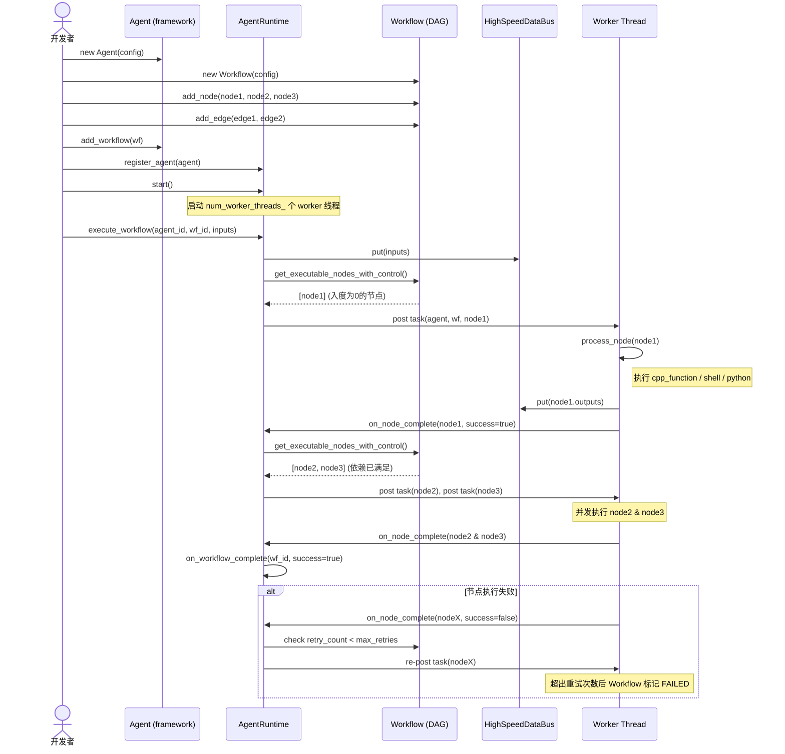

---

##### UC-02：节点热重载

- **参与者**：开发者、HotReloadManager、Node
- **前置条件**：Node 的 `enable_hot_reload = true`，对应 .so/.py/.sh 文件存在
- **质量目标**：热重载完成时间 < reload_timeout_ms（默认 30s），不中断其他节点执行

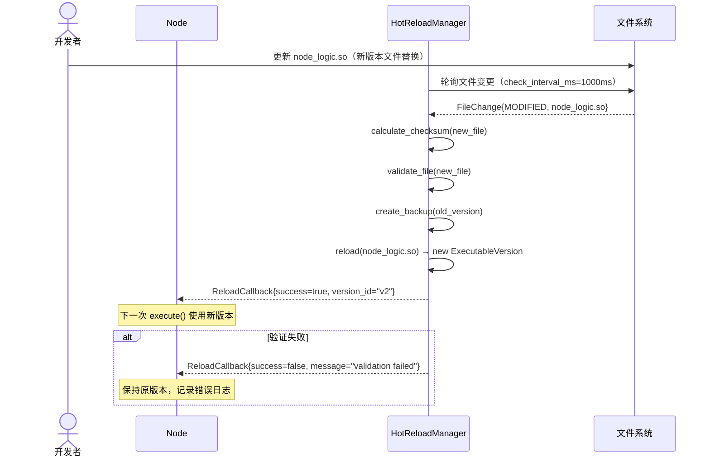

---

##### UC-03：DAG 条件分支 & 循环执行

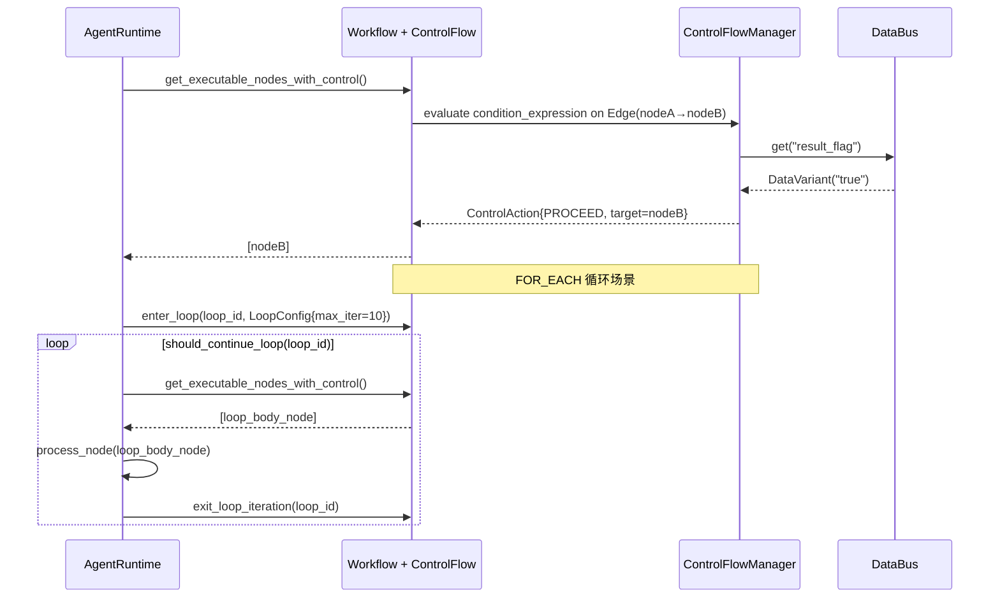

---

## 二、逻辑视图（Logical View）

### 2.1 结构模型

#### 架构决策记录（ADR-001）

| 字段 | 内容 |
|------|------|
| 决策标题 | 采用双框架分离架构（开发编排框架 + 运行框架） |
| 状态 | 已接受 |
| 背景 | Agent/Workflow 的定义、装配属于开发期行为，而调度、执行、监控属于运行期行为，两者混合会导致高耦合，难以独立演进。 |
| 决策 | 将系统拆分为独立的开发编排框架（`framework/`）和运行框架（`runtime/`），支持合一部署和分离部署两种模式。 |
| 部署方式 | 模式一（合一模式）：开发框架和运行框架共部署；模式二（分离模式）：开发框架和运行框架分离部署，开发框架和业务服务共部署，运行框架独立部署 |

#### 分层架构说明

| 层次 | 命名空间 | 职责 |
|------|----------|------|
| 开发编排框架 | `agentflow::framework` | Agent管理、Node定制 |
| 运行框架 | `agentflow::runtime` | AgentRuntime 三层调度、DataBus、ControlFlow、HotReload |
| 基础设施层 | `agentflow::utils` | OMAdapter（log等对接）、ThreadPool、ActorFramework、Storage、Protobuf等 |

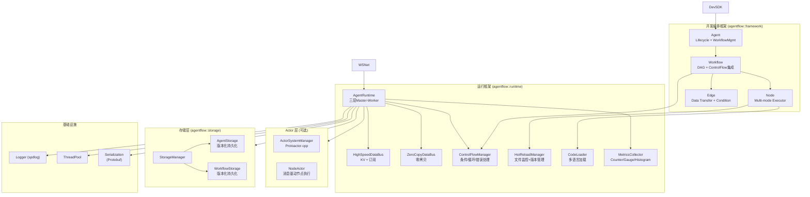

---

### 2.2 行为模型

#### 内部组件协作：三层调度主路径

Agent实例内支持Agent任务实例 -> Workflow实例 -> Node实例三层调度，其实例映射关系如下：
- 1个Agent实例包含1~N个Agent会话
- 1个Agent会话包含1~M个请求消息
- 1个请求消息触发1~X个任务
- 1个任务映射1~Y个Workflow实例
- 1个Workflow实例包含1~Z个Node及XX个Edge

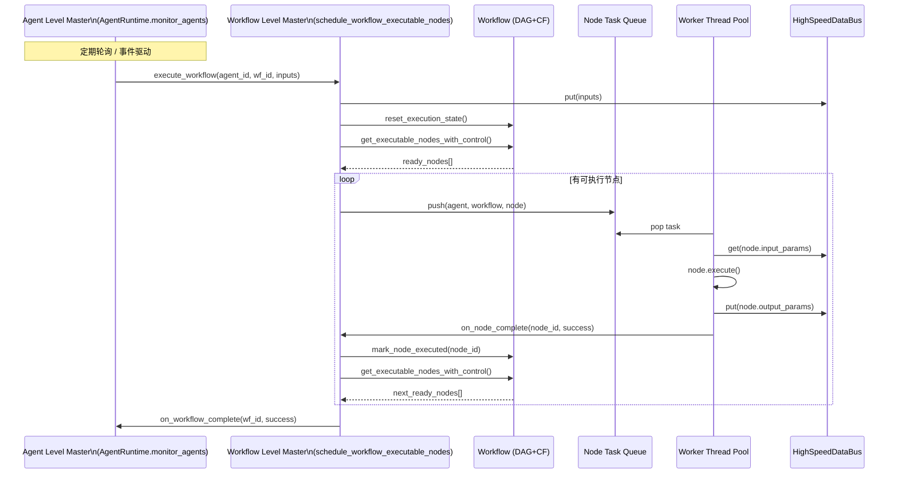

#### Node 状态机

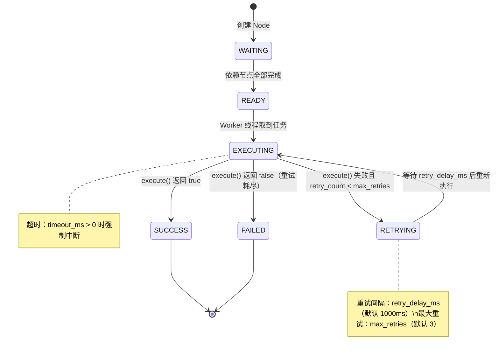

#### Workflow 状态机

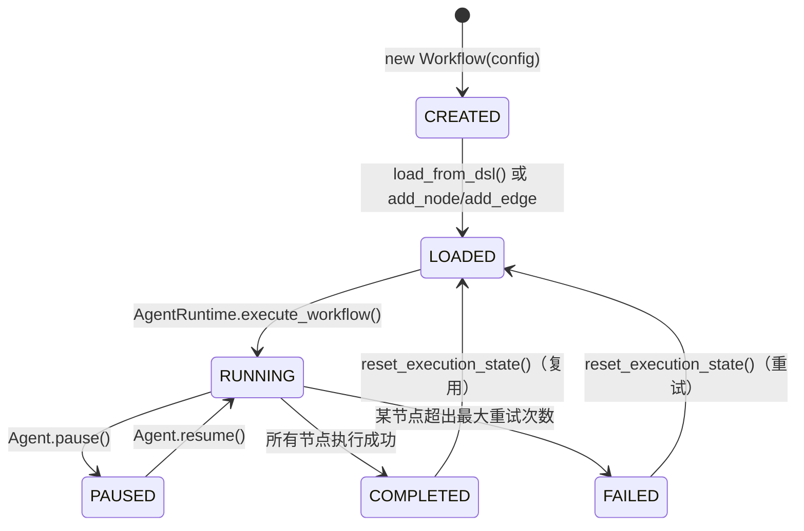

#### Agent 状态机

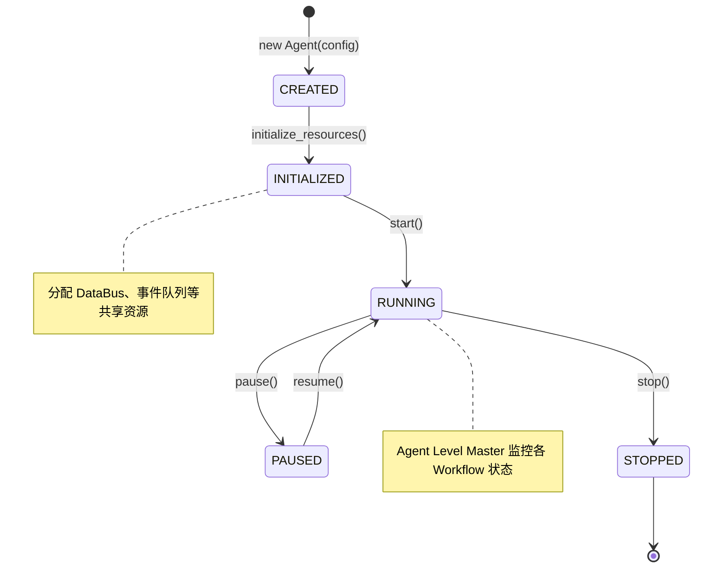

#### 三层调度职责详述

| 层次 | 职责 |
|------|------|
| **Agent Level Master** | Agent 实例；多个会话共享资源；每个会话包含多个消息，每个消息包含多个任务实例 |
| **Workflow Level Worker** | DAG 解析、调度与执行：多个Workflow的DAG图被调度到不同worker上执行；执行满足Workflow的流程控制，比如条件/循环控制流驱动 |
| **Node Level Worker** | 具体节点执行：Node按照运行面代码进行执行，Node间支持高速数据共享（依赖DataBus）；执行计时与超时控制 |

---

### 2.3 数据模型

三层拥有及包含关系：
Agent -> Workflow -> Node + Edge
同一个Agent实例内的Workflow基于数据总线共享数据
同一个Workflow实例内的Node基于数据总线共享数据，Node上下游传输数据

#### 核心实体与关系

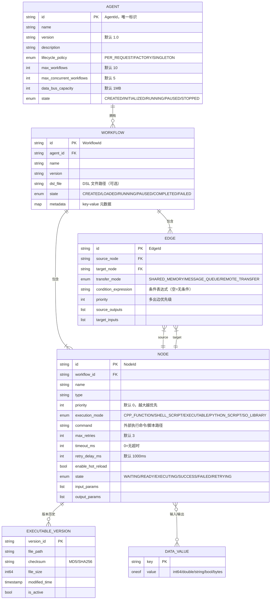

#### 数据所有权与索引策略

| 实体 | 所有者组件 | 主存储 | 关键索引 |
|------|-----------|--------|----------|
| Agent | AgentRuntime | 内存 Map + 文件 | agent_id → AgentPtr |
| Workflow | AgentRuntime / Agent | 内存 Map + 文件 | (agent_id, workflow_id) |
| Node | Workflow | 内存 Map | node_id → NodePtr；拓扑排序缓存 |

#### C++ 核心数据类型定义

```cpp
// 基础数据类型
using DataVariant = std::variant<int64_t, double, std::string, bool>;
using DataMap = std::map<std::string, DataVariant>;

// ID 类型定义
using AgentId    = std::string;
using WorkflowId = std::string;
using NodeId     = std::string;
using EdgeId     = std::string;

// 状态枚举
enum class AgentState    { CREATED, INITIALIZED, RUNNING, PAUSED, STOPPED };
enum class WorkflowState { CREATED, LOADED, RUNNING, PAUSED, COMPLETED, FAILED };
enum class NodeState     { WAITING, READY, EXECUTING, SUCCESS, FAILED, RETRYING };

// 生命周期策略
enum class LifecyclePolicy { PER_REQUEST, FACTORY, SINGLETON };

// 执行模式
enum class ExecutionMode { CPP_FUNCTION, SHELL_SCRIPT, EXECUTABLE, PYTHON_SCRIPT, SO_LIBRARY };
```

#### DSL 数据模型（JSON Schema）

Workflow 支持低码化实现业务流程编排，低码化规范需要支持可定义，支持通过 JSON/DSL 文件格式，并可以进行文件方式加载（`load_from_dsl()`），参考格式如下：

```json
{
  "$schema": "http://json-schema.org/draft-07/schema#",
  "type": "object",
  "properties": {
    "workflow": {
      "type": "object",
      "properties": {
        "id":      { "type": "string" },
        "name":    { "type": "string" },
        "version": { "type": "string" },
        "nodes":   { "type": "array", "items": { "$ref": "#/definitions/node" } },
        "edges":   { "type": "array", "items": { "$ref": "#/definitions/edge" } }
      }
    }
  },
  "definitions": {
    "node": {
      "type": "object",
      "required": ["id", "execution_mode"],
      "properties": {
        "id":             { "type": "string" },
        "name":           { "type": "string" },
        "type":           { "type": "string" },
        "execution_mode": { "type": "string", "enum": ["cpp_function","shell_script","executable","python_script","so_library"] },
        "command":        { "type": "string", "description": "脚本路径或可执行文件路径" },
        "timeout_ms":     { "type": "integer", "default": 0 },
        "max_retries":    { "type": "integer", "default": 3 },
        "input_params":   { "type": "array", "items": { "type": "string" } },
        "output_params":  { "type": "array", "items": { "type": "string" } }
      }
    },
    "edge": {
      "type": "object",
      "required": ["id", "source", "target"],
      "properties": {
        "id":        { "type": "string" },
        "source":    { "type": "string", "description": "source_node_id" },
        "target":    { "type": "string", "description": "target_node_id" },
        "condition": { "type": "string", "description": "条件表达式，如 result_flag == true" },
        "data_formats": { "type": "array", "items": { "type": "string" } }
      }
    }
  }
}
```

---

### 2.4 技术模型

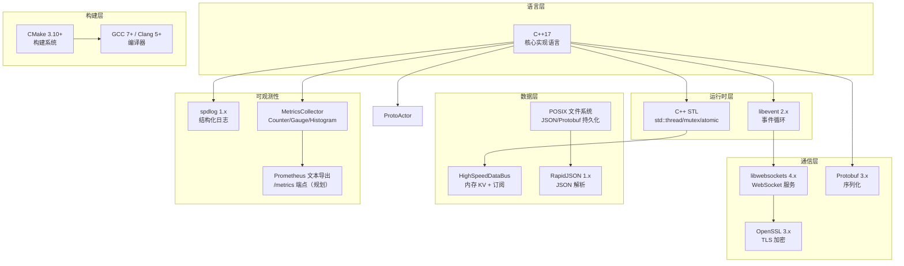

**技术选型清单**：

| 类别 | 技术 | 版本 | 用途 | 选型理由 |
|------|------|------|------|----------|
| 语言 | C++ | 17 | 全栈实现 | 高性能、零开销抽象、跨平台 |
| 构建 | CMake | 3.10+ | 跨平台构建 | 事实标准，支持 Linux/macOS |
| 序列化 | Protobuf | 3.x | 网络协议 + 节点 I/O | 高效二进制、强类型、跨语言 |
| WebSocket | libwebsockets | 4.x | 控制台通信 | 轻量级、C 原生，适合嵌入 |
| TLS/SSL | OpenSSL | 3.x | 传输加密 | 工业级安全库 |
| Actor 框架 | Protoactor-cpp | latest | 可选分布式调度 | 轻量消息驱动，可插拔 |
| 日志 | spdlog | 1.x | 结构化日志 | 异步高性能，格式灵活 |
| JSON | RapidJSON | 1.x | 配置/DSL 解析 | 零依赖、性能优秀 |
| 事件循环 | libevent | 2.x | 网络 I/O 复用 | 跨平台 epoll/kqueue 抽象 |
| 测试 | GoogleTest | 1.14+ | 单元 + 集成测试 | C++ 测试事实标准 |
| YAML | yaml-cpp（规划） | 0.8+ | 配置文件解析 | 人可读配置，已有 YAML 配置 |

#### 外部依赖集成策略

| 依赖 | 集成方式 | 可替代方案 | 说明 |
|------|----------|------------|------|
| **Protoactor-cpp** | 条件编译（必选） | Stub 实现 | Actor 核心框架，`AGENTFLOW_WITH_PROTOACTOR` 宏控制 |
| **libevent** | 条件编译（可选） | Stub 实现 | 事件循环，WebSocket 依赖 |
| **libwebsockets** | 可选依赖 | Stub 实现 | WebSocket 控制台通信 |
| **OpenSSL** | 可选依赖 | Stub 实现 | TLS 加密 |
| **RapidJSON** | 可选依赖 | Stub 实现 | JSON/DSL 解析 |
| **Protobuf** | 直接依赖 | — | 序列化，节点 I/O 协议 |
| **spdlog** | 直接依赖 | — | 结构化日志 |
| **GoogleTest** | 测试依赖 | Catch2 | 单元 + 集成测试 |

---

## 三、开发视图（Development View）

### 3.1 代码模型

#### 仓库策略
单仓库（Monorepo），所有组件共享同一 CMake 构建树，发布为单一静态/动态库（`libagentflow`）。

#### 完整目录结构

```
AgentFlow/
├── CMakeLists.txt                  # 顶层构建入口
├── build.sh                        # 构建/测试/示例快捷脚本
├── build/                          # 构建输出目录
│   ├── cmake/                      # CMake 配置文件
│   └── install_dependencies.sh     # 系统依赖安装脚本
├── include/                        # 头文件目录
│   ├── external/                   # 公开 API 头文件（随库发布，外部调用方使用）
│   │   ├── common.h                # 公共类型定义（DataVariant, AgentId, 枚举等）
│   │   ├── agent/                  # Agent 外部接口（agent.h）
│   │   └── workflow/               # Workflow/Node/Edge 外部接口（workflow.h/node.h/edge.h）
│   │   ├── runtime/                # 运行框架公开接口
│   │   │   ├── agent_runtime.h     # 三层 Master-Worker 调度引擎
│   │   │   ├── databus.h           # HighSpeedDataBus：KV + 订阅通知
│   │   │   ├── zero_copy_databus.h # ZeroCopyDataBus：共享内存高速通道
│   │   │   ├── local_channel.h     # 本地通信通道
│   │   │   ├── control_flow.h      # 条件/循环/错误处理控制流
│   │   │   ├── hot_reload.h        # 热重载：文件监控 + 版本管理
│   │   │   ├── code_loader.h       # 多语言代码加载（.so/shell/python）
│   │   │   ├── metrics.h           # 指标采集：Counter/Gauge/Histogram
│   │   │   ├── event.h             # 运行时事件定义
│   │   │   ├── scheduler/          # 调度器子接口
│   │   │   ├── communication/      # 通信子接口（databus, hot_reload 等）
│   │   │   ├── storage/            # 存储子接口
│   │   │   └── actor/              # Actor 子接口
│   │   ├── actor/                  # Actor 系统公开接口（Protoactor-cpp 封装）
│   │   │   ├── actor_system.h      # ActorSystemManager 单例
│   │   │   ├── node_actor.h        # NodeActor：消息驱动节点执行
│   │   │   ├── workflow_actor.h    # WorkflowActor：消息驱动 Workflow 执行
│   │   │   ├── actors.h            # Actor 消息类型定义
│   │   │   ├── adapter.h           # Actor 框架适配器抽象接口
│   │   │   ├── ask_pattern.h       # Ask 模式（Request-Response）接口
│   │   │   └── message_serializer.h# 消息序列化接口
│   │   ├── dsl/                    # DSL 解析公开接口
│   │   │   ├── json_adapter.h      # JSON 解析适配器接口
│   │   │   └── workflow_parser.h   # Workflow DSL 解析器
│   │   ├── event/                  # 事件循环公开接口
│   │   │   ├── eventloop_adapter.h # 事件循环适配器抽象接口
│   │   │   └── adapter_factory.h   # 事件循环适配器工厂
│   │   ├── network/                # 网络通信公开接口
│   │   │   ├── websocket_adapter.h # WebSocket 抽象接口
│   │   │   ├── ssl_adapter.h       # SSL/TLS 抽象接口
│   │   │   ├── request.h           # 请求对象
│   │   │   ├── response.h          # 响应对象
│   │   │   └── adapter_factory.h   # 网络适配器工厂
│   │   ├── serialization/          # 序列化公开接口
│   │   │   ├── proto_adapter.h     # Protobuf 序列化接口
│   │   │   └── adapter_factory.h   # 序列化适配器工厂
│   │   ├── storage/                # 持久化公开接口
│   │   │   ├── storage.h           # 存储基础类型（StorageResult, StorageConfig）
│   │   │   ├── storage_manager.h   # 存储管理器（统一入口）
│   │   │   ├── agent_storage.h     # Agent 版本化存储接口
│   │   │   └── workflow_storage.h  # Workflow 版本化存储接口
│   │   ├── utils/                  # 工具库公开接口
│   │   │   ├── logger.h            # Logger（spdlog 封装）
│   │   │   └── thread_pool.h       # 线程池
│   │   ├── agent/                  # Agent 实例化外部接口（生命周期管理）
│   │   └── workflow/               # Workflow/Node/Edge 定制开发外部接口
│   └── internal/                   # 内部实现头文件（仅供内部系统使用）
│       ├── adapter/                # 三方依赖适配实现头文件
│       │   ├── actor/              # Actor 框架适配（protoactor_impl.h, stub_impl.h）
│       │   ├── dsl/                # DSL 适配（rapidjson_impl.h, stub_impl.h）
│       │   ├── event/              # 事件循环适配（libevent_impl.h）
│       │   ├── network/            # 网络适配（libwebsockets_impl.h, openssl_impl.h）
│       │   └── serialization/      # 序列化适配（protobuf_impl.h）
│       ├── dsl/                    # DSL 内部实现头文件
│       ├── event/                  # 事件循环内部实现头文件
│       ├── network/                # 网络内部实现头文件（private_protocol.h 等）
│       ├── serialization/          # 序列化内部实现头文件
│       └── testing/                # 测试工具（performance_metrics.h 等）
├── src/                            # 核心业务源代码
│   ├── agent/                      # Agent 实例管理实现（agent.cpp）
│   ├── workflow/                   # Workflow 管理实现
│   │   ├── dsl/                    # DSL 解析实现
│   │   ├── edge/                   # Edge 子模块实现
│   │   └── node/                   # Node 子模块实现（code_loader, node_actor 等）
│   ├── runtime/                    # 运行时实现
│   │   ├── scheduler/              # 调度器（agent_runtime, control_flow）
│   │   ├── communication/          # 通信（databus, hot_reload, local_channel 等）
│   │   ├── storage/                # 存储（agent_storage, storage_manager 等）
│   │   ├── actor/                  # Actor 系统运行时（actor_system 等）
│   │   └── network/                # 运行时网络（private_protocol, request, response）
│   ├── vendor/                     # 三方适配实现（actor/dsl/event/network/serialization/storage）
│   └── utils/                      # 工具实现（logger, thread_pool）
├── vendor/                         # 三方依赖相关内容
│   ├── vendor.conf                 # 三方依赖下载配置
│   ├── vendor.sh                   # 三方依赖下载脚本
│   ├── README.md                   # Vendor 使用说明
│   ├── adapter/                    # 三方依赖适配器实现（与 src/ 业务代码隔离）
│   │   ├── actor/                  # Actor 框架适配（protoactor_impl.cpp, stub_impl.cpp）
│   │   ├── dsl/                    # DSL 适配（json_adapter_rapidjson.cpp, json_adapter_stub.cpp）
│   │   ├── event/                  # 事件循环适配（libevent_impl.cpp）
│   │   ├── eventloop/              # 事件循环适配（备用路径）
│   │   ├── network/                # 网络适配（adapter_factory.cpp）
│   │   └── serialization/          # 序列化适配（adapter_factory.cpp）
│   └── <downloaded>/               # 下载的三方依赖（.gitignore）
├── proto/                          # Protobuf 定义
│   ├── agentflow.proto             # 公共类型（DataValue, DataMap, 枚举）
│   └── node_service.proto          # 节点执行 Request/Response/Metrics
├── tests/                          # 测试套件
│   ├── unit/                       # 单元测试（GoogleTest）
│   │   ├── cpp/                    # C++ 单元测试（test_agent, test_workflow, test_databus 等）
│   │   ├── data/                   # 测试数据（JSON 配置、期望输出等）
│   │   ├── lib/                    # 测试库（hot_reload_test 等）
│   │   └── scripts/                # 测试脚本（python/, shell/）
│   └── functional/                 # 功能测试（性能/集成）
│       ├── cpp/                    # 功能测试代码（test_performance.cpp 等）
│       └── scripts/                # 功能测试脚本
├── examples/                       # 示例程序
└── docs/                           # 项目文档
```

#### 逻辑组件 → 代码路径映射图

> 说明：当前对外头文件仅保留 `include/external/agent` 与 `include/external/workflow`；其余能力头文件均内收至 `include/internal`。

| 逻辑组件 | 头文件路径 | 实现路径 | 关键类/接口 |
|----------|-----------|----------|-------------|
| 开发编排框架（核心实体） | `include/external/{agent,workflow}/` | `src/{agent,workflow}/` | `Agent`, `Workflow`, `Node`, `Edge` |
| Agent 外部接口 | `include/external/agent/` | `src/agent/` | Agent 实例生命周期管理（唯一对外 Agent 接口） |
| Workflow 外部接口 | `include/external/workflow/` | `src/workflow/` | Workflow/Node/Edge 定制开发外部接口 |
| 三层调度引擎 | `include/external/runtime/agent_runtime.h` | `src/runtime/scheduler/agent_runtime.cpp` | `AgentRuntime` |
| 控制流管理器 | `include/external/runtime/control_flow.h` | `src/runtime/scheduler/control_flow.cpp` | `ControlFlowManager`, `ConditionExpression` |
| 高速数据总线 | `include/external/runtime/databus.h` | `src/runtime/communication/databus.cpp` | `HighSpeedDataBus` |
| 零拷贝数据总线 | `include/external/runtime/zero_copy_databus.h` | `src/runtime/communication/zero_copy_databus.cpp` | `ZeroCopyDataBus` |
| 本地通信通道 | `include/external/runtime/local_channel.h` | `src/runtime/communication/local_channel.cpp` | `LocalChannel` |
| 热重载管理器 | `include/external/runtime/hot_reload.h` | `src/runtime/communication/hot_reload.cpp` | `HotReloadManager`, `ExecutableVersion` |
| 代码加载器 | `include/external/runtime/code_loader.h` | `src/workflow/node/code_loader.cpp` | `CodeLoader` |
| 指标采集器 | `include/external/runtime/metrics.h` | `src/runtime/metrics.cpp` | `MetricsCollector`, `CounterMetric`, `GaugeMetric`, `HistogramMetric` |
| Actor 系统 | `include/external/actor/` | `src/actor/` | `ActorSystemManager`, `NodeActor`, `WorkflowActor` |
| Actor 运行时实现 | `include/external/runtime/actor/` | `src/runtime/actor/` | Actor 系统运行时封装 |
| DSL 解析器 | `include/external/dsl/` | `src/dsl/` | `WorkflowParser`, `JsonAdapter` |
| 事件循环接口 | `include/external/event/` | `src/event/` | `EventLoopAdapter`, `AdapterFactory` |
| 网络层 | `include/external/network/` | `src/network/` | `WebSocketAdapter`, `SSLAdapter`, `PrivateProtocol` |
| 序列化层 | `include/external/serialization/` | `src/serialization/` | `ProtoAdapter`, `AdapterFactory` |
| 存储层 | `include/external/storage/` | `src/storage/` + `src/runtime/storage/` | `StorageManager`, `IAgentStorage`, `IWorkflowStorage` |
| 工具库 | `include/external/utils/` | `src/utils/` | `Logger`, `ThreadPool` |
| Actor 适配器实现 | `include/internal/adapter/actor/` | `vendor/adapter/actor/` | `ProtoactorImpl`, `StubImpl` |
| DSL 适配器实现 | `include/internal/adapter/dsl/` | `vendor/adapter/dsl/` | `RapidJsonImpl`, `StubImpl` |
| 事件循环适配器实现 | `include/internal/adapter/event/` | `vendor/adapter/event/` + `vendor/adapter/eventloop/` | `LibeventImpl` |
| 网络适配器实现 | `include/internal/adapter/network/` | `vendor/adapter/network/` | `LibwebsocketsImpl`, `OpenSSLImpl` |
| 序列化适配器实现 | `include/internal/adapter/serialization/` | `vendor/adapter/serialization/` | `ProtobufImpl` |
| 私有网络协议 | `include/internal/network/` | `src/network/private_protocol.cpp` | `PrivateProtocol` |
| 测试工具 | `include/internal/testing/` | `tests/unit/workflow/lib/` | `PerformanceMetrics`, `HotReloadTest` |

#### 命名规范

| 类型 | 规范 | 示例 |
|------|------|------|
| **命名空间** | 小写下划线 | `agentflow::runtime` |
| **类名** | PascalCase | `AgentRuntime` |
| **函数名** | snake_case | `execute_workflow()` |
| **变量名** | snake_case | `workflow_id` |
| **常量** | UPPER_CASE | `MAX_WORKERS` |
| **文件名** | snake_case.cpp/.h | `agent_runtime.cpp` |
| **宏/编译选项** | UPPER_CASE | `AGENTFLOW_WITH_PROTOACTOR` |

#### 关键类图

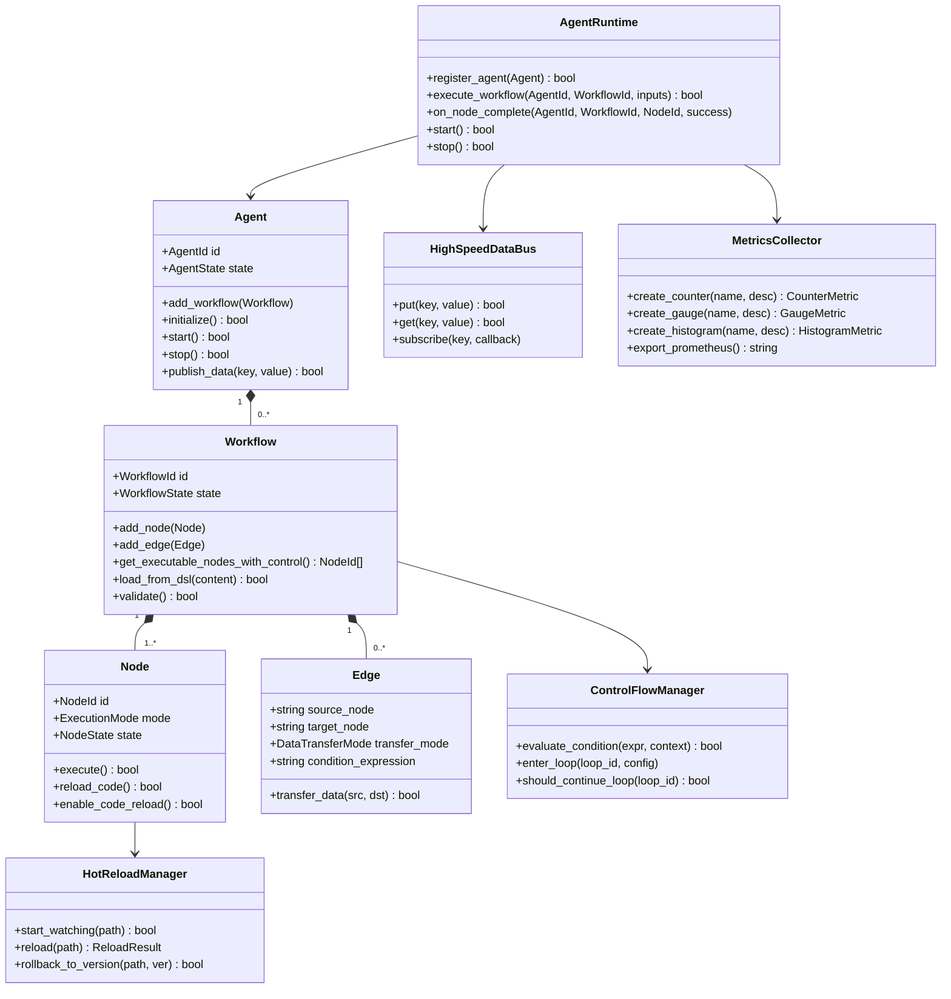

---

### 3.2 构建模型

#### 构建工具链

| 工具 | 版本 | 用途 |
|------|------|------|
| CMake | 3.10+ | 跨平台构建配置 |
| GCC | 7+ | Linux 主编译器（C++17） |
| Clang | 5+ | macOS / 可选 Linux 编译器 |
| GoogleTest | 1.14+ | 单元 + 集成测试框架 |
| clang-format | 14+ | 代码格式化 |
| clang-tidy | 14+ | 静态分析 |

#### 测试策略

| 层次 | 范围 | 覆盖目标 | 工具 |
|------|------|---------|------|
| 单元测试 | Node/Agent/Workflow/DataBus/Event 各模块（`tests/unit/workflow/cpp/`） | 行覆盖率 ≥ 80% | GoogleTest |
| 功能测试 | 性能基准、集成场景（`tests/functional/cpp/` + `tests/functional/scripts/`） | 关键路径全覆盖 | GoogleTest / Shell |
| 端到端测试（规划） | 完整 Agent 执行场景 | 5 个核心用例 | GoogleTest / Shell |

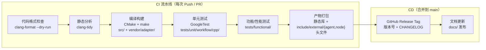

#### build.sh 主要命令

| 命令 | 说明 |
|------|------|
| `./build.sh build` | 完整构建（Debug/Release） |
| `./build.sh test` | 运行所有 GoogleTest |
| `./build.sh example` | 编译并运行示例 |
| `./build.sh clean` | 清理构建产物 |

#### CMake 构建选项

```cmake
option(AGENTFLOW_BUILD_TESTS    "Build tests"              ON)
option(AGENTFLOW_BUILD_EXAMPLES "Build examples"           ON)
option(AGENTFLOW_WITH_PROTOACTOR "Enable Protoactor-cpp"  OFF)
option(AGENTFLOW_WITH_LIBEVENT  "Enable libevent"          ON)
option(AGENTFLOW_ENABLE_COVERAGE "Enable code coverage"   OFF)
```

#### 构建目标结构

```
libagentflow（静态/动态库）
├── agentflow_agent          → src/agent/
├── agentflow_workflow       → src/workflow/（workflow.cpp, node.cpp, edge.cpp, dsl/, node/, edge/）
├── agentflow_runtime        → src/runtime/（scheduler/, communication/, storage/, actor/, network/）
├── agentflow_vendor         → src/vendor/（actor/, dsl/, event/, network/, serialization/, storage/）
├── agentflow_utils          → src/utils/
└── agentflow_vendor_adapters（条件编译）
    ├── actor_adapter        → vendor/adapter/actor/  (protoactor_impl, stub_impl)
    ├── dsl_adapter          → vendor/adapter/dsl/    (json_adapter_rapidjson, json_adapter_stub)
    ├── event_adapter        → vendor/adapter/event/ + vendor/adapter/eventloop/  (libevent_impl)
    ├── network_adapter      → vendor/adapter/network/
    └── serialization_adapter→ vendor/adapter/serialization/

可执行目标：
├── example_basic            → examples/
├── example_control_flow     → examples/
├── agentflow_unit_tests     → tests/unit/workflow/cpp/
└── agentflow_perf_tests     → tests/functional/cpp/
```

#### 完整构建命令参考

```bash
# 开发构建（Debug）
cmake -B build -DCMAKE_BUILD_TYPE=Debug
cmake --build build -j$(nproc)

# 发布构建（Release）
cmake -B build -DCMAKE_BUILD_TYPE=Release -DAGENTFLOW_BUILD_TESTS=OFF
cmake --build build -j$(nproc)

# 运行测试
ctest --test-dir build --output-on-failure

# 安装
cmake --install build --prefix /usr/local

# 代码覆盖率
cmake -B build -DAGENTFLOW_ENABLE_COVERAGE=ON
cmake --build build && ctest --test-dir build
gcovr -r . build
```

---

### 3.3 硬件模型

#### 最低资源要求

| 组件 | CPU | 内存 | 存储 | 网络 |
|------|-----|------|------|------|
| AgentRuntime（单节点） | x86_64 / ARM64，≥ 2 核 | ≥ 512 MB（节点 I/O 缓冲 1MB × agent 数） | SSD ≥ 1 GB（存储 + 日志） | — |
| WebSocket 服务 | + 0.5 核（libevent） | + 64 MB | — | ≥ 100 Mbps |
| Protoactor-cpp（可选） | + 1 核 | + 128 MB | — | — |

#### 各环境配置

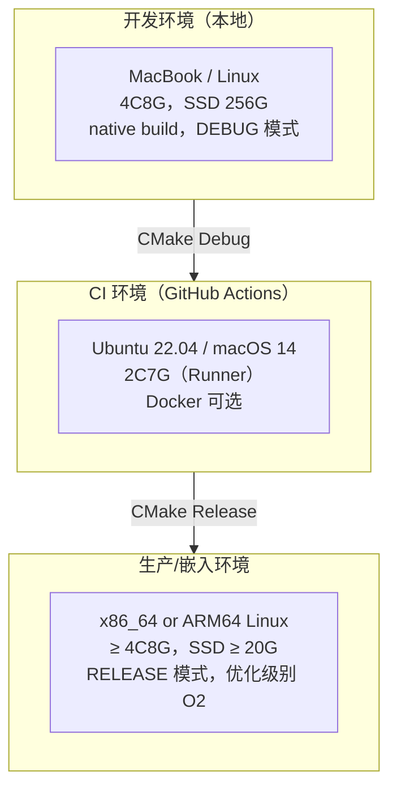

| 配置项 | 开发环境 | CI 环境 | 生产环境 |
|--------|---------|---------|---------|
| 构建类型 | Debug | Release | Release |
| Worker 线程数 | 2 | 2 | 4-16（按 CPU 核数） |
| DataBus 容量 | 1 MB | 1 MB | 16-64 MB |
| 日志级别 | DEBUG | INFO | WARN |
| Protoactor-cpp | 可选 | 可选 | 可选 |
| 热重载检查间隔 | 1000 ms | 禁用 | 5000 ms |

---

## 四、运行视图（Process View）

### 4.1 运行模型

libagentflow是运行时的库，需要在部署时指定是Master还是Worker，Master模式时，除了包含所有Worker能力外，还具备对所有worker的管理和调度能力

#### 进程 / 线程模型


进程：单进程嵌入（libagentflow 作为库嵌入宿主进程）
线程：
  ├── 主线程：AgentRuntime 控制Agent实例（start/stop/register）
  ├── Session 线程组：会话管理
  ├── Message 线程组：消息收发管理
  ├── Task 线程组：任务生命周期及调度管理
  ├── Master 线程组：worker的管理和调度
  ├── Worker 线程组：Workflow、Node执行


#### 并发控制

| 共享资源 | 保护机制 | 说明 |
|---------|---------|------|
| `agents_` Map | `std::mutex agents_mutex_` | Agent实例 注册/查找 |
| `sessions_` Map | `std::mutex sessions_mutex_` | Session实例 创建/删除 |
| `message_queue_` | `std::mutex task_queue_mutex_` | 消息 队列 |
| `task_queue_` | `std::mutex task_queue_mutex_` | Task 队列 |
| `worker_queue_` | `std::mutex worker_queue_mutex_` | Worker 队列 |
| `AgentDataBus::data_` | `std::mutex mutex_` | Agent实例内跨Workflow数据总线，KV 读写 + 订阅通知 |
| `WorkflowDataBus::data_` | `std::mutex mutex_` | Workflow实例内跨Node数据总线，KV 读写 + 订阅通知 |

关键并发原语实现参考（ZeroCopyDataBus 使用读写锁，任务队列使用条件变量）：

```cpp
// ZeroCopyDataBus — 读多写少场景使用 shared_mutex
class ZeroCopyDataBus {
    mutable std::shared_mutex data_mutex_;
    // 读：data_mutex_.lock_shared() / unlock_shared()
    // 写：data_mutex_.lock()       / unlock()
};

// 任务队列 — 条件变量避免 busy-wait
class TaskQueue {
    std::mutex              queue_mutex_;
    std::condition_variable queue_cv_;

    void push(Task task) {
        std::lock_guard<std::mutex> lock(queue_mutex_);
        tasks_.push(std::move(task));
        queue_cv_.notify_one();
    }

    Task pop() {
        std::unique_lock<std::mutex> lock(queue_mutex_);
        queue_cv_.wait(lock, [this] { return !tasks_.empty() || stopping_; });
        auto task = std::move(tasks_.front());
        tasks_.pop();
        return task;
    }
};
```

#### 负载均衡策略

AgentRuntime 维护每个 Worker 的负载计数，新任务分配给负载最低的 Worker：

```
worker_loads_: [2, 5, 1, 4]
                        ↑
              get_least_loaded_worker() → Worker 2 (load=1)
```

- 策略：最小负载优先（Least-Loaded First）
- 更新时机：`update_worker_load(worker_id, +1)` 入队时，`update_worker_load(worker_id, -1)` 出队时
- 支持动态 Worker 增减（规划）

#### 双平面通信机制

```
┌──────────────────────────────────────────────────────┐
│              业务数据通信面（Data Plane）               │
│  ┌────────────────┐  ┌───────────────┐  ┌──────────┐ │
│  │ZeroCopyDataBus │  │PrivateProtocol│  │共享内存  │ │
│  │• 本地零拷贝    │  │• 跨节点传输   │  │POSIX SHM │ │
│  │• 订阅发布      │  │• 高性能编解码 │  │（规划）  │ │
│  └────────────────┘  └───────────────┘  └──────────┘ │
│  特点：高性能、低延迟、批量传输                         │
└──────────────────────────────────────────────────────┘
┌──────────────────────────────────────────────────────┐
│             系统维护通信面（Control Plane）             │
│  ┌────────────────┐  ┌───────────────┐  ┌──────────┐ │
│  │Actor Message   │  │WebSocket      │  │REST API  │ │
│  │(Protoactor)    │  │（控制台）      │  │（规划）  │ │
│  │• Tell/Ask 模式 │  │• 监控与控制   │  │• 资源操作│ │
│  └────────────────┘  └───────────────┘  └──────────┘ │
│  特点：标准化、可观测、易于调试                         │
└──────────────────────────────────────────────────────┘
```

#### Actor 消息通信模式

当启用 Protoactor-cpp 时，NodeActor 支持以下消息模式：

| 模式 | 说明 | 使用场景 |
|------|------|---------|
| **Tell** | 单向消息，不等待响应 | 节点状态通知、事件广播 |
| **Ask** | 双向消息，等待响应（Future） | 节点执行结果查询、健康检查 |
| **Broadcast** | 广播给所有订阅者 | Workflow 级别事件通知 |
| **Forward** | 转发消息，保持原始发送者 | 跨 Actor 代理执行 |

| 场景 | 检测机制 | 恢复策略 | RTO 目标 |
|------|---------|---------|---------|
| 节点执行失败 | `execute()` 返回 false | 自动重试（最多 max_retries=3 次，间隔 retry_delay_ms） | < 3s（默认） |
| 节点执行超时 | `timeout_ms` 到期 | 强制中断，触发重试逻辑 | 即时 |
| Worker 线程异常 | 线程捕获异常后上报 | 任务重新入队，Worker 自恢复 | < 1s |
| 热重载文件损坏 | checksum 验证 | 回滚到上一版本 | < 2s |
| Workflow 全部失败 | completed_count 追踪 | 标记 FAILED，触发 on_workflow_complete | 即时 |

#### 优雅关闭（Graceful Shutdown）

```
1. AgentRuntime::stop() 设置 draining_ = true
2. 停止接收新任务入队
3. 等待现有 Worker 线程完成当前节点（不强制中断）
4. worker_threads_ join（超时 30s 后强制终止）
5. 释放 DataBus、StorageManager 资源
6. HotReloadManager 停止文件监控
```

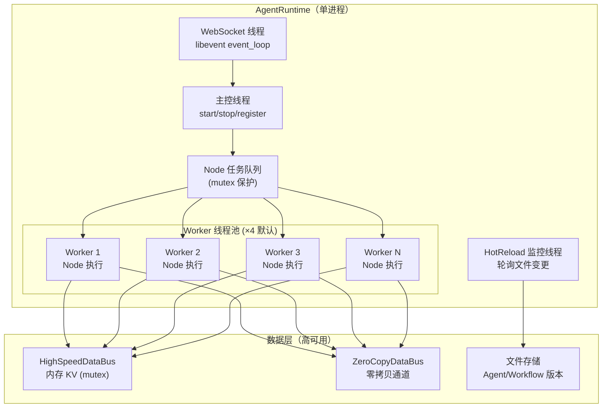

#### 弹性伸缩

AgentFlow 支持Scale Out和Scale Up两个方向弹性伸缩：
- Scale UP：单master服务实例内：增加CPU、内存资源，比如增加增加Agent实例个数，增加单实例会话数，单会话消息量，单消息任务数，单任务支持的workflow实例数，单workflow支持的Node数
- scale out：多master服务集群：增加单master对应的worker数，增加多master集群中master的数量

##### 单master服务实例内

| 策略 | 机制 | 边界 |
|------|------|------|
| Agent实例数 |  `num_agents`（默认 xxx） | 建议不超过xxx |
| 单Agent实例会话数 | `session_capacity` 配置（默认 XXX） | 按 单Agent 处理容量扩展 |
| 单会话消息数 | `max_messages`（默认 XX） | 受 单会话内存容量限制 |
| 单消息任务数 | `max_tasks`（默认 XX） | 受单消息处理复杂度 |
| 单任务Workflow实例数 | `max_flows`（默认 XX） | 受单任务需要多少流程处理复杂度 |
| 单Workflow支持Node数 | `max_nodes`（默认 XX） | 受单流程处理步骤数限制，Edge不受影响 |

##### 多master服务集群

| 策略 | 机制 | 边界 |
|------|------|------|
| 单Master管理Worker数 |  `num_workers`（默认 XX） | 建议不超过XXX |
| 集群master数 | `num_masters` （默认 XX） | 多master组去中心化集群 |

---

### 4.2 运维模型

#### 可观测性三支柱

**内部日志（spdlog），对接外部log服务统一管理**：
- 格式：`[时间戳][级别][logger名称] 消息`
- 输出：控制台 + 文件（按模块分级，见 `logging.yaml`）
- 模块日志器：`agentflow.core`（DEBUG）/ `agentflow.runtime`（INFO）/ `agentflow.network`（WARN）

**内部指标采集（MetricsCollector），对接外部监控服务统一管理**：
- Counter：`agentflow_node_executions_total`、`agentflow_workflow_completions_total`
- Gauge：`agentflow_active_agents`、`agentflow_running_nodes`、`agentflow_task_queue_size`
- Histogram：`agentflow_node_execution_duration_ms`（分位数 P50/P90/P95/P99）
- 导出格式：Prometheus 文本 / JSON / 纯文本（`MetricsCollector::export_prometheus()`）

**内部链路追踪打点，，对接外部监控服务统一管理**：OpenTelemetry C++ SDK，Workflow 执行 ID 作为 trace_id

#### 关键 SLI/SLO 定义

| 指标 | SLI 定义 | SLO 目标 | 告警阈值 |
|------|---------|---------|---------|
| 节点执行成功率 | 成功节点数 / 总执行节点数 | ≥ 99% | < 95% 触发告警 |
| 调度延迟 P99 | 从任务入队到 Worker 开始执行的耗时 | < 10ms | > 50ms 触发告警 |
| 热重载耗时 | 从文件变更检测到新版本生效的耗时 | < 5s | > 30s 触发告警 |
| 系统内存 | DataBus 已用容量 / 总容量 | < 80% | > 90% 触发告警 |
| 工作流完成率 | 成功 Workflow 数 / 总执行 Workflow 数 | ≥ 99.9% | < 99% 触发告警 |

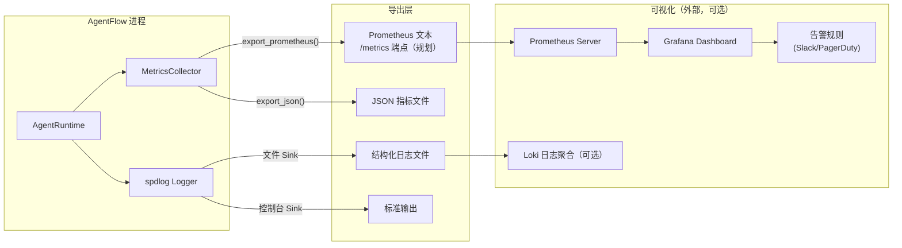

#### 健康检查设计

| 检查项 | 实现 | 说明 |
|--------|------|------|
| AgentRuntime 存活 | `is_running()` 返回 true | 运行状态原子读取 |
| Worker 线程存活 | `get_running_nodes() ≥ 0` | 统计运行中节点数 |
| DataBus 容量 | `get_used_capacity() / capacity < 0.9` | 防止内存溢出 |
| HotReload 状态 | `HotReloadStatus != ERROR` | 文件监控正常 |

#### 监控指标层次结构图

```
监控指标层次
├── 系统层指标（宿主进程）
│   ├── CPU 使用率
│   ├── 内存使用率（含 DataBus 占用）
│   ├── 磁盘 I/O（存储读写）
│   └── 文件描述符数量（dlopen 动态库）
│
├── 应用层指标
│   ├── 请求 QPS（Workflow 执行请求数）
│   ├── 请求延迟 P50/P95/P99
│   ├── 错误率（节点/Workflow 失败率）
│   ├── Worker 线程活跃数
│   └── 任务队列深度
│
├── 业务层指标
│   ├── agentflow_workflow_executions_total   (Counter)
│   ├── agentflow_node_executions_total       (Counter)
│   ├── agentflow_node_success_rate           (Gauge)
│   ├── agentflow_active_agents               (Gauge)
│   ├── agentflow_hot_reload_count_total      (Counter)
│   └── agentflow_version_distribution        (Gauge)
│
└── 自定义指标
    ├── agentflow_node_execution_duration_ms  (Histogram, P50/P90/P95/P99)
    ├── agentflow_databus_usage_ratio         (Gauge)
    ├── agentflow_worker_load_distribution    (Histogram)
    └── agentflow_dag_depth_distribution      (Histogram)
```


---

## 五、部署视图（Deployment View）

### 5.1 交付模型

#### 交付产物类型

| 制品 | 类型 | 命名规范 | 包含内容 |
|------|------|---------|---------|
| 静态库 | `libagentflow.a` | `libagentflow-{semver}-{os}-{arch}.a` | 全量编译单元 |
| 动态库 | `libagentflow.so/.dylib` | `libagentflow-{semver}-{os}-{arch}.{so/dylib}` | 全量编译单元 |
| 运行配置文件 | `config.json` 归档 | `agentflow-rt-{semver}.tar.gz` | 与库打包到一起 |
| 公开头文件 | `.h` 归档 | `agentflow-dev-{semver}.tar.gz` | `include/external/{agent,node}`，开发依赖包 |
| CMake 配置包 | AgentFlowConfig.cmake | `agentflow-dev-{semver}.tar.gz` | 开发依赖包（`build/cmake/`） |

**命名规范示例**：（已更新）
```
libagentflow-0.1.0-linux-x86_64.a
libagentflow-0.1.0-darwin-arm64.dylib
agentflow-dev-0.1.0.tar.gz
agentflow-rt-0.1.0.tar.gz
```

#### 完整交付物目录结构

```
agentflow-0.1.0-linux-x86_64/
├── bin/                         # 可执行工具（规划）
│   └── agentflow-cli            # 配置验证/Workflow 模拟工具
├── lib/                         # 库文件
│   ├── libagentflow.a           # 静态库
│   ├── libagentflow.so          # 动态库
│   └── cmake/                   # CMake Package 文件
│       ├── AgentFlowConfig.cmake
│       └── AgentFlowConfigVersion.cmake
├── include/                     # 公开头文件（来自 include/external/{agent,node}）
│   ├── common.h                 # 公共类型（DataVariant, AgentId, 枚举等）
│   ├── agent/                   # Agent 实例化外部接口（agent.h）
│   └── workflow/                # Workflow/Node/Edge 定制开发接口（workflow.h/node.h/edge.h）
├── docs/                        # 文档（可选）
│   ├── ARCHITECTURE.md
│   └── api/                     # Doxygen 生成（规划）
└── README.md
```

#### 软件包格式（已更新）

| 格式 | 目标平台 | 工具 | 说明 |
|------|---------|------|------|
| `.tar.gz` | 全平台 | CMake CPack | 通用压缩包 |
| Docker Image | 容器平台 | Dockerfile（规划） | `FROM ubuntu:22.04` |

| 环境 | 分发方式 | 配置来源 | 敏感信息管理 |
|------|---------|---------|------------|
| 开发 | 本地 `./build.sh build` | 宿主应用配置（环境变量/配置中心） | 无敏感信息（嵌入库） |
| CI | GitHub Actions artifact | 环境变量注入 | GitHub Secrets |
| 生产 | CMake 安装 / 包管理器（规划） | 宿主应用配置 | 宿主应用负责 |

#### 制品安全措施（规划）

- 静态库 SHA256 校验和随 Release 发布
- SBOM（软件物料清单）生成

---

### 5.2 部署模型

#### 部署拓扑说明

AgentFlow 作为**嵌入式 C++ 库**，部署形态为宿主应用链接 `libagentflow`，不独立部署。典型部署场景：

1. **单机嵌入**：直接链接到 AI Agent 应用进程，master和worker共部署
2. **多实例嵌入**：多个应用实例各自内嵌，通过外部消息队列协调（规划），master和worker共部署
3. **分布式模式**：，master和worker分离部署，部署时指定角色

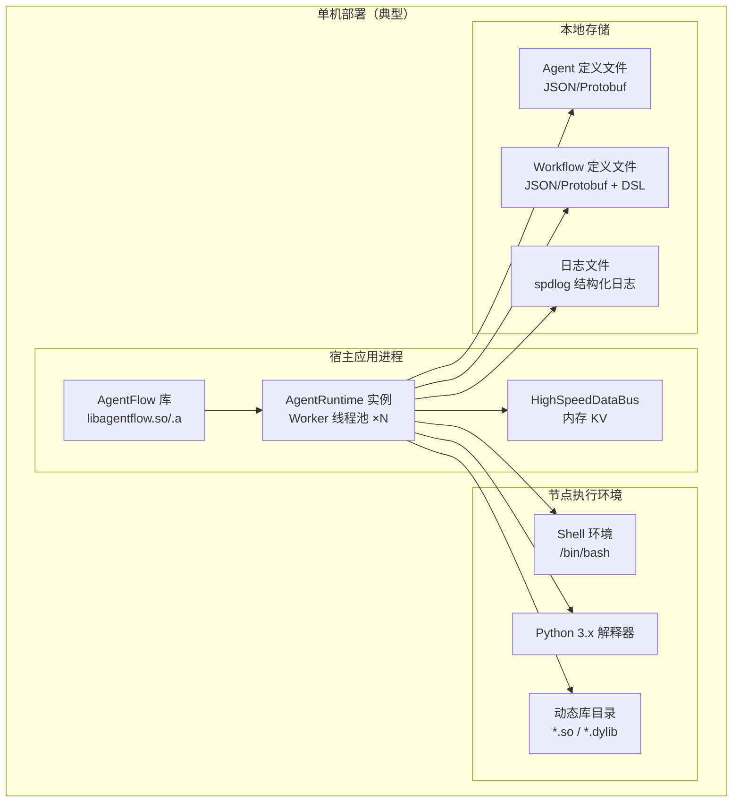

#### 分布式部署架构（规划）

多实例通过外部协调服务横向扩展：

```
                    ┌──────────────────────────────────┐
                    │          负载均衡器（规划）         │
                    │    Nginx / Envoy / AWS ALB         │
                    └──────────────┬───────────────────┘
                                   │
               ┌───────────────────┼──────────────────┐
               ▼                   ▼                  ▼
   ┌─────────────────┐  ┌──────────────────┐  ┌─────────────────┐
   │  应用实例节点1   │  │   应用实例节点2   │  │  应用实例节点3  │
   │  (libagentflow) │  │  (libagentflow)  │  │ (libagentflow)  │
   │  + AgentRuntime │  │  + AgentRuntime  │  │ + AgentRuntime  │
   └────────┬────────┘  └────────┬─────────┘  └────────┬────────┘
            │                    │                      │
            └──────────┬─────────┘──────────────────────┘
                       ▼
          ┌────────────────────────┐
          │   外部协调/存储层（规划）│
          │  ┌──────┐ ┌────────┐  │
          │  │ etcd │ │ Redis  │  │
          │  └──────┘ └────────┘  │
          │  ┌──────────────────┐ │
          │  │  MinIO (存储)    │ │
          │  └──────────────────┘ │
          └────────────────────────┘
```

#### Kubernetes 部署（规划）

```yaml
# agentflow-deployment.yaml
apiVersion: apps/v1
kind: Deployment
metadata:
  name: agentflow-app
  namespace: production
  labels:
    app: agentflow
    version: "0.1.0"
spec:
  replicas: 3
  selector:
    matchLabels:
      app: agentflow
  template:
    metadata:
      labels:
        app: agentflow
      annotations:
        prometheus.io/scrape: "true"
        prometheus.io/port: "9090"
    spec:
      containers:
      - name: agentflow-app
        image: ghcr.io/danielkernel/agentflow:0.1.0
        resources:
          requests:
            memory: "256Mi"
            cpu: "500m"
          limits:
            memory: "2Gi"
            cpu: "4000m"
        env:
        - name: AGENTFLOW_WORKER_THREADS
          value: "4"
        - name: AGENTFLOW_LOG_LEVEL
          value: "WARN"
        volumeMounts:
        - name: config-volume
          mountPath: /app/configs
        - name: agent-storage
          mountPath: /app/data
      volumes:
      - name: config-volume
        configMap:
          name: agentflow-config
      - name: agent-storage
        persistentVolumeClaim:
          claimName: agentflow-pvc
---
apiVersion: v1
kind: Service
metadata:
  name: agentflow-service
spec:
  selector:
    app: agentflow
  ports:
  - protocol: TCP
    port: 8080
    targetPort: 8080
```

| 配置项 | 开发环境 | CI 环境 | 生产环境 |
|--------|---------|---------|---------|
| 构建类型 | Debug（-g -O0） | Release（-O2） | Release（-O2 -DNDEBUG） |
| Worker 线程数 | 2 | 2 | CPU 核数（建议 4-16） |
| DataBus 容量 | 1 MB | 1 MB | 16-64 MB |
| 热重载 | 启用（1s 轮询） | 禁用 | 启用（5s 轮询） |
| 日志级别 | DEBUG | INFO | WARN |
| Protoactor-cpp | 可选 | 可选 | 按需启用 |
| 单测 | 运行全部 | 运行全部 | 不运行（仅验证 build） |
| 指标导出 | 文本输出 | 禁用 | Prometheus 端点（规划） |

#### 数据库迁移策略

AgentFlow 存储层使用文件系统（JSON/Protobuf），无传统数据库迁移概念。版本演进策略：

1. 新版本字段追加（向前兼容），旧字段标注废弃
2. 存储格式变更时提供迁移脚本（`scripts/migrate_storage.sh`，规划）
3. 持久化数据支持版本回滚（`IAgentStorage::rollback_agent()`）

---

## 六、架构决策记录（ADR）

### ADR-001：采用双框架分离架构

- **日期**：2026-01-01
- **状态**：已接受
- **背景**：开发期（定义/装配 Agent/Workflow）与运行期（调度/执行/监控）行为差异显著，混合实现导致高耦合、难以独立测试和演进。
- **决策**：将系统分为 `agentflow::framework`（开发编排框架）和 `agentflow::runtime`（运行框架），通过 `AgentRuntime` 桥接。
- **部署模式**：
  - 模式一（合一部署）：开发框架和运行框架共部署在一个服务
  - 模式二（分离部署）：开发框架在业务服务中，运行框架独立服务

---

### ADR-002：使用 HighSpeedDataBus 作为节点间数据共享机制

- **日期**：2026-01-15
- **状态**：已接受
- **背景**：单个Agent实例内，单个workflow的node可能在跨节点的woker中运行，多个workflow也可能在跨节点的worker中运行，需要支持单Agent内跨节点高速数据共享。
- **决策**：实现 `HighSpeedDataBus`（mutex 保护的内存 KV + 订阅通知）和 `ZeroCopyDataBus`（共享内存，规划真实实现），Node 通过 key 读写数据而非直接传递对象。
- **备选方案**：
  - 方案 A（直接函数参数传递）：简单 / 不支持并发节点间数据共享，无订阅机制
  - 方案 B（消息队列 如 Kafka）：强解耦 / 引入外部依赖，延迟高，不适合进程内通信
- **后果**：
  - ✅ 支持订阅通知，节点可响应数据变更事件
  - ✅ 容量可配置，防止内存滥用
  - ⚠️ mutex 竞争在高并发写入时可能成为瓶颈
  - 📌 ZeroCopyDataBus 的 POSIX 共享内存实现尚待完成

---

### ADR-003：热重载采用文件监控 + 版本管理模式

- **日期**：2026-02-01
- **状态**：已接受
- **背景**：生产环境中需要对 Node 的执行逻辑（.so/.py/.sh）进行零停机更新，且需要回滚能力。
- **决策**：`HotReloadManager` 通过轮询检测文件变更（checksum 校验），加载新版本前创建备份，支持多版本管理和一键回滚（`rollback_to_version()`）。
- **备选方案**：
  - 方案 A（inotify/FSEvents 内核通知）：响应更快 / 平台差异大，需平台适配层
  - 方案 B（重启进程更新）：最简单 / 有停机时间，不满足零停机要求
- **后果**：
  - ✅ 跨平台（Linux + macOS），无平台专有 API 依赖
  - ✅ 完整版本历史，支持灰度和回滚
  - ⚠️ 轮询间隔（默认 1s）有最大 1s 检测延迟
  - 📌 max_versions 配置需合理设置，防止存储堆积

---

### ADR-004：Protoactor-cpp 作为 Actor 框架底座

- **日期**：2026-02-10
- **状态**：已接受
- **背景**：Actor 模型适合分布式消息驱动调度，引入 Protoactor-cpp 支持AgentFlow简化并行编码。
- **决策**：非Node部分业务均基于Actor编程，Node内除了控制面外，运行面不强制要求基于Actor编程


---

## 七、横切关注点（Cross-Cutting Concerns）

### 7.1 安全架构

#### 认证与授权
- **当前**：AgentFlow 为嵌入式库，认证授权由宿主应用负责
- **WebSocket 控制台**：SSL/TLS 加密（OpenSSL 3.x，TLS 1.2+），基于 Token 的访问控制（规划）
- **未来**：为管理 API 增加 API Key / RBAC 模型

#### 数据加密
- **传输中**：WebSocket 通信强制 TLS（`ssl_adapter.h` + OpenSSL 3.x）
- **静态数据**：Agent/Workflow 定义文件暂不加密（不含敏感业务数据）；若有敏感配置，应由宿主应用加密后传入

#### 安全扫描策略
- 第三方依赖漏洞：Snyk / Dependabot（规划，在 CI 中集成）
- 静态代码分析：clang-tidy（已集成 `.clang-tidy` 配置）
- 动态库加载安全：`dlopen` 路径白名单验证（`CodeLoader::validate_file()`）

#### 敏感数据处理
- `DataBus` 中的 Node I/O 数据不持久化到文件系统
- 外部脚本执行通过进程隔离，避免 Node 间数据泄漏

---

### 7.2 错误处理规范

#### 错误码体系

| 状态码 | 含义 | 映射场景 |
|--------|------|---------|
| `STATUS_SUCCESS` | 执行成功 | Node/Workflow 正常完成 |
| `STATUS_FAILED` | 执行失败 | `execute()` 返回 false，重试耗尽 |
| `STATUS_TIMEOUT` | 执行超时 | `timeout_ms` 到期 |
| `STATUS_CANCELLED` | 被取消 | Workflow 被 `stop()` 中断 |
| `StorageResult` | 存储操作结果 | 持久化读写错误 |

#### 重试策略

```
Node 重试：
  - 触发条件：execute() 返回 false
  - 最大重试：max_retries（默认 3）
  - 重试间隔：retry_delay_ms（默认 1000ms，线性）
  - 幂等要求：Node 执行逻辑必须幂等（由实现者保证）

热重载失败重试：
  - checksum 校验失败 → 跳过本次重载，下次轮询重试
  - validate_file 失败 → 回滚到上一版本
```

#### 错误传播规则

- Node 级错误：由 AgentRuntime 捕获，触发重试或标记 FAILED，不传播到宿主进程
- Workflow 级错误：通过 `on_workflow_complete(success=false)` 回调通知宿主
- 不可恢复错误（如内存分配失败）：记录 FATAL 日志，由宿主应用决定是否重启

---

### 7.3 API 设计规范

#### C++ SDK API 规范

- **命名约定**：`snake_case` 函数名，`PascalCase` 类名，`SCREAMING_SNAKE_CASE` 枚举值
- **资源管理**：全部使用 `std::shared_ptr` 共享所有权；避免裸指针接口
- **错误返回**：`bool`（成功/失败）+ 内部 `last_error_` / `StorageResult`；不抛异常（嵌入库风格）
- **线程安全**：所有公开接口标注线程安全性（见头文件注释）

#### Protobuf API 规范（网络层）

- **版本策略**：`package agentflow`，新字段追加编号，不复用已废弃字段编号
- **向前兼容**：新版本客户端可解析旧版本消息（`proto3` 默认值语义）
- **节点 I/O**：统一使用 `DataMap`（`map<string, DataValue>`）传递，`DataValue` 支持 int64/double/string/bool/bytes

#### WebSocket 私有协议规范（规划）

- **分帧**：4 字节 magic + 4 字节 message_type + 4 字节 payload_len + payload
- **幂等性**：控制指令（start/stop workflow）携带 `request_id`，服务端去重
- **分页**：大量 Node 列表响应使用 cursor-based 分页（`cursor` + `page_size`）

---

## 附录

### A. 术语表

| 术语 | 定义 |
|------|------|
| Agent | AgentFlow 的顶层执行主体，管理多个 Workflow，拥有独立的生命周期和共享资源（DataBus） |
| Workflow | 由 Node 和 Edge 组成的 DAG，描述一个业务流程的执行拓扑 |
| Node | Workflow 中的最小执行单元，支持 C++ 函数/Shell/Python/SO 库等多种执行模式 |
| Edge | 连接两个 Node 的有向边，定义数据传递关系和条件执行表达式 |
| AgentRuntime | 三层 Master-Worker 调度引擎，负责 Agent/Workflow/Node 的调度与执行 |
| DataBus | 高速内存 KV 存储，支持 Node 间数据共享和订阅通知机制 |
| HotReload | 运行时动态替换 Node 执行逻辑（.so/.py/.sh），不中断当前执行 |
| DAG | Directed Acyclic Graph，有向无环图，Workflow 的拓扑结构 |
| ControlFlow | 条件分支、循环迭代、错误处理等复杂执行控制机制 |
| ExecutionMode | Node 的执行模式：CPP_FUNCTION / SHELL_SCRIPT / EXECUTABLE / PYTHON_SCRIPT / SO_LIBRARY |
| Master-Worker | 三层调度架构：Agent Level Master → Workflow Level Master → Node Level Worker |
| Protoactor-cpp | 可选的 C++ Actor 框架，提供消息驱动的分布式节点调度能力 |
| Actor | Actor 模型的最小执行单元，基于消息驱动，每个 Actor 封装状态并通过消息通信 |
| DSL | Domain Specific Language，领域特定语言；AgentFlow 通过 JSON Schema 描述 Workflow/Node/Edge 编排 |

### B. 参考资料

| 资料 | 链接 / 说明 |
|------|-------------|
| Kruchten 4+1 视图方法论 | Philippe Kruchten, "Architectural Blueprints—The '4+1' View Model" |
| C4 模型 | https://c4model.com |
| C++ Core Guidelines | https://isocpp.github.io/CppCoreGuidelines/ |
| Protobuf 3 语言规范 | https://protobuf.dev/programming-guides/proto3/ |
| spdlog 文档 | https://github.com/gabime/spdlog |
| Protoactor-cpp | https://github.com/DanielKernel/Protoactor-cpp.git |
| libwebsockets 文档 | https://libwebsockets.org |
| OpenTelemetry C++ | https://opentelemetry.io/docs/languages/cpp/ |
| gRPC 文档 | https://grpc.io/docs/ |
| Kubernetes 文档 | https://kubernetes.io/docs/ |
| Prometheus | https://prometheus.io/docs/ |

### C. 变更历史

| 版本 | 日期 | 作者 | 变更说明 |
|------|------|------|---------|
| v1.0 | 2026-02-17 | @DanielKernel | 初始架构文档 |
| v2.1 | 2026-02-19 | @DanielKernel | 同步目录结构重构：include/external/ + include/internal/ 替代 include/agentflow/；vendor/adapter/ 适配器独立；tests/ 重组为 unit/ + functional/；更新逻辑组件路径映射、构建目标结构、交付物目录 |
