# AgentFlow 软件架构设计文档

| 字段 | 内容 |
|------|------|
| 项目名称 | AgentFlow |
| 文档版本 | v1.0 |
| 编写日期 | 2026-02-28 |
| 架构状态 | 评审中 |
| 适用范围 | AgentFlow Framework + Runtime + MMDataBus + MMAgent 包交付链路 |

## 架构摘要
> AgentFlow 采用“Framework 编排 + Runtime 调度 + MMDataBus 共享数据”的 4+1 架构，实现 MMAgent→MMWorkflow→MMNode 三层执行。核心技术栈为 C++17、CMake、GoogleTest，运行时以 Master/Worker 协作、可插拔调度部署算法和会话化 coordinator(task0) 为关键机制。首要质量目标是高并发下的稳定调度、可扩展多语言执行与可观测可运维。

---

## 一、用例视图（Use Case View）

### 1.1 系统上下文模型

#### 系统定位
AgentFlow 是一个面向 MMAgent 工作流编排与执行的 C++ 引擎，负责从 MMAgent 包加载定义、会话化生成任务并在 Runtime 中完成跨 Worker 执行。

#### 系统边界
- **系统内**：MMAgent/Session/Task 管理、MMWorkflow 图执行、MMNode 执行、Deployer/Scheduler 调度、MMDataBus 数据共享、MMAgent 包解析与打包。
- **系统外**：业务调用方、外部 Redis 服务、CI/CD 平台（GitHub Actions）、系统依赖库与编译环境。

#### 外部接口清单

| 接口 | 方向 | 协议 | 数据格式 | 说明 |
|------|------|------|----------|------|
| 业务请求 -> MMAgentActor | 入 | Actor Message | 结构化消息 + metadata/data_ref | 触发会话消息处理与 task 生成 |
| MMAgentActor -> MMRuntimeActor | 出 | Actor Message | AgentRuntimeReport/TaskRuntimeReport | 上报注册、心跳、状态 |
| WorkerActor -> MMRuntimeActor | 出 | Actor Message | WorkerRuntimeReport | 上报 worker 注册/心跳/状态 |
| MMDataBus -> RedisAdapter | 双向 | Redis TCP | 字符串/索引集合 | 远端数据与 data_ref 索引同步 |
| DSL/Package 文件加载 | 入 | 文件系统 API | JSON/JSONC | 加载 package/workflow/node 资产 |

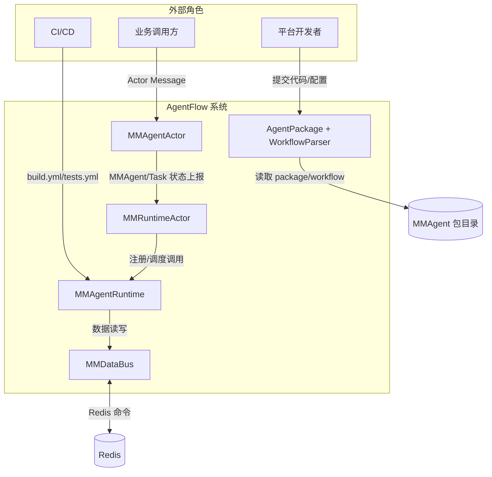

### 1.2 关键用例与交互模型

#### 核心用例（按优先级）
1. 从 MMAgent 包自动加载并实例化 MMAgent。
2. 接收业务请求并在会话中生成 task（dispatcher=task0，coordinator=task1）。
3. 将 task 调度到 workflow instance 并分配 Worker。
4. 由 Worker 执行 MMNode（多语言执行由 MMWorkerEngine 统一承载）。
5. 通过 MMDataBus 与 MMRuntimeActor 完成状态和数据协同。

#### 用例 UC-01：请求到任务生成
- 参与者：业务调用方、MMAgentActor、MMAgent、SessionTaskCoordinator(task0 dispatcher/task1 coordinator)。
- 前置条件：MMAgent 已由 package 加载，默认/目标 session 已存在或可创建。
- 主流程：
  1) 业务请求进入 MMAgent。
  2) MMAgent 路由到 `user_id:client_id` session。
  3) session 按消息头类型入队：`intent_request`→dispatcher(task0)，`output_result`→coordinator(task1)，`extensible_reserved`→扩展队列。
  4) 若无显式 `workflow_id`，task0 优先 `dispatcher_workflow`，task1 优先 `coordinator_workflow`。
- 异常流程：metadata 缺失 user/client 时不创建业务 session。
- 质量目标：单请求 task 生成路径 P99 < 50ms（本地基线）。

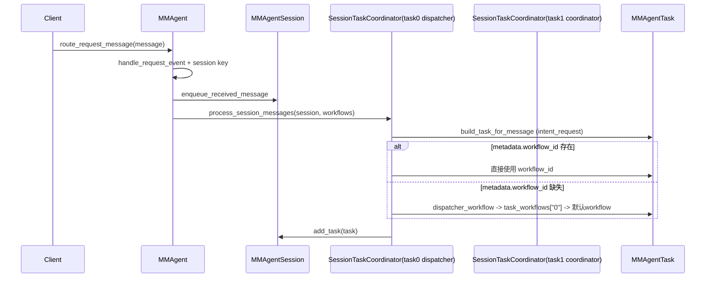

#### 用例 UC-02：task 调度与执行
- 参与者：MMRuntimeActor、MMAgentRuntime、Scheduler、Deployer、MMWorkerEngine、MMWorkflow/MMNode。
- 前置条件：workflow instance 已注册，worker 可用。
- 主流程：
  1) Scheduler 根据 agent instance/object/负载选择 workflow instance。
  2) Deployer 将 workflow instance 映射到 worker。
  3) Runtime 驱动 MMNode 执行；外部执行模式调用 `MMWorkerEngine::execute_code`。
  4) 状态上报并推进后继节点。
- 异常流程：worker 不健康则 Deployer 迁移映射，Scheduler 清理失效任务映射。
- 质量目标：调度延迟 P99 < 10ms（CI 性能基线目标）。

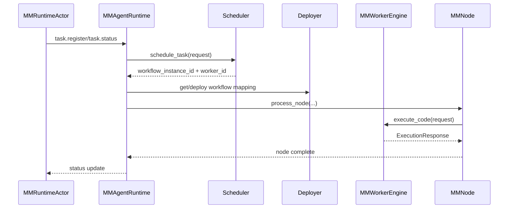

---

## 二、逻辑视图（Logical View）

### 2.1 结构模型

#### 架构风格
- **主风格**：分层 + 反应式消息驱动。
- **核心分层**：
  - Framework 层：MMAgent/Session/Task/Coordinator/MMWorkflow/MMNode/MMEdge。
  - Runtime 层：MMAgentRuntime + Scheduler + Deployer + Worker。
  - Infrastructure 层：MMDataBus、Storage、Adapter。

#### 组件职责
- `MMAgent`：生命周期、会话路由、session-level coordinator 管理。
- `SessionTaskCoordinator`：消息解析为 task，默认 `task0`。
- `MMWorkflow`：图结构、控制流、执行态推进。
- `MMNode`：动作定义与状态机；外部执行统一委托 MMWorkerEngine。
- `Scheduler`：task -> workflow instance 映射。
- `Deployer`：workflow instance -> worker 映射与重平衡。
- `MMDataBus`：本地/远端统一数据读写与 data_ref。

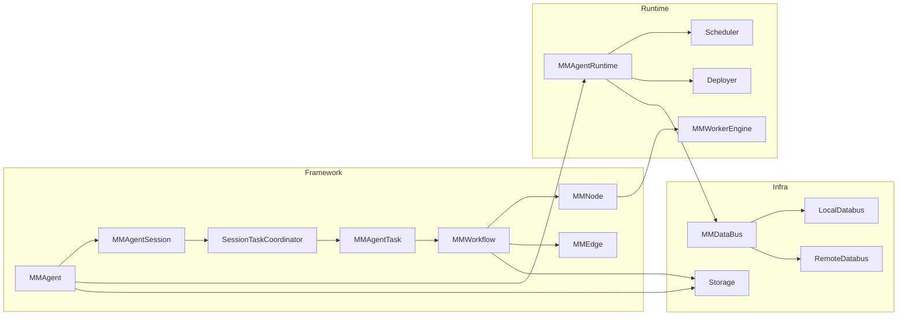

### 2.2 行为模型

#### 关键行为 A：MMWorkflow 控制流推进
- MMWorkflow 依据 edge 依赖与 `control.type`（if/loop/fork/join/async/goto）选择可执行节点。
- MMNode 执行完成后，MMWorkflow 更新状态并调度后继节点。

```mermaid
flowchart TD
    START([MMWorkflow Start]) --> READY[计算可执行节点]
    READY --> EXEC[调度 MMNode 执行]
    EXEC --> CHECK{执行成功?}
    CHECK -- Yes --> MARK[mark_node_executed(success)]
    CHECK -- No --> FAIL[mark_node_executed(failed)]
    MARK --> CTRL{存在控制流?}
    FAIL --> RETRY{可重试?}
    RETRY -- Yes --> EXEC
    RETRY -- No --> ENDFAIL([MMWorkflow Failed])
    CTRL -- if/loop/goto --> READY
    CTRL -- fork/join/async --> READY
    CTRL -- none --> DONE{全部完成?}
    DONE -- No --> READY
    DONE -- Yes --> ENDSUCC([MMWorkflow Success])
```

#### 关键行为 B：Session/Task 生命周期

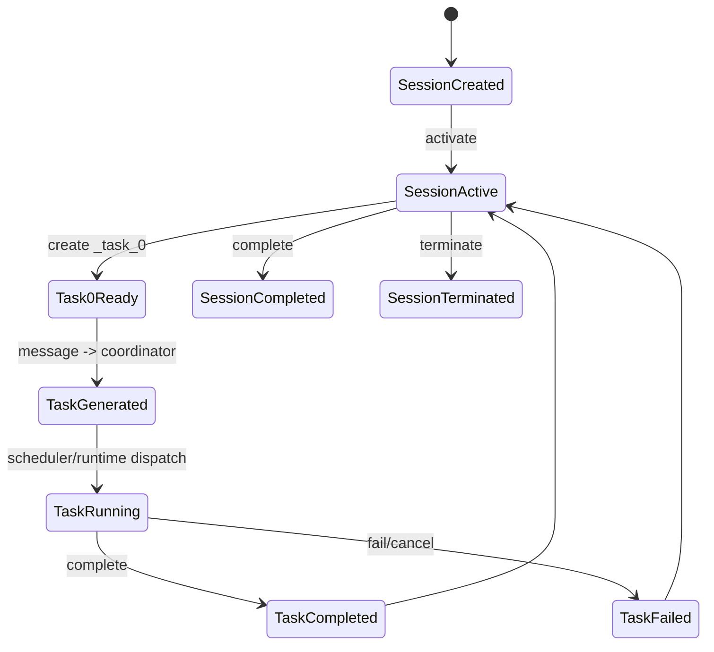

### 2.3 数据模型

#### 核心实体
- `MMAgent`：agent 元信息与 workflow 挂载。
- `MMAgentSession`：会话状态、收发队列、任务集合。
- `MMAgentTask`：task 标识、类型、session/workflow 归属、workflow_file 一致性标识、状态进度。
- `WorkflowInstanceInfo`：运行时实例映射（workflow -> worker）。
- `TaskInstanceInfo`：运行时 task 状态与调度绑定。
- `DataRef`：payload 引用与 owner 索引。

#### 数据所有权边界
- Framework 对象（MMAgent/Session/Task/MMWorkflow）由 Framework 管理。
- Runtime 映射（WorkflowInstanceInfo/TaskInstanceInfo）由 `IRuntimeSharedState` 管理。
- 业务 payload 由 MMDataBus 持有，消息总线只传 `data_ref`。

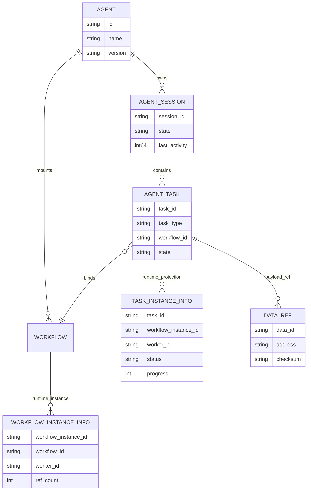

### 2.4 技术模型

| 技术 | 版本 | 用途 | 选型理由 |
|------|------|------|----------|
| C++ | C++17 | 核心实现语言 | 性能与系统级控制能力 |
| CMake | >= 3.10 | 跨平台构建 | Linux/macOS 通用、与 CI 兼容 |
| GoogleTest | >= 1.10 | 单元/功能测试 | 生态成熟，CTest 集成完善 |
| RapidJSON | header-only | package/workflow JSON 解析 | 轻量、无额外运行时依赖 |
| OpenSSL | 3.x（可选） | SSL/TLS 支持 | 安全通信基础库 |
| libevent | 可选 | 事件适配 | 事件驱动扩展能力 |
| RedisAdapter | 内置适配器 | 远端 MMDataBus | 支持 data_ref 跨节点协同 |

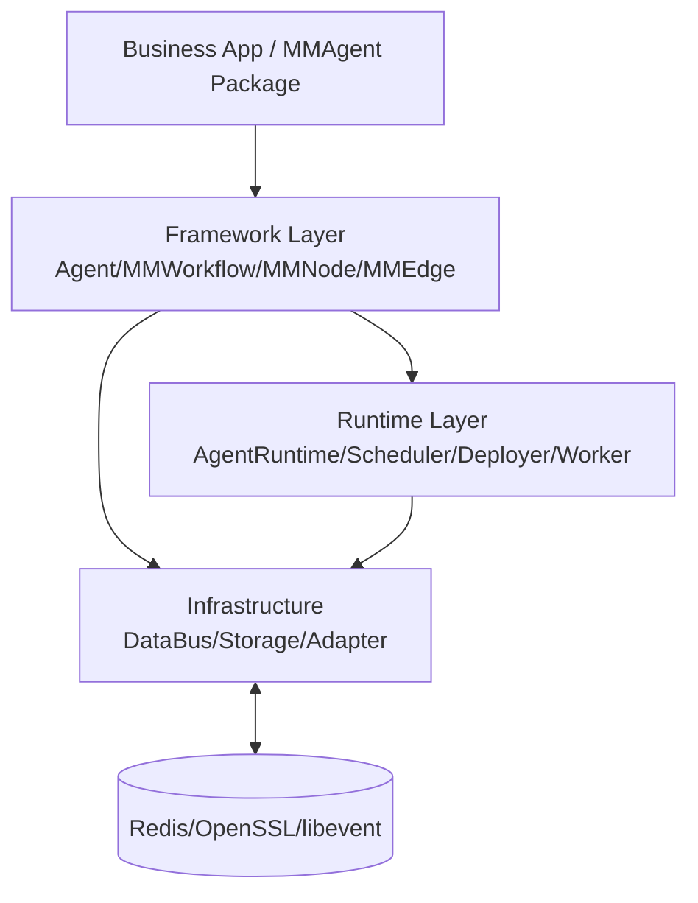

---

## 三、开发视图（Development View）

### 3.1 代码模型

#### 仓库组织策略
- `include/external`：外部 API（当前以 workflow/node 等为主）。
- `include/internal`：内部核心与适配器扩展点。
- `src`：framework/runtime/databus/actor 实现。
- `publish`：MMAgent 包模板、打包脚本、workflow 规范。
- `tests`：unit + functional + perf。

```text
AgentFlow/
├── include/
│   ├── external/
│   └── internal/
│       ├── agent/
│       ├── workflow/
│       └── runtime/
├── src/
│   ├── agent/
│   ├── workflow/
│   └── runtime/
│       ├── master/
│       ├── worker/
│       └── databus/
├── publish/
│   ├── agent/
│   ├── workflow/
│   └── agent_build.sh
├── tests/
│   ├── unit/
│   ├── functional/
│   └── perf/
└── docs/
```

#### 逻辑组件 -> 代码路径映射

| 逻辑组件 | 代码路径 |
|------|------|
| MMAgent / Session / Coordinator | `include/internal/agent/*`, `src/agent/*` |
| MMWorkflow / MMNode / MMEdge / DSL | `include/internal/workflow/*`, `src/workflow/*` |
| Runtime Core | `include/internal/runtime/agent_runtime.h`, `src/runtime/runtime.cpp` |
| Scheduler / Deployer | `include/internal/runtime/master/*`, `src/runtime/master/*` |
| Worker / WorkerActor | `include/internal/runtime/worker*.h`, `src/runtime/worker/*` |
| MMDataBus | `include/internal/runtime/databus/*`, `src/runtime/databus/*` |
| MMAgent 打包链路 | `publish/agent/*`, `publish/agent_build.sh` |

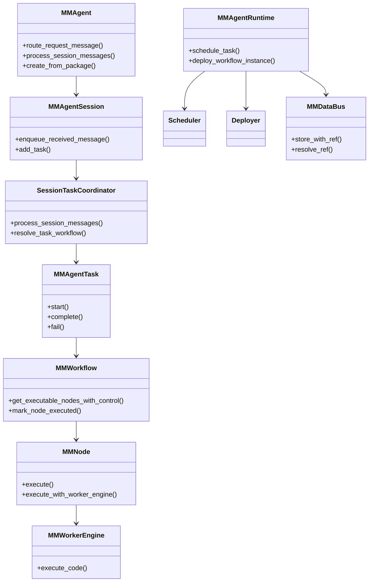

### 3.2 构建模型

#### 构建工具链
- 本地统一入口：`./build.sh build|test|example`。
- 底层：CMake + Ninja/Make，CTest 统一测试执行。
- 可选依赖通过 CMake 自动探测与 graceful fallback（Protoactor/libevent/OpenSSL/RapidJSON）。

#### 测试策略
- 单元测试：MMAgent/MMWorkflow/MMNode/MMDataBus/Event。
- 功能测试：MMAgent loading、包加载链路。
- 热更新测试：SO/Python/Shell/JAR。
- 性能测试：多 MMAgent/多 MMWorkflow 并发场景（tests 工作流定义）。

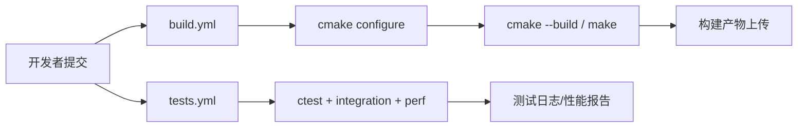

### 3.3 硬件模型

#### 建议配置

| 环境 | CPU | 内存 | 存储 | 网络 |
|------|-----|------|------|------|
| 开发机 | >= 4 核 | >= 8 GB | >= 20 GB 可用 | 本地环回 + 可选外网 |
| CI Runner | >= 4 核 | >= 8 GB | >= 20 GB | 稳定公网（拉依赖/上传制品） |
| 压测/预发 | >= 8 核 | >= 16 GB | >= 50 GB | 千兆网络 |
| 生产（单实例） | >= 8 核 | >= 16 GB | SSD >= 100 GB | 内网 + Redis 服务 |

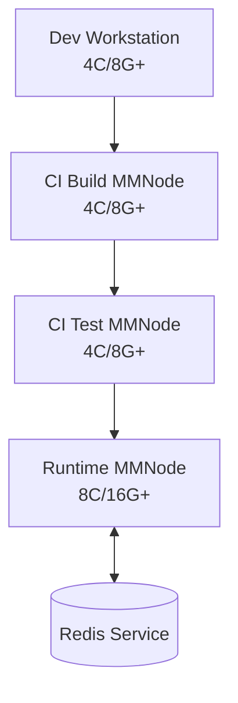

---

## 四、运行视图（Process View）

### 4.1 运行模型

#### 并发/线程模型
- `MMAgent`：请求事件队列线程 + session 处理循环。
- `MMAgentRuntime`：worker thread pool + agent 注册线程 + agent 监控线程。
- `Scheduler`：独立调度线程。
- `Deployer`：注册线程 + 调度线程。
- `MMWorkerEngine`：事件监控线程 + workflow 线程池 + 事件线程池。
- `MMNode/MMEdge/MMWorkflow`：各自可选 runtime 队列与线程池。

#### 高可用与故障恢复
- 心跳监测：agent/worker 心跳周期上报。
- 故障隔离：worker 不健康后 Deployer 清理映射并触发 rebalance。
- 调度恢复：Scheduler 在 agent 异常时清理 task->workflow 映射。

#### 弹性策略
- 按 workflow instance 与 worker 负载动态分配。
- 同 agent instance 优先，次选同 agent object，最后最小负载（Scheduler 默认策略）。

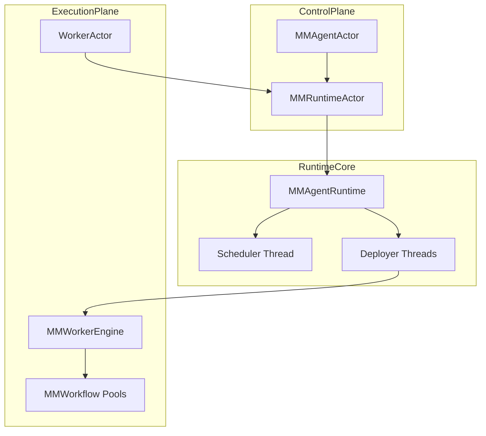

### 4.2 运维模型

#### 可观测性
- 日志：`utils/logger` 统一输出（info/warn/error/debug）。
- 指标：`runtime/metrics` 组件 + CI 性能报告（tests.yml 上传）。
- 链路：当前以 execution_id、task_id、workflow_instance_id 进行关联追踪（分布式 tracing 未内建）。

#### SLI/SLO（建议）

| 指标 | SLI 定义 | SLO 目标 |
|------|----------|----------|
| 请求到 task 生成延迟 | route_request_message -> task enqueue | P99 < 50ms |
| task 调度延迟 | schedule_task 耗时 | P99 < 10ms |
| 节点执行成功率 | MMNode 执行成功 / 总执行 | >= 99.5% |
| worker 心跳可用率 | 心跳按周期到达比例 | >= 99.9% |

#### 告警建议
- 心跳超时：`heartbeat_timeout_ms` 超限告警。
- 调度积压：task queue 深度持续增长告警。
- 执行失败率：窗口内 MMNode 失败率超过阈值告警。

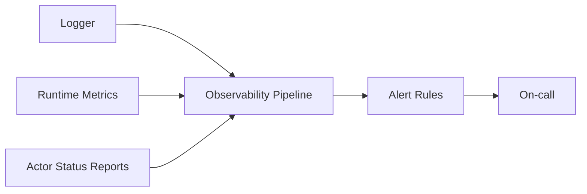

---

## 五、部署视图（Deployment View）

### 5.1 交付模型

#### 制品类型
- 核心库/可执行：`libagentflow.*`、`test_*`、`example_*`。
- MMAgent 包：双层 tar.gz（外层发布包 + 内层 agent 对象包）。
- MMWorkflow 资产：`workflow_XX.json`、`coordinator_workflow.json`、node 可执行脚本/动态库。

#### 命名规范
- 外层：`$xxxAgent_$PKGTYPE_$PKGVER.tar.gz`
- 内层：`$xxxAgent_$AGTVER.tar.gz`

#### 多环境策略
- Dev：本地 `./build.sh` + examples 验证。
- CI：`build.yml`、`tests.yml` 按矩阵构建/测试。
- Prod：发布包 + package manifest 驱动加载。

#### 制品安全措施（建议）
- 包签名（外层 tarball hash/signature）。
- 依赖与脚本扫描（CI SCA/SAST）。
- 发布前清单校验（manifest 必含 package.json 和内层包）。

### 5.2 部署模型

#### 部署拓扑
- MMAgentActor 与 MMRuntimeActor 可同进程或分进程部署。
- WorkerActor 可单节点多实例部署，统一向 MMRuntimeActor 汇报。
- MMDataBus 本地缓存优先，Redis 作为跨节点共享补充。

#### 资源与冗余建议
- MMRuntimeActor：至少 2 副本（主备/滚动更新）。
- WorkerActor：按负载水平扩容，建议最少 2 副本。
- Redis：生产建议主从 + 持久化。

#### 环境配置矩阵（建议）

| 环境 | MMRuntimeActor | WorkerActor | Redis | 备注 |
|------|--------------|-------------|-------|------|
| Dev | 1 | 1 | 可选 | 本地开发调试 |
| Test | 1 | 1-2 | 建议开启 | 集成测试与稳定性验证 |
| Prod | 2 | >=2 | 必选 | 高可用部署 |

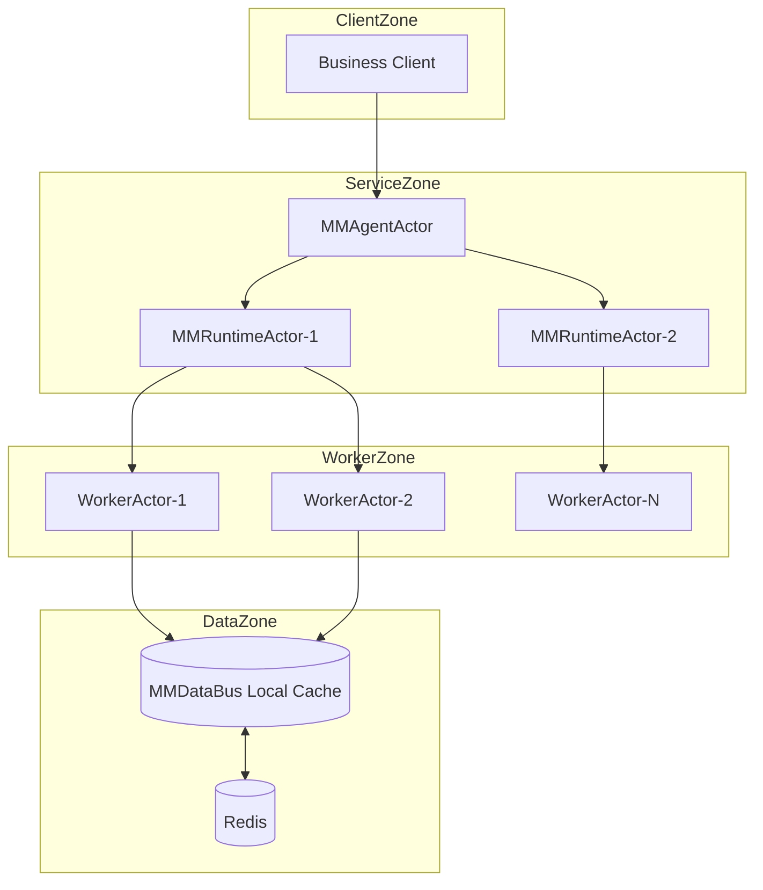

---

## 六、架构决策记录（ADR）

### ADR-001：采用 MMAgent→MMWorkflow→MMNode 三层调度
- **日期**：2026-02-28
- **状态**：已接受
- **背景**：系统需要同时管理 agent 生命周期、workflow 图执行和 node 并发执行。
- **决策**：采用分层调度，Runtime 将 task 调度与 workflow 部署拆分为 Scheduler + Deployer。
- **备选方案**：
  - 方案 A（单层全局调度）：实现简单 / 难以隔离复杂度。
  - 方案 B（三层调度）：扩展性好 / 组件协作复杂。
- **后果**：
  - ✅ 清晰职责边界，便于插件化扩展。
  - ⚠️ 需要保证跨组件状态一致性。
  - 📌 需关注调度链路监控与故障回滚策略。

### ADR-002：将多语言执行引擎下沉至 MMWorkerEngine
- **日期**：2026-02-28
- **状态**：已接受
- **背景**：MMNode 同时承担动作建模与执行引擎导致职责耦合。
- **决策**：MMNode 保留状态机与契约，外部执行模式统一委托 `MMWorkerEngine::execute_code`。
- **备选方案**：
  - 方案 A（MMNode 内执行）：调用路径短 / 运行时治理能力弱。
  - 方案 B（Worker 统一执行）：治理一致 / 需要更多跨层通信。
- **后果**：
  - ✅ 执行治理集中，便于统一超时、日志和资源策略。
  - ⚠️ 增加 Runtime 依赖与测试维度。
  - 📌 需持续完善 Worker 负载与隔离策略。

### ADR-003：Coordinator 固化为 session 归属 task0
- **日期**：2026-02-28
- **状态**：已接受
- **背景**：需要统一消息分析入口并支持包级 workflow 定制。
- **决策**：每个 session 默认创建 `<session_id>_task_0` 与 session coordinator，优先 `coordinator_workflow` 路由。
- **备选方案**：
  - 方案 A（全局 coordinator）：实现简单 / 难以实现 session 隔离。
  - 方案 B（session 级 task0 coordinator）：隔离清晰 / session 管理逻辑更复杂。
- **后果**：
  - ✅ session 语义一致，包级定制明确。
  - ⚠️ 任务编号与历史兼容需要注意。
  - 📌 需保证 metadata 显式 `workflow_id` 的最高优先级不被破坏。

---

## 七、横切关注点（Cross-Cutting Concerns）

### 7.1 安全架构
- 认证机制：当前框架层未内置 OAuth/JWT，建议由接入层网关负责认证，Actor 消息透传身份上下文。
- 授权模型：建议按 MMAgent 包、workflow、task 维度做 RBAC。
- 数据加密：
  - 传输中：对外接口建议 TLS 1.3+（OpenSSL 3.x 可选启用）。
  - 静态：MMDataBus 远端持久化建议启用 Redis 加密与 ACL。
- 敏感数据：建议 payload 仅以 data_ref 传递，PII 数据在写入前脱敏。
- 安全扫描：CI 增加依赖漏洞扫描与脚本安全检查（建议项）。

### 7.2 错误处理规范
- 错误码：
  - Framework 层：返回 bool + logger 错误信息。
  - Runtime 层：状态字段（scheduled/running/completed/failed/cancelled）+ progress。
- 重试策略：MMNode 支持 `max_retries`、`retry_delay_ms`；MMWorkflow/MMEdge 支持错误策略与 fallback。
- 错误传播：
  - 节点错误上抛至 workflow 状态机。
  - agent/worker 健康异常通过 MMRuntimeActor 上报并触发映射调整。

### 7.3 API 设计规范
- 版本策略：
  - 包级：`package.json.version` + `agent_version`。
  - 运行时对象：MMAgent/MMWorkflow metadata version。
- 分页规范：当前内存列表接口以全量返回为主；如接入控制面 API，建议采用 cursor 模式。
- 幂等性：
  - `task_id`、`workflow_instance_id` 作为幂等键。
  - 重试场景需确保同一 task 不重复计费/重复副作用执行（业务侧约束）。

---

## 附录

### A. 术语表
- **MMAgent**：执行主体，管理会话与工作流。
- **Session**：按 user/client 分区的会话上下文。
- **Task**：由 coordinator 生成的可调度工作单元。
- **MMWorkflow Instance**：workflow 的运行时实例。
- **DataRef**：payload 的数据引用标识。

### B. 参考资料
- `README.md`
- `docs/api-reference.md`
- `docs/REFACTORING.md`
- `publish/agent/AGENT_PACKAGE_SPEC.md`
- `include/internal/{agent,workflow,runtime}/*`
- `src/{agent,workflow,runtime}/*`

### C. 变更历史
- 2026-02-28：按 4+1 视图重写架构文档，补齐 ADR、横切关注点与 Mermaid 图。


- 2026-03-01：补充 MMAgent/Session/Task/MMNode 四级 context 与 SessionTaskCoordinator（session 0号任务单元）设计说明。
