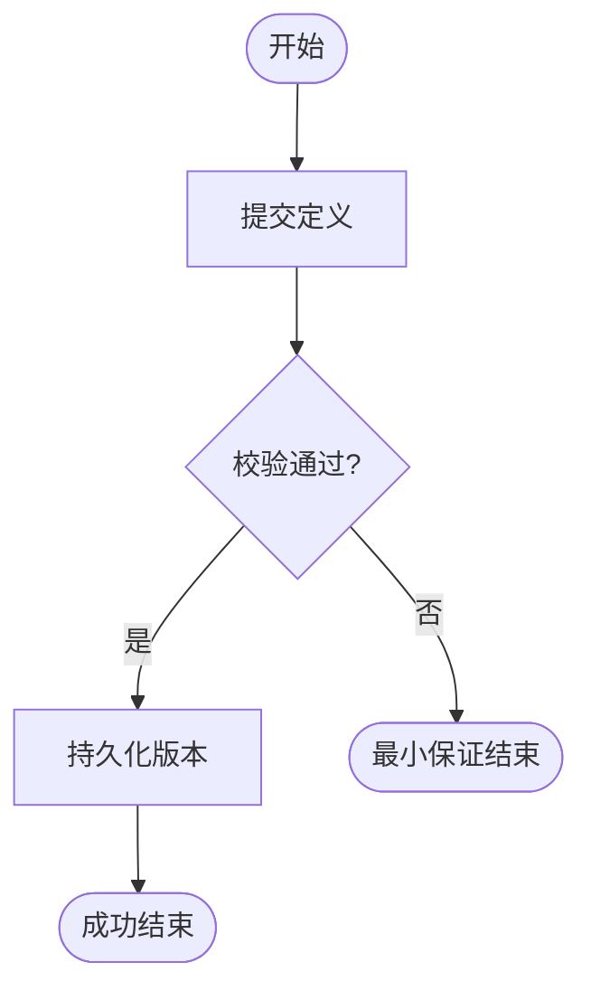

# AgentFlow 需求分析说明书（用例驱动）

- **版本**：v1.0
- **日期**：2026-02-19
- **受众**：开发团队
- **范围**：覆盖 `S1-01 Agent开发` 与 `S1-02 Agent运行` 全部确认用例
- **来源**：`docs/ARCHITECTURE.md` 中 S1/S2/S3 与对应 UC 定义

---

## 目录

- [1. 项目背景与范围](#1-项目背景与范围)
- [2. 用例全景（按 S1 归类）](#2-用例全景按-s1-归类)
- [3. 功能性需求（逐用例）](#3-功能性需求逐用例)
  - [3.1 S1-01 Agent开发](#31-s1-01-agent开发)
  - [3.2 S1-02 Agent运行](#32-s1-02-agent运行)
- [4. 系统级非功能性需求](#4-系统级非功能性需求)
- [5. 用例→模块→优先级实施映射表](#5-用例模块优先级实施映射表)
- [6. 里程碑交付映射（P0/P1）](#6-里程碑交付映射p0p1)
- [7. 自检结论](#7-自检结论)

---

## 1. 项目背景与范围

### 1.1 项目背景
AgentFlow 是一个面向 Agent 编排与运行的系统，目标是提供 **Agent 包开发、实例运行、任务调度、Workflow/Node 执行** 的一体化能力。

### 1.2 系统边界
- **系统内**：Agent 开发与打包、实例生命周期、消息/任务管理、调度与执行引擎、会话管理。
- **系统外**：本次需求分析不引入外部系统边界扩展（按“本系统内部功能”处理）。

### 1.3 目标用户
- 开发者
- 运维者
- AgentRuntime / AgentManager（系统内部执行主体）

---

## 2. 用例全景（按 S1 归类）

### 2.1 S1-01 Agent开发
| 编号 | 用例名称 | 主 Actor | 一句话摘要 |
|------|---------|---------|-----------|
| S1-01-S2-01-S3-01-UC-01 | Workflow、Node和Edge定义 | 开发者 | 定义编排核心实体与关系模型 |
| S1-01-S2-01-S3-01-UC-02 | Workflow、Node和Edge解析工具 | 开发者 | 将 JSON/DSL 解析为可执行模型 |
| S1-01-S2-01-S3-02-UC-01 | Node控制面 | 开发者 | 提供 Node 生命周期与运维控制能力 |
| S1-01-S2-01-S3-02-UC-02 | Node运行面 | 开发者 | 支持多语言 Node 执行实现 |
| S1-01-S2-01-S3-02-UC-03 | Node运行面热加载 | 开发者 | 在不中断服务下更新 Node 逻辑 |
| S1-01-S2-01-S3-03-UC-01 | Agent包构建发布 | 开发者 | 按规范打包并发布 Agent 制品 |

### 2.2 S1-02 Agent运行
| 编号 | 用例名称 | 主 Actor | 一句话摘要 |
|------|---------|---------|-----------|
| S1-02-S2-01-S3-01-UC-01 | Agent包加载 | 运维者 | 装载 Agent 包并验签校验 |
| S1-02-S2-01-S3-01-UC-02 | Agent实例生命周期管理 | AgentManager | 管理创建/启动/停止/销毁 |
| S1-02-S2-01-S3-01-UC-02 | Agent状态管理 | AgentManager | 管理状态机跃迁与一致性 |
| S1-02-S2-01-S3-02-UC-01 | Agent实例部署 | AgentRuntime | 单机/分布式部署与可用性校验 |
| S1-02-S2-02-S3-01-UC-01 | Agent接收消息 | Agent | 入站消息校验、缓存、路由 |
| S1-02-S2-02-S3-01-UC-02 | Agent发送消息 | Agent | 出站消息投递与重试 |
| S1-02-S2-02-S3-02-UC-01 | Agent消息与任务映射 | Agent | 将消息映射为任务实例 |
| S1-02-S2-02-S3-02-UC-02 | 任务生命周期管理 | Agent | 管理任务全生命周期状态 |
| S1-02-S2-02-S3-03-UC-01 | 任务对应Workflow实例调度 | AgentRuntime | 调度任务到 Workflow/Worker |
| S1-02-S2-02-S3-04-UC-01 | Workflow及Node执行引擎 | AgentRuntime | DAG 执行与结果汇聚 |
| S1-02-S2-02-S3-05-UC-01 | Agent会话管理 | Agent | 按会话管理消息与任务上下文 |

---

## 3. 功能性需求（逐用例）

### 3.1 S1-01 Agent开发

#### S1-01-S2-01-S3-01-UC-01 Workflow、Node和Edge定义
- **用例描述**：定义 Workflow DAG、Node 元数据、Edge 依赖关系。
- **主成功场景**：定义元数据 → 校验 schema → 校验 DAG 无环 → 持久化版本。
- **扩展场景**：ID 冲突、DAG 成环。
- **架构影响**：新增 DAG 校验器、定义版本仓储、错误定位模型（字段级）。

#### S1-01-S2-01-S3-01-UC-02 Workflow、Node和Edge解析工具
- **用例描述**：将 JSON/DSL 转换为内部 IR 执行模型。
- **主成功场景**：加载定义 → 语法/语义解析 → 类型推断与补全 → 输出 IR。
- **扩展场景**：语法错误、类型冲突、引用缺失。
- **架构影响**：`workflow/dsl` 分层（Parser/IRBuilder），引入 IR 缓存。

#### S1-01-S2-01-S3-02-UC-01 Node控制面
- **用例描述**：统一 Node 生命周期控制、配置下发、健康管理。
- **主成功场景**：定义契约 → 实现控制接口 → 契约测试 → 注册能力。
- **扩展场景**：接口缺失、健康探针失败。
- **架构影响**：新增 Node Control Plane 接口层、控制总线接入点。

#### S1-01-S2-01-S3-02-UC-02 Node运行面
- **用例描述**：支持多语言运行面接入与执行。
- **主成功场景**：选择运行面 → 生成模板 → 实现逻辑 → 校验沙箱 → 发布标签。
- **扩展场景**：资源超限、运行时不可用。
- **架构影响**：引入 Language Runtime Adapter 与能力路由。

#### S1-01-S2-01-S3-02-UC-03 Node运行面热加载
- **用例描述**：灰度切换并回滚保障不中断更新。
- **主成功场景**：提交新版本 → 验签兼容 → 灰度 → 健康通过后全量。
- **扩展场景**：探测失败自动回滚。
- **架构影响**：版本状态机、灰度路由、回滚机制。

#### S1-01-S2-01-S3-03-UC-01 Agent包构建发布
- **用例描述**：将 Workflow 与 Node 产物构建为可部署包。
- **主成功场景**：收集产物 → 依赖校验 → 打包签名 → 上传制品仓 → 发布元数据。
- **扩展场景**：依赖缺失、签名失败、上传失败。
- **架构影响**：制品清单模型、签名验签链路、可追溯发布记录。

### 3.2 S1-02 Agent运行

#### S1-02-S2-01-S3-01-UC-01 Agent包加载
- **用例描述**：加载包并校验合法性后进入可实例化状态。
- **主成功场景**：下载包 → 验签 → 兼容检查 → 注册包元数据。
- **扩展场景**：验签失败、兼容失败。
- **架构影响**：部署入口接入验包器，治理中心维护包状态机。

#### S1-02-S2-01-S3-01-UC-02 Agent实例生命周期管理
- **用例描述**：管理实例从创建到销毁全生命周期。
- **主成功场景**：创建实例 → 分配资源 → 注册发现 → 启动健康 → RUNNING。
- **扩展场景**：健康失败回收资源并置 FAILED。
- **架构影响**：实例仓储、注册中心适配、资源分配器。

#### S1-02-S2-01-S3-01-UC-02 Agent状态管理
- **用例描述**：维护状态机合法跃迁。
- **主成功场景**：接收状态变更 → 校验迁移规则 → 持久化状态事件。
- **扩展场景**：非法跃迁拒绝并保留原状态。
- **架构影响**：统一状态机组件、迁移规则表、审计事件流。

#### S1-02-S2-01-S3-02-UC-01 Agent实例部署
- **用例描述**：将实例部署到目标拓扑并接入流量。
- **主成功场景**：生成部署计划 → 选择节点 → 启动探测 → 加入路由。
- **扩展场景**：容量不足转待部署队列。
- **架构影响**：部署控制器、容量管理器、服务路由门禁。

#### S1-02-S2-02-S3-01-UC-01 Agent接收消息
- **用例描述**：入站消息接收、去重、缓存、会话路由。
- **主成功场景**：鉴权校验 → 幂等检查 → 入队 → 绑定会话。
- **扩展场景**：重复消息命中幂等键直接返回。
- **架构影响**：入站网关、幂等存储、会话路由器。

#### S1-02-S2-02-S3-01-UC-02 Agent发送消息
- **用例描述**：出站消息投递、重试与死信处理。
- **主成功场景**：构造消息 → 选择通道 → 投递确认 → 记录状态。
- **扩展场景**：下游超时进入重试/死信。
- **架构影响**：出站重试器、死信队列、投递追踪日志。

#### S1-02-S2-02-S3-02-UC-01 Agent消息与任务映射
- **用例描述**：将消息转换为任务实例及关联关系。
- **主成功场景**：读取消息上下文 → 规则匹配 → 创建任务 → 写关联。
- **扩展场景**：无匹配规则进入未路由队列。
- **架构影响**：规则引擎版本化、`message_task_relation` 模型。

#### S1-02-S2-02-S3-02-UC-02 任务生命周期管理
- **用例描述**：管理任务状态与重试策略。
- **主成功场景**：CREATED → RUNNING → COMPLETED/FAILED/TIMEOUT。
- **扩展场景**：乱序事件纠正、超时重试。
- **架构影响**：任务状态机服务、事件溯源仓储。

#### S1-02-S2-02-S3-03-UC-01 任务对应Workflow实例调度
- **用例描述**：调度任务至匹配 worker 执行。
- **主成功场景**：拉取任务 → 匹配实例 → 选 worker → 下发执行。
- **扩展场景**：无可用 worker 退避重试并告警。
- **架构影响**：调度策略插件、worker 能力标签与健康模型。

#### S1-02-S2-02-S3-04-UC-01 Workflow及Node执行引擎
- **用例描述**：按 DAG 执行 Node 并汇聚结果。
- **主成功场景**：加载 IR → 执行入口节点 → 推进依赖 → 输出终态。
- **扩展场景**：节点失败进入补偿/终止。
- **架构影响**：并发分支调度、上下文快照、补偿执行器。

#### S1-02-S2-02-S3-05-UC-01 Agent会话管理
- **用例描述**：会话级上下文、消息、任务统一管理。
- **主成功场景**：创建会话 → 绑定消息任务 → 状态更新 → 到期归档。
- **扩展场景**：非法会话 ID 拒绝。
- **架构影响**：会话仓储、TTL 策略、跨消息追踪链路。

---

## 4. 系统级非功能性需求

### 4.1 性能
- API 响应：P50 < 80ms，P95 < 200ms，P99 < 500ms `[推断值，请核实]`
- 调度决策：P95 < 50ms `[推断值，请核实]`
- 峰值并发：2,000 会话并发 `[推断值，请核实]`

### 4.2 可靠性
- 可用性 SLA ≥ 99.9% `[推断值，请核实]`
- RTO ≤ 15 分钟，RPO ≤ 5 分钟 `[推断值，请核实]`
- 核心状态更新必须原子提交

### 4.3 可用性（Availability & Usability）
- 支持单机/分布式部署
- 关键路径具备健康探针、熔断、降级
- 提供可视化排障入口（日志/指标/链路）

### 4.4 安全
- RBAC + 服务间身份校验
- 传输加密 TLS1.2+ `[推断值，请核实]`
- 操作审计保留 ≥ 180 天 `[推断值，请核实]`

### 4.5 可维护性
- Logging/Metrics/Tracing 三位一体
- 配置集中管理与变更审计
- 调度策略与运行面插件化扩展

### 4.6 产品生命周期管理
- 向后兼容至少 2 个次版本 `[推断值，请核实]`
- 废弃功能提前 1 版本公告 `[推断值，请核实]`
- 提供灰度迁移和回滚策略

### 4.7 可测试性
- 环境隔离（dev/test/stage/prod）
- 核心模块自动化覆盖率 ≥ 80% `[推断值，请核实]`
- 支持 Stub/Mock 与事件回放测试

---

## 5. 用例→模块→优先级实施映射表

| S1分类 | 用例编号 | 用例名称 | 优先级 | 主要模块 | 关键产出 |
|---|---|---|---|---|---|
| S1-01 | S1-01-S2-01-S3-01-UC-01 | Workflow/Node/Edge定义 | P0 | `workflow` | 定义模型 + DAG 校验 |
| S1-01 | S1-01-S2-01-S3-01-UC-02 | 解析工具 | P0 | `workflow/dsl` | Parser + IR |
| S1-01 | S1-01-S2-01-S3-02-UC-01 | Node控制面 | P0 | `workflow/node` + `runtime` | 控制契约与管理接口 |
| S1-01 | S1-01-S2-01-S3-02-UC-02 | Node运行面 | P0 | `workflow/node` | 多语言运行适配 |
| S1-01 | S1-01-S2-01-S3-02-UC-03 | Node热加载 | P1 | `runtime/communication` | 灰度与回滚机制 |
| S1-01 | S1-01-S2-01-S3-03-UC-01 | Agent包构建发布 | P0 | `build/ci` + `vendor` | 制品构建、签名、清单 |
| S1-02 | S1-02-S2-01-S3-01-UC-01 | Agent包加载 | P0 | `agent` + `runtime` | 验签加载与注册 |
| S1-02 | S1-02-S2-01-S3-01-UC-02 | 生命周期管理 | P0 | `agent` + `runtime/scheduler` | 实例状态机 |
| S1-02 | S1-02-S2-01-S3-01-UC-02 | 状态管理 | P0 | `agent` | 状态迁移规则 |
| S1-02 | S1-02-S2-01-S3-02-UC-01 | 实例部署 | P0 | `runtime/scheduler` | 部署与路由接入 |
| S1-02 | S1-02-S2-02-S3-01-UC-01 | 接收消息 | P0 | `agent` + `runtime/communication` | 入站网关与路由 |
| S1-02 | S1-02-S2-02-S3-01-UC-02 | 发送消息 | P0 | `agent` + `runtime/communication` | 出站投递重试 |
| S1-02 | S1-02-S2-02-S3-02-UC-01 | 消息任务映射 | P0 | `agent` | 映射规则引擎 |
| S1-02 | S1-02-S2-02-S3-02-UC-02 | 任务生命周期 | P0 | `agent` + `runtime` | 任务状态机 |
| S1-02 | S1-02-S2-02-S3-03-UC-01 | 任务调度 | P0 | `runtime/scheduler` | worker 分配策略 |
| S1-02 | S1-02-S2-02-S3-04-UC-01 | 执行引擎 | P0 | `workflow` + `runtime` | DAG 执行内核 |
| S1-02 | S1-02-S2-02-S3-05-UC-01 | 会话管理 | P0 | `agent` | 会话上下文与TTL |

---

## 6. 里程碑交付映射（P0/P1）

### M1（P0-建模与开发底座）
- `S1-01-S2-01-S3-01-UC-01`
- `S1-01-S2-01-S3-01-UC-02`
- `S1-01-S2-01-S3-02-UC-01`
- `S1-01-S2-01-S3-02-UC-02`

**验收要点**
- 可定义并解析 Workflow
- Node 控制面与运行面可被调用
- 基础单测通过

### M2（P0-运行主链路）
- `S1-02-S2-01-S3-01-UC-01`
- `S1-02-S2-01-S3-01-UC-02`（生命周期 + 状态）
- `S1-02-S2-01-S3-02-UC-01`
- `S1-02-S2-02-S3-01-UC-01`
- `S1-02-S2-02-S3-01-UC-02`
- `S1-02-S2-02-S3-02-UC-01`
- `S1-02-S2-02-S3-02-UC-02`
- `S1-02-S2-02-S3-03-UC-01`
- `S1-02-S2-02-S3-04-UC-01`
- `S1-02-S2-02-S3-05-UC-01`

**验收要点**
- “消息→任务→调度→执行→回传”闭环打通
- 任务和会话状态可追踪
- 核心集成测试通过

### M3（P0-交付与发布能力）
- `S1-01-S2-01-S3-03-UC-01`

**验收要点**
- 可重复构建 Agent 包
- 包验签与加载闭环可验证
- 发布元数据可追溯

### M4（P1-增强能力）
- `S1-01-S2-01-S3-02-UC-03`（Node热加载）

**验收要点**
- 灰度切换与自动回滚可演练
- 在途任务不中断或可恢复

---

## 7. 自检结论

- [x] 用例清单与 S1/S2/S3 编号对齐  
- [x] 用例已按 S1 场景归类  
- [x] 提供了 P0/P1 映射与里程碑交付表  
- [x] 非功能需求具备量化指标（推断值已标记）

