# AgentFlow 需求分析说明书（用例驱动）

- **版本**：v1.1
- **日期**：2026-02-19
- **受众**：开发团队
- **范围**：覆盖 `S1-01 Agent开发` 与 `S1-02 Agent运行` 全量用例
- **来源**：`docs/ARCHITECTURE.md`（S1/S2/S3 场景与 UC）

---

## 目录

- [1. 项目背景与范围](#1-项目背景与范围)
- [2. 场景全景（S1/S2/S3）](#2-场景全景s1s2s3)
- [3. 用例全景（按 S1 归类）](#3-用例全景按-s1-归类)
- [4. 功能性需求（逐用例展开）](#4-功能性需求逐用例展开)
  - [4.1 S1-01 Agent开发](#41-s1-01-agent开发)
  - [4.2 S1-02 Agent运行](#42-s1-02-agent运行)
- [5. 系统级非功能性需求](#5-系统级非功能性需求)
- [6. 用例→模块→优先级映射](#6-用例模块优先级映射)
- [7. 里程碑交付映射（含用例编号+用例名）](#7-里程碑交付映射含用例编号用例名)
- [8. 主流 AI Agent 实践映射](#8-主流-ai-agent-实践映射)
- [9. 自检结论](#9-自检结论)

---

## 1. 项目背景与范围

### 1.1 项目背景
AgentFlow 是一个面向 Agent 编排与运行的一体化系统，覆盖 **开发（定义/构建）→部署（加载/实例化）→运行（消息/任务/调度/执行/会话）** 全链路。

### 1.2 系统边界
- **系统内**：Agent 包开发与发布、实例生命周期与部署、消息与任务管理、Workflow/Node 执行引擎、会话管理。
- **系统外**：本次需求分析不扩展外部系统边界，仅关注系统内部功能协同。

### 1.3 目标用户
- 开发者
- 运维者
- 系统内部 Actor：`AgentManager`、`AgentRuntime`、`Agent`

---

## 2. 场景全景（S1/S2/S3）

### 2.1 S1 顶层业务场景
| S1编号 | 场景名称 | 目标 | 产出 |
|---|---|---|---|
| S1-01 | Agent开发 | 完成可运行 Agent 包的开发与发布 | Workflow/Node 定义、解析结果、发布包 |
| S1-02 | Agent运行 | 完成 Agent 在线运行与任务执行闭环 | 实例状态、任务执行结果、会话上下文 |

### 2.2 S2 子场景分解
| 归属S1 | S2编号 | 子场景名称 | 核心能力 |
|---|---|---|---|
| S1-01 | S2-01 | Agent包开发 | 流程定义、解析、Node开发、构建发布 |
| S1-02 | S2-01 | Agent实例管理 | 包加载、实例生命周期、状态管理、部署 |
| S1-02 | S2-02 | Agent执行管理 | 消息收发、任务映射、调度、执行、会话 |

### 2.3 S3 业务执行场景
| 归属S2 | S3编号 | 场景名称 | 说明 |
|---|---|---|---|
| S1-01-S2-01 | S3-01 | Workflow开发 | Workflow/Node/Edge 建模与解析 |
| S1-01-S2-01 | S3-02 | Node定制开发 | 控制面、运行面、热加载 |
| S1-01-S2-01 | S3-03 | Agent包构建 | 产物打包、签名、发布 |
| S1-02-S2-01 | S3-01 | Agent实例生命周期 | 包加载、实例与状态管理 |
| S1-02-S2-01 | S3-02 | Agent实例部署 | 拓扑部署与运行接入 |
| S1-02-S2-02 | S3-01 | Agent消息管理 | 接收消息、发送消息 |
| S1-02-S2-02 | S3-02 | Agent任务管理 | 消息映射任务、任务生命周期 |
| S1-02-S2-02 | S3-03 | Agent任务调度 | Workflow 实例调度 |
| S1-02-S2-02 | S3-04 | Agent任务执行 | Workflow/Node 执行引擎 |
| S1-02-S2-02 | S3-05 | Agent会话管理 | 会话级上下文管理 |

---

## 3. 用例全景（按 S1 归类）

### 3.1 S1-01 Agent开发
| 用例编号 | 用例名称 | 主 Actor | 一句话摘要 | 优先级 |
|---|---|---|---|---|
| S1-01-S2-01-S3-01-UC-01 | Workflow、Node和Edge定义 | 开发者 | 定义编排核心实体、约束和依赖关系 | P0 |
| S1-01-S2-01-S3-01-UC-02 | Workflow、Node和Edge解析器 | 解析工具、Agent | 将 JSON/DSL 解析为可执行 IR 模型 | P0 |
| S1-01-S2-01-S3-02-UC-01 | Node控制面 | 开发者 | 统一 Node 生命周期控制与运维接口 | P0 |
| S1-01-S2-01-S3-02-UC-02 | Node运行面 | 开发者 | 多语言 Node 运行逻辑接入与执行 | P0 |
| S1-01-S2-01-S3-02-UC-03 | Node运行面热加载 | 开发者 | 支持不停机更新 Node 运行逻辑 | P1 |
| S1-01-S2-01-S3-03-UC-01 | Agent包构建发布 | 开发者 | 产物打包、签名、发布与可追溯管理 | P0 |

### 3.2 S1-02 Agent运行
| 用例编号 | 用例名称 | 主 Actor | 一句话摘要 | 优先级 |
|---|---|---|---|---|
| S1-02-S2-01-S3-01-UC-01 | Agent包加载 | 运维者 | 将 Agent 包加载至运行环境并校验合法性 | P0 |
| S1-02-S2-01-S3-01-UC-02 | Agent实例生命周期管理 | AgentManager | 管理实例创建、启动、停止、销毁 | P0 |
| S1-02-S2-01-S3-01-UC-02 | Agent状态管理 | AgentManager | 管理实例状态机与跃迁约束 | P0 |
| S1-02-S2-01-S3-02-UC-01 | Agent实例部署 | AgentRuntime | 在单机/分布式拓扑部署实例 | P0 |
| S1-02-S2-02-S3-01-UC-01 | Agent接收消息 | Agent | 入站消息鉴权、去重、缓存、路由 | P0 |
| S1-02-S2-02-S3-01-UC-02 | Agent发送消息 | Agent | 出站消息投递、重试、死信处理 | P0 |
| S1-02-S2-02-S3-02-UC-01 | Agent消息与任务映射 | Agent | 消息映射任务与关联关系管理 | P0 |
| S1-02-S2-02-S3-02-UC-02 | 任务生命周期管理 | Agent | 管理任务状态与重试策略 | P0 |
| S1-02-S2-02-S3-03-UC-01 | 任务对应Workflow实例调度 | AgentRuntime | 调度任务到匹配 Workflow 与 Worker | P0 |
| S1-02-S2-02-S3-04-UC-01 | Workflow及Node执行引擎 | AgentRuntime | 执行 DAG、驱动 Node、汇聚结果 | P0 |
| S1-02-S2-02-S3-05-UC-01 | Agent会话管理 | Agent | 会话创建、销毁等生命周期管理 | P0 |
| S1-02-S2-02-S3-05-UC-02 | 长时会话资源管理 | Agent | 长时会话资源发放与回收 | P0 |
| S1-02-S2-02-S3-05-UC-03 | 会话内多任务并发 | Agent | 会话内多任务并发管理 | P0 |

---

## 4. 功能性需求（逐用例展开）

> 每个用例包含：用例描述、主成功场景、扩展场景、架构影响、UML 交互图（Mermaid Sequence）。

### 4.1 S1-01 Agent开发

#### S1-01-S2-01-S3-01-UC-01 Workflow、Node和Edge定义
**用例描述**：开发者按照业务流程定义业务agent对应的 Workflow/Node/Edge 的结构、约束与依赖，系统完成结构校验、语义校验与版本化保存。该能力是所有运行能力的前置基础。  
**主成功场景**：
1. 开发者创建 Workflow 元数据（ID/版本/入口）。
2. 系统校验元数据唯一性与格式。
3. 开发者定义 Node（输入输出、执行参数、资源需求）。
4. 系统校验 Node 配置完整性与类型约束。
5. 开发者定义 Edge（依赖关系、条件表达式、数据映射）。
6. 系统进行 DAG 无环校验、可达性校验、出口收敛校验。
7. 系统保存定义版本并返回校验报告。  
**扩展场景**：
- E1：版本冲突 → 系统返回冲突版本链路，要求升级版本号。
- E2：环路依赖 → 系统返回环路路径（节点序列）并阻断保存。
- E3：数据映射类型冲突 → 系统返回字段路径与期望类型。  
**架构影响**：新增 `DefinitionValidator`、`DagValidator`、`DefinitionRepository`；错误模型需支持字段级定位（JSON Pointer）。

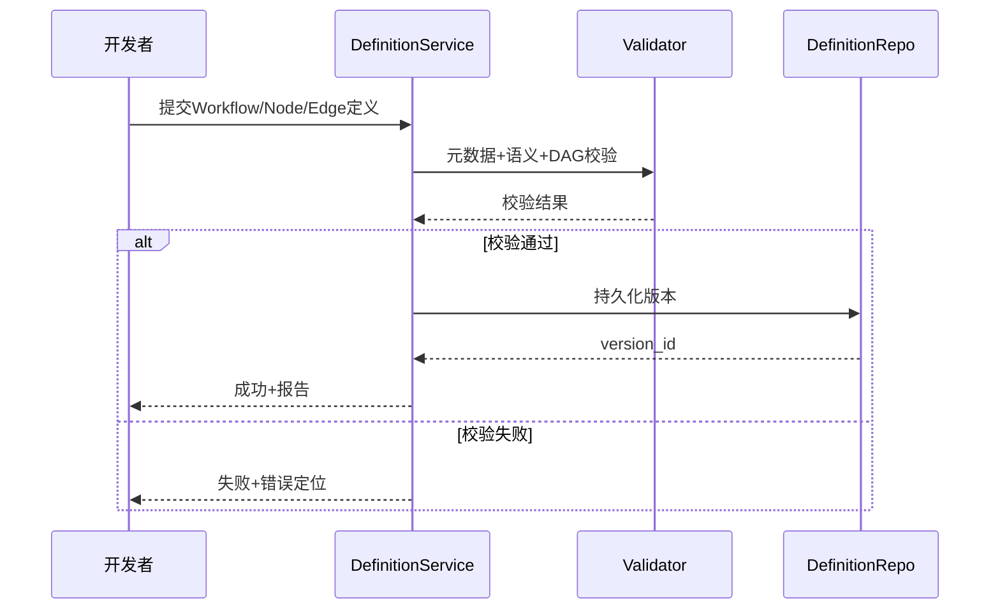

#### S1-01-S2-01-S3-01-UC-02 Workflow、Node和Edge解析器
**用例描述**：系统将 JSON/DSL 解析为内部 IR（中间表示），用于后续执行引擎、调试器与可视化工具。  
**主成功场景**：1）定义JSON格式的解析规范；2）对DSL文件加载定义 → 词法语法解析 → 语义绑定 → 默认值补全 → 输出 IR 与告警。  
**扩展场景**：语法错误、引用节点缺失、字段类型冲突。  
**架构影响**：`workflow/dsl` 分层（Lexer/Parser/Semantic/IRBuilder），引入 IR 缓存与哈希比对。

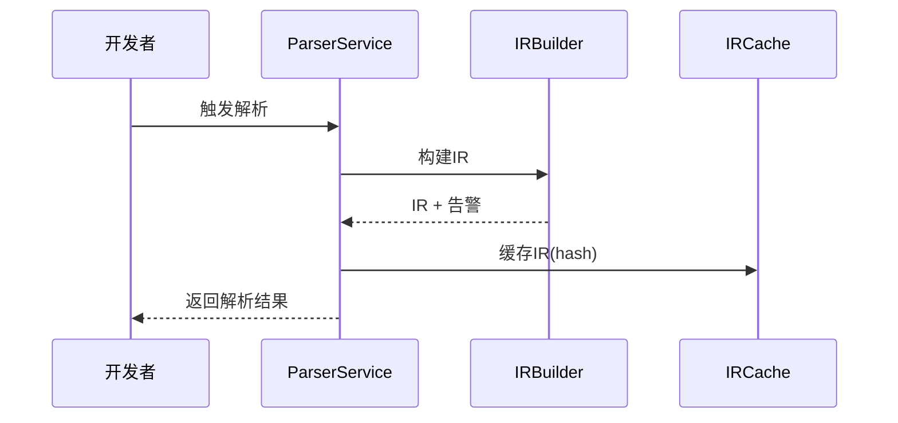

#### S1-01-S2-01-S3-02-UC-01 Node控制面
**用例描述**：为 Node 提供统一控制平面接口（start/stop/health/config），支持生命周期控制、状态采集和运维诊断。  
**主成功场景**：定义控制契约 → 实现控制接口 → 执行契约测试 → 注册控制能力。  
**扩展场景**：契约不完整、健康探针失败、配置下发失败。  
**架构影响**：新增 `NodeControlPlane` 接口层与命令总线适配器；状态事件对接监控系统。

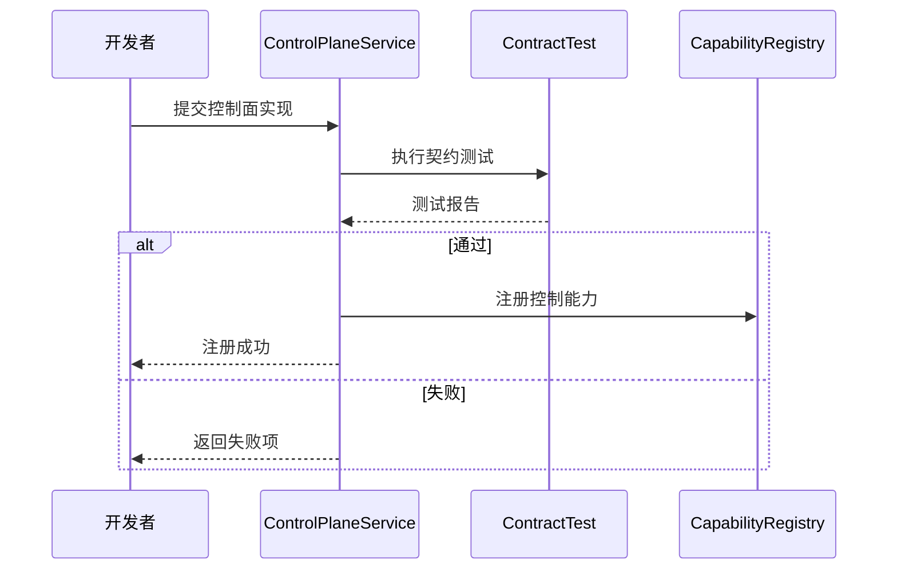

#### S1-01-S2-01-S3-02-UC-02 Node运行面
**用例描述**：接入 Shell/C++/Python/Java 等运行面，统一执行输入输出协议与资源边界。  
**主成功场景**：选择运行面模板 → 实现执行逻辑 → 资源与沙箱校验 → 注册运行能力标签。  
**扩展场景**：运行时缺失、资源超限、协议不兼容。  
**架构影响**：增加 `RuntimeAdapter` 抽象、语言能力标签、调度兼容矩阵。

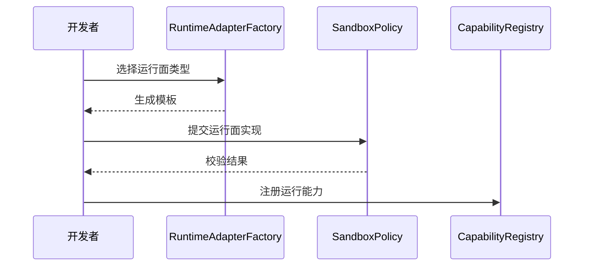

#### S1-01-S2-01-S3-02-UC-03 Node运行面热加载
**用例描述**：在不中断整体业务的前提下替换 Node 可执行逻辑，支持灰度与回滚。  
**主成功场景**：上传新版本 → 验签与兼容校验 → 灰度切流 → 健康通过后全量。  
**扩展场景**：灰度探针失败自动回滚；版本校验失败直接拒绝。  
**架构影响**：增加版本状态机（candidate/canary/stable）、灰度路由器、自动回滚控制器。

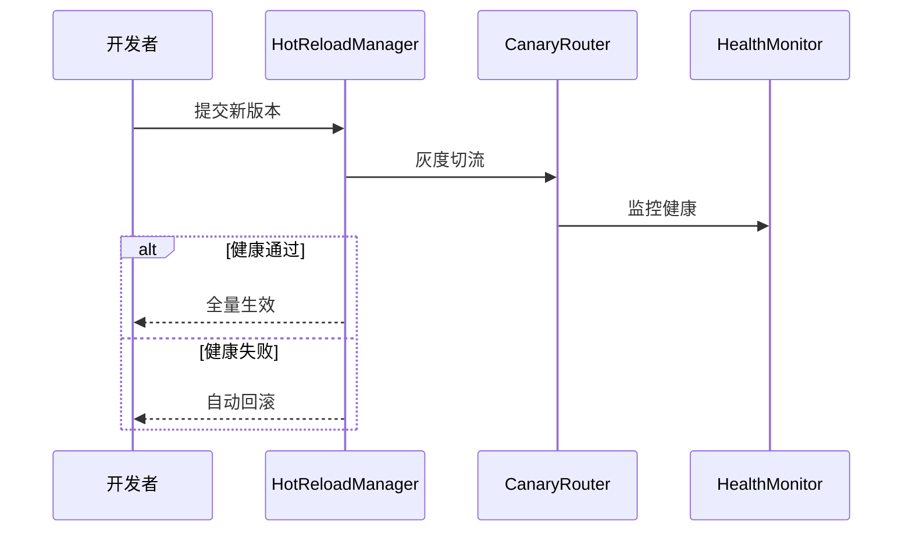

#### S1-01-S2-01-S3-03-UC-01 Agent包构建发布
**用例描述**：将 Workflow 定义、Node 产物、元数据打包为可发布 Agent 包并进入制品仓。  
**主成功场景**：拉取产物 → 依赖完整性校验 → 打包签名 → 上传制品库 → 发布元数据。  
**扩展场景**：依赖缺失、签名失败、上传失败。  
**架构影响**：增加制品清单模型、签名验签链路、发布审计日志与 SBOM 输出。

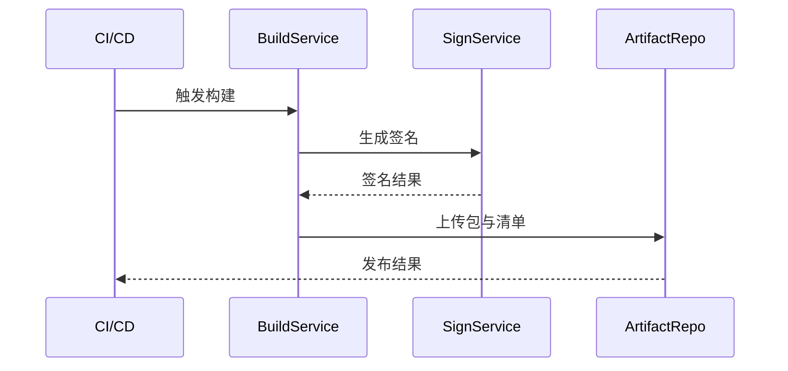

### 4.2 S1-02 Agent运行

#### S1-02-S2-01-S3-01-UC-01 Agent包加载
**用例描述**：运维者加载 Agent 包，系统完成验签、兼容性校验与包注册。  
**主成功场景**：提交包标识 → 下载包 → 验签 → 兼容校验 → 注册包状态。  
**扩展场景**：验签失败、运行环境不兼容、包元数据损坏。  
**架构影响**：部署入口接入 `PackageVerifier`，治理中心维护包状态机。

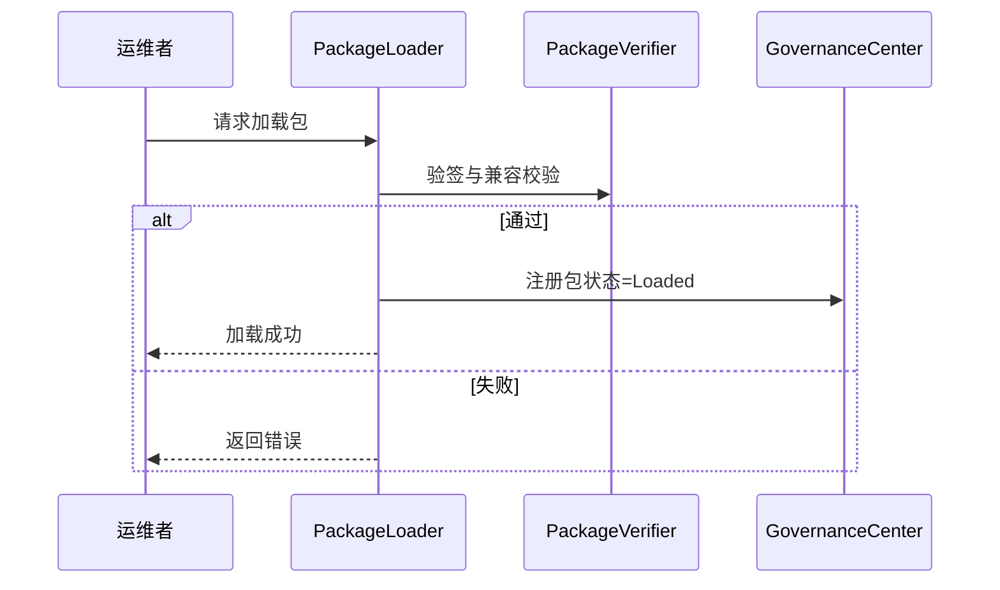

#### S1-02-S2-01-S3-01-UC-02 Agent实例生命周期管理
**用例描述**：管理实例创建、启动、暂停、停止、销毁全过程，保证资源与注册一致。  
**主成功场景**：创建实例 → 资源分配 → 注册发现 → 健康检查 → 进入 RUNNING。  
**扩展场景**：启动失败回收资源；注册失败重试并告警。  
**架构影响**：增加 `InstanceStateStore`、`LifecycleOrchestrator`、资源回收补偿逻辑。

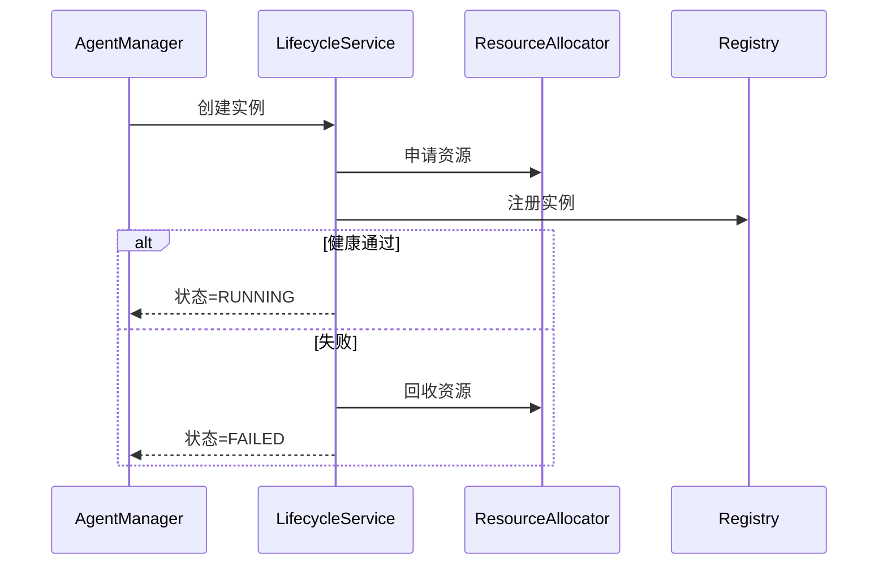

#### S1-02-S2-01-S3-01-UC-02 Agent状态管理
**用例描述**：执行 Agent 状态机合法跃迁，保证状态一致性、可追溯性和幂等处理。  
**主成功场景**：接收状态变更命令 → 校验迁移矩阵 → 更新状态 → 写审计事件。  
**扩展场景**：非法跃迁被拒绝；重复命令幂等返回。  
**架构影响**：引入统一状态机引擎，状态迁移表配置化。

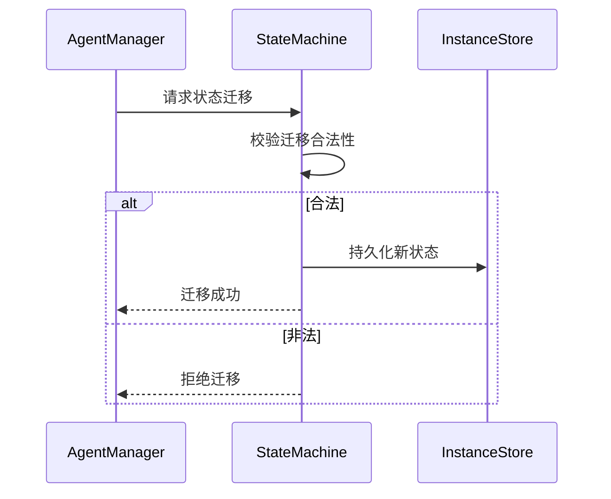

#### S1-02-S2-01-S3-02-UC-01 Agent实例部署
**用例描述**：在目标拓扑（单机/多机）执行部署并接入流量。  
**主成功场景**：生成部署计划 → 节点筛选 → 下发部署 → 探针通过后路由生效。  
**扩展场景**：容量不足排队；节点不可达切换候选节点。  
**架构影响**：新增部署调度器、容量评估器、路由门禁策略。

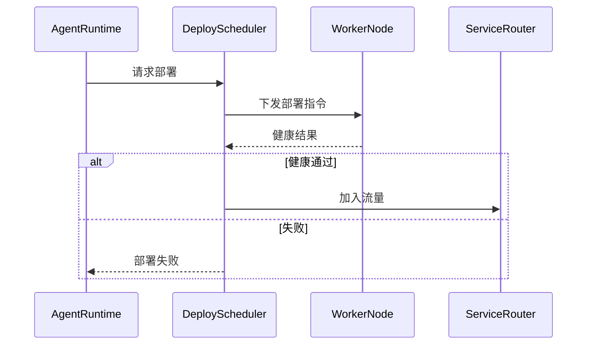

#### S1-02-S2-02-S3-01-UC-01 Agent接收消息
**用例描述**：处理消息入站全链路，包括鉴权、幂等、缓存、会话路由。  
**主成功场景**：接收消息 → 鉴权校验 → 幂等判断 → 入队缓存 → 绑定会话。  
**扩展场景**：鉴权失败拒绝；重复消息直接返回已处理。  
**架构影响**：引入 Ingress Gateway、幂等键存储、会话路由组件。

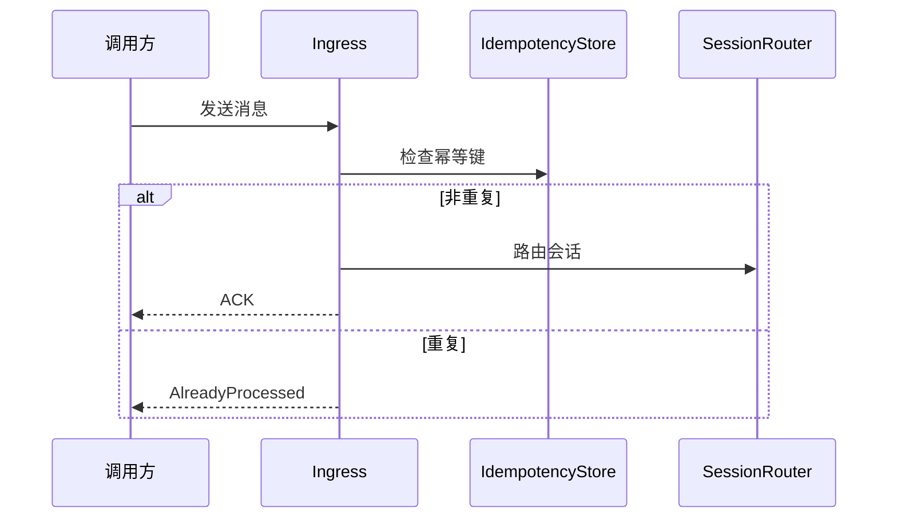

#### S1-02-S2-02-S3-01-UC-02 Agent发送消息
**用例描述**：处理消息出站投递，支持确认、重试、死信与审计。  
**主成功场景**：构造消息 → 选择通道 → 发送 → 等待确认 → 记录投递日志。  
**扩展场景**：超时重试；多次失败进入死信队列。  
**架构影响**：引入 Outbox + RetryWorker + DeadLetterQueue。

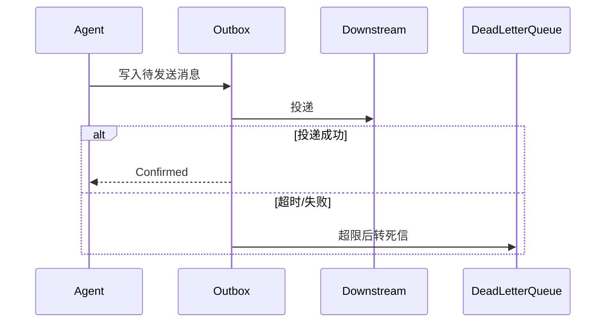

#### S1-02-S2-02-S3-02-UC-01 Agent消息与任务映射
**用例描述**：根据映射规则将消息转换为可调度任务，并建立追踪关系。  
**主成功场景**：读取消息上下文 → 匹配规则 → 生成任务 → 建立消息-任务关联。  
**扩展场景**：规则缺失转未路由队列；映射失败保留重试。  
**架构影响**：新增规则引擎服务、关联关系表、规则版本治理。

#### S1-02-S2-02-S3-02-UC-02 任务生命周期管理
**用例描述**：统一管理任务 CREATED/RUNNING/COMPLETED/FAILED/TIMEOUT。  
**主成功场景**：创建任务 → 状态推进 → 执行反馈 → 终态归档。  
**扩展场景**：超时重试；失败补偿；乱序事件纠偏。  
**架构影响**：引入任务状态机与事件溯源，支持幂等状态更新。

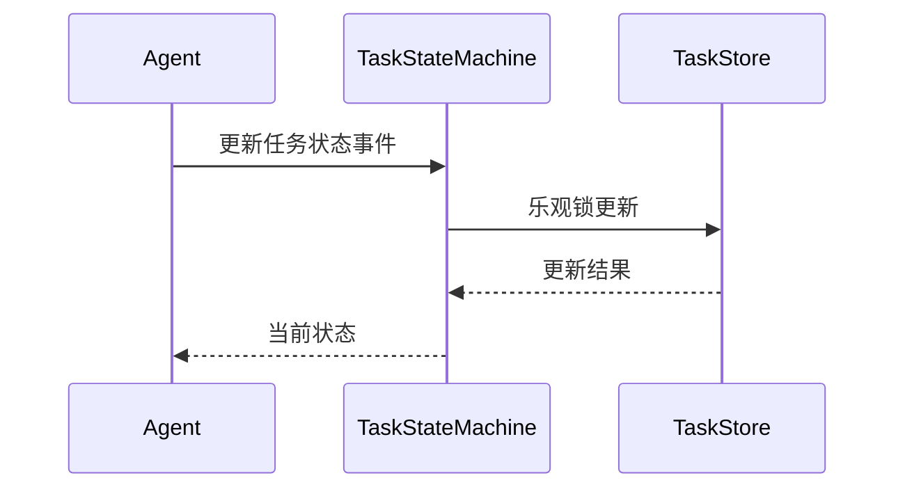

#### S1-02-S2-02-S3-03-UC-01 任务对应Workflow实例调度
**用例描述**：将任务调度到可执行 Workflow 实例与 Worker 节点。  
**主成功场景**：拉取待调度任务 → 匹配 Workflow 版本 → 选择 Worker → 下发执行命令。  
**扩展场景**：无可用 Worker 退避重试；版本不兼容阻断调度。  
**架构影响**：调度策略插件化、Worker 能力标签、负载模型。

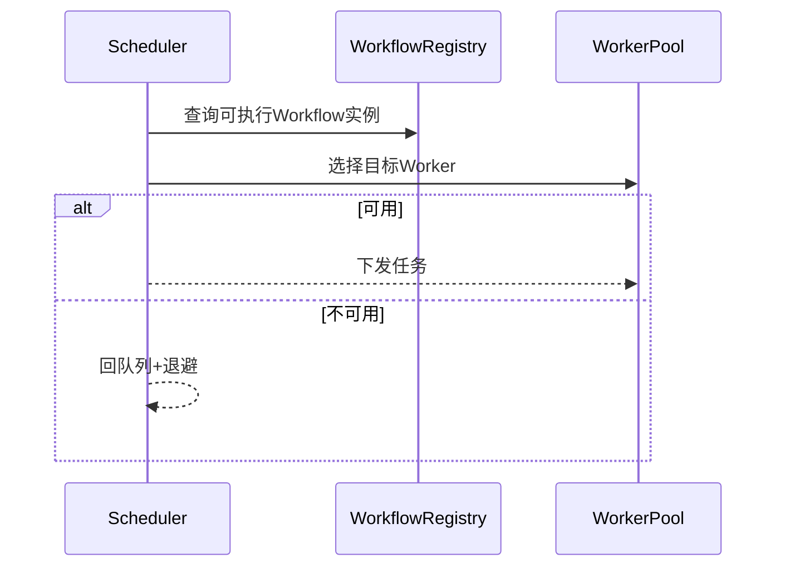

#### S1-02-S2-02-S3-04-UC-01 Workflow及Node执行引擎
**用例描述**：执行引擎按 DAG 语义驱动 Node，处理分支、聚合、异常与补偿。  
**主成功场景**：加载 IR → 执行入口 Node → 推进依赖 Node → 聚合结果 → 输出终态。  
**扩展场景**：Node 失败进入错误分支；补偿失败触发任务失败。  
**架构影响**：执行上下文快照、并行分支执行器、错误分支与补偿管理器。

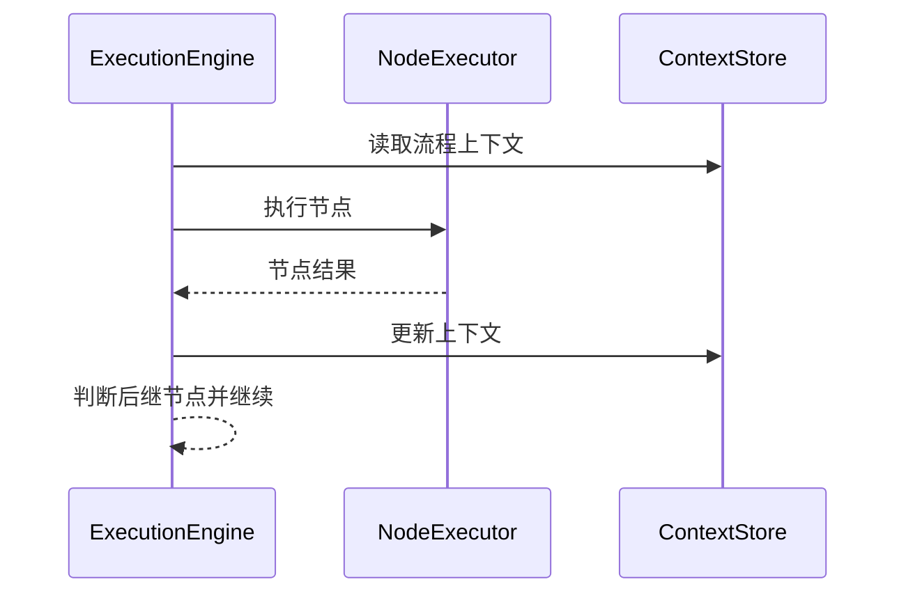

#### S1-02-S2-02-S3-05-UC-01 Agent会话管理
**用例描述**：按会话维度统一管理消息、任务、上下文与过期策略。  
**主成功场景**：创建/识别会话 → 绑定消息任务 → 更新会话状态 → 到期归档。  
**扩展场景**：会话非法拒绝；会话恢复失败转人工介入。  
**架构影响**：新增 SessionStore、TTL 管理器、会话追踪索引。

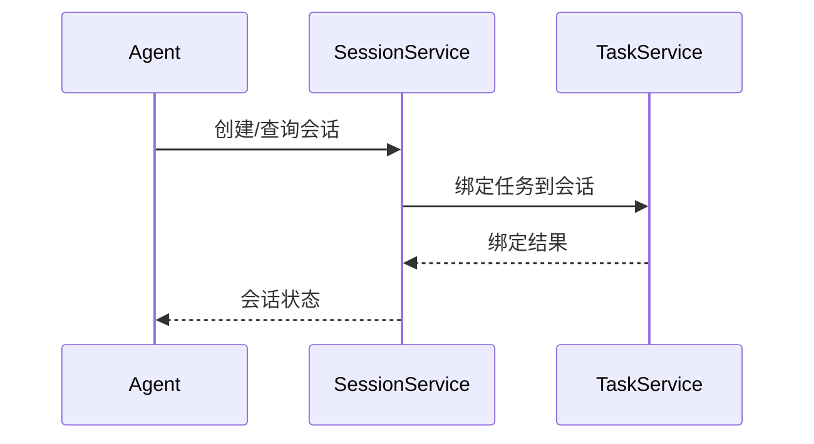

---

## 5. 系统级非功能性需求

### 5.1 性能
- API 响应：P50 < 80ms，P95 < 200ms，P99 < 500ms `[推断值，请核实]`
- 调度决策：P95 < 50ms `[推断值，请核实]`
- 峰值并发：2000 会话并发、2 万消息/分钟 `[推断值，请核实]`
- 单 Workflow（100 Node）调度开销占比 < 10% `[推断值，请核实]`

### 5.2 可靠性
- 运行面 SLA ≥ 99.9% `[推断值，请核实]`
- RTO ≤ 15 分钟，RPO ≤ 5 分钟 `[推断值，请核实]`
- 任务/状态更新采用幂等+原子提交
- 重试策略：指数退避 + 最大重试次数 + 死信队列

### 5.3 可用性（Availability & Usability）
- 支持单机、分布式、多实例部署
- 提供标准化健康探针、熔断降级策略
- 统一排障入口（日志、指标、链路追踪）

### 5.4 安全
- 认证鉴权：RBAC + 服务间身份校验
- 传输加密：TLS1.2+ `[推断值，请核实]`
- 审计留存：关键操作日志 ≥ 180 天 `[推断值，请核实]`
- 包加载、热更新必须验签与操作留痕

### 5.5 可维护性
- 全链路可观测：Logging + Metrics + Tracing
- 配置变更可审计、可回滚
- 调度策略、运行面与解析器支持插件化

### 5.6 产品生命周期管理
- 向后兼容 2 个次版本周期 `[推断值，请核实]`
- 废弃策略提前 1 个版本公告 `[推断值，请核实]`
- 支持灰度升级与自动回滚

### 5.7 可测试性
- 环境隔离：dev/test/stage/prod
- 核心模块自动化覆盖率 ≥ 80% `[推断值，请核实]`
- 提供 Stub/Mock 与事件回放能力

---

## 6. 用例→模块→优先级映射

| S1分类 | 用例编号 | 用例名称 | 优先级 | 主要模块 | 关键产出 |
|---|---|---|---|---|---|
| S1-01 | S1-01-S2-01-S3-01-UC-01 | Workflow、Node和Edge定义 | P0 | `workflow` | 定义模型、DAG校验 |
| S1-01 | S1-01-S2-01-S3-01-UC-02 | Workflow、Node和Edge解析工具 | P0 | `workflow/dsl` | Parser、IR、错误定位 |
| S1-01 | S1-01-S2-01-S3-02-UC-01 | Node控制面 | P0 | `workflow/node`、`runtime` | 控制契约、健康管理 |
| S1-01 | S1-01-S2-01-S3-02-UC-02 | Node运行面 | P0 | `workflow/node` | 运行面接入、多语言执行 |
| S1-01 | S1-01-S2-01-S3-02-UC-03 | Node运行面热加载 | P1 | `runtime/communication` | 灰度切换、回滚机制 |
| S1-01 | S1-01-S2-01-S3-03-UC-01 | Agent包构建发布 | P0 | `build`、`vendor` | 打包签名、制品发布 |
| S1-02 | S1-02-S2-01-S3-01-UC-01 | Agent包加载 | P0 | `agent`、`runtime` | 验包、包状态机 |
| S1-02 | S1-02-S2-01-S3-01-UC-02 | Agent实例生命周期管理 | P0 | `agent`、`runtime/scheduler` | 实例状态与资源编排 |
| S1-02 | S1-02-S2-01-S3-01-UC-02 | Agent状态管理 | P0 | `agent` | 状态机与迁移规则 |
| S1-02 | S1-02-S2-01-S3-02-UC-01 | Agent实例部署 | P0 | `runtime/scheduler` | 拓扑部署与路由接入 |
| S1-02 | S1-02-S2-02-S3-01-UC-01 | Agent接收消息 | P0 | `agent`、`runtime/communication` | 入站鉴权、幂等、路由 |
| S1-02 | S1-02-S2-02-S3-01-UC-02 | Agent发送消息 | P0 | `agent`、`runtime/communication` | 出站投递、重试、死信 |
| S1-02 | S1-02-S2-02-S3-02-UC-01 | Agent消息与任务映射 | P0 | `agent` | 规则引擎、关联关系 |
| S1-02 | S1-02-S2-02-S3-02-UC-02 | 任务生命周期管理 | P0 | `agent`、`runtime` | 任务状态机、溯源事件 |
| S1-02 | S1-02-S2-02-S3-03-UC-01 | 任务对应Workflow实例调度 | P0 | `runtime/scheduler` | 调度策略、Worker分配 |
| S1-02 | S1-02-S2-02-S3-04-UC-01 | Workflow及Node执行引擎 | P0 | `workflow`、`runtime` | DAG执行、异常补偿 |
| S1-02 | S1-02-S2-02-S3-05-UC-01 | Agent会话管理 | P0 | `agent` | 会话上下文、TTL、索引 |

---

## 7. 里程碑交付映射（含用例编号+用例名）

### M1（P0：开发底座）
| 用例编号 | 用例名称 | 交付内容 |
|---|---|---|
| S1-01-S2-01-S3-01-UC-01 | Workflow、Node和Edge定义 | 定义模型与校验器 |
| S1-01-S2-01-S3-01-UC-02 | Workflow、Node和Edge解析工具 | Parser 与 IR 构建能力 |
| S1-01-S2-01-S3-02-UC-01 | Node控制面 | 控制契约与健康管理 |
| S1-01-S2-01-S3-02-UC-02 | Node运行面 | 多语言运行面接入 |

### M2（P0：运行主链路）
| 用例编号 | 用例名称 | 交付内容 |
|---|---|---|
| S1-02-S2-01-S3-01-UC-01 | Agent包加载 | 包加载与验签 |
| S1-02-S2-01-S3-01-UC-02 | Agent实例生命周期管理 | 实例创建/销毁流程 |
| S1-02-S2-01-S3-01-UC-02 | Agent状态管理 | 状态机管理 |
| S1-02-S2-01-S3-02-UC-01 | Agent实例部署 | 部署编排能力 |
| S1-02-S2-02-S3-01-UC-01 | Agent接收消息 | 入站消息链路 |
| S1-02-S2-02-S3-01-UC-02 | Agent发送消息 | 出站消息链路 |
| S1-02-S2-02-S3-02-UC-01 | Agent消息与任务映射 | 映射规则引擎 |
| S1-02-S2-02-S3-02-UC-02 | 任务生命周期管理 | 任务状态机 |
| S1-02-S2-02-S3-03-UC-01 | 任务对应Workflow实例调度 | 调度器与Worker匹配 |
| S1-02-S2-02-S3-04-UC-01 | Workflow及Node执行引擎 | 执行引擎闭环 |
| S1-02-S2-02-S3-05-UC-01 | Agent会话管理 | 会话上下文管理 |

### M3（P0：交付发布）
| 用例编号 | 用例名称 | 交付内容 |
|---|---|---|
| S1-01-S2-01-S3-03-UC-01 | Agent包构建发布 | 制品打包、签名、发布 |

### M4（P1：增强能力）
| 用例编号 | 用例名称 | 交付内容 |
|---|---|---|
| S1-01-S2-01-S3-02-UC-03 | Node运行面热加载 | 灰度升级与自动回滚 |

---

## 8. 主流 AI Agent 实践映射

> 参考 Anthropic/OpenAI/Manus 等主流 Agent 体系中的通用工程实践，映射到本系统：

1. **任务分解与可恢复执行**：采用任务状态机 + 事件溯源，确保失败可恢复。
2. **工具调用可控性**：通过 Node 控制面契约限制执行边界，避免不受控调用。
3. **安全护栏（Guardrails）**：入站鉴权、幂等、防重放、审计追踪。
4. **热更新与最小中断**：灰度发布 + 自动回滚降低升级风险。
5. **可观测优先**：统一 trace_id 将“消息→任务→调度→执行”链路串联。
6. **人机协同运维**：失败场景进入告警/待处理队列，支持人工干预闭环。

---

## 9. 自检结论

- [x] 已在用例全景前补充 S1/S2/S3 场景全景。
- [x] 已展开全部列出用例，并补充 UML 交互图（Sequence）。
- [x] 里程碑映射已包含“用例编号 + 用例名 + 交付内容”。
- [x] 用例描述、主成功场景、扩展场景、架构影响已显著细化。

