# AgentFlow 需求分析说明书（用例驱动）

- **版本**：v1.1
- **日期**：2026-02-19
- **受众**：开发团队
- **范围**：覆盖 `S1-01 Agent开发` 与 `S1-02 Agent运行` 全量用例
- **来源**：`docs/ARCHITECTURE.md`（S1/S2/S3 场景与 UC）

---

## 目录

- [1. 项目背景与范围](#1-项目背景与范围)
- [2. 场景全景（S1/S2/S3）](#2-场景全景s1s2s3)
- [3. 用例全景（按 S1 归类）](#3-用例全景按-s1-归类)
- [4. 功能性需求（逐用例展开）](#4-功能性需求逐用例展开)
  - [4.1 S1-01 Agent开发](#41-s1-01-agent开发)
  - [4.2 S1-02 Agent运行](#42-s1-02-agent运行)
- [5. 系统级非功能性需求](#5-系统级非功能性需求)
- [6. 用例→模块→优先级映射](#6-用例模块优先级映射)
- [7. 里程碑交付映射（含用例编号+用例名）](#7-里程碑交付映射含用例编号用例名)
- [8. 主流 AI MMAgent 实践映射](#8-主流-ai-agent-实践映射)
- [9. 自检结论](#9-自检结论)

---

## 1. 项目背景与范围

### 1.1 项目背景
AgentFlow 是一个面向 MMAgent 编排与运行的一体化系统，覆盖 **开发（定义/构建）→部署（加载/实例化）→运行（消息/任务/调度/执行/会话）** 全链路。

### 1.2 系统边界
- **系统内**：MMAgent 包开发与发布、实例生命周期与部署、消息与任务管理、MMWorkflow/MMNode 执行引擎、会话管理。
- **系统外**：本次需求分析不扩展外部系统边界，仅关注系统内部功能协同。

### 1.3 目标用户
- 开发者
- 运维者
- 系统内部 Actor：`AgentManager`、`MMAgentRuntime`、`MMAgent`

---

## 2. 场景全景（S1/S2/S3）

### 2.1 S1 顶层业务场景
| S1编号 | 场景名称 | 目标 | 产出 |
|---|---|---|---|
| S1-01 | Agent开发 | 完成可运行 MMAgent 包的开发与发布 | MMWorkflow/MMNode 定义、解析结果、发布包 |
| S1-02 | Agent运行 | 完成 MMAgent 在线运行与任务执行闭环 | 实例状态、任务执行结果、会话上下文 |

### 2.2 S2 子场景分解
| 归属S1 | S2编号 | 子场景名称 | 核心能力 |
|---|---|---|---|
| S1-01 | S2-01 | Agent包开发 | 流程定义、解析、Node开发、构建发布 |
| S1-02 | S2-01 | Agent实例管理 | 包加载、实例生命周期、状态管理、部署 |
| S1-02 | S2-02 | Agent执行管理 | 消息收发、任务映射、调度、执行、会话 |

### 2.3 S3 业务执行场景
| 归属S2 | S3编号 | 场景名称 | 说明 |
|---|---|---|---|
| S1-01-S2-01 | S3-01 | Workflow开发 | MMWorkflow/MMNode/MMEdge 建模与解析 |
| S1-01-S2-01 | S3-02 | Node定制开发 | 控制面、运行面、热加载 |
| S1-01-S2-01 | S3-03 | Agent包构建 | 产物打包、签名、发布 |
| S1-02-S2-01 | S3-01 | Agent实例生命周期 | 包加载、实例与状态管理 |
| S1-02-S2-01 | S3-02 | Agent实例部署 | 拓扑部署与运行接入 |
| S1-02-S2-02 | S3-01 | Agent消息管理 | 接收消息、发送消息 |
| S1-02-S2-02 | S3-02 | Agent任务管理 | 消息映射任务、任务生命周期 |
| S1-02-S2-02 | S3-03 | Agent任务调度 | MMWorkflow 实例调度 |
| S1-02-S2-02 | S3-04 | Agent任务执行 | MMWorkflow/MMNode 执行引擎 |
| S1-02-S2-02 | S3-05 | Agent会话管理 | 会话级上下文管理 |

---

## 3. 用例全景（按 S1 归类）

### 3.1 S1-01 Agent开发
| 用例编号 | 用例名称 | 主 Actor | 一句话摘要 | 优先级 |
|---|---|---|---|---|
| S1-01-S2-01-S3-01-UC-01 | MMWorkflow、Node和Edge定义 | 开发者 | 定义编排核心实体、约束和依赖关系 | P0 |
| S1-01-S2-01-S3-01-UC-02 | MMWorkflow、Node和Edge解析器 | 解析工具、MMAgent | 将 JSON/DSL 解析为可执行 IR 模型 | P0 |
| S1-01-S2-01-S3-02-UC-01 | Node控制面 | 开发者 | 统一 MMNode 生命周期控制与运维接口 | P0 |
| S1-01-S2-01-S3-02-UC-02 | Node运行面 | 开发者 | 多语言 MMNode 运行逻辑接入与执行 | P0 |
| S1-01-S2-01-S3-02-UC-03 | Node运行面热加载 | 开发者 | 支持不停机更新 MMNode 运行逻辑 | P1 |
| S1-01-S2-01-S3-03-UC-01 | Agent包构建发布 | 开发者 | 产物打包、签名、发布与可追溯管理 | P0 |

### 3.2 S1-02 Agent运行
| 用例编号 | 用例名称 | 主 Actor | 一句话摘要 | 优先级 |
|---|---|---|---|---|
| S1-02-S2-01-S3-01-UC-01 | Agent包加载 | 运维者 | 将 MMAgent 包加载至运行环境并校验合法性 | P0 |
| S1-02-S2-01-S3-01-UC-02 | Agent实例生命周期管理 | AgentManager | 管理实例创建、启动、停止、销毁 | P0 |
| S1-02-S2-01-S3-01-UC-02 | Agent状态管理 | AgentManager | 管理实例状态机与跃迁约束 | P0 |
| S1-02-S2-01-S3-02-UC-01 | Agent实例部署 | MMAgentRuntime | 在单机/分布式拓扑部署实例 | P0 |
| S1-02-S2-02-S3-01-UC-01 | Agent接收消息 | MMAgent | 入站消息鉴权、去重、缓存、路由 | P0 |
| S1-02-S2-02-S3-01-UC-02 | Agent发送消息 | MMAgent | 出站消息投递、重试、死信处理 | P0 |
| S1-02-S2-02-S3-02-UC-01 | Agent消息与任务映射 | MMAgent | 消息映射任务与关联关系管理 | P0 |
| S1-02-S2-02-S3-02-UC-02 | 任务生命周期管理 | MMAgent | 管理任务状态与重试策略 | P0 |
| S1-02-S2-02-S3-03-UC-01 | 任务对应Workflow实例调度 | MMAgentRuntime | 调度任务到匹配 MMWorkflow 与 Worker | P0 |
| S1-02-S2-02-S3-04-UC-01 | Workflow及Node执行引擎 | MMAgentRuntime | 执行工作流图、驱动 MMNode、汇聚结果 | P0 |
| S1-02-S2-02-S3-05-UC-01 | Agent会话管理 | MMAgent | 会话创建、销毁等生命周期管理 | P0 |
| S1-02-S2-02-S3-05-UC-02 | 长时会话资源管理 | MMAgent | 长时会话资源发放与回收 | P0 |
| S1-02-S2-02-S3-05-UC-03 | 会话内多任务并发 | MMAgent | 会话内多任务并发管理 | P0 |

---

## 4. 功能性需求（逐用例展开）

> 每个用例包含：用例描述、主成功场景、扩展场景、架构影响、UML 交互图（Mermaid Sequence）。

### 4.1 S1-01 Agent开发

#### S1-01-S2-01-S3-01-UC-01 MMWorkflow、Node和Edge定义
**用例描述**：开发者按照业务流程定义业务agent对应的 MMWorkflow/MMNode/MMEdge 的结构、约束与依赖，系统完成结构校验、语义校验与版本化保存。该能力是所有运行能力的前置基础。  
**主成功场景**：
1. 开发者创建 MMWorkflow 元数据（ID/版本/入口）。
2. 系统校验元数据唯一性与格式。
3. 开发者定义 MMNode（输入输出、执行参数、资源需求）。
4. 系统校验 MMNode 配置完整性与类型约束。
5. 开发者定义 MMEdge（依赖关系、条件表达式、数据映射）。
6. 系统进行工作流图校验（含可达性、出口收敛；带 `loop/goto` 时允许受控环回）。
7. 系统保存定义版本并返回校验报告。  
**扩展场景**：
- E1：版本冲突 → 系统返回冲突版本链路，要求升级版本号。
- E2：环路依赖 → 系统返回环路路径（节点序列）并阻断保存。
- E3：数据映射类型冲突 → 系统返回字段路径与期望类型。  
**架构影响**：新增 `DefinitionValidator`、`DagValidator`、`DefinitionRepository`；错误模型需支持字段级定位（JSON Pointer）。

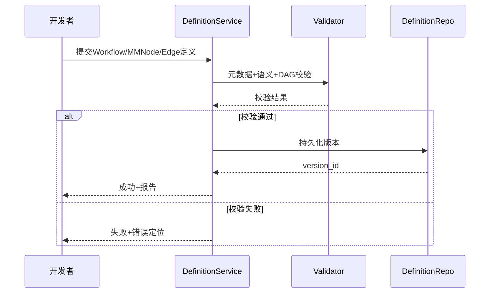

#### S1-01-S2-01-S3-01-UC-02 MMWorkflow、Node和Edge解析器
**用例描述**：系统将 JSON/DSL 解析为内部 IR（中间表示），用于后续执行引擎、调试器与可视化工具。  
**主成功场景**：1）定义JSON格式的解析规范；2）对DSL文件加载定义 → 词法语法解析 → 语义绑定 → 默认值补全 → 输出 IR 与告警。  
**扩展场景**：语法错误、引用节点缺失、字段类型冲突。  
**架构影响**：`workflow/dsl` 分层（Lexer/Parser/Semantic/IRBuilder），引入 IR 缓存与哈希比对。

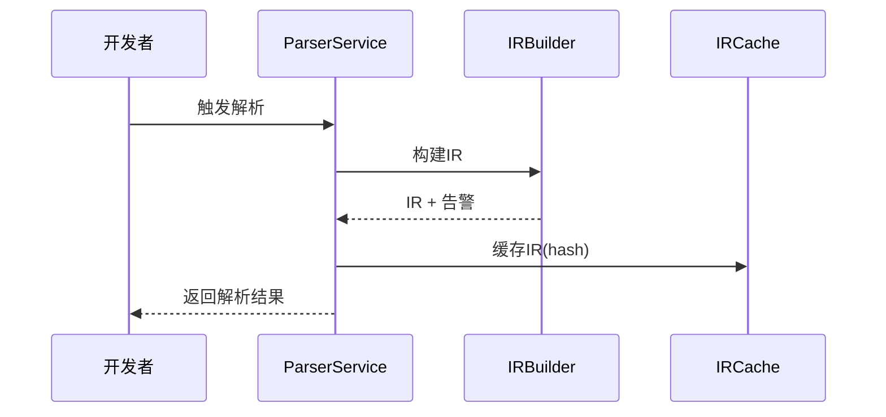

#### S1-01-S2-01-S3-02-UC-01 Node控制面
**用例描述**：为 MMNode 提供统一控制平面接口（start/stop/health/config），支持生命周期控制、状态采集和运维诊断。  
**主成功场景**：定义控制契约 → 实现控制接口 → 执行契约测试 → 注册控制能力。  
**扩展场景**：契约不完整、健康探针失败、配置下发失败。  
**架构影响**：新增 `NodeControlPlane` 接口层与命令总线适配器；状态事件对接监控系统。

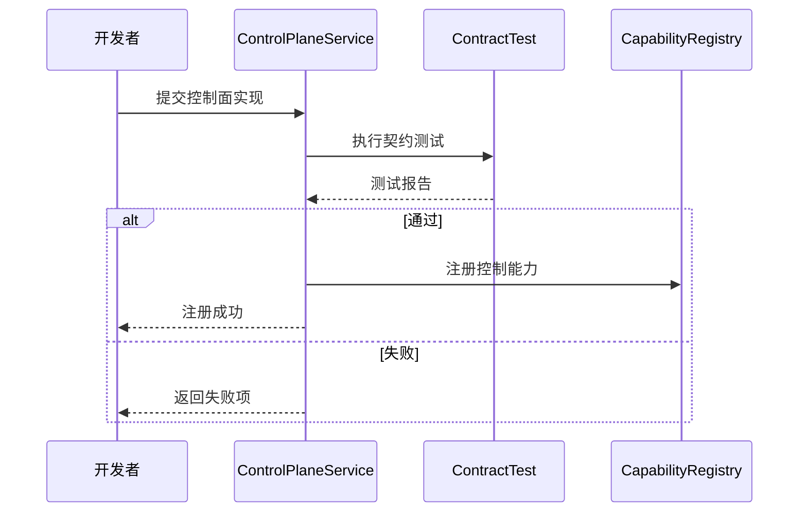

#### S1-01-S2-01-S3-02-UC-02 Node运行面
**用例描述**：接入 Shell/C++/Python/Java 等运行面，统一执行输入输出协议与资源边界。  
**主成功场景**：选择运行面模板 → 实现执行逻辑 → 资源与沙箱校验 → 注册运行能力标签。  
**扩展场景**：运行时缺失、资源超限、协议不兼容。  
**架构影响**：增加 `RuntimeAdapter` 抽象、语言能力标签、调度兼容矩阵。

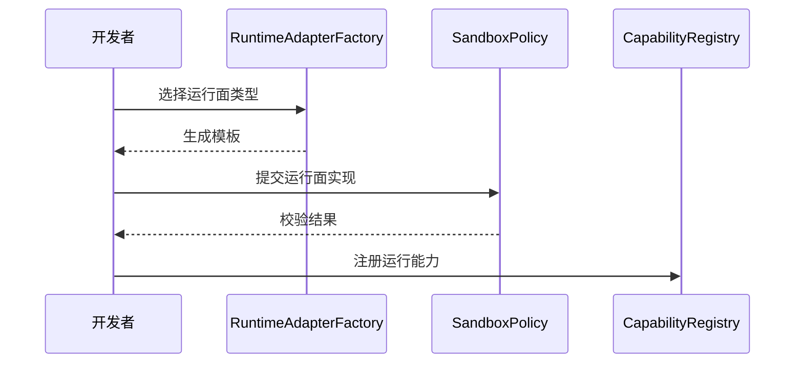

#### S1-01-S2-01-S3-02-UC-03 Node运行面热加载
**用例描述**：在不中断整体业务的前提下替换 MMNode 可执行逻辑，支持灰度与回滚。  
**主成功场景**：上传新版本 → 验签与兼容校验 → 灰度切流 → 健康通过后全量。  
**扩展场景**：灰度探针失败自动回滚；版本校验失败直接拒绝。  
**架构影响**：增加版本状态机（candidate/canary/stable）、灰度路由器、自动回滚控制器。

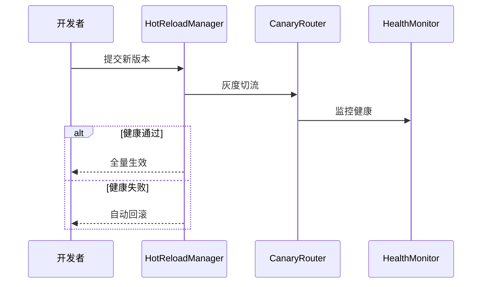

#### S1-01-S2-01-S3-03-UC-01 Agent包构建发布
**用例描述**：将 MMWorkflow 定义、MMNode 产物、元数据打包为可发布 MMAgent 包并进入制品仓。  
**主成功场景**：拉取产物 → 依赖完整性校验 → 打包签名 → 上传制品库 → 发布元数据。  
**扩展场景**：依赖缺失、签名失败、上传失败。  
**架构影响**：增加制品清单模型、签名验签链路、发布审计日志与 SBOM 输出。

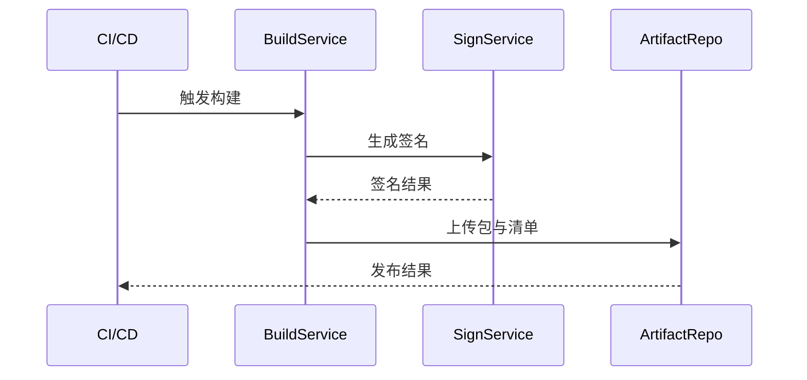

### 4.2 S1-02 Agent运行

#### S1-02-S2-01-S3-01-UC-01 Agent包加载
**用例描述**：运维者加载 MMAgent 包，系统完成验签、兼容性校验与包注册。  
**主成功场景**：提交包标识 → 下载包 → 验签 → 兼容校验 → 注册包状态。  
**扩展场景**：验签失败、运行环境不兼容、包元数据损坏。  
**架构影响**：部署入口接入 `PackageVerifier`，治理中心维护包状态机。

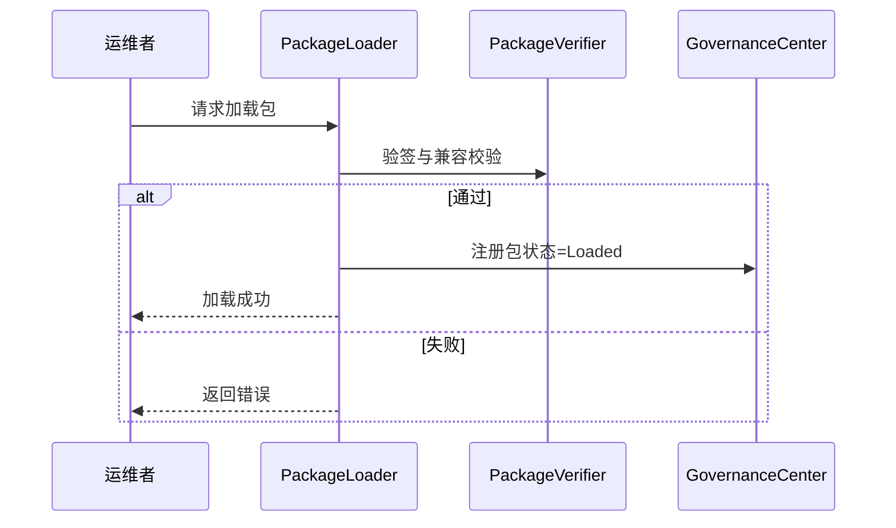

#### S1-02-S2-01-S3-01-UC-02 Agent实例生命周期管理
**用例描述**：管理实例创建、启动、暂停、停止、销毁全过程，保证资源与注册一致。  
**主成功场景**：创建实例 → 资源分配 → 注册发现 → 健康检查 → 进入 RUNNING。  
**扩展场景**：启动失败回收资源；注册失败重试并告警。  
**架构影响**：增加 `InstanceStateStore`、`LifecycleOrchestrator`、资源回收补偿逻辑。

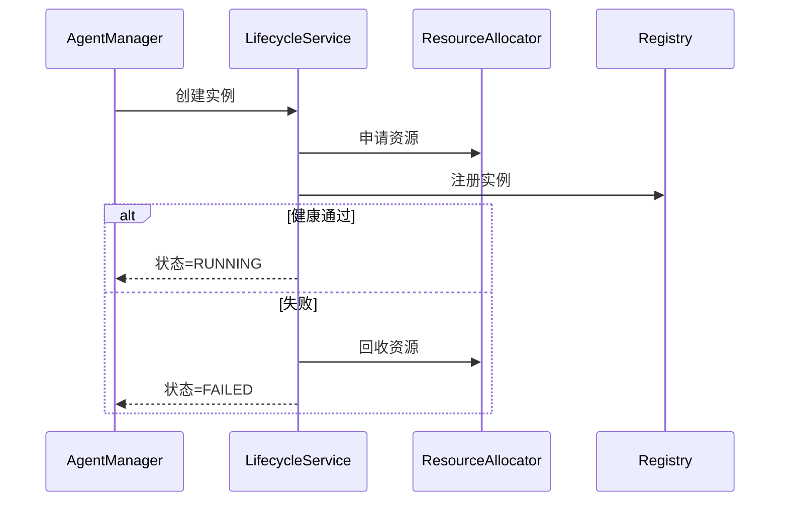

#### S1-02-S2-01-S3-01-UC-02 Agent状态管理
**用例描述**：执行 MMAgent 状态机合法跃迁，保证状态一致性、可追溯性和幂等处理。  
**主成功场景**：接收状态变更命令 → 校验迁移矩阵 → 更新状态 → 写审计事件。  
**扩展场景**：非法跃迁被拒绝；重复命令幂等返回。  
**架构影响**：引入统一状态机引擎，状态迁移表配置化。

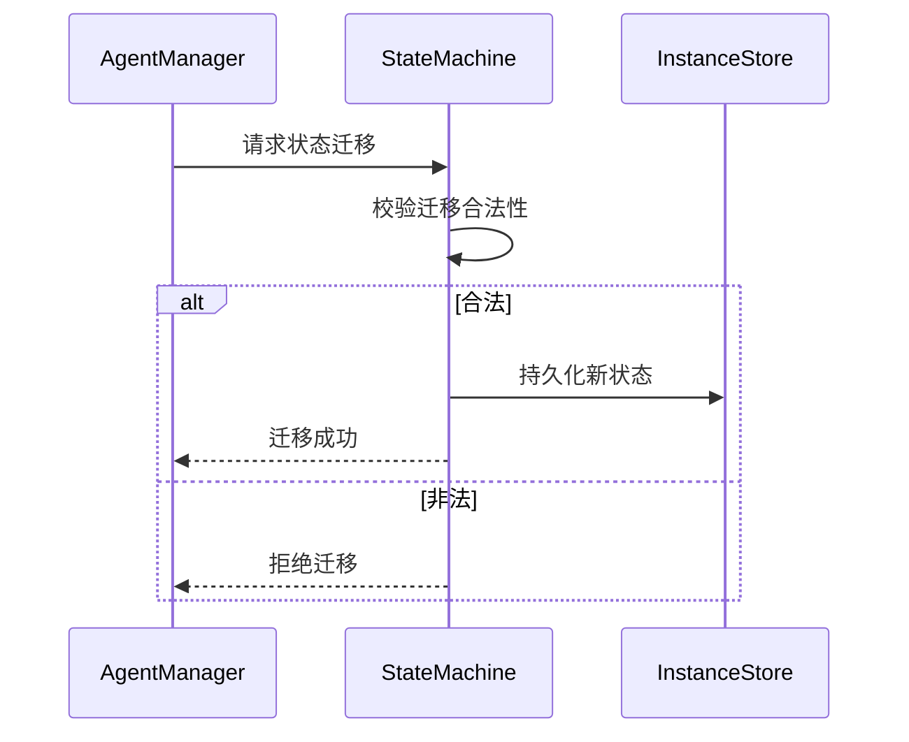

#### S1-02-S2-01-S3-02-UC-01 Agent实例部署
**用例描述**：在目标拓扑（单机/多机）执行部署并接入流量。  
**主成功场景**：生成部署计划 → 节点筛选 → 下发部署 → 探针通过后路由生效。  
**扩展场景**：容量不足排队；节点不可达切换候选节点。  
**架构影响**：新增部署调度器、容量评估器、路由门禁策略。

#### S1-02-S2-02-S3-01-UC-01 Agent接收消息
**用例描述**：处理消息入站全链路，包括鉴权、幂等、缓存、会话路由。  
**主成功场景**：接收消息 → 鉴权校验 → 幂等判断 → 入队缓存 → 绑定会话。  
**扩展场景**：鉴权失败拒绝；重复消息直接返回已处理。  
**架构影响**：引入 Ingress Gateway、幂等键存储、会话路由组件。

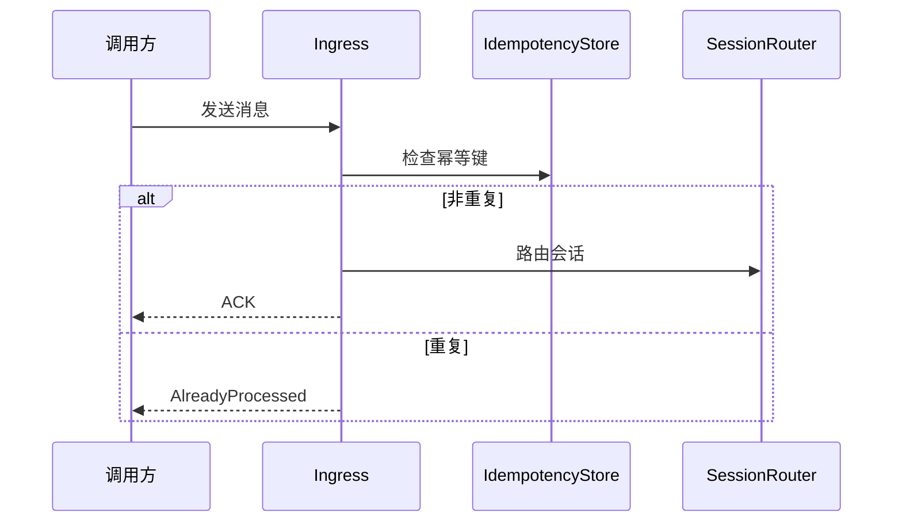

#### S1-02-S2-02-S3-01-UC-02 Agent发送消息
**用例描述**：处理消息出站投递，支持确认、重试、死信与审计。  
**主成功场景**：构造消息 → 选择通道 → 发送 → 等待确认 → 记录投递日志。  
**扩展场景**：超时重试；多次失败进入死信队列。  
**架构影响**：引入 Outbox + RetryWorker + DeadLetterQueue。

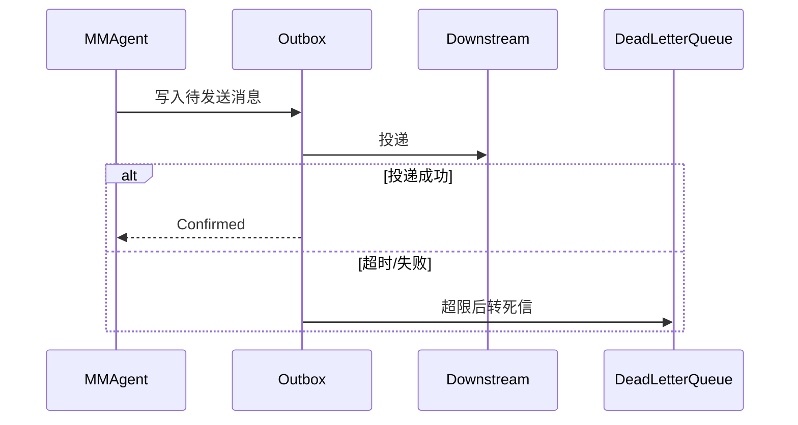

#### S1-02-S2-02-S3-02-UC-01 Agent消息与任务映射
**用例描述**：根据映射规则将消息转换为可调度任务，并建立追踪关系。  
**主成功场景**：读取消息上下文 → 匹配规则 → 生成任务 → 建立消息-任务关联。  
**扩展场景**：规则缺失转未路由队列；映射失败保留重试。  
**架构影响**：新增规则引擎服务、关联关系表、规则版本治理。

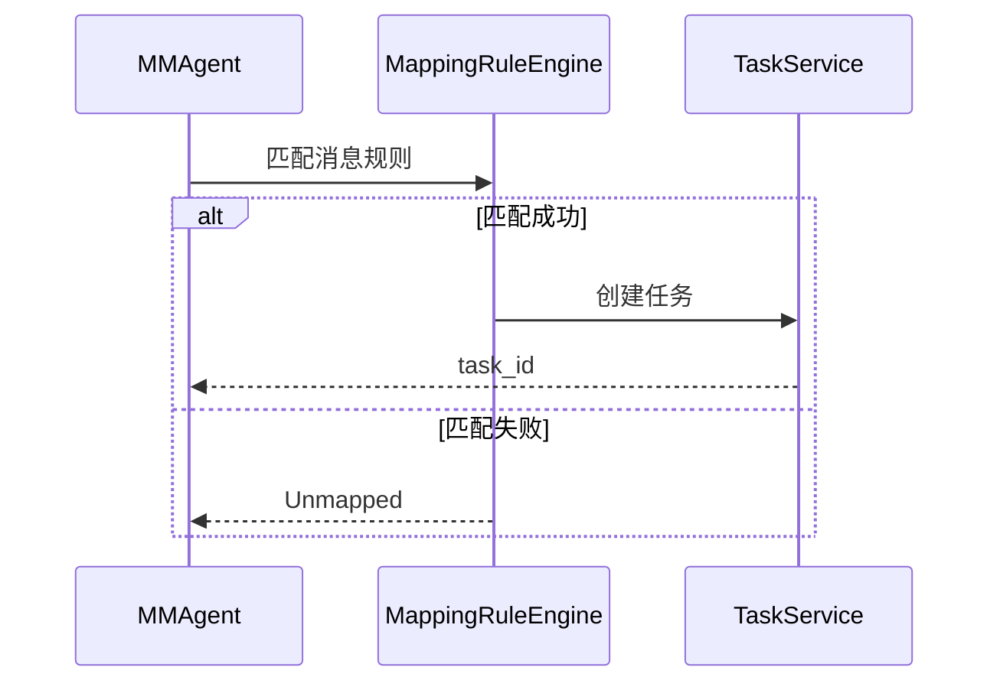

#### S1-02-S2-02-S3-02-UC-02 任务生命周期管理
**用例描述**：统一管理任务 CREATED/RUNNING/COMPLETED/FAILED/TIMEOUT。  
**主成功场景**：创建任务 → 状态推进 → 执行反馈 → 终态归档。  
**扩展场景**：超时重试；失败补偿；乱序事件纠偏。  
**架构影响**：引入任务状态机与事件溯源，支持幂等状态更新。

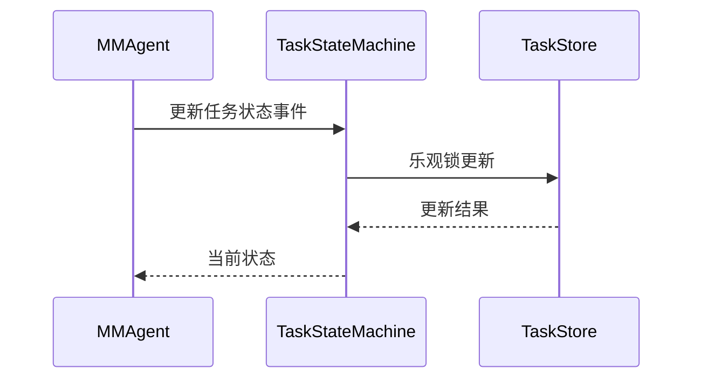

#### S1-02-S2-02-S3-03-UC-01 任务对应Workflow实例调度
**用例描述**：将任务调度到可执行 MMWorkflow 实例与 Worker 节点。  
**主成功场景**：拉取待调度任务 → 匹配 MMWorkflow 版本 → 选择 Worker → 下发执行命令。  
**扩展场景**：无可用 Worker 退避重试；版本不兼容阻断调度。  
**架构影响**：调度策略插件化、Worker 能力标签、负载模型。

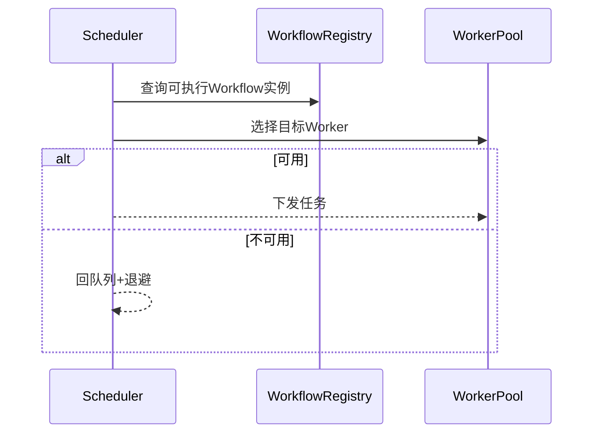

#### S1-02-S2-02-S3-04-UC-01 Workflow及Node执行引擎
**用例描述**：执行引擎按工作流图语义驱动 MMNode，处理分支、聚合、异常与补偿。  
**主成功场景**：加载 IR → 执行入口 MMNode → 推进依赖 MMNode → 聚合结果 → 输出终态。  
**扩展场景**：MMNode 失败进入错误分支；补偿失败触发任务失败。  
**架构影响**：执行上下文快照、并行分支执行器、错误分支与补偿管理器。

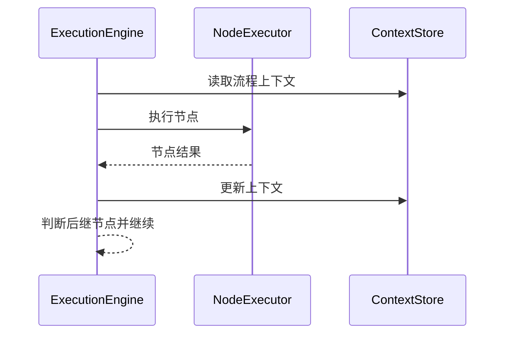

#### S1-02-S2-02-S3-05-UC-01 Agent会话管理
**用例描述**：按会话维度统一管理消息、任务、上下文与过期策略。  
**主成功场景**：创建/识别会话 → 绑定消息任务 → 更新会话状态 → 到期归档。  
**扩展场景**：会话非法拒绝；会话恢复失败转人工介入。  
**架构影响**：新增 SessionStore、TTL 管理器、会话追踪索引。

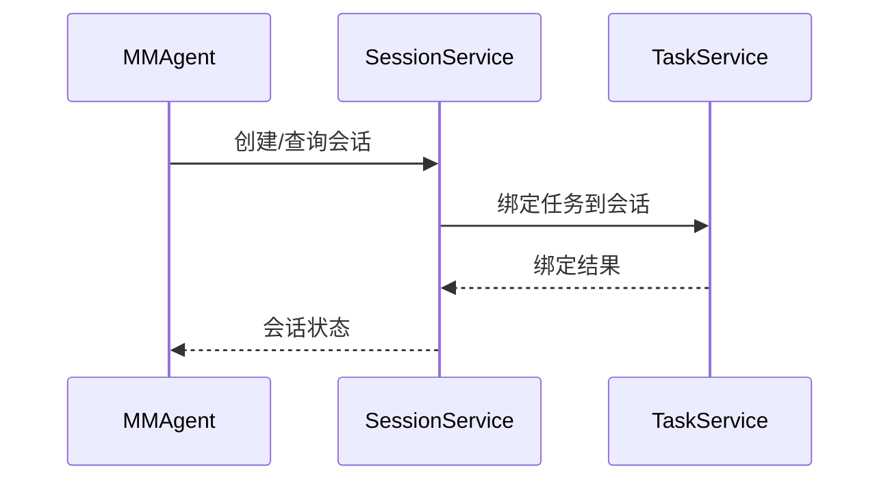

---

## 5. 系统级非功能性需求

### 5.1 性能
- API 响应：P50 < 80ms，P95 < 200ms，P99 < 500ms `[推断值，请核实]`
- 调度决策：P95 < 50ms `[推断值，请核实]`
- 峰值并发：2000 会话并发、2 万消息/分钟 `[推断值，请核实]`
- 单 MMWorkflow（100 MMNode）调度开销占比 < 10% `[推断值，请核实]`

### 5.2 可靠性
- 运行面 SLA ≥ 99.9% `[推断值，请核实]`
- RTO ≤ 15 分钟，RPO ≤ 5 分钟 `[推断值，请核实]`
- 任务/状态更新采用幂等+原子提交
- 重试策略：指数退避 + 最大重试次数 + 死信队列

### 5.3 可用性（Availability & Usability）
- 支持单机、分布式、多实例部署
- 提供标准化健康探针、熔断降级策略
- 统一排障入口（日志、指标、链路追踪）

### 5.4 安全
- 认证鉴权：RBAC + 服务间身份校验
- 传输加密：TLS1.2+ `[推断值，请核实]`
- 审计留存：关键操作日志 ≥ 180 天 `[推断值，请核实]`
- 包加载、热更新必须验签与操作留痕

### 5.5 可维护性
- 全链路可观测：Logging + Metrics + Tracing
- 配置变更可审计、可回滚
- 调度策略、运行面与解析器支持插件化

### 5.6 产品生命周期管理
- 向后兼容 2 个次版本周期 `[推断值，请核实]`
- 废弃策略提前 1 个版本公告 `[推断值，请核实]`
- 支持灰度升级与自动回滚

### 5.7 可测试性
- 环境隔离：dev/test/stage/prod
- 核心模块自动化覆盖率 ≥ 80% `[推断值，请核实]`
- 提供 Stub/Mock 与事件回放能力

---

## 6. 用例→模块→优先级映射

| S1分类 | 用例编号 | 用例名称 | 优先级 | 主要模块 | 关键产出 |
|---|---|---|---|---|---|
| S1-01 | S1-01-S2-01-S3-01-UC-01 | MMWorkflow、Node和Edge定义 | P0 | `workflow` | 定义模型、DAG校验 |
| S1-01 | S1-01-S2-01-S3-01-UC-02 | MMWorkflow、Node和Edge解析工具 | P0 | `workflow/dsl` | Parser、IR、错误定位 |
| S1-01 | S1-01-S2-01-S3-02-UC-01 | Node控制面 | P0 | `workflow/node`、`runtime` | 控制契约、健康管理 |
| S1-01 | S1-01-S2-01-S3-02-UC-02 | Node运行面 | P0 | `workflow/node` | 运行面接入、多语言执行 |
| S1-01 | S1-01-S2-01-S3-02-UC-03 | Node运行面热加载 | P1 | `runtime/communication` | 灰度切换、回滚机制 |
| S1-01 | S1-01-S2-01-S3-03-UC-01 | Agent包构建发布 | P0 | `build`、`vendor` | 打包签名、制品发布 |
| S1-02 | S1-02-S2-01-S3-01-UC-01 | Agent包加载 | P0 | `agent`、`runtime` | 验包、包状态机 |
| S1-02 | S1-02-S2-01-S3-01-UC-02 | Agent实例生命周期管理 | P0 | `agent`、`runtime/scheduler` | 实例状态与资源编排 |
| S1-02 | S1-02-S2-01-S3-01-UC-02 | Agent状态管理 | P0 | `agent` | 状态机与迁移规则 |
| S1-02 | S1-02-S2-01-S3-02-UC-01 | Agent实例部署 | P0 | `runtime/scheduler` | 拓扑部署与路由接入 |
| S1-02 | S1-02-S2-02-S3-01-UC-01 | Agent接收消息 | P0 | `agent`、`runtime/communication` | 入站鉴权、幂等、路由 |
| S1-02 | S1-02-S2-02-S3-01-UC-02 | Agent发送消息 | P0 | `agent`、`runtime/communication` | 出站投递、重试、死信 |
| S1-02 | S1-02-S2-02-S3-02-UC-01 | Agent消息与任务映射 | P0 | `agent` | 规则引擎、关联关系 |
| S1-02 | S1-02-S2-02-S3-02-UC-02 | 任务生命周期管理 | P0 | `agent`、`runtime` | 任务状态机、溯源事件 |
| S1-02 | S1-02-S2-02-S3-03-UC-01 | 任务对应Workflow实例调度 | P0 | `runtime/scheduler` | 调度策略、Worker分配 |
| S1-02 | S1-02-S2-02-S3-04-UC-01 | Workflow及Node执行引擎 | P0 | `workflow`、`runtime` | DAG执行、异常补偿 |
| S1-02 | S1-02-S2-02-S3-05-UC-01 | Agent会话管理 | P0 | `agent` | 会话上下文、TTL、索引 |

---

## 7. 里程碑交付映射（含用例编号+用例名）

### M1（P0：开发底座）
| 用例编号 | 用例名称 | 交付内容 |
|---|---|---|
| S1-01-S2-01-S3-01-UC-01 | MMWorkflow、Node和Edge定义 | 定义模型与校验器 |
| S1-01-S2-01-S3-01-UC-02 | MMWorkflow、Node和Edge解析工具 | Parser 与 IR 构建能力 |
| S1-01-S2-01-S3-02-UC-01 | Node控制面 | 控制契约与健康管理 |
| S1-01-S2-01-S3-02-UC-02 | Node运行面 | 多语言运行面接入 |

### M2（P0：运行主链路）
| 用例编号 | 用例名称 | 交付内容 |
|---|---|---|
| S1-02-S2-01-S3-01-UC-01 | Agent包加载 | 包加载与验签 |
| S1-02-S2-01-S3-01-UC-02 | Agent实例生命周期管理 | 实例创建/销毁流程 |
| S1-02-S2-01-S3-01-UC-02 | Agent状态管理 | 状态机管理 |
| S1-02-S2-01-S3-02-UC-01 | Agent实例部署 | 部署编排能力 |
| S1-02-S2-02-S3-01-UC-01 | Agent接收消息 | 入站消息链路 |
| S1-02-S2-02-S3-01-UC-02 | Agent发送消息 | 出站消息链路 |
| S1-02-S2-02-S3-02-UC-01 | Agent消息与任务映射 | 映射规则引擎 |
| S1-02-S2-02-S3-02-UC-02 | 任务生命周期管理 | 任务状态机 |
| S1-02-S2-02-S3-03-UC-01 | 任务对应Workflow实例调度 | 调度器与Worker匹配 |
| S1-02-S2-02-S3-04-UC-01 | Workflow及Node执行引擎 | 执行引擎闭环 |
| S1-02-S2-02-S3-05-UC-01 | Agent会话管理 | 会话上下文管理 |

### M3（P0：交付发布）
| 用例编号 | 用例名称 | 交付内容 |
|---|---|---|
| S1-01-S2-01-S3-03-UC-01 | Agent包构建发布 | 制品打包、签名、发布 |

### M4（P1：增强能力）
| 用例编号 | 用例名称 | 交付内容 |
|---|---|---|
| S1-01-S2-01-S3-02-UC-03 | Node运行面热加载 | 灰度升级与自动回滚 |

---

## 8. 主流 AI MMAgent 实践映射

> 参考 Anthropic/OpenAI/Manus 等主流 MMAgent 体系中的通用工程实践，映射到本系统：

1. **任务分解与可恢复执行**：采用任务状态机 + 事件溯源，确保失败可恢复。
2. **工具调用可控性**：通过 MMNode 控制面契约限制执行边界，避免不受控调用。
3. **安全护栏（Guardrails）**：入站鉴权、幂等、防重放、审计追踪。
4. **热更新与最小中断**：灰度发布 + 自动回滚降低升级风险。
5. **可观测优先**：统一 trace_id 将“消息→任务→调度→执行”链路串联。
6. **人机协同运维**：失败场景进入告警/待处理队列，支持人工干预闭环。

---

## 9. 自检结论

- [x] 已在用例全景前补充 S1/S2/S3 场景全景。
- [x] 已展开全部列出用例，并补充 UML 交互图（Sequence）。
- [x] 里程碑映射已包含“用例编号 + 用例名 + 交付内容”。
- [x] 用例描述、主成功场景、扩展场景、架构影响已显著细化。

## 10. 实现功能的一些说明
一、完善Agent对象的功能：
消息在agent穿越关系：reqmsg -> agent.msgque -> agent.defaultsession -> agent.newsession -> 
1）将src/agent/messages.cpp改为src/agent/msgque.cpp，体现消息队列功能，同步修改类名，msgque支持自定义优先级多队列
2）每个agent实例均有一个默认session实例，输入消息先送往默认session实例的接收队列（每个session有基于msgque机制配置有“高和默认”两个优先级接收队列，以及一个发送队列）
3），默认session实例进行消息的初步处理，首先按照消息中的user_id+client_id创建新的session实例，新的session实例仍然归属所在的agent实例，每个session实例下有自己的msgque消息接收队列和发送队列，存放会话中接收后待处理的消息及发送消息
4）src/agent目录下新增coordinator.cpp，实现AgentCoordinator类，coordinator属于某个agent实例，它对来自所有session会话的消息进行意图识别、理解判断等，生成对应session实例下的各类任务实例。Coordinator根据来自不同session的请求消息生成各类任务，这些任务包含两大类，一类是执行任务，依赖agent实例下某个workflow实例进行执行（执行流程由agent包中提供workflow流程文件决定）；另一类是协同任务，支持对多个执行任务进行协调，协调算法支持业务定制（通过so库的方式自动加载）。每个agent实例均有自己的Coordinator实例。
5）session会话实例中的消息均需要经过Coordinator处理，Coordinator按照识别结果生成若干个task实例，这些生成的task归属其触发消息所属的会话，每个task实例只能归属一个session会话实例。task实例可以和agent实例所包含的workflow类型映射，一个task实例就表示要按照对应的workflow流程来执行，但是task实例执行时需要被调度到对应workflow实例上（这个调度由runtime的scheduler完成）。

二、完善workflow能力
1）内建workflow：AgentFlow支持一些写好的默认workflow，比如MCP工具调用workflow、skills调用workflow、记忆访问workflow
2）内建workflow包含默认写好的流程文件、Node代码，可以被直接打包到Agent包中；
3)内建workflow也支持业务在已有流程及node代码实现上定制增强，在publish/workflow目录中增加一些内建workflow的目录，比如memory、skills、tools等

三、完善runtime能力
runtime是所有agent实例全局共享的，runtime支持配置为master角色和worker角色，master包含了worker的所有内容，但是worker不包含master的能力。runtime可以支持多实例部署，多实例间支持共享数据
1）src/runtime新增worker.cpp，worker是workflow及Node的执行引擎，这些worker对象均包含了workflow的解析执行引擎（也支持node执行引擎）
2）src/runtime新增master目录，该目录下新增deployer.cpp、scheduler.cpp两个文件。
A）deployer实现agent实例内workflow实例到worker的映射和调度（当前不支持workflow实例中node到worker的映射，node可以通过单node的workflow进行映射），所有的worker在启动成功后均需要向deployer注册，并定期同步心跳和状态，deployer决定agent实例中哪些workflow实例运行在哪些worker实例上，调度支持按照状态、负载等进行均衡，worker记录自身可以执行哪些workflow实例，某些workflow实例如果销毁了，需要通知deployer刷新，并广播到所有worker进行更新；deployer支持预配置一些worker实例，也支持主动查询其管理的worker状态。worker实例也可以预配置所支持的workflow实例。deployer的部署调度是全局的，支持所有workflow实例到所有worker的调度，所以往往在部署时会按照worker池来预部署和调度。
B）scheduler实现agent实例中所有会话的task任务调度到哪个workflow实例上，同一个agent实例的任务优先调度到其所属agent实例的workflow实例，相同agent对象的不同agent实例可以共享workflow实例（因为它们的workflow是一样的，只是实例不同，通过计数进行数量管理），也就是说同一个agent对象创建出来的不同实例，MMAgent-A实例的任务可以调度到Agent-B实例的workflow实例上去。因为workflow实例是被部署到某个worker上，所以最终可以实现某个task任务被调度到某个worker上。scheduler是全局的，支持所有agent实例的任务到所有workflow实例（以及所有worker实例）的调度。

四、完成以下重构，并记录到docs下合适文档中，确保构建和测试成功：
1、在publish/agent目录下补充agent包的规范定义文档，并刷新打包脚本及publish、examples/agent目录下的内容。
1）agent包的规范如下：
$xxxAgent_$PKGTYPE_$PKGVER.tar.gz     # Agent发布包，$xxxAgent为名称，$PKGTYPE为包类型，$PKGVER为包版本
├── $xxxAgent_$AGTVER.tar.gz/             # Agent对象包，这个包是需要被Agent对象加载的，$AGTVER为Agent版本号
 |            ├── agent.json             # Agent配置文档，加载agent时，需要读取这里面的内容。包括Agent名称、版本号、概述、包含了哪些workflow文件等
 │            ├── agentCard.md       # MMAgent prompt，当被其他大模型或Agent访问时需要获取，内容也包含类似openclaw中的SOUL.md
 │            ├── workflow_XX.json    # Workflow_XX 流程文件，包含了node和edge定义，node中需要指明调用了哪个可执行部件
 │            ├── node_xxx.$TYPE             # node_xx为名称，$TYPE后缀代表可执行部件格式，比如.so、.sh、.py、.jar等
└── package.json           # MMAgent 包描述文件，用于支撑包管理，包括包名、包版本、包功能描述、包中文件清单等

五、优化publish/README.md描述，这篇文档主要描述业务如何开发一个新的业务Agent包，包含以下内容：
1）Agent包开发：需要参考Agent的规范，定义Agent包中包含哪些workflow，填充Agent包内容
2）workflow开发：参考workflow规范（将src/workflow/dsl/workflow_sample.jsonc移到publish/workflow下面），定义每个workflow中的node（负责执行）及Edge（负责控制流程）
3）node定制开发：publish/workflow下生成node开发规范文档，明确可执行代码的通用入口函数及参数，可以调用的API接口等，额外提供node开发的api手册文档

六、完成以下重构，并记录到docs下合适文档中，确保构建和测试成功：
1、Workflow重新定义node和edge，node负责动作执行，不负责控制流程
1）edge负责执行流程的控制，node中的LOOP、FOR_EACH等循环控制流程功能移到edge实现中。
2）edge新增流程控制：除了已经实现的if选择某个node，loop循环执行某个node，新增fork实现多个node并行启动执行，join实现多个node执行完后再同步进入下个node，async实现node异步执行（当前node启动后不等结果，继续执行下一个node，等其结果完成后再回调）
3）workflow支持带环的流程：node可以被重入执行，edge新增支持环回流程控制（类似goto到某个node）
2、workflow新增一些固定模式，就是几个node+几个edge流程控制实现一个workflow，这些workflow可以被直接使用或二次开发
1）publish/workflow目录下新增pattern目录
2）串行workflow模式：新增串行流程文件serial_workflow.json，比如start node->工具选择node1->工具执行node2->end node
3）并行workflow模式：新增并行流程文件parallel_workflow.json，比如start node->工具选择node1->工具执行node2+工具执行node3->end node
4）环形workflow模式：新增环形式流程文件cycled_workflow.json，比如start node->决策node1 -> 工具执行node2 ->结果评估node3-> 决策node1或end node
3、node新增一些固定模式，就是1个node实现一些固定操作
1）问答node模式：通过COT、Relection等模式填充prompt，然后访问LLM大模型获得问题的回答
2)API工具选择模式：通过Function calling模式填充prompt，然后访问LLM大模型，获得选择的API及其调用参数
3)MCP工具选择模式：通过MCP协议模式填充prompt，然后访问LLM大模型，获得选择的MCP工具及其调用参数
4）skills选择模式：过skills协议模式填充prompt，然后访问LLM大模型，获得选择的skill及其调用参数

七、完成workflow支持由大模型动态生成流程的重构，并记录到docs下合适文档中，确保构建和测试成功：
1）将node包装成skills：在src/workflow/node中增加skill.md，仿照业界skill规范，填充node的功能说明和调用方法
2)将workflow包装成skills：在src/workflow/dsl中增加skill.md，仿照业界skill规范，填充node的功能说明和调用方法
3)workflow支持嵌套其他workflow：workflow.json支持include其他workflow，node扩充类型为workflow，可以以这种类型的node引用另一个workflow，需要修改workflow的解析代码、node的定义扩充支持一个workflow
4）workflow动态生成：新增publish/workflow/pattern/dynamic_workflow.json，其节点为start node->node或workflow选择node1——（支持goto流程控制的edge）-> 被node1动态选中的node2（该node既可以是普通node，也可以是另一个workflow）->end node

八、完成以下重构，并记录到docs下合适文档中，确保构建和测试成功：
1、检查docs/CONTRIBUTING.md文档内容是否和其他文档重叠，如果有没重叠的内容，可以搬移到其他文档，搬移完成后删除这个文档
2、检查docs/ARCHITECTURE.md文档是否和docs/REQUIREMENTS_ANALYSIS.md及代码一致，如果不一致需要更新
3、开发框架只有Agent和workflow两层（主要是Agent包规范、workflow规范，还有Node开发API），runtime主要是workflow实例到worker的部署调度、task实例到workflow实例的执行调度，还有一个是高速数据总线，供所有Agent实例、workflow实例和node实例共用，在docs/api-reference.md按照这几层来组织接口说明

九、完成以下重构，并记录到docs下合适文档中，确保构建和测试成功：
src/runtime/databus提供的数据总线需要支持进程内共享、跨进程数据共享以及跨节点（不同OS、容器等）数据共享，需要支持数据的存储、获取、订阅/通知等功能，需要支持跨Agent实例、跨workflow实例、跨node实例共享和传输数据。
1、需要与 Agent 的 msgque（src/agent/msgque.cpp）机制配合使用；msgque 只起到共享数据的控制作用，本身不携带数据本身，只携带数据的访问地址（数据是全局存放的，重复数据全局唯一），并与 databus 协同。
2、databus需要支持全局共享数据，除了runtime本地有数据缓存外，还需要有独立的缓存服务来提供数据的全局共享以及持久化存储，需要选型数据缓存系统，比如redis等，请完成数据缓存的选型，并实现databus和数据缓存服务协同工作。
3、数据缓存服务需要存储原始的数据内容，同时也需要把数据与所属者关联起来，需要与request_id、user_id、client_id、agent_id、session_id、task_id、workflow_id、node_id、master_id、worker_id等关联，以支持使用不同的xxx_id均可以获取对应的数据
4、不要只是打桩依赖redis，而是真实引入redis作为三方依赖（redis的代码仓地址：https://github.com/redis/redis.git），在vendor中增加对redis 的依赖和适配；所有message、event携带的数据都访问databus的本地缓存，本地缓存可以按照dataref访问，本地缓存和数据服务之间可以进行同步，数据消费方不感知数据服务，不直接使用数据服务，本地缓存没有需要的数据时才自动从数据服务上拉取，Agent收到的第一个消息中已经包含了原始数据，默认需要进行数据转储到databus的本地缓存，由本地缓存自动转储到数据服务上。

十、完成以下重构，并记录到docs下合适文档中，确保构建和测试成功：
1、整个workflow的流程控制机制均依托edge对象来完成，需要考虑include/external/workflow/control_flow.h的内容是不是应该合并到include/external/workflow/edge.h中
2、publish/agent/AGENT_PACKAGE_SPEC.md、publish/workflow/NODE_API_REFERENCE.md、publish/workflow/NODE_DEVELOPMENT_SPEC.md、publish/workflow/README.md中文化，检查其他文档都需要中文化
3、检查proto这个目录中的代码是否还有引用的地方，如果不需要建议删除
4、tests/functional目录中需要增加功能测试用例，测试用例可以参考docs/REQUIREMENTS_ANALYSIS.md中列出的场景用例，并加入到自动化测试用例集中。
5、当前workflow已经进行了扩充，可以支持有环图，所有文档及代码中涉及DAG的描述需要更新，比如README.md有一些DAG描述。
6、TODO.md中的内容已经过时了，需要合并到docs/REFACTORING.md中。vendor.conf应该可以删除
7、examples目录下的一些示例与真实代码不匹配了，需要进行更新

十一、完成以下重构，并记录到docs下合适文档中，确保构建和测试成功：
1、vendor/vendor.conf缺少对Protoactor-cpp: https://github.com/DanielKernel/Protoactor-cpp.git、RapidJSON: https://github.com/Tencent/rapidjson.git的依赖配置，需要补充。vendor/README.md需要刷新并中文化。

十二、完成以下重构，并记录到docs下合适文档中，确保构建和测试成功：
1、优化publish/agent/visualizer.html实现，解决显示publish/workflow/pattern/cycled_workflow.json时无法可视化goto流程控制、展现环能力，需要优化解决；

十三、完成以下runtime worker自主执行的重构，并记录到docs下合适文档中，确保构建和测试成功：
1、runtime/worker.cpp中的worker需要实现自驱动运行，worker有task队列（高优先级及一般优先级）、workflow实例队列和事件队列。1)当新的task被加入到task队列时，会触发一个新的事件，事件处理代码会选择该task对应的workflow处理线程（worker需要提前创建该worker上登记的workflow处理线程池）进行处理，worker会优先处理高优先级task，其次是一般优先级，每次新task到来都会触发处理线程并行处理完所有的task；2）当新workflow实例被调度到本worker，会进行登记，并在workflow处理线程池中增加这个workflow实例的处理线程（增加的线程数量支持配置文件可配置）。3）事件队列监控线程持续扫描事件队列，有新事件时会通过事件处理线程调用该事件注册的事件处理器进行处理，事件可以改变状态、刷新数据等。
2、src/workflow/workflow.cpp中实现workflow的运行，workflow有消息队列（高优先级及一般优先级）和事件队列。1）消息队列处理线程优先处理高优先级队列，其次处理一般优先级。所有消息处理从start node开始运行，直到end node处理完，所有node也需要支持多线程并行执行（需要提供node执行线程池机制），但是这些node执行顺序受edge的流程控制，可能存在串行等待等处理。每个消息穿越workflow实例整个过程，都有一个主控线程参与，它监控消息处理过程，处理失败等。2）workflow有专门的线程处理事件队列，事件处理需要调用对应事件注册的处理器来处理。事件往往可以改变一些workflow执行的状态、数据等，是workflow按照流程执行之外的执行控制机制。
3、src/workflow/node/node.cpp中实现node的运行，node实例由edge启动（每个edge在其workflow实例化时就已经记住其下一个或多个node实例），每个node有自己的消息队列和事件队列。1）消息队列有线程读取并传递给excutor执行线程，这些执行线程调用node的可执行代码（so、shell、python、jar等）完成执行动作，每个node有多个excutor执行实例，可以跑不同的执行代码（除so外，执行器都是独立的进程），所以excutor可以是直接执行so的线程，也可以是监控其他进程执行的线程。2)node有自己的事件队列和事件处理线程，当接收到不同类型事件后，会调用其注册的事件处理器进行处理
4、src/workflow/edge/edge.cpp中实现edge的运行，edge实例由node启动（每个node在其workflow实例化时就已经记住其下一个edge实例），每个edge有自己的消息队列和事件队列。1）消息队列有线程读取并传递给processor执行线程，这些执行线程调用edge不同类型的处理代码（if、loop、goto等）完成后续node的选择。2)edge有自己的事件队列和事件处理线程，当接收到不同类型事件后，会调用其注册的事件处理器进行处理。

十四、完成以下runtime自主执行的重构，并记录到docs下合适文档中，确保构建和测试成功：
runtime master支持workflow实例到worker的部署调度、task实例到workflow实例的执行调度
1、src/runtime/runtime.cpp实现全局Agent实例的管理。1）runtime提供agent实例注册消息队列，agent实例创建后向runtime发送注册请求，runtime提供注册处理线程完成agent实例注册，建立agent实例及其包含的workflow实例数据池（建立workflow实例的高速查询存储数据结构，方便deployer和scheduler查询），将agent实例数据保存在本地缓冲区，同时上送到databus进行数据持久化；3）runtime和Agent实例间建立固定心跳机制和状态收集能力，当agent实例状态故障或销毁时，需要将Agent实例对应的workflow实例注销，同时事件通知deployer和scheduler更新workflow到worker、task到workflow映射关系，重新调度。
2、src/runtime/master/deployer.cpp实现workflow实例到worker实例部署调度：1）deployer提供worker注册消息队列，worker实例启动时向deployer发送注册请求，deployer提供注册处理线程完成worker实例注册，将worker数据保存在本地缓冲区，同时上送到databus进行数据持久化；2）deployer提供部署调度线程，该线程对所有注册的workflow实例匹配合适的worker实例，匹配算法做到可插拔，算法可以按照so方式替换，默认匹配算法尽量确保每个worker上部署的workflow做到均衡（比如执行的所有node数、占有资源数尽量均衡），同时尽量将同一个agent实例的workflow实例部署到同一个worker上；3）deployer要和worker实例间建立固定心跳机制和状态收集能力，当worker状态发生变化（比如worker故障时），则需要自动将故障worker上部署的workflow实例重新部署到状态正常的worker实例上，实现对故障worker实例的隔离；4）当收到runtime发送的agent实例状态变化事件时，比如agent实例故障时，需要将worker上已经部署的Agent实例对应的workflow实例注销，使得更多的正常agent实例的workflow实例可以部署到这些worker上，避免worker负载太低。同时当有新的agent实例或已有agent实例的workflow新实例加入时，不要动已经部署好的workflow实例，只做增强部署。
3、src/runtime/master/scheduler.cpp实现task到workflow实例调度：1）scheduler提供task注册消息队列，agent实例对应的会话实例在生成新的task实例时，需要发送注册请求，scheduler提供注册处理线程完成task实例注册，将task数据保存在本地缓冲区，同时上送到databus进行数据持久化；2）scheduler提供任务调度线程，该线程对所有注册的task实例匹配合适的agent实例对应的workflow实例，调度算法做到可插拔，算法可以按照so方式替换，默认调度算法尽量确保每个workflow实例上承载的task实例做到均衡（比如task的数量），同时尽量将同一个agent实例的task实例调度到同一个Agent实例对应的workflow实例上；3）scheduler要对每个task实例状态及执行过程进行监控，收集其进度，当task执行完或被取消时，则需要同步更新workflow上承载的task数量、状态等进行更新，以方便更多task可以调度到该workflow实例。4）当收到runtime发送的agent实例状态变化事件时，比如agent实例故障时，需要将agent实例上已经调度的task实例重新调度到其他同类型agent实例对应的同类型workflow实例上，使得task执行不受影响。5）同时当有新的task实例加入时，不要动已经部署好的task和workflow实例映射关系，只做新task的增量调度。

十五、完成以下Agent自主能力增强，并记录到docs下合适文档中，确保构建和测试成功：
外部agent业务不需要通过代码方式创建Agent，只提供agent包，需要将Agent创建和运行逻辑内置到AgentActor模块中
1、优化src/agent/agent_actor.cpp自动化能力：AgentActor从AgentService.config中获取agent包所在的目录及清单，自动从目录中读取agent包信息创建Agent，同时启动包监控线程，监控目录中包是否发生变化，如果发生变化则自动读取包创建新的实例，可以支持不同包版本的agent实例同时启动运行
2、AgentActor进行agent实例生命周期管理：AgentActor完成所有agent实例的创建，提供消息接口供外部业务代码控制agent实例的运行、停止、暂停等状态，并维护agent实例清单，通过Actor消息接口给RuntimeActor发送agent实例的注册消息、心跳消息及状态上报消息；
3、Agent创建事件队列及事件监控和处理线程，当收到请求消息的事件时，触发执行AgentCoordinator的会话消息处理线程逐个会话处理，处理完成后生成task实例清单，AgentCoordinator根据请求消息控制task的运行、停止、暂停等状态
4、AgentActor进行task实例生命周期管理：AgentActor维护task实例清单，通过Actor消息接口给RuntimeActor发送task实例的注册消息、心跳消息及状态上报消息；
5、src/runtime目录下创建worker目录，将src/runtime/worker.cpp移到src/runtime/worker目录下，同时新增src/runtime/worker_actor.cpp，新增WorkerActor，由WorkerActor给RuntimeActor发送注册消息、心跳消息及状态同步相关消息

十六、完成以下功能重构及增强，并记录到docs下合适文档中，确保构建和测试成功：
1、将examples/p1_features_example.cpp改为examples/databus_example.cpp，只保留databus使用相关的示例
2、examples/agent下agent_example.cpp、agent_loader_example.cpp相关代码处理按需合并到src/agent/agent_actor.cpp相关处理中，并将这两个.cpp文件删除，这个目录下只保留agent包相关示例
3、外部业务看不到单独的workflow，将examples/workflow下面的示例合并到examples/agent中，不再单独提供代码方式创建workflow、node、edge等的示例，去掉examples/basic_example.cpp
4、examples/README.md中增加更多agent示例创建、agent运行处理业务请求相关的运行说明
5、tests/functional下增加更多新增自主化功能的测试用例
6、由于业务看不到agent高码化开发内容，只感知到agent包，所以include/external目录不需要发布agent.h，该文件需要合并到include/internal/agent下，include/external下只需要发布node相关的定制开发接口，所以include/external只需要保留node.h相关的内容，其他内容都需要合并到include/internal/workflow响应目录下
