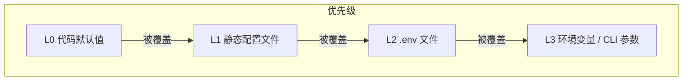
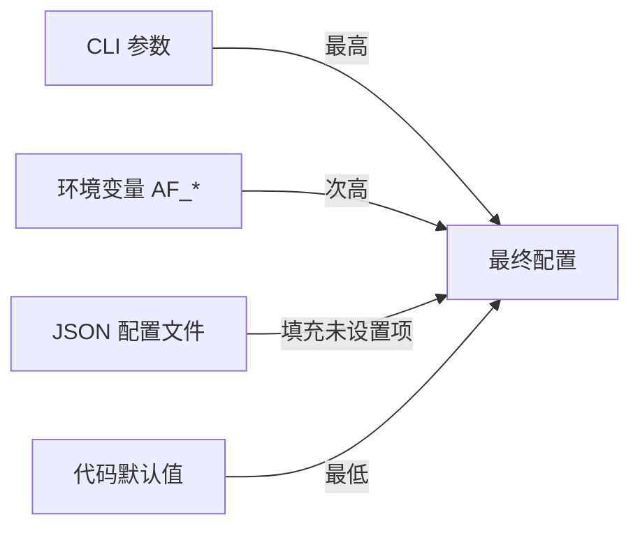
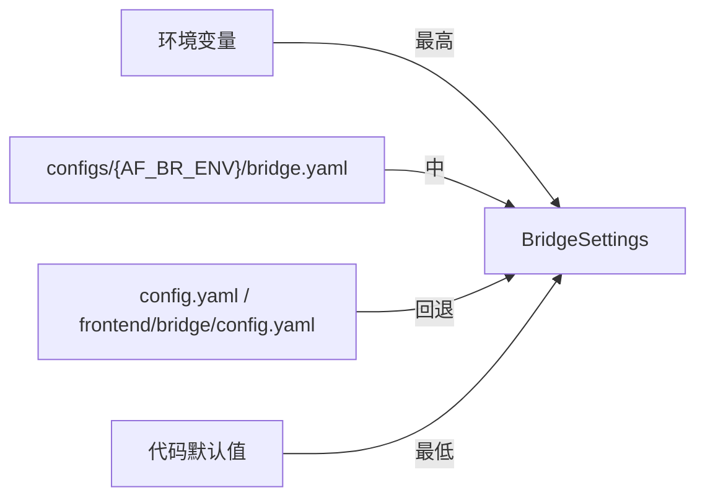
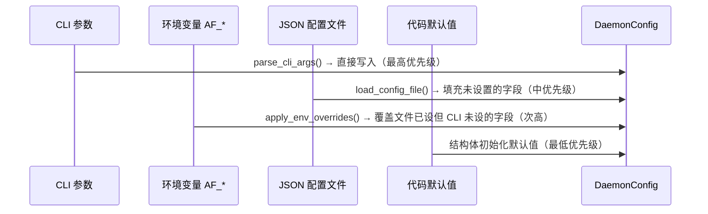
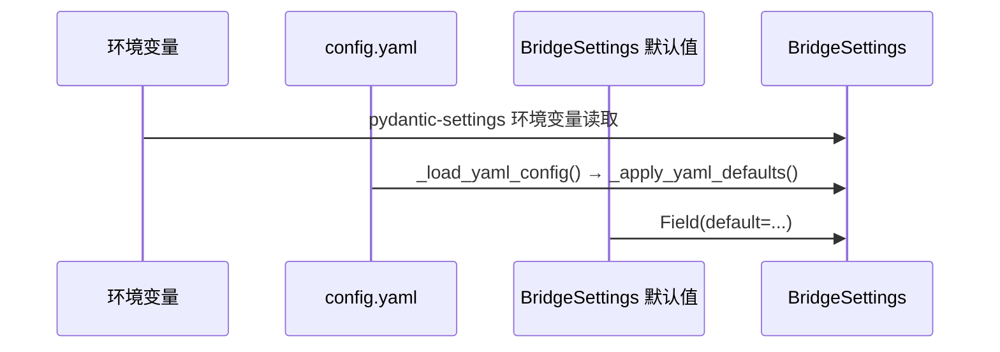
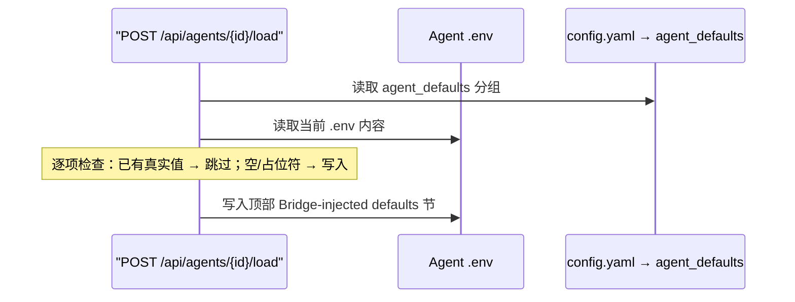
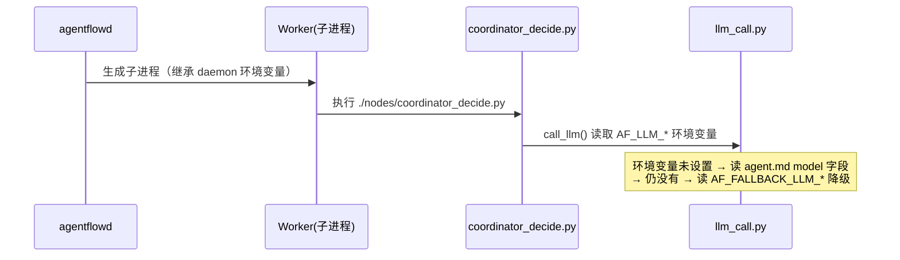

# AgentFlow 配置全景观

> **层级**: L3 · `docs/design/config-landscape.md`
> **状态**: v1.2 — 统一命名规范 (AF_BR_*) + AgentConfig 统一配置入口
> **创建日期**: 2026-07-10
> **更新**: v1.2 (2026-07-11) 统一命名规范、AgentConfig 统一配置入口

---

## 1. 总览

AgentFlow 的配置体系分为 4 层，按优先级从低到高排列。高优先级覆盖低优先级。



| 层级 | 组件 | 来源 | 加载时机 |
|------|------|------|----------|
| **L0** | Bridge | `config.py` pydantic 字段 `default=` | import 时 |
| | Daemon | `config.h` `DaemonConfig` 结构体字段默认值 | 进程启动 |
| | Agent 节点 | `llm_call.py` 等代码中的常量/缺省值 | 运行时 |
| **L1** | Bridge | `configs/{env}/bridge.yaml`（权威）→ `frontend/bridge/config.yaml`（回退） | `get_settings()` 首次调用 |
| | Daemon | `configs/{env}/agentflowd.json` | `--config` 加载 |
| **L2** | Agent 包 | `examples/agent/*/.env` | Bridge `load_agent` 注入 + 节点启动继承 |
| **L3** | Daemon | CLI 参数（`--listen`, `--package` 等）| `parse_cli_args()` |
| | Daemon | `AF_LISTEN`, `AF_LOG_LEVEL` 等环境变量 | `apply_env_overrides()` |
| | Bridge | `AF_BR_DAEMON_HOST`, `AF_BR_LISTEN` 等环境变量 | pydantic-settings |
| | Agent 节点 | `AF_LLM_*` 等环境变量 | 子进程继承 |

---

## 2. 配置分域与完整清单

### 2.1 Daemon 配置（C++ agentflowd）

#### 2.1.1 CLI 参数（优先级最高）

| 参数 | 类型 | 默认值 | 用途 |
|------|------|--------|------|
| `--listen ADDR:PORT` | string | `0.0.0.0:7890` | TCP 监听地址 |
| `--package PATH` | string[] | — | Agent 包目录（可重复） |
| `--config FILE` | string | — | JSON 配置文件路径 |
| `--validate` | bool | false | 验证配置 + 包结构后退出 |
| `--uds-biz-path PATH` | string | `/tmp/agentflowd_biz.sock` | UDS 业务 socket 路径 |
| `--uds-ctrl-path PATH` | string | `/tmp/agentflowd_ctrl.sock` | UDS 控制 socket 路径 |
| `--max-connections N` | int | 1024 | 最大并发连接数 |
| `--role ROLE` | enum | `master` | `master` \| `worker` |
| `--worker-threads N` | int | 4 | Worker 线程池大小 |
| `--worker-id ID` | string | — | Worker 标识 |
| `--workflow-threads N` | int | 1 | 每个 worker 的 workflow 默认线程数 |
| `--control-threads N` | int | 1 | 每个 worker 的控制线程数 |
| `--business-threads N` | int | 1 | 每个 worker 的业务线程数 |
| `--queue-size N` | uint | 1024 | Worker 队列大小 |
| `--daemonize` | bool | false | 后台运行 |
| `--pid-file FILE` | string | — | PID 文件路径 |
| `--log-level LEVEL` | enum | `info` | `trace` \| `debug` \| `info` \| `warn` \| `error` |
| `--log-file FILE` | string | — | 日志文件（空=stdout） |
| `--flow-trace-file FILE` | string | — | 流程追踪输出文件（单 `.ndjson`） |
| `--flow-trace-dir DIR` | string | — | 流程追踪输出目录（按 session 分 `.ndjson`） |
| `--drain-timeout MS` | int | 30000 | 优雅关闭超时（毫秒） |
| `--deploy-interval MS` | int | — | Deployer 调度间隔（毫秒） |
| `--heartbeat-timeout MS` | int64 | — | Deployer 心跳超时（毫秒） |
| `--schedule-interval MS` | int | — | Scheduler 调度间隔（毫秒） |
| `--dataref-capacity-mb N` | int | 512 | DataRef Bridge（总线 B）容量（MB） |
| `--dataref-redis-url URL` | string | `redis://127.0.0.1:6379` | DataRef Redis 连接地址 |

#### 2.1.2 环境变量覆盖（同优先级的 CLI 参数优先）

| 环境变量 | 覆盖的目标 | 类型 |
|----------|-----------|------|
| `AF_LISTEN` | `config.listen` | string |
| `AF_UDS_BIZ_PATH` | `config.uds_biz_path` | string |
| `AF_UDS_CTRL_PATH` | `config.uds_ctrl_path` | string |
| `AF_PLUGIN_UDS_FILE` | `config.runtime_config.plugin_uds_path` | string |
| `AF_LOG_LEVEL` | `config.log_level` | string |
| `AF_LOG_FILE` | `config.log_file` | string |
| `AF_FLOW_TRACE_FILE` | `config.flow_trace_file` | string |
| `AF_FLOW_TRACE_DIR` | `config.flow_trace_dir` | string |
| `AF_CONFIG_FILE` | `config.config_file` | string |
| `AF_DATAREF_CAPACITY_MB` | `config.dataref_bridge_config.capacity_mb` | int |
| `AF_DATAREF_REDIS_URL` | `config.dataref_bridge_config.redis_url` | string |

#### 2.1.3 配置文件（`configs/{env}/agentflowd.json`）

```jsonc
{
  "server": {
    "listen": "127.0.0.1:17891",     // TCP 监听
    "uds_biz_path": "/tmp/agentflowd_biz.sock",
    "uds_ctrl_path": "/tmp/agentflowd_ctrl.sock",
    "max_connections": 1024
  },
  "runtime": {
    "role": "master",                 // master | worker
    "worker_threads": 4,
    "local_worker_id": "worker-1",
    "worker_default_workflow_threads": 2,
    "worker_control_threads": 1,
    "worker_business_threads": 2,
    "worker_queue_size": 1024
  },
  "dataref_bridge": {
    "capacity_mb": 512,
    "redis_url": ""
  },
  "logging": {
    "level": "debug",
    "file": ""                        // 空=stdout
  },
  "daemon": {
    "pid_file": "/tmp/agentflowd.pid",
    "drain_timeout_ms": 30000
  },
  "agents": []                        // 通过 --package CLI 参数传入
}
```

> 上例为 `configs/dev/agentflowd.json`（开发环境）的真实内容。生产环境（`configs/prod/agentflowd.json`）额外包含 `deployer`、`scheduler`、`trace` 等字段，详见 `configs/prod/agentflowd.json`。

#### 2.1.4 配置合并优先级



> **说明**：合并顺序为 `parse_cli_args()` → `load_config_file()`（仅填充未设置字段）→ `apply_env_overrides()`（仅覆盖文件设置的字段）。最终优先级：CLI > 环境变量 > JSON 配置文件 > 代码默认值。`apply_env_overrides` 不会覆盖 CLI 已设置的值。

#### 2.1.5 完整环境变量全景

以下列出 agentflow 全系统中所有环境变量，按用途分组。标记「透传」的由 daemon 子进程继承，Bridge 或 Agent 节点读取。

**管辖分类**（按管理责任域划分）：

| 管辖域 | 说明 | 读取方 | 配置来源 |
|--------|------|--------|---------|
| `agentflow daemon 管辖` | agentflowd daemon (C++) 直接读取的 infra 配置 | daemon C++ | CLI 参数 / 环境变量 AF_* / JSON 配置文件 |
| `agentflow 框架透传` | 框架定义的标准可配项，daemon 透传 + Bridge 可注入，Agent 节点消费 | Agent 节点 (Python) | Bridge agent_defaults 注入 → `.env` / 环境变量 |
| `bridge 管辖` | Bridge (Python) 直接管理的应用配置 | Bridge Python | config.yaml / 环境变量 / .env |
| `agentpkg 业务自有` | Agent 包业务特有，框架不做任何读取或注入处理 | Agent 节点 (Python) | 手动配置 `.env` |

| 环境变量 | 用途 | 消费方 | 默认值 | fallback 链 | 分类 | 配置来源 |
|----------|------|--------|--------|-------------|------|----------|
| **🌐 环境选择** | | | | | | |
| `AF_BR_ENV` | 环境模式（dev/test/prod） | Bridge Python | `dev` | | bridge 管辖 | 环境变量 |
| **🔌 Daemon 原生** | | | | | **agentflow daemon 管辖** | |
| `AF_LISTEN` | daemon TCP 监听地址 | daemon C++ | `0.0.0.0:7890` | CLI `--listen` > env | agentflow daemon 管辖 | `configs/{env}/agentflowd.json` → `server.listen` |
| `AF_UDS_BIZ_PATH` | UDS 业务 socket 路径 | daemon C++ | `/tmp/agentflowd_biz.sock` | | agentflow daemon 管辖 | `configs/{env}/agentflowd.json` → `server.uds_biz_path` |
| `AF_UDS_CTRL_PATH` | UDS 控制 socket 路径 | daemon C++ | `/tmp/agentflowd_ctrl.sock` | | agentflow daemon 管辖 | `configs/{env}/agentflowd.json` → `server.uds_ctrl_path` |
| `AF_PLUGIN_UDS_FILE` | Plugin UDS 路径 | daemon C++ | — | | agentflow daemon 管辖 | `configs/{env}/agentflowd.json` → `runtime.plugin_uds_path` |
| `AF_LOG_LEVEL` | 日志级别 | daemon C++ | `info` | CLI `--log-level` > env | agentflow daemon 管辖 | `configs/{env}/agentflowd.json` → `logging.level` |
| `AF_LOG_FILE` | 日志文件路径 | daemon C++ | stdout | | agentflow daemon 管辖 | `configs/{env}/agentflowd.json` → `logging.file` |
| `AF_FLOW_TRACE_FILE` | 流程追踪输出文件 | daemon C++ | — | | agentflow daemon 管辖 | CLI `--flow-trace-file` |
| `AF_FLOW_TRACE_DIR` | 流程追踪输出目录 | daemon C++ | — | | agentflow daemon 管辖 | `configs/{env}/agentflowd.json` → `trace.flow_dir` |
| `AF_CONFIG_FILE` | JSON 配置文件路径 | daemon C++ | — | | agentflow daemon 管辖 | CLI `--config` |
| `AF_DATAREF_CAPACITY_MB` | DataRef 容量（MB） | daemon C++ | `512` | | agentflow daemon 管辖 | `configs/{env}/agentflowd.json` → `dataref_bridge.capacity_mb` |
| `AF_DATAREF_REDIS_URL` | DataRef Redis 连接 | daemon C++ | `redis://127.0.0.1:6379` | | agentflow daemon 管辖 | `configs/{env}/agentflowd.json` → `dataref_bridge.redis_url` |
| **🤖 LLM 主模型（透传 → 节点）** | | | | | **agentflow 框架透传** | |
| `AF_LLM_API_KEY` | LLM API 密钥 | Agent 节点 | — | → `AF_FALLBACK_LLM_API_KEY` | agentflow 框架透传 | `configs/{env}/bridge.yaml` → `agent_defaults.llm.api_key` |
| `AF_LLM_BASE_URL` | LLM 请求地址 | Agent 节点 | — | → `AF_FALLBACK_LLM_BASE_URL` | agentflow 框架透传 | `configs/{env}/bridge.yaml` → `agent_defaults.llm.base_url` |
| `AF_LLM_MODEL` | 模型名 | Agent 节点 | `agent.md model` | → `agent.md` > env > `AF_FALLBACK_LLM_MODEL` | agentflow 框架透传 | `configs/{env}/bridge.yaml` → `agent_defaults.llm.model` |
| `DASHSCOPE_API_KEY` | DashScope 快捷密钥 | 部分脚本 | — | | agentpkg 业务自有 | Agent `.env` 手动配置 |
| **⚙️ LLM 请求调优（透传 → 节点）** | | | | | **agentflow 框架透传** | |
| `AF_LLM_TIMEOUT` | 请求总超时（秒） | Agent 节点 | `120` | | agentflow 框架透传 | `configs/{env}/bridge.yaml` → `agent_defaults.llm_timeout` |
| `AF_LLM_CONNECT_TIMEOUT` | TCP 连接超时（秒） | Agent 节点 | `15` | | agentflow 框架透传 | `configs/{env}/bridge.yaml` → `agent_defaults.llm_connect_timeout` |
| `AF_LLM_MAX_RETRIES` | 网络错误重试次数 | Agent 节点 | `2` | | agentflow 框架透传 | `configs/{env}/bridge.yaml` → `agent_defaults.llm_max_retries` |
| `AF_LLM_RETRY_BASE_DELAY` | 重试退避基数（秒） | Agent 节点 | `1.0` | | agentflow 框架透传 | `configs/{env}/bridge.yaml` → `agent_defaults.llm_retry_base_delay` |
| `AF_USE_AISF_MODELS` | UDS 通道切换（true 时模型名补 `aisf/` 前缀） | Agent 节点 | `false` | | agentflow 框架透传 | `configs/{env}/bridge.yaml` → `agent_defaults.use_aisf_models` |
| **🔄 Coordinator（透传 → 节点）** | | | | | **agentflow 框架透传** | |
| `AF_MAX_COORDINATOR_ITERATIONS` | 最大协调轮次 | Agent 节点 | `10` | | agentflow 框架透传 | `configs/{env}/bridge.yaml` → `agent_defaults.coordinator.max_iterations` |
| `AF_MAX_COMPLETION_TOKENS` | 最大输出 token | Agent 节点 | `8192` | | agentflow 框架透传 | `configs/{env}/bridge.yaml` → `agent_defaults.coordinator.max_completion_tokens` |
| `AF_MODEL_MAX_TOKENS` | 模型上下文窗口上限 | Agent 节点 | `128000` | | agentflow 框架透传 | `configs/{env}/bridge.yaml` → `agent_defaults.skill.model_max_tokens` |
| `AF_COMPACTION_THRESHOLD` | 压缩触发阈值 | Agent 节点 | `0.8` | | agentflow 框架透传 | `configs/{env}/bridge.yaml` → `agent_defaults.skill.compaction_threshold` |
| **⚡ Skill 执行器（透传 → 节点）** | | | | | **agentflow 框架透传** | |
| `AF_MAX_SKILL_TASK_ITERATIONS` | skill 内部最大 LLM 轮次 | Agent 节点 | `8` | | agentflow 框架透传 | `configs/{env}/bridge.yaml` → `agent_defaults.skill.max_iterations` |
| `AF_SKILL_MAX_COMPLETION_TOKENS` | skill 最大输出 token | Agent 节点 | `8192` | | agentflow 框架透传 | `configs/{env}/bridge.yaml` → `agent_defaults.skill.max_completion_tokens` |
| `AF_SKILL_LLM_RECOVERY_ATTEMPTS` | LLM 错误恢复尝试次数 | Agent 节点 | `2` | | agentflow 框架透传 | `configs/{env}/bridge.yaml` → `agent_defaults.skill.llm_recovery_attempts` |
| `AF_NODE_EXECUTION_TIMEOUT` | 节点单次执行超时（秒） | Agent 节点 | `240` | | agentflow 框架透传 | `configs/{env}/bridge.yaml` → `agent_defaults.skill.node_timeout_sec` |
| **🖼 VL 多模态（透传 → 节点，命名 `AF_BR_VISION_*`）** | | | | | **agentflow 框架透传** | |
| `AF_BR_VISION_BASE_URL` | VL 模型请求地址 | Agent 节点 | — | → `AF_BR_VISION_FALLBACK_BASE_URL` | agentflow 框架透传 | `configs/{env}/bridge.yaml` → `agent_defaults.vision.base_url` |
| `AF_BR_VISION_MODEL` | VL 模型名 | Agent 节点 | — | → `AF_BR_VISION_FALLBACK_MODEL` | agentflow 框架透传 | `configs/{env}/bridge.yaml` → `agent_defaults.vision.model` |
| `AF_BR_VISION_API_KEY` | VL 模型 API 密钥 | Agent 节点 | — | → `AF_BR_VISION_FALLBACK_API_KEY` | agentflow 框架透传 | `configs/{env}/bridge.yaml` → `agent_defaults.vision.api_key` |
| `AF_BR_VISION_FALLBACK_BASE_URL` | VL 降级地址 | Agent 节点 | — | | agentflow 框架透传 | `configs/{env}/bridge.yaml` → `agent_defaults.vision_fallback.base_url` |
| `AF_BR_VISION_FALLBACK_MODEL` | VL 降级模型名 | Agent 节点 | — | | agentflow 框架透传 | `configs/{env}/bridge.yaml` → `agent_defaults.vision_fallback.model` |
| `AF_BR_VISION_FALLBACK_API_KEY` | VL 降级密钥 | Agent 节点 | — | | agentflow 框架透传 | `configs/{env}/bridge.yaml` → `agent_defaults.vision_fallback.api_key` |
| **🌐 外部服务（透传 → 节点）** | | | | | **agentpkg 业务自有** | |
| `QWEATHER_API_KEY` | 和风天气 API 密钥 | Agent 节点 | — | | agentpkg 业务自有 | Agent `.env` 手动配置 |
| `QWEATHER_API_HOST` | 和风天气 API 域名 | Agent 节点 | — | | agentpkg 业务自有 | Agent `.env` 手动配置 |
| **🪟 Agent 包配置（透传 → 节点，由 Bridge inject）** | | | | | **agentflow 框架透传** | |
| `AF_FALLBACK_LLM_API_KEY` | LLM 降级密钥 | Agent 节点 | — | | agentflow 框架透传 | `configs/{env}/bridge.yaml` → `agent_defaults.llm_fallback.api_key` |
| `AF_FALLBACK_LLM_BASE_URL` | LLM 降级地址 | Agent 节点 | — | | agentflow 框架透传 | `configs/{env}/bridge.yaml` → `agent_defaults.llm_fallback.base_url` |
| `AF_FALLBACK_LLM_MODEL` | LLM 降级模型 | Agent 节点 | — | | agentflow 框架透传 | `configs/{env}/bridge.yaml` → `agent_defaults.llm_fallback.model` |
| `DASHSCOPE_VL_MODEL` | DashScope VL 模型名（旧名） | Agent 节点 | — | | agentpkg 业务自有 | Agent `.env` 手动配置 |

> **透传机制说明**：以上所有变量均由 daemon 启动时继承或子进程透传，不在 daemon C++ 代码中直接读取。Bridge `load_agent` 会将 `config.yaml → agent_defaults` 注入到 Agent 包的 `.env` 中（详见 §2.3），daemon 子进程自动继承。「agentflow daemon 管辖」的变量由 daemon C++ 代码明确读取；「agentflow 框架透传」的变量由框架（daemon + Bridge）负责传递，Agent 节点消费；「bridge 管辖」的变量由 Bridge Python 代码读取；「agentpkg 业务自有」的变量仅由特定 Agent 包自行配置，框架不做任何处理。

---

### 2.2 Bridge 配置（Python FastAPI）

#### 2.2.1 config.yaml（权威源）

Bridge 配置按环境隔离，由 `AF_BR_ENV` 环境变量控制（默认 `dev`）：

| `AF_BR_ENV` | 加载的文件 |
|----------------|-----------|
| 未设置 / `dev` | `configs/dev/bridge.yaml` |
| `test` | `configs/test/bridge.yaml` |
| `prod` | `configs/prod/bridge.yaml` |
| 其他值 | `configs/{value}/bridge.yaml` |

**搜索顺序**（`_CONFIG_FILE_CANDIDATES`，first-match-wins）：

1. `configs/{AF_BR_ENV}/bridge.yaml` ← 新增环境配置（权威）
2. `config.yaml`（CWD 回退）
3. `frontend/bridge/config.yaml`（代码目录回退）
4. `/opt/agentflow/config.yaml`（系统路径回退）

> 当步骤 1 命中时，后续回退文件**不会被加载**。环境配置必须包含所有字段。

**配置分组**：

| 分组 | YAML 路径 | 条目数 | 代表变量 |
|------|-----------|--------|----------|
| 🔌 Daemon 连接 | `daemon.*` | 2 | `daemon.host`, `daemon.port` |
| 🌐 Bridge 服务 | `bridge.*` / `sidecar.*` | 4 | `bridge.listen`, `sidecar.enabled` |
| 📡 AISF Adapter | `aisf_adapter.*` | 10 | `aisf_adapter.agent_id`, `aisf_adapter.upstream.*` |
| 📂 文件路径 | `*_dir` | 3 | `agent_packages_dir`, `skill_hub_dir` |
| 🪵 日志与超时 | `log_level`, `request_timeout_seconds` | 2 | |
| 🗄 会话持久化 | `session_*` | 4 | `session_provider`, `session_db_path` |
| 🖼 多模态内容 | `content_image_*`, `uploads_dir` | 2 | |
| 🌍 CORS | `cors_allowed_origins` | 1 | |
| 🤖 Agent 默认值 | `agent_defaults.*` | 24 子项 | 详见 §2.2.2 |

完整字段清单见 `frontend/bridge/config.yaml` inline 注释。

#### 2.2.2 环境变量覆盖

所有 Bridge 环境变量均为「bridge 管辖」。命名统一为 `AF_BR_*` 前缀。

| 环境变量 | Pydantic 字段 | config.yaml 路径 | 类型 | 默认值 | 管辖 | 配置来源 |
|----------|---------------|-----------------|------|--------|------|----------|
| `AF_BR_DAEMON_HOST` | `daemon_host` | `daemon.host` | str | `"127.0.0.1"` | bridge 管辖 | `configs/{env}/bridge.yaml` → `daemon.host` |
| `AF_BR_DAEMON_PORT` | `daemon_port` | `daemon.port` | int | `17891` | bridge 管辖 | `configs/{env}/bridge.yaml` → `daemon.port` |
| `AF_BR_LISTEN` | `bridge_listen` | `bridge.listen` | str | `"0.0.0.0:8199"` | bridge 管辖 | `configs/{env}/bridge.yaml` → `bridge.listen` |
| `AF_BR_AGENT_PACKAGES_DIR` | `agent_packages_dir` | `agent_packages_dir` | str | `"examples/agent"` | bridge 管辖 | `configs/{env}/bridge.yaml` → `agent_packages_dir` |
| `AF_BR_SKILL_HUB_DIR` | `skill_hub_dir` | `skill_hub_dir` | str | `"resource/skill_hub"` | bridge 管辖 | `configs/{env}/bridge.yaml` → `skill_hub_dir` |
| `AF_BR_LOG_LEVEL` | `log_level` | `log_level` | str | `"INFO"` | bridge 管辖 | `configs/{env}/bridge.yaml` → `log_level` |
| `AF_BR_REQUEST_TIMEOUT_SECONDS` | `request_timeout_seconds` | `request_timeout_seconds` | float | `5.0`（代码）→`15.0`（config.yaml） | bridge 管辖 | `configs/{env}/bridge.yaml` → `request_timeout_seconds` |
| `AF_BR_DAEMON_STATUS_REFRESH_INTERVAL` | `daemon_status_refresh_interval` | `daemon_status_refresh_interval` | float | `10.0` | bridge 管辖 | `configs/{env}/bridge.yaml` → `daemon_status_refresh_interval` |
| `AF_BR_CORS_ALLOWED_ORIGINS` | `cors_allowed_origins` | `cors_allowed_origins` | list[str] | `["http://localhost:15173", ...]` | bridge 管辖 | `configs/{env}/bridge.yaml` → `cors_allowed_origins` |
| `AF_BR_CHAT_TURN_TIMEOUT_SECONDS` | `chat_turn_timeout_seconds` | `chat_turn_timeout_seconds` | float | `900.0` | bridge 管辖 | `configs/{env}/bridge.yaml` → `chat_turn_timeout_seconds` |
| `AF_BR_SESSION_PROVIDER` | `session_provider` | `session_provider` | str | `"local"` | bridge 管辖 | `configs/{env}/bridge.yaml` → `session_provider` |
| `AF_BR_SESSION_DB_PATH` | `session_db_path` | `session_db_path` | str | `"/tmp/agentflow/sessions.db"`（代码）→`"data/sessions.db"`（config.yaml） | bridge 管辖 | `configs/{env}/bridge.yaml` → `session_db_path` |
| `AF_BR_SESSION_SYNC_INTERVAL` | `session_sync_interval` | `session_sync_interval` | float | `30.0` | bridge 管辖 | `configs/{env}/bridge.yaml` → `session_sync_interval` |
| `AF_BR_UPLOADS_DIR` | `uploads_dir` | `uploads_dir` | str | `"/tmp/agentflow/uploads"` | bridge 管辖 | `configs/{env}/bridge.yaml` → `uploads_dir` |
| `AF_BR_COREMIND_AGENT_ID` | — | — | str | `"outfit-assistant"` | bridge 管辖 | 环境变量（由 `coremind_internal.py` 直接 `os.environ.get()`） |

**注意**：Bridge 的环境变量已统一为 `AF_BR_*` 前缀，与 Daemon 的 `AF_*` 前缀同源。

#### 2.2.3 配置加载优先级



> 注：Bridge 自身配置仅通过 YAML + 环境变量加载，`frontend/bridge/.env` 及 `.env.example` 已删除（不再需要，配置已迁移到 `configs/{env}/bridge.yaml`）。

---

### 2.3 Agent .env 注入（Bridge load_agent 中间层）

当 Bridge 调用 `load_agent`（`POST /api/agents/{id}/load`）时，会自动将 `config.yaml → agent_defaults` 中的配置注入到 Agent 包的 `.env` 文件中。

**映射表**（`routes/agents.py` 中 `_AGENT_ENV_DEFAULTS`）：

所有变量均为 **agentflow 框架透传** —— 框架（Bridge `load_agent`）将 `agent_defaults` 注入 `.env`，daemon 透传给子进程，Agent 节点代码消费。这些变量是 agentflow 框架为 Agent 包定义的标准可配项，框架明确负责其传递与管理。

| .env 变量 | config.yaml 路径 | 类型 | 管辖 |
|-----------|-----------------|------|------|
| **LLM 主模型** | | | |
| `AF_LLM_API_KEY` | `agent_defaults.llm.api_key` | string | agentflow 框架透传 |
| `AF_LLM_BASE_URL` | `agent_defaults.llm.base_url` | string | agentflow 框架透传 |
| `AF_LLM_MODEL` | `agent_defaults.llm.model` | string | agentflow 框架透传 |
| **LLM 降级** | | | |
| `AF_FALLBACK_LLM_API_KEY` | `agent_defaults.llm_fallback.api_key` | string | agentflow 框架透传 |
| `AF_FALLBACK_LLM_BASE_URL` | `agent_defaults.llm_fallback.base_url` | string | agentflow 框架透传 |
| `AF_FALLBACK_LLM_MODEL` | `agent_defaults.llm_fallback.model` | string | agentflow 框架透传 |
| **Coordinator** | | | |
| `AF_MAX_COORDINATOR_ITERATIONS` | `agent_defaults.coordinator.max_iterations` | int | agentflow 框架透传 |
| `AF_MAX_COMPLETION_TOKENS` | `agent_defaults.coordinator.max_completion_tokens` | int | agentflow 框架透传 |
| **Skill 执行器** | | | |
| `AF_MAX_SKILL_TASK_ITERATIONS` | `agent_defaults.skill.max_iterations` | int | agentflow 框架透传 |
| `AF_SKILL_MAX_COMPLETION_TOKENS` | `agent_defaults.skill.max_completion_tokens` | int | agentflow 框架透传 |
| `AF_SKILL_LLM_RECOVERY_ATTEMPTS` | `agent_defaults.skill.llm_recovery_attempts` | int | agentflow 框架透传 |
| `AF_NODE_EXECUTION_TIMEOUT` | `agent_defaults.skill.node_timeout_sec` | int | agentflow 框架透传 |
| **Token 预算**（YAML 中嵌套在 `skill:` 下） | | | |
| `AF_MODEL_MAX_TOKENS` | `agent_defaults.skill.model_max_tokens` | int | agentflow 框架透传 |
| `AF_COMPACTION_THRESHOLD` | `agent_defaults.skill.compaction_threshold` | float | agentflow 框架透传 |
| **HTTP 传输** | | | |
| `AF_LLM_TIMEOUT` | `agent_defaults.llm_timeout` | int | agentflow 框架透传 |
| `AF_LLM_CONNECT_TIMEOUT` | `agent_defaults.llm_connect_timeout` | int | agentflow 框架透传 |
| `AF_LLM_MAX_RETRIES` | `agent_defaults.llm_max_retries` | int | agentflow 框架透传 |
| `AF_LLM_RETRY_BASE_DELAY` | `agent_defaults.llm_retry_base_delay` | float | agentflow 框架透传 |
| `AF_USE_AISF_MODELS` | `agent_defaults.use_aisf_models` | bool | agentflow 框架透传 |
| **VL 多模态** | | | |
| `AF_BR_VISION_BASE_URL` | `agent_defaults.vision.base_url` | string | agentflow 框架透传 |
| `AF_BR_VISION_MODEL` | `agent_defaults.vision.model` | string | agentflow 框架透传 |
| `AF_BR_VISION_API_KEY` | `agent_defaults.vision.api_key` | string | agentflow 框架透传 |
| **VL 降级** | | | |
| `AF_BR_VISION_FALLBACK_BASE_URL` | `agent_defaults.vision_fallback.base_url` | string | agentflow 框架透传 |
| `AF_BR_VISION_FALLBACK_MODEL` | `agent_defaults.vision_fallback.model` | string | agentflow 框架透传 |
| `AF_BR_VISION_FALLBACK_API_KEY` | `agent_defaults.vision_fallback.api_key` | string | agentflow 框架透传 |

**注入规则**：
- 只写入 currently empty / missing / placeholder（`${...}` / `sk-your-` / `your-`）的值
- **永不覆盖**用户已在 `.env` 中配置的真实值
- Bridge 默认值写在 `.env` 文件顶部（`# ── Bridge-injected defaults ──`），用户原有值写在底部

---

### 2.4 节点运行时环境变量（被 Agent 节点读取）

这些环境变量由 Agent 节点代码（`coordinator_decide.py`, `skill_executor.py`, `llm_call.py` 等）在运行时读取。来源有两层：Daemon 进程继承 + `.env` 文件（通过 `load_agent` 注入）。

**管辖分类**：框架定义的标准可配项（`AF_LLM_*`, `AF_BR_VISION_*`, `AF_FALLBACK_*` 等）为 **agentflow 框架透传**；Agent 包业务特有的变量（`QWEATHER_*`, `DASHSCOPE_*` 等）为 **agentpkg 业务自有**。

#### 2.4.1 LLM 核心配置

| 变量 | 用途 | fallback 链 | 读取位置 |
|------|------|-------------|----------|
| `AF_LLM_API_KEY` | LLM API 密钥 | → `AF_FALLBACK_LLM_API_KEY` | `llm_call.py` |
| `AF_LLM_BASE_URL` | LLM 请求地址 | → `AF_FALLBACK_LLM_BASE_URL` | `llm_call.py` |
| `AF_LLM_MODEL` | 模型名 | → `agent.md model` 字段 → `AF_FALLBACK_LLM_MODEL` | `llm_call.py` |
| `DASHSCOPE_API_KEY` | DashScope 快捷密钥 | — | 部分脚本直接引用 |

#### 2.4.2 LLM 请求调优

| 变量 | 用途 | 默认值 |
|------|------|--------|
| `AF_LLM_TIMEOUT` | 请求总超时（秒） | `120` |
| `AF_LLM_CONNECT_TIMEOUT` | TCP 连接超时（秒） | `15` |
| `AF_LLM_MAX_RETRIES` | 网络错误重试次数 | `2` |
| `AF_LLM_RETRY_BASE_DELAY` | 重试退避基数（秒） | `1.0` |
| `AF_USE_AISF_MODELS` | UDS 通道切换（true 时模型名补 `aisf/` 前缀） | `false` |

#### 2.4.3 Coordinator 控制

| 变量 | 用途 | 默认值 |
|------|------|--------|
| `AF_MAX_COORDINATOR_ITERATIONS` | 最大协调轮次 | `10` |
| `AF_MAX_COMPLETION_TOKENS` | 最大输出 token | `8192` |
| `AF_MODEL_MAX_TOKENS` | 模型上下文窗口上限（token） | `128000` |
| `AF_COMPACTION_THRESHOLD` | 压缩触发阈值（0.0-1.0） | `0.8` |

#### 2.4.4 Skill 执行控制

| 变量 | 用途 | 默认值 |
|------|------|--------|
| `AF_MAX_SKILL_TASK_ITERATIONS` | skill 内部最大 LLM 轮次 | `8` |
| `AF_SKILL_MAX_COMPLETION_TOKENS` | skill 最大输出 token | `8192` |
| `AF_SKILL_LLM_RECOVERY_ATTEMPTS` | skill LLM 错误恢复尝试次数 | `2` |
| `AF_NODE_EXECUTION_TIMEOUT` | 节点单次执行超时（秒） | `240` |

#### 2.4.5 VL 多模态模型

| 变量 | 用途 | fallback 链 |
|------|------|-------------|
| `AF_BR_VISION_BASE_URL` | VL 模型请求地址 | → `AF_BR_VISION_FALLBACK_BASE_URL` |
| `AF_BR_VISION_MODEL` | VL 模型名 | → `AF_BR_VISION_FALLBACK_MODEL` |
| `AF_BR_VISION_API_KEY` | VL 模型 API 密钥 | → `AF_BR_VISION_FALLBACK_API_KEY` |
| `AF_BR_VISION_FALLBACK_BASE_URL` | VL 降级地址 | |
| `AF_BR_VISION_FALLBACK_MODEL` | VL 降级模型名 | |
| `AF_BR_VISION_FALLBACK_API_KEY` | VL 降级密钥 | |

#### 2.4.6 外部服务

| 变量 | 用途 | 来源 |
|------|------|------|
| `QWEATHER_API_KEY` | 和风天气 API 密钥 | `.env` 手动配置 |
| `QWEATHER_API_HOST` | 和风天气 API 域名 | `.env` 手动配置 |
| `DASHSCOPE_VL_MODEL` | DashScope VL 模型名（旧名） | `.env` 手动配置 |

---

### 2.5 agent.md 中的配置引用

Agent 包的 `agent.md` 中可声明 `model` 字段，此字段实际映射为配置：

```
# agent.md frontmatter
---
name: 穿搭顾问 · Outfit Stylist
model: deepseek-v4-flash           # ← 节点读此字段为 LLM 模型名
---
```

**优先级链**：`agent.md model` 字段 > `AF_LLM_MODEL` 环境变量 > `AF_FALLBACK_LLM_MODEL`

> **注意**：`model` 字段和环境变量是**替代关系而非叠加关系**——节点代码（`llm_call.py`）优先读 `agent.md` 的 `model` 字段（通过 `resolve_llm_config` 加载），若未设置则读 `AF_LLM_MODEL` 环境变量。

---

### 2.6 测试配置

#### 2.6.1 E2E 测试的 LLM 模式切换

所有 E2E 测试（`test_e2e_outfit_*.py`, `e2e_agentflow_pipeline.py`）遵循相同的模式：

```
环境变量 AF_LLM_BASE_URL + AF_LLM_API_KEY 已设置 → 使用真实 LLM
环境变量未设置                         → 回退 mock LLM（e2e-scripted）
```

| 测试 | 真实 LLM 检测变量 | mock LLM 实现 |
|------|-------------------|---------------|
| `test_e2e_outfit_agent.py` (pytest) | `AF_LLM_API_KEY` + `AF_LLM_BASE_URL` | `e2e_helpers.scripted_llm()` |
| `test_e2e_outfit_multiturn.py` (pytest) | 同上 | 同上 |
| `test_e2e_outfit_skill.py` (pytest) | 同上 | 同上 |
| `e2e_agentflow_pipeline.py` (独立脚本) | 同上 + `dotenv` 自动加载 `.env` | —（无 mock） |

#### 2.6.2 Bridge 集成测试的配置覆盖

| 测试 | 覆盖的配置 |
|------|-----------|
| `test_config.py` | 验证 `config.yaml` 默认值与 `BridgeSettings` 代码默认值一致 |
| `test_agent_env_inject.py` | 验证 `load_agent` 的 `.env` 注入逻辑 |

---

## 3. 加载链路详解

### 3.1 Daemon 启动 → 配置合并



> **优先级顺序**：CLI 参数 > 环境变量 AF_* > JSON 配置文件 > 代码默认值。

### 3.2 Bridge 启动 → 配置加载



### 3.3 Bridge load_agent → 注入 .env



### 3.4 Agent 节点执行 → 环境变量继承



---

## 4. 变量 fallback 优先级链


---

## 附录 A：所有 .env 文件清单

| 文件 | 用途 | 是否提交 git |
|------|------|-------------|
| `examples/agent/outfit-assistant/.env` | 穿搭助手 Agent 配置 | ❌（含 key） |
| `examples/agent/outfit-assistant/.env.example` | 配置模板 | ✅ |
| `examples/agent/test-agent/.env` | 测试用 Agent 配置 | ❌ |
| `examples/agent/outfit-test-agent/.env` | 穿搭测试专用 Agent | ❌ |
| `examples/agent/agentflow_assistant/.env.example` | AgentFlow Assistant 模板 | ✅ |
| `scripts/.env` | 脚本工具配置（超时参数，不含 API key） | ❌ |
| `scripts/.env.example` | 脚本工具配置模板 | ✅ |

## 附录 B：配置文件清单

| 文件 | 用途 | 加载者 |
|------|------|--------|
| `configs/dev/bridge.yaml` | Bridge 开发环境配置 | `BridgeSettings`（`AF_BR_ENV=dev`） |
| `configs/test/bridge.yaml` | Bridge 测试/CI 环境配置 | `BridgeSettings`（`AF_BR_ENV=test`） |
| `configs/prod/bridge.yaml` | Bridge 生产环境配置 | `BridgeSettings`（`AF_BR_ENV=prod`） |
| `configs/dev/agentflowd.json` | Daemon 开发环境配置 | `agentflowd --config` |
| `configs/test/agentflowd.json` | Daemon 测试/CI 环境配置 | `agentflowd --config` |
| `configs/prod/agentflowd.json` | Daemon 生产环境配置 | `agentflowd --config` |
| `frontend/bridge/config.yaml` | Bridge 配置（回退） | `BridgeSettings`（当 env 配置不存在时） |
| ~~`daemon_config.json`~~ | ~~Daemon 配置（旧，已删除）~~ | ~~未被脚本引用~~ |

## 附录 C：跨组件配置引用速查

| 概念 | Daemon C++ | Bridge Python | Agent 节点 | 测试 |
|------|-----------|---------------|------------|------|
| LLM API 密钥 | 透传（`AF_LLM_API_KEY`） | `agent_defaults.llm.api_key` | `AF_LLM_API_KEY` → `AF_FALLBACK_LLM_API_KEY` | `e2e-test-key` |
| LLM 地址 | 透传（`AF_LLM_BASE_URL`） | `agent_defaults.llm.base_url` | `AF_LLM_BASE_URL` | mock `scripted_llm()` |
| 监听地址 | `--listen` / `AF_LISTEN` | `bridge.listen` / `AF_BR_LISTEN` | — | `127.0.0.1:free_port()` |
| Agent 包路径 | `--package` | `agent_packages_dir` | — | `outfit-assistant` |
| 日志级别 | `--log-level` / `AF_LOG_LEVEL` | `log_level` / `AF_BR_LOG_LEVEL` | — | — |

---

## 附录 D：Agent 节点执行环境隔离（Shell Wrapper 模式）

### 问题

AgentFlow daemon 可同时运行多个 agent package，每个 package 可能依赖不同的 Python 版本和第三方库。传统的 `PYTHON_PATH` 环境变量是 worker 进程级的，无法实现 per-package 的 Python 环境隔离。

### 方案：Shell Wrapper 模式

所有 workflow 节点使用 `execution_mode: "shell_script"`，指向一个薄 shell 包装脚本。包装脚本负责：

1. **环境选择**：检测 package 根目录下的 `.venv`，优先使用 `.venv/bin/python3`
2. **环境初始化**（可选）：执行 `setup.sh` 确保 `.venv` 存在
3. **业务执行**：`exec` 替换自身为真正的 Python 业务脚本

```
┌──────────────────────────────────────────────────┐
│ agentflowd worker                                │
│  ┌─ 调度 workflow 节点                            │
│  │  ┌──────────────────────────────────────┐     │
│  │  │ shell_script: bash nodes/xxx.sh      │     │
│  │  │  ├─ 检测 .venv/bin/python3           │     │
│  │  │  ├─ exec .venv/bin/python3 xxx.py    │     │
│  │  │  └─ Python 业务脚本（纯逻辑）         │     │
│  │  └──────────────────────────────────────┘     │
│  └─ 子进程环境完全隔离                          │
└──────────────────────────────────────────────────┘
```

### 包装脚本模板

```bash
#!/bin/bash
# nodes/xxx.sh — Shell wrapper for environment isolation
set -euo pipefail
SCRIPT_DIR="$(cd "$(dirname "$0")" && pwd)"
PACKAGE_DIR="$(cd "$SCRIPT_DIR/.." && pwd)"

VENV_PYTHON="$PACKAGE_DIR/.venv/bin/python3"
if [ -f "$VENV_PYTHON" ]; then
    exec "$VENV_PYTHON" "$SCRIPT_DIR/xxx.py" "$@"
fi
exec python3 "$SCRIPT_DIR/xxx.py" "$@"
```

### 环境初始化流程

```
dummy_pre_skill_workflow:
  setup_env (shell_script)
    └─ bash setup.sh          → 创建 .venv、装依赖
       ↓
  dummy_pre_skill (shell_script)
    └─ bash nodes/dummy_pre_skill.sh
         ├─ (可选) bash setup.sh  → 幂等校验
         └─ exec .venv/bin/python3 nodes/dummy_pre_skill.py
            ↓
coordinator_workflow:
  coordinator_decide (shell_script)
    └─ bash nodes/coordinator_decide.sh
         └─ exec .venv/bin/python3 nodes/coordinator_decide.py
            ↓
skill_workflow:
  skill_executor (shell_script)
    └─ bash nodes/skill_executor.sh
         └─ exec .venv/bin/python3 nodes/skill_executor.py
```

### 优势

| 维度 | 之前（python_script） | 之后（shell_script 包装） |
|------|----------------------|--------------------------|
| 环境隔离 | 依赖全局 `PYTHON_PATH`，多 agent 无法隔离 | 每个 package 独立选择 `.venv` |
| 框架依赖 | 框架必须知道 `python3` 解释器路径 | 框架只调 `bash`，完全不知 Python |
| 业务代码 | 混入 `sys.path` 操作和 venv 激活代码 | 纯业务逻辑，零环境代码 |
| 扩展性 | 只有 Python 可用 | 可按需选择 Python / Go / Node.js 等 |
| 环境初始化 | 手动执行 `setup.sh` | workflow 自动执行 `setup.sh` |
