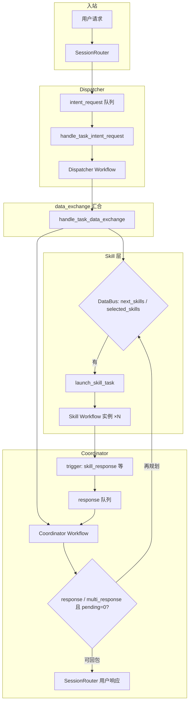
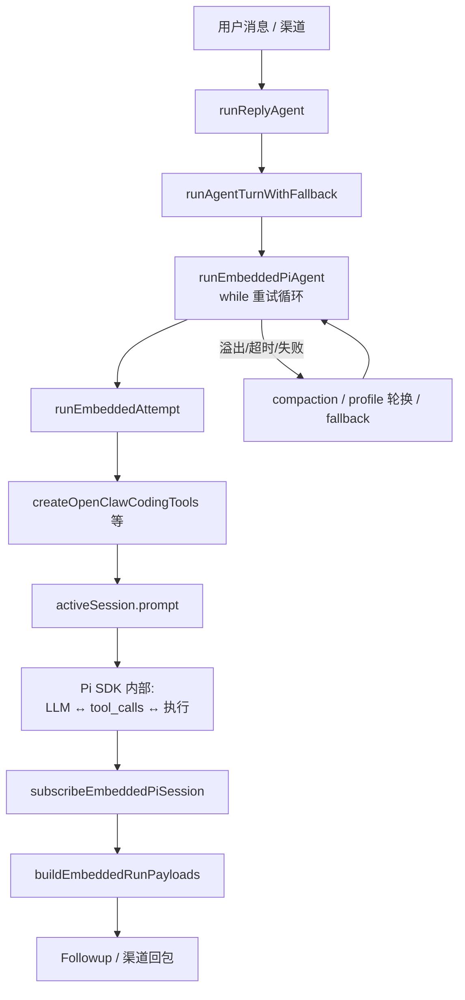
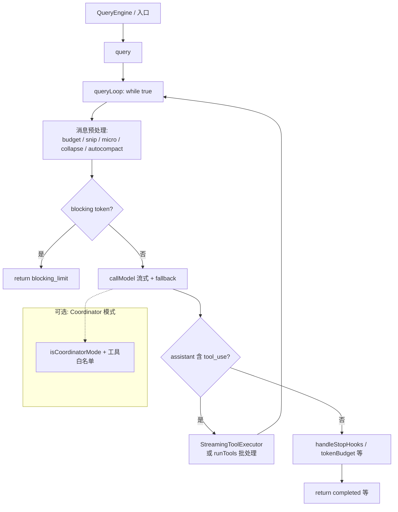
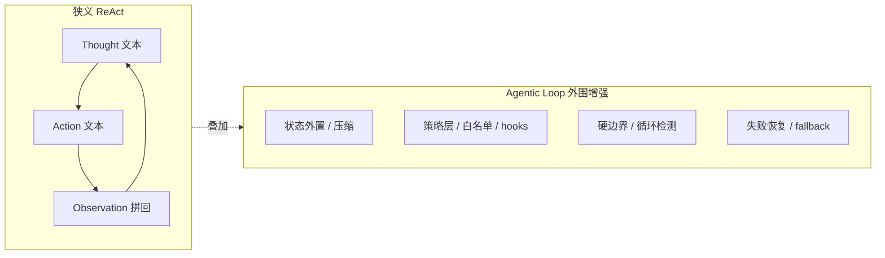

## Coordinator 协同机制设计分析（2026-04-05）

### 1. 背景

Coordinator 是 AgentFlow 框架 dispatcher-coordinator-skill 三层协同架构中的核心编排组件。其设计目标是：

1. **结果判定**：在 dispatcher 分发 skill、skill 执行完成后，判断是否已达成用户请求的最终结果
2. **查漏补缺**：分析当前已完成的 skill 结果，判断是否还需要规划新的 skill 继续完成任务
3. **协同编排**：作为 dispatcher 与 skill 之间的协调层，管理多轮 skill 执行的生命周期

当前 coordinator 机制已具备基本的框架骨架和数据流通路，但在策略层面的实现完整性、与业界 agent loop 实践的对齐程度上仍有较大提升空间。

本文档从下列维度展开分析：
- **当前实现分析**：审视现有 coordinator 实现的完整性和问题
- **对标分析**：对比 OpenClaw 和 Claude Code 的 agent loop 实现
- **ReAct 与 Agentic Loop**：结合 OC/CC 说明从经典 ReAct 到现代 agentic loop 的演进、效果变好的机制原因，及对 AgentFlow 的映射
- **效率、Token 与防循环（§6.6）**：在准确率可验收前提下优化闭环效率与 token；coordinator 兜底时的多层防死循环、OC 官方 loop detection 映射与可审计退出契约
- **改进建议**：识别待优化和待实现的能力，给出改进方案

### 2. 方案简述

本文档为设计分析型 enhancement，核心输出为：

1. 对当前 coordinator 实现的全面审计报告
2. 与 OpenClaw、Claude Code 的 agent loop 实现的详细对比矩阵
3. **ReAct 与 Agentic Loop** 的概念对照、OC/CC 中的体现、以及「相对 ReAct 进步在何处」的归纳
4. **§6.6 专章**：在**准确率可验收**前提下提升闭环效率与降低 token；以及 coordinator 作为编排兜底时的**多层防死循环**策略、OpenClaw 官方 loop detection 映射与**可审计退出契约**
5. 分层次的改进建议（已实现/需优化/待实现），并与上述演进缺口对齐

改进方向覆盖以下关键能力维度：
- 任务完成判定机制
- 多轮 skill 规划与调度
- 失败处理与重试
- 上下文管理与压缩
- 循环检测与死锁防护
- 并发控制与资源管理
- **与 ReAct 时代相比 agentic 层已证明有效的机制**（外层循环、策略层、完成语义、可恢复性）在 AgentFlow 侧的补齐

### 3. 约束与假设

- 分析基于 AgentFlow 当前 main 分支代码
- OpenClaw 代码路径：`~/openclaw/openclaw`（TypeScript/Node.js 实现）
- Claude Code 代码路径：`~/ClaudeProjects/cc_src`（TypeScript/Bun 实现）
- 三个项目的设计目标和应用场景存在差异，对比重在机制借鉴而非直接移植

### 4. 当前实现分析

#### 4.1 架构概览

AgentFlow 的 coordinator 采用 **dispatcher-coordinator-skill 三层模型**：

```
用户请求 → SessionRouter → MMAgentSession
    → Dispatcher Task (intent_request)
        → Skill Tasks (并行执行)
    → Coordinator Task (data_exchange)
        → 结果判定 / 再规划
    → SessionRouter → 用户响应
```

每个 session 包含固定的三类 task：
- **Dispatcher**（task_index=0）：接收用户请求，解析 `next_skills` 并分发
- **Coordinator**（task_index=1）：接收 skill 完成通知，判定结果和再规划
- **Skill**（task_index≥2）：具体技能执行单元

#### 4.2 核心代码结构

| 文件 | 职责 |
|------|------|
| `include/internal/agent/coordinator.h` | `SessionTaskCoordinator` 类声明 |
| `src/agent/coordinator.cpp` | workflow 映射、消息构造、session 聚合 |
| `src/agent/agent.cpp` | **协调逻辑主体**：`handle_task_data_exchange` 中 coordinator 分支 |
| `include/internal/agent/builtin_dispatcher.h` | `BuiltinDispatcher` + `SkillSpec` 定义 |
| `src/agent/builtin_dispatcher.cpp` | `next_skills` 解析、skill 启动、结果转发 |
| `include/internal/agent/session.h` | session 配置与 coordinator/dispatcher task 引用 |
| `src/agent/task.h` / `task.cpp` | 三队列模型（intent/data_exchange/response） |

#### 4.3 Coordinator 的协同流程

**阶段一：Dispatcher 接收并分发**

1. 用户消息通过 `SessionRouter` 路由到 session 的 dispatcher task 的 `intent_request` 队列
2. `handle_task_intent_request` 创建 dispatcher workflow 实例并提交执行
3. Dispatcher workflow 执行完成后，在 `handle_task_data_exchange` 中读取 DataBus 中的 `next_skills`
4. 调用 `launch_skill_task` 启动指定的 skill

**阶段二：Skill 执行与结果通知**

1. Skill workflow 被调度执行，结果写入 DataBus
2. Skill 完成后，框架自动通知 coordinator：
   - 将完成消息写入 coordinator 的 `response` 队列
   - 向 coordinator 的 `data_exchange` 队列投递 `trigger_type=skill_response` 触发消息
3. `pending_skills_count` 计数器递减

**阶段三：Coordinator 判定与再规划**

1. Coordinator 在 `handle_task_data_exchange` 中处理触发消息
2. 从 `response` 队列取出 skill 完成通知
3. 读取 DataBus 中的 `next_skills`/`selected_skills` 判断是否需要再规划
4. 若有新的 `next_skills`，调用 `launch_skill_task` 继续执行
5. 若无新规划且 `pending_skills_count == 0`，读取 `response` 键生成最终响应

#### 4.4 关键数据契约（DataBus Keys）

| 键名 | 写入方 | 读取方 | 作用 |
|------|--------|--------|------|
| `next_skills` | workflow 节点 | coordinator/dispatcher | 下一批待执行的 skill 列表 |
| `selected_skills` | workflow 节点 | coordinator/dispatcher | 兼容旧格式的 skill 列表 |
| `response` | workflow 节点 | coordinator | 最终响应内容 |
| `multi_response` | workflow 节点 | coordinator | 流式多轮响应 |
| `pending_skills_count` | 框架 | coordinator | 待完成 skill 计数 |
| `launched_skills` | 框架 | coordinator | 已启动的 skill 列表（逗号分隔） |
| `skills_scheduled` | 框架 | coordinator | 标记 skill 已调度 |
| `candidate_skills` | workflow 节点 | dispatcher | 限制可选 skill 范围 |

#### 4.5 已识别的问题

**问题 1：SessionTaskCoordinator 与 MMAgentSession 队列脱节**

`SessionTaskCoordinator::process_session_messages` 依赖 `session.dequeue_intent_request_message` / `session.dequeue_data_exchange_message`，但这两个方法在 `session.cpp` 中是空实现（恒返回 `false`），导致该路径不可用。

```cpp
// src/agent/session.cpp:226-233
bool MMAgentSession::dequeue_intent_request_message(MMAgentMsgQue::Message& message) {
  (void)message;
  return false;  // ← 始终返回 false
}
```

实际的消息处理逻辑已迁移到 `MMAgent::handle_task_data_exchange` 中直接实现，`SessionTaskCoordinator::process_session_messages` 成为死代码。

**问题 2：BuiltinDispatcher 实例未参与主路径**

`BuiltinDispatcher` 的 `process_request` / `process_skill_response` 方法未在 `MMAgent` 中被调用。`builtin_dispatchers_` map 只有插入操作而无读取。实际的 dispatcher 逻辑已在 `agent.cpp` 中以内联方式实现，导致存在两套逻辑（`BuiltinDispatcher` 类方法 vs `agent.cpp` 内联代码）。

**问题 3：终止判定缺乏语义层**

当前 coordinator 判定任务完成的方式纯粹基于 DataBus 键的存在性检查（`response` 是否存在、`pending_skills_count` 是否为 0），缺乏：
- 结果质量评估机制
- 语义级别的完成度判断
- 多轮对话的上下文关联判定

**问题 4：同名方法导致的维护混淆**

`MMAgent::process_session_messages` 与 `SessionTaskCoordinator::process_session_messages` 职责不同但名称相同，前者是对 task 的 `process_pending_messages_once` 的封装，后者是从 session 队列构建 task 的逻辑。

**问题 5：规划与终止语义完全依赖 DataBus 约定**

C++ 层缺乏统一的状态机模型来描述 coordinator 的生命周期状态（如 `idle → dispatching → waiting_skills → evaluating → completed/re_planning`）。所有状态通过 DataBus 键的组合隐式表达，调试成本高且容易因写入顺序或竞态条件导致状态不一致。

**问题 6：缺少循环和死锁防护**

当前没有 skill 执行轮次上限、coordinator 循环检测、超时中断等保护机制。如果 coordinator workflow 持续产生 `next_skills`，理论上会形成无限循环。

**问题 7：缺少失败恢复机制**

skill 执行失败时，框架通过 `skill_launch_failed` 消息通知 coordinator，但 coordinator 侧缺乏系统性的失败处理策略（如重试、降级、跳过）。

#### 4.6 三种代码实现的流程图（Mermaid）

以下流程图分别概括 **AgentFlow**、**OpenClaw**、**Claude Code** 中与「一轮用户意图 → 多步执行 → 产出结果」相关的主路径，便于对照架构差异（细节以各仓库源码为准）。

**AgentFlow：dispatcher / coordinator / skill + DataBus**



**OpenClaw：外层重试 + Pi SDK 内层工具循环**



**Claude Code：queryLoop 单循环 + 工具执行**



### 5. 对标项目分析

#### 5.1 OpenClaw Agent Loop 实现分析

**项目定位**：TypeScript/Node.js 实现的 AI Agent 平台，通过 Pi Coding Agent SDK 驱动 LLM 多轮工具调用。

**核心架构**：

```
用户消息 → auto-reply → runAgentTurnWithFallback
    → runEmbeddedPiAgent（外层重试循环 while(true)）
        → runEmbeddedAttempt（单次尝试）
            → session.prompt（Pi SDK 内部工具循环）
    → subscribeEmbeddedPiSession（事件聚合）
    → buildEmbeddedRunPayloads（结果构建）
```

**关键实现细节**：

| 机制 | 实现方式 |
|------|----------|
| **Agent Loop 主循环** | `runEmbeddedPiAgent` 中 `while(true)` 循环，上限 `MAX_RUN_LOOP_ITERATIONS`（最大 160 次） |
| **任务分发** | 由 LLM 自主选择工具（`tool_choice`），OpenClaw 控制可用工具列表 |
| **任务协调** | 无独立 coordinator 组件；`sessions_spawn` + `subagents` 工具实现子代理编排 |
| **终止判定** | 模型停止产生 `tool_calls` 即终止；框架侧通过 `stopReason` 分类（`end_turn`/`tool_calls`） |
| **重试机制** | 上下文溢出 → compaction/截断；超时 → compaction；认证失败 → profile 轮换；模型失败 → fallback |
| **循环检测** | `tool-loop-detection.ts` 检测重复无进展的工具调用，分 warning/critical 两级阻断 |
| **工具策略** | `applyToolPolicyPipeline` 按渠道/模型/沙箱/用户策略动态裁剪工具集 |
| **子代理** | `sessions_spawn` 创建子运行，`subagentRole: "orchestrator" | "leaf"` 标识角色 |
| **上下文管理** | `contextEngine.compact` 在 overflow/timeout 路径触发，`resolveContextEngine` 动态选择策略 |

**核心代码路径**：

- 外层重试循环：`src/agents/pi-embedded-runner/run.ts`
- 单次尝试：`src/agents/pi-embedded-runner/run/attempt.ts`
- 工具循环检测：`src/agents/tool-loop-detection.ts`
- 工具钩子：`src/agents/pi-tools.before-tool-call.ts`
- 子代理编排：`src/agents/tools/sessions-spawn-tool.ts`

#### 5.2 Claude Code Agent Loop 实现分析

**项目定位**：TypeScript/Bun 实现的 AI 编程助手客户端，围绕单一 `queryLoop` 异步生成器构建。

**核心架构**：

```
QueryEngine → query()
    → queryLoop()  while(true)
        → 消息预处理（snip / microcompact / collapse / autocompact）
        → callModel（流式 + fallback 重试）
        → 有 tool_use?
            → 是：执行工具 → 合并结果 → continue
            → 否：stopHooks → 判定完成 → return
```

**关键实现细节**：

| 机制 | 实现方式 |
|------|----------|
| **Agent Loop 主循环** | `query.ts` 中 `queryLoop` 单一 `while(true)` 异步生成器 |
| **任务分发** | LLM 产生 `tool_use` block → 框架执行 → 结果回填 `tool_result` → 下一轮 |
| **Coordinator 模式** | 环境变量 `CLAUDE_CODE_COORDINATOR_MODE` 切换，专用 system prompt + 工具白名单 |
| **终止判定** | `needsFollowUp === false`（无 `tool_use`）→ `return { reason: 'completed' }` |
| **重试机制** | `FallbackTriggeredError` → 切换模型 + 补充 `tool_result` 错误块；最大输出 token 恢复（最多 3 次） |
| **上下文压缩** | 四级压缩链：snip → microcompact → context collapse → autocompact |
| **Token 预算** | `tokenBudget.ts` 按全局 turn token 与 budget 比较，低于 90% 时注入 meta 续跑消息 |
| **流式工具执行** | `StreamingToolExecutor` 并发执行只读安全工具，排队独占工具 |
| **非流式工具编排** | `partitionToolCalls` 分批并行/串行执行，并发上限 10 |
| **子代理** | `runAgent.ts` 复用 `query()` 并传入 `agentId`，通过 `ToolUseContext` 隔离 |
| **工具白名单** | Coordinator 模式仅允许 `Agent`/`TaskStop`/`SendMessage`/`SyntheticOutput` |
| **Stop Hooks** | 回合结束钩子：记忆提取、prompt 建议等，可阻止 continuation |
| **maxTurns** | 子代理可配置最大轮次，超限返回 `max_turns` |
| **阻塞限制** | `calculateTokenWarningState` 达硬阻塞上限时直接 `return { reason: 'blocking_limit' }` |

**核心代码路径**：

- 主循环：`query.ts`（`queryLoop`）
- 流式工具执行：`services/tools/StreamingToolExecutor.ts`
- 非流式工具编排：`services/tools/toolOrchestration.ts`
- Coordinator 模式：`coordinator/coordinatorMode.ts`
- 工具池过滤：`utils/toolPool.ts`
- Stop Hooks：`query/stopHooks.ts`
- Token 预算：`query/tokenBudget.ts`
- 子代理：`tools/AgentTool/runAgent.ts`

### 6. 三项目对比分析

#### 6.1 架构模式对比

| 维度 | AgentFlow | OpenClaw | Claude Code |
|------|-----------|----------|-------------|
| **语言** | C++ | TypeScript/Node.js | TypeScript/Bun |
| **Agent Loop 模型** | 消息驱动 + 三层 task（dispatcher/coordinator/skill） | 外层重试循环 + Pi SDK 内部工具循环 | 单一 `queryLoop` while(true) 生成器 |
| **协调方式** | 独立 coordinator task + DataBus 状态 | 无独立 coordinator；子代理树 + 工具循环检测 | Coordinator 模式（环境变量切换）+ 工具白名单 |
| **工具/Skill 选择** | 框架通过 `next_skills` DataBus 键驱动 | LLM 自主选择（`tool_choice`） | LLM 自主选择（`tool_use`） |
| **执行引擎** | MMWorkerEngine（C++ SO/Python/Shell/Go/Java） | Pi SDK session.prompt | callModel 流式 + 本地工具执行 |

#### 6.2 核心能力对比矩阵

| 能力 | AgentFlow | OpenClaw | Claude Code |
|------|-----------|----------|-------------|
| **基础 agent loop** | ✅ 消息驱动循环 | ✅ while(true) + Pi SDK | ✅ while(true) 生成器 |
| **任务分发** | ✅ next_skills 驱动 | ✅ LLM tool_choice | ✅ LLM tool_use |
| **结果通知** | ✅ response 队列 + trigger | ✅ subscribe 事件聚合 | ✅ tool_result 回填 |
| **终止判定** | ⚠️ 仅 DataBus 键检查 | ✅ 模型 end_turn + 框架侧检查 | ✅ needsFollowUp + stopHooks |
| **多轮 skill 规划** | ✅ next_skills 循环 | ✅ 模型自主多轮 | ✅ 模型自主多轮 |
| **循环上限** | ❌ 无保护 | ✅ MAX_RUN_LOOP_ITERATIONS=160 | ✅ maxTurns 可配置 |
| **循环检测** | ❌ 无 | ✅ tool-loop-detection（warning/critical）[^loop-66] | ❌ 无显式循环检测 |
| **模型 fallback** | ❌ 不涉及 | ✅ runWithModelFallback | ✅ FallbackTriggeredError 切换 |
| **上下文压缩** | ❌ 无 | ✅ contextEngine.compact | ✅ 四级压缩链 |
| **Token 预算** | ❌ 无 | ❌ 无显式 | ✅ tokenBudget 控制 |
| **流式响应** | ⚠️ multi_response 基础支持 | ✅ 流式 block reply | ✅ 流式 generator yield |
| **并发工具执行** | ⚠️ max_concurrent_skills 计数 | ✅ Pi SDK 内部并发 | ✅ 流式并发 + 批量并发（上限 10） |
| **失败重试** | ⚠️ skill_launch_failed 通知 | ✅ 多层重试（auth/model/context） | ✅ 多层重试（fallback/compact/recovery） |
| **超时控制** | ❌ 无 | ✅ 超时 → compaction | ❌ 无显式超时（依赖模型 API） |
| **子代理** | ❌ 无 | ✅ sessions_spawn + subagentRole | ✅ runAgent 复用 query |
| **Coordinator 模式** | ✅ 固定三层架构 | ❌ 无独立 coordinator | ✅ 可选 coordinator 模式 |
| **工具策略** | ⚠️ candidate_skills 过滤 | ✅ 多层 policy pipeline | ✅ coordinator 白名单 + 工具池过滤 |
| **数据清理** | ✅ cleanup_dialogue_data | ❌ 依赖 session 生命周期 | ❌ 依赖 context 压缩 |
| **多 session 聚合** | ✅ aggregate_session_results | ⚠️ 子代理通信 | ❌ 单会话 |
| **状态机模型** | ❌ 隐式状态 | ❌ 无显式状态机 | ⚠️ QueryGuard idle/dispatching/running |

[^loop-66]: OpenClaw 侧检测器分级、阈值顺序与 dampen/block 行为详见 **§6.6-B**；官方说明见 [Tool-loop detection](https://docs.openclaw.ai/tools/loop-detection)。

**图例**：✅ 已实现 | ⚠️ 部分实现 | ❌ 未实现

#### 6.3 实现深度对比

**6.3.1 终止判定**

- **AgentFlow**：通过 DataBus 键 `response` 的存在性 + `pending_skills_count == 0` 进行判定。纯粹的"条件满足即结束"，**不涉及结果质量评估**。
- **OpenClaw**：模型自主决定停止产生 `tool_calls` → Pi SDK 返回 → OpenClaw 侧检查 `stopReason`（`end_turn`/`tool_calls`/`yieldDetected`），支持 **yield 中断**让 agent 主动让出控制。
- **Claude Code**：`needsFollowUp` 标志（有 `tool_use` 即为 true）→ 无工具时进入完成判定链：`handleStopHooks`（记忆/建议等回合末钩子）→ `checkTokenBudget`（预算检查）→ `return { reason: 'completed' }`。

**差距分析**：AgentFlow 的终止判定最为简单，缺乏 **stop hooks**（完成前的检查链）和 **模型自主终止语义**。在 LLM 驱动场景下，coordinator workflow 需要自行实现"是否结束"的判断逻辑并写入 DataBus，框架不提供辅助。

**6.3.2 重试与恢复**

- **AgentFlow**：skill 启动失败时发送 `skill_launch_failed` 消息到 coordinator，但 coordinator 侧无系统性处理。skill 执行失败的场景（如 node 执行出错）目前通过 workflow 状态传播，coordinator 侧缺乏统一的失败感知和恢复策略。
- **OpenClaw**：多层嵌套重试——HTTP 瞬时重试 → 模型 fallback → session reset → 上下文 compaction → 认证 profile 轮换 → 最终 retry limit exhaustion。
- **Claude Code**：`FallbackTriggeredError` 触发模型切换 + 已发出 `tool_use` 的错误补偿（`yieldMissingToolResultBlocks`）→ 最大输出 token 恢复（最多 3 次 escalation）→ reactive compact → `executeStopFailureHooks`。

**差距分析**：AgentFlow 在 C++ 框架层不直接调用 LLM API，因此 LLM 层面的 fallback/重试不在框架范围内。但在 **skill 执行失败的框架级恢复**（如重试、降级、标记跳过）方面，当前实现不够完善。

**6.3.3 循环与安全防护**

- **AgentFlow**：无显式的 skill 执行轮次上限或 coordinator 循环检测。理论上 coordinator workflow 可通过持续产生 `next_skills` 形成无限循环。`force` 标记的 `reset_force_flags` 机制仅防止单个 skill 的无限重跑，不防止宏观层面的循环。
- **OpenClaw**：`tool-loop-detection.ts` 实现了两级循环检测——warning 级别输出告警、critical 级别直接阻断工具调用。外层 `MAX_RUN_LOOP_ITERATIONS` 硬性保护。
- **Claude Code**：`maxTurns` 对子代理设置轮次上限（`max_turns_reached` 时 break）。`blocking_limit` 在 token 达到硬上限时直接终止。但无显式的"工具循环检测"。

**差距分析**：AgentFlow 需要引入 **coordinator 最大轮次限制**和 **skill 调度循环检测**。

#### 6.4 任务成功率保证、并发与时延：AgentFlow 是否有优势

本节从**任务成功率保证**、**任务并发**、**时延优化**三个维度，对比 AgentFlow 与 OpenClaw、Claude Code 的相对优劣，并给出 AgentFlow 侧应补齐的优化方向。三者目标场景不同（服务化多语言工作流 vs 客户端 LLM 工具循环），对比结论侧重**机制能力**，而非单一产品优劣。

##### 6.4.1 任务成功率保证

| 维度 | AgentFlow 相对位置 | OpenClaw / Claude Code | 结论 |
|------|-------------------|------------------------|------|
| **执行失败后的自动恢复** | 框架层以 `skill_launch_failed`、workflow 状态为主；**无**与 OC 同级的「认证/模型/context 多层重试链」 | OC：超时、overflow、模型失败均有路径；CC：fallback、compact、output recovery | AgentFlow **不弱在 skill 执行本身**（Worker 隔离、可重试节点），但 **弱在编排层的统一成功率策略**（轮次上限、循环检测、失败策略枚举） |
| **语义/结果质量** | 完成条件由 DataBus 键约定，**无** CC 式 stopHooks、**无** OC 式 tool-loop 阻断 | CC：stopHooks、token 硬上限；OC：tool-loop-detection | **无优势**；若业务依赖 LLM 自判终止，须在 coordinator workflow 内自建逻辑 |
| **无限循环 / 失控规划** | **无**框架级 coordinator 轮次上限与循环检测（见 4.5） | OC：外层迭代上限 + 工具循环检测；CC：maxTurns、blocking_limit | **明显劣势**，需按第 7 章补齐 |
| **数据一致性与隔离** | dialogue 级 DataBus 键、`cleanup_dialogue_data`、`candidate_skills` | 主要依赖 transcript / session 文件与策略 | AgentFlow 在 **多对话隔离与可清理性** 上**有结构性优势**（适合长会话服务） |

**小结**：AgentFlow **并非**在「端到端任务成功率」上整体优于 OpenClaw / Claude Code；在 **隔离与清理** 上有优势，在 **编排层防失控、统一重试与质量闸门** 上弱于二者。**建议优化**（与第 7、8 章对齐）：

1. 引入 **max_coordination_rounds**、**coordinator 级超时**、**循环/重复 skill 检测**，对齐 OC/CC 的「硬边界」。
2. 标准化 **failure_policy**（重试 / 跳过 / 中止）与 **skill 级重试计数**，减少 silent failure。
3. 可选 **CoordinatorStopHook**（或等价扩展点），在回包前做完整性/策略检查，靠近 CC 的 stopHooks 能力。
4. 观测面：将 coordinator 状态转换、pending 计数、回包原因写入 TraceSystem，便于线上成功率归因。

##### 6.4.2 任务并发

| 维度 | AgentFlow 相对位置 | OpenClaw / Claude Code | 结论 |
|------|-------------------|------------------------|------|
| **Skill / 工具并行度** | `max_concurrent_skills` + 多 Worker；多个 skill **workflow 实例可并行**（受池大小与调度限制） | OC：依赖 Pi/SDK；CC：只读可并行、默认并发上限约 10，独占工具串行 | AgentFlow 在 **异构、重计算、多 skill 流水线并行** 场景下**潜力更大**（多进程/多语言 Worker） |
| **协调路径串行化** | dispatcher → coordinator 的判定与 `handle_task_data_exchange` 链路易形成 **逻辑上的串行瓶颈**（非指 Worker 不能并行跑 skill） | 模型一轮可出多个 tool_use，CC 流式合并执行 | 并行 **skill** 有优势时，**协调决策**仍可能拖尾；需避免 coordinator workflow 过重 |
| **资源与背压** | 有并发计数，但缺少与 OC 类似的 **全局队列 + lane** 的显式文档化模型 | OC：`enqueueSession` / global lane 防 transcript 乱序 | AgentFlow 需在 **高并发 session** 下关注 **同一 dialogue 内顺序**与 **池耗尽** 行为（依赖现有 session_pool、workflow_pool） |

**小结**：AgentFlow 在 **多 skill 并行执行、多语言 Worker** 上**可以**相对 OC/CC **更有优势**，前提是产品形态是「编排 + 外部计算」而非「单会话紧耦合 LLM 小步循环」。**建议优化**：

1. 文档与示例中明确 **max_concurrent_skills**、**workflow_pool_size**、**instance_pool_size** 的推荐配置与背压语义。
2. 评估 coordinator 节点是否为 **轻量决策**（重逻辑下沉到独立 skill），减少协调路径 CPU/IO 占用。
3. 对「同 dialogue 多 skill 并行写 DataBus」的键冲突场景增加测试（见 9.2）。

##### 6.4.3 时延优化

| 维度 | AgentFlow 相对位置 | OpenClaw / Claude Code | 结论 |
|------|-------------------|------------------------|------|
| **交互轮次链长** | 用户请求 → dispatcher workflow →（可能多轮）skill → coordinator → 回包；**消息队列 + 调度 + 多 workflow** | 用户 → 模型 → 工具 → 模型… **路径更短**（同进程异步） | 对 **纯 LLM+轻工具** 闭环，AgentFlow **通常时延更高** |
| **重 skill / 远程 IO** | skill 可在 Worker 上跑，Master 不阻塞在单次 SO/Python 执行上（架构上可重叠） | 工具执行仍在 Node/Bun 进程内（可异步但同栈） | **重任务**若拆成独立 skill，AgentFlow **有机会**通过并行与 Worker 分摊 **降低端到端时间** |
| **流式体验** | `multi_response`、部分示例向 coordinator 转发 chunk（如 `llm-query-agent`） | OC/CC 流式成熟 | **无整体优势**；流式路径需与 022 enhancement 与节点实现持续对齐 |

**小结**：AgentFlow **一般不具备**相对 OpenClaw / Claude Code 的 **纯时延优势**（尤其在以 LLM 为主循环的产品里）；优势更多体现在 **可并行重任务与资源隔离**。**建议优化**：

1. **热路径**：减少不必要的 coordinator 触发次数、合并 DataBus 读、避免 coordinator workflow 空转。
2. **可选短路**：dispatcher 已产出 `response` 时直出（`claw-agent` 文档已提及类似能力），减少必经 coordinator 的延迟。
3. **异步与流式**：延续 `llm-query-agent` 等模式，明确 chunk → coordinator → 客户端的契约，降低首字节时间（TTFB）。
4. **调度**：结合 runtime 负载均衡，避免 skill 全挤在同一 Worker（见 Master-Worker 026 enhancement）。

#### 6.5 ReAct 与 Agentic Loop：异同、进步点与三项目映射

本节从 **经典 ReAct**（Reasoning + Acting）到 **现代 Agentic Loop**（以 OpenClaw、Claude Code 的实现为代表）做概念对齐，说明二者**并非互斥命名**，而是**同一抽象循环在不同工程成熟度下的形态**；并归纳 **agentic 相对「朴素 ReAct」进步在哪些方面、为何常带来更好效果**，最后映射到 **AgentFlow** 与后续优化（与第 7、8 章衔接）。

##### 6.5.1 经典 ReAct 模式（狭义）

**原始范式**（论文与早期提示工程常见形态）可概括为：

1. 模型在**自然语言轨迹**中交替产出 **Thought（推理）**、**Action（动作描述）**、环境返回 **Observation（观察）**；
2. **单线程、线性**扩展上下文：每一步都追加到同一条 transcript；
3. **动作落地**依赖解析文本中的 Action → 调用工具 → 将 Observation 拼回 prompt；
4. **终止**常依赖模型自行输出「结束」类陈述，或固定最大步数，**缺少**统一的结构化完成语义与框架级恢复。

**典型薄弱点**（与效果直接相关）：

- **上下文腐蚀**：Thought/Observation 无限堆叠 → token 膨胀、早期关键信息被挤出、模型注意力漂移；
- **错误传播**：一次工具失败或格式错误 → 仅作为字符串进入下一轮，**无**标准化的错误块、模型切换、压缩与重试链；
- **原地循环**：重复调用同一工具或无效动作，**无**显式 loop detection 与分级阻断；
- **并发与编排**：多为严格串行；复杂任务缺少 **子代理 / 协调者 / 显式规划-执行分层**；
- **完成判定模糊**：仅靠自然语言「我认为做完了」→ 易出现假完成或冗长不收尾。

##### 6.5.2 现代 Agentic Loop（OpenClaw / Claude Code 共性）

OpenClaw 与 Claude Code 的实现在细节上不同（见 §5、§6.1），但在「相对朴素 ReAct」上共享一层 **工程化的 agentic 外壳**：

| 机制类别 | OpenClaw 中的体现 | Claude Code 中的体现 |
|----------|-------------------|----------------------|
| **结构化行动接口** | Pi SDK：`tool_calls` / 执行结果进入会话状态，而非纯自由文本 Action | `tool_use` / `tool_result` 块、流式与非流式统一管线 |
| **内层循环** | `session.prompt` 内多轮「模型 ↔ 工具」 | `queryLoop` 内「callModel ↔ runTools」 |
| **外层控制循环** | `runEmbeddedPiAgent` 的 `while(true)`：overflow、超时、profile、failover | 模型 fallback、`yieldMissingToolResultBlocks`、streaming fallback 重建执行器 |
| **上下文工程** | `contextEngine.compact`、截断、与重试联动 | snip / microcompact / collapse / autocompact 链 |
| **防失控** | `MAX_RUN_LOOP_ITERATIONS`、`tool-loop-detection` | `maxTurns`、`blocking_limit`、tokenBudget 续跑或停 |
| **策略与安全** | `before_tool_call`、工具策略 pipeline、渠道/模型裁剪 | coordinator 工具白名单、`applyCoordinatorToolFilter`、权限 hooks |
| **完成语义** | `stopReason`、`yieldDetected`、不完整 turn 处理 | `needsFollowUp`（不盲信 `stop_reason`）、`handleStopHooks` |
| **层次化** | `sessions_spawn`、`subagentRole` | `runAgent` 子代理、`coordinatorMode` |

**一句话**：**Agentic loop = 仍以「模型—工具—反馈」为核，但把循环、状态、失败、并发、终止与策略从「纯 prompt 约定」提升为「运行时的一等公民」。**

##### 6.5.3 ReAct 与 Agentic Loop 对照（异同）

| 维度 | 经典 ReAct（狭义） | 现代 Agentic Loop（OC/CC 代表） |
|------|-------------------|--------------------------------|
| **推理-行动关系** | Thought/Action/Observation 常混在同一文本流 | 推理多在模型侧；**行动**以 **结构化 tool 调用**为主，Observation 以 **标准 tool_result** 回填 |
| **循环边界** | 依赖步数或模型自觉 | **显式**外层迭代上限、多种 `return reason`、子代理独立 `maxTurns` |
| **状态存放** | 几乎全在对话 transcript | **外部状态**：session 文件、DataBus、执行器内部队列（AF）；压缩后的摘要 |
| **失败与抖动** | 下一轮「读错字」式消化 | **合成 tool_result**、换模型、compact、session reset（OC） |
| **并发** | 少见 | 只读工具并行、多 `tool_use` 批处理（CC）；多 skill 并行（AF 潜力） |
| **子任务** | 隐含在长 CoT 中 | **显式**子会话 / subagent / coordinator 模式 |
| **「谁在协调」** | 单一 LM 线程 | LM + **运行时策略层**（hooks、检测器、白名单） |

**相同点**：二者核心仍是 **迭代式「决策 → 执行环境 → 观测 → 再决策」**；改进主要来自 **循环外围与状态管理**，而非否定 ReAct 思想本身。

##### 6.5.4 Agentic 相对 ReAct「效果变好」的机制归纳（因果链）

以下条目对应业界常见失败模式与 OC/CC 中已验证的缓解手段，可作为 AgentFlow 优化的**目标函数**：

1. **上下文可控 → 推理更稳**  
   ReAct 易因 transcript 过长导致幻觉与遗忘；agentic 通过 **compact / 摘要 / 外部存储**（OC `contextEngine`，CC 多级压缩）降低噪声，**等效提升「有效推理窗口」内的信噪比**。

2. **结构化反馈 → 错误可恢复**  
   朴素 ReAct 把错误当普通字符串；agentic 用 **标准 tool 结果块、fallback、补全缺失块**（CC）使模型在下一轮获得 **类型一致、可解析** 的信号，**减少级联胡编**。

3. **硬边界 + 循环检测 → 减少无效探索**  
   ReAct 常见「同一工具空转」；agentic 用 **迭代上限、tool-loop-detection（OC）、blocking_limit（CC）** 强制止损或改策略，**降低 token 浪费与用户感知卡顿**。

4. **并发与批处理 → 更少轮次完成等价工作**  
   串行 ReAct 需多轮对话才能完成多步只读查询；agentic 允许 **安全并行**（CC `StreamingToolExecutor` / 分区并发），**降低端到端轮次与总延迟**（在 IO 允许时）。

5. **显式完成与钩子 → 减少假完成/滥尾**  
   ReAct 终止模糊；agentic 用 **stopHooks、stopReason 族、needsFollowUp** 等形成 **可测试的终止语义**，**提高任务完整率与用户可预期性**。

6. **策略层与协调分层 → 复杂任务可分解**  
   单线程 ReAct 难以约束「谁能调什么」；agentic 的 **coordinator 模式、工具白名单、子代理** 把 **权限与职责** 从 prompt 搬到架构，**降低越权与任务纠缠**。

##### 6.5.5 AgentFlow 在 ReAct—Agentic 谱系上的位置

- **与 OC/CC 的差异**：AgentFlow 的 **dispatcher / coordinator / skill** 不必每步都经过 LLM；`next_skills`、DataBus、`candidate_skills` 使系统可以是 **「规则/工作流主导的 agentic 编排」+ 可选 LLM 节点**，属于 **混合 agentic**：外层仍是 **消息驱动循环**，内层 skill 可以是代码、SO、脚本或模型调用。
- **与朴素 ReAct 的关系**：若仅用「单会话 + 单 workflow 里 LLM 反复写 Thought/Action」，则 AgentFlow **可以退化为 ReAct 风格**；框架价值在于 **把「行动」拆成可并行、可隔离的 skill，并把协调状态外置到 DataBus**，这已经具备部分 agentic 特征（**外置状态 + 分层**）。
- **相对 OC/CC 的 agentic 缺口**：AgentFlow **强在**执行隔离与多 skill 拓扑；**弱在**与 §6.5.4 对齐的 **外层硬边界、循环检测、压缩/预算、标准化失败恢复、stop 语义**——这些正是「从 ReAct 走向成熟 agentic」时在 **编排层**仍需补齐的部分。

##### 6.5.6 面向「ReAct → Agentic」差距的优化措施（与第 7、8 章对齐）

将 §6.5.4 的因果链映射为 AgentFlow **下一步优先动作**（不重复展开实现细节时指向第 7、8、9 章）：

| ReAct / 早期 agent 痛点 | OC/CC 已验证手段 | AgentFlow 建议动作（文档内章节） |
|-------------------------|------------------|----------------------------------|
| 上下文无限膨胀 | compact、多级压缩 | 接线 **task_context_workflow**、对话级摘要策略（§7.3 待实现 6）；长期对齐 **028** 流式与节点异步 |
| 工具/API 抖动不可恢复 | fallback、合成 tool_result | **failure_policy**、skill 级重试与 `skill_execution_failed` 统一语义（§7.2 优化项 4、§7.3） |
| 空转与死循环 | 迭代上限、loop detection | **max_coordination_rounds**、coordinator **循环检测**（§7.3 待实现 2、3） |
| 终止不可审计 | stopHooks、明确 reason | **CoordinatorStopHook**、回包原因写入 Trace（§7.3 待实现 4、§6.4.1） |
| 协调与执行缠在一起 | coordinator 模式、子代理 | 保持 **轻量 coordinator**；中长期 **子 session / 子代理**（§7.3 待实现 7）；代码上收敛 **BuiltinDispatcher**（§7.2） |
| 纯 LLM 路径时延高 | 流式、批处理、短路 | **dispatcher response 短路**、**multi_response** 契约与示例（§6.4.3、§9） |

**小结**：**Agentic loop 相对经典 ReAct 的进步，主要来自「循环外围」：状态外置、压缩与预算、失败可恢复、防循环、并发与策略分层、可审计的完成语义。** OpenClaw 与 Claude Code 分别在 **外层重试+loop 检测** 与 **压缩链+stopHooks+并发工具** 上体现了这些原则。AgentFlow 已在 **分层编排与执行隔离** 上领先于「单条 ReAct 文本链」，要在 **成功率与可控性** 上进一步接近 OC/CC，需按上表补齐 **编排层 agentic 能力**（与 §7、§8 已有条目一致，本小节提供 **ReAct→Agentic 视角下的优先级叙事**）。



#### 6.6 准确率约束下的效率与 Token，以及兜底防循环（策略专章）

本节与 §7 分工：**§6.6** 给出可操作的策略、对标归纳与契约；**§7** 给出代码路径与配置项落地。循环护栏的分级思路与 OpenClaw 官方 loop detection 的对应关系见 **§6.6-B**；`SkillExecutionRecord`、轮次计数等实现骨架见 **§7.3 待实现 2、3**。

##### 6.6-A 准确率不变前提下：闭环效率与 Token 优化

**「准确率不变」的可操作含义**：在可验收的不变量下优化——例如用户意图满足度（含拒答/澄清策略）、关键业务约束（权限、格式、工具契约）、以及回归用例 / 黄金对话集通过率。以下手段均应在上述门禁下做 A/B 或离线回放验证，避免「省 token」以砍掉关键证据链为代价。

**1）分解成本来源（AgentFlow 语境）**

- **Coordinator workflow 内含 LLM 节点**：主要成本来自每轮协调输入中的 **全量 transcript / DataBus 大段快照**，以及多轮 `next_skills` 规划带来的 **模型往返次数**。
- **Coordinator 以规则、代码或轻量节点为主**：框架侧成本更多体现为 **coordinator 触发次数、workflow 调度、DataBus I/O**；此时「省 token」的重点转为 **减少不必要的 LLM skill 唤醒**，以及 **压缩传入 LLM skill 的上下文**（与 skill 侧节点设计相关）。

**2）闭环效率（少轮次、少协调）——与准确率兼容**

- **批量化规划**：在依赖图允许时，单次协调产出更大粒度的 `next_skills`，减少「skill 完成 → 再次唤醒 coordinator」的次数（思想对齐 Claude Code 单轮多 `tool_use` 的批处理，见 §5.2、§6.2）。
- **热路径短路**：dispatcher 已能产出最终 `response` 时直出，避免无意义的 coordinator 往返（§6.4.3、`claw-agent` 等示例）。
- **轻量 coordinator / 重 skill**：重推理、重 IO、重模型调用下沉到 skill；coordinator 聚焦 **阶段门控、终止条件、合并策略**，降低协调链上的调度与序列化开销。
- **并行只读或可交换 skill**：在 §6.4.2 的多 skill 并行基础上，仅当 **无写冲突、无顺序敏感副作用** 时并行，避免为提速牺牲确定性。
- **结构化中间态**：用 DataBus **小键**（计划 ID、阶段、校验位、摘要指针）承载进度，避免每轮把大段中间结果重复注入下一轮 LLM（与 §7.3 待实现 6 `task_context_workflow` / 摘要策略衔接）。

**3）Token 优化（不降低准确率的关键杠杆）**

- **增量上下文**：相对上一轮只传递 **delta**（新 observation、diff、短摘要），而非全量历史。
- **摘要与外部化**：长结果写入 DataBus 或对象存储；协调层只传 **引用 + 短摘要**，保证模型仍能通过引用取回完整内容（对齐 §6.5.4「上下文可控」因果链）。
- **幂等与缓存**：对相同 `(意图签名, skill, 输入哈希)` 的重复规划，在失效条件明确（TTL、版本、用户显式刷新）时复用已验证输出，减少重复推理。
- **必须经 LLM 协调时**：为每 dialogue 或每协调回合设 **token / 轮次预算**；逼近预算时触发 **压缩或强制收尾**（对标 §5.2 `tokenBudget`、`blocking_limit` 的硬边界思想）。落地职责可放在 **coordinator workflow 节点**（业务可控）或未来 **框架级配置**（跨产品一致），文档层面需二选其一或分层组合并在 agent 包中写明。

**4）可观测性作为「不损准确率」的前提**

建议在 Trace 中记录：**协调轮次**、**每次 coordinator 触发原因**（dispatcher 转发 / skill_completion / data_exchange）、**本轮 `next_skills` 规模**、以及（若存在）**LLM 输入输出 token 估算**。调参时据此证明压缩与短路没有移除完成任务所必需的信息。

##### 6.6-B Coordinator 兜底：防死循环与快速明确退出

**原则**：采用 **纵深防御**，优先使用 **低成本确定性判定**（计数、哈希、状态快照），避免依赖「再问模型该不该停」作为唯一护栏（贵且不稳定）。每层明确 **判定信号**、**动作**（block / dampen / escalate）、以及 **用户可见的退出原因**。

**1）对标：OpenClaw 与 Claude Code（与 §5–§6.3 互补）**

- **OpenClaw**  
  - **外层**：`runEmbeddedPiAgent` 的 `while(true)` 与 `MAX_RUN_LOOP_ITERATIONS`（§5.1）提供 **宏观迭代上限**。  
  - **工具/动作层**：[Tool-loop detection](https://docs.openclaw.ai/tools/loop-detection) 描述的配置包括：`historySize`；阈值满足 **`warningThreshold` < `criticalThreshold` < `globalCircuitBreakerThreshold`**；检测器 **genericRepeat**（同工具 + 同参数重复）、**knownPollNoProgress**（已知轮询类调用无状态进展）、**pingPong**（交替重复模式）。功能默认 **关闭**，启用后按严重度 **告警、抑制或阻断下一轮 tool-cycle**。源码路径仍见 §5.1 `tool-loop-detection.ts`。  
  - **诚实边界**：社区 issue 中曾报告部分场景（如特定 `exec` 重复）**漏检**，说明 **单一启发式不足**；AgentFlow 侧应叠加 **L0 硬上限** 与 **L2 状态无进展**（见下表），而非只移植一种检测器。

- **Claude Code**（§5.2）  
  - **maxTurns**：子代理 / 循环 **硬切断**。  
  - **blocking_limit**：token **硬上限** 直接终止。  
  - **needsFollowUp**：无 `tool_use` 则进入完成链（stopHooks、预算等）。  
  - **Coordinator 模式**：工具 **白名单** 收缩动作空间，从架构上降低无意义循环概率。

**一句话对照**：OpenClaw = **外层迭代上限 + 工具层多检测器 loop guard**；Claude Code = **轮次/token 硬边界 + 完成链 + 策略收缩**。

**2）映射到 AgentFlow：推荐护栏栈**

| 层级 | 判定（低成本） | 动作 | 退出语义示例（建议写入契约，见下节） |
|------|----------------|------|--------------------------------------|
| **L0 硬上限** | `coordination_round_count`、`skill_launch_count`、wall-clock 总时长 | 停止调度 `next_skills`，写入最终 `response` 或结构化错误 | `max_rounds` / `timeout` |
| **L1 重复模式** | 滑动窗口内 `(skill_name, input_hash)` 频次；可选 **ping-pong**（A→B→A→B） | 日志 warning →（可选）向协调上下文注入 meta → critical **阻断 launch** | `loop_repeat` |
| **L2 无进展** | 连续 K 次协调后 **关键 DataBus 状态快照 hash** 不变，或业务 **progress_token** 未前进 | 触发 **global circuit breaker**（类比 OpenClaw `globalCircuitBreakerThreshold`） | `no_progress` |
| **L3 失败风暴** | 同一 **失败签名** 连续 N 次（与 §7.2 `failure_policy` 对齐） | `abort` 或 `skip` + 用户可读说明 | `failure_loop` |
| **L4（可选）语义闸** | 仅在 L0–L2 未触发且 **临近上限** 时，做一次低成本 LLM 或规则检查「是否强制收尾」 | 写入明确 `coordination_exit_reason`，避免无声失败 | `forced_wrap_up` |

**3）快速明确退出的工程契约**

- 约定单一 **DataBus 键**（例如 `coordination_exit_reason`）或等价 metadata，取值枚举建议：**`completed` / `max_rounds` / `loop_detected` / `no_progress` / `timeout` / `aborted`**（可按产品增删）。  
- **用户可见消息**：说明 **为何停止**、**已取得的部分结果**、**建议的下一步**（人工接管、重试、缩小任务范围），与 §7.3 待实现 5「超时部分响应」一致。  
- **`force` 与检测的交互**（与 §7.3 待实现 3 协同）：`force=true` 可 **跳过 L1** 以避免阻断合法重跑，但 **默认不应绕过 L0 与 L2**（全局轮次与无进展断路器）；若业务要求「强制到底」，应 **显式配置**并接受失控风险，文档中写明权衡。

**4）与 §7.3 的关系**

§6.6-B **不重复** §7.3 中的 `SkillExecutionRecord` 代码块；§6.6 补充的是 **OpenClaw 三级阈值 + 多检测器 + dampen/block 行为** 与 **AgentFlow 分层映射**。具体实现仍按 **§7.3 待实现 2、3、5** 推进。

### 7. 改进分类与建议

第 7、8 章中的具体项可视为 **§6.5.6 映射表**与 **§6.6**（效率/token、防循环策略与退出契约）在实现层的展开；优先补齐 **硬边界、失败语义、完成钩子、上下文策略**，与 ReAct 时代最易失效的环节对齐。

#### 7.1 已实现且运行良好的能力

以下能力已在当前框架中正确实现，无需修改：

| 能力 | 实现位置 | 评价 |
|------|----------|------|
| 每 session 固定 dispatcher/coordinator/skill 三层 task | `agent.cpp` `create_session_from_tasks` | 结构清晰 |
| 消息驱动的三队列模型（intent/data_exchange/response） | `task.h`/`task.cpp` | 异步解耦良好 |
| `next_skills` 驱动的 skill 调度 | `agent.cpp` + `builtin_dispatcher.cpp` | 支持多格式 |
| `pending_skills_count` 并发计数 | `agent.cpp` handle_task_data_exchange | 原子性保证 |
| `launched_skills` 去重 + `force` 强制重跑 | `agent.cpp` | 防重复执行 |
| `cleanup_dialogue_data` 对话数据清理 | `builtin_dispatcher.cpp` | 防数据泄露 |
| `aggregate_session_results` 多 session 聚合 | `coordinator.cpp` | 跨 session 协调 |
| `candidate_skills` 白名单过滤 | `builtin_dispatcher.cpp` | 安全约束 |
| DataBus 键格式兼容（新格式/legacy/无前缀） | `get_framework_data` | 平滑迁移 |

#### 7.2 已实现但需要优化的能力

**优化项 1：消除 SessionTaskCoordinator 死代码路径**

当前状态：`SessionTaskCoordinator::process_session_messages` 依赖的 session dequeue 方法为 stub，实际协调逻辑已迁移到 `MMAgent::handle_task_data_exchange`。

建议方案：
- 方案 A（推荐）：实现 `MMAgentSession::dequeue_*` 方法，将 `handle_task_data_exchange` 中的 coordinator 分支逻辑回迁到 `SessionTaskCoordinator`，恢复 `process_session_messages` 的设计意图。这样能使 `SessionTaskCoordinator` 成为独立可测试的组件。
- 方案 B：删除 `process_session_messages` 及相关 dequeue stub，明确 `SessionTaskCoordinator` 仅作为 workflow 映射与 task 构造的辅助工具类，避免名实不符。

**优化项 2：统一 BuiltinDispatcher 与 agent.cpp 逻辑**

当前状态：`BuiltinDispatcher` 类的 `process_request` / `process_skill_response` 未在主路径调用，`builtin_dispatchers_` map 为死存储。dispatcher 逻辑在 `agent.cpp` 中以内联方式重新实现。

建议方案：
- 将 `agent.cpp` 中分散的 dispatcher/coordinator 逻辑收敛到 `BuiltinDispatcher` 和 `SessionTaskCoordinator` 中
- `agent.cpp` 中 `handle_task_data_exchange` 的 coordinator 分支应委托给 `SessionTaskCoordinator` 的方法
- 消除 `builtin_dispatchers_` 的死存储

**优化项 3：同名方法消歧**

当前状态：`MMAgent::process_session_messages` 与 `SessionTaskCoordinator::process_session_messages` 容易混淆。

建议方案：
- `SessionTaskCoordinator::process_session_messages` → `SessionTaskCoordinator::build_tasks_from_queue` 或 `drain_and_build_tasks`
- 或合并优化项 1 后，明确前者为"轮询驱动"、后者为"消息消费"

**优化项 4：增强 skill 失败处理**

当前状态：`skill_launch_failed` 消息会通知 coordinator，但缺乏系统性的处理策略。

建议方案：
- 在 coordinator 的 `handle_task_data_exchange` 中增加 `skill_launch_failed` / `skill_execution_failed` 的专门处理分支
- 支持可配置的失败策略：`retry`（重试，可配最大次数）、`skip`（跳过，降级执行）、`abort`（中止整个任务）
- 在 `agent.json` 的 coordinator 配置中增加 `failure_policy` 字段

#### 7.3 待实现的能力

**策略先行说明**：最大轮次、循环检测、超时与 `coordination_exit_reason` 等 **分级护栏与契约** 的设计依据见 **§6.6**（尤其 §6.6-B）；本节以下为 **实现要点与代码骨架**。

**待实现 1：Coordinator 状态机模型**

参考 Claude Code 的 `QueryGuard`（idle/dispatching/running）和 OpenClaw 的循环计数，为 coordinator 引入显式状态机：

```
IDLE → DISPATCHING → WAITING_SKILLS → EVALUATING
  ↑                                       |
  |          ┌────────────────────────────┘
  |          ↓
  |     RE_PLANNING ─→ WAITING_SKILLS
  |          |
  └── COMPLETED / FAILED / ABORTED
```

实现建议：
- 在 `SessionTaskCoordinator` 中增加 `CoordinatorState` 枚举和状态转换方法
- 状态转换触发日志，便于追踪和调试
- 非法状态转换抛出异常或告警

**待实现 2：最大轮次限制**

参考 Claude Code 的 `maxTurns` 和 OpenClaw 的 `MAX_RUN_LOOP_ITERATIONS`：

```cpp
struct Config {
  // ...
  int max_coordination_rounds = 10;   // coordinator 最大协调轮次
  int max_skill_retries = 3;          // 单个 skill 最大重试次数
};
```

实现建议：
- 在 coordinator 的 `handle_task_data_exchange` 中维护 `coordination_round_count`
- 每次产生新的 `next_skills` 时递增
- 达到上限时强制终止并返回错误或部分结果
- 通过 `agent.json` 配置 `max_coordination_rounds`

**待实现 3：循环检测**

参考 OpenClaw 的 `tool-loop-detection.ts`：

```cpp
struct SkillExecutionRecord {
  std::string skill_name;
  std::string input_hash;    // skill 输入的哈希
  std::string output_hash;   // skill 输出的哈希
  int execution_count = 0;
};
```

实现建议：
- 在 coordinator 维护 `std::map<std::string, SkillExecutionRecord>` 记录各 skill 的执行历史
- 检测相同输入的重复执行（input_hash 相同且 execution_count > 阈值）
- 分级处理：warning（日志告警）→ critical（阻断 skill 启动）
- 与 `force` 标记协同：`force=true` 的 skill 跳过循环检测

**待实现 4：Coordinator 完成度评估钩子（Stop Hooks）**

参考 Claude Code 的 `handleStopHooks`，在 coordinator 判定"完成"前提供可扩展的检查链：

```cpp
class CoordinatorStopHook {
public:
  virtual ~CoordinatorStopHook() = default;
  struct Result {
    bool prevent_completion = false;
    std::string reason;
    std::vector<SkillSpec> additional_skills;
  };
  virtual Result evaluate(const CoordinatorContext& context) = 0;
};
```

实现建议：
- coordinator 在判定 `response` 存在且 `pending_skills_count == 0` 后，依次调用注册的 stop hooks
- stop hook 可以阻止 completion 并请求额外 skill
- 通过 SO/Python 扩展实现具体的评估逻辑
- 内置 hook 示例：完整性检查、质量评分、关键字段校验

**待实现 5：Coordinator 超时控制**

参考 OpenClaw 的超时 → compaction 机制：

```cpp
struct Config {
  // ...
  int coordination_timeout_ms = 30000;  // 单轮协调超时
  int total_timeout_ms = 300000;        // 总超时
};
```

实现建议：
- coordinator 启动时记录时间戳
- 超时后触发特定的终止流程（区别于正常完成和错误终止）
- 超时时收集已有结果生成部分响应
- 与 monitor 线程协同工作

**待实现 6：Coordinator 上下文管理**

参考 Claude Code 的四级压缩链和 OpenClaw 的 contextEngine：

在多轮 coordinator 协调中，随着 skill 结果的累积，DataBus 中的数据量会持续增长。需要：
- 对话级别的上下文摘要机制（将多轮 skill 结果压缩为摘要）
- 选择性保留关键数据，清理中间数据
- 配合已有的 `task_context_workflow` 配置点实现

实现建议：
- 在 `SessionTaskCoordinator::Config` 中已有 `task_context_workflow`（当前未接线）
- 实现 context workflow 在每轮协调后执行，压缩/摘要 DataBus 数据
- `create_session_from_tasks` 中补全 `task_context_workflow` 的赋值

**待实现 7：子代理编排能力**

参考 OpenClaw 的 `sessions_spawn` / `subagentRole` 和 Claude Code 的 `runAgent`：

当前 AgentFlow 的多 session 是通过 `session_pool_size` 静态复制 session template 实现的，缺乏运行时动态创建子 agent/子 session 的能力。

实现建议：
- 在 coordinator workflow 中支持 `spawn_sub_session` 动作
- 子 session 可继承父 session 的上下文
- 子 session 完成后结果汇聚到父 coordinator
- 通过 `aggregate_session_results`（已实现）实现结果聚合

### 8. 实现方案

根据对比分析，将改进分为以下阶段：

#### 阶段一：代码治理（消除技术债务）

解决当前实现中的死代码、逻辑分散、命名混淆问题。

| 文件 | 修改类型 | 说明 |
|------|---------|------|
| `src/agent/session.cpp` | 修改 | 实现 `dequeue_intent_request_message` / `dequeue_data_exchange_message` 或删除声明 |
| `include/internal/agent/coordinator.h` | 修改 | 方法重命名消歧；可选增加状态枚举 |
| `src/agent/coordinator.cpp` | 修改 | 补全 `process_session_messages` 逻辑或重构 |
| `src/agent/agent.cpp` | 修改 | 将 coordinator 分支逻辑委托给 `SessionTaskCoordinator` |

#### 阶段二：安全防护机制

引入循环检测、轮次限制、超时控制。

| 文件 | 修改类型 | 说明 |
|------|---------|------|
| `include/internal/agent/coordinator.h` | 修改 | 增加 `max_coordination_rounds`、`coordination_timeout_ms` 配置 |
| `src/agent/coordinator.cpp` | 修改 | 实现轮次计数、循环检测、超时逻辑 |
| `src/agent/agent.cpp` | 修改 | 在 coordinator 分支中检查轮次和超时 |
| `src/agent/package.cpp` | 修改 | 解析新增配置字段 |

#### 阶段三：策略增强

完成度评估、失败恢复、上下文管理。

| 文件 | 修改类型 | 说明 |
|------|---------|------|
| `include/internal/agent/coordinator.h` | 修改 | 增加 `CoordinatorStopHook` 接口和失败策略配置 |
| `src/agent/coordinator.cpp` | 修改 | 实现 stop hooks 链、失败策略执行、上下文 workflow 接线 |
| `src/agent/agent.cpp` | 修改 | 集成 stop hooks 和 context workflow |

#### 阶段四：高级编排

子代理、动态 session 创建。

| 文件 | 修改类型 | 说明 |
|------|---------|------|
| `include/internal/agent/coordinator.h` | 修改 | 增加子 session 创建接口 |
| `src/agent/coordinator.cpp` | 修改 | 实现动态子 session 生命周期管理 |
| `src/agent/agent.cpp` | 修改 | 支持运行时 session 创建和结果汇聚 |

**功能点实现优先级排序**：

| 优先级 | 功能点 | 副作用分析 | 验证策略 |
|--------|--------|-----------|---------|
| P1 | 代码治理（死代码/逻辑统一/命名消歧） | 无副作用，内部重构 | 现有单元测试 + E2E 测试回归 |
| P1 | 最大轮次限制 | 无副作用，新增保护 | 新增 coordinator 循环测试 |
| P1 | Coordinator 状态机模型 | 无副作用，增强可观测性 | 状态转换单元测试 |
| P2 | 循环检测 | 无副作用，新增保护 | 模拟重复 skill 场景测试 |
| P2 | 超时控制 | 有行为变化（超时中断） | 超时场景 E2E 测试 |
| P2 | 失败处理策略 | 有行为变化（新增失败路径） | 失败场景单元测试 |
| P3 | Stop Hooks 扩展点 | 需定义接口契约 | Hook 注册与触发测试 |
| P3 | 上下文管理（context workflow 接线） | 依赖已有配置点 | context 压缩效果测试 |
| P4 | 子代理编排 | 较大架构扩展 | 多 session 协调 E2E 测试 |

### 9. 测试方案

#### 9.1 Examples 与 coordinator / agent loop 覆盖审视

仓库内 **多数带 `agent.json` 的示例** 均包含 `type: "coordinator"` 任务与 `coordinator_workflow.json`（或等价命名），但**完整度差异大**：有的仅透传，有的覆盖多轮 `next_skills`、force、多 skill 聚合与流式转发。

**代表性示例（与 coordinator 机制相关）**：

| 示例路径 | 覆盖要点 | 完整度（相对「完整 agent loop 演示」） |
|---------|----------|----------------------------------------|
| `examples/agent/system-agent-mock/` | dispatcher 动态选 skill、coordinator 补 skill、`force` 重跑、DataBus 聚合；README / FLOW_ANALYSIS 文档齐全 | **高**（最接近「教科书级」闭环） |
| `examples/agent/multi_session_chat/` | `session-coordinator-workflow` 多路径 merge、`selected_skills`、shell 编排 | **高**（偏会话与编排复杂度） |
| `examples/agent/openjiuwen_multi_session_chat/` | 与上类似，Python 节点实现 merge | **高** |
| `examples/agent/multi_language_databus/` | `chain_coordinator_node`、跨语言链路与 coordinator workflow | **中高** |
| `examples/agent/basic-agent/` | `basic-coordinator-workflow`、`calculator_coordinator_workflow` | **中**（偏入门） |
| `examples/agent/llm-query-agent/` | dispatcher → coordinator → skill、异步 LLM chunk / `[DONE]` 转发 coordinator | **中高**（流式 + 完整三类 task） |
| `examples/agent/claw-agent/` | coordinator 多为透传；dispatcher 可直接 `response` 短路 | **低**（框架契约满足，非编排演示） |
| `examples/agent/openjiuwen-studio-agent/`、`nested_workflow_agent/`、`workflow_patterns/` | 具备 coordinator 占位或变体 | **中到低**（视具体 workflow） |

**结论**：**存在**较完整的 coordinator/agent loop 演示（**首推 `system_agent_mock`、`multi_session_chat`、`llm-query-agent`**），但**缺少**面向框架能力的**专项**示例矩阵（见下表缺口）。

**Examples 缺口与优化建议**：

| 缺口 | 说明 | 建议 |
|------|------|------|
| **max_concurrent_skills 压测与行为展示** | 示例多未突出并发阈值与排队语义 | 新增小型 example：故意配置较小 `max_concurrent_skills`，多 skill 同时 `next_skills`，验证顺序/背压（文档 + 可脚本化跑法） |
| **skill_launch_failed / 执行失败** | 无标准「失败 → coordinator 决策」演示 | 新增 example：故意错误 skill 配置或节点返回失败，配合预期 `failure_policy`（待框架实现后接线） |
| **无限 next_skills / 恶意循环** | 无负例或防护演示 | 待框架轮次上限实现后，增加 `coordinator_loop_protection` 示例或集成测试场景 |
| **multi_response 全链路** | `llm-query-agent` 有部分实践，文档分散 | 在 `docs/` 或示例 README 增加「流式 chunk → coordinator → 客户端」单一入口说明，并与 022 enhancement 对齐 |
| **SessionTaskCoordinator::process_session_messages** | 与 session dequeue stub 相关能力未在示例中验证 | 代码治理后，用最小 example 或单测证明「session 队列 → task 构造」路径（若保留该 API） |

#### 9.2 Tests 覆盖审视

**单元测试**（`tests/unit/`）：

| 文件 / 区域 | 与 coordinator 相关内容 | 缺口 |
|-------------|---------------------------|------|
| `test_agent_gtest.cpp` | coordinator task 创建、`get_coordinator_task`、`SessionTaskCoordinator`、workflow_pool、模拟 `data_exchange` 后 skill 任务生成等 | **偏配置与消息入队**，对 **多轮 next_skills、pending 归零、response 回包** 的**状态机级断言较少** |
| `test_control_message_gtest.cpp` | dispatcher/coordinator task 与 session 绑定 | 非端到端编排 |
| `test_runtime_master_worker_gtest.cpp` | coordinator workflow 池大小与调度计数 | 不覆盖 agent 层协调语义 |

**E2E / 黑盒**（`tests/e2e/`）：

| 测试 | 覆盖要点 | 缺口 |
|------|----------|------|
| `system_agent_mock/test_system_agent_mock_e2e.cpp` | **dispatcher-skill-coordinator** 完整场景（含 coordinator 补 skill、force） | **强**，但仅此一条「深度」链路；未覆盖流式、multi_response、失败策略 |
| `test_basic-agent_e2e.cpp` | `basic-coordinator-workflow` 加载与执行相关 | **中** |
| `message_routing/test_message_routing.cpp` | coordinator_workflow 默认路由 | **路由层** |
| `event_handler/test_event_handler_blackbox.cpp` | 引用 coordinator SO，TASK_CREATED 等 | **事件面** |
| `blackbox/test_blackbox_basic-agent.sh` | CLI 执行 coordinator workflow | **冒烟** |

**结论**：**具备**基础到中等强度的 **单元测试 + 一条高质量 E2E（system_agent_mock）**，**不足以**称为对「coordinator 实现的 agent loop 机制」的**完整**测试矩阵；**流式、失败恢复、并发边界、循环保护、多 dialogue 竞态** 等仍薄弱。

**Tests 优化建议**：

1. **单元测试**：在 `test_agent_gtest.cpp` 或新建 `test_coordinator_gtest.cpp` 中增加 **最小状态机用例**：模拟两轮 `next_skills` → 验证 `pending_skills_count`、`launched_skills`、最终 `response` 出队（可用 Mock DataBus / 固定 workflow 桩，避免全量 runtime）。
2. **E2E**：在 `system_agent_mock` 之外增加 **轻量** E2E：**skill 启动失败**、**仅 dispatcher 直出 response**（若框架支持），与 **multi_response** 消费路径（可与现有 LLM 示例二进制或脚本配合）。
3. **回归**：将 `max_concurrent_skills=1` 与 `=N` 的行为差异纳入 CTest，防止调度回归。
4. **属性 / 模糊**：中长期可对 `parse_next_skills`、键解析（`get_framework_data`）做边界输入测试（与 023 enhancement 一致）。

#### 9.3 Examples 黑盒矩阵（更新版）

| 功能点 | 现有 Examples 覆盖 | 更新建议 |
|--------|-------------------|---------|
| 基础 coordinator 流程 | ✅ `basic-agent`；⚠️ 深度见 `system_agent_mock` | 在 `examples/README.md` 用表格指向「首推示例」 |
| 多轮 next_skills + force | ✅ `system_agent_mock` | 保持为 CI 推荐 E2E 依赖 |
| 会话级复杂 coordinator | ✅ `multi_session_chat` / `openjiuwen_multi_session_chat` | 文档链路与测试对齐 |
| 流式 → coordinator | ⚠️ `llm-query-agent` | 补统一说明 + 可选 E2E |
| max_concurrent_skills | ❌ 未专项展示 | 新增小型 example 或扩展现有 |
| 循环检测 | ❌ 未覆盖 | 框架实现后新增 `coordinator_loop_protection` |
| 失败恢复 | ❌ 未覆盖 | 框架 failure_policy 后新增 |
| Stop Hooks | ❌ 未覆盖 | 扩展点落地后新增 |

**测试用例设计**（与 9.2 呼应，保留原表）：

| 测试场景 | 验证点 | 预期结果 |
|----------|--------|---------|
| Coordinator 正常完成 | skill 全部完成后返回 response | response 正确返回 |
| Coordinator 多轮规划 | 第一轮 skill 完成后产生新 next_skills | 自动启动新 skill |
| 最大轮次限制 | 连续 N 轮产生 next_skills 超过上限 | 强制终止并返回错误 |
| 循环检测 | 相同输入重复执行同一 skill | warning 后 critical 阻断 |
| Skill 启动失败 | skill template 不存在 | 按策略处理（重试/跳过/中止） |
| Coordinator 超时 | skill 执行时间超过限制 | 超时中断并返回部分结果 |
| Stop Hook 阻止完成 | hook 返回 prevent_completion | coordinator 继续等待 |

### 10. 文档

**需要变更的文档**：

| 文档 | 变更说明 |
|------|---------|
| [ARCHITECTURE.md](../ARCHITECTURE.md) | 补充 coordinator 状态机模型、安全防护机制的描述 |
| [agent-lifecycle.md](../agent-lifecycle.md) | 增加 coordinator 多轮协调的生命周期说明 |
| [AGENT_PACKAGE_SPEC.md](../../publish/agent/AGENT_PACKAGE_SPEC.md) | 增加 coordinator 配置字段说明（max_rounds/timeout/failure_policy） |
| [examples/README.md](../../examples/README.md) | 增加「coordinator / agent loop 首推示例」索引表，与 9.1 对齐 |

**关联方案**：

| 关联方案 | 关系说明 |
|---------|---------|
| [009-feature-mmnode-执行引擎下沉-coordinator-task0-默认化](009-feature-mmnode-执行引擎下沉-coordinator-task0-默认化-260228-implemented.md) | Coordinator task0 默认化的基础设计 |
| [011-refactor-sessiontaskcoordinator-context-分层重构](011-refactor-sessiontaskcoordinator-context-分层重构-260301-implemented.md) | SessionTaskCoordinator 的分层重构基础 |
| [023-feature-next-skills-格式扩展](023-feature-next-skills-格式扩展-260319-implemented.md) | next_skills 格式扩展（含 force 标记） |
| [022-feature-multi-response-机制设计](022-feature-multi-response-机制设计-260319-implemented.md) | multi_response 流式响应机制 |
| [025-feature-session-老化-databus-清理问题](025-feature-session-老化-databus-清理问题-260320-implemented.md) | DataBus 数据清理与 coordinator 生命周期相关 |
| [028-feature-node-模型推理服务流式访问设计](028-feature-node-模型推理服务流式访问设计-260323-tbd.md) | 与 §6.5.6 上下文/流式能力长期对齐 |

### 11. 进展跟踪

- [ ] 代码治理（死代码清理、逻辑统一、命名消歧）
- [ ] Coordinator 状态机模型实现
- [ ] 最大轮次限制
- [ ] 循环检测机制
- [ ] 超时控制
- [ ] 失败处理策略
- [ ] Stop Hooks 扩展点
- [ ] 上下文管理（context workflow 接线）
- [ ] 子代理编排能力
- [ ] 单元测试
- [ ] 集成测试
- [ ] 文档更新
- [ ] 验证通过

**详细进度**：

| 功能点 | 功能 | 用例 | 文档 | 状态 |
|--------|------|------|------|------|
| 代码治理 | ⏳待实施 | ⏳待实施 | ⏳待实施 | 待实施 |
| 状态机模型 | ⏳待实施 | ⏳待实施 | ⏳待实施 | 待实施 |
| 最大轮次限制 | ⏳待实施 | ⏳待实施 | ⏳待实施 | 待实施 |
| 循环检测 | ⏳待实施 | ⏳待实施 | ⏳待实施 | 待实施 |
| 超时控制 | ⏳待实施 | ⏳待实施 | ⏳待实施 | 待实施 |
| 失败处理策略 | ⏳待实施 | ⏳待实施 | ⏳待实施 | 待实施 |
| Stop Hooks | ⏳待实施 | ⏳待实施 | ⏳待实施 | 待实施 |
| 上下文管理 | ⏳待实施 | ⏳待实施 | ⏳待实施 | 待实施 |
| 子代理编排 | ⏳待实施 | ⏳待实施 | ⏳待实施 | 待实施 |

### 12. 后续计划

| 优化项 | 预期效果 | 方案简述 |
|--------|---------|---------|
| 基于 LLM 的语义完成度评估 | coordinator 可调用 LLM 判断结果质量 | 集成 028 流式推理能力，coordinator 节点调用 LLM 评估 skill 结果 |
| 动态工具策略 | 根据 skill 执行历史动态调整可用 skill | 参考 OpenClaw 的 tool policy pipeline，引入多层策略栈 |
| 跨 Agent 协调 | 多个 Agent 实例间的任务协调 | 通过 Actor 系统实现 Agent 间消息路由 |
| 可视化协调流程 | 协调过程的实时可视化 | 集成 TraceSystem，输出 coordinator 状态转换链 |

### 13. 修订记录

| 版本 | 刷新时间 | 刷新人 | 刷新内容 |
|------|---------|--------|---------|
| v1.0 | 2026-04-05 | AI | 初始版本：当前实现分析 + OpenClaw/Claude Code 对标分析 + 改进建议 |
| v1.1 | 2026-04-05 | AI | 补充三种实现 Mermaid 流程图；6.4 成功率/并发/时延对比与优化项；9.1–9.3 examples/tests 审视与测试优化建议 |
| v1.2 | 2026-04-05 | AI | 新增 §6.5：ReAct 与 Agentic Loop 异同、效果变好的机制归纳、三项目映射及与 §7–§9 对齐的优化措施表；背景/方案简述/关联方案同步更新 |
| v1.3 | 2026-04-08 | AI | 新增 §6.6：准确率约束下闭环效率与 token 优化（6.6-A）；coordinator 兜底多层防循环、OpenClaw 官方 loop detection 引用与 AF 护栏栈、退出契约及与 §7.3 交叉引用；§2 / §6.2 脚注 / §7 引言同步更新 |
