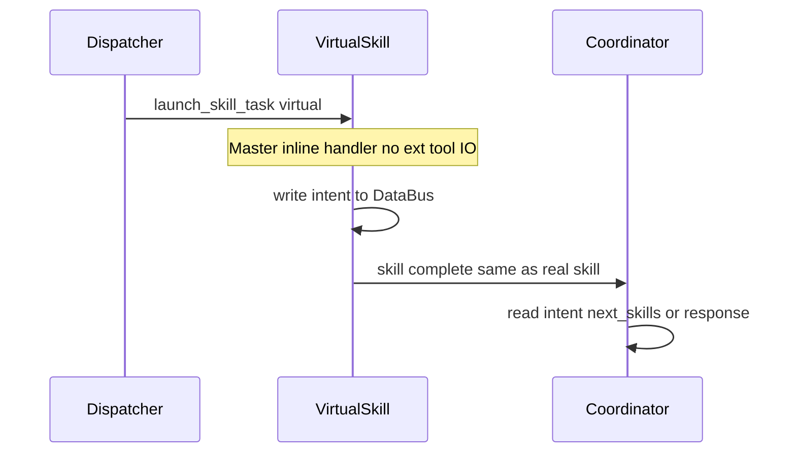

## 虚拟 Skill（意图分类）编排能力（2026-04-08）

### 1. 背景

在多轮 **dispatcher → skill → coordinator** 编排中，常见需求是：在调用「重」技能（外部工具、长链路 Worker、多节点 workflow）之前，先做一次 **意图分类或路由**（可多标签、置信度、槽位摘要），再由 **coordinator** 根据结构化结果决定下一阶段 **loop**：收紧可选 skill 范围、生成 `next_skills`、或直出澄清/拒答。

当前若将分类实现为普通 `type: "skill"`，会与「真实可执行工具」共用一条调度路径，带来 **额外 Worker 往返与语义混淆**（观测上难以区分「路由 hop」与「业务执行」）。

本 enhancement 定义一种 **虚拟 skill**：在编排上与 skill **等价**（参与 `pending_skills_count`、完成时按现有链路通知 coordinator），但 **执行语义** 为纯分类/路由，**默认不落 Worker 长链路** 或仅在 Master 侧轻量执行；分类结果通过 **约定 DataBus 契约** 交给 coordinator workflow 消费，便于与 [031-feature-coordinator-协同机制设计分析-260405-tbd.md](031-feature-coordinator-协同机制设计分析-260405-tbd.md) 中的轮次上限、循环检测等护栏对齐。**对 LLM 暴露的 skill 名、`next_skills` 格式与工具描述与真实 skill 保持一致**，虚拟性仅体现在包配置与框架运行时（见 §2.1）。

### 2. 方案简述

**抽象定义**：**虚拟 skill** = 编排层的一等成员，对外仍表现为 session 模板中的一个 skill 名称，可被 `next_skills` / dispatcher 拉起；完成时产生与普通 skill 一致的 **完成事件**，但内部 **不调用实际可执行工具**（无外部副作用或仅读/分类），并将 **意图结构化结果** 写入 DataBus。

**与现有机制衔接**：

- Skill 启动与完成路径依赖 `launch_skill_task`、runtime task 构建及完成后的 coordinator 触发（见 `src/agent/agent.cpp` 中 `launch_skill_task` 与 coordinator 相关分支）。
- `next_skills`、`candidate_skills` 的语义见 [publish/agent/AGENT_PACKAGE_SPEC.md](../../publish/agent/AGENT_PACKAGE_SPEC.md) 与 `src/agent/builtin_dispatcher.cpp`；意图输出建议通过 **新增或文档化 DataBus 键**（见 §5）与 coordinator 节点读取逻辑结合，而非仅依赖非结构化自然语言。

**问题拆解**：

1. 如何在 **配置与运行时** 区分「虚拟」与「真实」skill，且保持向后兼容。
2. 如何在 **不破坏** `pending_skills_count` / response 队列语义的前提下 **跳过或缩短** Worker 路径。
3. 如何约定 **意图 schema** 与 `candidate_skills` / `next_skills` 的组合策略，使 coordinator 下一阶段判定 **可测试、可观测**。

#### 2.1 标准 Skill 格式与「模型不感知虚拟性」（核心原则）

本方案要求：**Skill 在「对模型可见的契约」上保持与现网完全一致**；**是否虚拟** 仅为 **Agent 包配置 + 框架运行时** 的内部决策，**不得**进入下列任一通道：

| 通道 | 要求 |
|------|------|
| `next_skills` / `selected_skills` 的 **JSON 结构** | 与 [023](023-feature-next-skills-格式扩展-260319-implemented.md) 一致：字符串或 `{"name","exec_skill_key","force"}` 等标准字段；**无** `virtual`、`execution_kind` 等扩展键对模型输出开放（除非未来单独评审并默认关闭）。 |
| 供 LLM 选择的 **技能清单 / function 列表 / 工具描述** | 虚拟 skill 与真实 skill **同名、同描述粒度**；模型只看到「可调用的技能集合」，不区分「由 Worker 执行」或「由 Master 内联执行」。 |
| Dispatcher / Coordinator **workflow 节点** 若拼接 prompt | **禁止**写入「这是虚拟 skill」类措辞；节点侧逻辑仅消费 **标准 skill 名与 DataBus 结果**，与真实 skill 无差别。 |
| DataBus 上 **模型直接读写** 的键（若存在） | 不新增要求模型感知的 `*_is_virtual` 键；意图路由产物（`intent` 等）可由 **框架或 coordinator** 写入，供 **下游编排** 使用，而非要求用户在 prompt 里解释虚拟性。 |

**框架职责**：在 `launch_skill_task` 解析到 `tasks[].skill.execution_kind=="virtual"`（仅来自 `agent.json` / 包元数据）时 **透明分流** 至内联 handler；对上游而言，skill **已启动且会完成**，与真实 skill **事件形态一致**。运维与 Trace 可通过 **日志 / metadata（如 `execution_kind`）** 区分，该 metadata **默认不注入** 给 LLM 请求体。

**收益**：

- **提示词与工具 schema 稳定**：无需为「路由型技能」单独维护一套模型侧描述，避免模型利用「虚拟」语义偷懒或拒调。
- **A/B 与灰度**：同一 skill 名可在不同环境切换 default/virtual 执行路径，**不改** dispatcher 工作流与模型侧配置（仅换包或改运维配置）。
- **安全与权限**：`candidate_skills` 白名单仍以 **标准 skill 名** 为粒度；虚拟 skill 不形成「旁路技能名」。

### 3. 约束与假设

- **与 031 对齐**：虚拟 skill 的完成仍计为一次正常的 skill 完成事件；不得被滥用为「零成本空转」以绕过 `max_coordination_rounds` / 循环检测（待 031 落地后一并审计）。若虚拟 skill 仅写 DataBus、无外部 IO，也应在 Trace 中可区分 `skill_name` 与 `execution_kind=virtual`。
- **与 023 组合**：`SkillSpec` / `exec_skill_key` 可与虚拟 skill 输出的意图键组合，将后续真实 skill 的输入绑定到 dialogue 级子键。
- **与 024 区分**：[024-feature-消息定向路由机制设计-260319-implemented.md](024-feature-消息定向路由机制设计-260319-implemented.md) 侧重 **消息路径** 与定向投递；033 侧重 **任务编排层** 的「伪 skill」与 DataBus 意图契约，二者可并存，职责不重复。
- **兼容性**：未配置虚拟语义的现有 agent **行为不变**；新字段缺省等价于当前「真实 skill」。
- **模型不可见性**：`execution_kind` 等字段 **仅** 存在于包配置与运行时 task 元数据；禁止作为 LLM 工具定义的一部分或写入要求模型遵循的系统提示（见 §2.1）。

### 4. 当前实现分析

#### 4.1 代码分析

- Session 模板中 `type: "skill"` 的任务最终会经 `launch_skill_task` 构建 runtime task、加入 session，由 **MMWorkerEngine** 调度 workflow 执行；不存在声明「本 skill 仅 Master 内联、不创建 Worker 任务」的一等配置。
- `BuiltinDispatcher::launch_skill_task` 与 `MMAgent::launch_skill_task` 负责校验 `candidate_skills`、注入 `dialogue_id` / `exec_skill_key` 等；完成路径依赖 workflow **完成消息** 与 coordinator 的 `data_exchange` / `intent_request` 触发。
- **关键缺口**：无一类 **声明式** 能力表示「此 skill 无 Worker 执行体，仅运行分类 handler 并合成完成」；意图分类若用普通 skill，必然承担 **workflow 池、Worker 调度** 成本，且监控面与真实工具执行混在一起。

#### 4.2 Examples 分析

| 示例路径 | 与 dispatcher/coordinator/skill 链的关系 | 插入「意图分类 hop」的现况 |
|---------|-------------------------------------------|---------------------------|
| `examples/agent/system_agent_mock/` | 完整 dispatcher → skill → coordinator，含 `next_skills`、force | 仅能通过 **再增一个真实 skill** 或 **dispatcher workflow 内联分类** |
| `examples/agent/multi_session_chat/`、`openjiuwen_multi_session_chat/` | session 级 coordinator merge、`selected_skills` | 同上；无虚拟 skill 概念 |
| `examples/agent/basic_agent/` | 入门 coordinator | 适合未来最小 `intent_router` 演示 |

**同步修改预期**：待框架支持后，新增或扩展示例 `examples/agent/intent_router_mock/`（名称待定），演示虚拟 skill → coordinator 按 `intent` 写不同 `next_skills`。

#### 4.3 缺失功能分析

- 缺少 **skill 执行类别**（真实 / 虚拟）的 DSL 与运行时分支。
- 缺少 **推荐的意图 DataBus schema** 及与 `candidate_skills` 合并策略的规范说明。
- 缺少 **Trace / 日志** 上对「路由 hop」与「工具执行」的区分字段。

##### 4.3.1 行业实践研究（速览表）

| 模式 | 代表思路 | 对 AgentFlow 的启发 |
|------|-----------|---------------------|
| Router / chain 节点 | LangChain `RunnableBranch`、LCEL 条件路由 | 显式把「路由」与「执行」分离；虚拟 skill 等价于可插拔 router hop，且仍走统一编排事件 |
| 图与条件边 | LangGraph 等基于 graph state 的条件转移 | 意图 = 状态更新；coordinator 读状态（DataBus）决定下一批 `next_skills` |
| 内部 / 结构化工具 | 仅更新会话状态、不调外部 HTTP/OS 的 tool | 与虚拟 skill 同构：**统一完成语义与观测**，但不占外部配额 |
| NLU → 策略 | 经典对话系统：意图 + 槽位 → policy | 输出 **稳定 schema**（intent、slots、confidence），利于单测与回归 |
| Multi-agent Supervisor | Supervisor 分配子任务、不亲自执行重工具 | coordinator 类似 supervisor；虚拟 skill 专职「分诊」 |
| 模型结构化路由 | JSON Schema / function 仅返回 `route` 或 label | 实现上可用 **轻量 LLM 节点** 或 **规则引擎** 写入同一 DataBus 契约，避免每轮全文由 coordinator 重新猜意图 |

##### 4.3.2 业界分层实践详述（与「标准工具面 + 执行面分离」对齐）

以下归纳常见产品中 **「模型看到的」** 与 **「运行时实际做的」** 如何解耦，以支撑 §2.1：**skill 名与工具列表保持标准、模型不感知虚拟**。

**A. 通用 LLM API：同质工具表 + 不透明执行**

- **OpenAI Chat Completions / Responses**、**Anthropic Messages** 等：`tools` / `tool_definitions` 为 **扁平列表**；每条仅有 name、description、parameters。服务端收到 `tool_use` 后，由 **路由层** 决定调用本地函数、远程 MCP、或纯内存逻辑；**模型协议中不存在**「此 tool 是否落库」字段。
- **启发**：AgentFlow 中虚拟 skill 即 **同名 skill 的执行后端切换**（Worker workflow vs Master handler），对应 API 侧的 **统一 tool 名**。

**B. MCP（Model Context Protocol）与远程工具**

- Host 将多个 Server 的工具 **聚合为同一 namespace** 暴露给模型；模型只发起 `call_tool(name, args)`，**不感知** 某 tool 在进程内短路返回还是跨网络。
- **启发**：虚拟 skill 类似 **Host 侧拦截**：名称与参数 schema 不变，执行路径在框架内分流。

**C. LangChain / LangGraph**

- **LCEL**：`RunnableLambda`、`RunnableBranch` 可在 **不增加模型可见 tool** 的情况下改写图；条件边依赖 **state**，而非让模型输出「branch 类型」。
- **LangGraph**：`add_conditional_edges` 由 **图状态 + 函数** 决定下一节点；若需模型参与，仍通过 **标准结构化输出**（如单一 `route` 字段），而非在 tool 定义里标注「虚拟节点」。
- **启发**：`execution_kind` 放在 **图外配置**（AgentFlow 的 `agent.json`），与 LangGraph 的 **compile 前图结构** 类似，**不进入** 每次 inference 的 tool 列表元数据。

**D. Semantic Kernel、Microsoft Agent Framework**

- **Plugin / KernelFunction**：注册名对 prompt 可见；实现可以是 **纯 C# 方法**（无 IO）或 **带 HTTP**。Planner 或手动编排选函数时，**同一套 Function 视图**。
- **启发**：虚拟 skill = 同名 `KernelFunction`，实现体为 **inline**；Planner（对应 coordinator）仍按 **函数名** 推理。

**E. 经典对话与语音栈（NLU → DM）**

- **Rasa、Dialogflow、Alexa** 等：**意图分类器** 输出 `intent` + `entities`，对话管理器（DM）再选 **动作**；ASR/NLU 模块对上层应用暴露 **稳定 intent 名**，上层 **不区分** 该 intent 是由规则命中还是由小模型分类得到。
- **启发**：虚拟 skill 可视为 **可编排的 NLU hop**，对外 skill 名 = **标准动作槽位入口**，与 DM 选 skill 一致。

**F. Multi-agent：Supervisor / Handoff**

- **AutoGen、CrewAI、OpenAI Swarm** 等：supervisor 分配任务时常用 **与业务相同的 task 名**；执行者是否为「轻量路由 agent」由 **编排代码** 决定，**不在** 子 agent 的 system prompt 中写「你是虚拟的」。
- **启发**：coordinator = supervisor；虚拟 skill = **轻量分诊 agent**，但在 **next_skills 命名空间** 中与真实 skill **平权**。

**G. 检索与 RAG 中的「路由」**

- **Query routing**（HyDE、step-back、multi-query）：常在 **pipeline 内部** 完成；若暴露给模型，往往用 **单一 `route` 或 `strategy` 枚举** 工具，**不** 在 schema 中标注「此步不访问向量库」。
- **启发**：意图分类若由 **handler 内 LLM** 完成，应 **封装在虚拟 skill 内部**；对外仍是一次 skill 完成 + DataBus 更新，主对话模型 **可选不经过** 该内部 LLM（若分类完全由规则/handler 做）。

**H. 安全与策略层（工具治理）**

- OpenClaw 等 **tool policy pipeline**、Claude Code **coordinator 模式工具白名单**：在 **服务端裁剪** 可见工具集；裁剪原因 **不反馈** 给模型为「这些 tool 被标记为虚拟」。
- **启发**：`candidate_skills` 过滤与 virtual 分流同属 **策略层**；模型只看到 **允许列表内的标准 skill 名**。

##### 4.3.3 参考点总结（修订）

- **路由与执行分离** 是共性；**对模型的接口** 应尽量 **同质、稳定**。
- AgentFlow 落地：**`execution_kind` 仅属包配置 + 运行时**；**`next_skills` / skill 注册表 / 白皮书中的 skill 描述** 与真实 skill **同一格式、同一命名空间**。
- **结构化状态**（`intent` 等）供 **coordinator 与观测** 使用，**不** 作为要求主模型理解「虚拟性」的通道。

### 5. 数据结构设计

#### 5.1 agent.json / skill 元数据（提案）

在 `tasks[]` 中 `type: "skill"` 条目上增加可选字段（命名二选一，实施前需定稿）：

| 方案 | 字段示例 | 优点 | 缺点 |
|------|----------|------|------|
| A | `skill.execution_kind`: `"default"` \| `"virtual"` | 与 execution 语义直接对应 | 需扩展 `skill` 对象 schema |
| B | `virtual: true`（task 级布尔） | 配置简短 | 与 `skill` 嵌套层次略脱节 |

**建议采用方案 A**：`execution_kind` 缺省为 `"default"`，与当前行为一致；`"virtual"` 时由框架走内联路径。

可选扩展：`virtual_handler`（字符串，标识内建或插件名）、`intent_schema_version`（便于演进）。

**与 §2.1 的关系**：上述字段 **仅** 出现在 `agent.json`（及解析后的 `MMAgentTask` 元数据）中；**不** 写入：

- 供 LLM 生成的 `next_skills` JSON schema 说明；
- `publish` 侧面向模型的 **工具/技能描述模板**（除非刻意做调试开关且默认关闭）。

包内 **skill 的 `name`、`config_dir`、`expected_parameters` 等** 与真实 skill **同一套规范**；workflow 目录可仍存在（用于文档、测试或未来 fallback），但 virtual 路径下 **默认不调度 Worker** 执行该 workflow。

#### 5.2 DataBus 键约定（提案）

| 键名 | 类型建议 | 写入方 | 读取方 | 说明 |
|------|----------|--------|--------|------|
| `intent` | string 或 JSON | 虚拟 skill / handler | coordinator | 主意图标签或结构化 `{ "label": "...", "slots": {} }` |
| `intent_confidence` | number 或 JSON map | 同上 | coordinator | 单值或多标签置信度 |
| `intent_labels` | JSON 数组 | 同上 | coordinator | 多意图场景 |
| `routing_metadata` | JSON | 同上 | coordinator / Trace | 路由原因、模型版本、规则 id 等 |
| `routing_trace_id` | string | 框架或 handler | 观测 | 与 FlowTrace 关联 |

与 **`candidate_skills`** 的组合策略（需在 coordinator 或规范中择一或配置化）：

- **覆盖**：意图决定白名单，替换当前 dialogue 的候选集。
- **交集**：与 dispatcher 已写 `candidate_skills` 取交集，防止放大权限。
- **仅建议**：写入 `suggested_skills`，由 coordinator 再判定是否写入 `next_skills`。

**兼容性**：新键均为增量；旧 agent 不读即可。

### 6. 流程设计

#### 6.1 目标时序（虚拟 skill 插入点）

#### 6.2 与现状对比

- **现状**：任意 skill 均经 Worker 执行 workflow 至完成，再通知 coordinator。
- **目标**：`execution_kind=virtual` 时，在 **Master/agent 层** 完成 handler，**合成**与「workflow 完成」等价的通知与 DataBus 更新，再进入同一 coordinator 路径（细节在 §8 实现方案中分阶段落地）。

### 7. 接口设计

#### 7.1 配置（DSL）

- `publish/agent` 包内 `agent.json`：`tasks[].skill.execution_kind`、`tasks[].skill.virtual_handler`（可选）。
- [AGENT_PACKAGE_SPEC.md](../../publish/agent/AGENT_PACKAGE_SPEC.md) 后续增加字段表（实施阶段同步）。

**可见性边界**：

| 层级 | 是否包含 `execution_kind` / 虚拟语义 | 说明 |
|------|----------------------------------------|------|
| agent 包 JSON、运维配置 | 是 | 供框架分流 |
| Task 元数据、Trace、日志 | 是（可选） | 排障与计费归因 |
| LLM 请求（system / tools / user 拼装） | **否**（默认） | 保证「模型不感知虚拟 skill」 |
| `next_skills` 模型输出 | **否** | 维持 023 标准格式 |

#### 7.2 消息与 DataBus

- 虚拟 skill 完成时：**不改变** 对 coordinator 的 `trigger_type` / `skill_completion` 等既有 metadata 语义；可选增加 `metadata["execution_kind"]="virtual"` 供观测。
- DataBus 读写遵循 dialogue 级 key 规则（见 021）。

#### 7.3 C++ 扩展点（方向性）

- `launch_skill_task`：若解析到 `execution_kind==virtual`，分支到 `run_virtual_skill_handler(...)`，成功则调用与真实完成相同的 **coordinator 通知** 封装，避免两处复制逻辑。
- Handler 注册表：类似插件或 `std::function` 表，按 `virtual_handler` 字符串解析；长期可接 SO/Python（与 Worker 解耦，仍在 Master 进程内执行分类逻辑）。

### 8. 实现方案

#### 8.1 多方案对比

| 方案 | 做法 | 优点 | 缺点 |
|------|------|------|------|
| **1. 框架级虚拟 skill** | `launch_skill_task` 识别 virtual → Master 内联 handler → 写 DataBus → 合成完成并通知 coordinator | 与现网 **编排语义完全一致**，pending/队列/Trace 统一 | 需改 agent 层分支与配置解析 |
| **2. 极薄真实 workflow** | 单节点、green risk，尽量短 workflow；若将来支持 master-local 节点则进一步减负 | **少新概念** | 仍可能走 Worker 与池化，成本与语义混淆未根治 |
| **3. dispatcher 内两阶段** | dispatcher workflow 直接写 `intent`，不创建 skill task | **实现最省** | **无 skill 完成事件**，`pending_skills_count` 与 skill 级 metrics 需另建模，与「虚拟 skill」产品叙事不一致 |

**推荐**：长期以 **方案 1** 为主；极简 agent 或过渡期可采用 **方案 3**，并在文档中注明观测差异。

#### 8.2 待修改文件清单（实施阶段）

| 文件 | 修改类型 | 说明 |
|------|---------|------|
| `publish/agent/AGENT_PACKAGE_SPEC.md` | 修改 | 补充 `execution_kind`、`virtual_handler` 及 DataBus 键说明 |
| `src/agent/package.cpp` / `include/internal/agent/package.h` | 修改 | 解析 skill 新字段 |
| `include/internal/agent/task.h` / `src/agent/task.cpp` | 修改 | task 元数据承载 execution_kind |
| `src/agent/agent.cpp` | 修改 | `launch_skill_task` 虚拟分支、合成 coordinator 通知 |
| `include/internal/agent/builtin_dispatcher.h` / `builtin_dispatcher.cpp` | 视需要 | 与 launch 路径共享校验逻辑 |
| `tests/unit/` | 新增 | 虚拟 skill 完成 → coordinator 触发 / DataBus |
| `tests/e2e/` 或 `examples/agent/` | 新增 | 最小 intent_router 示例 |

#### 8.3 功能点实现优先级排序

| 优先级 | 功能点 | 副作用分析 | 验证策略 |
|--------|--------|-----------|---------|
| P1 | package 解析 + task 元数据 `execution_kind` | 缺省兼容 | 单元测试解析 |
| P1 | `launch_skill_task` 虚拟分支 + DataBus 写入 + coordinator 通知复用 | 分支需严密测试避免双发 | 单测 + mock session |
| P2 | `virtual_handler` 注册表与内置规则分类示例 | 插件边界与安全 | 示例与黑盒 |
| P2 | Trace 字段 `execution_kind` | 仅日志/metadata | 观测用例 |
| P3 | SO/Python handler 接入 Master | 进程安全与超时 | 与 019/插件能力对齐后实施 |

### 9. 测试方案

#### 9.1 Examples 黑盒覆盖

| 功能点 | 现有 Examples 覆盖 | 更新建议 |
|--------|-------------------|---------|
| 虚拟 skill → coordinator 分支 | 未覆盖 | 新增最小 `intent_router` 类示例 |
| intent + candidate_skills 交集 | 未覆盖 | 在示例中演示 coordinator 收紧白名单 |
| 与多轮 `next_skills` 共存 | 可参考 system_agent_mock | 合并演示虚拟 hop + 真实 skill |

#### 9.2 测试用例设计

| 场景 | 验证点 | 预期 |
|------|--------|------|
| virtual skill 成功 | coordinator 收到与真实 skill 一致的完成触发 | 后续 coordinator workflow 可读 `intent` |
| 未配置 virtual | 行为与现网一致 | 仍走 Worker |
| candidate_skills 校验 | 虚拟 skill 名称仍在模板中 | 与现网 skill 校验一致 |
| 失败 handler | 错误写入 DataBus 或 failure 消息 | coordinator 可走 failure_policy（031/7.2） |
| 模型侧无虚拟泄漏 | 抓取发给 LLM 的 payload | **不得**出现 `execution_kind`、`virtual`、内部 handler 名（除非显式调试模式） |
| 标准 next_skills | 模型输出仅含标准字段 | 解析与 launch 与真实 skill 一致 |

### 10. 文档

| 文档 | 变更说明 |
|------|----------|
| [AGENT_PACKAGE_SPEC.md](../../publish/agent/AGENT_PACKAGE_SPEC.md) | 增加 virtual skill 字段与 DataBus 意图键 |
| [AF_DSL_DESC.md](../../publish/agent/AF_DSL_DESC.md) | agent.json skill 段字段 |
| [031-feature-coordinator-协同机制设计分析-260405-tbd.md](031-feature-coordinator-协同机制设计分析-260405-tbd.md) | 实施后可交叉引用「意图 hop 与循环检测」 |
| [INTEGRATION_GUIDE.md](../../publish/INTEGRATION_GUIDE.md) | 可选：集成方如何消费 `intent` |

### 11. 关联方案

| 关联方案 | 关系 |
|---------|------|
| [031](031-feature-coordinator-协同机制设计分析-260405-tbd.md) | coordinator 多轮判定与护栏 |
| [023](023-feature-next-skills-格式扩展-260319-implemented.md) | `exec_skill_key` 与 skill 列表 |
| [024](024-feature-消息定向路由机制设计-260319-implemented.md) | 消息层路由 vs 本方案编排层虚拟 skill |

### 12. 进展跟踪

- [ ] 方案评审（execution_kind 命名、DataBus schema、**LLM 暴露面审查** 定稿）
- [ ] package / task 元数据解析
- [ ] `launch_skill_task` 虚拟分支与 coordinator 通知复用
- [ ] handler 注册表与内置示例
- [ ] 单元测试
- [ ] 示例与 E2E
- [ ] 手册与 AGENT_PACKAGE_SPEC 更新

**状态**：tbd（待人工确认后方可进入 wip / 编码）

### 13. 修订记录

| 版本 | 日期 | 说明 |
|------|------|------|
| v0.1 | 2026-04-08 | 初稿：背景、业界调研、多方案对比、数据结构与流程 |
| v0.2 | 2026-04-08 | 新增 §2.1 标准 skill 与模型不感知虚拟性；§4.3.2 业界分层详述（OpenAI/Anthropic/MCP、LangGraph、SK、NLU-DM、multi-agent、RAG 路由、工具治理）；§5/§7/§9 与可见性边界及测试项对齐 |
