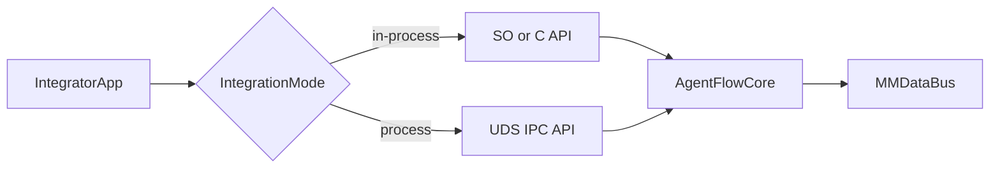
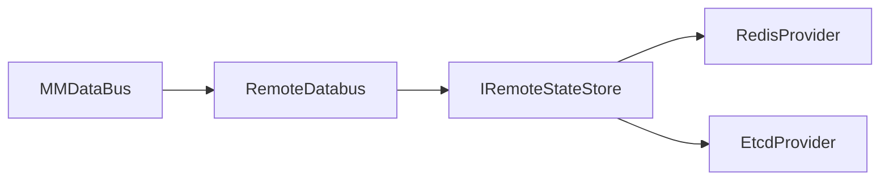

## AgentFlow 双集成与跨节点 DataBus 适配层设计（2026-04-23）

### 1. 背景

AgentFlow 当前已经具备两类能力雏形：

1. **so/in-process 集成基础**：`include/external/agentflow/so_node.h` 提供稳定 ABI 与 DataBus 客户端接口。
2. **进程集成基础**：`src/runtime/databus/uds_server.cpp` 提供 UDS 访问能力，支持外部进程读写 DataBus。

但从产品化集成角度还存在两个关键问题：

- **问题 A：双集成模式未抽象统一契约**  
  当前 so 与进程访问能力是“能力存在、接口分散”，缺少统一语义接口、错误码模型与生命周期约束，导致接入方需要自行拼接集成路径。

- **问题 B：DataBus 跨节点能力与具体中间件耦合**  
  `src/runtime/databus/remote_databus.cpp` 直接依赖 `vendor/cache/redis_adapter.h`，且 `vendor/adapter/cache/redis_adapter.cpp` 为 Redis CLI 风格实现。当前架构难以无侵入切换到 etcd、MongoDB、PostgreSQL 等后端。

本 enhancement 目标是：在保持现有能力兼容的前提下，建立 **统一接入契约 + 中间件适配层**，使 AgentFlow 同时具备稳定的 in-process 与 IPC 集成能力，并把跨节点 DataBus 从“Redis 绑定”升级为“多后端可插拔”。

### 2. 方案简述

整体方案分为两条主线：

1. **双集成统一接口层**
   - 定义统一 `AgentFlowService` 语义（请求/响应、流式、错误码、生命周期）。
   - in-process 路径通过函数 API 直接调用核心能力。
   - 进程路径通过 UDS RPC 暴露同一语义接口，做到“同契约不同传输”。

2. **DataBus 跨节点 Provider 适配层**
   - 引入 `IRemoteStateStore` 抽象接口，定义 `put/get/delete/list/watch/cas/ttl` 等能力。
   - 将 Redis、etcd 等后端实现为独立 provider，通过工厂装配。
   - `RemoteDatabus` 仅依赖抽象接口，不再依赖具体中间件头文件。

核心收益：
- 接入方可以按部署形态选择 in-process 或进程模式，不改业务语义。
- 跨节点存储可按环境切换（Redis -> etcd 等），不改主流程代码。
- 便于后续统一可观测、错误治理、性能压测。

### 3. 约束与假设

- 兼容优先：已有 agent/workflow 行为不变，新增能力默认关闭或按配置启用。
- 语义优先：in-process 与 IPC 必须返回一致错误码与状态语义。
- 可替换优先：抽象层不得泄漏 Redis 私有语义（如命令细节）到上层。
- 性能约束：in-process 路径保持低开销；IPC 路径支持高并发本机通信。
- 安全约束：UDS 默认使用文件权限控制，后续支持可选鉴权元数据。

### 4. 当前实现分析

#### 4.1 代码分析（现状）

- **so/in-process 接口层**
  - `include/external/agentflow/so_node.h` 已有 `SoNodeFunctionV1/V2/V3`、`INodeDataBus`、`INodeDataBusClient`。
  - `src/runtime/worker/exe_loader.cpp` 已支持按函数签名 V1/V2/V3 加载和执行 SO。

- **进程访问层**
  - `src/runtime/databus/uds_server.cpp` 已实现 JSON-RPC 风格接口（`put/get/remove/contains/publish/...`）。
  - 当前实现已具备线程池、连接管理、订阅机制，但协议演进和能力协商尚未标准化。

- **跨节点 DataBus**
  - `include/internal/runtime/databus/remote_databus.h` 定义了远程总线接口，但具体实现 `remote_databus.cpp` 直接调用 `RedisAdapter`。
  - `vendor/adapter/cache/redis_adapter.cpp` 当前为轻量封装，能力边界无法覆盖多后端差异。

#### 4.2 Examples 分析

- 现有示例更多覆盖单节点与会话内编排，对“跨节点共享 + 多后端切换”缺少专项样例。
- UDS 多语言客户端已有基础目录（Python/Go/Java/CLI），但缺少统一“服务集成协议”样例。

#### 4.3 缺失功能分析

- 缺少统一 `AgentFlowService` 接口文档与版本化策略。
- 缺少 `RemoteDatabus` 与后端中间件的解耦层。
- 缺少中间件能力协商（CAS、TTL、事务、订阅）及降级策略。
- 缺少覆盖双模式一致性的测试矩阵（同输入同语义同错误）。

#### 4.4 行业实践研究

**双形态接入（in-process + 网络/IPC）**
- NVIDIA Triton 将核心能力封装为共享库（Server API），同时通过 HTTP/gRPC 前端暴露服务，体现“统一核心、双入口”模式：  
  - <https://docs.nvidia.com/deeplearning/triton-inference-server/user-guide/docs/client_guide/in_process.html>  
  - <https://docs.nvidia.com/deeplearning/triton-inference-server/archives/triton-inference-server-2400/user-guide/docs/customization_guide/inference_protocols.html>

**UDS 作为本机 IPC 最佳实践**
- gRPC 官方与实践文档普遍采用 UDS 作为同机高效 IPC 方案：  
  - <https://learn.microsoft.com/en-us/aspnet/core/grpc/interprocess-uds?view=aspnetcore-10.0>  
  - <https://chromium.googlesource.com/external/github.com/grpc/grpc/+/HEAD/examples/cpp/unix_abstract_sockets/README.md>

**多后端适配层实践**
- Go CDK 通过统一 API + driver URL 实现“代码不变、后端可换”：  
  - <https://gocloud.dev/howto/pubsub/publish/>
- Dapr 通过组件模型支持多 state store，并强调能力差异与可移植策略：  
  - <https://docs.dapr.io/developing-applications/building-blocks/state-management/state-management-overview>  
  - <https://docs.dapr.io/reference/components-reference/supported-state-stores>

**可插拔管线架构**
- OpenTelemetry Collector 的 receiver/processor/exporter 分层可作为 Provider 工厂与能力扩展参考：  
  - <https://opentelemetry.io/docs/collector/architecture/>

### 5. 数据结构设计

#### 5.1 远程存储抽象（提案）

```cpp
struct StoreCapabilities {
  bool supports_cas = false;
  bool supports_ttl = false;
  bool supports_watch = false;
  bool supports_transaction = false;
};

class IRemoteStateStore {
public:
  virtual ~IRemoteStateStore() = default;
  virtual bool connect(const std::string& endpoint) = 0;
  virtual void disconnect() = 0;
  virtual bool put(const std::string& key, const DataVariant& value) = 0;
  virtual bool get(const std::string& key, DataVariant& value) const = 0;
  virtual bool remove(const std::string& key) = 0;
  virtual StoreCapabilities capabilities() const = 0;
};
```

#### 5.2 兼容性策略

- `MMDataBus` 与 `RemoteDatabus` 对上层接口保持不变。
- 旧配置 `connect_remote(redis://...)` 仍可用，默认映射到 Redis provider。
- 新配置支持 `remote_store.provider = redis|etcd|...` 显式选择。

### 6. 流程设计

#### 6.1 双集成路径



#### 6.2 跨节点 DataBus 路径



### 7. 接口设计

#### 7.1 in-process 接口（建议）

- 提供稳定函数级 API（同步请求、异步请求、流式回调）。
- 错误码采用统一枚举（参数错误、超时、后端不可用、能力不支持等）。

#### 7.2 IPC 接口（UDS）

- 维持 JSON-RPC 兼容，同时补充 `protocol_version` 字段。
- 增加 `capabilities` 查询方法，返回服务端支持的语义能力。
- 保持方法名与 in-process 语义一致，降低 SDK 维护成本。

#### 7.3 DataBus 远程适配接口

- `RemoteDatabus` 依赖 `IRemoteStateStore`，不直接依赖 Redis 头文件。
- Provider 通过工厂注册（名称 -> 构造函数）。
- 未支持能力必须显式返回 `NOT_SUPPORTED`，禁止静默失败。

### 8. 实现方案

#### 8.1 分阶段实施

**阶段一：抽象层落地（无行为变更）**
- 引入 `IRemoteStateStore`、`StoreCapabilities`、Provider 工厂。
- Redis 实现迁移为 `RedisRemoteStoreProvider`。
- `RemoteDatabus` 改为依赖抽象层。

**阶段二：双集成语义统一**
- 抽取统一 `AgentFlowService` 语义层。
- in-process 与 UDS 路径复用同一处理器，统一错误码与状态机。

**阶段三：第二后端验证**
- 实现 etcd provider（最小 CRUD + 可选 watch）。
- 完成跨后端一致性/降级测试。

#### 8.2 待修改文件清单

| 文件 | 修改类型 | 说明 |
|------|---------|------|
| `include/internal/runtime/databus/remote_databus.h` | 修改 | 改为依赖远程存储抽象接口 |
| `src/runtime/databus/remote_databus.cpp` | 修改 | 删除对 RedisAdapter 的直接依赖 |
| `include/internal/runtime/databus/` | 新增 | 新增 `remote_store.h` 等抽象接口头文件 |
| `src/runtime/databus/` | 新增 | Provider 工厂与 Redis provider 实现 |
| `src/runtime/databus/uds_server.cpp` | 修改 | 增加协议版本与 capabilities 查询 |
| `docs/api-reference.md` | 修改 | 增补双模式统一语义与错误码 |
| `publish/INTEGRATION_GUIDE.md` | 修改 | 增补 in-process/IPC 选择与配置 |

#### 8.3 功能点优先级排序

| 优先级 | 功能点 | 副作用分析 | 验证策略 |
|--------|--------|-----------|---------|
| P1 | Remote store 抽象与 Redis provider 迁移 | 对外接口不变，低风险 | 单元测试 + 回归 |
| P1 | UDS / in-process 统一错误码语义 | 可能影响接入侧错误处理 | 协议兼容测试 |
| P2 | capabilities 能力协商 | 新增接口，兼容 | 新增接口测试 |
| P2 | etcd provider | 新增功能 | 集成测试 |
| P3 | 事务/CAS/TTL 高级能力统一 | 涉及后端差异 | 分层回归与压测 |

### 9. 测试方案

#### 9.1 Examples 黑盒测试覆盖分析

| 功能点 | 现有 Examples 覆盖 | 更新建议 |
|--------|-------------------|---------|
| in-process 与 IPC 语义一致 | ❌ 未覆盖 | 新增 `examples/features/dual_integration_demo` |
| 跨节点共享 + Redis | ⚠️ 间接覆盖 | 增加专项脚本验证跨进程/跨节点读写 |
| 跨节点共享 + 第二后端 | ❌ 未覆盖 | 增加 etcd 场景示例 |

#### 9.2 测试用例设计

- **一致性用例**：同一请求分别走 in-process 与 UDS，断言结果与错误码一致。
- **兼容用例**：旧 Redis 配置无需改动即可运行。
- **能力用例**：查询 `capabilities` 并按能力执行降级路径。
- **故障用例**：后端断连、超时、权限不足、能力不支持。
- **性能用例**：in-process 与 UDS 延迟基线；跨节点吞吐基线。

### 10. 文档

#### 10.1 需要变更的文档

| 文档 | 变更说明 |
|------|---------|
| [api-reference.md](../api-reference.md) | 补充双集成统一语义接口与错误码 |
| [multi_language_databus.md](../multi_language_databus.md) | 增补 capabilities 与 provider 说明 |
| [INTEGRATION_GUIDE.md](../../publish/INTEGRATION_GUIDE.md) | 明确 in-process 与 UDS 选型建议 |
| [ARCHITECTURE.md](../ARCHITECTURE.md) | 增补 DataBus 远程适配层分层图 |

#### 10.2 关联方案

| 关联方案 | 关系说明 |
|---------|---------|
| [003-refactor-mmdatabus-全局共享重构](003-refactor-mmdatabus-全局共享重构-260222-implemented.md) | 当前跨节点共享设计基础，需从 Redis 直连升级为适配层 |
| [019-feature-plugin-uds-注入机制设计](019-feature-plugin-uds-注入机制设计-260317-implemented.md) | UDS 接入能力的前置基础 |
| [027-feature-udsserver-线程池改造](027-feature-udsserver-线程池改造-260322-implemented.md) | UDS 并发处理能力基础 |
| [032-feature-dispatcher-coordinator-databus-observability-260405-tbd](032-feature-dispatcher-coordinator-databus-observability-260405-tbd.md) | 远程适配层与可观测指标需联动设计 |

#### 10.3 外部参考（真实链接）

- Triton In-Process API: <https://docs.nvidia.com/deeplearning/triton-inference-server/user-guide/docs/client_guide/in_process.html>
- Triton 协议与 API（含 in-process + HTTP/gRPC）：<https://docs.nvidia.com/deeplearning/triton-inference-server/archives/triton-inference-server-2400/user-guide/docs/customization_guide/inference_protocols.html>
- gRPC over UDS: <https://learn.microsoft.com/en-us/aspnet/core/grpc/interprocess-uds?view=aspnetcore-10.0>
- gRPC Unix abstract socket 示例: <https://chromium.googlesource.com/external/github.com/grpc/grpc/+/HEAD/examples/cpp/unix_abstract_sockets/README.md>
- Go CDK PubSub（可插拔 driver 模式）: <https://gocloud.dev/howto/pubsub/publish/>
- Dapr 状态管理总览: <https://docs.dapr.io/developing-applications/building-blocks/state-management/state-management-overview>
- Dapr 支持的 state store 矩阵: <https://docs.dapr.io/reference/components-reference/supported-state-stores>
- OpenTelemetry Collector 架构: <https://opentelemetry.io/docs/collector/architecture/>

### 11. 进展跟踪

- [ ] 抽象接口设计评审通过（IRemoteStateStore + capabilities）
- [ ] Redis provider 迁移完成并回归通过
- [ ] 双集成统一错误码与状态语义完成
- [ ] UDS 协议版本与能力协商接口完成
- [ ] 第二后端 provider（etcd）接入完成
- [ ] 文档更新完成
- [ ] 单元测试与集成测试通过

**详细进度**：

| 功能点 | 功能 | 用例 | 文档 | 状态 |
|--------|------|------|------|------|
| 远程适配抽象层 | ⏳待实施 | ⏳待实施 | ⏳待实施 | 待实施 |
| 双集成统一语义 | ⏳待实施 | ⏳待实施 | ⏳待实施 | 待实施 |
| 第二后端验证 | ⏳待实施 | ⏳待实施 | ⏳待实施 | 待实施 |

### 12. 后续计划（可选）

| 优化项 | 预期效果 | 方案简述 |
|--------|---------|---------|
| 统一 SDK 生成 | 降低多语言维护成本 | 基于统一协议描述生成 Python/Go/Java 客户端 |
| 远程写入批处理 | 提升跨节点吞吐 | 增加批量 put/get 与压缩选项 |
| 多租户鉴权 | 增强安全隔离 | UDS 与远程存储统一接入 token/ACL |

### 13. 附录 A：仓库代码与 DataBus / Node / Worker 链综合分析（合并自 `ANALYSIS.md`）

以下内容来自已删除的仓库根目录 `ANALYSIS.md`（2026-04-23 合并后删除），仅保留与本 issue（双集成、DataBus、进程侧执行）直接相关的结论，便于评审时单文档闭环。

#### 13.1 对外 DataBus 与 SO 节点 API（`include/external/agentflow/so_node.h`）

- **V1**：`void node(const SoDataMap& inputs, SoDataMap& outputs)`
- **V2**：增加 `INodeDataBus*`，KV + topic 订阅 + `kv_dir`/`events_dir`
- **V3（推荐）**：`INodeDataBusClient*`（`sys/ctx/llm/tool/user` 命名空间 + `session_id()` + `raw()`），键前缀形如 `/session/{session-id}/{namespace}/{key}`

#### 13.2 内部 MMNode 与 Worker 委托（`include/internal/workflow/node.h` 等）

- `MMNode::execute_with_worker_engine()` 组装 `MMWorkerEngine::ExecutionRequest`（含 `databus_`、`databus_client_->session_id()`、`plugin_uds_path_`），调用 **`MMWorkerEngine::execute_code(request)`** 静态入口。
- `MMWorkerEngine` 对 SO 库按 V1/V2/V3 符号加载执行；脚本/可执行文件子进程注入环境变量：`AF_DATABUS_UDS_FILE`、`AF_SESSION_ID`、`AF_SELF_TASK_ID`、`AF_PLUGIN_UDS_FILE`、`AF_SELF_NODE_ID` 等。

#### 13.3 MMDataBus 混合架构（与 §4、§5 对齐）

- **本地**：`LocalDatabus` / `ZeroCopyDataBus`（共享内存工厂：`create_in_process`、`create_posix_shared`、`create_systemv_shared`、`create_best`）。
- **远程**：`RemoteDatabus::connect(address)`；读写语义为 **写穿本地 + 可选远程同步；读穿本地，miss 则远程回填**；订阅在本地与远程侧均需挂接。
- **大对象**：`store_with_ref` / `resolve_ref`；多响应：`index_data_ref` / `find_indexed_refs`（与 enhancement 020/022 文档一致）。

#### 13.4 `vendor/adapter` 现状与本 issue 的缺口

- `vendor/adapter/network/` **为空**：无通用 HTTP/gRPC 适配；与本 issue「统一服务语义 + 可插拔远程存储」的动机一致。
- `StreamingLLMClient`：基于 curl 的 SSE，**非通用流式 RPC**；若未来统一「服务层流式」，需单独纳入 API 设计，不在本 issue 首阶段强制范围。

#### 13.5 规划向文档结构的建议（来自原 `ANALYSIS.md` §11）

- 架构决策 → `docs/architecture/`；跟踪项 → `docs/enhancements/`（已落实）；开发指南 / API 参考 / 示例说明可按需拆分，避免再出现单文件数千行难以维护的情况。

### 14. 附录 B：构建、架构分层、DSL 与工程约定（合并自 `AGENTFLOW_ANALYSIS.md`）

以下内容来自已删除的仓库根目录 `AGENTFLOW_ANALYSIS.md`（2026-04-23 合并后删除），仅保留与**集成方、CI、新人上手**相关的条目，便于与 `publish/INTEGRATION_GUIDE.md`、`docs/ARCHITECTURE.md` 交叉引用。

#### 14.1 构建与测试命令（摘要）

- 构建：`./build.sh build` / `Release` / `RelWithDebInfo` / `clean` / `rebuild`
- 测试：`./build.sh test` 或 `ctest --test-dir build --output-on-failure`；单测过滤示例：`ctest --test-dir build -R NodeTests`
- 示例：`./build.sh example <name>`
- 代码质量：项目无统一 lint target；可用 `clang-format`、`clang-tidy`、`cppcheck` 等（详见原文）

#### 14.2 高层架构与本 issue 的映射

- **Framework 层**：MMAgent / MMWorkflow / MMNode（编排与图）
- **Runtime 层**：`MMAgentRuntime`（Scheduler + Deployer）、`MMWorkerEngine`
- **基础设施**：`MMDataBus` + `vendor/adapter`（ProtoActor、Redis、RapidJSON 等）
- **三层调度表述**：`MMAgent(Master) → MMWorkflow(Master) → MMNode(Worker)` — 与 enhancement **026**（Master/Worker 职责边界）及新增 **035**（分进程部署）直接相关：当前代码路径上仍存在 Master 侧直接操作 Node 的历史问题，分进程化必须以 **RPC/消息边界** 收口。

#### 14.3 头文件布局与对外 API 面

- `include/external/`：集成方可见的稳定 API（含 `agentflow/so_node.h`）
- `include/internal/`：仅框架内部实现

#### 14.4 DSL 与 `agent.json` 参考路径

- Workflow DSL：`publish/workflow/workflow_sample.jsonc`，解析 `src/workflow/dsl/workflow_parser.cpp`
- Agent 包：`publish/agent/agent.json`、`publish/agent/AGENT_PACKAGE_SPEC.md`

#### 14.5 CMake 可选特性标志（与远程存储相关）

- `AGENTFLOW_WITH_REDIS`：Redis 适配；**本 issue 目标**是运行时可选仍保留，但 **RemoteDatabus 不再硬编码依赖 Redis 头文件**（见 §8）。
- 其他：`AGENTFLOW_WITH_PROTOACTOR`、`AGENTFLOW_WITH_RAPIDJSON`、`AGENTFLOW_WITH_OPENSSL` 等；依赖缺失时期望走 stub — 合并文档强调勿随意删除 fallback 路径。

#### 14.6 示例与测试目录（摘录）

- `examples/agent/`：`basic-agent`、`multi_session_chat`、`llm-query-agent` 等；`examples/features/` 含 runner 设计文档
- `tests/unit/src/`：`test_agent_gtest`、`test_workflow_gtest`、`test_node_gtest`、`test_databus_gtest` 等

#### 14.7 原 `AGENTFLOW_ANALYSIS.md` 中已过时表述的勘误

- 原文档表格仍列 `docs/REFACTORING.md` 为路线图主入口；实际 **大块内容已拆分为 `docs/enhancements/` 多文件**（与附录 A §1 所述一致）。以本目录 README 与单条 enhancement 为准。

### 15. 修订记录

| 版本 | 刷新时间 | 刷新人 | 刷新内容 |
|------|---------|--------|---------|
| v1.0 | 2026-04-23 | AI | 初始版本：双集成统一接口与跨节点 DataBus 适配层设计，含业界调研、分阶段实施与测试方案 |
| v1.1 | 2026-04-23 | AI | 合并仓库根目录 `ANALYSIS.md`、`AGENTFLOW_ANALYSIS.md` 与本 issue 相关章节为附录 A/B；勘误 REFACTORING 路径表述 |
| v1.2 | 2026-04-23 | AI | 根目录 `ANALYSIS.md`、`AGENTFLOW_ANALYSIS.md` 已删除；附录 A/B 为唯一留存正文 |

