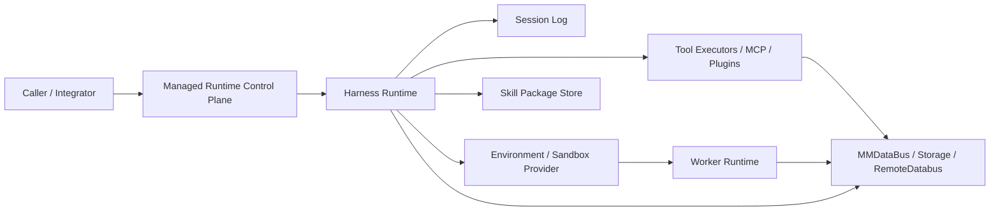
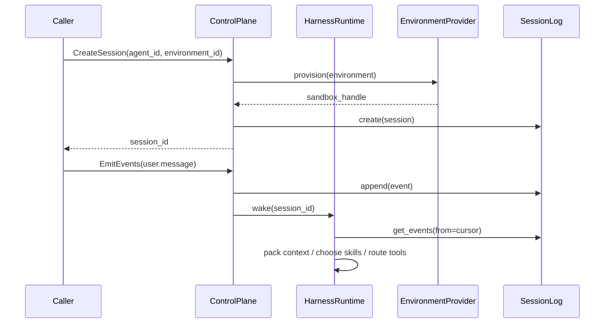
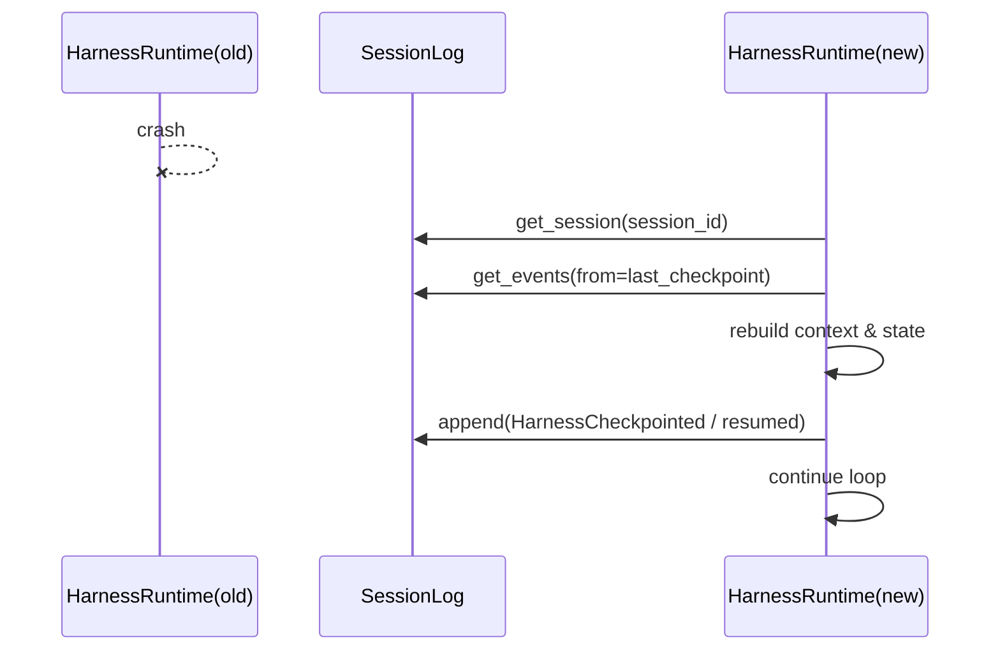
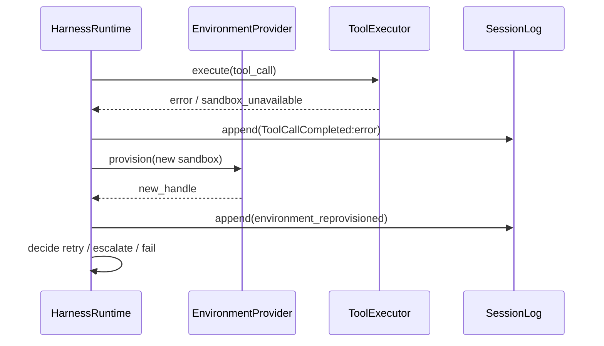

## Managed Agent 平台架构借鉴：Brain / Skills / Session-Context 解耦与 Harness 托管运行时设计（2026-06-25）

### 1. 背景

AgentFlow 当前已经具备面向 agent 编排与执行的核心骨架：

1. **Framework 编排层**：`MMAgent` / `MMAgentSession` / `SessionTaskCoordinator` / `MMAgentTask`
2. **Runtime 调度层**：`MMAgentRuntime` / `Scheduler` / `Deployer` / `MMWorkerEngine`
3. **共享数据层**：`MMDataBus` / `RemoteDatabus` / UDS
4. **包与工作流层**：`agent.json` / workflow DSL / 多语言 node 执行

现有架构已经在多个 enhancement 中逐步逼近“平台化 agent runtime”：

- **026**：Master / Worker 职责边界
- **031**：coordinator 协同机制与 agent loop
- **034**：双集成与跨节点 DataBus 适配层
- **035**：Master / Worker 分进程与跨进程边界
- **036**：`agentflowd` 守护进程入口

但这些能力仍主要从“框架内部解耦”和“本地运行时工程化”的角度演进，尚未形成一个清晰的 **Managed Agent 平台抽象**。尤其缺少以下统一设计视角：

1. **brain、skills / tools、session / context、sandbox / environment 的稳定边界**
2. **harness 作为托管运行时** 的独立生命周期、恢复语义与部署边界
3. **session 作为可恢复状态对象** 的事件化建模，而非仅以 DataBus key 组合隐式表达
4. **skills 作为能力包** 的声明、按需加载、资源边界与安全模型
5. **managed runtime 与 local runtime 的统一语义模型**

Anthropic 在 2026 年公开的 **Managed Agents** 架构，恰好提供了一个高价值的对标样本：它不是简单把一个 agent loop 放到云上，而是把 **session、harness、sandbox** 虚拟化为可替换、可恢复、可托管的接口，从而实现长时任务、会话恢复、环境隔离、VPC / self-hosted sandboxes、skills 与 MCP 工具接入等能力。

本 enhancement 的目标不是照搬 Anthropic 产品接口，而是：

- 提炼其中 **对 AgentFlow 有普适价值的架构原则**
- 明确本项目当前实现与目标能力之间的**结构性差距**
- 为后续 enhancement / 代码实施提供一个**统一的总体设计蓝图**

---

### 2. 方案简述

本 enhancement 定位为 **分析 + 设计型 `tbd` issue**，不直接启动代码开发。整体方案分为三层输出：

1. **Managed Agents 架构与技术分析**
   - 基于 Anthropic 官方工程博客与官方文档，拆解其 managed runtime 的核心抽象：
     - brain（Claude + harness loop）
     - hands（sandbox / tools / MCP / execution environments）
     - session（durable event log / resumable state）
     - skills（能力包 / 按需加载 / 文件系统资源）

2. **AgentFlow 当前实现映射**
   - 将 AgentFlow 现有的 `dispatcher / coordinator / skill`、`session / task / workflow / node`、`MMDataBus / UDS / Worker` 映射到上述抽象，识别哪些能力已具雏形，哪些仍耦合或缺失。

3. **借鉴方案的整体设计与落地建议**
   - 定义一个适用于 AgentFlow 的 **Managed Runtime 总体模型**：
     - 将 harness 作为显式运行时层
     - 将 session 作为 durable event + replay 对象
     - 将 skills / tools / sandbox 抽象为被 harness 调度的能力面
     - 将 control plane 与 data plane 分离
   - 给出分阶段落地建议，明确哪些优先级高、哪些依赖已有 enhancement、哪些需要后续实验验证

**核心判断**：

- Anthropic Managed Agents 的真正价值，不在于“云上 agent 托管”本身，而在于 **围绕未来会变化的 harness，把不该变化的边界抽象出来**。
- AgentFlow 若要进一步走向平台化，最值得借鉴的不是具体 API，而是这种 **通过 session / harness / sandbox 接口实现大脑、技能、上下文与运行环境解耦** 的方法。

---

### 3. 约束与假设

#### 3.1 约束

- **仅做设计，不做实现**：本文档状态保持 `tbd`，不直接修改运行时代码。
- **兼容优先**：现有 `agent.json`、workflow DSL、dispatcher/coordinator/skill 模型不应被一次性推翻。
- **语义优先于协议**：先统一 session / harness / environment / skill 的语义边界，再决定 UDS / TCP / HTTP / gRPC 等传输细节。
- **渐进演进**：优先复用 enhancement 026 / 031 / 034 / 035 / 036 已经确认的方向，避免重新发明平行体系。
- **显式失败，不做静默降级**：未来若引入 managed runtime，恢复失败、skill 不可用、environment 丢失、event replay 不完整等情况必须有明确状态。

#### 3.2 假设

- Anthropic 公开资料足以支撑**架构层面**分析，但并不公开其全部内部实现细节；凡无法由一手资料直接证明的部分，本文均明确标记为“推断”。
- AgentFlow 当前的三层模型：
  - `Agent / Session / Task`
  - `Workflow / WorkflowInstance / Node`
  - `MMDataBus`
  已经足以承载 managed runtime 的演进，不需要从头重做所有抽象。
- `MMDataBus + UDS + RemoteDatabus` 可以作为未来 session durability / cross-process tool I/O 的基础，但其当前语义还不足以直接等价“session event log”。

#### 3.3 非目标（本 enhancement 首阶段）

- 不实现 Anthropic API 兼容层
- 不直接引入外部托管平台依赖
- 不规定最终必须使用某种网络协议
- 不在本 issue 内完成 skill 包格式、event schema、环境编排协议的全部细节定稿

---

### 4. 当前实现分析

#### 4.1 AgentFlow 现有架构基线

根据 `docs/ARCHITECTURE.md`，AgentFlow 当前是典型的 **Framework 编排 + Runtime 调度 + MMDataBus 共享数据** 结构：

- **Framework 层**
  - `MMAgent`：生命周期、会话路由、session/task 实例管理
  - `MMAgentSession`：会话实例
  - `SessionTaskCoordinator`：生成 dispatcher / coordinator / skill task
  - `MMWorkflow / MMNode / MMEdge`：执行图与节点逻辑

- **Runtime 层**
  - `MMAgentRuntime`：中心运行时
  - `Scheduler`：task -> workflow instance 映射
  - `Deployer`：workflow instance -> worker 映射
  - `MMWorkerEngine`：统一执行引擎

- **Data 层**
  - `MMDataBus`
  - `RemoteDatabus`
  - UDS Server / 客户端

这意味着 AgentFlow 已有两个重要前提：

1. **brain 与 hands 已有雏形分层**：编排在 Master / Agent / Session / Coordinator 一侧，执行在 Workflow / Node / Worker 一侧
2. **共享状态已有统一通道**：大多数业务状态可经由 `MMDataBus` 流动

但它与 Managed Agents 的差别在于：**当前边界主要是“实现级分层”，还不是“平台级虚拟化接口”**。

#### 4.2 当前 session / context 模型分析

当前 AgentFlow 的 session 模型具备以下特点：

- session 由 `user_id + client_id` 路由复用
- 每个 session 由固定模板实例化：
  - 1 个 dispatcher
  - 1 个 coordinator
  - N 个 skill tasks
- 协同状态大量通过 DataBus key 约定表达，例如：
  - `next_skills`
  - `selected_skills`
  - `response`
  - `multi_response`
  - `pending_skills_count`

这套模型适合编排，但存在三个问题：

1. **会话状态不是一等事件对象**
   - 更像是若干 key 的组合，而不是有顺序、有 cursor、可 replay、可 wake 的 durable event stream。

2. **上下文恢复依赖实现细节**
   - 若 runtime / harness 崩溃，当前框架没有统一的 `wake(sessionId) -> replay events -> resume` 语义。

3. **context window 与 durable session 未显式分离**
   - 当前 session / DataBus 兼顾“状态”和“上下文承载”，但缺乏面向长时任务的：
     - slice
     - compaction
     - checkpoint
     - replay cursor
     - context policy

这正是 Managed Agents 中“**The session is not Claude’s context window**”对 AgentFlow 的直接启发点。

#### 4.3 当前 skills / tools / execution 模型分析

根据 `publish/agent/AGENT_PACKAGE_SPEC.md`，当前 AgentFlow 的 skill/task 模型已经具备较强编排能力：

- `task.type = dispatcher / coordinator / skill`
- `skill.instance_pool_size`
- `skill.expected_parameters`
- workflow 输出 `next_skills`
- node 支持多语言执行

但它与 Anthropic Skills 仍有明显差异：

1. **当前 skill 更接近“运行时任务槽位”**
   - 重点在 workflow 绑定与调度
   - 不强调 skill 自身是可打包、可按需装载、可携带资源 / 脚本 / 文档的能力包

2. **当前 skill 缺少 progressive disclosure 语义**
   - Anthropic Skills 强调：
     - metadata 总是轻量可见
     - 主说明文档触发后加载
     - 附加资源 / 脚本按需读取或执行
   - AgentFlow 当前更偏向“workflow 先定义、node 先接线”，而不是“能力包按需暴露”

3. **tool / skill / sandbox 边界不够显式**
   - 现有 node execution 与 skill 编排关系紧密，但缺少一个更高层的 tool execution contract，用来统一：
     - 本地执行
     - 外部 MCP / plugin
     - 远程 sandbox
     - 自托管 environment

#### 4.4 当前 runtime / harness 模型分析

当前 AgentFlow 虽然有 runtime，但还缺少“托管 harness runtime”的显式层：

- `dispatcher` / `coordinator` 共同承担部分 harness loop 语义
- `MMAgentRuntime` 负责调度，但不是面向 agent loop 的显式控制面
- `agentflowd`（enhancement 036）提供的是守护进程入口，不等价于 managed harness 架构本身

因此当前存在以下差距：

| 目标能力 | AgentFlow 当前状态 | 差距 |
|------|------|------|
| harness 独立生命周期 | dispatcher/coordinator 分散承载 | 缺少 `IHarnessRuntime` 抽象 |
| harness 崩溃后恢复 | 无统一 wake / replay 契约 | 缺少 session event log |
| sandbox 生命周期 | Worker / Node 执行为主 | 缺少 environment / sandbox provider 抽象 |
| managed / local 双模式 | 有 in-process 与 UDS 雏形 | 缺少统一语义层 |
| 长时会话恢复 | DataBus 可保存数据 | 不是事件化 session state machine |

#### 4.5 Examples 分析

当前 `examples/agent/` 目录主要包含：

- `basic_agent`
- `multi_session_chat`
- `llm_query_agent`
- `openjiuwen_multi_session_chat`
- `openjiuwen_studio_agent`
- `workflow_patterns`
- `nested_workflow_agent`
- `claw_agent`

从目录定位与现有文档说明看，这些 examples 的覆盖重点是：

| 示例 | 当前覆盖重点 | 对本 enhancement 的意义 | 仍缺失 |
|------|------|------|------|
| `basic_agent` | 基础包结构、workflow / node 执行 | 可作为最小 managed runtime 适配基线 | 无 session replay / environment 抽象 |
| `multi_session_chat` | 多 session 路由与会话编排 | 可验证 session routing 与协同编排 | 无 durable event log / wake |
| `llm_query_agent` | LLM 查询与部分流式返回 | 可映射 harness 的结果回传与多响应 | 无托管 harness、无 sandbox 生命周期 |
| `openjiuwen_*` | 集成接入 | 可参考外部集成形态 | 未抽象 managed agent control plane |
| `workflow_patterns` | 可复用工作流模式 | 可承载内建 memory / skills / tools workflow | 缺少 managed runtime 模式样例 |

**结论**：当前 examples 足以支撑“框架执行”验证，但不足以覆盖以下 managed runtime 关键场景：

1. session create / resume / interrupt / archive
2. harness crash 后 wake + replay
3. sandbox / self-hosted environment provisioning
4. skill bundle 按需加载
5. control plane 与 data plane 分离

#### 4.6 缺失功能分析

相对于目标效果，AgentFlow 当前缺少以下一等能力：

1. **Session 事件日志**
   - 缺少 append-only session event schema、cursor、slice、checkpoint、replay 语义

2. **Harness Runtime 抽象**
   - 缺少显式的 `harness` 概念来统一 dispatcher / coordinator loop、tool routing、context packing、resume

3. **Environment / Sandbox 抽象**
   - 缺少显式 environment 配置与 sandbox provider 接口

4. **Skill Package 抽象**
   - 缺少 skill 级元数据、资源、脚本、按需加载语义

5. **Managed / Local 双运行时对照模型**
   - 缺少统一“同一 agent 语义，不同运行位置”的架构契约

6. **Control Plane / Data Plane 分层**
   - 调度控制、上下文状态、工具执行结果尚未明确拆层

7. **恢复与可观测性**
   - 缺少面向长时任务的 checkpoint / wake / interrupt / progress / audit 统一事件模型

#### 4.7 行业实践研究：Anthropic Managed Agents 架构分析

本节仅使用 **Anthropic 官方工程文档 / 官方产品文档** 为主，必要时明确标注推断。

##### 4.7.1 Key findings

1. **Managed Agents 的核心是托管 harness，而不是单纯托管模型调用。** 官方 overview 明确其提供“pre-built, configurable agent harness that runs in managed infrastructure”，并负责 agent loop、tool execution、runtime。  
2. **架构关键抽象是 Agent / Environment / Session / Events。** 这是比单次 Messages API 更高层的状态机模型。  
3. **brain、hands、session 被显式解耦。** Anthropic 工程博客将 Claude+harness、sandbox/tools、session log 视为可独立替换的三部分。  
4. **session 被定义为 durable event log，而不是上下文窗口本身。** harness 可通过 `getEvents()` 选择性读取并组织上下文。  
5. **harness 与 sandbox 都应是 cattle，而不是 pet。** harness 崩溃可通过 `wake(sessionId)` 重启并恢复；sandbox 失效可通过标准 provisioning recipe 重建。  
6. **安全边界通过“credential 不进入 sandbox / harness”来实现。** Git token 与 MCP OAuth credentials 由外部机制或 vault 管理。  
7. **skills 采用 filesystem-based、progressive disclosure 的能力包设计。** metadata 常驻、主说明按需加载、资源和脚本进一步按需读取 / 执行。  
8. **Managed runtime 与 local runtime 共存，但语义应尽量一致。** Agent SDK 与 Managed Agents 的对照说明：一个在本地进程运行，一个在托管基础设施运行，但二者共享 tools、sessions、context management 等核心语义。  

##### 4.7.2 Evidence table

| Claim | Source | Date | Confidence |
|------|------|------|------|
| Managed Agents 是“pre-built, configurable agent harness that runs in managed infrastructure” | Claude Managed Agents overview — <https://platform.claude.com/docs/en/managed-agents/overview> | 文档抓取于 2026-06-25 | High |
| Managed Agents 的四个核心概念是 Agent / Environment / Session / Events | Claude Managed Agents overview — <https://platform.claude.com/docs/en/managed-agents/overview> | 文档抓取于 2026-06-25 | High |
| Session 是 environment 内的 agent instance，并采用“先创建 session、再发送 user event”的两步生命周期 | Start a session — <https://platform.claude.com/docs/en/managed-agents/sessions> | 文档抓取于 2026-06-25 | High |
| Anthropic 将 session、harness、sandbox 虚拟化为稳定接口 | Scaling Managed Agents: Decoupling the brain from the hands — <https://www.anthropic.com/engineering/managed-agents> | Published 2026-04-08 | High |
| harness 通过 `wake(sessionId)`、`getSession(id)`、`emitEvent(id, event)` 从 session log 恢复 | Scaling Managed Agents: Decoupling the brain from the hands — <https://www.anthropic.com/engineering/managed-agents> | Published 2026-04-08 | High |
| session 不是 Claude 的 context window，context 应作为可恢复对象存在窗口之外 | Scaling Managed Agents: Decoupling the brain from the hands — <https://www.anthropic.com/engineering/managed-agents> | Published 2026-04-08 | High |
| Skills 是 filesystem-based resources，并以 progressive disclosure 方式加载 | Agent Skills overview — <https://platform.claude.com/docs/en/agents-and-tools/agent-skills/overview> | 文档抓取于 2026-06-25 | High |
| Agent SDK 与 Managed Agents 共享 tools / sessions / context management 等语义，但分别运行于本地进程与托管基础设施 | Agent SDK overview — <https://code.claude.com/docs/en/agent-sdk/overview> | 文档抓取于 2026-06-25 | High |
| Anthropic 对 agent 的经验是优先使用简单、可组合的模式，而不是复杂框架 | Building effective agents — <https://www.anthropic.com/engineering/building-effective-agents> | Published 2024-12-19 | High |

##### 4.7.3 Anthropic 架构拆解

**一、Agent / Environment / Session / Events 是“平台操作面”**

Anthropic 官方 overview 把 Managed Agents 固定为四类资源：

- **Agent**：model、system prompt、tools、MCP servers、skills
- **Environment**：agent 在哪里运行，既可 Anthropic-managed cloud sandbox，也可 self-hosted sandbox
- **Session**：某个 environment 中运行的 agent 实例
- **Events**：应用与 agent 之间交换的用户消息、工具结果、状态更新

这非常接近一个 **managed runtime control plane**，而不是一个“帮你调用几次模型”的 SDK。

**二、Brain / Hands / Session 三分法是“未来 harness 可变”的前提**

Anthropic 在工程博客中明确提出：

- **brain** = Claude + harness
- **hands** = sandboxes + tools
- **session** = append-only log of everything that happened

之所以这样拆，不是为了形式上的分层，而是因为 **harness 会持续变化**。因此应该把未来最可能变化的 agent loop 放在一个可替换层，把必须稳定的东西（session durability、tool contract、sandbox boundary）固定为接口。

**三、Session 是 durable state object，不是 prompt 拼接缓存**

Managed Agents 的关键观点是：

- session log 在 harness 外部
- harness 用 `getEvents()` 获取某一段事件
- context packing / compaction / prompt cache optimization 仍在 harness 内完成

也就是说：

- **session 负责“保真保存”**
- **harness 负责“如何把这些状态装进 context window”**

这是一个非常重要的职责分离。

**四、Harness 和 Sandbox 都必须是 cattle**

Anthropic 早期把所有组件放在同一容器里，结果：

- container 变成 pet
- harness 挂掉就丢 session
- sandbox 与凭证共处一个边界，安全面过大

后来的结构性修复是：

- harness 迁出 container
- sandbox 通过 `execute(name, input) -> string` / `provision({resources})` 接口被调用
- harness 挂掉后可重新 wake
- sandbox 挂掉后可重新 provision

这意味着 **恢复策略被接口化**，而不是靠人工排障。

**五、Skills 是能力包，不是单条 prompt**

Anthropic Skills 的核心特征：

- metadata 常驻系统 prompt
- `SKILL.md` 在触发时加载
- 其他资源文件、脚本按需读取或执行
- 代码本身不一定进入 context，只回传脚本输出

这是一种 **能力包 + 渐进披露** 的设计，而不是“把大量说明塞进系统提示词”。

**六、Managed Runtime 与 Local Runtime 共用语义层**

Anthropic Agent SDK 文档明确对比：

- Agent SDK：本地进程运行 agent loop
- Managed Agents：Anthropic 托管基础设施运行 agent 与 sandbox

但两者在语义上都围绕：

- tools
- hooks
- subagents
- sessions
- context management

展开。也就是说，**运行位置可以变，核心 agent 语义不应分裂**。

##### 4.7.4 这些实践对 AgentFlow 的具体参考意义

| Anthropic 实践 | 对 AgentFlow 的参考意义 |
|------|------|
| Agent / Environment / Session / Events 四元模型 | AgentFlow 应在 `agent.json + runtime config + session state` 之上补齐统一控制面模型 |
| Session log 外置，harness 只做上下文组织 | AgentFlow 应把 session durability 与 context packing 分离 |
| harness 与 sandbox 都可重建 | AgentFlow 应引入显式 harness runtime 与 environment provider |
| skills 以 filesystem bundle 形式按需加载 | AgentFlow skill 应从“任务槽位”升级为“能力包 + 资源 + 触发语义” |
| managed / local 双模式共存 | AgentFlow 应统一 in-process / daemon / self-hosted runtime 的语义，而不是分别造概念 |
| vault / proxy 管理认证 | AgentFlow 应避免把敏感凭证直接暴露到 skill node / sandbox 内 |

##### 4.7.5 Contradictions and open questions

1. **Anthropic 未公开所有内部协议细节。** 比如 session event 的完整 schema、checkpoint 粒度、sandbox provisioning API 细节并未全部公开，因此本文关于其内部实现的某些部分只能停留在架构层推断。
2. **AgentFlow 的核心优势是 workflow / node 强编排，而 Anthropic 更强调通用 harness。** 二者并非一一映射；AgentFlow 不能简单把 workflow 图降格为 prompt-loop 的附属物。
3. **Anthropic Skills 依赖文件系统与 bash/code execution 环境。** AgentFlow 若借鉴这一模型，需要明确是落在 worker sandbox 内，还是作为包资源挂载给 harness / node。
4. **Managed Agents 的 session 由 Anthropic 托管，AgentFlow 既可能本地部署也可能远程部署。** 因此 AgentFlow 的 session durability 设计必须同时考虑单机、分进程、跨节点三种部署形态。

##### 4.7.6 Suggested follow-up reading list

1. **Scaling Managed Agents: Decoupling the brain from the hands** — <https://www.anthropic.com/engineering/managed-agents>  
2. **Claude Managed Agents overview** — <https://platform.claude.com/docs/en/managed-agents/overview>  
3. **Start a session** — <https://platform.claude.com/docs/en/managed-agents/sessions>  
4. **Agent Skills overview** — <https://platform.claude.com/docs/en/agents-and-tools/agent-skills/overview>  
5. **Agent SDK overview** — <https://code.claude.com/docs/en/agent-sdk/overview>  
6. **Building effective agents** — <https://www.anthropic.com/engineering/building-effective-agents>  

---

### 5. 数据结构设计

本节给出 AgentFlow 借鉴 Managed Agents 后，建议引入的核心数据结构方向。以下均为**提案**，非既有实现。

#### 5.1 顶层资源模型

建议把 AgentFlow 的 managed runtime 控制面显式抽象为四类资源：

```cpp
struct ManagedAgentSpec {
  std::string agent_id;
  std::string version;
  std::string model;
  std::string system_prompt;
  std::vector<ToolBinding> tools;
  std::vector<SkillBinding> skills;
  std::vector<McpServerBinding> mcp_servers;
  HarnessPolicy harness_policy;
};

struct EnvironmentSpec {
  std::string environment_id;
  std::string provider;   // local | uds | worker | container | self_hosted
  std::string profile;    // default | coding | browser | isolated
  ResourceQuota quota;
  SecretPolicy secret_policy;
  NetworkPolicy network_policy;
};

struct ManagedSession {
  std::string session_id;
  std::string agent_id;
  std::string environment_id;
  SessionStatus status;
  SessionCursor cursor;
  std::optional<HarnessCheckpoint> checkpoint;
};
```

#### 5.2 Session Event Log

建议把当前大量分散的 DataBus key，提升为统一 event schema：

```cpp
enum class SessionEventType {
  UserMessage,
  AssistantMessage,
  ToolCallRequested,
  ToolCallCompleted,
  SkillTriggered,
  SkillCompleted,
  ContextCompacted,
  HarnessCheckpointed,
  SessionInterrupted,
  SessionCompleted,
  SessionFailed
};

struct SessionEvent {
  std::string event_id;
  std::string session_id;
  SessionEventType type;
  std::string actor;          // user | harness | skill | tool | worker
  int64_t sequence;
  std::string timestamp;
  DataVariant payload;
  std::map<std::string, std::string> metadata;
};
```

关键点：

- **append-only**
- **sequence 有序**
- **可切片 / 可 replay**
- **与 context window 解耦**

#### 5.3 Harness 状态与上下文策略

```cpp
struct SessionCursor {
  int64_t last_seen_sequence = 0;
  int64_t last_compacted_sequence = 0;
};

struct HarnessCheckpoint {
  std::string checkpoint_id;
  int64_t replay_from_sequence = 0;
  std::string summary_ref;  // 指向 DataBus / storage 中的压缩摘要
  std::map<std::string, std::string> state;
};

struct ContextWindowPolicy {
  bool enable_compaction = true;
  bool enable_prompt_cache_optimization = true;
  size_t soft_token_budget = 0;
  size_t hard_token_budget = 0;
  size_t replay_window = 0;
};
```

#### 5.4 Skill Bundle 抽象

建议让 skill 从“task 定义”升级为“能力包”：

```cpp
struct SkillBundleManifest {
  std::string name;
  std::string description;
  std::string entry_markdown;  // 类似 SKILL.md
  std::vector<std::string> resources;
  std::vector<std::string> scripts;
  TriggerPolicy trigger_policy;
  SecurityPolicy security_policy;
};
```

这允许：

- metadata 轻量暴露
- 触发时加载主要指导文档
- 资源 / 脚本按需读取

#### 5.5 Tool / Sandbox / Environment 抽象

```cpp
class IToolExecutor {
 public:
  virtual ~IToolExecutor() = default;
  virtual ToolResult execute(const ToolInvocation& request) = 0;
};

class ISandboxProvider {
 public:
  virtual ~ISandboxProvider() = default;
  virtual SandboxHandle provision(const EnvironmentSpec& env) = 0;
  virtual void destroy(const SandboxHandle& handle) = 0;
  virtual ToolResult execute(const SandboxHandle& handle,
                             const ToolInvocation& request) = 0;
};

class IHarnessRuntime {
 public:
  virtual ~IHarnessRuntime() = default;
  virtual ManagedSession create_session(const ManagedAgentSpec& agent,
                                        const EnvironmentSpec& env) = 0;
  virtual void emit_events(const std::string& session_id,
                           const std::vector<SessionEvent>& events) = 0;
  virtual void wake(const std::string& session_id) = 0;
  virtual std::vector<SessionEvent> get_events(const std::string& session_id,
                                               int64_t start,
                                               int64_t limit) = 0;
};
```

---

### 6. 流程设计

#### 6.1 AgentFlow 借鉴后的总体分层



解释：

- **Control Plane**：负责 session / environment / lifecycle
- **Harness Runtime**：负责 agent loop、context packing、resume、skill / tool routing
- **Session Log**：负责 durable event storage
- **Environment / Worker / Tools**：负责执行与外部动作
- **MMDataBus**：作为共享数据与大对象引用面

#### 6.2 创建与启动 managed session



#### 6.3 Harness 恢复流程



#### 6.4 Sandbox / Tool 失败恢复流程



#### 6.5 与现有 AgentFlow 组件的映射

| Managed Runtime 概念 | AgentFlow 当前可复用基座 | 需要新增 / 重构 |
|------|------|------|
| Agent | `agent.json` + `MMAgent` | 增加 managed agent spec 语义 |
| Session | `MMAgentSession` | 增加 event log / cursor / replay / wake |
| Harness Runtime | dispatcher + coordinator + 部分 runtime 逻辑 | 提炼成显式 `IHarnessRuntime` |
| Skills | `skill task + workflow + node` | 增加 bundle / metadata / on-demand loading |
| Environment | Worker / UDS / runtime 配置 | 增加 environment spec / sandbox provider |
| Events | `MMAgentMsgQue` + DataBus key | 提升为统一 session event schema |

---

### 7. 接口设计

#### 7.1 `agent.json` / 包规范扩展建议

建议在不破坏现有配置的前提下，逐步增加 managed runtime 语义：

```json
{
  "name": "ExampleAgent",
  "version": "1.0.0",
  "managed_runtime": {
    "enabled": true,
    "harness_policy": {
      "mode": "coordinator_loop",
      "resume_strategy": "event_replay",
      "context_policy": "default"
    },
    "default_environment": "coding-default",
    "session_log": {
      "backend": "databus",
      "retention": "7d"
    }
  }
}
```

兼容性建议：

- 新字段全部可选
- 默认行为保持现状
- 老 agent 包不受影响

#### 7.2 Skill 包接口建议

在现有 `skill` task 之上新增 bundle 语义：

```json
{
  "skill": {
    "name": "research",
    "config_dir": "skills/research",
    "bundle_manifest": "skills/research/SKILL.json",
    "load_mode": "on_demand",
    "expected_parameters": ["query"]
  }
}
```

建议支持：

- `metadata`：总是轻量可见
- `instructions`：触发时加载
- `resources` / `scripts`：按需读取执行

#### 7.3 Runtime 控制面接口建议

建议后续统一为如下语义接口（传输协议后定）：

| 接口 | 作用 |
|------|------|
| `create_session(agent, environment)` | 创建托管会话 |
| `emit_events(session_id, events)` | 追加用户 / tool / system 事件 |
| `get_events(session_id, cursor)` | 拉取事件切片 |
| `wake(session_id)` | 恢复或唤醒 harness |
| `interrupt(session_id)` | 中断当前回合 |
| `archive_session(session_id)` | 归档会话 |
| `delete_session(session_id)` | 删除会话及其关联资源 |

#### 7.4 Data Plane 接口建议

| 接口 | 作用 |
|------|------|
| `execute_tool(invocation)` | tool / sandbox 调用统一入口 |
| `load_skill_bundle(skill_id)` | 加载 skill 包元数据或资源 |
| `read_context_slice(session_id, range)` | 读取会话片段 |
| `store_checkpoint(session_id, checkpoint)` | 保存 harness checkpoint |
| `resolve_ref(data_ref)` | 读取大对象 / 历史产物 |

#### 7.5 安全与认证边界建议

借鉴 Anthropic vault / proxy 思路，建议：

- sandbox / worker 内 **不直接暴露长期凭证**
- MCP / 外部工具凭证由外部 secret provider 管理
- harness 仅持有 session-scoped capability / token reference
- node / script 若需访问敏感资源，应经由显式代理层，而非环境变量直出

---

### 8. 实现方案

#### 8.1 总体设计结论

对 AgentFlow 而言，最合理的借鉴路线不是“新增一个 Anthropic 风格子系统”，而是以现有 enhancement 为基础，逐步把框架演进到以下结构：

1. **把 session 从隐式 DataBus 状态升级为一等 durable event object**
2. **把 dispatcher / coordinator 的 loop 逻辑提炼为显式 harness runtime**
3. **把 worker / UDS / plugin / MCP / node execution 收口为 hands / tool execution 面**
4. **把 skill 从任务定义扩展为 bundle + metadata + 资源的能力包**
5. **把 local runtime 与 managed runtime 放在统一语义层下**

#### 8.2 推荐的分阶段落地策略

##### 阶段 P1：Session 事件化与恢复语义

目标：

- 为 session 定义 append-only event schema
- 引入 cursor / replay / wake 语义
- 不改变现有 workflow / node 主执行路径

对应收益：

- 为长会话恢复奠定基础
- 把 coordinator 状态从“DataBus key 拼装”提升为统一事件流

##### 阶段 P2：Harness Runtime 抽象

目标：

- 从 dispatcher / coordinator / runtime 中提炼 `IHarnessRuntime`
- 把 context packing、stop condition、skill routing、retry / interrupt 统一到显式层

对应收益：

- 为 managed runtime 奠定清晰 brain 层
- 让 031 enhancement 中的 agentic loop 建议有明确承载点

##### 阶段 P3：Environment / Sandbox Provider 抽象

目标：

- 在 Worker / UDS / remote execution 之上抽象 `ISandboxProvider`
- 支持 local sandbox、in-process、UDS、self-hosted 等 provider

对应收益：

- 将“在哪里执行”与“如何编排”分离
- 与 034 / 035 / 036 形成闭环

##### 阶段 P4：Skill Bundle 与 Progressive Disclosure

目标：

- 在现有 skill task 基础上增加 bundle manifest、元数据、资源与脚本按需加载
- 区分：
  - skill metadata
  - instructions
  - resources / scripts

对应收益：

- skill 不再只是 workflow 入口，而是稳定能力包
- 更适合构建 memory / tools / domain kits 等内建能力

##### 阶段 P5：Managed / Local Runtime 统一控制面

目标：

- 在 `agentflowd`、in-process API、未来远程服务之间统一：
  - session lifecycle
  - events
  - wake / interrupt / archive
  - environment selection

对应收益：

- 形成真正的平台级运行时语义
- 便于 future cloud / self-hosted / embedded 三形态统一

#### 8.3 待修改文件清单（预期）

> 以下为后续实施阶段的预期影响面，非本 issue 已执行修改。

| 文件 | 修改类型 | 说明 |
|------|---------|------|
| `include/internal/agent/session.h` | 修改 | 增加 session event / cursor / checkpoint 语义 |
| `src/agent/session.cpp` | 修改 | session 生命周期与 event append / replay 基础实现 |
| `include/internal/agent/coordinator.h` | 修改 | 为 harness runtime 提炼接口预留边界 |
| `src/agent/coordinator.cpp` | 修改 | 从当前协同逻辑中拆出 resume / routing / completion 语义 |
| `src/agent/agent.cpp` | 修改 | dispatcher / coordinator 与 managed session control plane 对接 |
| `include/internal/runtime/` | 新增 | `managed_runtime.h`、`environment_provider.h`、`session_log.h` 等抽象 |
| `src/runtime/` | 新增/修改 | harness runtime、session log、environment provider 实现 |
| `include/internal/runtime/databus/remote_databus.h` | 修改 | 与 session log / event refs 的对接 |
| `src/runtime/databus/uds_server.cpp` | 修改 | 后续为 managed runtime control plane 或 data plane 扩展协议 |
| `publish/agent/AGENT_PACKAGE_SPEC.md` | 修改 | 增补 managed runtime 与 skill bundle 配置 |
| `docs/ARCHITECTURE.md` | 修改 | 增补 brain / hands / session / environment 分层视图 |
| `publish/INTEGRATION_GUIDE.md` | 修改 | 增补 local vs managed runtime 集成方式 |
| `examples/agent/` | 修改/新增 | 增加 managed session / replay / skill bundle 的验证样例 |

#### 8.4 功能点实现优先级排序

| 优先级 | 功能点 | 副作用分析 | 验证策略 |
|--------|--------|-----------|---------|
| P1 | Session event schema + cursor + replay | 对现有 session 状态表达有结构性影响，但可先旁路实现 | 单测事件流、回放与 cursor |
| P1 | `IHarnessRuntime` 抽象 | 主要是依赖倒置，行为应保持兼容 | 回归 dispatcher / coordinator 行为 |
| P2 | Environment / Sandbox provider | 会影响 Worker 边界与部署模型 | 本地 UDS / in-process / worker e2e |
| P2 | Skill bundle / progressive disclosure | 影响包规范与 skill 加载流程 | bundle 样例 + 黑盒验证 |
| P3 | Managed / local runtime 统一控制面 | 会影响对外接口与 daemon 形态 | `agentflowd` 集成验证 |
| P3 | secret / vault / proxy 边界 | 与外部系统集成相关 | 安全测试 + 集成验证 |

#### 8.5 设计取舍总结

| 方案方向 | 优点 | 风险 / 代价 | 结论 |
|------|------|------|------|
| 直接在现有 coordinator 上叠功能 | 改动局部、短期快 | 继续累积隐式状态与耦合 | 不推荐作为长期方向 |
| 先做 session 事件化，再抽 harness runtime | 结构清晰、便于恢复与观测 | 需要先补状态模型 | **推荐主线** |
| 先做远程 worker / sandbox，再补 session | 易展示“托管”表象 | 容易把状态恢复问题后置 | 不推荐 |
| 先把 skill 包能力升级 | 对业务开发体验提升明显 | 若 session / harness 不稳，会造成能力堆叠 | 适合在 P1 / P2 后推进 |

---

### 9. 测试方案

#### 9.1 Examples 黑盒测试覆盖分析

| 功能点 | 现有 Examples 覆盖 | 更新建议 |
|--------|-------------------|---------|
| session 路由与多会话 | ⚠️ `multi_session_chat` 间接覆盖 | 增加“可恢复 session”样例 |
| 长时 agent loop | ⚠️ `llm_query_agent` 部分覆盖 | 增加 interrupt / wake / replay 场景 |
| sandbox / environment 选择 | ❌ 未覆盖 | 新增 local / UDS / self-hosted environment demo |
| skill bundle 按需加载 | ❌ 未覆盖 | 新增 skill bundle 示例 |
| managed / local runtime 对照 | ❌ 未覆盖 | 新增 `managed_runtime_demo` |

#### 9.2 测试用例设计

后续实施阶段建议至少包含：

1. **Session Event Log**
   - append 顺序正确
   - cursor 切片正确
   - replay 后状态一致

2. **Harness Runtime**
   - wake 后从 checkpoint / cursor 恢复
   - interrupt 能打断长回合
   - completion / failure 状态机明确

3. **Environment / Sandbox**
   - provision / destroy 生命周期
   - sandbox 崩溃后重建
   - tool execution error 明确透传

4. **Skill Bundle**
   - metadata 总是可见
   - instructions 按需加载
   - scripts 只回传输出而非全文进入上下文

5. **Managed / Local 一致性**
   - 同一 agent spec 在本地 / 守护进程模式下语义一致

#### 9.3 独立性要求

- 测试不得依赖人工修改代码路径
- skill bundle 与 environment provider 的测试样例应通过 package / config 注入
- session replay 测试应能离线执行，不依赖真实外部模型

---

### 10. 文档

#### 10.1 需要变更的文档

> 本 issue 当前先作为总设计文档，不在本轮直接修改以下文档；下列为后续实施时应同步刷新的文档面。

| 文档 | 变更说明 |
|------|---------|
| [docs/ARCHITECTURE.md](../ARCHITECTURE.md) | 增补 managed runtime 分层视图，明确 brain / hands / session / environment |
| [publish/INTEGRATION_GUIDE.md](../../publish/INTEGRATION_GUIDE.md) | 增补 local runtime 与 managed runtime 的集成路径 |
| [publish/agent/AGENT_PACKAGE_SPEC.md](../../publish/agent/AGENT_PACKAGE_SPEC.md) | 增补 managed_runtime、skill bundle、session log 配置建议 |
| [docs/README.md](../README.md) | 后续如形成独立主题索引，可增加“managed runtime”入口 |

#### 10.2 关联方案

| 关联方案 | 关系说明 |
|---------|---------|
| [026 Master-Worker 架构边界问题](026-feature-master-worker-架构边界问题-260320-tbd.md) | 本方案中的 brain / hands 解耦，需要以 026 的职责边界作为基础 |
| [031 Coordinator 协同机制设计分析](031-feature-coordinator-协同机制设计分析-260405-tbd.md) | 本方案中的 harness runtime，本质上承接 031 中的 agentic loop 能力建设 |
| [034 AgentFlow 双集成与跨节点 DataBus 适配层设计](034-feature-agentflow-双集成与跨节点databus适配层设计-260423-tbd.md) | session log、data plane、远程存储与 UDS 能力应优先复用 034 的方向 |
| [035 Runtime Master/Worker 分进程部署与跨进程边界](035-feature-runtime-master-worker-分进程部署与跨进程边界-260423-tbd.md) | managed runtime 的 environment / worker 边界依赖 035 的控制面解耦 |
| [036 agentflowd 可执行入口设计](036-feature-agentflowd-可执行入口设计-260423-implemented.md) | 后续 managed runtime control plane 适合优先落在 `agentflowd` 演进线上 |

---

### 11. 进展跟踪

```markdown
### 进展跟踪

- [ ] 代码实现
- [ ] 单元测试
- [ ] 集成测试
- [ ] 文档更新
- [ ] 验证通过
```

**详细进度**：

- [x] 完成 Anthropic Managed Agents / Agent SDK / Skills / Sessions 一手资料整理
- [x] 完成 AgentFlow 当前架构与 Anthropic managed runtime 的映射分析
- [x] 完成借鉴点、总体设计与分阶段落地建议整理
- [ ] 待人工评审本 enhancement 是否进入后续拆项
- [ ] 待后续子 enhancement / 实施任务落地代码与测试

---

### 12. 修订记录

| 版本 | 刷新时间 | 刷新人 | 刷新内容 |
|------|---------|--------|---------|
| v1.0 | 2026-06-25 | AI | 初始 issue：完成 Anthropic Managed Agents 架构分析，并提出 AgentFlow 的 brain / skills / session-context / harness 托管运行时整体设计与落地建议 |
