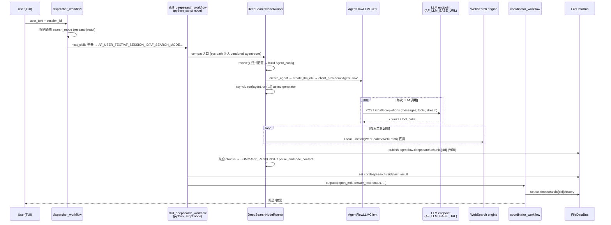

# 040 - openjiuwen DeepSearch agent 集成样例（agent-core 嵌入 workflow node）

| 属性 | 值 |
|------|------|
| 编号 | 040 |
| 类型 | feature |
| 状态 | tbd（待实施，**编码前需人工确认**） |
| 日期 | 2026-08-15 |

---

## 1. 背景

AgentFlow 已具备把外部 Python agent 框架嵌入 workflow node 的基础能力：node 以 `execution_mode=python_script` 声明 Python 运行时，由 `MMWorkerEngine::execute_code` → `CodeLoader::execute_python_script` 以子进程执行（`src/runtime/worker/exe_loader.cpp:819-834`），并由 scheduler/deployer 调度到 worker 的线程池上运行。仓库内已有两个 openjiuwen 系先例（`examples/agent/openjiuwen_multi_session_chat`、`examples/agent/openjiuwen_studio_agent`），但它们验证的都是**轻量、短耗时、无 function-calling** 的链路。

尚未验证的是：一个**重型多阶段 research agent**——长耗时（分钟到小时级）、流式产出、LLM 调用需要 messages/tools 完整语义、依赖外部搜索工具、具有跨 run 会话状态——能否完整嵌入 AgentFlow 的 dispatcher/coordinator/skill 三段协同，并被 scheduler/worker 正常调度执行。

本方案在 `examples/agent/openjiuwen_deepsearch/` 新增一个 agent 包，把 openJiuwen agent-core（仓库 vendored 副本 `vendor/openjiuwen/python`）及其上的 DeepSearch agent（SDK 包 `openjiuwen_deepsearch`，源码 `~/atomGitProjects/deepsearch/deepsearch`，项目地址 https://gitcode.com/openJiuwen ）作为 skill node 端到端跑通，并以其为试金石验证 AgentFlow 对外部 agent-core 的三类适配接口：

1. **上下文记忆**（context memory）→ AgentFlow DataBus `ctx:` 命名空间；
2. **推理服务**（inference）→ AgentFlow worker 注入的 `AF_LLM_*` 凭证通道；
3. **Skills/Tools** → node inputs/env 注入的配置 + DataBus 观测通道。

## 2. 方案简述

整体复用三段协同范式：`contextupdater → dispatcher → skill(deepsearch) → coordinator`。deepsearch 是一个 `python_script` node，包内自带 `nodes/python/compat/` 适配层，所有对 openjiuwen/deepsearch 的适配修改**全部收敛在该目录**，不污染 AgentFlow、agent-core、deepsearch 三方代码。

适配层的三条缝（seam）：

1. **LLM 推理适配**：实现 `AgentFlowLLMClient(BaseModelClient)`，通过 `__client_name__="AgentFlow"` 自动注册进 agent-core 的 `ClientRegistry`（`vendor/openjiuwen/python/openjiuwen/core/foundation/llm/model_clients/base_model_client.py:36-58` 的 `__init_subclass__` 自动注册机制），deepsearch `llm_config` 槽位配 `model_type:"AgentFlow"` 即可选中（`LLMModelFactory` 对非内置 provider 原样透传为 `client_provider`）。传输走**直连 OpenAI 兼容 `/chat/completions`**，凭证来自 worker 注入的 `AF_LLM_BASE_URL/AF_LLM_API_KEY/AF_LLM_MODEL` 环境变量。
2. **上下文记忆适配**：deepsearch 的 `conversation_id`（checkpointer thread key）绑定 AgentFlow `session_id`；run 结束把终态报告/用量快照写入 DataBus `ctx:` 命名空间；可选实现 `@CheckpointerFactory.register("agentflow_databus")` 把 checkpoint 状态放 DataBus KV（P3）。
3. **Tools/Skills 适配**：deepsearch 自带的 web-search/local-search 工具（`LocalFunction`）在 node 内以 node inputs/环境注入的配置直接运行；可选反向把 AgentFlow 兄弟 skill 包装为 openjiuwen `LocalFunction` 工具（P3）。

依赖与运行时：包内 `scripts/setup_env.sh` 用 uv 建独立 venv，editable 安装 deepsearch（指向 `~/atomGitProjects/deepsearch/deepsearch`，**不修改其源码**），随后**卸载 pip 拉入的 `openjiuwen`**，node 启动时 `sys.path.insert(0, vendor/openjiuwen/python)` 强制使用仓库 vendored 副本；worker 通过 `PYTHON_PATH` 环境变量选用该 venv 的 python（`exe_loader.cpp:266-286` 支持 venv 目录/二进制路径解析）。

测试独立闭环：包内 `tests/run_tests.sh` 为唯一测试入口（因不可修改 `tests/e2e/CMakeLists.txt`，无法注册 ctest），分两段：(a) 适配层单测（本地 mock endpoint）；(b) **以包内 import 驱动方式运行 deepsearch 全量 pytest 套件**（默认 `-m "not llm"`，`RUN_LLM_TESTS=1` 时 opt-in 真实 LLM 用例）。

## 3. 约束与假设

**硬约束**：

- 不修改 `examples/agent/openjiuwen_deepsearch/` 之外的任何**代码**。具体包括：
  - 不修改 AgentFlow 的 C++/CMake/SDK（含 `publish/sdk/python/agentflow_databus.py`）；
  - 不修改 `tests/e2e/CMakeLists.txt`——因此**无法注册 ctest**（ctest 注册依赖该文件的 `if(EXISTS ...) add_test` 模式，见 `tests/e2e/CMakeLists.txt:100-135`），测试只能通过包内 standalone 脚本运行；
  - 不修改 `vendor/openjiuwen/python`（vendored agent-core 副本）；
  - 不修改 `~/atomGitProjects/agent-core` 与 `~/atomGitProjects/deepsearch` 源码；对二者的任何适配（monkey-patch、子类化、配置注入）都放在本包 `nodes/python/compat/` 适配层完成。
- 本文档例外：`docs/enhancements/040-*.md`（本文件）与 `docs/enhancements/README.md` 索引行属**文档交付物**，非代码变更。

**假设**：

- 运行环境为 macOS/Linux + Python 3.11（`.venv` 固定 3.11，与 agent-core `.python-version` 一致）+ `uv` 可用。
- deepsearch 真实运行需要 OpenAI 兼容 LLM endpoint 与 web 搜索引擎 API key，由环境变量/node inputs 注入，不落库、不写 DataBus 明文。
- **版本偏差假设（本方案最大风险）**：deepsearch `pyproject.toml` 锁定 `openjiuwen==0.1.10.post3`，而仓库 vendored 副本为 main 分支源码快照（无版本号）。本方案选择 vendored 副本为唯一来源（已确认），风险消减：
  1. `setup_env.sh` 安装后卸载 pip 的 `openjiuwen`，杜绝双副本混入；
  2. node 启动期做 API 存在性校验（`BaseModelClient.__init_subclass__` 注册机制、`Runner`、`ControllerAgent`、`CheckpointerFactory` 等），缺失时打印可操作错误退出；
  3. **包内测试以 vendored 副本 import 驱动 deepsearch 全量用例——全部通过即兼容性的直接证明**（见 §9）。
- workflow 三段协同（dispatcher → skill fan-out → coordinator fan-in）语义按 031 号方案描述的现状使用，不依赖其 tbd 中的增强项。

## 4. 当前实现分析

### 4.1 代码分析

**AgentFlow node 执行链路**（本方案依赖的宿主机制，全部只读复用）：

| 事实 | 证据 |
|---|---|
| node 以 `MMNode::Config{execution_mode, command, json_output, timeout_ms, inputs, outputs}` 声明；`python_script` 模式由 DSL `map_execution_mode` 映射 | `include/external/workflow/node.h:77-138`、`src/workflow/dsl/dsl_adapter.cpp:60,141` |
| node 执行经 `MMNode::execute_with_worker_engine()` 组装 `ExecutionRequest` 调 `MMWorkerEngine::execute_code` | `src/workflow/node/node.cpp:543-597` |
| Python 子进程注入 `AF_DATABUS_DIR/AF_DATABUS_KV_DIR/AF_DATABUS_EVENTS_DIR`、`AF_LLM_BASE_URL/API_KEY/MODEL`、`AF_PLUGIN_UDS_FILE`、`AF_DATABUS_UDS_FILE` | `src/runtime/worker/worker.cpp:55-71` |
| 每个 node input 以 `AF_<NAME_UPPER>` 环境变量注入子进程 | `src/runtime/worker/worker.cpp:123` |
| worker 后台线程把 DataBus 事件 `agentflow.llm.request` 桥接到 C++ `StreamingLLMClient`，chunk 发 `agentflow.llm.chunk.{request_id}`，done/error 各有 topic，终值落 KV | `src/runtime/worker/worker.cpp:137-186` |
| **DataBus LLM 代理协议只接受扁平 `prompt` 字符串**——无 messages 数组、无 tools、无采样参数 | `src/runtime/worker/worker.cpp:145-149`（`parse_scalar_json_object` 只解析标量字段）、`publish/sdk/python/agentflow_databus.py` 的 `request_llm()` |
| `CodeLoader::execute_python_script` 用 `PYTHON_PATH` 解析 python（支持 venv bin 目录或二进制路径），缺省 `python3` | `src/runtime/worker/exe_loader.cpp:266-286, 819-834` |
| node 默认 `timeout_ms=30000`，workflow JSON 可配；超时由 `MMNode::execute_with_timeout` 硬杀 | `src/workflow/node/node.cpp:550,739,820,841`、`src/workflow/workflow.cpp:439-440` |
| Python 节点读写 DataBus 用 `FileDataBus`（文件协议 SDK） | `publish/sdk/python/agentflow_databus.py` |
| DataBus 命名空间与 key 布局（`SYS/CTX/LLM/TOOL/USER`，`/session/{sid}/{namespace}/{key}`） | `include/external/agentflow/so_node.h:158` |

**openjiuwen agent-core 扩展点**（vendored 副本，全部只读复用）：

| 事实 | 证据 |
|---|---|
| `BaseModelClient` 子类定义 `__client_name__` 即经 `__init_subclass__` 自动注册（registry key = `llm_<name>`）；`create_model_client` 先查内置 provider，miss 后查 registry | `vendor/openjiuwen/python/openjiuwen/core/foundation/llm/model_clients/base_model_client.py:36-58`、`model_clients/__init__.py:61-96`、`core/common/clients/client_registry.py:79-126` |
| `Model` facade 以 `Model(model_client_config=ModelClientConfig(client_provider,...), model_config=ModelRequestConfig)` 解析具体 client | `core/foundation/llm/model.py:27` |
| `CheckpointerFactory.register(name)` 装饰器可注册自定义 checkpoint provider | `core/session/checkpointer/checkpointer.py:60-85` |
| 工具基元为 `ToolCard` + `Tool` / `LocalFunction(card, func)` | `core/foundation/tool/base.py` |

**deepsearch 嵌入面**（`~/atomGitProjects/deepsearch/deepsearch`，只读复用）：

| 事实 | 证据 |
|---|---|
| SDK 嵌入路径：`AgentFactory().create_agent(agent_config)` → `agent.run(message, conversation_id, agent_config, report_template, interrupt_feedback)` 为 async generator，产出 JSON str，终态含 `SUMMARY_RESPONSE` / `parse_endnode_content` | `openjiuwen_deepsearch/framework/openjiuwen/agent/workflow.py:607-690` |
| **`agent.run()` 内部自行构造 LLM 并 set contextvars**（`llm_context.set(all_llms)`、`_initialize_tools` set `web_search_context/local_search_context/tool_context`）——适配层职责收敛为"正确构造 `agent_config`"，无需外部注入 contextvars | `framework/openjiuwen/agent/workflow.py:642-655, 869-877`；contextvars 定义于 `openjiuwen_deepsearch/utils/constants_utils/session_contextvars.py` |
| `LLMModelFactory.get_model` 的 provider_map 仅含 openai/siliconflow 别名，**其余 `model_provider` 原样透传为 `client_provider`**——`model_type:"AgentFlow"` 即可选中自定义 client | `framework/openjiuwen/llm/llm_model_factory.py:21-24, 48-55` |
| `AgentFactory` import 时设置 `WORKFLOW_EXECUTE_TIMEOUT`（默认 7200s） | `framework/openjiuwen/agent/agent_factory.py:19` |
| `agent_config` 为 Pydantic `AgentConfig.model_dump()` 字典：`search_mode`（research/search/react）、`llm_config` 五槽位（general/plan_understanding/info_collecting/writing_checking/vlm_chart_generating）、`web_search_engine_config`、`workflow_human_in_the_loop`（默认 True，嵌入必须显式关）等 | `openjiuwen_deepsearch/config/config.py` |
| 锁定依赖 `openjiuwen==0.1.10.post3`，`requires-python >=3.11,<3.14`；pytest markers unit/integration/llm，`RUN_LLM_TESTS=1` gate llm 用例；`asyncio_mode=strict`、`pythonpath=["."]` | `pyproject.toml`、`tests/search_agent/test_llm_search_fetch_e2e.py:55-56` |
| `tests/conftest.py` autouse fixture 绑主线程 event loop（openjiuwen `Vertex` 在同步构图期调用 `asyncio.get_event_loop()`） | `tests/conftest.py` |
| 测试规模：131 个文件、约 1823 个用例，广泛使用 monkeypatch/AsyncMock | `tests/` 目录 |

### 4.2 Examples 分析

- `examples/agent/openjiuwen_multi_session_chat`：包结构范式母本——`package/`（agent.json 7 tasks + workflow JSON + prompts）+ `nodes/python/compat/runtime_bridge.py`（sys.path 注入 vendor+sdk、`RuntimeBinding`、`emit_json`）+ `scripts/build_and_run.sh` + TUI。本方案直接复用其骨架与节点约定（读 `AF_*` env、`json_output:true` 时 stdout 末行 JSON 即 node outputs）。
- `examples/agent/openjiuwen_studio_agent`：单脚本多模式（`--mode dispatcher/coordinator/skill/contextupdater`）加载 bundle。本方案不引入 studio runtime，但借鉴其以 `package/runtime/` 作为 node 可写目录（checkpointer sqlite、日志落点）的做法。
- 两者都**没有**：长耗时流式 agent、function-calling LLM 通路、跨 run 会话状态、外部重型依赖管理与外部测试套件运行的先例——即本方案要补齐的缺口。

### 4.3 缺失功能分析

| 缺失项 | 行业实践参考 | 对本方案的参考意义 |
|---|---|---|
| function-calling LLM 通路（现有示例仅扁平 prompt） | LangChain/LangGraph 的宿主注入 `BaseChatModel` 实现（宿主提供 client，子框架提供语义）是标准嵌入模式 | `AgentFlowLLMClient(BaseModelClient)` 即该模式在 agent-core 上的对应物，零侵入 |
| 长耗时 node 的超时与进度可观测 | LangGraph checkpointer + 事件流 | node `timeout_ms` 显式配置 + DataBus lifecycle/chunk 事件 topic |
| 外部重型 SDK 的依赖隔离 | uv/pip venv + 入口脚本解析器选择 | `PYTHON_PATH` 指向包内 `.venv`，`setup_env.sh` 幂等构建 |
| 宿主上下文 ↔ 内嵌 agent 会话状态映射 | MCP 工具桥接（宿主能力以 tool schema 暴露给内嵌 agent） | DataBus `ctx:` 快照 + 可选 DataBus checkpointer（P3） |

## 5. 数据结构设计

全部为**新增**（本包私有约定），不改 AgentFlow 既有数据结构，无兼容性影响。

### 5.1 `package/agent.json`

格式与 `examples/agent/openjiuwen_multi_session_chat/package/agent.json` 完全一致（`AgentPackage::load_from_directory`，`src/agent/package.cpp` 解析）：

```json
{
  "name": "OpenJiuwenDeepSearchAgent",
  "version": "1.0.0",
  "description": "DeepSearch research agent embedded as AgentFlow skill node (openjiuwen agent-core)",
  "session_pool_size": 3,
  "tasks": [
    {"id": 0, "type": "contextupdater", "description": "Resolve & publish LLM/search config into ctx namespace",
     "workflow_file": "deepsearch_context_workflow.json", "workflow_pool_size": 1, "scope": "agent"},
    {"id": 1, "type": "dispatcher", "description": "Route query by search_mode intent (research|react)",
     "workflow_file": "deepsearch_dispatcher_workflow.json", "workflow_pool_size": 2},
    {"id": 2, "type": "coordinator", "description": "Aggregate result & maintain session history",
     "workflow_file": "deepsearch_coordinator_workflow.json", "workflow_pool_size": 2},
    {"id": 3, "type": "skill", "description": "DeepSearch research skill",
     "workflow_file": "skill_deepsearch_workflow.json",
     "skill": {"name": "deepsearch", "config_dir": "runtime", "instance_pool_size": 1},
     "workflow_pool_size": 1},
    {"id": 4, "type": "skill", "description": "Fast react search skill",
     "workflow_file": "skill_react_search_workflow.json",
     "skill": {"name": "reactsearch", "config_dir": "runtime", "instance_pool_size": 1},
     "workflow_pool_size": 1}
  ],
  "max_workflows": 6,
  "max_concurrent_workflows": 2
}
```

要点：deepsearch/reactsearch skill `instance_pool_size:1`、`workflow_pool_size:1`（重资源 + 长耗时，避免并发互踩 `package/runtime/` 下的 checkpointer sqlite）；`max_concurrent_workflows:2` 限制并发 research。

### 5.2 node 内构造的 deepsearch `agent_config`

由适配层 `env_resolver` 组装后传给 `AgentFactory.create_agent` / `agent.run`：

```python
{
  "search_mode": "research",            # research | search | react（来自 node input AF_SEARCH_MODE）
  "execution_method": "parallel",
  "workflow_human_in_the_loop": False,  # 嵌入模式必须显式关（Config 默认 True）
  "outline_interaction_enabled": False,
  "outliner_max_section_num": 5,
  "llm_config": {
    "general":            {"model_type": "AgentFlow", "model_name": "<AF_LLM_MODEL>",
                            "base_url": "<AF_LLM_BASE_URL>", "api_key": "<AF_LLM_API_KEY>",
                            "hyper_parameters": {"top_p": 1.0, "temperature": 1.0}},
    "plan_understanding": {...同上...},
    "info_collecting":    {...同上...},
    "writing_checking":   {...同上...}
    # vlm_chart_generating 槽位不配置 → 关闭 vlm 出图（AgentFlowLLMClient 不实现 generate_image）
  },
  "web_search_engine_config": {"search_engine_name": "<engine>", "search_api_key": "<key>",
                                "search_url": "<url>", "max_web_search_results": 5},
  "stats_info_llm": True
}
```

`model_type:"AgentFlow"` 是 LLM 适配的总开关：`LLMModelFactory` 不识别该名字时原样透传（`llm_model_factory.py:23`），`create_model_client` 内置表 miss 后经 ClientRegistry 命中 `llm_AgentFlow`。

### 5.3 DataBus 键与事件 topic

| 键 / Topic | 写入方 | 内容 |
|---|---|---|
| `ctx:deepsearch:config` | context_node | LLM/搜索引擎配置快照（**密钥以 `***` 占位**，运行期密钥只走 env） |
| `ctx:deepsearch:{session_id}:last_result` | deepsearch skill node | `{conversation_id, search_mode, report_md, final_result_info, llm_usage, finished_at}` |
| `ctx:deepsearch:{session_id}:history` | coordinator | 会话摘要（报告 title + query 列表，供多轮 follow-up） |
| `agentflow.deepsearch.chunk.{session_id}`（event） | deepsearch skill node | 流式中间 chunk（节流发布，observability） |
| `agentflow.deepsearch.lifecycle`（event） | 各 node | `{stage: started|outline|report|done|error, session_id, ts}` |

### 5.4 Checkpointer（P3 可选）

`DataBusCheckpointProvider`（`@CheckpointerFactory.register("agentflow_databus")`）：`put/get/list` 以 `ckpt:{conversation_id}:{thread_ts}` 为键写 FileDataBus KV（值 = JSON 序列化 state dict，二进制不可序列化字段 base64）。默认路径仍用 deepsearch 自带 checkpointer（sqlite 落 `package/runtime/`，由 `CHECKPOINTER_TYPE` 控制），DataBus provider 作为跨 worker 共享的增强项，不改变默认行为。

## 6. 流程设计

### 6.1 总体时序



与既有实现的差异：`openjiuwen_multi_session_chat` 的 LLM 通路为"DataBus `request_llm` + 等 chunk topic"（扁平 prompt 足够）；本方案因 agent-core 需要 messages/tools/采样参数完整语义而**直连 HTTP**（`worker.cpp:145-149` 的代理协议无法表达）。DataBus LLM 代理在本方案中降级为可选观测通道，README 将标注该差异。

### 6.2 node 内部执行流（`DeepSearchNodeRunner.run_node()`）

1. **解析输入**：`AF_USER_TEXT`（必填）、`AF_SESSION_ID`、`AF_SEARCH_MODE`（默认 research）、`AF_REPORT_TEMPLATE`、`AF_SEARCH_ENGINE_NAME/API_KEY/URL`、`AF_LLM_TIMEOUT_SEC`。
2. **配置归并优先级**：`AF_*` env（node inputs）> DataBus `ctx:deepsearch:config` > `package/config/deepsearch_defaults.json` > deepsearch `Config().agent_config.model_dump()` 默认。密钥类只从 env 取，不落 DataBus 明文。
3. **构造 agent_config**（§5.2），`AgentFactory().create_agent(agent_config)`。
4. **消费流式输出**：`asyncio.run(self._consume(...))` 循环 `async for payload in agent.run(...)`，累计 chunk 摘要（只存 event/node 类型不存全文，防内存膨胀），遇 `SUMMARY_RESPONSE`/endnode 记录终态；每 20 帧或状态变更 publish 一次 DataBus 进度事件。
5. **emit 输出**：stdout 末行输出单帧 JSON（node `json_output:true` 约定）。
6. **异常路径**：捕获 `CustomValueException`/`ValidationError`，输出 `{status:"error", error_code, error_message, conversation_id}`，进程 exit code 仍为 0——避免 worker 把结构化错误当作脚本级失败吞掉输出。

**event loop 论证**：node 每次执行都是全新子进程、主线程首次进入 asyncio，`asyncio.run()` 自建新 loop。deepsearch `tests/conftest.py` 的主线程 pin fixture 解决的是**同进程多测试串扰**（其 docstring 明言任何先前代码可能已调用 `asyncio.run()`），node 一次性执行不存在该前提。兜底：若实测遇 loop 报错，在 runner 中 run 前显式 `asyncio.set_event_loop(asyncio.new_event_loop())` 再 `loop.run_until_complete`（等价 conftest 行为，仍在包内）。

## 7. 接口设计

全部为包内新增接口，无既有接口变更。

### 7.1 `nodes/python/compat/agentflow_llm_client.py`

```python
from openjiuwen.core.foundation.llm.model_clients.base_model_client import BaseModelClient

class AgentFlowLLMClient(BaseModelClient):
    __client_name__ = "AgentFlow"      # 经 __init_subclass__ 自动注册为 registry key "llm_AgentFlow"
    __client_type__ = "llm"

    def __init__(self, model_config, model_client_config):
        super().__init__(model_config, model_client_config)
        # api_base/api_key/verify_ssl/max_retries 取自 model_client_config
        # （由 deepsearch llm_config.base_url/api_key 经 LLMModelFactory 透传）

    async def invoke(self, messages, *, tools=None, temperature=None, top_p=None,
                     max_tokens=None, stop=None, model=None, output_parser=None,
                     timeout=None, **kwargs) -> AssistantMessage: ...
        # POST {api_base}/chat/completions (stream=False)
        # messages: BaseMessage list -> OpenAI dicts; tools: ToolInfo -> function schemas
        # 响应 tool_calls -> AssistantMessage(tool_calls=[...]); usage 透传

    async def stream(self, messages, *, ..., **kwargs) -> AsyncIterator[AssistantMessageChunk]: ...
        # stream=True; 逐 SSE 帧构造 AssistantMessageChunk(content_delta/tool_call_delta)
        # first_chunk/idle 超时语义由 Model 层保证（model.py:174-176）

    async def generate_image(self, *a, **kw): raise NotImplementedError("AgentFlow client: text-only")
    async def generate_speech(self, *a, **kw): raise NotImplementedError(...)
    async def generate_video(self, *a, **kw): raise NotImplementedError(...)
```

传输用 aiohttp（deepsearch 依赖树已有）。**模块 import 即完成注册**，`deepsearch_runner.py` 顶部 `import agentflow_llm_client  # noqa: F401` 保证注册发生。每次调用把 `{provider, model, latency, usage}` 汇入计数器，run 结束写入 `last_result.llm_usage`。

### 7.2 `nodes/python/compat/env_resolver.py`

```python
@dataclass
class DeepSearchNodeConfig:
    message: str; session_id: str; conversation_id: str   # conversation_id = session_id（跨 run 可 resume）
    search_mode: str = "research"                          # research|search|react
    execution_method: str = "parallel"
    report_template: str = ""
    llm: dict            # 各槽位 {model_type, model_name, base_url, api_key, hyper_parameters}
    web_search: dict; web_fetch: dict
    node_timeout_budget_ms: int = 3_600_000

def resolve() -> DeepSearchNodeConfig: ...
# 优先级: AF_* env > FileDataBus(AF_DATABUS_DIR).get("ctx:deepsearch:config")
#         > package/config/deepsearch_defaults.json > deepsearch Config() 默认
```

### 7.3 `nodes/python/compat/deepsearch_runner.py`

```python
class DeepSearchNodeRunner:
    def run_node(self) -> None                    # 脚本入口调用（sys.path 注入 + 校验 + 执行 + emit）
    async def _consume(self, agent, message, conversation_id, agent_config) -> RunOutcome
    def _build_agent_config(self, cfg: DeepSearchNodeConfig) -> dict
    def _publish_progress(self, session_id, frame: dict) -> None   # 节流
    def _summarize(self, frames: list[dict]) -> dict              # SUMMARY_RESPONSE/endnode 聚合

@dataclass
class RunOutcome:
    status: str; report_md: str; answer_text: str
    conversation_id: str; chunk_count: int; error_code: str = ""; error_message: str = ""
```

### 7.4 `nodes/python/compat/skill_tool_adapter.py`（P3 可选）

```python
def make_agentflow_skill_tool(skill_name: str, script_relpath: str) -> Tool:
    # LocalFunction(card=ToolCard(name=f"agentflow_skill_{skill_name}", ...), func=_invoke)
    # _invoke(payload: str) -> str: subprocess 运行兄弟 node 脚本（注入 AF_DATABUS_DIR 等 env），
    # 解析其 stdout 末行 JSON 返回
```

### 7.5 `package/skill_deepsearch_workflow.json` 核心 node（DSL 接口）

```json
{
  "id": "skill-deepsearch-workflow", "version": "1.0", "name": "skill-deepsearch-workflow",
  "nodes": [{
    "id": "n1", "name": "deepsearch-run", "type": "task",
    "execution_mode": "python_script",
    "command": "examples/agent/openjiuwen_deepsearch/nodes/python/deepsearch_skill_node.py",
    "json_output": true,
    "timeout_ms": 3600000,
    "inputs": [
      {"name": "user_text", "type": "string", "required": true},
      {"name": "session_id", "type": "string", "required": true},
      {"name": "search_mode", "type": "string", "required": false},
      {"name": "report_template", "type": "string", "required": false},
      {"name": "search_engine_name", "type": "string", "required": false},
      {"name": "search_api_key", "type": "string", "required": false},
      {"name": "search_url", "type": "string", "required": false}
    ],
    "outputs": [
      {"name": "answer_text", "type": "string"},
      {"name": "report_md", "type": "string"},
      {"name": "conversation_id", "type": "string"},
      {"name": "status", "type": "string"},
      {"name": "chunk_count", "type": "int"},
      {"name": "error_message", "type": "string"}
    ]
  }],
  "edges": []
}
```

`timeout_ms: 3600000` 为必填项：默认 30000ms 会在大纲阶段就杀掉 research（`node.cpp:550`）；该值经 `MMNode::execute_with_timeout` 硬生效（`node.cpp:476-515`），与 `AgentFactory` 设置的 `WORKFLOW_EXECUTE_TIMEOUT`（7200s）取小。

### 7.6 `scripts/setup_env.sh`（环境接口）

```bash
DEEPSEARCH_HOME="${DEEPSEARCH_HOME:-$HOME/atomGitProjects/deepsearch/deepsearch}"
VENV_DIR="$(dirname "$0")/../.venv"
uv venv --python 3.11 "$VENV_DIR"
uv pip install --python "$VENV_DIR/bin/python" -e "$DEEPSEARCH_HOME"
uv pip uninstall --python "$VENV_DIR/bin/python" openjiuwen   # 保证唯一来源是 vendored 副本
# 运行期: export PYTHON_PATH="$VENV_DIR/bin"  (CodeLoader resolve_python_command 支持 <dir>/bin/python)
```

node 脚本内 sys.path 顺序：`vendor/openjiuwen/python`（**第一位**，强制 vendored 副本）→ `$DEEPSEARCH_HOME`（源码 import `openjiuwen_deepsearch`，与 editable 安装一致）→ venv site-packages → `publish/sdk/python`（FileDataBus）。启动时校验 `import openjiuwen` 解析到 vendored 路径且含所需 API，mismatch 时打印可操作错误退出。

## 8. 实现方案

### 8.1 包目录树（全部新增，约 25 个文件）

```
examples/agent/openjiuwen_deepsearch/
├── README.md                                  # 依赖准备 / 运行 / 测试说明 + 已知限制
├── example.md                                 # 遵循 examples 文档约定
├── openjiuwen_deepsearch_tui.cpp              # include ../../features/agent_tui_main.h
├── package/
│   ├── agent.json / package.json / .gitignore
│   ├── config/deepsearch_defaults.json        # search_mode/引擎/超时默认（无密钥）
│   ├── prompts/skill_router_prompt.txt        # dispatcher 路由 prompt（规则兜底可选）
│   ├── deepsearch_context_workflow.json       # contextupdater: 归并配置写 ctx:deepsearch:config
│   ├── deepsearch_dispatcher_workflow.json    # 规则路由 research|react
│   ├── deepsearch_coordinator_workflow.json   # 汇总 + ctx history + 最终输出
│   ├── skill_deepsearch_workflow.json         # §7.5 核心 node
│   ├── skill_react_search_workflow.json       # 同一脚本, search_mode=react 快路径
│   └── runtime/                               # gitignore; checkpointer sqlite / 日志
├── nodes/python/
│   ├── context_node.py / dispatcher_node.py / coordinator_node.py
│   ├── deepsearch_skill_node.py               # 薄入口: compat 运行器
│   └── compat/
│       ├── __init__.py
│       ├── runtime_bridge.py                  # 借鉴 multi_session_chat: sys.path 注入 / env_text / emit_json
│       ├── env_resolver.py                    # §7.2
│       ├── agentflow_llm_client.py            # §7.1
│       ├── memory_adapter.py                  # ctx 快照写入 + DataBusCheckpointProvider(P3)
│       ├── skill_tool_adapter.py              # §7.4 (P3)
│       └── deepsearch_runner.py               # §7.3
├── scripts/
│   ├── setup_env.sh                           # §7.6
│   └── build_and_run.sh                       # ./build.sh build && ./build/example_openjiuwen_deepsearch_tui examples/agent/openjiuwen_deepsearch/package
└── tests/
    ├── run_tests.sh                           # 唯一测试入口（不能改 CMakeLists, 无法注册 ctest）
    ├── conftest.py                            # 适配层测试夹具 (mock endpoint)
    ├── pytest_deepsearch.ini.in               # deepsearch 全量套件的 ini 模板（run_tests.sh 展开绝对路径）
    ├── test_agentflow_llm_client.py           # mock /chat/completions: invoke/stream/tool_calls/SSE
    ├── test_env_resolver.py                   # 优先级归并 / 密钥不落盘
    ├── test_deepsearch_runner_wiring.py       # agent_config 构造 + registry 注册 + fake agent.run 聚合
    ├── test_memory_adapter.py
    └── auto_deepsearch_dialog.sh              # 黑盒冒烟（手动, 需密钥; 不注册 ctest）
```

### 8.2 关键实现细节

- **streaming 聚合**：一次 research 可产出数百帧、耗时数分钟到 1 小时。全帧只缓存 event/node 摘要不存全文；终态报告取 `SUMMARY_RESPONSE` 帧 content 或 `parse_endnode_content`；进度事件节流 publish 到 `agentflow.deepsearch.chunk.{sid}`，外部可用 FileDataBus `next_event` 消费作观测。
- **密钥安全**：`api_key` 仅经 env 进入子进程内存；写入 DataBus 的 config 快照一律 `***` 占位；deepsearch 侧 `create_llm_obj` 使用后 `zero_secret` 清零。
- **可维护性**：compat 层零 AgentFlow 编译产物依赖（纯 FileDataBus 文件协议 + `AF_*` env），与 precedent 的 `runtime_bridge.py` 同构；对 agent-core 只用公开扩展点（ClientRegistry / CheckpointerFactory / LocalFunction），后续可抽公共库（§12）。
- **性能**：直连 HTTP 免去 DataBus 文件轮询中转两层 poll；`instance_pool_size:1` 序列化重任务避免 sqlite checkpointer 并发写冲突。
- **优点**：三方代码零污染；agent-core 的所有适配走官方扩展点而非 monkey-patch；deepsearch 套件成为持续兼容性回归。
- **潜在问题与消减**：
  - vendored agent-core 与 deepsearch 锁定版本偏差 → §3 三重消减（卸载 pip 副本 / 启动校验 / 全量套件回归）；
  - research 超时被杀 → node `timeout_ms` 显式 3600000 + react 快路径作为秒级回归通道；
  - 子进程内存占用（transformers 等重依赖）→ `instance_pool_size:1` + README 标注资源需求。

### 8.3 待修改文件清单

| 文件 | 修改类型 | 说明 |
|------|---------|------|
| `docs/enhancements/040-feature-openjiuwen-deepsearch-agent-260815-tbd.md` | 新增 | 本设计文档 |
| `docs/enhancements/README.md` | 修改 | 索引表 +1 行（文档性交付物，非代码） |
| `examples/agent/openjiuwen_deepsearch/**`（§8.1 全树，约 25 文件） | 新增 | 所有代码 / 配置 / 测试，全部位于本包内 |

### 8.4 功能点实现优先级排序

| 优先级 | 功能点 | 副作用分析 | 验证策略 |
|--------|--------|-----------|---------|
| P1 | 包骨架 + agent.json + 5 个 workflow JSON + context/dispatcher/coordinator node | 无副作用（纯新增目录） | TUI 启动冒烟 |
| P1 | scripts/setup_env.sh + PYTHON_PATH venv 方案 + vendored 副本校验 | 无（venv 在包内 .gitignore） | API 存在性校验单测 |
| P2 | AgentFlowLLMClient + env_resolver + deepsearch_runner（research 主链路） | 依赖 P1；不影响已有功能 | mock endpoint 单测 + react 模式端到端（秒级） |
| P2 | 流式聚合 + DataBus ctx 快照 + 观测事件 | 依赖上一项 | test_deepsearch_runner_wiring |
| P3 | DataBusCheckpointProvider、skill_tool_adapter（skill 反向适配） | 影响面限本包 | 专项单测 |
| P3 | README/example.md/索引等文档收尾 | 无 | 评审确认 |

## 9. 测试方案

### 9.1 Examples 黑盒测试覆盖分析

| 功能点 | 现有 Examples 覆盖 | 更新建议 |
|--------|-------------------|---------|
| python_script node + AF_* env 注入 | ✅ multi_session_chat | 无 |
| function-calling LLM 通路（messages/tools） | ❌ 无先例 | 本包 `test_agentflow_llm_client.py`（mock SSE + tool_calls） |
| 长耗时 node（timeout_ms 显式配置） | ❌（现有 node 均 <30s） | workflow JSON `timeout_ms:3600000` + react 快路径回归 |
| 流式聚合 + DataBus 进度事件 | ❌ | `test_deepsearch_runner_wiring.py` |
| 外部重型 SDK 依赖管理（venv/PYTHON_PATH/vendored 校验） | ❌ | setup_env.sh 幂等重跑 + 校验单测 |
| 跨 run conversation resume（checkpointer） | ❌ | 双次 react run 复用 conversation_id，断言 ctx 快照 |

### 9.2 测试执行设计（唯一入口 `tests/run_tests.sh`，因不可改 CMakeLists 无法注册 ctest）

```bash
# 1) 环境准备（幂等）
bash scripts/setup_env.sh
# 2) 适配层单测（本地 mock OpenAI endpoint，秒级）
"$VENV_DIR/bin/python" -m pytest examples/agent/openjiuwen_deepsearch/tests -m adapter
# 3) deepsearch 全量套件 —— 包内 import 驱动（不改 deepsearch 任何代码）
#    run_tests.sh 由 tests/pytest_deepsearch.ini.in 生成 ini（展开 DEEPSEARCH_HOME /
#    AgentFlow 仓库根绝对路径；asyncio_mode=strict、markers unit/integration/llm、
#    pythonpath 注入 vendored agent-core 与 DEEPSEARCH_HOME）
"$VENV_DIR/bin/python" -m pytest -c tests/pytest_deepsearch.ini \
    "$DEEPSEARCH_HOME/tests" -m "not llm"
# 4) RUN_LLM_TESTS=1 且密钥齐备时加跑 -m llm
# 5) 总退出码 = 各段 OR
```

要点：

- **import 驱动的兼容性意义**：第 3 段运行时 `openjiuwen` 由 ini 的 `pythonpath` 解析到 **vendored 副本**——deepsearch 全量 131 文件约 1823 用例在 vendored agent-core 上全部通过，即 §3 版本偏差风险的直接证明。
- deepsearch 自带 `tests/conftest.py`（主线程 event loop fixture）位于被收集路径内，pytest 自动加载生效，无需复制。
- 用 `-c` 指定包内生成 ini 而非依赖 deepsearch 的 pyproject，保证 asyncio_mode/markers/pythonpath 由本包控制且 rootdir 行为确定。

### 9.3 测试用例设计与独立性

- **LLM client 单测**：本地 mock HTTP server（aiohttp test_utils）断言 messages 映射、`stop` 透传、tool_calls 解析、SSE 分帧、错误码透传；不访问真实 endpoint。
- **runner 单测**：注入 fake `agent.run` async generator（不 import 真实 deepsearch，标 `adapter` marker，秒级）；断言 chunk 聚合、`SUMMARY_RESPONSE` 终态提取、error 路径输出结构化 JSON 且 exit code 0。
- **env_resolver 单测**：四级优先级归并、密钥不落 DataBus 明文断言。
- **独立性**：全部 mock/stub 位于 `tests/`，不因测试便捷性修改功能代码；真实密钥仅 `RUN_LLM_TESTS=1` 的 opt-in 用例与 `auto_deepsearch_dialog.sh` 手动冒烟使用。

## 10. 文档

**需要变更的文档**：

| 文档 | 变更说明 |
|------|---------|
| `examples/agent/openjiuwen_deepsearch/README.md` | 依赖准备（uv / DEEPSEARCH_HOME / 密钥 env）、TUI 运行、测试入口、已知限制（直连 HTTP vs DataBus LLM 代理差异、资源需求） |
| `examples/agent/openjiuwen_deepsearch/example.md` | 按仓库 examples 文档约定描述交互流程与示例输出 |
| `docs/enhancements/README.md` | 索引表 +1 行（040 条目） |

**关联方案**：

| 关联方案 | 关系说明 |
|---------|---------|
| [037 Managed Agent 平台架构借鉴](037-feature-managed-agent-runtime-decoupling-260625-tbd.md) | 节点即 harness 的实践印证：本方案的 node 子进程即 deepsearch 的托管运行时 |
| [028 Node 模型推理服务流式访问设计](028-feature-node-模型推理服务流式访问设计-260323-tbd.md) | 本方案以直连 HTTP 绕开其未实施的 DataBus 代理协议限制；其后续升级（messages/tools）可反哺本方案 |
| [036 agentflowd 可执行入口设计](036-feature-agentflowd-可执行入口设计-260423-implemented.md) | standalone 运行的替代入口（daemon 模式加载本包） |
| [031 Coordinator 协同机制设计分析](031-feature-coordinator-协同机制设计分析-260405-tbd.md) | 本方案按其 §7.1 描述的三段协同现状使用 fan-out/fan-in |

## 11. 进展跟踪

- [ ] 代码实现（P1 骨架 → P2 主链路 → P3 可选项）
- [ ] 单元测试（适配层 adapter 套件）
- [ ] 集成测试（react 快路径 + research 全链路 + TUI 冒烟）
- [ ] deepsearch 全量套件（vendored agent-core 驱动，`-m "not llm"`）通过
- [ ] 文档更新（README / example.md / 索引）
- [ ] 验证通过（`RUN_LLM_TESTS=1` 真实密钥下 research 端到端出报告）

| 功能点 | 功能 | 用例 | 文档 | 状态 |
|--------|------|------|------|------|
| 包骨架 + workflow JSON + 环境脚本 | ⏳待实施 | ⏳待实施 | ⏳待实施 | 待实施 |
| LLM 适配层（AgentFlowLLMClient） | ⏳待实施 | ⏳待实施 | ⏳待实施 | 待实施 |
| 运行器 + 流式聚合 + ctx 快照 | ⏳待实施 | ⏳待实施 | ⏳待实施 | 待实施 |
| Memory/Skill 适配（P3 可选） | ⏳待实施 | ⏳待实施 | ⏳待实施 | 待实施 |
| deepsearch 全量套件接入 | ⏳待实施 | ⏳待实施 | ⏳待实施 | 待实施 |

## 12. 后续计划（可选）

| 优化项 | 预期效果 | 方案简述 |
|--------|---------|---------|
| compat 层抽公共库 | 多个 openjiuwen 示例共享 runtime_bridge/emit_json | 上移至 `publish/sdk/python/`（需出包内约束，另立 enhancement） |
| DataBus LLM 代理协议升级 | 节点可复用 worker 持有凭证，支持 messages/tools | 扩展 `agentflow.llm.request` payload schema（对应 028 号方案），本方案 AgentFlowLLMClient 增加代理后端 |
| vlm 槽位支持 | deepsearch 出图能力 | AgentFlowLLMClient 实现 `generate_image`（独立图像 endpoint 配置） |
| ctest 注册 | CI 一体化 | 放宽包内约束后在 `tests/e2e/CMakeLists.txt` 按既有 `if(EXISTS)` 模式加 `add_test` |

## 13. 修订记录

| 版本 | 刷新时间 | 刷新人 | 刷新内容 |
|------|---------|--------|---------|
| v1.0 | 2026-08-15 | DanielKernel | 初始版本（tbd，编码前待人工确认） |
