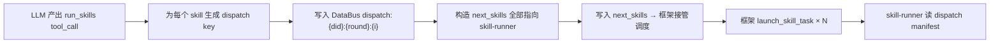
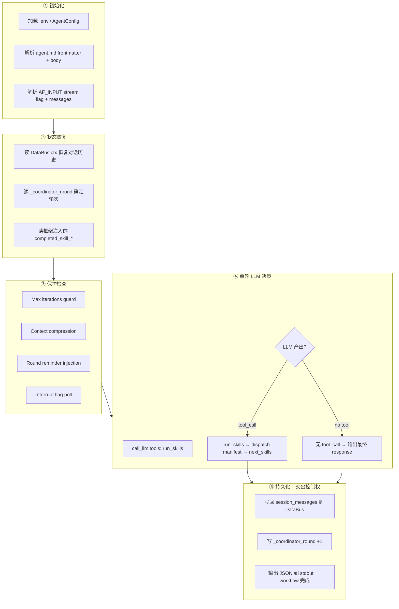
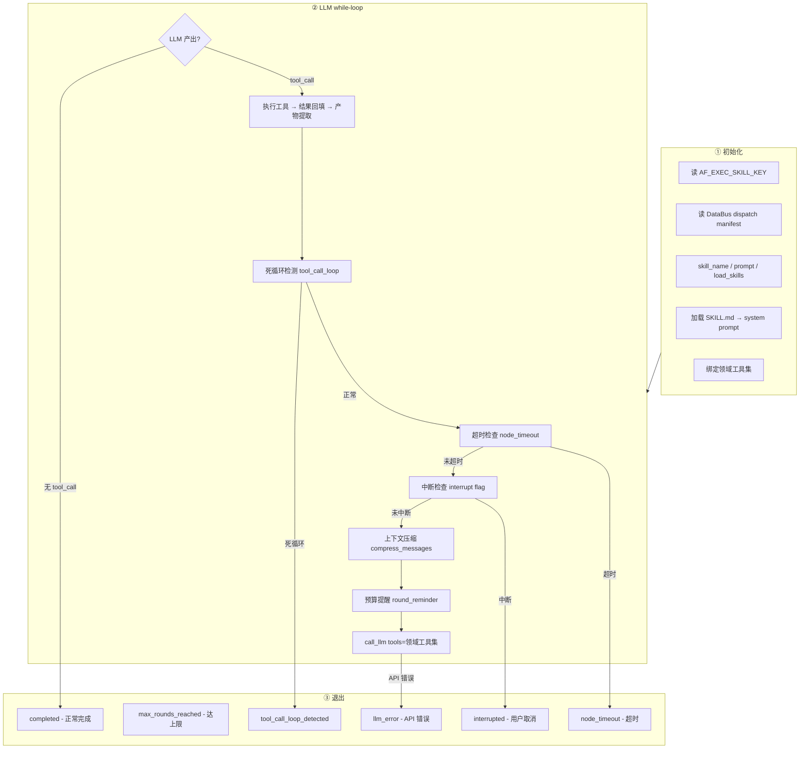

# 详细设计: 通用 Harness Agent Package — Coordinator-Driven Agent Loop + 参数化 Skill Task

> **文档级别**: L4 技术设计
> **日期**: 2026-06-30，刷新 2026-07-14
> **状态**: implemented (v3+)
> **关联**: `packages/agentflow-runtime/src/agentflow_runtime/`（核心实现）、`examples/agent/outfit-assistant/`（生产 Agent）、`frontend/bridge/templates/agent_template/harness_agent/`（通用模板）、031-coordinator-协同机制、038-harness-agent-能力升级、040-harness-agent-MCP-support、agent-template-delta（四层架构）

---

## 1. 背景

### 1.1 当前模型的问题

现有 `harness-agent` 采用 **dispatcher → skill → coordinator** 三层固定 task 模型：

```
agent.json:
  tasks[0]: dispatcher  → next_skills=["harness_agent_run"]  (硬编码)
  tasks[1]: coordinator → coordinator_collect.json            (透传)
  tasks[2]: skill       → harness_agent_run.json             (LLM while-loop)
```

| 问题 | 具体表现 |
|------|---------|
| **Dispatcher 僵化** | `next_skills` 硬编码为 `["harness_agent_run"]`，dispatcher 不做任何决策，仅透传 |
| **Coordinator 退化** | `coordinator_collect.py` 仅输出 `{"coordinator_status": "ok"}`，不做判定/再规划 |
| **Skill 静态绑定** | 每个 skill 需独立 workflow JSON + node 实现 + agent.json task 定义，加 skill 改三处 |
| **无法指派任务** | Coordinator 只能 `next_skills: ["travel"]`，无法传达"用 travel skill 做什么" |
| **无法指派技能** | Skill node 不知道该加载哪个 SKILL.md，技能知识硬编码在 node 或 prompt 中 |
| **单 skill 限制** | 当前 `harness_agent_run` 是唯一 skill，无法并行多 skill |

### 1.2 框架硬性约束

AgentFlow 框架要求每个 session **必须包含三个 task**：

| task_type | task_index | 职责 | 框架依赖 |
|-----------|-----------|------|---------|
| `dispatcher` | 0 | 接收用户请求，启动初始 skill | `handle_task_intent_request` 中 dispatcher 分支；`session->set_dispatcher_task()` |
| `coordinator` | 1 | 接收 skill 完成通知，判定/再规划 | `handle_task_data_exchange` 中 coordinator 分支；`session->set_coordinator_task()` |
| `skill` | ≥2 | 执行具体技能 | `launch_skill_task()`；`pending_skills_count` 计数 |

**不能消除任何一个 task** — 框架的消息路由、完成通知、并发计数等机制都依赖三个 task 的存在。

### 1.3 当前实现状态（v3+）

本设计已实现并演进到 v3+ 架构，核心变化：

1. **代码包化**：通用逻辑从 `examples/agent/harness_agent_v2/` 迁移到 `packages/agentflow-runtime/src/agentflow_runtime/`（pip 包），agent 包仅保留入口 wrapper 文件
2. **单 Skill-Runner 路由**：所有 skill 通过 `exec_skill_key` → DataBus dispatch manifest 统一路由到单个 `skill-runner` task，不再为每个 skill 创建独立 task
3. **dummy_pre_skill hook**：在 dispatcher 和 coordinator 之间插入预处理步骤
4. **新增能力**：对话中断处理、流式进度推送、Artifact 管理、工具调用死循环检测、上下文压缩、可观测性事件等

详见 §15 实施情况。

### 1.4 设计目标

在保留三层 task 的前提下，**将决策权从 dispatcher 转移到 coordinator**：

```
Dispatcher (透传层)
  │  next_skills=["coordinator-skill"]  (固定，仅启动 coordinator)
  ▼
Coordinator Skill (LLM while-loop, 真正的决策中枢)
  │
  ├─ 唯一工具: run_skills
  │     ├─ 传入: skill 名称 + 任务指令 + 应加载的技能
  │     └─ 返回: 所有 skill 的执行结果
  │
  └─ LLM 自主决策: 调用 run_skills / 输出最终 response
```

**核心变化**：

1. **Dispatcher 退化为透传** — 固定 `next_skills=["coordinator-skill"]`，不做任何决策
2. **Coordinator 升级为决策中枢** — 用 LLM while-loop + `run_skills` 工具自主规划
3. **Skill 参数化** — coordinator 通过 `run_skills` 指派"做什么"和"用什么技能"
4. **通用 skill node** — 一个 `general_task_executor.py` 通过入参差异化，消灭 N 份模板代码
5. **工具分层绑定** — coordinator 只绑 `run_skills`；skill task 绑领域工具

---

## 2. 方案简述

### 2.1 架构总览

框架要求每个 session 包含 dispatcher (task_index=0)、coordinator (task_index=1)、skill (task_index≥2) 三个 task，不可省略。本方案在保留三层结构的前提下，**将决策权从 dispatcher 转移到 coordinator**。

v3+ 架构引入了一个 **dummy_pre_skill hook**（预处理步骤）和 **单 skill-runner 路由**：

```
agent.json:
  tasks[0]: dispatcher        → next_skills=["dummy_pre_skill"]  (透传)
  tasks[1]: coordinator       → coordinator_workflow.json        (LLM 决策循环)
  tasks[2]: skill (dummy_pre_skill)  → 预处理 hook，透传后触发 coordinator
  tasks[3]: skill (skill-runner)     → 通用 skill 执行器，通过 exec_skill_key 路由
```

### 2.2 核心抽象：两个独立节点

**关键洞察**：coordinator 和 skill 是**两个独立的 Python 节点**，不再共享同一个 `general_task_executor.py`：

| 节点 | 文件 | system prompt 来源 | 绑定工具 | 职责 |
|------|------|-------------------|---------|------|
| **coordinator_decide** | `coordinator_decide.py` | 框架协议 + agent.md 正文 | `[run_skills]` | 规划与委派 |
| **skill_executor** | `skill_executor.py` | SKILL.md（dispatch manifest 指定） | `[领域工具集]` | 执行具体任务 |

两者通过 **DataBus dispatch manifest** 通信：

```
Coordinator 调用 run_skills
  → handle_run_skills_call 写入 dispatch:{dialogue_id}:{round}:{i} 到 DataBus
  → 所有 skill 通过 exec_skill_key 路由到 skill-runner task
  → skill_executor 从 DataBus 读取 dispatch manifest 获取 skill_name/prompt/load_skills
```

### 2.3 架构总览

**Coordinator 就是主 Agent**——它思考、分析、回复用户，`run_skills` 是它委派执行的手段。Skill-Runner 是被委派的执行单元，做完具体工作后把结果交回。

```
用户请求
  │
  ▼
┌─────────────────────────────────────────────────────────────────┐
│  Dispatcher (task_index=0) — 透传层                             │
│  固定 next_skills=["dummy_pre_skill"]                           │
└──────────────┬──────────────────────────────────────────────────┘
               │
               ▼
┌─────────────────────────────────────────────────────────────────┐
│  dummy_pre_skill (task_index=2) — 预处理 hook                   │
│  框架启动 → 执行 dummy_pre_skill.py → 透传后触发 coordinator   │
└──────────────┬──────────────────────────────────────────────────┘
               │ skill 完成 → 框架 re-trigger coordinator
               ▼
┌─────────────────────────────────────────────────────────────────┐
│  Coordinator (task_index=1, 主 Agent 循环)                      │
│  = coordinator_decide.py                                        │
│      system_prompt = 框架协议 + agent.md 业务意图               │
│      tools = [run_skills]                                       │
│                                                                  │
│  它就是用户对话的对象：                                          │
│    - 分析用户需求                                                │
│    - 思考该怎么做                                                │
│    - 需要执行时 → 调用 run_skills 委派 skill                    │
│    - 收到结果后 → 继续分析、补充、或直接回复用户                │
│    - 直接回复用户 → 任务完成                                    │
│                                                                  │
│  事件驱动: 每次被触发执行一轮 LLM 决策                          │
│  "循环"由框架 re-trigger 提供 (skill 完成 → re-trigger)        │
│                                                                  │
│  ┌─── run_skills: 委派执行 ──────────────────────────────┐     │
│  │  传入: skill 名称 + 任务指令(prompt) + 技能文档       │     │
│  │  效果: 写 dispatch manifest → 写 next_skills          │     │
│  │        → 框架启动 skill-runner → 并行执行 → 完成后    │     │
│  └───────────────────────────────────────────────────────┘     │
└──────────────┬──────────────────────────────────────────────────┘
               │ run_skills → dispatch manifest → next_skills
               ▼
┌─────────────────────────────────────────────────────────────────┐
│  Skill-Runner (task_index=3, 被委派的执行单元, 可并行)          │
│  = skill_executor.py                                            │
│      system_prompt = SKILL.md (dispatch manifest 指定)          │
│      tools = [领域工具集]                                       │
│                                                                  │
│  所有 skill 共享同一个 task，通过 exec_skill_key 区分：          │
│    - 读 DataBus dispatch:{key} → 获取 skill_name/prompt        │
│    - 加载 SKILL.md → 知道"怎么做"                               │
│    - LLM + 技能知识 + 领域工具 → function-calling loop          │
│    - 做完 → 结果写入 DataBus skill_result → 通知 coordinator   │
└─────────────────────────────────────────────────────────────────┘
               │ skill 完成 → 框架 re-trigger coordinator
               ▼
          Coordinator 继续分析...
```

**一句话**：Coordinator 是脑（分析+决策+回复），Skill-Runner 是手（执行具体工作），`run_skills` + DataBus dispatch manifest 是脑指挥手的接口。

### 2.4 关键设计决策

**1. Coordinator 为什么是事件驱动而非 while-loop**

框架的 `next_skills` 在 workflow **完成后**才被处理（`process_next_skills_launch` 在 workflow 完成回调中执行）。coordinator 不能在 while-loop 中"等待 skill 结果"——必须先完成 workflow，让框架启动 skill，然后等框架在 skill 完成后 re-trigger 自己。

**2. 为什么是单 skill-runner 而非多 skill task**

所有 skill 共享同一个 `skill-runner` task（task_index=3），通过 `exec_skill_key` 路由区分：

- **加 skill 无需改 agent.json**：只需在 `harness/skills/` 下放 SKILL.md
- **并行度由 instance_pool_size 控制**：`instance_pool_size=5` 允许 5 个 skill 实例并行
- **dispatch manifest 承载所有信息**：skill_name/prompt/load_skills 打包在 DataBus key 中

**3. 为什么 coordinator 和 skill 是独立的 Python 节点**

两者职责不同，工具集不同，生命周期不同：
- **coordinator**：只绑 `run_skills`，事件驱动（单轮 LLM 决策后交出控制权）
- **skill_executor**：绑领域工具集，while-loop（多轮工具调用直到完成）

### 2.5 核心设计原则

| 原则 | 说明 |
|------|------|
| **三层 task 保留** | 框架硬性要求，dispatcher/coordinator/skill 不可省略 |
| **Dispatcher 退化为透传** | 固定 `next_skills=["dummy_pre_skill"]`，不做决策 |
| **统一执行器** | coordinator-skill 和 generic-skill 共享 `general_task_executor.py`，差异仅在入参 |
| **Coordinator 事件驱动** | 每次 skill 完成触发一次 LLM 决策，框架 re-trigger 提供循环 |
| **Skill 是被参数化的** | 不再是"我是什么"，而是"coordinator 让我做什么" |
| **技能知识从 SKILL.md 动态加载** | 不硬编码在 node 中，coordinator 指定加载哪些 |
| **工具分层绑定** | coordinator-skill 只绑 `run_skills`；generic-skill 绑领域工具 |
| **框架零改动（Phase 1）** | 所有新逻辑在 Python 节点层实现，复用已有 next_skills 管线 |

---

## 3. 约束与假设

- **Phase 1 不改动 C++ 框架核心层**（`src/agent/`、`src/workflow/`、`src/runtime/`）— 所有新逻辑在 agent package 的 Python 节点层实现
- **复用已有 next_skills 管线** — `parse_next_skills()` + `launch_skill_task()` + `pending_skills_count` + `launched_skills` 完全复用
- **Phase 2 可选框架改动** — 新增 `AF_SKILL_PROMPT` / `AF_LOAD_SKILLS` 环境变量传播（约 20 行 C++），提升通用性
- **向后兼容** — 现有 `harness-agent` 不动，新模型作为 `harness_agent_v2` 共存
- **Skill 执行在 Worker 进程** — Python node 通过 `execution_mode: "python_script"` 执行，多 skill 实例天然并行隔离
- **LLM 调用使用 agent.md 配置** — 模型、base_url、api_key 从 agent.md frontmatter 读取，不硬编码

---

## 4. 当前实现分析

### 4.1 现有 harness-agent 数据流

```
用户请求 → SessionRouter → Session
  → Dispatcher task (intent_request)
      → next_skills=["harness_agent_run"] (硬编码)
      → launch_skill_task("harness_agent_run")
  → Skill task (harness_agent_run)
      → llm_think_and_act.py while-loop
      → LLM + tools (echo, bash, read_file, write_file, web_fetch, load_skill, list_skills, MCP...)
      → 输出 {"response": "..."} → DataBus
  → Coordinator task (data_exchange, skill_response 触发)
      → coordinator_collect.py → {"coordinator_status": "ok"}
      → handle_task_data_exchange 读 DataBus "response" → 返回客户端
```

### 4.2 现有框架注入的环境变量

| 环境变量 | 注入位置 | 说明 |
|---------|---------|------|
| `AF_INPUT` | `runtime.cpp` task poller | 用户原始输入 |
| `AF_DIALOGUE_ID` | `runtime.cpp` task poller | 当前 dialogue ID |
| `AF_SESSION_ID` | `runtime.cpp` task poller | 当前 session ID |
| `AF_DATABUS_UDS_FILE` | `runtime.cpp` worker 启动 | DataBus UDS socket 路径 |

### 4.3 现有框架注入的 node inputs

| input key | 注入位置 | 说明 |
|-----------|---------|------|
| `dialogue_id` | `runtime.cpp:1825` | 从 task parameter 传播 |
| `completed_skill_name` | `runtime.cpp:1830` | 前一个完成的 skill 名称（给 coordinator 用） |
| `skill_success` | `runtime.cpp:1835` | 前一个 skill 是否成功 |
| `exec_skill_key` | `runtime.cpp:1842` | skill 专属数据路由 key |
| `self_task_id` | `runtime.cpp:1846` | 当前 task 的 ID |

### 4.4 可直接复用的框架机制

| 机制 | 位置 | 复用方式 |
|------|------|---------|
| `next_skills` 解析 | `builtin_dispatcher.cpp:parse_next_skills()` | `run_skills` 拦截后构造 next_skills 写入 DataBus |
| `SkillSpec` 格式 | `builtin_dispatcher.h` | `name` + `exec_skill_key` + `force` 完全对齐 |
| Skill 启动 | `agent.cpp:launch_skill_task()` | 直接调用，无需改动 |
| 并发控制 | `task.h:max_concurrent_skills` | 直接复用 |
| 去重 + force | `agent.cpp:launched_skills` + `force` | 直接复用 |
| 完成通知 | `response` 队列 + `data_exchange` trigger | 直接复用 |
| `pending_skills_count` | `agent.cpp` handle_task_data_exchange | 直接复用 |
| `candidate_skills` 白名单 | `builtin_dispatcher.cpp` | 直接复用 |
| `cleanup_dialogue_data` | `builtin_dispatcher.cpp` | 直接复用 |
| DataBus UDS SDK | `src/runtime/databus/clients/python/` | Python 节点直接使用 |

---

## 5. 节点数据交互设计

**核心原则：所有跨 task 的数据传递通过 DataBus，不使用环境变量。**

环境变量仅用于框架注入的固定标识（session_id、dialogue_id 等），不适合传递业务数据——有大小限制、只支持字符串、无法传递结构化数据。DataBus 是框架的正式跨 task 通信机制，支持结构化数据、命名空间隔离、按 dialogue 自动清理。

### 5.1 DataBus Key 命名规范

所有 key 遵循框架已有的路径规范：`/session/{session_id}/{namespace}/{dialogue_id}/{key}`

| 命名空间 | 用途 | 生命周期 |
|---------|------|---------|
| `sys` | 框架/协调层写入的系统数据 | dialogue 级，随 cleanup_dialogue_data 清理 |
| `user` | 业务数据（skill 输入输出） | dialogue 级 |
| `ctx` | 跨轮持久化状态（对话历史、checkpoint） | session 级，跨 dialogue 持久化 |

### 5.2 数据交互总览

```
                    DataBus
                    ┌──────────────────────────────────────────────────────┐
                    │                                                      │
                    │  /session/{sid}/sys/{did}/                           │
                    │    ├── next_skills            ← coordinator 写入     │
                    │    ├── launched_skills        ← 框架写入            │
                    │    ├── pending_skills_count   ← 框架写入            │
                    │    ├── response               ← skill 写入          │
                    │    │                                                │
                    │    ├── coord:dispatch          ← coordinator 写入   │  §5.3
                    │    └── skill_result:{name}     ← skill 写入         │  §5.4
                    │                                                      │
                    │  /session/{sid}/user/{did}/                          │
                    │    └── {exec_skill_key}       ← coordinator 写入   │
                    │                                    skill 读取        │
                    │                                                      │
                    │  /session/{sid}/ctx/                                 │
                    │    ├── coord_messages         ← coordinator 维护    │  §5.5
                    │    └── coord_checkpoint       ← coordinator 维护    │  §5.5
                    └──────────────────────────────────────────────────────┘
```

### 5.3 Coordinator → Skill-Runner：任务指派（通过 DataBus dispatch manifest）

**v3+ 核心变化**：所有 skill 通过 **单 skill-runner task** 路由，不再为每个 skill 创建独立 task。Coordinator 的 `run_skills` 被拦截后，为每个 skill 写入独立的 **dispatch manifest** 到 DataBus，然后通过 `exec_skill_key` 指向该 manifest。

**写入流程**（`handle_run_skills_call`）：

```
Coordinator LLM 产出 run_skills tool_call
  │
  ├─ ① 为每个 skill 生成 dispatch manifest key:
  │     dispatch:{dialogue_id}:{round}:{i}
  │
  ├─ ② 写入 DataBus (global sys namespace, 无 dialogue 前缀):
  │     Key:   dispatch:{did}:{round}:{i}
  │     Value: {"skill_name": "code-review", "prompt": "...", "load_skills": [...]}
  │
  ├─ ③ 构造 next_skills 全部指向 skill-runner:
  │     [{"name": "skill-runner", "exec_skill_key": "dispatch:{did}:{round}:{i}", "force": true}]
  │
  └─ ④ 写入 next_skills → 框架接管调度
```

**DataBus dispatch manifest 格式**：

| 字段 | 类型 | 说明 |
|------|------|------|
| `skill_name` | string | 实际 skill 名称（如 `code-review`） |
| `prompt` | string | coordinator 指派的详细任务指令 |
| `load_skills` | string[] | 应加载的技能文档名称列表 |

**skill-runner 读取方式**：

```python
# skill_executor.py 中
# exec_skill_key 由框架从 node inputs 注入为 AF_EXEC_SKILL_KEY
dispatch_key = os.environ.get("AF_EXEC_SKILL_KEY", "")
raw = databus.get_global(dispatch_key)  # 读 dispatch manifest
manifest = json.loads(raw)
skill_name = manifest["skill_name"]
skill_prompt = manifest["prompt"]
load_skill_names = manifest["load_skills"]
```

### 5.4 Skill-Runner → Coordinator：结果回传（通过 DataBus）

| 数据 | DataBus Key | 写入方 | 读取方 | 说明 |
|------|------------|--------|--------|------|
| **skill 结果** | node stdout → `skill_result` | skill_executor.py | 框架 process_node → DataBus | skill 的执行输出 |
| **skill 状态** | node stdout → `status` | skill_executor.py | 框架 | `"completed"` / `"failed"` / `"max_rounds_reached"` / `"node_timeout"` / `"llm_error"` |
| **完成通知** | response 队列 + data_exchange trigger | 框架 | coordinator | `completed_skill_name` + `skill_success` |

**回传链路**（已有，完全复用）：

```
skill_executor.py stdout → node.cpp 解析 JSON → runtime.cpp process_node
  → DataBus publish → workflow_completed → agent.cpp handle_task_data_exchange
  → coordinator response 队列 → coordinator trigger → coordinator workflow 执行
```

### 5.5 Coordinator 重入状态（通过 DataBus 持久化）

Coordinator 是事件驱动的：每次被框架触发执行一次，然后交出控制权。**重入时必须恢复完整状态**，否则丢失对话上下文和已调度信息。

**持久化的状态**（全部存储在 DataBus `ctx` 命名空间，跨 dialogue 持久化）：

| 状态 | DataBus Key | 类型 | 说明 |
|------|------------|------|------|
| **对话历史** | `/session/{sid}/ctx/coord_messages` | JSON array | 完整的 messages 列表（含 system/user/assistant/tool 消息） |
| **调度检查点** | `/session/{sid}/ctx/coord_checkpoint` | JSON object | 当前轮次、已启动 skill 集合、阶段标记 |

**checkpoint 格式**：

```json
{
  "phase": "evaluating",
  "dispatch_round": 2,
  "launched_skills": ["code-review", "security-scan"],
  "completed_skills": ["code-review"],
  "pending_skills": ["security-scan"],
  "user_input_received": true
}
```

**重入恢复流程**：

```
coordinator-skill 被框架触发
  │
  ├─ ① 从 DataBus 读取 coord_messages → 恢复对话历史
  ├─ ② 从 DataBus 读取 coord_checkpoint → 恢复调度状态
  ├─ ③ 从框架注入的 node inputs 读取 completed_skill_name + skill_success
  │
  ├─ ④ 构造本轮输入:
  │     if phase == "initial":
  │         messages += [{"role":"user", "content": 用户原始请求}]
  │     elif phase == "evaluating":
  │         messages += [{"role":"user", "content": f"Skill {name} 完成，结果: ..."}]
  │
  ├─ ⑤ LLM 决策 (工具: run_skills)
  │     ├─ tool_call: run_skills → 更新 checkpoint → 写 next_skills → 结束
  │     └─ 无 tool_call → 写 response → 结束
  │
  ├─ ⑥ 持久化: 写回 coord_messages + coord_checkpoint 到 DataBus
  └─ ⑦ 输出 coordinator_status → workflow 完成 → 交出控制权
```

---

## 6. Coordinator Agent Runtime 设计

### 6.1 系统提示词槽位设计

**核心问题**：业务开发者在 `agent.md` 中写的是业务意图（"你是代码审查助手，负责..."），不应该知道 `run_skills` 工具的存在、事件驱动重入机制、或框架调度协议。框架必须自动注入 coordinator 协议层。

**系统提示词 = 框架协议槽位 + 业务意图槽位**

```
┌─────────────────────────────────────────────────────┐
│  System Prompt (最终传给 LLM 的)                     │
│                                                      │
│  ┌─── 框架协议槽位 (自动注入, 业务不可见) ───────┐  │
│  │                                               │  │
│  │  ## 你的工作方式                               │  │
│  │  你通过 run_skills 工具委派 skill 执行子任务。 │  │
│  │  你不能直接执行任何操作——只能委派。           │  │
│  │                                               │  │
│  │  ## run_skills 使用方式                        │  │
│  │  - name: skill 名称                           │  │
│  │  - prompt: 告诉 skill 做什么 (必填)           │  │
│  │  - load_skills: skill 应加载的技能文档         │  │
│  │  - exec_skill_key: 结构化输入的 DataBus key   │  │
│  │                                               │  │
│  │  ## 决策规则                                   │  │
│  │  - 需要执行子任务 → 调用 run_skills           │  │
│  │  - 所有子任务完成且结果满意 → 直接回复用户    │  │
│  │  - 结果不完整 → 再次调用 run_skills 补充      │  │
│  │  - 每次只做一轮决策，不要连续调用 run_skills  │  │
│  │                                               │  │
│  └───────────────────────────────────────────────┘  │
│                                                      │
│  ┌─── 业务意图槽位 (来自 agent.md 正文) ─────────┐  │
│  │                                               │  │
│  │  # 代码审查助手                                │  │
│  │  你负责审查代码的安全性和质量。               │  │
│  │  重点关注：并发安全、SQL 注入、内存泄漏。     │  │
│  │                                               │  │
│  └───────────────────────────────────────────────┘  │
└─────────────────────────────────────────────────────┘
```

**框架协议模板**（硬编码在 `general_task_executor.py` 中，coordinator-skill 实例化时自动注入）：

```python
COORDINATOR_PROTOCOL = """## 你的工作方式

你是一个任务编排 AI，通过 run_skills 工具委派 skill 执行子任务。
你不能直接读取文件、执行命令或搜索——所有具体工作必须委派给 skill。

## run_skills 使用方式

调用 run_skills 时，为每个 skill 指定：
- name (必填): skill 名称，对应 harness/skills/ 下的目录
- prompt (必填): 给这个 skill 的任务指令，告诉它应该做什么
- load_skills (可选): skill 应加载的技能文档名称列表
- exec_skill_key (可选): 结构化输入数据的 DataBus key

## 决策规则

- 需要执行子任务 → 调用 run_skills 委派
- 所有子任务完成且结果满意 → 直接回复用户（不调用工具）
- 结果不完整或有新需求 → 再次调用 run_skills 补充
- 可以在一次 run_skills 中委派多个独立子任务（并行执行）
- 每次只做一轮决策，等待 skill 结果后再做下一轮
"""
```

**agent.md 只写业务意图**：

```markdown
---
name: harness-agent-v2
model:
  provider: openai
  name: gpt-4o-mini
  base_url: https://api.example.com/v1
  api_key: ${API_KEY}
---

# 代码审查助手

你负责审查代码的安全性和质量。
重点关注：并发安全、SQL 注入、内存泄漏。
审查结果应包含具体的问题位置和修复建议。
```

**组装逻辑**：

```python
# general_task_executor.py 中，当 role == "coordinator" 时
system_prompt = COORDINATOR_PROTOCOL + "\n\n---\n\n" + agent_md_body
```

### 6.2 职责与执行机制

Coordinator 是整个 agent loop 的 **决策中枢**，采用 **事件驱动** 模式（非 while-loop）：

**触发时机**：
1. **首次触发**：dispatcher 透传用户请求 → 启动 `coordinator-skill` → skill 完成 → 框架 re-trigger coordinator
2. **后续触发**：每当 coordinator 指派的 skill 完成时，框架自动 re-trigger coordinator

**每次执行（单轮 LLM 调用）**：
1. **恢复重入状态** — 从 DataBus 读取 `coord_messages` + `coord_checkpoint`
2. **构造本轮输入** — 根据 checkpoint.phase 决定是"初始规划"还是"评估结果"
3. **LLM 决策** — 绑定工具 `[run_skills]`，决定下一步
4. **持久化重入状态** — 写回 `coord_messages` + `coord_checkpoint` 到 DataBus
5. **交出控制权** — 输出 coordinator_status，workflow 完成

**"循环"由框架提供**：coordinator 每次执行完 workflow 后，如果产出了 `next_skills`，框架启动新 skill → skill 完成 → re-trigger coordinator → 形成循环。coordinator 自身不需要 Python while-loop。

### 6.2 工具绑定

Coordinator **只绑定一个工具**：`run_skills`。

**工具定义**（JSON Schema 格式）：

```python
RUN_SKILLS_TOOL = {
    "type": "function",
    "function": {
        "name": "run_skills",
        "description": "委派一个或多个 skill 去执行子任务。",
        "parameters": {
            "type": "object",
            "properties": {
                "skills": {
                    "type": "array",
                    "items": {
                        "type": "object",
                        "properties": {
                            "name":        {"type": "string", "description": "Skill 名称"},
                            "prompt":      {"type": "string", "description": "任务指令（必填）"},
                            "load_skills": {"type": "array", "items": {"type": "string"},
                                            "description": "应加载的技能文档列表"},
                            "exec_skill_key": {"type": "string", "description": "结构化输入 DataBus key"},
                            "force":        {"type": "boolean", "description": "强制重新执行"},
                        },
                        "required": ["name", "prompt"],
                    }
                },
                "reason": {"type": "string", "description": "调度原因"},
            },
            "required": ["skills"],
        }
    }
}
```

**设计要点**：`prompt` 必填（coordinator 必须说清做什么），所有 skill 通过单 `skill-runner` 路由，由 `exec_skill_key` 区分。

### 6.3 `run_skills` 拦截与框架对接

当 coordinator LLM 产出 `run_skills` tool_call 时，**不作为普通工具执行**，而是拦截并对接框架的 next_skills 管线：



**核心实现**：

```python
def handle_run_skills_call(args, databus, session_id, dialogue_id):
    skills = args.get("skills", [])
    # ① 为每个 skill 写入 dispatch manifest（必须 在 next_skills 之前）
    next_skills = []
    for i, spec in enumerate(skills, 1):
        dispatch_key = f"dispatch:{dialogue_id}:{dispatch_round}:{i}"
        databus.put_global(dispatch_key, json.dumps({
            "skill_name": spec["name"],
            "prompt": spec.get("prompt", ""),
            "load_skills": spec.get("load_skills", []),
        }))
        # 所有 skill 都通过 skill-runner 路由
        next_skills.append({"name": "skill-runner", "exec_skill_key": dispatch_key, "force": True})
    # ② 写入 next_skills → 框架接管
    databus.put("next_skills", json.dumps(next_skills))
    return json.dumps({"status": "dispatched", "skills": [s["name"] for s in skills]})
```

**关键**：步骤 ① 必须在步骤 ③ 之前执行，确保 skill task 启动时 `skill_prompt` 和 `load_skills` 已在 DataBus 中就绪。

### 6.4 Coordinator 事件驱动实现

Coordinator 是 **事件驱动** 的：每次被框架触发时执行一次 LLM 决策，然后交出控制权。框架的 skill 完成 → re-trigger 机制提供"循环"。



**核心代码结构**（`coordinator_decide.py` 的 `execute()` 函数骨架）：

```python
def execute():
    # ① 初始化
    _load_dotenv(); _init_skills()
    frontmatter, agent_md_body = parse_agent_md(AGENT_MD_PATH)
    llm_cfg = resolve_llm_config(frontmatter.get("model", {}), node_type="coordinator")
    databus = DataBusClient()

    # ② 状态恢复
    history = recorder.read_session_messages() if recorder.is_connected else []
    messages = [{"role": "system", "content": COORDINATOR_PROTOCOL + agent_md_body}]
    messages.extend(history)

    # ③ 保护检查
    if current_round > max_iterations:       # Max iterations guard
        output = {"response": "...", "status": "max_iterations_reached"}
    messages, _ = compress_messages(messages, budget)  # Context compression
    messages.append(build_round_reminder(...))          # Budget awareness
    if databus.get_global(f"interrupt:{did}") == "true":  # Interrupt check
        output = {"response": "对话已被取消", "status": "interrupted"}

    # ④ 单轮 LLM 决策
    raw = call_llm(messages, tools=[RUN_SKILLS_TOOL], ...)
    choice = raw.get("choices", [{}])[0]
    tool_calls = choice.get("message", {}).get("tool_calls")

    if tool_calls:
        handle_run_skills_call(args, databus, session_id, dialogue_id)
        # 交出控制权，等框架 re-trigger
        print(json.dumps({"coordinator_status": "skills_dispatched"}))
    else:
        print(json.dumps({"response": response_text}))

    # ⑤ 持久化
    recorder.write_session_messages(messages[1:])
```

### 6.5 Coordinator Workflow JSON

```json
{
  "id": "task-executor-workflow",
  "version": "2.0",
  "name": "Coordinator Loop",
  "nodes": [
    {
      "id": "coordinator",
      "name": "Coordinator Agent Loop",
      "type": "task",
      "execution_mode": "python_script",
      "command": "./nodes/general_task_executor.py",
      "working_dir": "examples/agent/harness_agent_v2",
      "json_output": true,
      "inputs": [
        {"name": "input",               "type": "string", "required": true},
        {"name": "session_id",          "type": "string", "required": true},
        {"name": "dialogue_id",         "type": "string", "required": false},
        {"name": "completed_skill_name", "type": "string", "required": false},
        {"name": "skill_success",       "type": "string", "required": false}
      ],
      "outputs": [
        {"name": "response", "type": "string"}
      ],
      "timeout_ms": 60000
    }
  ],
  "edges": []
}
```

---

## 7. Skill Task Agent Runtime 设计

### 7.1 职责定义

Skill Task 是 **被参数化的 mini-agent**，职责：

1. **读取任务指令** — 从 `AF_SKILL_PROMPT` / DataBus 获取 coordinator 指派的 prompt
2. **加载技能知识** — 从 `load_skills` 列表加载 SKILL.md，注入 system prompt
3. **获取结构化输入** — 从 `exec_skill_key` 指向的 DataBus key 获取输入数据
4. **执行任务** — LLM + 技能知识 + 领域工具 while-loop
5. **输出结果** — 结构化结果写入 DataBus，通知 coordinator

### 7.2 工具绑定

Skill Task 绑定 **领域工具集**，从 `harness/tools/` + MCP 自动发现：

```python
# general_task_executor.py 的工具来源
tools = tool_registry.get_tools()  # 本地工具 + MCP 工具
```

**与 coordinator 的工具隔离**：

| 角色 | 绑定工具 | 说明 |
|------|---------|------|
| Coordinator | `[run_skills]` | 只做规划和委派，不直接操作文件/搜索/执行 |
| Skill Task | `[echo, bash, read_file, write_file, web_fetch, load_skill, list_skills, mcp__*]` | 做具体工作，操作文件、搜索、执行命令 |

**隔离方式**：两个 node 是独立的 Python 进程（不同 workflow 实例），各自 `import tools as tool_registry` 时绑定不同的工具子集。具体实现：

```python
# general_task_executor.py
tools = [RUN_SKILLS_TOOL]  # 只绑 run_skills

# general_task_executor.py
tools = tool_registry.get_tools()  # 绑领域工具集（不含 run_skills）
```

### 7.3 入参契约

Skill Executor 的所有输入通过 **框架环境变量** + **DataBus** 获取：

| 输入 | 来源 | 获取方式 | 说明 |
|------|------|---------|------|
| `AF_INPUT` | 框架注入 | `os.environ` | coordinator 传入的原始消息（兜底） |
| `AF_DIALOGUE_ID` | 框架注入 | `os.environ` | 当前 dialogue ID |
| `AF_SESSION_ID` | 框架注入 | `os.environ` | 当前 session ID |
| `AF_SKILL_NAME` | 框架注入 (Phase 2) / DataBus (Phase 1) | `os.environ` / DataBus | 当前 skill 名称 |
| `skill_prompt:{name}` | coordinator 写入 | DataBus `sys` namespace | coordinator 指派的任务指令 |
| `load_skills:{name}` | coordinator 写入 | DataBus `sys` namespace | 应加载的技能文档列表 |
| `exec_skill_key` | 框架注入 | node inputs → `os.environ` | 结构化输入的 DataBus key |
| `/session/{sid}/user/{did}/{exec_skill_key}` | coordinator 写入 | DataBus `user` namespace | 结构化输入数据 |

### 7.4 Skill Executor 主循环实现

Skill Executor 是一个 **LLM while-loop**，每次迭代执行一次 LLM 调用 + 工具执行，直到完成或超时/超轮次。



**核心代码结构**（`skill_executor.py` 的 `execute()` 函数骨架）：

```python
def execute():
    # ① 初始化
    exec_skill_key = os.environ.get("AF_EXEC_SKILL_KEY", "")
    manifest = json.loads(databus.get_global(exec_skill_key))
    skill_name = manifest["skill_name"]
    skill_prompt = manifest["prompt"]
    load_skill_names = [skill_name] + manifest.get("load_skills", [])

    system_prompt = "\n\n---\n\n".join(
        f"## Skill: {name}\n\n{load_skill_md(name)}" for name in load_skill_names
    )
    tool_registry = _LocalToolRegistry(skill_name)
    llm_cfg = resolve_llm_config(agent_md_model, node_type="skill")

    # ② LLM while-loop
    for round_i in range(max_rounds):
        # 保护检查
        if elapsed > node_timeout_sec: break  # node_timeout
        if databus.get_global(f"interrupt:{dialogue_id}") == "true": break  # interrupt
        messages, _ = compress_messages(messages, budget)  # context compression
        messages.append(build_round_reminder(round_i, max_rounds, elapsed, ...))  # budget

        raw = call_llm(messages, tools=available_tools, ...)
        choice = raw.get("choices", [{}])[0]
        tool_calls = choice.get("message", {}).get("tool_calls")

        if tool_calls:
            # 死循环检测
            if _detect_tool_call_loop(history, signatures, threshold=3):
                output = {"status": "tool_call_loop_detected", ...}
                break
            # 执行工具
            for tc in tool_calls:
                result = tool_registry.execute(name, args)
                generated_artifacts.extend(extract_artifact_paths(result))
                messages.append({"role": "tool", "content": result})
        else:
            output = {"status": "completed", "skill_result": content, ...}
            break

    # ③ 输出结果
    databus.put("skill_result:skill-runner", json.dumps(output))
    print(json.dumps(output))
```

### 7.5 Skill Workflow JSON

```json
{
  "id": "task-executor-workflow",
  "version": "2.0",
  "name": "Generic Skill Executor",
  "nodes": [
    {
      "id": "skill_executor",
      "name": "Universal Skill Executor",
      "type": "task",
      "execution_mode": "python_script",
      "command": "./nodes/general_task_executor.py",
      "working_dir": "examples/agent/harness_agent_v2",
      "json_output": true,
      "inputs": [
        {"name": "input",               "type": "string", "required": true},
        {"name": "session_id",          "type": "string", "required": true},
        {"name": "dialogue_id",         "type": "string", "required": false},
        {"name": "exec_skill_key",      "type": "string", "required": false},
        {"name": "skill_name",          "type": "string", "required": false},
        {"name": "completed_skill_name", "type": "string", "required": false},
        {"name": "skill_success",       "type": "string", "required": false}
      ],
      "outputs": [
        {"name": "skill_result", "type": "string"},
        {"name": "status",       "type": "string"}
      ],
      "timeout_ms": 60000
    }
  ],
  "edges": []
}
```

---

## 8. Agent Task Loop 外循环 与 Agent Function Calling 内循环

### 8.1 双循环架构总览

Harness Agent 的运行时由 **两个嵌套的循环** 构成：

```
外循环 (Agent Task Loop) — Coordinator 事件驱动
  ┌────────────────────────────────────────────────────────────┐
  │  Coordinator 被框架触发（首次 / skill 完成 re-trigger）     │
  │  → ① 恢复重入状态 (DataBus ctx namespace)                  │
  │  → ② 上下文压缩 (compress_messages)                        │
  │  → ③ 预算提醒注入 (round_reminder)                         │
  │  → ④ 中断标志轮询                                         │
  │  → ⑤ 单轮 LLM 决策 (tools: [run_skills])                  │
  │  │                                                         │
  │  ├─ run_skills → 写 dispatch manifest → 写 next_skills    │
  │  │   → 框架启动内循环 × N                                  │
  │  │   → 持久化状态 → 交出控制权（等 re-trigger）            │
  │  │                                                         │
  │  └─ 无 tool_call → 输出最终 response → 对话结束            │
  └──────────────┬─────────────────────────────────────────────┘
                 │ skill 完成 → 框架 re-trigger（pending_skills_count=0）
                 ▼
  ┌────────────────────────────────────────────────────────────┐
  │  内循环 (Agent Function Calling) — LLM while-loop          │
  │  Skill Executor 被框架启动（实例池分配）                     │
  │  → 读 dispatch manifest (exec_skill_key)                    │
  │  → 加载 SKILL.md → 绑定领域工具集                           │
  │  → 循环直到以下任一条件满足:                                 │
  │    ├─ 上下文压缩 (compress_messages)                        │
  │    ├─ 预算提醒注入 (round_reminder)                         │
  │    ├─ 中断标志轮询                                         │
  │    ├─ LLM 调用                                              │
  │    ├─ 工具执行 → 结果回填 → 产物提取                        │
  │    ├─ 死循环检测 (tool_call_loop_detection)                 │
  │    ├─ 节点超时 (node_timeout)                               │
  │    └─ 最大轮次 (max_rounds) → 强制退出                      │
  │  → 输出 skill_result → 框架通知 coordinator                  │
  └────────────────────────────────────────────────────────────┘
```

**关键区别**：

| 维度 | 外循环 (Task Loop) | 内循环 (Function Calling) |
|------|-------------------|--------------------------|
| **驱动方式** | 框架事件驱动（re-trigger） | LLM while-loop（自驱动） |
| **执行节点** | `coordinator_decide.py` | `skill_executor.py` |
| **每轮决策** | 单次 LLM 调用 | 多次 LLM 调用（直到完成） |
| **绑定工具** | `[run_skills]` 仅委派 | 领域工具集（bash, read_file, ...） |
| **状态持久化** | DataBus ctx 命名空间（跨 trigger） | 无（单次执行，结果即回传） |
| **循环终止** | skill 完成后 framework re-trigger | LLM 自主决定 / 超时 / 最大轮次 |
| **并发度** | 单实例（coordinator 串行） | 多实例并行（instance_pool_size=5） |

### 8.2 外循环：Coordinator Task Loop（事件驱动）

#### 8.2.1 触发时机

Coordinator 的每次执行由框架的 `handle_task_data_exchange` 触发：

| 触发场景 | 条件 | 说明 |
|---------|------|------|
| **首次触发** | `completed_skill == ""` 或 `completed_skill == "dummy_pre_skill"` | 用户新请求，无前置 skill 结果需要评估 |
| **Re-trigger** | `completed_skill` 为真实 skill 名称 | 某个 skill 执行完成，coordinator 需要评估结果 |

#### 8.2.2 重入状态恢复

Coordinator 是事件驱动的——每次被框架触发执行一次 LLM 决策，然后交出控制权。**重入时必须恢复完整状态**：

```
状态持久化到 DataBus ctx 命名空间（session 级，跨 dialogue 持久化）:

  /session/{sid}/ctx/session_messages    ← 完整对话历史 (JSON array)
  /session/{sid}/ctx/_coordinator_round  ← 当前轮次计数器

恢复流程:
  ① 读 session_messages → 恢复对话历史
  ② 读 _coordinator_round → 确定当前轮次
  ③ 读框架注入的 completed_skill_name / skill_success / skill_result
  ④ 构造本轮输入（skill 完成通知 / 用户原始请求）
```

#### 8.2.3 单轮执行流程

每次外循环迭代执行以下步骤：

```
1. 初始化
   ├─ 加载 .env / AgentConfig
   ├─ 解析 agent.md（frontmatter + body）
   └─ 解析 AF_INPUT（stream flag + messages）

2. 状态恢复
   ├─ 读 DataBus ctx 恢复对话历史
   ├─ 读 _coordinator_round 确定轮次
   └─ 读框架注入的 completed_skill_* 变量

3. Max iterations 保护
   └─ current_round > max_iterations → 强制输出并退出

4. 上下文压缩
   └─ compress_messages(messages, budget) → 压缩到 budget 内

5. 预算提醒注入
   └─ build_round_reminder(round_i, max_rounds, elapsed, ...)

6. 中断标志轮询
   └─ databus.get_global("interrupt:{did}") == "true" → 中断退出

7. 单次 LLM 调用
   ├─ tools: [run_skills]
   └─ 支持流式输出 (stream flag)

8. LLM 结果处理
   ├─ 检测 LLM error / empty response → fallback 输出
   ├─ 有 tool_call → run_skills → dispatch manifest → next_skills
   └─ 无 tool_call → 最终 response → 输出到 stdout

9. 状态持久化
   └─ 写回 session_messages + _coordinator_round 到 DataBus

10. 交出控制权
    └─ 输出 JSON 到 stdout → workflow 完成 → 框架接管
```

#### 8.2.4 Max Iterations 保护

```python
# coordinator_decide.py 中
max_iterations = AgentConfig.coordinator_max_iterations()  # 默认 10

# 轮次计数器
current_round = _get_coordinator_round()  # 从 DataBus 读取

# 首次触发重置计数器，re-trigger 递增
first_trigger = not (completed_skill and completed_skill != "dummy_pre_skill")
if first_trigger:
    current_round = 1
else:
    current_round = int(databus.get("_coordinator_round")) + 1

# 前置保护：超过 max_iterations 直接输出
if current_round > max_iterations:
    output = {"response": llm_error_response(...), "status": "max_iterations_reached"}
    print(json.dumps(output))

# 后置保护：最后一轮即使 LLM 要调工具也强制输出
if current_round >= max_iterations and tool_calls:
    response_text = msg.get("content", "") or "已达协调轮次上限"
    output = {"response": response_text}
    print(json.dumps(output))
```

**设计要点**：
- **前置保护**（行 549-560）：在调用 LLM 前检查，避免浪费一次 LLM 调用
- **后置保护**（行 805-830）：在 LLM 产出 tool_call 时检查，强制输出而非继续调度

### 8.3 内循环：Skill Function Calling Loop（LLM while-loop）

#### 8.3.1 循环结构

Skill Executor 被框架启动后，进入 **LLM while-loop**，每次迭代包括：

```
for round_i in range(max_rounds):
    │
    ├─ 超时检查: elapsed > node_timeout_sec → node_timeout 退出
    ├─ 中断检查: interrupt flag → interrupted 退出
    ├─ 上下文压缩: compress_messages(messages, budget)
    ├─ 预算提醒: build_round_reminder(round_i, max_rounds, elapsed, ...)
    ├─ LLM 调用: call_llm(messages, tools=available_tools)
    ├─ 结果处理:
    │   ├─ LLM error → llm_error 退出
    │   ├─ Empty response → llm_error 退出
    │   ├─ Invalid tool calls → recovery 重试
    │   ├─ Tool calls → 执行工具 → 产物提取 → 回填 messages
    │   │   ├─ 死循环检测: _detect_tool_call_loop → loop_detected 退出
    │   │   └─ 正常执行 → continue
    │   └─ No tool calls → completed 退出
    │
    └─ 到达 max_rounds → max_rounds_reached 退出
```

#### 8.3.2 退出状态

| 退出状态 | 触发条件 | 说明 |
|---------|---------|------|
| `completed` | LLM 无 tool_call | 正常完成，LLM 给出了最终结果 |
| `max_rounds_reached` | 达到 `AF_SKILL_MAX_ITERATIONS`（默认 24） | LLM 持续调工具未收敛 |
| `node_timeout` | 达到 `AF_NODE_EXECUTION_TIMEOUT`（默认 240s） | 节点级别硬超时保护 |
| `llm_error` | LLM API 返回错误 | 网络/API 问题 |
| `tool_call_loop_detected` | 连续 3 轮相同 tool_call 签名 | LLM 陷入死循环 |
| `tool_call_error` | 工具参数截断超出恢复次数 | 工具调用格式错误恢复耗尽 |
| `interrupted` | 收到中断 flag | 用户取消对话 |

#### 8.3.3 工具调用死循环检测

```python
# skill_executor.py 中的检测逻辑
# 连续 3 轮出现完全相同的 tool_call 签名 → 视为死循环
tool_call_history: list[list[tuple[str, str]]] = []

for each round:
    new_signatures = [(name, json.dumps(args, sort_keys=True))
                      for tc in tool_calls]
    if _detect_tool_call_loop(tool_call_history, new_signatures, threshold=3):
        # 强制走完成分支
        output = {"status": "tool_call_loop_detected", ...}
        return
    tool_call_history.append(new_signatures)
```

**设计原则**：违反不变量 I-4（幂等性）。同一规则重复应用不应产生重复效果——重复 tool_call 即违反。

#### 8.3.4 工具调用截断恢复

当 LLM 产出的工具参数在参数完成前被截断（`finish_reason=length` 导致 JSON 不完整），内循环会尝试恢复：

```python
if not valid_tool_calls:
    if recovery_attempts < max_recovery_attempts:
        recovery_attempts += 1
        completion_budget = min(completion_budget * 2, 16384)  # 加倍预算
        messages.append({"role": "user", "content": SKILL_RECOVERY_PROMPT})
        continue  # 重试本轮
    else:
        output = {"status": "tool_call_error", ...}
```

### 8.4 共享机制

以下机制在外循环和内循环中**共用同一套实现**：

#### 8.4.1 上下文压缩

```
触发时机: 每轮 LLM 调用前
位置:     llm_call.py:compress_messages()
设计文档: docs/design/features/agent-runtime/context-compression.md

压缩序列（按优先级从低到高，每步完成后检查 budget）:
  P5 丢弃 reminder           ← 本轮会重新生成
  P4 折叠 tool_result 到文件  ← 核心：保留内容但释放上下文窗口
  P3 折叠 tool_call 到文件    ← 保留最近 N 轮调用链
  P2 硬压缩：LLM 语义摘要     ← 可选，默认关闭
  P2 降级：丢弃 assistant     ← 保留最近 2 条
  P1 丢弃 user                ← 保留最近 2 条
  P0 极端兜底                 ← 截断到仅剩 system + 最近的 user

保护轮次（永不压缩）:
  R0 system 消息
  R1 第一轮 user + assistant（用户原始意图）
  R2 最近 3 轮完整对话（保持局部连贯性）
```

配置项：

| 环境变量 | 默认值 | 说明 |
|---------|--------|------|
| `AF_MODEL_MAX_TOKENS` | 131072 | 模型最大 token 数 |
| `AF_COMPACTION_THRESHOLD` | 0.8 | 触发压缩的阈值比例 |
| `AF_PROTECT_LAST_ROUNDS` | 3 | 保护的最远轮次数 |
| `AF_FOLD_DIR` | `/tmp/agentflow/folded` | 折叠文件的存储目录 |
| `AF_HARD_COMPRESSION_ENABLED` | `false` | 是否启用 LLM 语义摘要 |
| `AF_HARD_COMPRESSION_MODEL` | `""` | 摘要使用的模型（为空则复用主模型） |

#### 8.4.2 预算感知提醒

```
触发时机: 每轮 LLM 调用前（always=True 模式）
位置:     round_reminder.py:build_round_reminder()
设计文档: 本文件顶部注释

两种模式:
  - Always 模式（skill_executor + coordinator 均使用）:
    每轮注入完整预算遥测，让 LLM 从第 1 轮就感知剩余预算
    格式: <system-reminder>剩余 7/10 轮，已用 45/240s (19%)，...closing_hint</system-reminder>

  - Threshold 模式（向后兼容，当前未使用）:
    仅在最后 3 轮或超时 70% 时触发

升档梯度（always 模式）:
  <50% rounds AND <50% time: "可继续探索工具以完成任务，但注意收敛预算"
  >=50% either:              "倾向收敛，避免发起非必要的新工具调用"
  >=70% either OR last 3:    "本轮必须收敛，给出已有结论或当前执行结果"
```

**设计原则**：`build_round_reminder` 是**软提示层**，与硬约束（`node_timeout` break + `tool_call_loop` detection）互为兜底。软提示先尝试引导 LLM 收敛，硬约束在软提示失效时兜底。

#### 8.4.3 中断标志轮询

```
触发时机: 每轮 LLM 调用前（外循环 + 内循环）
位置:     coordinator_decide.py:654-677
          skill_executor.py:719-748

流程:
  daemon 收到中断请求 → 写入 global sys flag:
    /session/{sid}/sys/interrupt:{did} = "true"
  → 节点轮询该 flag → 命中则写 interrupted 结果 → 正常断流

设计原则:
  - 轮询失败（DataBus 抖动）不阻断主流程（I-INT-5）
  - 中断结果走正常 stdout JSON 通道，Bridge 收到后正常断流
  - 不同于 workflow 级 kill：中断允许节点输出"已取消"响应，kill 直接终止进程
```

#### 8.4.4 Thinking 标签提取（仅外循环）

```
外循环 (coordinator) 在最终响应时解析 thinking 标签:
  LLM 输出格式:
    ＜thinking＞
    推理过程...
    ＜/thinking＞
    ＜response＞
    给用户的最终回复
    ＜/response＞

  → 推理过程写入 trace 记录（不展示给用户）
  → 最终回复作为 response 输出

内循环 (skill) 不解析 thinking 标签——skill 的输出是结构化结果，
coordinator 负责格式化。
```

#### 8.4.5 可观测性事件

双循环均通过 `emit_event()` 发射全链路追踪事件：

| 事件 | 发射方 | 说明 |
|------|--------|------|
| `coordinator.trigger` | 外循环 | 触发类型（first / skill_completion） |
| `coordinator.llm_call_start` | 外循环 | LLM 调用开始（消息数、模型） |
| `coordinator.llm_result` | 外循环 | LLM 结果（finish_reason、tool_call 数量） |
| `coordinator.max_iterations` | 外循环 | 达到最大迭代次数 |
| `coordinator.interrupted` | 外循环 | 被中断 |
| `coordinator.skills_dispatched` | 外循环 | 已调度 skill 列表 |
| `coordinator.final_response` | 外循环 | 最终输出 |

| 事件 | 发射方 | 说明 |
|------|--------|------|
| `skill_executor.trigger` | 内循环 | 触发信息（skill_name、load_skills） |
| `skill_executor.llm_round_start` | 内循环 | 每轮 LLM 开始 |
| `skill_executor.llm_error` | 内循环 | LLM 调用失败 |
| `skill_executor.tool_call` | 内循环 | 工具调用（名称、数量） |
| `skill_executor.tool_call_loop_detected` | 内循环 | 死循环检测命中 |
| `skill_executor.node_timeout` | 内循环 | 节点超时 |
| `skill_executor.max_rounds_reached` | 内循环 | 达到最大轮次 |
| `skill_executor.completed` | 内循环 | 正常/异常完成 |

### 8.5 双循环协作流程

```
外循环 第1轮 (coordinator)
  │ LLM: run_skills({skills: [{name: "code-review", prompt: "..."}]})
  │
  ├─ dispatch manifest 写入 DataBus
  ├─ next_skills → 框架启动内循环 × N
  └─ 交出控制权
       │
       ▼
内循环 第1~N轮 (skill_executor × N, 并行)
  │ LLM while-loop 执行具体任务
  │ → 工具调用 → 结果回填 → 完成
  │
  └─ 输出 skill_result → 框架通知 coordinator
       │
       ▼
外循环 第2轮 (coordinator re-trigger)
  │ LLM: 评估所有 skill 结果
  │
  ├─ 结果满意 → 无 tool_call → 输出最终 response → 对话结束
  └─ 需要补充 → run_skills 再次委派 → 重复
```

**与框架的交互边界**：

```
外循环                      框架                       内循环
  │                        │                          │
  ├─ write next_skills ───→│  parse_next_skills()     │
  │                        │  launch_skill_task() × N │
  │                        │  ├─ 分配执行实例池 ─────→│
  │                        │  │                       ├─ 读 dispatch manifest
  │                        │  │                       ├─ while-loop 执行
  │                        │  │                       └─ 输出 skill_result
  │                        │  │                       │
  │                        │  └─ pending_skills_count │
  │                        │     → 0 → re-trigger     │
  │←─ completed_skill_name ─│                        │
  │  skill_success          │                          │
```

---

## 9. Agent Package 配置

### 9.1 agent.json（v3+ 实际配置）

```json
{
  "name": "GeneralHarnessAgent",
  "version": "3.0.0",
  "description": "通用 Harness Agent — dispatcher → dummy_pre_skill hook → coordinator loop",
  "session_pool_size": 3,
  "max_workflows": 10,
  "max_concurrent_workflows": 5,
  "data_bus_capacity_mb": 50,
  "tasks": [
    {
      "id": 0,
      "type": "dispatcher",
      "description": "Routes to dummy_pre_skill hook via next_skills",
      "next_skills": ["dummy_pre_skill"],
      "max_concurrent_skills": 5,
      "workflow_pool_size": 1
    },
    {
      "id": 1,
      "type": "coordinator",
      "description": "LLM decision loop — dispatches skills, evaluates results, outputs final response",
      "workflow_file": "coordinator_workflow.json",
      "workflow_pool_size": 1
    },
    {
      "id": 2,
      "type": "skill",
      "description": "Pre-processing hook — passthrough before coordinator",
      "workflow_file": "dummy_pre_skill_workflow.json",
      "skill": {
        "name": "dummy_pre_skill",
        "config_dir": "harness/skills/dummy_pre_skill",
        "instance_pool_size": 1
      },
      "workflow_pool_size": 1
    },
    {
      "id": 3,
      "type": "skill",
      "description": "Generic skill runner — serves ALL skill names via exec_skill_key routing",
      "workflow_file": "skill_workflow.json",
      "skill": {
        "name": "skill-runner",
        "config_dir": "harness/skills/skill-runner",
        "instance_pool_size": 5
      },
      "workflow_pool_size": 5
    }
  ]
}
```

**关键变化（vs v2 设计）**：

| 字段 | v2 设计 | v3+ 实际 | 说明 |
|------|---------|---------|------|
| `tasks[0].next_skills` | `["coordinator-skill"]` | `["dummy_pre_skill"]` | dispatcher 先启动预处理 hook |
| `tasks[2]` | `coordinator-skill`  | `dummy_pre_skill` | 预处理 hook，透传后触发 coordinator |
| `tasks[3].skill.name` | `"generic-skill"` | `"skill-runner"` | 单 skill 路由，通过 exec_skill_key 区分 |
| `tasks[3].skill.instance_pool_size` | `5` | `5` | 保留 5 实例并行 |
| `data_bus_capacity_mb` | `5` | `50`（模板）/ `500`（outfit） | 按需增大 |

**架构说明**：

- **Dispatcher (task_index=0)**：透传层，固定 `next_skills=["dummy_pre_skill"]`，不做任何决策
- **Coordinator (task_index=1)**：框架级协调，接收 skill 完成通知，读 DataBus 判定结果
- **dummy_pre_skill (task_index=2)**：预处理 hook，执行后框架触发 coordinator
- **skill-runner (task_index=3)**：通用 skill 执行器，所有 skill 通过 `exec_skill_key` → DataBus dispatch manifest 路由。这是唯一的 skill task，coordinator 的 `run_skills` 产出的所有 skill 都走这个通道

### 9.2 agent.md

```markdown
---
name: harness-agent-v2
description: "Coordinator-driven agent loop with parameterized skill tasks"
model:
  provider: openai
  name: gpt-4o-mini
  base_url: https://api.example.com/v1
  api_key: ${API_KEY}
skills:
  - code-review
  - problem-localization
  - security-scan
  - echo
---

# Harness Agent V2

你是一个任务编排 AI。你的职责是：

1. **分析用户需求** — 理解用户想要完成什么
2. **规划 skill 调度** — 决定需要哪些 skill，每个 skill 做什么子任务
3. **委派执行** — 通过 run_skills 工具将子任务分配给 skill
4. **评估结果** — 收到 skill 结果后，判断是否需要补充或可以完成
5. **输出响应** — 任务完成时，综合所有 skill 结果回复用户

## 规则
- 你只能通过 run_skills 委派 skill 执行子任务，不能直接操作文件或执行命令
- 每个 skill 必须收到明确的 prompt，告诉它应该做什么
- 如果需要多个独立子任务，可以在一次 run_skills 中并行委派
- 如果 skill 结果不完整，可以再次调用 run_skills 补充
- 当所有子任务完成且结果满意时，直接回复用户
```

---

## 10. 完整数据流时序

### 10.1 单 skill 场景

```
用户: "审查 src/agent/agent.cpp 的并发安全性"

T1  Coordinator Loop
    │
    ├─ LLM 决策: run_skills({
    │     skills: [{
    │       name: "code-review",
    │       prompt: "审查 src/agent/agent.cpp 中 launch_skill_task 方法的并发安全性，重点关注 mutex 和 atomic 的使用",
    │       load_skills: ["coder-skills/problem-localization"]
    │     }]
    │   })
    │
    ├─ handle_run_skills_call:
    │   ├─ DataBus.put("skill_prompt:code-review", "审查 src/agent/agent.cpp ...")
    │   ├─ DataBus.put("load_skills:code-review", '["coder-skills/problem-localization"]')
    │   └─ DataBus.put("next_skills", '[{"name":"code-review"}]')
    │
    └─ 返回 tool_result: {"status":"dispatched","skills":["code-review"],...}

T2  框架接管
    │
    ├─ handle_task_data_exchange 读 next_skills
    ├─ launch_skill_task("code-review", exec_skill_key="", ...)
    │   ├─ message.metadata["skill_name"] = "code-review"
    │   └─ task.set_parameter("message_content", coordinator 传入的消息)
    │
    └─ runtime task poller 调度 skill workflow

T3  Skill Task: general_task_executor.py
    │
    ├─ 读 DataBus "skill_prompt:code-review" → "审查 src/agent/agent.cpp ..."
    ├─ 读 DataBus "load_skills:code-review" → ["coder-skills/problem-localization"]
    ├─ load_skill_md("code-review") → SKILL.md 内容
    ├─ load_skill_md("coder-skills/problem-localization") → SKILL.md 内容
    │
    ├─ system_prompt = "## Skill: code-review\n...\n---\n## Skill: problem-localization\n..."
    ├─ user_message = "审查 src/agent/agent.cpp 中 launch_skill_task 方法的并发安全性..."
    │
    ├─ LLM while-loop:
    │   ├─ call_llm → tool_call: read_file({"path": "src/agent/agent.cpp"})
    │   ├─ execute → 文件内容
    │   ├─ call_llm → tool_call: bash({"command": "grep -n mutex src/agent/agent.cpp"})
    │   ├─ execute → grep 结果
    │   └─ call_llm → 最终分析文本
    │
    └─ stdout: {"skill_result": "并发安全性审查结果...", "status": "completed"}

T4  框架回传
    │
    ├─ node.cpp 解析 stdout → outputs["skill_result"] = "..."
    ├─ runtime.cpp process_node → DataBus publish
    ├─ workflow_completed → agent.cpp handle_task_data_exchange
    │   ├─ pending_skills_count-- → 0
    │   └─ 触发 coordinator: completed_skill_name="code-review", skill_success="true"
    │
    └─ coordinator workflow 再次执行

T5  Coordinator Loop (第二轮)
    │
    ├─ 读取 skill 结果: {"skill":"code-review","result":"并发安全性审查结果..."}
    ├─ messages.append({"role":"user","content":"Skill 执行结果:..."})
    │
    └─ LLM 决策: 无 tool_call → 输出最终 response
        → {"response": "审查完成。launch_skill_task 方法在以下方面存在并发风险：..."}
```

### 10.2 并行多 skill 场景

```
用户: "审查代码安全性并搜索相关 CVE"

T1  Coordinator Loop
    │
    └─ LLM 决策: run_skills({
          skills: [
            {name:"code-review", prompt:"审查 SQL 注入和 XSS 风险", load_skills:["security/codeql-scan"]},
            {name:"web-search",   prompt:"搜索 2026 年 C++ 并发安全 CVE", load_skills:["browser-skills/web-search"]}
          ]
        })

T2  handle_run_skills_call:
    ├─ DataBus.put("skill_prompt:code-review", "审查 SQL 注入...")
    ├─ DataBus.put("load_skills:code-review", '["security/codeql-scan"]')
    ├─ DataBus.put("skill_prompt:web-search", "搜索 2026 年...")
    ├─ DataBus.put("load_skills:web-search", '["browser-skills/web-search"]')
    └─ DataBus.put("next_skills", '[{"name":"code-review"},{"name":"web-search"}]')

T3  框架并行启动两个 skill task:
    ├─ Skill Task 1: code-review → general_task_executor.py (进程 A)
    └─ Skill Task 2: web-search  → general_task_executor.py (进程 B)

T4  两个 skill 各自执行 LLM while-loop，结果写入 DataBus

T5  两个 skill 都完成 → pending_skills_count=0 → 触发 coordinator

T6  Coordinator 聚合两个 skill 结果 → LLM 评估 → 输出最终 response
```

---

## 11. 框架侧改动（已放弃 — DataBus 方案已解决问题）

**v3+ 结论**：当前方案通过 DataBus dispatch manifest 已完全解决了 skill 路由问题，**不需要 C++ 框架层改动**。

v2 设计曾提出的 Phase 2 框架改动（`AF_SKILL_NAME` / `AF_SKILL_PROMPT` / `AF_LOAD_SKILLS` 传播）已被放弃，原因：

| 原提案 | 状态 | 放弃原因 |
|--------|------|---------|
| `AF_SKILL_NAME` 传播 | ❌ 已放弃 | skill-runner 通过 `exec_skill_key` → DataBus dispatch manifest 获取 skill_name，不需要框架注入 |
| `AF_SKILL_PROMPT` 传播 | ❌ 已放弃 | prompt 通过 dispatch manifest 传递，比环境变量更可靠（无大小限制、支持结构化数据） |
| `AF_LOAD_SKILLS` 传播 | ❌ 已放弃 | 同 `AF_SKILL_PROMPT`，manifest 已包含 load_skills 列表 |

**保留的 framework 依赖**：
- `next_skills` 管线（`parse_next_skills` + `launch_skill_task` + `pending_skills_count`）
- `exec_skill_key` 从 node inputs → 环境变量传播（已有）
- `completed_skill_name` / `skill_success` / `skill_result` / `skill_artifacts` 从 node inputs 注入（已有）

---

## 12. 目录结构（v3+ 实际）

### 11.1 Pip 包（核心逻辑）

```
packages/agentflow-runtime/src/agentflow_runtime/
├── __init__.py                       # 空（命名空间包）
├── coordinator_decide.py             # Coordinator 主循环 — 事件驱动 LLM 决策
├── skill_executor.py                 # 通用 skill 执行器 — LLM while-loop
├── databus_client.py                 # DataBus UDS 客户端（dialogue-scoped wrapper）
├── llm_call.py                       # LLM API 调用 + 全链路 trace 记录
├── observability.py                  # 可观测性事件发射
├── parse_af_input.py                 # AF_INPUT 协议解析（stream + messages）
├── round_reminder.py                 # 轮次预算提醒注入
├── common/
│   ├── __init__.py
│   ├── agent_config.py               # AgentConfig — 三层 fallback 配置系统
│   ├── runtime_context.py            # 运行时上下文（环境变量读取）
│   └── clients/
│       ├── __init__.py
│       ├── base.py                   # LLM 客户端基类
│       ├── llm_uds_client.py         # UDS LLM 客户端
│       └── openai_compatible_client.py  # OpenAI 兼容客户端
├── harness/
│   ├── __init__.py
│   └── tools/                        # 领域工具集
│       ├── __init__.py               # 工具注册 + MCP 发现
│       ├── bash.py
│       ├── list_skills.py
│       ├── load_skill.py
│       ├── mcp_bridge.py
│       ├── read_file.py
│       ├── web_fetch.py
│       └── write_file.py
├── prompts/                          # 集中式 prompt 管理
│   ├── __init__.py
│   ├── common.py                     # 共享模板（artifact UI、LLM error）
│   ├── coordinator.py                # coordinator prompt + run_skills 工具定义
│   └── skill.py                      # skill prompt + 失败恢复模板
├── dummy_pre_skill.py                # 预处理 hook 节点
└── tests/                            # 单元测试
    ├── test_compress_messages.py
    ├── test_coordinator_compaction.py
    ├── test_interrupt_poll.py
    ├── test_llm_compaction.py
    └── test_tool_path_resolution.py
```

### 11.2 Agent 包（生产示例 — outfit-assistant）

```
examples/agent/outfit-assistant/
├── agent.json                        # agent package 配置（§9.1）
├── agent.md                          # system prompt + 模型配置（§9.2）
├── coordinator_workflow.json         # coordinator workflow
├── skill_workflow.json               # 通用 skill workflow
├── dummy_pre_skill_workflow.json     # 预处理 hook workflow
├── nodes/                            # 入口 wrapper 文件（委托 pip 包）
│   ├── coordinator_decide.py         # 1 行 import → agentflow_runtime.coordinator_decide
│   ├── coordinator_decide.sh         # shell wrapper（检测 .venv）
│   ├── skill_executor.py             # 1 行 import → agentflow_runtime.skill_executor
│   ├── skill_executor.sh             # shell wrapper
│   ├── dummy_pre_skill.py
│   ├── dummy_pre_skill.sh
│   └── common/                       # 共享工具
├── harness/
│   ├── tools/                        # 领域工具集（同 pip 包内容）
│   └── skills/                       # 技能文档目录
│       ├── dummy_pre_skill/
│       │   └── SKILL.md
│       ├── skill-runner/
│       │   └── SKILL.md
│       ├── minimax_outfit_skills/
│       │   ├── outfit-stylist/
│       │   ├── forge-image-gen/
│       │   └── video-gen/
│       └── ...
├── tests/                            # 集成测试
│   ├── test_coordinator_compaction.py
│   ├── test_coordinator_decide_databus.py
│   ├── test_databus_client_contract.py
│   ├── test_databus_memory_regression.py
│   ├── test_dispatch_and_artifacts.py
│   ├── test_llm_call_errors.py
│   ├── test_llm_compaction.py
│   ├── test_llm_config_params.py
│   ├── test_round_reminder.py
│   ├── test_skill_executor_recovery.py
│   └── test_streaming_chunk_push.py
├── .env / .env.example
├── requirements.txt
├── setup.sh                            # 自动创建 .venv + pip install agentflow-runtime
└── README.md
```

### 11.3 通用模板

```
frontend/bridge/templates/agent_template/harness_agent/
├── agent.json                          # 通用配置（同 §9.1）
├── agent.md                            # 通用模板 agent.md
├── coordinator_workflow.json
├── skill_workflow.json
├── dummy_pre_skill_workflow.json
├── nodes/                              # 入口 wrapper
├── harness/skills/                     # 技能目录（空，用户按需添加）
├── harness/tools/                      # 领域工具集
├── tests/                              # 集成测试模板
└── setup.sh
```

---

## 13. 与现有 harness-agent 的对比

| 维度 | harness-agent (V1) | harness-agent (v3+ 当前) |
|------|-------------------|--------------------------|
| **架构** | dispatcher → skill → coordinator (三层) | dispatcher(透传) → dummy_pre_skill(hook) → coordinator(事件驱动) → skill-runner(单路由) |
| **决策方** | dispatcher (硬编码 next_skills) | coordinator LLM (自主规划, 事件驱动) |
| **Skill 数量** | 1 个固定 skill | N 个动态 skill，按需调度 |
| **Skill 路由** | 每个 skill 独立 task | 单 skill-runner task + exec_skill_key 路由 |
| **任务指派** | 无法指派（skill 不知道"做什么"） | prompt + load_skills 通过 dispatch manifest 参数化 |
| **工具绑定** | skill 绑所有工具 | coordinator 只绑 run_skills；skill-runner 绑领域工具 |
| **并行** | 单 skill | 多 skill 并行（instance_pool_size=5） |
| **再规划** | coordinator 透传，无再规划 | coordinator LLM 评估结果后可再委派 |
| **加 skill** | 改 agent.json + 写 workflow + 写 node | 放 SKILL.md 到 harness/skills/ |
| **代码分发** | 节点文件直接复制 | pip 包 + 入口 wrapper 文件 |
| **Prompt 管理** | 散落在 node 代码中 | 集中式 `prompts/` 模块管理 |
| **配置管理** | 环境变量硬编码 | AgentConfig 三层 fallback 系统 |
| **终止语义** | DataBus 键存在性检查 | LLM 自主决定不再调用 run_skills |

---

## 14. 测试方案

### 14.1 E2E 测试场景

| TC | 场景 | 步骤 | 预期 |
|----|------|------|------|
| 1 | 单 skill 委派 | 用户请求 → coordinator 调 run_skills → 1 个 skill 完成 → coordinator 输出 | 最终 response 包含 skill 结果 |
| 2 | 并行多 skill | coordinator 一次 run_skills 委派 2 个 skill | 两个 skill 并行执行，结果都被聚合 |
| 3 | 多轮再规划 | 第一轮 skill 结果不完整 → coordinator 再次 run_skills | 第二轮 skill 被调度，最终结果完整 |
| 4 | Skill 加载技能文档 | coordinator 指定 load_skills | skill_executor 的 system prompt 包含 SKILL.md 内容 |
| 5 | Skill 使用领域工具 | skill LLM 调用 read_file / bash | 工具正常执行，结果回填 |
| 6 | Coordinator 不直接操作 | coordinator LLM 尝试调 read_file | 工具不存在，LLM 被迫用 run_skills |
| 7 | 最大轮次保护 | coordinator 持续调 run_skills 超过上限 | 达到 max_rounds 后输出部分结果 |
| 8 | Skill 最大轮次 | skill LLM 持续调工具超过上限 | skill 输出 status=max_rounds_reached |
| 9 | dispatch manifest 路由 | coordinator 传多个 skill → dispatch manifest 写入 | skill-runner 从 DataBus 读取正确的 manifest |
| 10 | force 重跑 | coordinator 对已完成 skill 设 force=true | skill 被重新执行 |

### 14.2 单元测试

| 测试 | 验证点 | 实际文件 |
|------|--------|---------|
| `test_handle_run_skills_call` | DataBus 写入 dispatch manifest / next_skills 的 key 和值正确 | `packages/agentflow-runtime/tests/` |
| `test_dispatch_and_artifacts` | dispatch manifest + artifact 路径提取 | `outfit-assistant/tests/test_dispatch_and_artifacts.py` |
| `test_coordinator_decide_databus` | coordinator 的 DataBus 读写 | `outfit-assistant/tests/test_coordinator_decide_databus.py` |
| `test_databus_client_contract` | DataBus 客户端契约 | `outfit-assistant/tests/test_databus_client_contract.py` |
| `test_skill_executor_recovery` | 工具调用截断恢复 | `outfit-assistant/tests/test_skill_executor_recovery.py` |
| `test_streaming_chunk_push` | 流式推送 | `outfit-assistant/tests/test_streaming_chunk_push.py` |
| `test_coordinator_compaction` | 上下文压缩 | `outfit-assistant/tests/test_coordinator_compaction.py` |
| `test_llm_compaction` | LLM 调用压缩 | `outfit-assistant/tests/test_llm_compaction.py` |

---

## 15. 实施情况

### 15.1 Phase 1: 核心架构实现（v2）— ✅ 已完成

实现位置：`examples/agent/outfit-assistant/` + `packages/agentflow-runtime/`

| 步骤 | 内容 | 状态 | 实际文件 |
|------|------|------|---------|
| 1 | 创建目录结构 | ✅ | `examples/agent/outfit-assistant/` |
| 2 | 实现 coordinator（含 `run_skills` 工具定义 + 拦截逻辑 + dispatch manifest） | ✅ | `packages/agentflow-runtime/.../coordinator_decide.py` |
| 3 | 实现通用 skill executor（含 SKILL.md 加载 + dispatch manifest 解析 + LLM while-loop） | ✅ | `packages/agentflow-runtime/.../skill_executor.py` |
| 4 | 编写 workflow + agent.json + agent.md | ✅ | `coordinator_workflow.json` + `skill_workflow.json` + `agent.json` + `agent.md` |
| 5 | 编写 `harness/tools/` + `databus_client.py` + `llm_call.py` | ✅ | `pip 包 + harness/` |
| 6 | E2E 测试 | ✅ | `outfit-assistant/tests/` + `bridge/tests/` |
| 7 | README.md | ✅ | `README.md` |

### 15.2 Phase 2: 架构演进（v3+）— ✅ 已完成

| 步骤 | 内容 | 状态 | 说明 |
|------|------|------|------|
| 1 | **单 skill-runner 路由** | ✅ | 从"多 skill task"改为"单 skill-runner + exec_skill_key 路由" |
| 2 | **dummy_pre_skill hook** | ✅ | 在 dispatcher 和 coordinator 之间插入预处理步骤 |
| 3 | **代码包化** | ✅ | 核心逻辑迁移到 `packages/agentflow-runtime/` pip 包，agent 包仅保留入口 wrapper |
| 4 | **集中式 prompt 管理** | ✅ | 提取到 `prompts/coordinator.py` + `prompts/skill.py` + `prompts/common.py` |
| 5 | **AgentConfig 配置系统** | ✅ | 三层 fallback 配置（环境变量 → .env → 默认值） |
| 6 | **对话中断处理** | ✅ | coordinator + skill 轮询 `interrupt:{did}` flag |
| 7 | **流式进度推送** | ✅ | `response_push()` 向 Bridge 推流式进度 |
| 8 | **Artifact 管理** | ✅ | 自动提取产物路径、重写 Markdown/HTML 链接 |
| 9 | **工具调用死循环检测** | ✅ | `_detect_tool_call_loop()` 检测重复调用 |
| 10 | **网络失败防护** | ✅ | `SKILL_NETWORK_FAILURE_PROMPT` 注入 |
| 11 | **上下文压缩** | ✅ | 基于 `compress_messages` 的多级压缩 |
| 12 | **轮次预算提醒** | ✅ | `build_round_reminder()` 每轮注入 |
| 13 | **Node 超时硬约束** | ✅ | `node_timeout_sec` 硬超时保护 |
| 14 | **Thinking 标签提取** | ✅ | 解析 `\\<think\\>...\\<\\/think\\> ... \\<response\\>` 格式 |
| 15 | **可观测性事件** | ✅ | `emit_event()` 全链路追踪 |

### 15.3 Phase 3: 框架侧优化 — ❌ 已放弃

| 步骤 | 内容 | 状态 | 放弃原因 |
|------|------|------|---------|
| 1 | 新增 `AF_SKILL_NAME` 环境变量传播 | ❌ 已放弃 | DataBus dispatch manifest 已解决，不需要框架改动 |
| 2 | 新增 `AF_SKILL_PROMPT` 传播链路 | ❌ 已放弃 | 同上 |
| 3 | 新增 `AF_LOAD_SKILLS` 传播链路 | ❌ 已放弃 | 同上 |

---

## 16. 关联方案

| 关联方案 | 关系说明 |
|---------|---------|
| [031-coordinator-协同机制](031-feature-coordinator-协同机制设计分析-260405-tbd.md) | 本方案是 031 中"coordinator 自主规划 + 事件驱动"的具体落地 |
| [038-harness-agent-能力升级](038-feature-harness-agent-能力升级-260621-tbd.md) | 本方案是 038 的架构升级版，从"单 skill + load_skills 工具"走向"多 skill + run_skills 委派" |
| [040-harness-agent-MCP](040-feature-harness-agent-mcp-support-260622-tbd.md) | MCP 工具桥接层完全复用，skill_executor 的领域工具集包含 MCP 工具 |
| [agent-template-delta](agent-template-delta.md) | 描述了从文件复制式分发到 pip 包 + 入口 wrapper 的四层架构演进 |
| [023-next-skills-格式扩展](023-feature-next-skills-格式扩展-260319-implemented.md) | `run_skills` 产出的 next_skills 格式与 023 完全对齐（SkillSpec） |
| [009-coordinator-task0-默认化](009-feature-mmnode-执行引擎下沉-coordinator-task0-默认化-260228-implemented.md) | 本方案延续 009 的 coordinator 作为 task_index=0 的设计 |

---

## 17. 修订记录

| 版本 | 刷新时间 | 刷新人 | 刷新内容 |
|------|---------|--------|---------|
| v1.0 | 2026-06-30 | AtomCode | 初始版本：完整设计文档，含节点数据交互、coordinator/skill runtime、工具绑定、数据流时序、实施计划 |
| v1.1 | 2026-07-02 | AtomCode | 状态从 tbd → implemented；实施计划更新为实施情况，指向 `outfit-assistant/` 实际实现；修复 MiniMax endpoint 域名错误（minimax.io → minimaxi.com）|
| v2.0 | 2026-07-14 | AtomCode | 全面更新反映 v3+ 架构演进：单 skill-runner 路由 + dispatch manifest 数据交互 + dummy_pre_skill hook；代码包化到 `packages/agentflow-runtime/` 的 pip 包模型；新增 §8 Agent Task Loop 外循环与 Function Calling 内循环 章节（含上下文压缩、预算感知、中断处理、双循环协作等 15 项机制）；§11 框架侧改动标记为"已放弃"；§12 目录结构重写为 pip 包 + agent 包 + 模板三层；§15 实施情况重写为 Phase 1/2/3 三阶段；代码精简（大段实现代码替换为 Mermaid 流程图 + 核心骨架）；新增 §18 技术债务 |

---

## 18. 技术债务

| # | 债务项 | 优先级 | 描述 |
|---|--------|--------|------|
| 1 | **历史上下文对话接入** | P2 | 当前依赖 Python 侧 Bridge 连接 aisf 上下文服务获取历史对话，未以框架原生方式接入，增加故障点和耦合 |
| 2 | **记忆服务未接入** | P2 | Agent 记忆数据（用户偏好、会话摘要）通过 `.agentfoundry/memory/` 自行管理，无统一记忆服务，无法跨 Agent 共享 |
| 3 | **RAG 服务未接入** | P3 | 缺少对业务知识库的检索增强生成能力，Agent 仅依赖 LLM 训练数据和 SKILL.md 静态知识 |
| 4 | **系统内模型推理服务接口未跑通生产** | **P1** | `llm_uds_client.py` / `openai_compatible_client.py` 已实现但端到端生产链路未验证，双客户端并存增加维护成本 |
| 5 | **上下文压缩策略可优化** | P3 | 硬压缩默认关闭、折叠文件无自动展开、压缩阈值全局配置未区分节点类型、保护轮次静态配置未动态调整 |
| 6 | **Hook 系统消费端待完善** | P3 | 仅实现 `emit_event()` 发射端，消费端只对接可观测性日志，缺少 Handler 注册/分发/条件触发/异步回调机制 |
