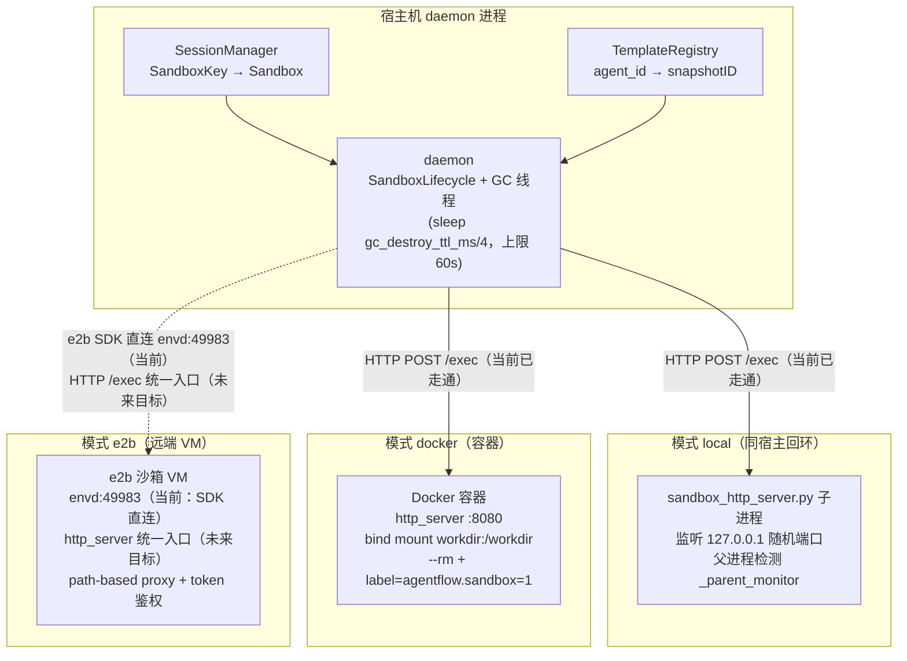
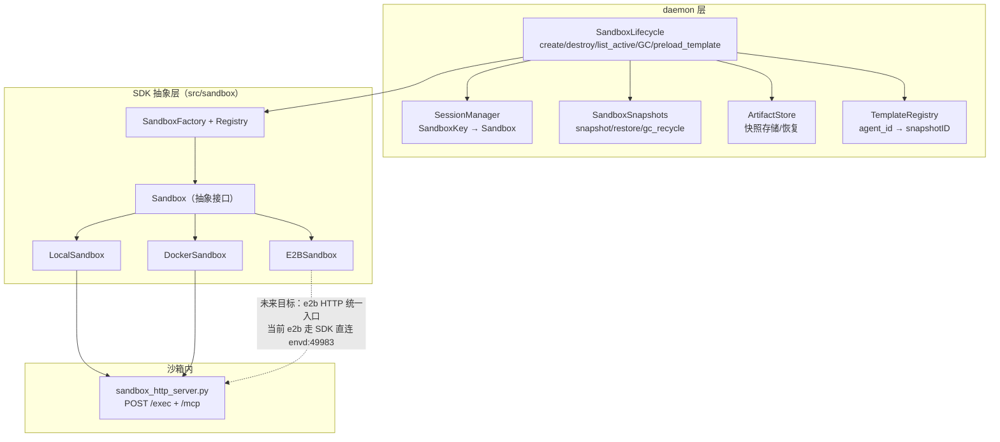
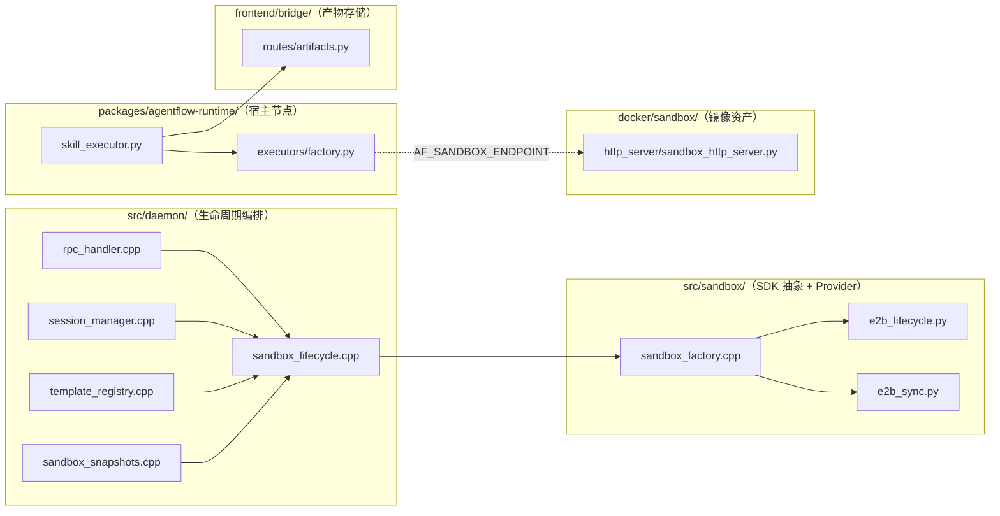
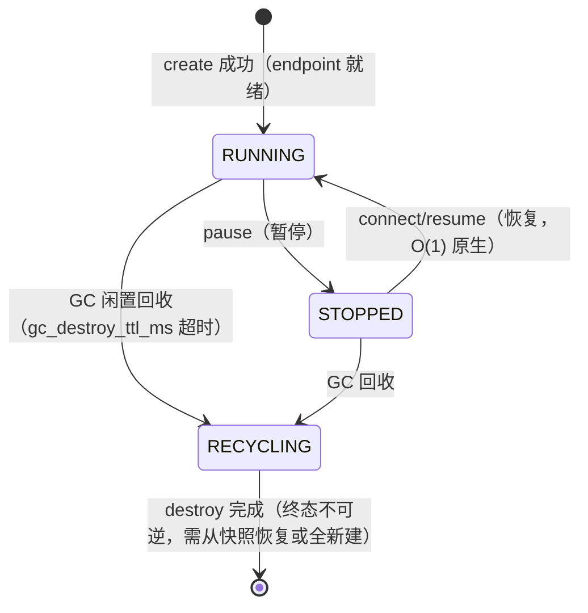
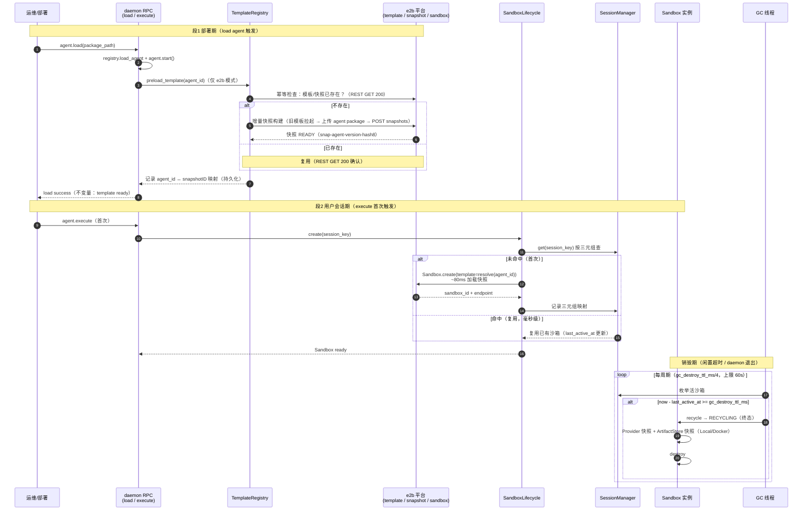
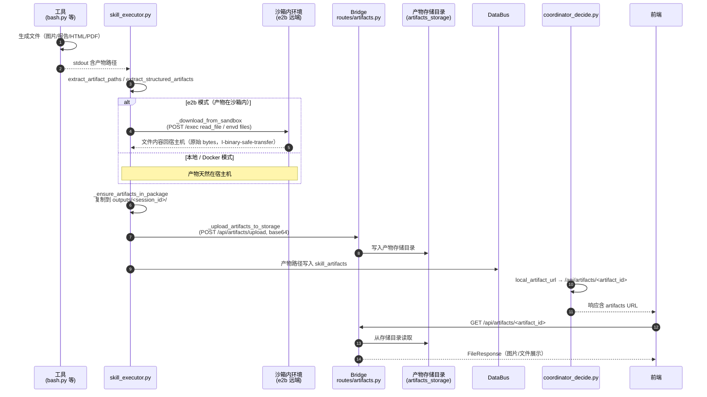
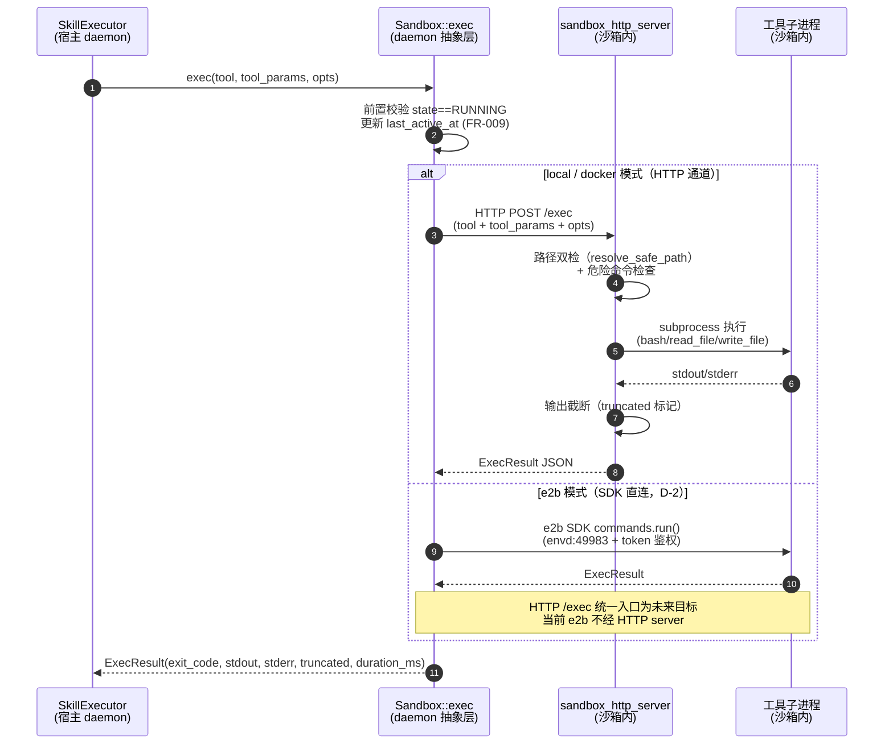
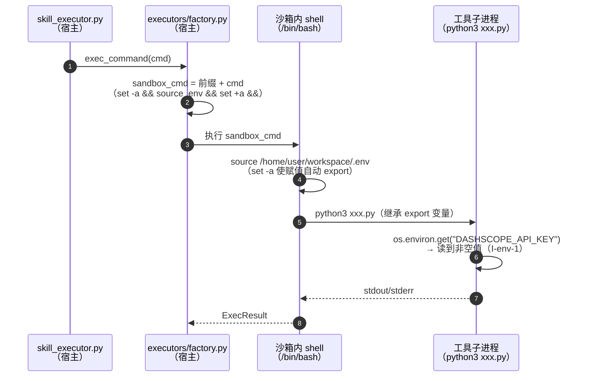
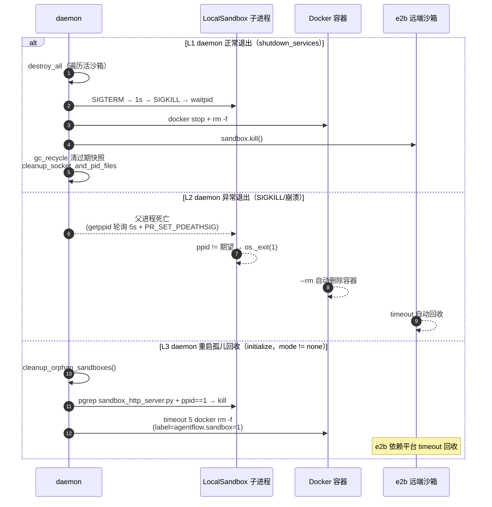

# 沙箱隔离机制

> **文档级别**: L2 功能设计（enhancement 全量汇总）
> **日期**: 2026-08-20
> **状态**: implemented（核心已实现；部分项待实现，见 §10.2）
> **定位**: 本文档为沙箱隔离机制的**自包含全量设计**——覆盖 v1 双层防护 → v2 预热两段式 → 预热模板增量快照 → 产物存储解耦 → harness 资产同步 → env 注入 → 沙箱内 MCP server 的完整演进，以及数据结构、流程、接口、安全防护、测试与后续计划。不依赖任何外部文档，可直接评审与实施。

---

## 1. 背景

### 1.1 当前模型的问题

agent 工具执行（bash / 文件读写）直接在宿主 daemon 侧进行，存在三类风险：

| 风险 | 具体表现 |
|------|---------|
| **误删文件** | `rm -rf` 等危险命令直接作用于宿主机文件系统，无隔离边界 |
| **密钥泄漏** | 工具子进程继承宿主机完整环境变量，`*_API_KEY` 类密钥可能被工具脚本读取或外泄 |
| **宿主污染** | 工具安装的依赖、生成的中间文件、崩溃残留进程污染宿主环境，且无法回收 |

此外，不同用户/会话的工具执行共享同一宿主环境，缺少**按用户隔离**——用户 A 的 profile、历史数据对用户 B 的会话可见（数据串写风险）。

### 1.2 演进历程

沙箱机制经历了三个演进阶段，本文档按最终形态（v3 口径）描述，同时保留各阶段关键决策：

| 阶段 | 时间 | 核心变化 | 状态 |
|------|------|---------|------|
| **v1 懒加载** | 2026-07 | 双层防护 + 生命周期 + 快照；沙箱在用户首条消息时懒加载 | 已实现，保留作兜底 |
| **v2 预热两段式** | 2026-08-09 | load agent 部署期预热 template + execute 运行态秒级拉起；首条消息不再秒级等待 | 已实现 |
| **v3 增量快照预热** | 2026-08-09 | snapshot 可作蓝图（`Sandbox.create(template=snap-*)` 实测成功）；首问毫秒级 | 已实现 |

### 1.3 设计目标

为 agent 执行的命令和文件操作提供**隔离沙箱**，核心设计：**双层防护**（宿主侧危险命令检查 + env 注入约束，沙箱侧路径双检 + 输出截断）+ **MCP-like HTTP server** 统一工具入口 + **按用户身份复用沙箱** + **生命周期管理**（销毁/回收/快照/restore）+ **容器化镜像**（Docker/e2b 共用）+ **预热两段式**（load 预热 / execute 秒级拉起）。

**物理分离原则**：推理循环留在宿主 daemon，工具执行放入沙箱——两个隔离环境物理分离。沙箱不承担推理循环，只负责工具执行。

## 2. 方案简述

### 2.1 架构总览

```
daemon（宿主）                    沙箱（隔离环境）
┌─────────────────────┐   ┌──────────────────────────┐
│ 推理循环             │   │ sandbox_http_server.py    │
│ (coordinator/skill)  │   │ POST /exec 统一入口       │
│  │                  │   │ ├ bash / read_file / ...  │
│  ▼                  │   │ ├ 路径双检（第二道防线）    │
│ SandboxLifecycle    │   │ └ 输出截断保护             │
│ create/destroy/GC   │   │                          │
│  │                  │   │ workdir/harness/skills/   │
│  ▼                  │   └──────────────────────────┘
│ Sandbox 抽象接口     │          ▲
│ (local/docker/e2b)  ───────────┘
│  │                  │   按用户复用：SandboxKey
│  ▼                  │   (user_id+client_id+agent_id)
│ 宿主侧第一道防线     │
│ (危险命令 + env 约束) │
└─────────────────────┘
```

- **宿主侧第一道防线**：危险命令前缀检查（拒绝 `rm -rf /`、`sudo`、fork bomb）；env 注入约束——宿主机 `os.environ` 不透传沙箱，密钥允许存在于沙箱内 `.env` 文件，但不得出现在每条命令的 API 请求体（网络传输面）
- **沙箱侧第二道防线**：路径双检（string prefix + realpath）拒绝越界访问；命令输出截断保护（truncated 标记明示）
- **四种沙箱模式**：`none`（向后兼容，行为与移植前完全一致）/ `local`（subprocess.Popen 起 http.server，仅 loopback）/ `docker`（docker run 容器）/ `e2b`（远程沙箱，token 鉴权）
- **生命周期管理**：同一 SandboxKey 复用同一沙箱；GC 按 `last_active_at` 闲置回收；销毁时快照兜底（Local/Docker 快照到宿主机，e2b 平台侧快照）；daemon 退出显式清理 + 异常退出父进程检测 + 启动时孤儿回收

> **当前实现 vs 未来目标（重要）**：
> - **当前已走通**：**docker** 与 **local（本地文件系统沙箱）**——工具执行经沙箱内 HTTP server 的 `POST /exec` 统一入口（MCP-like 通道）
> - **e2b 当前实现**：走 **e2b SDK 直连**（`commands.run()` → envd:49983），**不经 HTTP server**；HTTP server 在 e2b 沙箱内仅作 health check
> - **未来目标方案**：e2b 沙箱内 HTTP server 统一入口（与 local/docker 同构的 MCP-like 通道）——尚未走通，见 §6.6 与 §10.2

**部署/进程视图（三种模式物理形态）**：



**部署要点**：
- **local**：沙箱与 daemon 同宿主，子进程监听 loopback（127.0.0.1），无网络暴露——**当前已走通**
- **docker**：容器内 http_server 固定 8080，host 端口映射；`/workdir` bind mount 宿主机 workdir——**当前已走通**
- **e2b**：远端 VM，**当前走 e2b SDK 直连 envd:49983**（D-2）；沙箱内 http_server 统一入口为**未来目标方案**（尚未走通，见 §10.2）；path-based proxy + `traffic_access_token` 鉴权访问
- **GC 线程**：daemon 内独立线程，周期 `gc_destroy_ttl_ms/4`（上限 60s）枚举活沙箱，`now - last_active_at >= gc_destroy_ttl_ms` 触发回收（FR-009）

### 2.2 核心抽象

| 抽象 | 职责 |
|------|------|
| `Sandbox` | 抽象接口：exec / id / destroy / endpoint / state / owner / workdir / last_active_at / snapshot |
| `SandboxKey` | 用户身份三元组（user_id + client_id + agent_id），复用键 |
| `SandboxFactory` + Registry | 按 mode 构造，支持 none/local/docker/e2b |
| `SandboxLifecycle` | 生命周期管理（create/destroy/list_active/GC 线程/preload_template） |
| `SandboxSnapshots` | 快照 snapshot/restore/gc_recycle + 注册表持久化 |
| `ArtifactStore` | workdir 快照/恢复（仅 Local/Docker，产物快照跳过 dotfile） |
| `TemplateRegistry` | 按 agent_id 寻址预建 template/snapshot（v2 新增） |
| `sandbox_http_server.py` | 沙箱内 MCP-like POST /exec 统一入口 + /mcp 代理端点（仅 Python stdlib） |
| `MCPBridge` | 宿主侧 MCP 客户端（streamable-http），工具经沙箱内执行 |

**组件图（逻辑视图：daemon 层 / SDK 抽象层 / 沙箱内）**：



**依赖边界**：daemon 层（SandboxLifecycle）经 SandboxFactory 构造 SDK 抽象层 Provider；Provider 可达沙箱内 http_server——**当前仅 LocalSandbox 与 DockerSandbox 走 HTTP 统一入口（已走通）；E2BSandbox 当前经 SDK 直连 envd:49983，其 HTTP 统一入口为未来目标方案**（虚线标注）。SessionManager/SandboxSnapshots/ArtifactStore/TemplateRegistry 为 daemon 层平行组件，不直接依赖 SDK 层。

### 2.3 方案关键决策与 WHY

| # | 决策 | WHY（约束来源） |
|---|------|----------------|
| D-1 | 推理循环留宿主、工具执行进沙箱，物理分离 | 沙箱不承担推理循环——隔离强度与推理复杂度解耦；v1 范围明确不含沙箱内推理 |
| D-2 | e2b 工具调用以 e2b SDK `commands.run()` 为当前实现主路径（SDK 直连 envd:49983）；沙箱内 HTTP server 统一入口（与 local/docker 同构）为**未来目标方案**，当前仅作 health check 与 local/docker 模式使用 | cubeproxy 实测不转发 8080 端口（HTTP 502），SDK 直连 envd 端口（49983）稳定可用——这是 e2b 当前走 SDK 而不走 HTTP server 的实证根因 |
| D-3 | env 注入用 `set -a && source .env && set +a` 命令前缀，删除宿主侧 env 白名单机制（build_safe_env） | 实操坐实：`.env` 已在沙箱内（随包上传），根因是无 export 的 shell 变量不继承给子进程；`set -a` 让 source 期间赋值自动 export，不改 `.env` 内容；白名单在生产代码零调用（F6 删死代码） |
| D-4 | 沙箱内 MCP server 采用 http_server `/mcp` 代理（方式 B），不采用 e2b 独立端口直连（方式 A） | 方式 A 依赖 cubeproxy 自定义端口转发（未证实），仅 e2b 适用，stdio-only server 需 HTTP 包装；方式 B 三模式统一、复用现有端点/生命周期/回收机制、对 server 形态无要求（YAGNI F6） |
| D-5 | 产物持久化与沙箱生命周期解耦——工具执行后主动上传 Bridge 存储中心，e2b 销毁不下载远端 workspace | 原"沙箱销毁前抢救式下载"假设产物与沙箱同生命周期；解耦后 artifact_id 不依赖沙箱存活；e2b 远端数据留平台避免泄露 |
| D-6 | 预热模板用增量快照（snapshot 作蓝图），不用 OCI 镜像构建 | 实测：OCI 镜像 4.7GB 构建 ~98s；快照固化秒级且资产完整继承（marker 实测可读）；HTTP server 预跑非关键路径（工具走 SDK 不依赖它） |
| D-7 | 快照双用途分治：产物快照跳过 dotfile、恢复快照保留 dotfile | 产物快照只保留交付物（`.env` 等敏感配置不属于交付物）；恢复快照需完整运行环境（含 `.env`），跳过则恢复出的沙箱缺配置不可用 |
| D-8 | 每 agent 至多保留 1 个快照，先建后删 | 防平台快照无限膨胀（用户拍板）；构建失败不删旧快照（回滚可用，I-A4/I-A6） |
| D-9 | v2 预热失败降级 warning 而非拒绝 load | 用户拍板：初始化错误在部署期暴露给运维而非用户；agent 仍载入，execute 首问走 v1 懒加载兜底（秒级但可用） |
| D-10 | `AF_SANDBOX_WORKSPACE` 统一契约（原 `SANDBOX_WORKDIR` 废弃） | 2026-08-17 收敛：host 模式 = agent 包根 / e2b 模式 = 沙箱目录，工具统一读契约消除硬编码路径 |

## 3. 约束与假设

- 用户具有稳定的互联网连接，远程沙箱（e2b）场景的网络延迟可接受
- v1 范围**不包含**沙箱内 harness/skills 热更新——需 unload agent → reload 触发再同步；harness 更新统一挂 agent load/unload 事件
- v1 范围**不包含**沙箱内推理循环——推理循环留宿主 daemon
- 复用现有 agentflow daemon 作为沙箱生命周期管理者，不引入新 daemon
- 沙箱元数据持久化策略为"以查代存"——不引入数据库组件；唯一跨重启元数据（快照注册表 + template 映射表）落盘持久化
- 沙箱内 HTTP server v1 用 Python 标准库实现（http.server），不引入额外依赖
- 沙箱镜像 registry URL、GC 阈值、输出截断阈值等具体数值由业务方在开发期拍板（见 §12 待澄清规格）
- `sandbox-mode=none` 必须 100% 向后兼容——行为与移植前完全一致（SC-007）
- e2b 模式仅在有 `E2B_API_KEY`（或配置 `e2b_api_key`）时可用；local/docker 模式不依赖外部服务
- 沙箱内依赖仅 Python stdlib（当前约束）；运行时新增依赖由 Agent 通过 bash 工具自主安装

## 4. 当前实现分析

### 4.1 代码现状

`src/sandbox/` 已有 3487 行实现（16 个文件），v1/v2/warm 主线均已落地：

| 文件 | 行数 | 说明 |
|------|------|------|
| `sandbox.h` / `sandbox_types.h` | 125/89 | Sandbox 抽象接口 + 类型定义 |
| `sandbox_local.cpp/.h` | 373/88 | LocalSandbox：subprocess.Popen + loopback |
| `sandbox_docker.cpp/.h` | 229/87 | DockerSandbox：docker run + bind mount |
| `sandbox_e2b.cpp/.h` | 778/182 | E2BSandbox：e2b SDK 远程沙箱 |
| `sandbox_factory.cpp/.h` | 83/85 | 按 mode 构造 Provider |
| `sandbox_helpers.cpp/.h` | 302/92 | 工具 helper，构造 tool_params |
| `sandbox_ignore.cpp/.h` | 37/29 | IgnoreMatcher（dotfile/缓存跳过） |
| `e2b_lifecycle.py` | 453 | e2b 沙箱生命周期（create/kill/snapshot） |
| `e2b_sync.py` | 455 | e2b 远端同步（upload/download） |

**模块/包依赖图（开发视图）**：



**依赖方向**：`src/daemon` 编排生命周期（依赖 `src/sandbox` 的 SandboxFactory）；`src/sandbox` 的 e2b 脚本（lifecycle/sync）自包含；`packages/agentflow-runtime` 经 executors 抽象层路由到沙箱（AF_SANDBOX_ENDPOINT）与 bridge 产物存储；`docker/sandbox` 为镜像资产（沙箱内运行，不依赖宿主包）。

**配置现状**：`configs/{dev,prod,test}/agentflowd.json` 均已有 `sandbox` 配置块（mode、workdir_root、sandbox_http_port、sandbox_max_active、image_name 等，详见 §7.3）。

**已知缺口**：
- Bridge 端点**运行时通道**待实现（当前仅快照回退通道，活沙箱转发需 daemon RPC 查询 SessionManager 拿 endpoint）
- 前端 artifacts URL 构造待集成（agent 需知道 session_id 拼接 Bridge URL）
- 快照注册表持久化待确认（`SandboxSnapshots::snapshot()` 当前用 `copy_dir_skip_dotfiles`，与"恢复快照保留完整状态"存在偏差——恢复快照需改为完整拷贝）
- e2b 沙箱模板 DNS 修复待执行（T-001，阻塞沙箱内 Python 外网调用）
- `restore_from_snapshot` 部分实现：E2B fork 分支已实现（`sandbox_snapshots.cpp::ForkFromSnapshot`），Local/Docker store_path 完整拷贝分支为占位骨架待实现（见 §8.2）

### 4.2 Examples 接入现状

- `examples/agent/outfit-assistant/harness/tools/` 当前仅 `preload_user_context.py`（与 bash.py 同模式，经 `create_executor()` 路由：`sandbox_endpoint` → 沙箱内执行；`_run_in_sandbox` 已删除收敛）；领域工具（bash/read_file 等）位于 pip 包 `agentflow-runtime/harness/tools/`
- `examples/agent/cloudalbum-assistant/harness/tools/` 已接入沙箱（`search_photos.py` 等，`_sandbox_exec()` 先 HTTP 快速路径 → e2b SDK fallback）
- 工具改造模式：新增 `sandbox_endpoint: str = None` 参数，非空时 POST /exec，为空且 sandbox-mode != none 时返回错误——存量工具需逐个核对适配

### 4.3 功能实现状态

| 功能点 | 实现现状 | 缺口 |
|--------|---------|------|
| 宿主侧危险命令检查 + env 约束 | ✅ 已实现 | — |
| 沙箱侧路径双检 + 输出截断 | ✅ 已实现 | — |
| 按用户复用沙箱 | ✅ 已实现 | — |
| 销毁/回收/快照/restore | ⚠️ 部分 | restore：E2B fork 已实现；Local/Docker 完整拷贝待实现；恢复快照完整拷贝待修正 |
| GC 僵尸清理 | ⚠️ 部分 | 阈值与调度待确认 |
| 产物存储中心（与沙箱解耦） | ✅ 已实现 | Bridge 运行时通道待实现 |
| e2b 远程沙箱 | ⚠️ 部分（SDK 直连已实现） | 当前走 e2b SDK 直连 envd:49983（D-2）；沙箱内 HTTP server 统一入口为**未来目标方案**（尚未走通）；DNS 模板修复 T-001 |
| daemon 退出/异常/重启清理 | ✅ 已实现 | — |
| v2 预热 + warm 增量快照 | ✅ 已实现 | v1 文档表述待回填（§4.4 决策记录 C-8） |
| 沙箱内 MCP server | ⚠️ 阶段 1 进行中 | /mcp 端点、manifest includes 扩展待实现 |

### 4.4 设计决策记录（历史表述冲突的消解结论）

> 设计演进过程中，同一语义曾出现两种表述；以下为消解结论（"以谁为准"）。这些决策已在正文中直接采用最终口径，此处留痕供追溯。

| # | 冲突主题 | 消解结论 |
|---|---------|---------|
| C-1 | 配置键命名：kebab-case vs snake_case | **以实际配置 snake_case 为准**（`configs/*/agentflowd.json` 实读），如 `sandbox_max_active`/`gc_destroy_ttl_ms` |
| C-2 | env 密钥策略：拒绝对外泄漏 vs 密钥可存沙箱内文件 | **以新约束为准**：密钥允许存在于沙箱内 `.env` 文件，但不得出现在 API 请求体（网络传输面）；白名单机制整体删除 |
| C-3 | build_safe_env 去留 | **删除**：生产代码零调用，新链路（set -a && source）不需要（F6 删死代码） |
| C-4 | e2b 产物：销毁后 410 vs 存储中心解耦 | **以存储中心解耦为准**：工具执行后主动上传存储，沙箱销毁不影响产物；410 语义仅剩"运行时通道读取"兜底 |
| C-5 | 快照 dotfile：统一跳过 vs 双用途 | **以双用途为准**：产物快照跳过 dotfile、恢复快照保留 dotfile（D-7） |
| C-6 | 两个注册表：快照注册表 vs template 映射表 | **并存、职责不同**：快照注册表（`snapshot_root/registry.jsonc`）管 restore；template 映射表（`e2b_template_map_path`）管预热复用 |
| C-7 | HTTP server 就绪探测：轮询 vs 跳过 | **以跳过为准**：工具执行走 e2b SDK envd:49983，HTTP server 无人使用；跳过探测恢复秒级 |
| C-8 | v2 预热表述同步 | v2 已实现（2026-08-09），v1/L3 章节待回填（M11 概念变更同步）——本文档直接采用 v2/warm 最终口径 |

---

## 5. 数据结构设计

### 5.1 Sandbox（沙箱）

| 字段 | 类型 | 必填 | 说明 |
|------|------|------|------|
| sandbox_id | string(UUID) | ✅ | UUID v4，全局唯一，由 daemon 生成 |
| owner | SandboxKey | ✅ | 三元组非空，持有者身份 |
| workdir | string(绝对路径) | ✅ | 宿主机可达目录，沙箱工作区绑定 |
| endpoint | string(URL) | ✅ | daemon 侧可达的 HTTP URL，Provider 拉起时返回 |
| state | SandboxState | ✅ | RUNNING / STOPPED / RECYCLING |
| created_at | int64(ms) | ✅ | > 0 |
| last_active_at | int64(ms) | ✅ | ≥ created_at，GC 判定依据（FR-009） |

**状态转换**：RUNNING ↔ STOPPED 可逆（暂停/恢复）；RUNNING → RECYCLING（GC 闲置回收）；RECYCLING 终态不可逆。



**不变量**：I-2 同一 owner 只能有一个活沙箱；I-4 销毁幂等；I-5 sandbox_id 唯一寻址、owner 唯一复用键。

### 5.2 SandboxKey（沙箱键）

| 字段 | 类型 | 必填 | 说明 |
|------|------|------|------|
| user_id | string | ✅ | 用户标识 |
| client_id | string | ✅ | 客户端标识（多租户） |
| agent_id | string | ✅ | agent 标识 |

**不变量**：三元组完全相同 → 复用同一沙箱；任一字段不同 → 不同沙箱（隔离）。

### 5.3 Snapshot（沙箱快照）

| 字段 | 类型 | 必填 | 说明 |
|------|------|------|------|
| snapshot_id | string(UUID) | ✅ | 本地 UUID v4，registry 主键 |
| sandbox_id | string(UUID) | ✅ | 来源沙箱 ID |
| created_at | int64(ms) | ✅ | > 0 |
| store_path | string(绝对路径) | ⬜ | 本地持久化路径（Local/Docker）；e2b 模式为空 |
| e2b_snapshot_id | string | ⬜ | e2b 平台 snapshot_id（e2b 模式）；restore 时用于 `Sandbox.create(e2b_snapshot_id)` |
| sandbox_mode | string | ⬜ | ""（Local/Docker）/ "e2b" / "none" |

**快照双用途（C-5 决策）**：

| 快照类型 | 载体 | dotfile 处理 | 用途 |
|---------|------|-------------|------|
| 产物快照 | `ArtifactStore::snapshot`（Local/Docker） | **跳过** dotfile | 销毁后产物访问、审计 |
| 恢复快照 | `SandboxSnapshots::snapshot` + registry | **保留** dotfile（完整工作区） | 从快照恢复沙箱（restore） |

**快照注册表持久化**：`snapshot_root/registry.jsonc`（宿主机磁盘），每次 snapshot 创建 / gc_recycle 后立即落盘；daemon 启动时 `_load_from_disk` 加载，snapshot_id → sandbox_id / e2b_snapshot_id 映射跨重启可用。

### 5.4 ExecResult / ExecOptions

**ExecResult**：exit_code(int32, 0-255)、stdout(string, 可截断标记明示)、stderr(string)、truncated(bool)、duration_ms(int64)。

**ExecOptions**：timeout_ms(int64)、env_vars(map)、working_dir(string)。

### 5.5 实体关系

```
SandboxKey 1───1 Sandbox        (owner 持有，按键查找/复用)
Sandbox   1───0..N Snapshot    (销毁/异常时触发快照)
Sandbox   ──── SandboxImage     (Docker/e2b 沙箱启动用镜像)
Sandbox   1───1 SandboxHttpServer (沙箱内常驻，endpoint 指向它)
ExecResult  ←── Sandbox::exec
ExecOptions →── Sandbox::exec
TemplateRegistry 1───1..N Sandbox (agent_id 寻址预热模板/快照，部署期)
```

### 5.6 全局不变量（全量合并）

| 编号 | 不变量 | 说明 |
|------|--------|------|
| I-1 | 不丢失业务数据 | 销毁时快照兜底（仅 Local/Docker）；异常时 try/finally 触发。e2b 模式不做本地快照，产物经存储中心上传解耦 |
| I-2 | 边界硬约束 | 同一 owner 只一个活沙箱；路径双检拒越界；并发软上限 |
| I-3 | 元数据一致性 | state 转换遵守规则，last_active_at ≥ created_at |
| I-4 | 幂等 | 快照先清旧再重做；销毁多次调用一致；template preload 幂等（已存在则跳过） |
| I-5 | 单一真相来源 | sandbox_id 唯一寻址，owner 唯一复用键；agent_id 唯一 template 键 |
| I-6 | 资源不泄漏 | daemon 正常退出 100% 清理；异常退出 LocalSandbox 子进程 5s 内自动退出 |
| I-7 | 孤儿清理幂等 | 启动时清理孤儿资源，无残留则无操作 |
| I-sb-1 | 工具数据隔离 | 资产层进沙箱 / 调度层宿主 import / 执行层统一经 AF_SANDBOX_ENDPOINT 转发——并发用户隔离依赖此约束 |
| I-v2-1 | load 成功 = template 已尽力 | ready_cmd 自动验证；失败 warning 降级（不拒绝 load） |
| I-A1~A8 | agent 级快照 | 每 agent 快照 = 基础模板 + manifest includes 全量；不同 agent 隔离；版本变化 → 新快照；先建后删（防膨胀）；评测产物不污染 hash |
| I-artifact-id | artifact_id 格式 | `{agent_name}/{session_id}/{file_path}` 三处实现共用 |
| I-same-name-overwrite | 同名产物覆盖 | 同 session 内同名产物直接覆盖旧文件，不产生 `_N` 后缀 |
| I-binary-safe-transfer | 二进制安全 | base64 传输，禁止 `data.decode("utf-8", errors="replace")` |
| I-upload-traversal-block | 上传防穿越 | 白名单字符 + 段过滤 + realpath 越界检查三层防御 |
| I-env-1~4 | env 注入 | 非空变量沙箱内可读；宿主专属变量不透传；密钥不出网络请求；幂等 |
| I-mcp-6 | MCP 路由分离 | MCP 工具由 MCPBridge 路由（`mcp__` 前缀在 sandbox 分支之前），沙箱内 server 模式依然成立 |
| I-mcp-7 | MCP 沙箱内执行 | 沙箱内 server 工具调用必须到达沙箱内进程，宿主侧不得有本地 stdio 实例（防双轨） |

---

## 6. 流程设计

### 6.1 沙箱生命周期总览（v2/v3 两段式 + warm 快照）



**生命周期关键节点**：拉起（预热，load 部署期，秒-分钟级 build，仅首次）；拉起（实例，execute 首次，~80ms 快照加载）；复用（同三元组，毫秒级）；使用（每次 exec 更新 last_active_at）；销毁（GC 闲置超时 / daemon 退出 destroy_all）。

**v1 兜底**：段1 preload 失败但 load 成功 → execute 首问走 v1 懒加载（用配置 `e2b_default_template` 默认值，秒级但可用）；Local/Docker/none 模式 preload no-op。

### 6.2 重开会话恢复流程（restore 决策入口）

```
重开会话（无活沙箱）
  ├─ ① 查平台沙箱状态（Sandbox.list / Sandbox.info）
  │     ├─ 沙箱仍存活（RUNNING/PAUSED）→ ② pause 路径：connect() 唤醒同一沙箱（O(1) 原生）
  │     │        └─ 恢复后刷新 harness（哈希比对，相同跳过）
  │     └─ 沙箱已销毁/不存在 → ③ 快照路径：查注册表（snapshot_root/registry.jsonc）
  │           ├─ 有快照 → restore_from_snapshot（Local/Docker 从 store_path 完整拷贝；
  │           │           e2b 从 Sandbox.create(e2b_snapshot_id)）→ 刷新 harness
  │           └─ 无快照 → 全新建
  └─ 恢复失败 → 全新建 + 诚实记录（不假装能恢复）
```

**关键区分**：pause/connect（沙箱存活）= 一对一保留同一沙箱（含运行进程/变量）；快照/restore（沙箱已销毁）= 一对多从持久化点派生新沙箱，不依赖沙箱存活。

**restore 三分支**（部分实现）：**E2B 分支已实现**（`sandbox_snapshots.cpp`：`E2BSandbox::ForkFromSnapshot`，优先 `Sandbox.create(e2b_snapshot_id)` 平台快照 → 降级 fork 源沙箱 → 失败降级全新建）；**Local/Docker 分支待实现**（当前占位骨架：从 store_path **完整拷贝**重建，保留 dotfile，恢复快照语义）；失败诚实记录不假装能恢复。

**恢复后刷新 harness**：从快照恢复的沙箱内 `harness/skills` 是快照时刻旧版；宿主侧可能已更新。恢复后比对宿主/沙箱 skills 清单哈希——相同跳过（零开销），不同则增量同步（`e2b_sync.py upload`）。agent 包根文件（agent.md/.env/nodes/）同理。

### 6.3 产物交付链路（存储中心）



**产物生命周期与沙箱解耦（D-5）**：工具执行 → 立即上传存储 → artifact_id 持久化；沙箱销毁不影响产物可访问。e2b 沙箱销毁时**不下载远端 workspace**（数据留在平台，避免泄露）。

**产物 ID**：`{agent_name}/{session_id}/{file_path}`；`session_id` = `{user_id}_{client_id}`（注意：框架环境变量 `AF_SESSION_ID` 是执行槽位编号，非本处 session_id，产物路由键必须用 `{user_id}_{client_id}` 防跨用户撞路径）。

### 6.4 harness 资产更新（agent load 事件驱动）

```
skill/agent.md 更新（宿主侧）
  ↓
unload agent → reload agent（宿主侧事件）
  ↓
触发 harness 同步到关联沙箱（e2b_sync.py upload / fs::copy）
```

| 沙箱状态 | harness 更新 |
|---------|-------------|
| running | ✅ agent load/reload 事件时直接更新 |
| paused | ⚠️ 延迟到 connect 恢复后更新（哈希比对，相同跳过） |
| 快照恢复（原沙箱已不存活） | ✅ 新沙箱创建后主动更新 skill（恢复事件独立于 agent load） |

**harness 资产范围**（manifest.jsonc includes，非手动枚举）：`harness/skills/**`、`harness/tools/**`、`data/**`、`requirements.txt`、`.env`、`setup.sh`。**不同步**：`nodes/**`、`workflows/**`、`agent.md`、`agent.json`、`__pycache__`、`.venv`、`workspace/`、`outputs/`、`.agentfoundry/`、`tests/`。

**harness 与快照职责边界**：快照管业务工作区（用户数据/产物）；harness 管框架注入资产（每次拉最新，不对齐快照）。

### 6.5 沙箱内 MCP server 调用链路（方式 B）

```
Coordinator (宿主 daemon 进程)
  → SkillExecutor: _load_mcp_tools 读取 .mcp.json（URL 含 ${AF_MCP_SANDBOX_ENDPOINT} 占位）
  → MCPBridge (streamable-http, url={AF_SANDBOX_ENDPOINT}/mcp)
  → sandbox_http_server /mcp 代理端点（沙箱内，fork stdio 子进程托管 MCP server）
  → 工具实现（沙箱内执行）
```

**不变量**：I-mcp-6 MCP 路由（`mcp__` 前缀）在 sandbox 分支之前，MCP 工具永不走沙箱 `/exec`；I-mcp-7 执行必须在沙箱内进程，宿主侧不得有本地 stdio 实例（防双轨）。

### 6.6 工具执行链路（单次调用）



**关键语义**：
- **local/docker** 走 HTTP /exec 通道（统一 MCP-like 入口，路径双检在沙箱侧执行）——**当前已走通**
- **e2b** 当前走 e2b SDK 直连 envd:49983（D-2，cubeproxy 不转发 8080 的实证决策）；沙箱内 HTTP server 统一入口为**未来目标方案**（尚未走通，见 §10.2）
- 每次 exec 自动更新 `last_active_at`（FR-009），供 GC 闲置判定
- 输出截断在沙箱侧做，truncated 标记明示（F7，日志不截断）

---

## 7. 接口设计

### 7.1 沙箱内 HTTP server — POST /exec（统一工具入口）

**请求体**（JSON）：

| 字段 | 类型 | 必填 | 说明 |
|------|------|------|------|
| tool | string | ✅ | 工具名：bash / read_file / write_file / edit_file / list_skills / load_skill / grep / glob |
| tool_params | object | ✅ | 工具参数（如 bash 的 command、read_file 的 path） |
| opts.timeout_ms | int | ⬜ | 执行超时（默认 30000） |
| opts.env_vars | map | ⬜ | env 注入（白名单过滤后） |
| opts.output_max_bytes | int | ⬜ | 输出截断阈值（默认 0，不截断；与 §7.3 配置项一致） |

**响应体**（JSON，统一 ExecResult）：

| 字段 | 类型 | 说明 |
|------|------|------|
| exit_code | int32 | 0-255 |
| stdout | string | 可截断，截断标记明示 |
| stderr | string | 可截断，截断标记明示 |
| truncated | bool | 默认 false，是否发生截断 |
| duration_ms | int64 | 执行时长 |

**不变量**：统一 MCP-like 入口（只 POST /exec）；截断在沙箱侧做，标记明示（truncated=true）。产物链路已迁移至存储中心（§6.3），HTTP server 不再承担产物存储端点。

> **当前实现状态**：POST /exec 统一入口**当前仅 local/docker 模式走通**（HTTP 通道）；e2b 模式当前走 e2b SDK 直连（D-2），HTTP server 统一入口为**未来目标方案**（尚未走通，见 §10.2）。

### 7.2 产物接口（Bridge 作为存储中心）

**上传**：`POST /api/artifacts/upload`

| 字段 | 类型 | 必填 | 说明 |
|------|------|------|------|
| agent_name | string | ✅ | agent 包名 |
| session_id | string | ✅ | `{user_id}_{client_id}`（非 AF_SESSION_ID 槽位号） |
| files[].path | string | ✅ | 产物相对路径（`outputs/xxx.png`） |
| files[].data_b64 | string | ✅ | base64 编码内容（二进制安全，I-binary-safe-transfer） |

**响应**：`{"artifact_ids": ["outfit-assistant/user_abc_client_123/outputs/look.png"]}`

**下载**：`GET /api/artifacts/{artifact_id}` → 文件内容（Content-Type 由上传时 mime_type 决定）；404 产物不存在。

**路径解析**（三阶段回退）：主路径 → 剥离 session_id 段重试（上传时含 session_id 目录、实际存储无该目录）→ 项目根目录（legacy 兼容）。

**图片压缩**（读取时，不污染原图）：`_encode_file` 最大边长 512px、JPEG 质量 80、JPEG 与原格式取更小者、开关 `AF_BR_ARTIFACT_COMPRESS_ENABLED`（默认启用）；非图片文件（pdf/pptx）返回 raw base64 不压缩。

### 7.3 配置接口（DSL）

> 配置键为 **snake_case**（实际配置 `configs/*/agentflowd.json` 实读，C-1 决策）。

| 配置项 | 类型 | 默认值 | 说明 |
|--------|------|--------|------|
| `sandbox.mode` | enum | "none" | none/local/docker/e2b |
| `sandbox.workdir_root` | string | "/tmp/agentflow_sandbox" | 沙箱工作区根目录 |
| `sandbox.snapshot_root` | string | "/tmp/agentflow_snapshots" | 快照持久化根目录 |
| `sandbox.sandbox_http_port` | int | 8080 | 沙箱内 HTTP server 监听端口（容器内固定，本地 0 自动分配） |
| `sandbox.sandbox_max_active` | int | 16 | 并发软上限（SC-011） |
| `sandbox.output_max_bytes` | int | 0（不截断） | 沙箱侧输出截断阈值（FR-005） |
| `sandbox.gc_destroy_ttl_ms` | int | 600000 (10 min) | 闲置回收阈值（FR-009） |
| `sandbox.gc_recycle_snapshot_ttl_ms` | int | 86400000 (24 h) | 快照过期清理阈值（FR-009） |
| `sandbox.e2b_default_template` | string | "base" | e2b 模板 ID（`tpl-*` 或 `snap-*`） |
| `sandbox.e2b_api_url` | string | "" | e2b API 服务端点（空=SDK 默认） |
| `sandbox.e2b_api_key` | string | "" | e2b API 鉴权密钥（未设回退 `E2B_API_KEY`） |
| `sandbox.e2b_ca_cert_path` | string | "" | e2b CA 证书路径（自签名），设为 `SSL_CERT_FILE` |
| `sandbox.e2b_network_allow_out` | string | "" | e2b 沙箱出站 CIDR 列表 JSON |
| `sandbox.e2b_remote_workspace_dir` | string | "/home/user/workspace" | e2b 远端工作区路径 |
| `sandbox.e2b_template_map_path` | string | "data/template_registry.json" | agent_id ↔ snapshotID 关联真相源 |
| `sandbox.image_name` | string | "agentflow-sandbox:v1" | Docker/e2b 沙箱镜像标签 |
| `sandbox.allow_fallback` | bool | true | 沙箱不可用时是否允许 fallback 到宿主执行 |

**环境变量注入**（daemon → 沙箱内/工具侧）：

| 变量 | 用途 | 注入方 |
|------|------|--------|
| `AF_SANDBOX_ENDPOINT` | 沙箱内 HTTP server 宿主可达地址 | daemon（skill_executor 读取） |
| `AF_SANDBOX_MODE` | 沙箱模式（none/local/docker/e2b） | daemon |
| `AF_SANDBOX_WORKSPACE` | 沙箱内工作区路径契约（host=agent 包根 / e2b=沙箱目录） | daemon（D-10，原 SANDBOX_WORKDIR 废弃） |
| `AF_SANDBOX_E2B_TEMPLATE` / `AF_SANDBOX_IMAGE_NAME` | 覆盖配置模板/镜像 | daemon |
| `AF_ARTIFACT_STORAGE_URL` | skill 上传产物到 bridge | skill 侧（默认 `http://localhost:8199`） |
| `AF_MCP_SANDBOX_ENDPOINT` | 沙箱内 MCP server 宿主可达基地址（方式 B = `{AF_SANDBOX_ENDPOINT}/mcp`） | daemon sandbox_lifecycle |

**env 注入取值 → 行为映射**（D-3，命令前缀）：

| 场景 | 前缀 | 行为 |
|------|------|------|
| `.env` 存在 | `set -a && source /home/user/workspace/.env && set +a && <命令>` | source 期间赋值自动 export，子进程 `os.environ` 可读全部非空变量 |
| `.env` 不存在 | `<命令>`（无前缀） | 跳过加载，不报错 |
| 宿主机 os.environ | 不透传 | 宿主专属变量（PATH/HOME/USER 等）不进入沙箱，防路径污染 |

**env 注入链路时序（I-env-1~4）**：



**关键语义**：`.env` 标准写法 `KEY=VAL`（无 export）经 `set -a` 前缀自动 export，子进程 `os.environ` 可读（实操坐实，子方案 2a）；`.env` 不存在时跳过前缀不报错；宿主机 os.environ 不透传沙箱（I-env-2 防路径污染）；密钥不出网络请求体（I-env-3，C-2 决策）。

### 7.4 Sandbox 抽象接口

| 方法 | 签名要点 | 语义 |
|------|---------|------|
| exec | `exec(tool, tool_params_json, opts)` | 前置：state == RUNNING；超时从 opts.timeout_ms 读取（默认 30s） |
| id | `id() -> string` | UUID v4，唯一寻址（I-5） |
| destroy | `destroy()` | 幂等；后置 state == RECYCLING 或已清理 |
| endpoint | `endpoint() -> string` | Provider 拉起时返回的 HTTP URL |
| state | `state() -> SandboxState` | RUNNING/STOPPED/RECYCLING |
| owner | `owner() -> SandboxKey` | 持有者身份 |
| workdir | `workdir() -> string` | 宿主机侧 workdir 绝对路径 |
| last_active_at / mark_active | `int64` / `void` | GC 判定依据，每次 exec 自动更新（FR-009） |
| snapshot | `snapshot()` | Provider 级快照（FR-012） |

**SandboxFactory**：`create(mode, owner, workdir_root, config)`，mode ∈ {none, local, docker, e2b}；mode=none 返回 nullptr；拉起失败抛 `SandboxLaunchException(reason)`——不静默 fallback。

### 7.5 TemplateRegistry（v2 新增组件）

| 方法 | 职责 | 返回 |
|------|------|------|
| `preload(agent_id)` | 预建 template/快照（幂等，已存在则跳过） | bool |
| `resolve(agent_id)` | 解析 agent_id → template/snapshotID | string |

**职责切分**：TemplateRegistry 用 agent_id 单键（部署期）；SessionManager 用 SandboxKey 三元组（会话期），两组件并行无耦合（I-4/I-5）。

### 7.6 安全防护（双层防护 + 泄漏三层）

**宿主侧第一道防线**：
- 危险命令检查（拒绝 `rm -rf /`、`sudo`、fork bomb 等危险前缀），拒绝时返回明确错误含命令名
- env 约束：宿主机 os.environ 不透传沙箱；密钥（`*_API_KEY`）允许存在于沙箱内 `.env` 文件，但不得出现在每条命令的 API 请求体（网络传输面，C-2 决策）

**沙箱侧第二道防线**：
- 路径双检（string prefix + realpath）拒越界，错误含路径名（I-2）
- 输出截断（truncated 标记明示）；日志不截断（F7，截断只发生在展示层）

**远程鉴权（e2b）**：`allow_public_traffic=False` + `traffic_access_token`；出站 `network_allow_out` CIDR 限制。

**泄漏防护三层（FR-023/024/025）**：

| 层 | 触发 | 机制 |
|----|------|------|
| L1 daemon 正常退出 | shutdown_services | 显式 destroy_all：LocalSandbox SIGTERM→SIGKILL→waitpid；Docker stop+rm；e2b sandbox.kill；随后 gc_recycle 清过期快照；forced shutdown 同步清理 UDS socket/PID 文件 |
| L2 异常退出（SIGKILL/崩溃） | 父进程死亡检测 | LocalSandbox：`getppid()` 轮询 5s + Linux `PR_SET_PDEATHSIG`；Docker：`--rm` 自动删除 + `--label agentflow.sandbox=1` 供识别；e2b：创建时 timeout 自动回收 |
| L3 启动时孤儿回收 | initialize 开头（mode != none） | LocalSandbox：pgrep `sandbox_http_server.py` + ppid==1 → kill；Docker：`timeout 5 docker rm -f`（label 过滤，防 Docker daemon 不可达阻塞）；e2b 依赖平台 timeout |

**泄漏防护时序（L1/L2/L3 三分支）**：



**不变量**：I-6 资源不泄漏（正常退出 100% 清理，异常退出 LocalSandbox 5s 内退出）；I-7 孤儿清理幂等（无残留则无操作）。

---

## 8. 实现方案

### 8.1 功能点实现优先级

| 优先级 | 功能点 | 副作用分析 | 验证策略 | 现状 |
|--------|--------|-----------|---------|------|
| P1 | 双层防护（危险命令 + 路径双检 + 输出截断） | 无副作用 | 单元测试 + 手动命令验证 | ✅ 已实现 |
| P1 | sandbox-mode=none 向后兼容 | 无副作用 | 回归测试 100% 通过（SC-007） | ✅ 已实现 |
| P1 | 泄漏防护（L1/L2/L3） | 无副作用 | 退出/异常注入测试 | ✅ 已实现 |
| P1 | env 注入 `set -a && source`（C-2/C-3） | 有语义变更（密钥可进沙箱文件） | 实操演练 + e2b 真实验证 | ✅ 已实现 |
| P2 | 按用户复用 + GC + 快照/restore | 有兼容影响 | 集成测试 | ⚠️ restore：E2B fork 已实现，Local/Docker 待实现 |
| P2 | 产物存储中心（与沙箱解耦） | 有兼容影响（端点迁移） | E2E 测试 | ✅ 已实现 |
| P2 | v2 预热 + warm 增量快照 | 有兼容影响 | SC-v2 系列 + SC-W 系列 | ✅ 已实现 |
| P2 | Bridge 运行时通道（活沙箱转发） | 有依赖 | 集成测试 | ⚠️ 待实现 |
| P3 | 沙箱内 MCP server（方式 B /mcp 端点） | 有新增能力 | 三模式集成测试（阶段 1-4） | ⚠️ 阶段 1 进行中 |
| P3 | 快照显式创建 API（checkpoint/fork 探索） | 无副作用 | 单元测试 | ⏳ 后续增强 |

### 8.2 关键实现要点

1. **restore 三分支**（`sandbox_snapshots.cpp` 部分实现）：**E2B 分支已实现**（`E2BSandbox::ForkFromSnapshot`，优先 `Sandbox.create(e2b_snapshot_id)` → 降级 fork 源沙箱 → 失败降级全新建）；**Local/Docker 分支待实现**（从 store_path **完整拷贝**重建，保留 dotfile，恢复快照语义，C-5）；失败诚实记录不假装能恢复
2. **快照注册表持久化**：`snapshot_root/registry.jsonc` 每次 snapshot/gc_recycle 后落盘；daemon 启动 `_load_from_disk` 恢复（C-6 与 template_registry.json 职责区分）
3. **v2 预热**：`handle_agent_load` 阻塞等 preload（部署期可接受）；失败返回 warning 不拒绝 load，execute 首问走 v1 兜底（D-9）
4. **warm 增量快照**：load 时检测快照不存在 → 自动构建（旧模板拉起 + 上传 agent package + POST snapshots）→ 构建成功删旧快照（先建后删，I-A5/A6）；`e2b_template_map_path` 持久化 agent_id ↔ snapshotID 关联（真相源）
5. **env 注入**：命令前缀 `set -a && source /home/user/workspace/.env && set +a &&`（.env 不存在跳过）；沙箱内无 python-dotenv（子方案 2c 否决，实操坐实）
6. **MCP 方式 B**：`sandbox_http_server.py` 新增 `/mcp` 代理端点，内部 fork stdio 子进程托管 MCP server；`.mcp.json` 的 `${ENV}` 占位展开复用宿主侧单一展开函数（I-5）
7. **依赖安装 workaround**（DNS 不可达）：`setup.sh` 主路径 `curl --resolve` IP 直连 PyPI/Fastly CDN 下载 wheel + pip 本地装；运维根治 DNS 后恢复外网 pip 主路径

---

## 9. 测试方案

### 9.1 测试覆盖缺口

| 功能点 | 现有覆盖 | 更新建议 |
|--------|---------|---------|
| 命令隔离（宿主无副作用） | ❌ 未覆盖 | 新增：E2E 验证沙箱内命令不影响宿主机文件系统（SC-001） |
| 密钥保护 | ⚠️ 部分 | env 注入断言按新约束反转（C-2） |
| 路径边界 | ⚠️ 部分 | 保留 resolve_safe_path 用例；build_safe_env 用例删除（C-3） |
| 同用户复用 | ❌ 未覆盖 | 新增：10 分钟内多次对话复用同一沙箱（SC-004） |
| 快照可读 | ❌ 未覆盖 | 新增：沙箱销毁后产物从存储中心可读（SC-005） |
| 向后兼容（mode=none） | ✅ 覆盖 | 保持回归（SC-007） |
| v2 预热 | ⚠️ 部分 | SC-v2 系列已真实验证，沉淀为自动化回归 |
| 产物存储中心 | ⚠️ 部分 | 同名覆盖已覆盖；上传/下载链路需补充 |
| 沙箱内 MCP server | ❌ 未覆盖 | 全模式端到端测试 |

### 9.2 关键测试用例（规则 → 验证点）

| 用例 | 覆盖不变量/规则 | 验证方式 |
|------|---------------|---------|
| 危险命令拒绝（`rm -rf /`/`sudo`/fork bomb） | 危险命令检查 | 单元测试：宿主侧返回明确错误含命令名 |
| 路径越界拒绝（string prefix + realpath） | I-2 | 单元测试：越界 100% 拒绝 |
| 输出截断（truncated=true 标记） | 输出截断 | 单元测试：超长输出截断且标记明示 |
| 同 owner 唯一活沙箱 | I-2 | 集成测试：重复 create 复用同一沙箱 |
| 销毁幂等 | I-4 | 集成测试：destroy 多次调用效果一致 |
| 快照先清旧再重做 | I-4 | 集成测试：重复 snapshot 不产生叠加 |
| daemon 退出清理 | I-6 | 集成测试：shutdown 后无残留子进程/容器 |
| 孤儿清理幂等 | I-7 | 集成测试：无孤儿时清理无操作 |
| e2b 无 token 公网请求被拒 | 远程鉴权 | 集成测试：allow_public_traffic=False + token 校验 |
| 并发上限拒绝新用户 | 并发软上限 | 集成测试：超限返回 ConcurrentLimitException |
| env `set -a && source` 注入 | I-env-1~4 | E2E：沙箱内子进程读到 .env 非空变量；密钥不出网络请求体 |
| restore 三分支 | restore 规则 | 集成测试：Local/Docker 从 store_path 恢复、e2b 从 snapshot_id 恢复、失败降级新建 |
| template preload 幂等 | I-4 | 集成测试：重复 load 命中内存映射不重复 build |
| 快照先建后删（防膨胀） | I-A5/A6 | 集成测试：新快照 READY 后旧快照删除 |
| MCP 工具不走 /exec | I-mcp-6/7 | 集成测试：沙箱内生成文件对宿主不可见；MCP 路由在 sandbox 分支之前 |

### 9.3 测试分层与独立性

- 分层：Unit（双检/截断/幂等）→ Integration（复用/GC/快照/恢复）→ E2E（env 注入/预热/产物链路）→ Contract（POST /exec 与产物接口契约）
- 最小执行集成测试（F13）不 mock 关键集成点（e2b SDK / Docker / HTTP server）
- 测试方案具备独立性；禁止因测试便捷性修改功能代码（日志除外）；测试数据、Mock、Stub 通过测试框架或配置实现
- 基线验证：e2b SDK 连通性 smoke 脚本；template REST 可用性检查（rest-check）

---

## 10. 支持能力与边界

### 10.1 当前稳定支持

| 能力 | 说明 |
|------|------|
| 命令隔离 + 路径边界 | 双层防护：宿主侧危险命令检查 + 沙箱侧路径双检 |
| 按用户复用沙箱 | SandboxKey 三元组复用；GC 闲置回收 |
| 产物持久化 | 工具执行后主动上传存储中心，与沙箱生命周期解耦 |
| 沙箱模式隔离 | local/docker：沙箱内 HTTP server `/exec` 统一入口（**已走通**）；e2b：SDK 直连 envd:49983（**已走通**）；none 行为与移植前一致 |
| 预热两段式 + 增量快照 | load 预热 / execute 秒级拉起；snapshot 作蓝图 |
| env 注入 | `set -a && source` 前缀，密钥在沙箱内文件、不出网络请求 |
| 泄漏防护 | L1 显式清理 / L2 父进程检测 / L3 孤儿回收 |

### 10.2 明确不支持 / 待实现

| 项 | 状态 | 说明 |
|----|------|------|
| 沙箱内推理循环 | ❌ 不支持（设计排除） | 推理循环留宿主 daemon，沙箱只做工具执行 |
| harness/skills 热更新 | ❌ 不支持（v1 范围） | 需 unload agent → reload 触发再同步 |
| **e2b HTTP server 统一入口** | ⏳ 未来目标方案 | e2b 当前走 SDK 直连 envd:49983（D-2）；沙箱内 HTTP server `/exec` 统一入口（与 local/docker 同构）尚未走通 |
| restore 三分支（Local/Docker） | ⏳ 待实现 | E2B fork 分支已实现（`ForkFromSnapshot`）；Local/Docker store_path 完整拷贝为占位骨架 |
| Bridge 运行时通道 | ⏳ 待实现 | 活沙箱文件转发需 daemon RPC 查 SessionManager |
| 沙箱内 MCP server | ⏳ 阶段 1 进行中 | /mcp 端点 + manifest includes 扩展 |
| 快照显式创建 API | ⏳ 后续增强 | checkpoint / fork 并行探索 |
| 沙箱内依赖预装自动化 | ⏳ 技术债务 | 当前 Agent 自主 pip install；候选 Skill 级 requirements.txt |

---

## 11. 后续计划

| 优化项 | 预期效果 | 方案简述 |
|--------|---------|---------|
| 快照显式创建 API | 长任务 checkpoint / fork 并行探索 | `Sandbox.create_snapshot()` 暴露为可选 API |
| 依赖安装自动化 | 消除 Agent 自主 pip install 痛点 | Skill 级 `requirements.txt` 声明式契约，沙箱创建时自动安装 |
| 存储后端 S3 | 生产态产物存储 | `S3ArtifactStorage` 替换 `LocalArtifactStorage` |
| e2b 方式 A（cubeproxy 直连） | e2b MCP 少一跳 | 需先实测 cubeproxy 自定义端口转发（前提未证实） |
| 第 0 步基础模板构建 | 全新环境可部署 | OCI create-from-image 闭环（当前依赖平台预置模板） |
| 沙箱 DNS 运维根治 | 消除 curl --resolve workaround | 运维放行 169.254.0.0/16 段或镜像注入 nameserver |

---

## 12. 待澄清规格 / 待确认问题

> 以下规格当前只有代码默认值、warning 或经验值，**尚未形成产品级承诺**。实施/评审前需业务方拍板。

| # | 规格项 | 当前事实（默认值/经验值） | 为什么必须拍板 | 未拍板风险 |
|---|--------|--------------------------|---------------|-----------|
| Q-1 | GC 闲置回收阈值 `gc_destroy_ttl_ms` | 默认 600000（10 min） | 决定沙箱资源占用与复用命中率 | 过短频繁重建、过长资源膨胀 |
| Q-2 | 快照过期清理阈值 `gc_recycle_snapshot_ttl_ms` | 默认 86400000（24 h） | 决定快照保留时长 | 过短丢失恢复点、过长磁盘膨胀 |
| Q-3 | 并发软上限 `sandbox_max_active` | dev 16 / prod 64 / test 4 | 决定多用户并发容量 | 超限拒绝新用户对话 |
| Q-4 | 输出截断阈值 `output_max_bytes` | 默认 0（不截断） | 决定工具输出保护强度 | 不截断可能拖垮沙箱稳定性 |
| Q-5 | exec 默认超时 | 默认 30000 ms | 决定慢命令处理 | 过长阻塞对话、过短误杀长任务 |
| Q-6 | 沙箱镜像 registry URL | 未定 | 生产态镜像分发 | 多节点部署时镜像不可达 |
| Q-7 | e2b 模板 `e2b_default_template` | 平台预置 `tpl-cb6b9dcbf5784a1487a75971` | 决定沙箱基础环境 | 平台模板变更影响所有沙箱 |
| Q-8 | 图片压缩阈值（512px / 质量 80） | 代码常量 `_MAX_DIMENSION`/`_JPEG_QUALITY` | 决定产物展示清晰度与传输体积 | 压缩过度影响图片可读性 |
| Q-9 | 外部 MCP server 下载源与校验强度 | 未定 | 供应链安全 | 下载源不可控存在投毒风险 |

---

## 13. 修订记录

| 版本 | 刷新时间 | 刷新人 | 刷新内容 |
|------|---------|--------|---------|
| v1.0 | 2026-08-20 | - | 初始版本：自包含全量设计（吸收 v1/v2/warm/产物/harness/env/MCP 全部决策，去外部引用） |
| v1.1 | 2026-08-20 | - | 与代码一致性校验（042~044 三文档比对）：§4.1 模块图 sandbox_http_server.py 路径补全为 `http_server/sandbox_http_server.py`；§4.2 Examples 接入现状修正（outfit `harness/tools/` 仅 `preload_user_context.py`、领域工具在 pip 包，search_photos.py 归 cloudalbum-assistant）；§7.1 `opts.output_max_bytes` 默认值修正（320000 → 0 不截断，与 §7.3/代码 `DEFAULT_OUTPUT_MAX_BYTES` 对齐）；restore 状态 6 处更新（E2B fork 分支已实现 `ForkFromSnapshot`，Local/Docker store_path 完整拷贝为占位骨架待实现：§4.1 已知缺口/§4.3 状态表/§6.2/§8.1/§8.2/§10.2） |
| v1.2 | 2026-08-20 | - | 状态字段更新：tbd → implemented（核心已实现；部分项待实现，见 §10.2）——核心链路（双层防护/env 注入/按用户复用/GC/快照/产物解耦/预热/泄漏防护）已落地，restore Local/Docker、Bridge 运行时通道、沙箱内 MCP server、e2b HTTP 统一入口仍待实现 |

