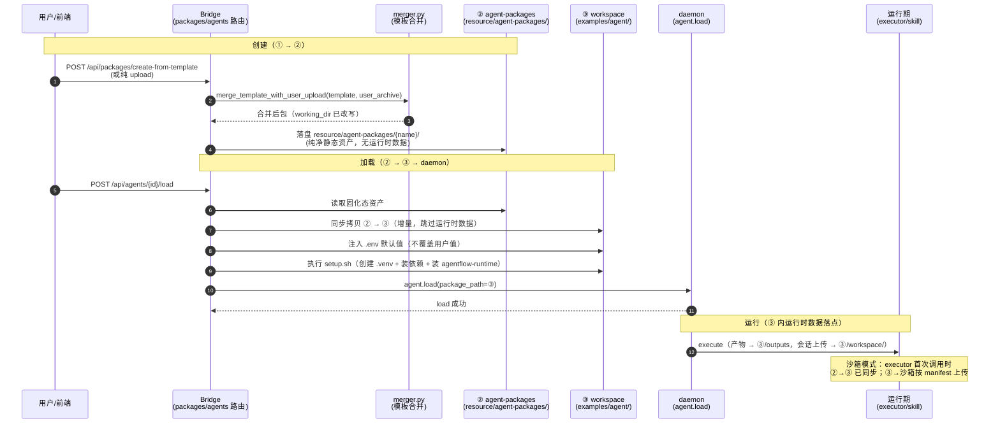

# Agent Package 设计 — 团队共享全量设计文档

> **文档级别**: L2 功能设计（enhancement 全量汇总）
> **日期**: 2026-08-20
> **状态**: implemented（核心已实现；部分项待实现，见 §10.2）
> **定位**: 本文档为 Agent Package 的**自包含全量设计**——覆盖包目录规范、三态生命周期（① template 蓝图 → ② agent-packages 固化态 → ③ workspace 运行实例）、创建/加载/上传流程、manifest 契约、工具执行路径与边界。不依赖任何外部文档，可直接评审与实施。
>
> **代码权威源**: `packages/agentflow-runtime/src/agentflow_runtime/common/manifest.py`（manifest 生成/加载）、`frontend/bridge/templates/agent_template/merger.py`（模板合并引擎）、`frontend/bridge/routes/{packages,agents}.py`（创建/加载路由）、`src/daemon/rpc_handler.cpp`（agent.load 调度）
>
> **校验声明**: §4.4 列出跨文档/代码偏差，均已标注"以谁为准"。实施前优先核对，避免多份文档互相矛盾。

---

## 1. 背景

### 1.1 当前模型的问题

Agent Package 是 agent 业务资产的载体，但设计演进中暴露三类问题：

| 问题 | 具体表现 |
|------|---------|
| **结构无规范** | 各示例包目录结构不统一，`harness/tools/`、`harness/skills/`、`nodes/` 的归属和边界不清晰 |
| **双源分叉** | 模板（`bridge/templates/agent_template/harness_agent/`）与生产实例（`examples/agent/outfit-assistant/`）存在几乎相同的代码副本，改一处需手动同步多处，最终分叉、无权威源 |
| **运行时污染** | 包目录同时承载"固化资产"与"运行实例数据"（`.venv` 91M、`outputs/`、`workspace/`、`.agentfoundry/` 直接写回包目录），版本控制噪音、上传膨胀、无法区分资产与垃圾 |

### 1.2 演进历程

| 阶段 | 时间 | 核心变化 | 状态 |
|------|------|---------|------|
| 模板 + 实例双源 | 2026-07 | 模板分叉、手动同步 | 已被替代 |
| 模板 → pip 包分发 | 2026-07-11 | `agentflow-runtime` pip 包 + shell wrapper + 入口文件，消除代码分叉 | 已实现 |
| 三态分离 | 2026-08-07 | ① template → ② agent-packages 固化态 → ③ workspace 运行实例，落点分离 | 已实现 |
| manifest 驱动上传 | 2026-08-04~15 | `manifest.jsonc` 自动推断 + includes/excludes 白名单 + 上传幂等 | 已实现 |

### 1.3 设计目标

1. 定义 agent package 的规范目录结构与资产分层（用户感知 vs 框架生成 vs 框架默认 vs 运行实例数据）
2. 三态分离：固化态纯净（只含静态资产）、运行态可重建（由固化态派生、运行时数据只落运行态）
3. 框架侧自动推断上传范围并生成 `manifest.jsonc`（用户无需手动维护，可覆盖）
4. 三端（Host/HTTP/e2b）工具执行路径统一（`python3 -m agentflow_runtime.harness.tools.{tool}`）
5. 模板改版可安全应用到已有实例（实例从固化态派生的追踪关系）

---

## 2. 方案简述

### 2.1 三态模型

```
① template（创建蓝图）                ② agent-packages（固化保存态）          ③ workspace（运行实例）
frontend/bridge/templates/           resource/agent-packages/{name}/        examples/agent/{name}/
agent_template/harness_agent/
   │ 脚手架：nodes/workflow/             │ ① + 用户资产合并后的                 │ ② 的拷贝 + 运行时数据
   │ agent.json/package.json/            │ 纯净静态资产（agent.md/             │ .venv/outputs/workspace/
   │ harness/ 骨架/requirements.txt      │ harness/skills/ 覆盖 tools/         │ .agentfoundry/preferences.json
   │ setup.sh/.env.example               │ agent.json/package.json/.env）       │ manifest.jsonc
   │ 框架维护，用户不得修改              │ bridge 写入，用户可编辑              │ bridge load 时同步 + 运行写入
   └──────────create-from-template────────▶ └────load 时 bridge 同步拷贝──────▶ └────daemon --package / agent.load────▶ 运行
```

**关键原则**：
- 固化态（②）**不含任何运行时数据**（`.venv`/`outputs`/`workspace`/`.agentfoundry`/`preferences.json`/`manifest.jsonc`）
- 运行时数据**只落** workspace 实例（③），由 ② 派生、可重建
- daemon 保持运行态语义：只 load 指定目录，不感知 ②/③ 之分；拷贝由 bridge 负责（用户已拍板）

### 2.2 资产分层（谁感知、谁维护）

| 层 | 内容 | 谁感知 | 谁维护 |
|----|------|--------|--------|
| **用户编写** | `agent.md`（意图 + model 配置）、`harness/skills/`（业务逻辑）、`harness/tools/`（仅覆盖项） | 用户 | 用户 |
| **模板提供** | `agent.json`、`package.json`、`coordinator_workflow.json`、`skill_workflow.json`、`nodes/`、`setup.sh`、`.env.example`、`requirements.txt` | 前端/API 生成 | 用户不得删除 |
| **系统自动生成** | `manifest.jsonc` — 上传清单持久化缓存（文件名中性，无"sandbox"） | 用户不感知（可手动覆盖） | 框架首次推断后生成 |
| **框架默认** | `harness/tools/*.py` 默认实现（pip 包）、`agentflow_runtime/` runtime、上传范围规则 | 框架 | 框架 |
| **运行实例数据**（③） | `.venv/`、`outputs/`、`workspace/{user}_{client}/upload/`、`.agentfoundry/memory/`、`preferences.json`、`manifest.jsonc` | 用户不感知（可清理） | 运行期——**只落 ③，不进 ②** |

**覆盖语义**：agent package 的 `harness/tools/{tool}.py` 存在时**覆盖** pip 包默认实现。加载顺序——先查 `AF_AGENT_PACKAGE_DIR/harness/tools/{tool}.py`，命中则用；未命中再走 `python3 -m agentflow_runtime.harness.tools.{tool}`。这是"用户定制覆盖系统默认"（优先级明确，非多权威源分叉）。

### 2.3 模板 → pip 包分发（消除代码分叉）

```
通用代码 → pip 包 agentflow-runtime（py3-none-any，纯 Python）
  → 安装到 agent 包虚拟环境 .venv（或容器/沙箱内 Python）
  → agent 包 nodes/ 每节点保留 shell wrapper（.sh）+ 入口文件（.py，1 行 import）
      ├─ .sh wrapper：检测 .venv 就绪 → exec .venv/bin/python3 xxx.py
      └─ fallback：exec python3 xxx.py（Bridge 启动时系统 Python 预装 agentflow-runtime）
```

**为什么需要 shell wrapper**：C++ daemon 的 `exe_loader.cpp` 只支持"读 `PYTHON_PATH` → execve 指定 python → 执行 .py"，不支持自动检测 agent 包 `.venv`。wrapper 在 daemon 调用 Python 前做一层包装（选解释器），不改 C++ daemon。

### 2.4 manifest 驱动上传（沙箱部署关切）

- `manifest.jsonc` 是**上传清单持久化缓存**，文件名中性（无"sandbox"）
- 首次连接自动扫描推断生成；后续连接直接读取（跳过推断）；用户可手动提供覆盖
- includes glob = 唯一真相来源（I-5），消费端实时展开，新增文件自动进入白名单
- 消费链路：`e2b_sync.py upload --manifest <path>` → includes/excludes 白名单过滤上传

---

## 3. 约束与假设

- **用户感知最小化**：用户只写 `agent.md`（意图+模型）与 `harness/skills/`（业务逻辑）；`agent.json`/`package.json`/workflow/`nodes/` 由模板自动生成，用户不应删除
- **平台无关**：`agentflow-runtime` 是纯 Python 包（py3-none-any wheel），跨平台可用
- **向后兼容**：HostExecutor 和 HTTPExecutor 不受影响；`sandbox-mode=none` 行为与移植前一致
- **用户不感知沙箱**：上传范围是框架的部署关切；manifest 是框架写入的状态文件，用户无需手动维护
- **容器沙箱文件系统独立**：不能通过 `PYTHONPATH`/`symlink` 引用宿主机路径，需真正的依赖分发（pip 包 + 上传）
- **运行时数据只落 ③**：`.venv`/`outputs`/`workspace`/`.agentfoundry` 等由运行期写入，且不进入固化态（②）
- **同步由 bridge 负责**：daemon 保持"只 load 指定目录"语义，②→③ 拷贝在 bridge 层
- **模板与实例的代码分叉**：通用机制代码的唯一权威源是 `agentflow-runtime` pip 包；agent 包 nodes/ 只留 wrapper + 入口

---

## 4. 当前实现分析

### 4.1 代码现状

**manifest.py**（`packages/agentflow-runtime/src/agentflow_runtime/common/manifest.py`，157 行）：

| 函数 | 职责 |
|------|------|
| `generate_manifest(agent_package_dir)` | 生成或重载 manifest；文件已存在则直接返回，否则扫描写入 |
| `load_manifest(agent_package_dir)` | 读取现有 manifest（JSONC 注释剥离后解析）；不存在/不可解析返回 None |
| `strip_jsonc_comments(text)` | 状态机剥离 JSONC 注释，字符串内 `//`/`/*` 不剥离 |

**includes 白名单**（`_INCLUDE_GLOBS`）：`harness/skills/**`、`harness/tools/**`（仅覆盖项）、`data/**`、`requirements.txt`、`.env`（密钥文件，set -a && source 链路要求）、`setup.sh`。

**excludes 黑名单**（`_EXCLUDE_DIRS`）：`nodes`、`__pycache__`、`.pytest_cache`、`.mypy_cache`、`.ruff_cache`、`.git`、`.venv`、`workspace`、`outputs`、`output`、`tests`、`.agentfoundry`。

**merger.py**（`frontend/bridge/templates/agent_template/merger.py`，406 行）——模板合并引擎：

| 机制 | 规则 | 示例 |
|------|------|------|
| 模板拥有（`_TEMPLATE_ONLY`） | 模板总是覆盖 | `harness/tools/`、`nodes/databus*`、shell wrapper、workflow DAG、`setup-host.sh`、`tests/` |
| 用户拥有 | 用户文件胜出 | `agent.md`、`package.json` |
| 智能合并 | agent.json 深度合并 | tasks 保留 + 用户顶层字段覆盖 |
| workflow 改写 | `working_dir` 重写为新包路径 | 三个 workflow JSON |

**examples/agent 现状**：`outfit-assistant`、`cloudalbum-assistant`、`agent-creator` 三个示例包，结构基本一致（agent.json/agent.md/nodes/harness/manifest.jsonc 等）；outfit-assistant 有运行时数据（outputs/、.agentfoundry/）。

### 4.2 配置现状

| 配置项 | 当前值 | 语义 |
|--------|--------|------|
| `agent_packages_dir` | `resource/agent-packages` | 固化态（②）保存位置 |
| `agent_workspace_dir` | `examples/agent` | 运行实例（③）位置 |
| `agent_packages_path` | 项目根/resource/agent-packages | 固化态路径 property |
| `agent_workspace_path` | 项目根/examples/agent | 运行实例路径 property |

### 4.3 功能实现状态

| 功能点 | 实现现状 | 缺口 |
|--------|---------|------|
| 三态分离（②/③ 落点） | ✅ 已实现 | — |
| ②→③ 同步（load 时） | ✅ 已实现（增量同步 + 幂等 + OSError 保留半成品） | — |
| manifest 生成/加载 | ✅ 已实现（generate/load/strip 注释） | — |
| manifest 驱动上传 | ✅ 已实现（e2b_sync.py --manifest 消费） | — |
| 上传幂等（远端存在性检查） | ✅ 已实现（2026-08-15，list + 跳过已存在） | — |
| 模板 → pip 包分发 | ✅ 已实现（wrapper + 入口文件） | — |
| merger 模板合并 | ✅ 已实现（三态创建入口） | — |
| 三种创建模式 UI | ⚠️ 部分 | 快速创建/对话创建待实现（白盒编排已有） |
| 会话上传目录清理 | ⚠️ 待实现 | 会话销毁后宿主机 upload 目录清理缺钩子（I-8） |

### 4.4 跨文档/代码校验偏差

| # | 偏差 | 不一致点 | 以谁为准 |
|---|------|---------|---------|
| A-1 | **同步清单的 manifest 归属** | structure.md §2.1 说 manifest 是"系统自动生成"；three-state.md §2.3 说 manifest 属 ② 固化态资产声明（bridge 同步 ②→③ 带上，③ 的 manifest 恒等于 ② 权威清单） | **three-state：manifest 属 ② 固化态**（③ 是同步副本） |
| A-2 | **`harness/tools/` 归属** | structure.md §2.2 说上传"仅覆盖项"；merger.py `_TEMPLATE_ONLY` 含 `harness/tools/`（模板总是覆盖用户 tools） | **merger.py 为准**（创建时模板覆盖；运行期覆盖 pip 默认——两条不同链路） |
| A-3 | **`.env` 变体** | structure.md §3.2 明确"只传主 .env，不传 .env_dashscope/.env_minimax 变体" | 以 structure.md 为准（manifest includes 仅 `.env`） |
| A-4 | **`files` 键废弃** | 旧 manifest 含 `files` 键（展开后的文件列表）；2026-08-11 收敛为 includes glob 唯一真相 | **includes glob 为准**（存量 `files` 键被消费端忽略） |
| A-5 | **上传时机** | structure.md §6.1 说 E2BExecutor 首次调用触发连接+上传；three-state.md §3.2 说 load 时同步 ②→③（bridge 层） | **两者不同层**：②→③ 同步 = bridge load 时；③→沙箱 = executor 首次调用时 |

---

## 5. 数据结构设计

### 5.1 Agent Package 目录规范（用户视角）

```
<agent-package/>                  ← 用户资产（② 固化态 = 此结构纯净版）
│
├── manifest.jsonc  ← 🔄 系统自动生成（② 权威，③ 同步副本）
├── [用户必写] agent.md                    # 业务意图 + model 配置
├── [模板] agent.json                      # 任务拓扑（agent_template 生成）
├── [模板] package.json                    # workflow 注册
├── [模板] coordinator_workflow.json       # coordinator workflow 定义
├── [模板] skill_workflow.json             # skill workflow 定义
├── [模板] nodes/                          # shell wrapper(.sh) + 入口文件(.py)
│   ├── coordinator_decide.sh / .py
│   └── skill_executor.sh / .py
├── [用户必写] harness/
│   ├── skills/                            # skill 定义（≥ 1 个）
│   │   └── <name>/
│   │       ├── SKILL.md
│   │       └── scripts/
│   │           └── tool.py
│   └── [可选] tools/                      # 覆盖 pip 包默认实现
│       └── bash.py
├── [可选] requirements.txt                # Python 依赖
├── [可选] setup.sh                        # 沙箱内环境初始化（用户域，模板不覆盖）
├── [可选] .env                            # 环境变量（只传主 .env，不传变体）
└── [运行时，仅 ③] workspace/             # 会话级用户上传资产
    └── {user_id}_{client_id}/upload/
        └ {sha256}.{ext}                  # content-addressed，重复上传幂等
```

### 5.2 三态目录（生命周期视角）

| 态 | 角色 | 目录 | 内容 | 是否进版本控制 |
|----|------|------|------|---------------|
| **① template** | 创建蓝图 | `frontend/bridge/templates/agent_template/harness_agent/` | 脚手架：nodes（wrapper+入口）、workflow JSON、agent.json、package.json、harness 骨架、requirements.txt、setup.sh、.env.example | ✅ 是 |
| **② agent-packages** | 固化保存态 | `resource/agent-packages/{name}/` | ① + 用户资产合并后的纯净静态资产：agent.md、harness/skills/、覆盖 tools/、agent.json、package.json、workflow JSON、nodes/、.env | ✅ 是（业务资产不 gitignore；.env 由密钥策略决定） |
| **③ workspace** | 运行实例 | `examples/agent/{name}/` | ② 拷贝 + 运行时数据：.venv/、outputs/、workspace/、.agentfoundry/memory/、preferences.json、manifest.jsonc | ⚠️ 资产进，运行时数据 ignore |

### 5.3 manifest.jsonc 格式

```jsonc
// manifest.jsonc — 由系统自动生成（② 权威，③ 同步副本），用户可手动覆盖
{
  "includes": [          // 上传白名单 glob（相对 agent_package_dir）——系统预制，可覆盖/扩展
    "harness/skills/**",
    "harness/tools/**",  // 仅覆盖项
    "data/**",
    "requirements.txt",
    ".env",              // 密钥文件——只传主 .env，不传变体
    "setup.sh"
  ],
  "excludes": [          // 即使命中 includes 也排除
    ".agentfoundry", ".venv", "__pycache__",
    "nodes", "output", "outputs", "tests", "workspace"
  ],
  "generated_at": "2026-08-20T10:00:00+08:00"
}
```

**不变量**：includes glob 是唯一真相来源（I-5）——`files` 键（展开后的具体文件列表）已废弃（2026-08-11 收敛），消费端实时展开，新增文件自动进入白名单与快照 hash。

### 5.4 实体关系

```
AgentPackage 1───1 Manifest         (包目录持有 manifest，② 权威 / ③ 副本)
template(①) 1───0..N agent-packages(②)  (create-from-template 派生，merger 合并)
agent-packages(②) 1───0..N workspace(③) (load 时 bridge 同步拷贝，② 为权威)
workspace(③) 1───N 会话上传目录          (workspace/{user_id}_{client_id}/upload/)
workspace(③) 1───N outputs               (产物落点，AGENT_PACKAGE_DIR/outputs/)
agent-packages(②) 1───1 .env             (用户密钥资产，同步到 ③)
Manifest ────> e2b_sync.py upload        (消费 includes/excludes 白名单)
```

### 5.5 全局不变量

| 编号 | 不变量 | 说明 |
|------|--------|------|
| I-3S-1 | 固化态（②）不含运行时数据 | CI 扫描 `resource/agent-packages/` 断言无 .venv/outputs/workspace/.agentfoundry/preferences.json/manifest.jsonc |
| I-3S-2 | 运行时数据只落 ③ | 运行后扫描 ② 无新增运行时数据 |
| I-3S-3 | ③ 由 ② 派生（② 为权威） | 同步后比对资产一致 |
| I-3S-4 | 重复 load 幂等 | 资产刷新、运行时数据保留 |
| I-5 | 单一真相来源 | includes glob 唯一真相；manifest 属 ② 固化态 |
| I-4 | 幂等 | ②→③ 增量同步幂等；上传远端存在性检查（同名即同内容） |
| I-6 | upload 目录是**输入目录**非产物 | artifact 收集扫到 `workspace/*/upload/` 必须跳过 |
| I-7 | 给 LLM 的路径必须是沙箱内可解析路径 | e2b 改写为沙箱绝对路径；Local/Docker 保持相对路径（cwd=workdir） |
| I-8 | 宿主机 upload 是会话级真相源；沙箱副本随沙箱销毁而清 | 会话销毁后应清理宿主机目录（待实现） |
| I-9 | base64 不得出现在对话上下文 | 模型看图由 skill 脚本沙箱内自行 open + 调 VL API |
| I-env-1 | agent `.env` 显式声明的非空变量在沙箱内子进程 `os.environ` 可读 | `set -a && source .env` 前缀使赋值自动 export，子进程继承 |
| I-env-2 | 宿主机专属变量（PATH/HOME/USER 等含宿主路径）不透传沙箱 | 宿主机 os.environ 不注入沙箱，防路径污染 |
| I-env-3 | 密钥（`*_API_KEY`）允许存在于沙箱内 `.env` 文件，但不得出现在每条命令的 API 请求体 | 密钥只随文件进沙箱，不出网络传输面（C-2 决策） |
| I-env-4 | 重复执行同一命令不得产生重复副作用（幂等） | `source .env` 重复执行无副作用 |

---

## 6. 流程设计

### 6.1 生命周期总览（三态时序）



**生命周期关键节点**：创建（①→②，merger 合并，落 ②）；加载（②→③，bridge 同步 + .env 注入 + setup.sh + daemon load）；运行（产物/上传/记忆只落 ③）；重复加载（增量同步幂等，运行时数据保留）。

### 6.2 创建流程（① → ②）

```
POST /api/packages/create-from-template（或纯 upload）
  1. merge_template_with_user_upload(template_dir=①, user_archive, target_dir=②)
     a. 复制 template → ②（全量脚手架）
     b. 改写 workflow 的 working_dir 为新包路径
     c. 解压用户 archive 到 ② 之上（直接冲突用户文件胜出）
     d. 深度合并 agent.json（保留模板基础设施任务，用户覆盖顶层身份字段）
     e. 确保模板拥有文件（_TEMPLATE_ONLY）始终完整
  2. ② 生成后即固化态，不产生任何运行时数据
```

**merge 所有权规则**：

| 类别 | 胜出方 | 示例 |
|------|--------|------|
| 运行时基础设施 | 模板 | harness/tools/*、nodes/databus*、shell wrapper、workflow DAG |
| 用户身份 | 用户 | agent.md、package.json |
| 智能合并 | 深度 | agent.json（tasks 保留 + 用户顶层） |
| workflow DAG | 模板+改写 | coordinator_workflow.json（working_dir 重写） |
| 用户增量 | 用户+ | 自定义 harness/skills/<custom>/、data/ |

### 6.3 加载同步流程（② → ③）

```
sync_agent_package(source=②/{name}, target=③/{name}):
  1. source 不存在 → 404（固化态缺失，无法实例化）
  2. target 不存在 → 全量拷贝 source → target
  3. target 已存在 → 增量同步：
     a. 遍历 source 下"资产文件"（§5.2 ② 列）
     b. 覆盖 target 中对应文件（资产以 ② 为权威）
     c. 跳过 target 中"运行时数据"（排除清单）——保留运行现场
  4. 返回 target 路径
```

**排除清单（同步时不动 target 运行时数据）**：`.venv/`（安装成本高，复用）、`outputs/`（历史产物）、`workspace/`（会话上传）、`.agentfoundry/`（技能接管的 agent 记忆）、`preferences.json`、`manifest.jsonc`（② 权威清单副本）。

**OSError 处理（用户拍板 2026-08-07）**：`shutil.copytree` 中途失败 → ③ 半成品**保留不清理**（下次 load 覆盖式同步收敛；避免误删运行时数据）；HTTP 500 + `logger.warning("agent_lifecycle.sync_error ...")`；不调用 daemon.load（前置拦截）。

### 6.4 manifest 上传流程（③ → 沙箱）

```
E2BExecutor.exec_command（首次调用触发）
  └─ _ensure_connected()
       ├─ Sandbox.connect(sandbox_id, envs={PYTHONPATH, AF_AGENT_PACKAGE_DIR})
       ├─ upload_harness()  ← 只执行一次（_uploaded flag）
       │    ├─ 读 manifest.jsonc（不存在 → 按规则扫描生成）
       │    ├─ 复制 agentflow_runtime/（from site-packages）
       │    ├─ 按 includes 展开白名单上传（batch=50）
       │    ├─ 远端存在性检查（_list_remote_files 跳过已存在——幂等，I-4）
       │    └─ 扫描依赖文件（requirements.txt → pip install -r 等）
       └─ _uploaded = True
```

**上传幂等（2026-08-15 决策）**：`e2b_sync.py upload()` 上传前先 `_list_remote_files` 列出远端已有文件，**跳过已存在的**，只 `write_files` 新增。幂等依据：宿主侧 `_land_image` 落盘文件名 = `sha256[:16]` 内容寻址——**文件名即内容指纹**，同名即同内容。list 失败降级为全量上传（保守，不 fail-fast）。

### 6.5 工具执行链路（三层架构）

```
skill_executor.py               ← 控制层：决定调哪个 tool（bash/read_file/...）
  │
  ▼
ToolExecutor 接口               ← 路由层：决定工具在哪执行（host/container/e2b）
  │  HostExecutor.exec_command("ls")
  │  HTTPExecutor.exec_command("ls")
  │  E2BExecutor.exec_command("ls")
  │
  ▼
python3 -m agentflow_runtime    ← 执行层：tool 脚本在目标环境上实际跑
  .harness.tools.bash '...'
      或
AF_AGENT_PACKAGE_DIR/harness    ← 用户覆盖优先（先查包内，未命中走 pip 包）
  /tools/bash.py
```

**工具查找优先级**：`AF_AGENT_PACKAGE_DIR/harness/tools/{tool}.py`（用户覆盖）→ 未命中 → `python3 -m agentflow_runtime.harness.tools.{tool}`（pip 包默认）。

**三端执行对比**：

| Provider | 执行环境 | 调用链路 | pip 包默认来源 | 用户覆盖项来源 |
|----------|---------|---------|---------------|---------------|
| **HostExecutor** | 宿主机 | skill_executor → ToolExecutor → subprocess.run(python3 -m ...) | 宿主 site-packages | 宿主 AF_AGENT_PACKAGE_DIR/harness/tools/ |
| **HTTPExecutor** | Docker/local 沙箱 | skill_executor → ToolExecutor → POST /exec → sandbox_http_server → python3 -m ... | 容器内 site-packages | 容器内 {workdir}/harness/tools/ |
| **E2BExecutor** | e2b 远端沙箱 | skill_executor → ToolExecutor → sb.commands.run(python3 -m ...) | 沙箱内 {workspace}/agentflow_runtime/ | 沙箱内 {workspace}/harness/tools/（manifest 上传） |

> **⚠️ e2b 当前实现**：走 e2b SDK 直连（`commands.run()` → envd:49983），**不经 HTTP server**；HTTP server 统一入口为未来目标（与 043 sandbox 文档同口径）。

---

## 7. 接口设计

### 7.1 创建接口（① → ②）

**`POST /api/packages/create-from-template`**（或纯 upload）：

| 参数 | 类型 | 必填 | 说明 |
|------|------|------|------|
| template | string | ⬜ | 模板名（默认 harness_agent） |
| user_archive | file | ✅ | 用户上传的 agent 包（zip/tar） |
| name | string | ✅ | 目标包名（落盘 `resource/agent-packages/{name}/`） |

**行为**：merger 合并（§6.2 所有权规则）→ 落盘 ② 固化态 → 返回包信息。

### 7.2 加载接口（② → ③ → daemon）

**`POST /api/agents/{id}/load`**：

| 步骤 | 动作 | 说明 |
|------|------|------|
| 1 | 校验 agent_id / package_path | 固化态存在性 |
| 2 | 同步拷贝 ② → ③（增量，§6.3） | 资产以 ② 为权威，跳过运行时数据 |
| 3 | `.env` 注入 | bridge `_inject_agent_env_defaults` 在 ③ 注入默认配置（不覆盖用户值） |
| 4 | setup.sh 执行 | 在 ③ 上运行（创建 .venv、装依赖、装 agentflow-runtime）——I-3S-1 要求运行时数据只落 ③ |
| 5 | daemon `agent.load(package_path=③)` | daemon 保持"只 load 指定目录"语义 |

### 7.3 manifest 契约（manifest.py）

| 函数 | 签名 | 语义 |
|------|------|------|
| `generate_manifest(agent_package_dir)` | `str → dict` | 生成或重载；文件存在直接返回（跳过扫描），否则扫描写入 |
| `load_manifest(agent_package_dir)` | `str → dict \| None` | 读取现有 manifest（JSONC 注释剥离）；不存在/不可解析返回 None |
| `strip_jsonc_comments(text)` | `str → str` | 状态机剥离注释，字符串内 `//`/`/*` 保留 |

**includes/excludes 取值 → 行为**：

| 键 | 默认值 | 行为 |
|----|--------|------|
| `includes` | `harness/skills/**`、`harness/tools/**`、`data/**`、`requirements.txt`、`.env`、`setup.sh` | 上传白名单 glob；消费端实时展开，新增文件自动进入 |
| `excludes` | `.agentfoundry`、`.venv`、`__pycache__`、`nodes`、`output`、`outputs`、`tests`、`workspace` | 即使命中 includes 也排除 |
| `generated_at` | 当前时间 | 上传时间戳（框架记录） |

**消费链路**：`sandbox_e2b.cpp` 启动时 `e2b_sync.py upload --manifest <path>`；manifest 加载/生成失败 → fail-fast（B22 不 fallback，禁止盲传 .venv 等产物）。

### 7.4 环境变量注入（daemon → agent 包/沙箱）

| 变量 | 用途 | 注入方 |
|------|------|--------|
| `AF_AGENT_PACKAGE_DIR` | agent 包根目录（工具查找 + skill 定位） | daemon / executor |
| `AF_INPUT` | 用户输入纯文本（含上传资产路径） | daemon handle_agent_execute |
| `AF_SESSION_ID` | 执行槽位编号（非产物 session_id） | daemon |
| `AF_SANDBOX_WORKSPACE` | 当前执行环境工作目录契约（host=agent 包根 / e2b=沙箱目录） | daemon（D-10 统一，原 SANDBOX_WORKDIR 废弃） |
| `PYTHONPATH` | 沙箱内指向 workspace（含 agentflow_runtime） | executor（e2b 上传后） |

> **来源标注**：`AF_SANDBOX_WORKSPACE` 工作目录契约（D-10：host=agent 包根 / e2b=沙箱目录，原 SANDBOX_WORKDIR 废弃）与 `.env` 注入决策（D-3：`set -a && source` 前缀，删除宿主侧 env 白名单）源自沙箱隔离机制设计（043 文档决策记录），本文档沿用并在 §5.5 定义其不变量（I-env-1~4）。

### 7.5 环境变量 → 行为映射（.env 注入，沿用 D-3 决策）

| 场景 | 前缀 | 行为 |
|------|------|------|
| `.env` 存在 | `set -a && source /home/user/workspace/.env && set +a && <命令>` | source 期间赋值自动 export，子进程 `os.environ` 可读非空变量（I-env-1） |
| `.env` 不存在 | `<命令>`（无前缀） | 跳过加载，不报错 |
| 宿主机 os.environ | 不透传 | 宿主专属变量不进入沙箱（I-env-2 防路径污染） |

---

## 8. 实现方案

### 8.1 功能点实现优先级

| 优先级 | 功能点 | 副作用分析 | 验证策略 | 现状 |
|--------|--------|-----------|---------|------|
| P1 | 三态分离（②/③ 落点 + I-3S-1~4） | 有兼容影响（路径迁移） | CI 扫描 + 集成测试 | ✅ 已实现 |
| P1 | ②→③ 同步（load 时增量 + OSError 处理） | 有兼容影响 | 幂等测试 + OSError 注入 | ✅ 已实现 |
| P1 | manifest 生成/加载/注释剥离 | 无副作用 | 单元测试 | ✅ 已实现 |
| P1 | manifest 驱动上传（includes/excludes + fail-fast） | 有兼容影响（上传范围收敛） | E2E 测试 | ✅ 已实现 |
| P1 | 上传幂等（远端存在性检查） | 无副作用 | 集成测试（多轮上传） | ✅ 已实现 |
| P1 | 模板 → pip 包分发（wrapper + 入口 + fallback） | 无副作用 | 三端执行测试 | ✅ 已实现 |
| P2 | merger 模板合并（所有权规则） | 有兼容影响 | merger 单测 + 创建集成测试 | ✅ 已实现 |
| P2 | 三种创建模式 UI | 有新增能力 | 前端 E2E | ⚠️ 快速/对话创建待实现 |
| P2 | 会话上传目录清理 | 有依赖（session 生命周期钩子） | 集成测试 | ⚠️ 待实现（I-8） |
| P3 | 沙箱内 HTTP server 统一入口（e2b） | 有新增能力 | 三模式集成测试 | ⏳ 未来目标 |

### 8.2 关键实现要点

1. **②→③ 同步幂等**：`shutil.copytree(dirs_exist_ok=True)` 覆盖式同步；资产以 ② 为权威（I-5），运行时数据排除清单保留（I-3S-4）
2. **manifest 单一真相**：includes glob 唯一真相（I-5），`files` 键废弃；消费端实时展开
3. **上传幂等**：远端存在性检查（list + 跳过已存在），文件名 = sha256[:16] 内容指纹（同名即同内容，I-4）
4. **三态落点**：产物/上传/记忆只落 ③；固化态 ② 纯净（I-3S-1/2），CI 扫描守护
5. **工具查找优先级**：包内覆盖 > pip 包默认（`AF_AGENT_PACKAGE_DIR/harness/tools/{tool}.py` 先查）
6. **e2b 路径改写**：daemon 下发前 `SandboxHelpers::rewrite_upload_path_to_sandbox` 把相对路径改写为沙箱内绝对路径（I-7，2026-08-12 修复）

---

## 9. 测试方案

### 9.1 测试覆盖缺口

| 功能点 | 现有覆盖 | 更新建议 |
|--------|---------|---------|
| 三态隔离（I-3S-1/2） | ⚠️ 部分 | CI 扫描 ② 无运行时数据；运行后扫描 ② 无新增 |
| ②→③ 同步幂等（I-3S-3/4） | ⚠️ 部分 | 两次 load 后资产一致 + 运行时数据保留 |
| 同步 OSError 处理 | ✅ 已覆盖 | `test_sync_agent_package_preserves_partial_on_oserror` 保留 |
| manifest 生成/加载 | ⚠️ 部分 | 注释剥离、存在跳过、不可解析降级 |
| 上传幂等 | ✅ 已覆盖 | 多轮上传远端不重复 |
| merger 所有权 | ⚠️ 部分 | 模板拥有/用户拥有/智能合并三矩阵 |
| 三端工具执行 | ⚠️ 部分 | Host/HTTP/e2b 各一链路 |

### 9.2 关键测试用例（规则 → 验证点）

| 用例 | 覆盖不变量/规则 | 验证方式 |
|------|---------------|---------|
| 固化态无运行时数据 | I-3S-1 | CI 扫描 resource/agent-packages/ 断言无 .venv/outputs/workspace |
| 运行后 ② 无新增 | I-3S-2 | 运行后扫描 ② 目录 |
| 重复 load 幂等 | I-3S-4 | 两次 load 后资产一致、运行时数据保留 |
| 同步 OSError 半成品保留 | §6.3 | 注入 OSError → ③ 保留 + 500 + 下次收敛 |
| manifest 注释剥离 | manifest.py | JSONC 带注释解析成功；字符串内 // 不剥离 |
| manifest 存在跳过推断 | §3.1 | 已有 manifest 直接读取，不重新扫描 |
| 上传远端存在性跳过 | I-4 | 第二轮上传仅写新增文件 |
| merger 模板拥有覆盖 | §6.2 | 用户上传 harness/tools/ 被模板覆盖 |
| merger 用户身份胜出 | §6.2 | agent.md/package.json 用户值保留 |
| 工具覆盖优先级 | §5.5 | 包内 tools/bash.py 优先于 pip 包 |
| e2b 路径改写幂等 | I-7 | 相对路径改写为沙箱绝对路径；已是绝对路径不二次改写 |

### 9.3 测试分层与独立性

- 分层：Unit（manifest 解析/merger 规则）→ Integration（②→③ 同步/上传幂等）→ E2E（创建→加载→运行全链路）→ Contract（创建/加载 API）
- 最小执行集成测试（F13）不 mock 关键集成点（merger/文件系统/沙箱上传）
- 测试 fixture 必须走框架权威 agent 生成机制（merger/template），不手写 agent.json/nodes/workflows（项目记忆）
- 测试方案具备独立性；禁止因测试便捷性修改功能代码（日志除外）

---

## 10. 支持能力与边界

### 10.1 当前稳定支持

| 能力 | 说明 |
|------|------|
| 三态分离 | ① template → ② 固化态 → ③ 运行实例，落点分离、可重建 |
| ②→③ 同步 | load 时增量同步（资产刷新、运行时数据保留、OSError 保护） |
| manifest 自动生成 | 首次扫描推断 + includes/excludes 白名单 + JSONC 注释剥离 |
| manifest 驱动上传 | e2b_sync.py --manifest 消费；加载失败 fail-fast |
| 上传幂等 | 远端存在性检查（文件名 = 内容指纹） |
| 模板 → pip 包分发 | shell wrapper + 入口文件 + .venv fallback |
| 工具三层执行 | 控制层/路由层/执行层，三端统一 `python3 -m` |
| 用户覆盖工具 | 包内 harness/tools/ 优先于 pip 包默认 |

### 10.2 明确不支持 / 待实现

| 项 | 状态 | 说明 |
|----|------|------|
| 快速创建 / 对话创建 UI | ⏳ 待实现 | 当前仅白盒编排（模式二） |
| 会话上传目录清理 | ⏳ 待实现 | 缺 session 销毁钩子（I-8） |
| 沙箱内 HTTP server 统一入口（e2b） | ⏳ 未来目标 | 当前 e2b 走 SDK 直连 |
| 多实例预热 | ⏳ 后续增强 | 当前 load 时懒同步 |
| 模板自动迁移已有实例 | ⏳ 后续增强 | 当前改模板后需重新 create 或手动同步 |

---

## 11. 后续计划

| 优化项 | 预期效果 | 方案简述 |
|--------|---------|---------|
| 三种创建模式 UI 补齐 | 覆盖初级/高级/对话用户 | 快速创建（填空即用）+ 对话创建（AI 引导），复用 create-from-template |
| 会话上传目录清理 | 用户数据隔离 | Bridge session 生命周期补充销毁钩子（I-8） |
| 沙箱内 HTTP server 统一入口（e2b） | 三模式同构 | 与 043 sandbox 文档 G-1 对齐（未来目标） |
| manifest 增量感知 | 避免删除重扫 | watch 目录变化自动更新 manifest |
| 模板版本化 | 可回滚创建 | template 快照 + 实例版本追踪 |

---

## 12. 待澄清规格 / 待确认问题

> 以下规格当前只有代码默认值、warning 或经验值，**尚未形成产品级承诺**。实施/评审前需业务方拍板。

| # | 规格项 | 当前事实（默认值/经验值） | 为什么必须拍板 | 未拍板风险 |
|---|--------|--------------------------|---------------|-----------|
| Q-1 | `.env` 是否纳入版本控制 | 默认 `**/.env` 被 .gitignore 排除 | 密钥策略：固化态 ② 含 .env，是否 commit 决定分发安全 | 误提交密钥泄漏 |
| Q-2 | 模板升级策略 | 当前改模板后需重新 create | 存量实例如何接收模板改进 | 实例与模板分叉复现 |
| Q-3 | 上传 batch 大小 | 代码固定 batch=50 | 影响上传吞吐与失败重试粒度 | 大包上传慢、失败恢复粗 |
| Q-4 | 会话上传目录保留时长 | 无自动清理 | 决定磁盘占用与用户数据保留 | 磁盘膨胀 / 数据残留 |
| Q-5 | 快速/对话创建 UI 优先级 | 未排期 | 决定用户创建路径覆盖 | 初级用户上手门槛 |
| Q-6 | 沙箱内 HTTP server（e2b）目标 | 未排期 | 决定 e2b 是否与 local/docker 同构 | 三模式行为分叉 |

---

## 13. 修订记录

| 版本 | 刷新时间 | 刷新人 | 刷新内容 |
|------|---------|--------|---------|
| v1.0 | 2026-08-20 | - | 初始版本：自包含全量设计（三态生命周期 + 结构规范 + 流程 + 接口） |
| v1.1 | 2026-08-20 | - | 与代码一致性校验（042~044 三文档比对）：manifest.py（157 行）/merger.py（406 行）行数与 includes/excludes 常量、bridge 路由（create-from-template/agents load）、config.yaml 落点、e2b_sync 上传幂等全部与代码一致，0 偏差；同期 043 修订联动补充 `e2b_remote_workspace_dir` 配置键 |
| v1.2 | 2026-08-20 | - | 状态字段更新：tbd → implemented（核心已实现；部分项待实现，见 §10.2）——核心链路（三态分离/②→③ 同步/manifest 生成与上传/上传幂等/pip 包分发/merger 合并）已落地，快速/对话创建 UI、会话上传目录清理、e2b HTTP 统一入口仍待实现 |

