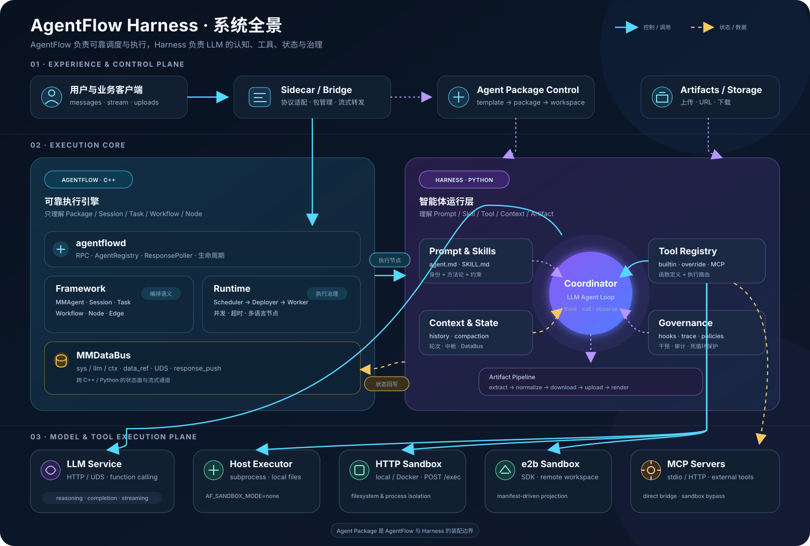
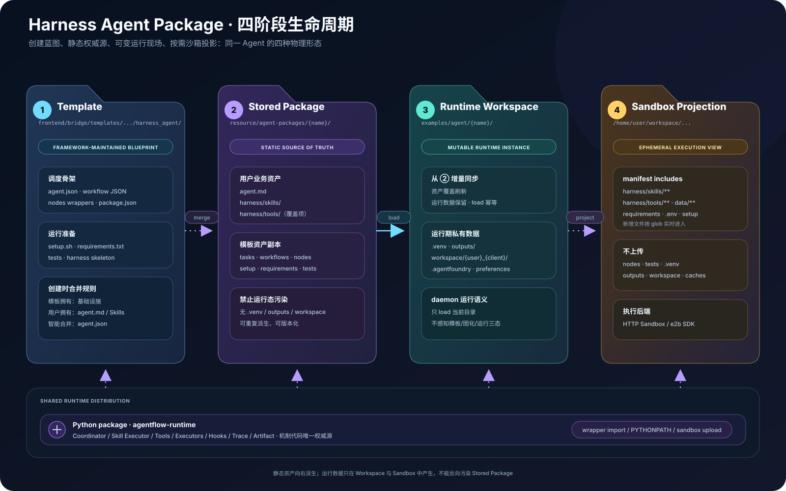
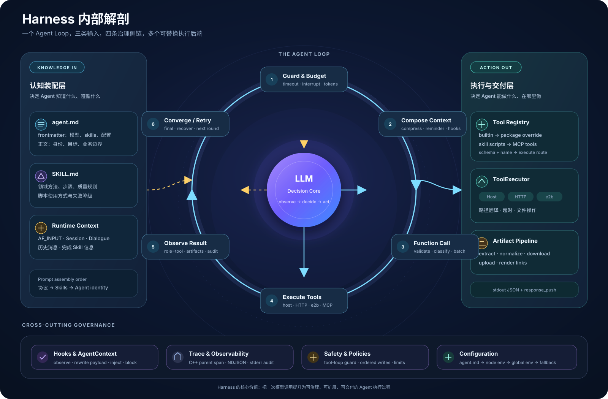
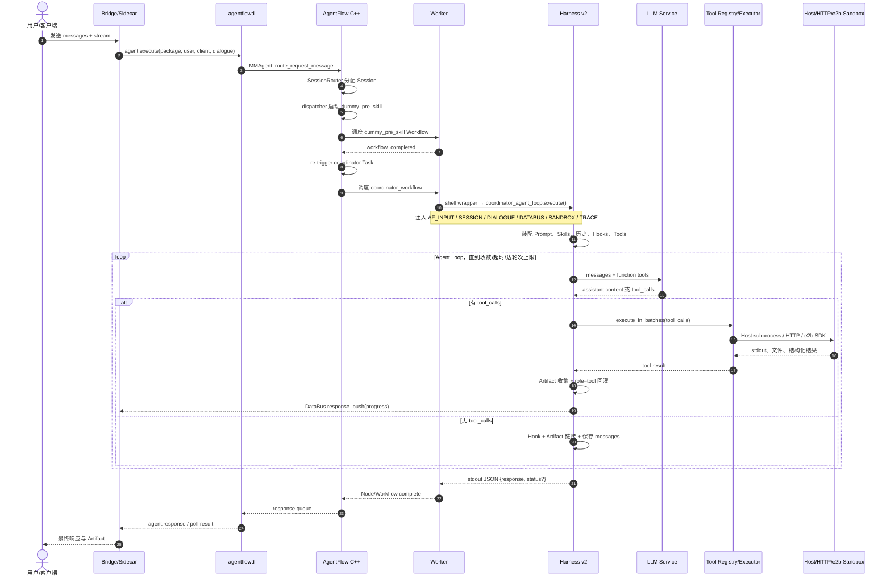
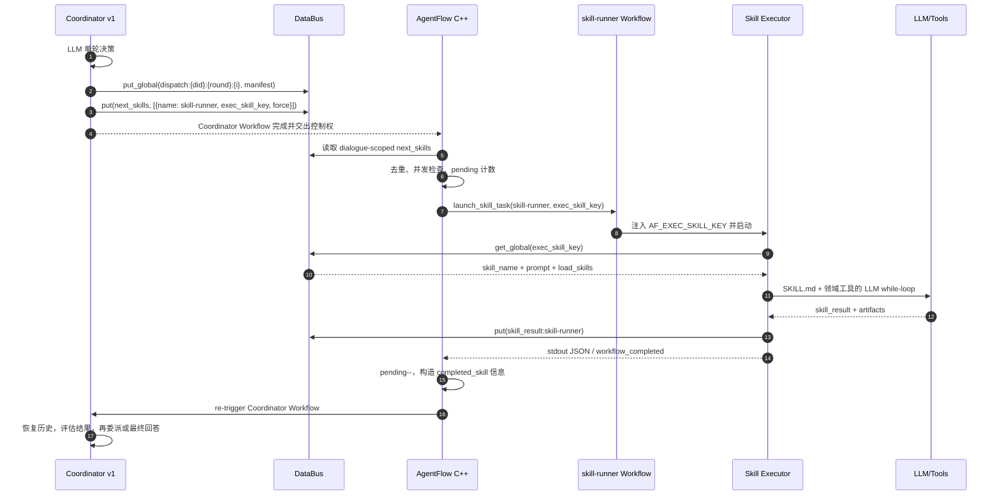
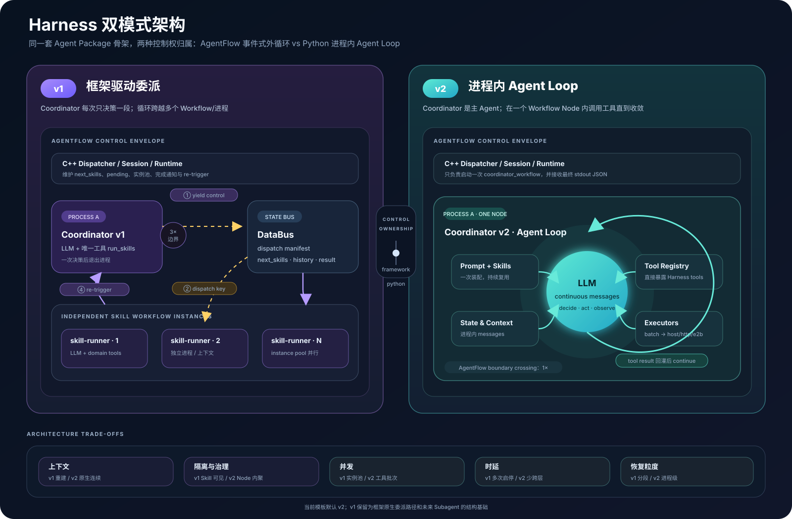

# AgentFlow Harness 深度解读

> 基于 `harness_agent_poc` 分支当前实现整理，代码基线：2026-08-20。
>
> 本文中的“当前默认”以仓库实际入口脚本为准：`AF_COORDINATOR_VERSION` 未设置时选择 v2。设计文档仍将 v2 标记为实验/A-B 验证状态，因此“默认启用”和“架构已稳定”不是同一件事。

## 阅读导航

- [系统全景图](diagrams/01-system-landscape.svg)：Harness、AgentFlow、Bridge、沙箱和外部服务的边界。
- [Harness 内部解剖图](diagrams/02-harness-anatomy.svg)：一次 Agent Loop 内部各子系统如何围绕 LLM 协作。
- [v1 / v2 双模式图](diagrams/03-dual-mode-architecture.svg)：框架驱动委派与进程内 Agent Loop 的本质差异。
- [默认 v2 请求时序图](diagrams/04-v2-request-sequence.svg)：从 API 请求到最终响应的完整关键路径。
- [Agent Package 生命周期图](diagrams/05-package-lifecycle.svg)：模板、固化包、运行实例、沙箱投影之间的关系。



## 1. 一句话定义

Harness 是 AgentFlow 之上的智能体运行层。它把“只能生成文本的 LLM”包装成一个具备以下能力的可运行 Agent：

- 能装配身份、业务规则和 Skill 知识；
- 能在多轮推理中选择并调用工具；
- 能把工具放在宿主机、容器或 e2b 沙箱中执行；
- 能保存上下文、压缩超长消息并检测失控循环；
- 能产生、归档和上传文件产物；
- 能通过 Hook 干预运行过程，并通过 Span/Event 观察全链路。

它不负责底层 Session、Task、Workflow、Worker 的生命周期和调度。这些属于 AgentFlow C++ Framework/Runtime。

最小心智模型是：

```text
AgentFlow = 任务与工作流的执行平台
Harness   = LLM 的认知、工具与运行策略
Agent Package = 把两层装配成一个可加载 Agent 的交付单元
```

## 2. 必须先拆开的四组同名概念

### 2.1 AgentFlow Runtime 与 `agentflow-runtime`

这两个名字很像，但不是同一层：

| 名称 | 实际含义 | 主要代码 |
|---|---|---|
| AgentFlow C++ Runtime | Task 到 Workflow Instance、再到 Worker 的调度与部署 | `src/runtime/`、`include/internal/runtime/` |
| Python `agentflow-runtime` 包 | Harness 的通用 Agent 执行逻辑 | `packages/agentflow-runtime/src/agentflow_runtime/` |

Python 包虽然名为 `agentflow-runtime`，但其中的 coordinator、skill、tool、hook、artifact、compaction 等模块，实际上组成了本文讨论的 Harness Runtime。

### 2.2 C++ Coordinator 与 Harness Coordinator

| 名称 | 是否调用 LLM | 职责 |
|---|---:|---|
| `SessionTaskCoordinator` | 否 | 创建并维护 dispatcher/coordinator/skill Task 模板及默认 Workflow 绑定 |
| `coordinator_decide.py` | 是 | v1 单轮决策，借助 `run_skills` 委派任务 |
| `coordinator_agent_loop.py` | 是 | v2 主 Agent Loop，直接调用 Harness 工具直至收敛 |

所以日志或文档里看到“coordinator”时，必须继续确认它处于 C++ Framework 还是 Python Harness。

### 2.3 Skill 知识与 Skill Task

- Skill 知识是 `harness/skills/<name>/SKILL.md`，本质上是给 LLM 的领域操作手册。
- Skill Task 是 AgentFlow 中 `task_type=skill` 的可调度工作单元。
- v1 同时使用二者：Coordinator 调度 Skill Task，Skill Task 加载对应 SKILL.md。
- v2 仍会加载 SKILL.md，但默认不再为每个动作调度 Skill Task；Coordinator 在自己的进程内直接使用知识和工具。

因此，v2 提示词中的“skill 不存在了”应理解为“LLM 不再把 Skill 当成要委派的运行单元”，而不是 SKILL.md 资产被删除。

### 2.4 Tool 与 Executor

- Tool 是暴露给 LLM 的函数定义，例如 `bash`、`read_file`、`write_file`。
- Executor 决定这个操作在哪里执行，例如 Host、HTTP Sandbox、e2b。

一个 Tool 描述“做什么”，Executor 描述“在哪做”。两者之间由 `_LocalToolRegistry` 和各 Tool 模块衔接。

## 3. 代码地图与所有权

| 区域 | 关键路径 | 所有权与用途 |
|---|---|---|
| Harness 核心入口 | `coordinator_decide.py`、`coordinator_agent_loop.py`、`skill_executor.py` | v1/v2 Coordinator 和 Skill mini-agent 主循环 |
| Prompt | `prompts/` | Coordinator/Skill 协议、恢复提示、产物提示模板 |
| LLM 接入 | `llm_call.py`、`common/clients/` | OpenAI-compatible HTTP 与 UDS 模型通道 |
| Skill | `skills_loader.py`、Agent 包 `harness/skills/` | 解析 `agent.md`、加载 SKILL.md |
| Tool | `tool_registry.py`、`harness/tools/` | 工具发现、覆盖、MCP 路由 |
| 执行环境 | `executors/` | Host/HTTP/e2b 的统一 `ToolExecutor` 抽象 |
| 状态与通信 | `databus_client.py`、`recorder.py` | DataBus 读写、流式消息、对话历史、LLM 调用记录 |
| 上下文治理 | `compaction.py`、`round_reminder.py` | Token 预算、折叠/裁剪/摘要、轮次与时间提醒 |
| 扩展机制 | `hooks/`、`events.py`、`mounts.py`、`context.py` | 生命周期订阅、payload 改写、消息/产物注入与动作阻断 |
| 可观测性 | `trace/`、`observability.py` | 跨 C++/Python Span 父链、NDJSON、瞬时事件 |
| 产物 | `artifact_pipeline.py` | 路径抽取、归位、沙箱下载、对象存储上传、最终链接拼装 |
| 资产上传 | `common/manifest.py` | Agent 包上传白名单和排除规则 |
| AgentFlow 对接 | `src/agent/agent.cpp`、`src/runtime/worker/worker.cpp` | Task 调度、`next_skills` 消费、环境变量注入、节点进程执行 |
| Agent 模板 | `frontend/bridge/templates/agent_template/harness_agent/` | `agent.json`、Workflow、shell wrapper 和最小用户扩展面 |

这里有一个刻意的模块所有权规则：`skill_executor.py` 仍是兼容入口，但 Artifact、Tool Registry、Skill Loader 已拆到独立模块，并通过 re-export 保持旧调用点不变。

## 4. Harness 不是一个目录，而是四种形态的组合

### 4.1 Python Runtime

`packages/agentflow-runtime` 是机制实现的唯一权威源。Agent 包内的 `nodes/*.py` 基本只是入口文件，将包目录等路径注入模块后调用真正的 `execute()`。

### 4.2 Agent Template

`frontend/bridge/templates/agent_template/harness_agent/` 是创建 Agent 时使用的脚手架，提供：

- dispatcher/coordinator/dummy_pre_skill/skill-runner 四个基础 Task；
- Coordinator、Skill、dummy pre-skill 三个 Workflow；
- shell wrapper 与 Python 入口；
- setup、requirements、测试和 Harness 目录骨架。

### 4.3 Agent Package

一个业务 Agent Package 主要由三类资产组成：

```text
业务意图：agent.md
认知能力：harness/skills/*/SKILL.md
执行能力：harness/tools/ 与 skill scripts

框架拓扑：agent.json + *_workflow.json
运行入口：nodes/*.sh + nodes/*.py
部署声明：package.json + manifest.jsonc + setup/requirements
```

### 4.4 运行实例

Bridge 加载 Agent 时，会从固化 Agent Package 派生运行目录；`.venv`、`outputs`、`workspace`、记忆等运行数据只应写入运行实例。工具进入远端沙箱时，再根据 `manifest.jsonc` 将必要资产投影到沙箱。



## 5. 默认 v2：一个 Workflow Node 内的完整 Agent Loop

当前模板的 `coordinator_decide.sh` 在没有显式配置时选择 v2。v2 的关键变化不是“增加了几个工具”，而是把控制循环收回 Python 进程：

```text
v1：LLM 决策一次 → 交还 AgentFlow → 新起 Skill Workflow → 再回到 Coordinator
v2：LLM 决策 → 工具执行 → 结果回灌 → Python 内继续下一轮 LLM
```



### 5.1 初始化阶段

`coordinator_agent_loop.execute()` 的初始化顺序可以归纳为：

1. 绑定 Agent Package 路径，使公共模块和工具定位到正确业务包；
2. 加载 `.env`，注入可用虚拟环境；
3. 从 `AF_*` 环境变量读取 Session、Dialogue、输入和超时；
4. 解析 `agent.md` frontmatter 与正文；
5. 按节点类型解析模型、API Key 和 Base URL；
6. 从 `harness/hooks/` 动态加载 Hook；
7. 建立 DataBus Client 与 TraceRecorder；
8. 加载 `agent.md` 声明的 SKILL.md；
9. 组装 System Prompt；
10. 恢复跨 Dialogue 历史并加入本次消息；
11. 初始化 Tool Registry。

### 5.2 System Prompt 的真实组成

v2 的 System Prompt 不是单一文件，而是按顺序拼接：

```text
Coordinator Agent Loop 协议
  + agent.md frontmatter 中 skills 对应的 SKILL.md 内容
  + agent.md 正文（业务身份、目标、边界）
```

三部分分别回答：

- 如何运行：由框架协议规定；
- 如何完成领域任务：由 SKILL.md 规定；
- 我是谁、服务什么业务：由 agent.md 正文规定。

### 5.3 单轮循环

每一轮执行以下状态机：

```text
超时/中断检查
  → Token 预算检查与上下文压缩
  → 注入轮次提醒
  → before_llm_call Hook
  → LLM function calling
  → 响应校验
     ├─ 无 tool_calls：形成最终回答并退出
     └─ 有 tool_calls：校验、去重/死循环检测、批次执行
                         → 收集 Artifact
                         → 结果作为 role=tool 回灌
                         → 下一轮
```

只读工具和满足独立写约束的工具可以并行批处理；有顺序依赖或可能产生冲突的写操作保持串行。这样并行发生在工具执行阶段，而不是破坏 messages 的回灌顺序。

### 5.4 退出条件

v2 主要有以下终态：

| 终态 | 触发条件 | 输出行为 |
|---|---|---|
| 正常完成 | LLM 不再产生 tool call | 输出 `response`，保存 messages，附加 Artifact 链接 |
| `llm_error` | 模型调用重试耗尽或返回空响应 | 输出统一错误响应并保留已有 Artifact |
| `node_timeout` | 超过节点级执行时间 | 从已有上下文汇总兜底响应 |
| `max_rounds_reached` | 达到 Coordinator 最大轮次 | 从最近有效消息生成兜底响应 |
| 工具死循环恢复 | 连续三轮工具签名相同 | 不再执行该工具，提示 LLM 基于已有结果收敛 |
| Hook 阻断 | 可干预挂载点设置 `ctx.blocked` | 跳过当前 LLM 或工具动作，由调用点决定后续分支 |

## 6. 默认 v2 请求时序

下面的 Mermaid 是可修改源码；更适合评审展示的版本见 [SVG 时序图](diagrams/04-v2-request-sequence.svg)。



### 6.1 两条响应通道

Harness 同时使用两条不同目的的通道：

1. `response_push()`：发送进度、流式 chunk 和中间状态，不代表 Workflow 完成；
2. 节点 stdout JSON：由 `json_output=true` 解析成 Node 输出，推动 Workflow 完成并形成最终响应。

调试“前端看到了进度但没有最终回答”时，必须分别检查这两条链路。

## 7. v1：AgentFlow 驱动的事件式外循环

v1 的 Coordinator 只暴露 `run_skills`。这不是普通 Tool，而是一个框架桥接协议：Harness 拦截 LLM 的 tool call，将其转换成 DataBus dispatch manifest 和 AgentFlow `next_skills`。



### 7.1 Dispatch Manifest

真实 Skill 身份不写进 AgentFlow 的 Task 名；所有业务 Skill 都复用 `skill-runner` Task，身份和指令由 manifest 承载：

```json
{
  "skill_name": "outfit-stylist",
  "prompt": "根据用户上传的照片生成通勤穿搭方案",
  "load_skills": ["forge-image-gen"]
}
```

对应的 `next_skills` 形态为：

```json
[
  {
    "name": "skill-runner",
    "exec_skill_key": "dispatch:<dialogue>:<round>:<index>",
    "force": true
  }
]
```

顺序不变量是：先写 manifest，再写 `next_skills`。否则 AgentFlow 可能已经启动 Skill Task，而 Skill Executor 尚读不到任务定义。

### 7.2 为什么 manifest 使用 global sys key

`DataBusClient.put/get()` 会自动增加 Dialogue 前缀；`put_global/get_global()` 只保留 Session 作用域。

v1 的 Coordinator 和新启动的 skill-runner 可能处于不同执行上下文，dispatch manifest 必须由明确的 `exec_skill_key` 跨执行单元寻址，所以使用：

```text
/session/{session_id}/sys/dispatch:{dialogue}:{round}:{index}
```

而不是再次隐式拼接当前 Dialogue。

## 8. v1 与 v2 的架构取舍



| 维度 | v1：框架驱动委派 | v2：进程内 Agent Loop |
|---|---|---|
| 控制循环 | 跨 Coordinator/Skill Workflow，由 AgentFlow re-trigger 形成 | 单个 Coordinator Python 进程内 `for` 循环 |
| LLM 工具 | Coordinator 只见 `run_skills` | Coordinator 直接见 Harness Tools |
| Skill Task | 核心执行单元 | 默认路径不使用，保留兼容/未来 subagent 基础 |
| 上下文 | 跨进程持久化与重新装配 | Dialogue 内 messages 原生连续 |
| 隔离 | 每个 Skill Workflow 独立进程/实例 | 多个工具共享一个 Coordinator 进程上下文 |
| 并发 | AgentFlow 可并行调度多个 Skill 实例 | 单轮 tool calls 在 Harness 内按策略批处理 |
| 框架治理 | 充分利用 Task/Workflow 计数、调度和完成通知 | 减少跨层次数，但弱化 Skill 级框架可见性 |
| 时延 | 多次 Workflow 启停与重入，较高 | 少跨层，通常较低 |
| 适合 | 强隔离、多子任务并行、希望框架治理 Skill | 连续推理、频繁工具交互、重视上下文一致性 |

当前代码默认 v2，但相关设计仍称其为实验。架构评审时应把“入口默认值”和“生产成熟度”分开判断。

## 9. Prompt、Skill 与 Tool 的三级能力模型

### 9.1 Agent Prompt：定义长期身份和目标

`agent.md` frontmatter 负责模型、描述、Skill 声明等结构化配置；正文负责业务角色、目标和行为边界。

### 9.2 Skill：定义可复用的方法论

推荐把以下内容放进 SKILL.md：

- 何时使用该 Skill；
- 输入要求和判断规则；
- 分阶段操作步骤；
- 需要调用哪些脚本或工具；
- 产物规范、质量检查和失败降级。

Skill 本身不应承担原子 I/O；它指导 LLM 如何组合 Tool。

### 9.3 Tool：定义可执行的原子能力

本地 Tool 模块需要暴露：

```python
TOOL_NAME = "..."
TOOL_DESCRIPTION = "..."
TOOL_PARAMS = {...}

def execute(args, sandbox_endpoint=None) -> str:
    ...
```

Tool Registry 的加载优先级为：

1. Python Runtime 内置 `agentflow_runtime/harness/tools/`；
2. Agent Package 的 `harness/tools/`，同名时覆盖内置实现；
3. v1 Skill Executor 下的 `harness/skills/<skill>/scripts/`，同名时继续覆盖；
4. `.mcp.json` 发现的 MCP Tools，以 `mcp__<server>__<tool>` 注册。

注意：v2 使用 `_LocalToolRegistry(skill_name="")`，因此不会自动把某个 Skill 目录的 scripts 注册为函数工具。v2 中领域脚本通常由 SKILL.md 指导 LLM 通过 `bash` 调用，或者提升为 Agent Package 全局 Tool/MCP Tool。

## 10. 工具执行与沙箱边界

### 10.1 Factory 选择

| `AF_SANDBOX_MODE` | Executor | 运行位置 | 必要条件 |
|---|---|---|---|
| 未设置、`none`、未知值 | `HostExecutor` | AgentFlow 宿主机 | 无 |
| `local`、`docker` | `HTTPExecutor` | 本地/容器沙箱 HTTP Server | `AF_SANDBOX_ENDPOINT` 非空 |
| `e2b` | `E2BExecutor` | e2b 远端沙箱 | Endpoint、凭据和资产上传成功 |

模式和 Endpoint 必须成对注入。仅有 Endpoint、缺少 Mode 时，Factory 会落入 Host fallback，这是需要重点防范的隔离失效路径。

### 10.2 MCP 是例外路径

`mcp__*` 工具在 Tool Registry 中先于 Sandbox 分支处理，由 `MCPBridge` 直接调用对应 Server，不走 ToolExecutor。这样可以避免把 MCP 协议调用错误地发送到沙箱 `/exec`。

### 10.3 路径契约

- `AF_AGENT_PACKAGE_DIR`：Agent Package 根目录，也是 Tool/Skill 定位的权威入口；
- `AF_SANDBOX_WORKSPACE`：工具当前可解析的工作目录；Host 模式一般指向 Agent Package，e2b 指向远端 workspace；
- `AF_SANDBOX_ENDPOINT`：沙箱连接地址或标识；
- 用户覆盖 Tool 必须通过 Agent Package 路径定位，不能依赖 Python 包 `__file__` 推断业务目录。

## 11. 状态模型与 DataBus 契约

### 11.1 Framework 注入的运行上下文

Worker 在启动节点进程前，将 Node inputs 和运行元数据转成 `AF_*` 环境变量：

| 变量 | 作用域 | 含义 |
|---|---|---|
| `AF_INPUT` | 单次 Node 执行 | 用户消息包装对象或文本 |
| `AF_SESSION_ID` | Session slot | AgentFlow Session 槽位，不等于业务用户身份 |
| `AF_USER_ID` / `AF_CLIENT_ID` | 业务会话 | Artifact 和 workspace 路由身份 |
| `AF_DIALOGUE_ID` | Dialogue | 当前对话轮次标识 |
| `AF_NODE_ID` | Node | 当前节点 ID |
| `AF_COMPLETED_SKILL_NAME` | v1 re-trigger | 刚完成的 Skill Task 名 |
| `AF_SKILL_SUCCESS` / `AF_SKILL_RESULT` / `AF_SKILL_ARTIFACTS` | v1 re-trigger | Skill 完成信息 |
| `AF_EXEC_SKILL_KEY` | v1 Skill 执行 | dispatch manifest 的全局 DataBus key |
| `AF_DATABUS_UDS_FILE` | 进程 | DataBus SDK 的 UDS socket |
| `AF_SANDBOX_MODE` / `ENDPOINT` / `WORKSPACE` | 工具执行 | Executor 路由与路径翻译 |
| `AF_TRACE_ID` / `AF_PARENT_SPAN_ID` | 跨进程 Trace | 将 Python Span 挂到 C++ Node Span 下 |

当前源码明确记录了两个缺口：`AF_SELF_TASK_ID` 和 `AF_SKILL_NAME` 目前可能始终为空，不能把它们当作稳定寻址来源。

### 11.2 DataBus namespace

| 数据 | Namespace/Key | 作用 |
|---|---|---|
| 对话历史 | `llm/session_messages` | v1 重入和跨 Dialogue 历史；由 `TraceRecorder` 维护 |
| legacy 消息帮助方法 | `ctx/session_messages` | `DataBusClient.read/write_messages()` 提供的兼容接口 |
| Dialogue 状态 | `sys/{dialogue_id}/<key>` | `next_skills`、轮次、response、pending 等 |
| Dispatch manifest | `sys/dispatch:<did>:<round>:<i>` | v1 Coordinator 到 skill-runner 的跨执行单元输入 |
| Skill 结果 | `sys/{dialogue_id}/skill_result:skill-runner` | Skill Executor 回传给 Coordinator |
| 流式响应 | SDK `response_push` | Bridge/前端消费的 progress/chunk |
| LLM Trace | `llm` namespace 下的调用记录 | 请求、响应、耗时和索引 |

### 11.3 v1 重入状态

v1 Coordinator 每次 Workflow 完成都会退出进程，所以重入必须恢复：

- `llm/session_messages`：对话和决策历史；
- `sys/{dialogue_id}/_coordinator_round`：调度轮次；
- Framework 注入的 completed skill 信息；
- Framework 维护的 `launched_skills`、`pending_skills_count`；
- Skill Executor 写入的结果。

v2 的 Dialogue 内历史主要留在当前进程的 `messages`，只在最终/异常出口写回 Recorder，因此运行中途进程崩溃时的恢复粒度与 v1 不同。

## 12. 横切能力

### 12.1 Context Compaction

当估算 Token 超过模型窗口乘以阈值后，Harness 依次采取折叠、裁剪和可选的 LLM 摘要策略，并保护最近若干轮消息。工具长输出可以落到 fold 目录，把摘要和引用留在对话中。

### 12.2 Hook

Hook 从 Agent Package 的 `harness/hooks/*.py` 动态加载。每个模块声明：

- `HOOK_NAME`：幂等注册名；
- `HOOK_EVENTS`：订阅挂载点/事件；
- `HOOK_ORDER`：同事件执行顺序；
- `handle(event, ctx)`：处理器。

Hook 有两种语义：

- 观察：读取 payload，记录外部状态；
- 干预：返回 dict 改写 payload，或修改 `AgentContext.messages/artifacts/blocked`。

单个 Hook 异常会被隔离并告警，不阻断后续 Handler 和主流程。

### 12.3 Trace 与审计

C++ Worker 注入 `AF_TRACE_ID` 和 `AF_PARENT_SPAN_ID`。Python `SpanContext` 读取后建立父子关系，使 LLM Round、Tool Call、Skill Dispatch 等 Span 能挂到 C++ Node Span 下。

当前 Python 侧主要输出：

- NDJSON Span 文件；
- stderr `[obs]` 预览；
- DataBus `response_push` 集中审计行；
- Tool 调用参数、耗时和结果日志。

### 12.4 Artifact Pipeline

Artifact 不只是“从回答里找路径”，而是完整管线：

1. 从 Tool 的结构化 JSON 和文本中提取候选路径；
2. 排除用户 upload 输入目录，防止把输入误报为输出；
3. 将包外/沙箱内产物归位到 Agent Package `outputs/`；
4. 必要时从 e2b 下载到宿主机；
5. 可选上传 Artifact Storage；
6. 将最终 URL/路径追加到响应 Markdown。

## 13. Agent Package 的三态与沙箱投影

```text
① Template
frontend/bridge/templates/agent_template/harness_agent/
        │ create-from-template + merger
        ▼
② 固化 Agent Package
resource/agent-packages/{name}/
        │ Bridge load 时增量同步
        ▼
③ 运行实例
examples/agent/{name}/
        │ Executor 首次连接，按 manifest 上传
        ▼
④ Sandbox Projection
/home/user/workspace/...
```

关键边界：

- ② 是业务静态资产权威源；
- `.venv`、`outputs`、`workspace`、`.agentfoundry` 等只属于 ③；
- AgentFlow daemon 只加载指定运行目录，不理解三态；复制和合并由 Bridge 负责；
- 沙箱上传白名单包含 Skills、覆盖 Tools、data、requirements、`.env`、setup；
- Node、Workflow、agent.md 通常在宿主侧驱动 Harness，不进入普通工具沙箱上传白名单。

## 14. 应该把新能力放在哪里

| 需求 | 推荐扩展点 | 判断标准 |
|---|---|---|
| 新的领域步骤、判断规则、操作手册 | `SKILL.md` | 主要是知识与方法，不需要新增原子权限 |
| 新的文件/API/命令原子操作 | Tool | 需要结构化参数并实际产生 I/O 或副作用 |
| 接第三方 Tool Server | `.mcp.json` + MCP | 已有 MCP Server，希望自动暴露函数 |
| 在 LLM/Tool/最终响应前后统一检查或改写 | Hook | 横切策略，不属于某个业务 Skill |
| 确定性多节点 DAG、独立超时/资源/重试 | AgentFlow Workflow | 不应交给 LLM 自主决定的稳定流程 |
| 独立上下文、强隔离、并行子任务 | v1 Skill Task 或未来 Subagent | 需要独立执行单元而不只是普通 Tool |

一个实用原则是：

```text
知识放 Skill
原子动作放 Tool
横切策略放 Hook
确定性编排放 AgentFlow Workflow
独立智能执行单元放 Skill Task/Subagent
```

## 15. 常见故障的分层定位

| 现象 | 先检查 | 常见根因 |
|---|---|---|
| LLM 看不到 Skill 内容 | `agent.md` skills、`AF_AGENT_PACKAGE_DIR`、SKILL.md 路径 | v2 未在 frontmatter 声明；包路径仍指向 pip 源码 |
| Tool 未出现在 function tools | Tool 四个导出符号、加载日志、MCP 配置 | 模块 import 失败；Tool 定义不完整；MCP 连接降级 |
| Tool 意外在宿主机执行 | `AF_SANDBOX_MODE` 与 `AF_SANDBOX_ENDPOINT` | Mode 漏注导致 Host fallback |
| v1 Skill 没有启动 | dispatch manifest、`next_skills`、`launched_skills` | 写入顺序错误；复合 key 去重；并发上限 |
| v1 Skill 启动但任务为空 | `AF_EXEC_SKILL_KEY`、`get_global()` | manifest key 被错误加 Dialogue 前缀 |
| 有进度但无最终响应 | `response_push` 与 stdout JSON 分别排查 | 只推了进度；节点未打印合法 JSON；Workflow 未完成 |
| 多轮历史丢失 | `llm/session_messages`、DataBus UDS | Recorder 未连接；异常出口未保存；Session 变化 |
| 工具无限重复 | tool call signature 与轮次日志 | LLM 未消费结果；结果为空；提示词冲突 |
| Artifact 没显示 | 提取、归位、沙箱下载、Storage 上传四段日志 | 路径不在允许边界；输入被正确排除；远端下载失败 |
| Hook 没生效 | loader validation 日志 | 事件名非法；签名不是 `handle(event, ctx)`；重复 HOOK_NAME |
| Trace 断链 | `AF_TRACE_ID`、`AF_PARENT_SPAN_ID` | Worker 未注入；Python 退化到本地 trace ID |

## 16. 当前架构判断与风险

### 16.1 v2 是务实的性能优化，也改变了治理边界

v2 减少跨 Workflow 冷启动和上下文重建，适合高频 Tool Loop；代价是 AgentFlow 不再看到每个领域步骤对应的 Skill Task，Task 级隔离、并发统计和重试能力被折叠进一个 Coordinator Node。

### 16.2 Skill 在 v2 中存在语义错位

当前 v2 一方面提示 LLM“不要派发 skill”，另一方面又把 SKILL.md 作为知识注入。这在实现上成立，但命名容易让使用者误以为 Skill 资产完全失效。后续如果引入 Subagent，建议明确区分：

- Instruction Skill：知识资产；
- Tool：原子能力；
- Subagent：独立智能执行单元。

### 16.3 `agentflow-runtime` 的包名弱化了边界

包名看起来像 C++ Runtime 的 Python SDK，但实际囊括完整 Harness。长期可以保留发行名兼容，同时在架构与模块命名中明确 `Agent Harness Runtime`。

### 16.4 环境变量是最关键、也最脆弱的跨语言 ABI

C++ Worker 与 Python Harness 之间没有强类型 RPC 对象，主要依赖 `AF_*` 环境变量、DataBus key 和 stdout JSON。新增字段时必须同步：

1. Workflow inputs；
2. C++ Task 参数传播；
3. Worker 环境变量注入；
4. Python `runtime_context` accessor；
5. 测试与文档。

### 16.5 v2 的恢复点较粗

v2 的 Dialogue 内 messages 主要存在进程内，最终出口才持久化。相比 v1 的事件式分段，进程中途崩溃可能丢失最近 Tool Loop。若未来要求长任务可恢复，需要更细粒度 checkpoint。

### 16.6 当前分支仍是 POC 集成形态

实际分支名为 `harness_agent_poc`。代码已经把 v2 设为默认，但设计仍标记实验；同时该分支相对 `main` 长期分叉，不能把全部分支差异都视为 Harness 的最小补丁。

## 17. 推荐阅读源码顺序

如果要继续进入代码，建议按调用链而不是目录字母序阅读：

1. `frontend/bridge/templates/agent_template/harness_agent/agent.json`
2. `coordinator_workflow.json` 与 `nodes/coordinator_decide.sh`
3. `coordinator_agent_loop.py`（默认 v2）
4. `skills_loader.py` 与 `tool_registry.py`
5. `harness/tools/*.py` 与 `executors/factory.py`
6. `databus_client.py`、`recorder.py`、`artifact_pipeline.py`
7. `hooks/engine.py` 与 `trace/emit.py`
8. `src/runtime/worker/worker.cpp` 的环境变量注入
9. `src/agent/agent.cpp` 的 dispatcher、skill completion、`process_next_skills_launch`
10. `coordinator_decide.py` 与 `skill_executor.py`（v1 对照）

## 18. 最终结论

Harness 的本质不是某一个 Coordinator 文件，也不是 `harness/tools/` 目录。它是一个围绕 LLM 建立的用户态 Agent Runtime：

```text
Prompt/Skill 决定“怎么想”
Tool/MCP 决定“能做什么”
Executor/Sandbox 决定“在哪里做”
DataBus/Recorder 决定“怎样跨轮保存和通信”
Hook/Trace 决定“怎样治理和观察”
Artifact 决定“怎样交付非文本结果”
Agent Package 决定“怎样被创建、加载和部署”
AgentFlow 决定“这些节点怎样被调度并可靠运行”
```

理解了这组边界，才能判断一项新能力究竟应改 Harness、AgentFlow、Agent Package，还是 Bridge/Sandbox，而不会继续把所有逻辑堆进 `skill_executor.py` 或 C++ Framework。
