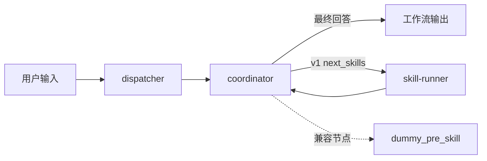
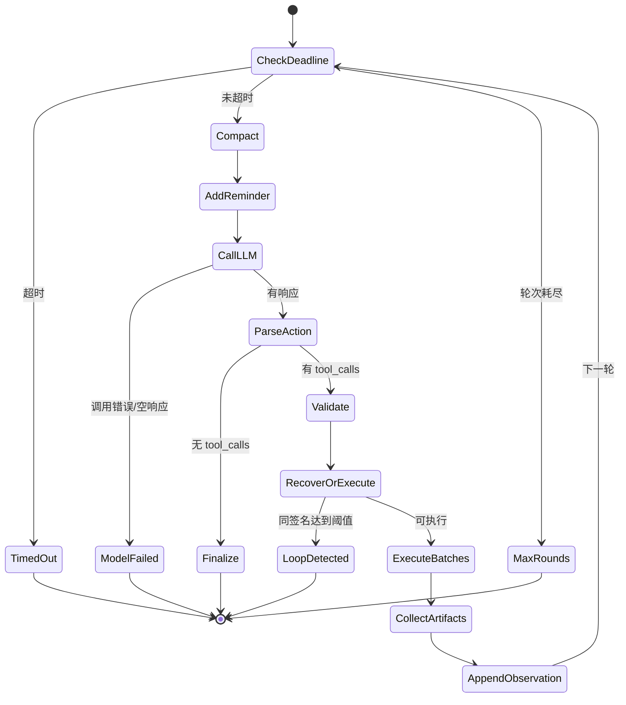
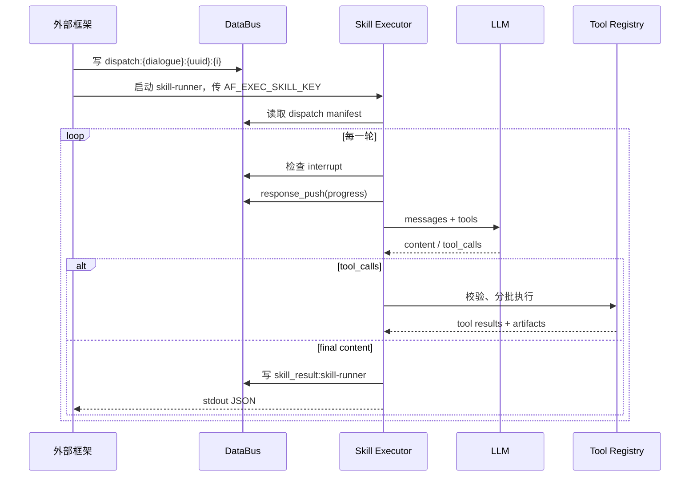
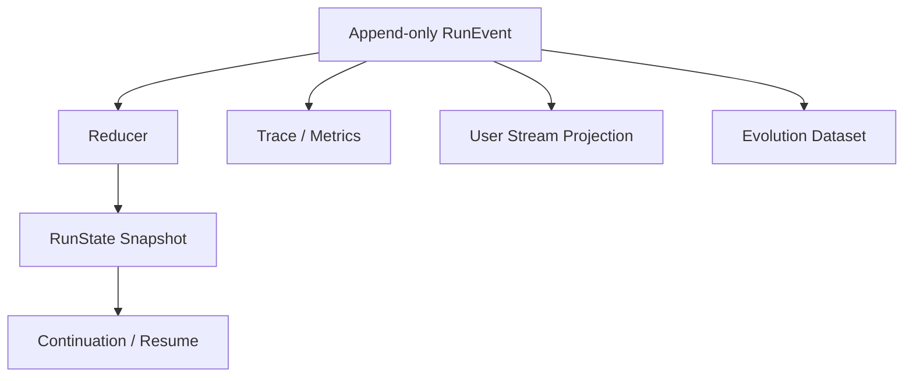
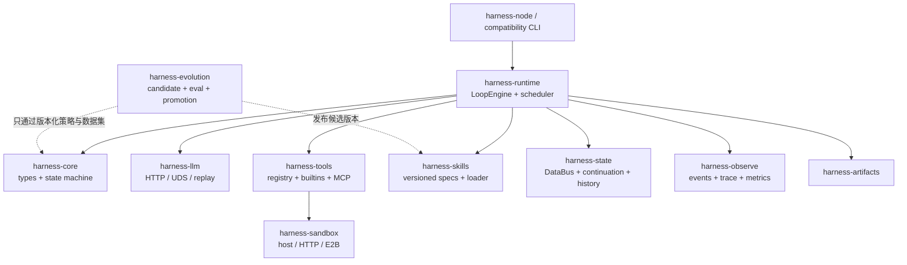
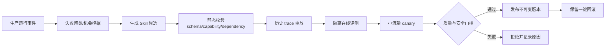

# Harness 专项代码解读：Rust 重写与 Skill / Loop 自进化基线

> 分析基线：`harness_agent_poc` 分支，2026-08-20。
>
> 目标读者：准备接手 Harness、用 Rust 重写运行时，并在其上实现 Skill 与 Loop 自进化的研发人员。
>
> 本文不是产品概览，而是一份“行为规格恢复文档”：先从当前 Python 实现中恢复真实语义，再区分哪些必须兼容、哪些应该纠正、哪些应成为可演化策略。

## 0. 先给结论

当前 Harness 不是一个单一的 Agent 循环，而是三套控制模型叠加在一起：

1. **Coordinator v2：进程内主循环**。一次节点执行中反复调用 LLM、执行工具，直到得到最终回答或触发终止条件。
2. **Coordinator v1：工作流级 Skill 调度器**。一次节点执行只作一轮决策；通过 DataBus 写入 Skill 调度清单，返回给外部框架，由框架执行 `skill-runner` 后再次触发 Coordinator。
3. **Skill Executor：Skill 内部工具循环**。每个 Skill 又拥有自己的 LLM → 工具 → 观察 → LLM 循环。

因此 Rust 重写的正确对象不是某个 Python 文件，而是下面这个抽象：

```text
外部工作流 / HTTP-UDS / 环境变量
              │
       Compatibility Adapter
              │
       Typed Loop State Machine
       ┌──────┼──────────┐
       │      │          │
      LLM   Tools     Skill dispatch
       │      │          │
       └──────┼──────────┘
              │
 State / Events / Artifacts / Trace
```

对未来自进化最重要的判断是：

- **Skill 可以演化，运行时安全边界不能演化。** Skill 的说明、示例、工具选择和任务分解可以生成候选版本；文件权限、网络权限、预算上限和审批规则必须由运行时持有。
- **Loop 应演化为数据化策略，而不是让 Agent 改自己的二进制。** 把轮数、恢复策略、压缩策略、并行策略、停止判据等建模成版本化 `LoopPolicy`，通过离线评测、影子运行、灰度和回滚晋升。
- **先做行为兼容，再做语义收敛。** 当前实现中存在一些明确缺陷和偶然行为。Rust 版本需要通过兼容层接住外部协议，但不应把所有内部缺陷永久复制进去。
- **事件日志是自进化的地基。** 如果一次运行不能用版本化输入、策略、工具结果和状态转换重放，就无法可靠评估“新 Skill / 新 Loop 是否真的更好”。

## 1. 分析范围与证据等级

### 1.1 核心源码范围

核心运行时代码位于：

- [`packages/agentflow-runtime/src/agentflow_runtime/`](../../packages/agentflow-runtime/src/agentflow_runtime/)
- [`packages/agentflow-runtime/pyproject.toml`](../../packages/agentflow-runtime/pyproject.toml)
- Agent 包模板：[`frontend/bridge/templates/`](../../frontend/bridge/templates/)
- 当前设计说明：[`docs/enhancements/042-feature-generic-harness-agent-package-260630.md`](../enhancements/042-feature-generic-harness-agent-package-260630.md)

截至分析时，`agentflow_runtime` 约 1.1 万行 Python。主干并不包含这套包；它基本是 `harness_agent_poc` 分支新增的实验实现。设计文档虽然已更新到 v3+ 表述，但运行入口仍默认选择 Coordinator v2，且代码中继续保留 v1。

### 1.2 本文如何标记判断

| 标记 | 含义 |
|---|---|
| **契约** | 外部系统或测试已经依赖，Rust 迁移期应保持兼容 |
| **核心语义** | 业务上应保留，但可更换实现方式 |
| **偶然行为** | Python 实现细节，不建议上升为长期协议 |
| **确认缺陷** | 由执行诊断或完整调用路径可直接确认 |
| **风险推断** | 从源码推导出的高概率问题，仍应补集成测试验证 |
| **目标设计** | 建议的 Rust / 自进化架构，不表示当前代码已有此能力 |

### 1.3 GitNexus 可用性说明

仓库说明要求用 GitNexus 做代码导航和影响分析，但当前工作区没有 `.gitnexus` 索引、对应 MCP 工具或 `.claude/skills/gitnexus` 文件。因此本次恢复规格采用四类证据交叉核对：源码定义、调用点搜索、测试断言和 Git 历史。本文只新增文档，没有修改任何函数、类或方法。

## 2. 代码地图：每个模块究竟负责什么

| 层 | 关键文件 | 真实职责 | Rust 中建议归属 |
|---|---|---|---|
| Coordinator v2 | `coordinator_agent_loop.py` | 进程内多轮 LLM / Tool 主循环 | `harness-runtime` |
| Coordinator v1 | `coordinator_decide.py` | 工作流级 Skill 选择、调度与再次唤醒 | `harness-runtime` + framework adapter |
| Skill runtime | `skill_executor.py` | 单 Skill 的工具调用循环 | 与统一 LoopEngine 合并 |
| 公共协调逻辑 | `coordinator_common.py` | Agent 配置、模型配置、产物 URL、DataBus 结果 | compatibility / application service |
| 提示词 | `prompts.py` | Coordinator / Skill 协议及恢复提示 | versioned policy assets |
| 工具注册 | `tool_registry.py` | 内置、Agent、Skill、MCP 工具发现与路由 | `harness-tools` |
| 工具调度 | `tool_policies.py` | 读写分类、批次并发、循环签名 | runtime scheduler |
| 内置工具 | `harness/tools/*.py` | bash、read、write、edit、web_fetch、load_skill | `harness-tools-builtins` |
| 执行器 | `executors/*.py` | host / HTTP / E2B 命令和文件操作 | `harness-sandbox` |
| LLM | `common/clients/*.py` | OpenAI-compatible 流式调用及未接通的 UDS 客户端 | `harness-llm` |
| 状态 | `databus_client.py`、`recorder.py` | KV、流式消息、会话历史、LLM trace | `harness-state` / `harness-observe` |
| 上下文 | `common/runtime_context.py` | 从环境变量读取会话、节点、输入、超时信息 | compatibility adapter |
| 配置 | `common/agent_config.py` | `agent.md` / env / fallback 模型参数 | config crate |
| 压缩 | `compaction.py` | token 估算、折叠工具结果、可选摘要 | context policy |
| Hook | `hooks/` | 动态 Python Hook 和挂载点 | typed middleware |
| Trace | `trace/`、`events.py` | NDJSON span、事件名和 stderr 预览 | `tracing` adapter |
| 产物 | `artifact_pipeline.py` | 识别、复制、上传、URL 改写 | `harness-artifacts` |
| Skill 加载 | `skills_loader.py` | 读取 `SKILL.md` 和路径占位符替换 | `harness-skills` |
| 包初始化 | `agent_package.py`、`setup_package.py` | manifest、依赖、venv、包生命周期 | package/bootstrap tool |
| MCP | `harness/mcp/mcp_bridge.py` | stdio / HTTP MCP 连接和调用 | async MCP adapter |

一个关键去重方向是：Coordinator v2 和 Skill Executor 大量代码同构，Rust 中应复用同一个 LoopEngine；差异通过 `PromptPolicy`、`AvailableActions`、`ToolScope`、`StopPolicy` 和外部适配器注入。

## 3. 当前运行拓扑与入口

### 3.1 外部工作流拓扑

Agent 包模板中的 `agent.json` 仍保留这些节点角色：



`coordinator` 的 shell 包装器默认使用 v2；只有设置 `AF_COORDINATOR_VERSION=v1` 才走 v1。换言之，“设计文档中的推荐版本”和“当前模板的实际默认值”并不完全一致，Rust 迁移不能只按文档推断入口。

### 3.2 Python 节点包装方式

模板节点并不直接包含核心逻辑，而是：

1. 找到 Agent 包根目录和 `agent.md`。
2. 将共享运行时包加入 Python 路径。
3. 导入共享模块。
4. 向模块全局变量注入 `AGENT_PACKAGE_DIR`、`AGENT_MD_PATH`、`NODES_DIR`。
5. 调用对应 `execute()`。

这是一个重要的**偶然行为**：模块依赖进程级可变全局变量，甚至 Coordinator 还要手动同步 `skill_executor` 模块中的同名全局变量。Rust 中应改为显式的不可变 `RuntimeContext`，不能照搬全局注入。

### 3.3 Rust 迁移期应该保留的入口面

迁移初期最稳妥的做法是保留 shell 命令和外部工作流结构，只把其目标替换成 Rust 二进制。兼容面至少包括：

- 环境变量名和默认值；
- stdin / `AF_INPUT` 的输入约定；
- stdout 最终 JSON 结构；
- DataBus UDS 访问及 key scope；
- `response_push` 流式消息格式；
- `next_skills` 清单格式；
- OpenAI-compatible tool schema 和 tool call 结构；
- Artifact 字段和 URL 改写规则；
- 工作流认定的状态名。

内部模块、异步模型、错误类型、trace 实现和配置解析都可以重写。

## 4. 先恢复领域模型

当前 Python 代码大量传递无类型 `dict` 和 JSON 字符串。重写前应先把隐含对象恢复出来。

### 4.1 核心对象

| 对象 | 当前载体 | 最少字段 |
|---|---|---|
| RunContext | 环境变量 + 模块全局 | session、dialogue、node、user、client、package、deadline |
| Message | OpenAI dict | role、content、tool_calls、tool_call_id |
| ToolDefinition | dict | name、description、JSON Schema |
| ToolCall | LLM response dict | id、name、arguments JSON |
| ToolOutcome | JSON 字符串 | success/error、content、artifacts、side effects |
| SkillInvocation | DataBus manifest | skill_name、prompt、load_skills、force |
| LoopPolicy | 常量 + env + prompt | round/token/time budget、recovery、compaction、parallelism |
| RunResult | stdout / DataBus dict | status、result、artifacts、usage/error |
| RunEvent | trace / response_push | phase、payload、timestamp、correlation IDs |

### 4.2 统一 Action 模型

要同时覆盖 v1、v2 和未来自进化，建议不要把“工具调用”写死为唯一动作：

```rust
enum Action {
    Respond { content: String },
    CallTools { calls: Vec<ToolCall> },
    DispatchSkills { calls: Vec<SkillInvocation> },
    AskUser { question: String, schema: Option<Value> },
    Abort { reason: String },
}
```

映射关系：

- v2 的普通 tool calls → `CallTools`；
- v1 的 `run_skills` → `DispatchSkills`；
- Skill Executor 的工具调用 → `CallTools`，但绑定不同 `ToolScope`；
- 没有 tool calls 的 assistant content → `Respond`；
- 未来暂停等待用户，不必伪装成特殊工具结果 → `AskUser`。

这样，Loop 的状态迁移与具体动作类型解耦，之后才有可能对 Loop 策略进行受控演化。

## 5. Coordinator v2：进程内主循环逐阶段解读

入口：[`coordinator_agent_loop.py`](../../packages/agentflow-runtime/src/agentflow_runtime/coordinator_agent_loop.py) 的 `execute()`。

### 5.1 初始化阶段

真实执行顺序如下：

1. 绑定 Agent 包、`agent.md`、nodes 路径。
2. 加载包内 `.env`，并注入 venv 环境。
3. 从环境读取输入、dialogue/session 标识和超时。
4. 解析 `agent.md` frontmatter 及模型配置。
5. 同步 `skill_executor` 的模块全局路径。
6. 加载 Hook；触发 dialogue 和 observability 起始事件。
7. 创建 DataBus client 和全局 Recorder。
8. 解析 stream 配置并写入 DataBus。
9. 构造 system prompt 和会话 messages。
10. 注册工具，进入多轮循环。

这里至少混合了四种职责：bootstrap、配置、I/O 适配、循环控制。Rust 中必须拆开，否则 Loop 很难单测和演化。

### 5.2 System prompt 的真实组成

v2 prompt 不是只有 Coordinator 协议：

```text
Coordinator v2 protocol
  + agent.md frontmatter 中列出的每个 Skill 的 SKILL.md
  + agent.md 正文
```

协议文字称“Skill 不存在了”，实现却把所有 Skill 文档预加载进上下文，让模型依靠文档自行调用 bash 或其他工具完成任务。这意味着当前 v2 实际采用的是“Skill 作为提示知识”，而不是“Skill 作为一等可调度实体”。

这对自进化很关键：如果保持这种模式，Skill 的效果很难从运行日志中独立归因；更好的目标是让 `SkillVersion` 成为每次运行显式记录的输入。

### 5.3 消息历史

v2 使用 Recorder 存放在 DataBus 的 `llm/session_messages` 作为跨轮历史，然后追加当前输入。DataBusClient 另有 `ctx/session_messages` 读写 API，但它不是 v1/v2 当前主路径。

因此现在存在两套“会话历史”命名。迁移时应：

- 兼容读取旧 key；
- 写入一个权威事件/消息存储；
- 明确哪些消息可进模型上下文，哪些只是审计事件；
- 避免把 trace 和会话状态绑定成同一个组件。

### 5.4 工具可见范围

v2 创建 `_LocalToolRegistry(skill_name="")`：

- 可见内置工具；
- 可见 Agent 全局工具；
- 可见 MCP 工具；
- 不加载某一 Skill 私有目录中的脚本工具。

Skill 私有脚本只能由 SKILL.md 告知模型，再经 bash 调用。这是“文档层 Skill”和“工具注册层 Skill”之间的重要裂缝。

### 5.5 每轮状态机



更精确地说，每轮执行：

1. 检查硬超时。
2. 按 token 阈值压缩 messages。
3. 在达到阈值时追加 round reminder。
4. 开 LLM span，触发 before-LLM Hook，调用 LLM，触发 after-LLM Hook。
5. LLM 异常或返回空选择时终止。
6. 将 assistant message 追加到上下文。
7. 若没有 tool calls，清理 think 文本、收集产物、执行完成 Hook、输出结果并保存历史。
8. 若有 tool calls，做参数校验和恢复处理。
9. 计算调用签名；连续重复达到 3 次则终止。
10. 按读写策略分批并发执行工具。
11. 收集产物、推送进度、追加 tool message。
12. 进入下一轮。

### 5.6 终止原因

Rust 中不应继续散落字符串，建议用枚举表达并在兼容层映射旧值：

| 当前场景 | 建议 `TerminalReason` |
|---|---|
| 正常回答 | `Completed` |
| LLM 调用失败 | `ModelError` |
| 节点超时 | `DeadlineExceeded` |
| 重复 tool call | `RepeatedAction` |
| 无效 tool call 且无法恢复 | `InvalidAction` |
| 达到最大轮数 | `RoundBudgetExceeded` |
| 外部取消 | `Cancelled`，当前 v2 尚未实现 |

### 5.7 v2 中必须注意的问题

| 现象 | 级别 | 解释 |
|---|---|---|
| v2 不读取 `interrupt:{dialogue_id}` | **确认缺陷（静态调用路径）** | v1 和 Skill Executor 会轮询中断，v2 不会；运行中取消无法及时生效 |
| tool-call 校验传入 `{"tool_calls": ...}` | **确认缺陷（静态调用路径）** | 校验器从 `choice.message.tool_calls` 读取，因此 v2 实际没有校验到调用 |
| think 清理从开标签后切片 | **风险推断** | 与 v1 搜索闭合标签的实现不一致，可能把思考内容当最终答案 |
| after-LLM Hook 的返回值未替换 response | **确认行为** | 原位修改嵌套对象可能生效，返回新对象不会生效 |
| 没有通用 before/after-tool Hook | **能力差异** | Skill Executor 有，v2 没有 |
| prompt 说 Skill 不存在但加载全部 Skill 文档 | **设计矛盾** | 难以独立度量和版本化 Skill |

Rust 版本应把取消、校验、Hook、终止和状态持久化变成统一 LoopEngine 的固定阶段，而不是由不同入口各自选择是否实现。

## 6. Skill Executor：第二套内循环

入口：[`skill_executor.py`](../../packages/agentflow-runtime/src/agentflow_runtime/skill_executor.py) 的 `execute()`。

### 6.1 输入不是普通函数参数

Skill Executor 从 `AF_EXEC_SKILL_KEY` 指向的 DataBus 全局 key 读取 dispatch manifest。manifest 至少包含：

- `skill_name`；
- `prompt` / task instruction；
- 需要额外加载的 Skill；
- force 等调度信息。

若字段缺失，代码存在 `unknown-skill` 等默认值。Rust 中建议边界反序列化时立即校验，不要让无效 Skill 身份进入执行中段。

### 6.2 Prompt 组成

Skill system prompt 大体由以下部分组成：

```text
当前 Skill 文档
+ 按 manifest 加载的其他 Skill 文档
+ 失败处理策略
+ 网络访问策略
+ Artifact 规则
+ ask-user 规则
+ 执行报告要求
+ 工具优先级
```

和 v2 不同，它以 `_LocalToolRegistry(skill_name)` 注册当前 Skill 私有工具，所以这里的 Skill 同时影响提示和工具能力。

### 6.3 Skill 循环

Skill 每轮与 v2 类似，但有几个关键差异：

1. 每轮轮询 DataBus interrupt flag。
2. 每轮推送执行进度。
3. round reminder 总是添加，再进行压缩；v2 是先压缩、仅过阈值才提醒。
4. 执行 before/after-LLM Hook。
5. tool call 前后执行 before/after-tool Hook。
6. 最终结果统一写到全局 `skill_result:skill-runner`，真实 Skill 名在 payload 内。

Skill stdout 的兼容 ABI 为
`skill_result/status/skill_name/rounds_used/artifacts_json/error`（`error` 可选）；
Coordinator stdout 只可能提供 `response/status`。v1 的 `next_skills` 属于
DataBus continuation，不属于 stdout。Rust typed adapter 应把两条通道分成
`SkillRunResult`、`CoordinatorOutput` 和 `ContinuationStore`，不能根据旧模板中
曾经误写的 `response`/ `coordinator_status` 字段推导。



### 6.4 无效 tool call 的恢复路径有真实控制流缺陷

代码意图是：

```text
无效调用 → 加恢复提示 → 下一轮让 LLM 修正 → 超出恢复次数才失败
```

实际控制流是：成功执行 `response_push` 后没有 `continue`，会直接落入“恢复耗尽”的终止分支；`continue` 只写在 `response_push` 异常处理内部。也就是说，流式推送成功反而不会重试。

这是 Rust 重写不能兼容复制的**确认缺陷（静态完整路径）**。当前模板中的恢复测试只覆盖校验器和 `remove_invalid_tool_turns` 辅助函数，没有驱动完整 `execute()` 证明恢复循环有效；而且 `remove_invalid_tool_turns` 在主执行路径中没有被调用。

### 6.5 Skill 结果 identity 问题

所有 Skill 都把最终结果写到：

```text
skill_result:skill-runner
```

而不是 `skill_result:{real_skill_name}`。这是外部工作流把节点认作 `skill-runner` 的兼容结果，但会造成：

- 真实 Skill 身份只能从 payload 读取；
- 多 Skill 并行时 key 冲突风险上升；
- completed skill / 重复调度语义容易把“runner 节点”和“业务 Skill”混为一谈；
- 自进化评测难以按 Skill 版本聚合。

Rust 的内部存储建议使用 `(run_id, invocation_id, skill_id, skill_version)` 作为主键，再由兼容适配器维护旧 key。

### 6.6 Span 生命周期

Skill span 通过手工调用 `__enter__` / `__exit__` 管理，某些提前返回分支没有可靠关闭。Rust 应依赖 RAII guard；更进一步，业务函数不要直接管理 span 生命周期，而应由状态迁移中间件自动生成事件。

## 7. Coordinator v1：未来 Skill 控制面的重要参考

入口：[`coordinator_decide.py`](../../packages/agentflow-runtime/src/agentflow_runtime/coordinator_decide.py)。

v1 虽然不是模板默认入口，却比 v2 更接近“一等 Skill 调度器”。它的核心不是在本进程执行 Skill，而是把计划写入 DataBus 并把控制权交还外部工作流。

### 7.1 一次框架触发的语义

1. 读取用户输入、历史和已完成 Skill。
2. 调用一次 LLM，让它返回最终回答或 `run_skills`。
3. 如果是 `run_skills`，校验并为每个 Skill 写 dispatch manifest。
4. 写入 dialogue-scoped `next_skills`。
5. 当前节点退出。
6. 外部框架启动一个或多个 `skill-runner`。
7. Skill 结束后，框架再次启动 Coordinator。

因此 v1 的“循环”跨越多个进程/节点，由 DataBus 和外部框架维持，而 v2 的循环在单进程内。这两者必须在 Rust 领域模型中明确区分：

- `InProcessContinuation`：执行工具后在本进程继续；
- `YieldToFramework`：持久化 continuation 后退出，等待再次唤醒。

### 7.2 调度 key

当前关键 key 约定：

```text
global:   dispatch:{dialogue_id}:{uuid}:{index}
global:   last_prompt:{dialogue_id}:{skill_name}
dialogue: next_skills
global:   interrupt:{dialogue_id}
```

`next_skills` 中写入的实际节点名是 `skill-runner`，并携带 `exec_skill_key` 和 `force`。Rust 兼容层必须原样理解这些 scope：global 表示同一 session 下跨 Skill dialogue 可读，dialogue scope 则随当前 dialogue 隔离。

### 7.3 去重与 force

v1 会结合已完成 Skill 和上一次 prompt 阻止重复调度，`force` 是逃生口。这个机制不应继续依赖松散字符串，而应提升为：

```rust
struct InvocationFingerprint {
    skill_version: SkillVersionId,
    normalized_input_hash: Hash,
    dependency_versions: Vec<VersionId>,
}
```

重复并不总是错误：有副作用的 Skill 必须要求幂等键；纯分析 Skill 可以使用缓存；带不同上下文版本的相同 prompt 也可能应重新执行。

### 7.4 v1 与 v2 的能力对照

| 能力 | v1 Coordinator | v2 Coordinator | Skill Executor |
|---|---:|---:|---:|
| 跨进程 Skill 调度 | 是 | 否 | 被调度方 |
| 进程内多轮工具循环 | 仅处理特殊恢复 | 是 | 是 |
| 每轮中断检查 | 是 | 否 | 是 |
| Skill 私有工具 | 不直接执行 | 否 | 是 |
| before/after dispatch Hook | 是 | 不适用 | 不适用 |
| before/after tool Hook | 非主路径 | 否 | 是 |
| 跨轮恢复 | 外部框架重触发 | 本地 messages | 本地 messages |

Rust 不应选择“复制 v1”或“复制 v2”中的一个，而应让统一引擎支持两种 continuation。

## 8. LLM 调用链：文档宣称与真实路径不同

### 8.1 当前真实路径

主循环调用公共 `call_llm()`，后者交给 `TraceRecorder.trace_call()`。Recorder 会直接实例化 `OpenAiCompatibleClient`。因此当前 Harness 主路径是：

```text
Loop → call_llm → TraceRecorder → OpenAiCompatibleClient → HTTP /chat/completions
```

虽然代码中存在 `create_llm_client()` 和 `LlmUdsClient`，并有 `aisf/` 路由设想，但主 Coordinator 和 Skill Executor 都没有走该工厂。

### 8.2 已确认的客户端工厂错误

[`common/clients/base.py`](../../packages/agentflow-runtime/src/agentflow_runtime/common/clients/base.py) 的 `create_llm_client()` 使用 `os.environ`，文件却没有导入 `os`。通过直接调用该函数已复现 `NameError`。这进一步说明工厂不是当前主路径，否则主循环会更早暴露此错误。

### 8.3 OpenAI-compatible 流处理

HTTP 客户端支持流式和非流式：

- 流式拼接 content delta；
- 逐片组装 tool call 的 id、name 和 arguments；
- 第一块数据到达前可重试；开始输出后不再透明重试；
- 通过 Recorder 回调将 delta 推到 DataBus；
- 最终仍恢复为类似 Chat Completions choice 的结构。

Rust 中 LLM provider 的边界应输出领域事件，而不是暴露 SDK 对象：

```rust
enum ModelEvent {
    ContentDelta(String),
    ToolCallDelta { index: u32, id: Option<String>, name: Option<String>, args: String },
    Usage(ModelUsage),
    Completed(ModelResponse),
}
```

这能让 HTTP、UDS、录制回放和测试假客户端共享一套行为。

### 8.4 Compaction 摘要调用可能不可用

硬压缩阶段调用 LLM 摘要时只传 model，没有把当前 base URL / API key 明确透传。结合 Recorder 当前固定使用 HTTP client 的实现，这条路径很可能以空 endpoint / auth 调用失败。这是**风险推断**，需要用启用 hard compaction 的集成测试最终确认。

### 8.5 Rust provider 契约

建议：

```rust
trait ModelProvider: Send + Sync {
    async fn complete(
        &self,
        request: ModelRequest,
        sink: &dyn ModelEventSink,
        cancel: CancellationToken,
    ) -> Result<ModelResponse, ModelError>;
}
```

关键原则：

- endpoint、凭据和 retry policy 在构造 provider 时绑定；
- request 记录模型、参数、prompt/skill/loop 版本；
- streaming 与 non-streaming 最终产生同一 `ModelResponse`；
- retry 只发生在“尚未产生外部可见副作用”的阶段；
- trace 是 middleware，不是 provider 工厂的隐藏责任。

## 9. Tool Registry 与 MCP

### 9.1 Python 工具 ABI

动态 Python 工具模块通过以下成员注册：

```text
TOOL_NAME
TOOL_DESCRIPTION
TOOL_PARAMS
execute(args, sandbox_endpoint=...)
```

工具加载顺序是：

1. 内置工具；
2. Agent 全局工具；
3. 当前 Skill 私有工具；
4. MCP 工具。

后加载模块会覆盖 `_modules[name]`，但用于发给 LLM 的 `_tools` 定义列表只是继续 append。因此同名覆盖可能造成“执行路由只有最后一个，模型 schema 却看到多个同名定义”。这是**确认行为**，目标实现应采用 map 中原子替换定义与 executor。

### 9.2 Rust Tool 契约

```rust
#[derive(Clone)]
struct ToolSpec {
    id: ToolId,
    version: Version,
    description: String,
    input_schema: JsonSchema,
    output_schema: Option<JsonSchema>,
    effect: EffectClass,
    idempotency: Idempotency,
    capabilities: CapabilitySet,
    timeout: Duration,
}

trait Tool: Send + Sync {
    fn spec(&self) -> &ToolSpec;
    async fn invoke(&self, ctx: ToolContext, input: Value)
        -> Result<ToolOutcome, ToolError>;
}
```

JSON 应只存在于 LLM / plugin 边界；引擎内部至少用类型区分成功、业务失败、策略拒绝、超时、取消和基础设施失败。

### 9.3 MCP

当前 MCP 工具名形如 `mcp__{server}__{tool}`，优先路由到 MCPBridge。Bridge 用同步包装器维护一个独立 asyncio loop，以便从同步 Harness 调异步 MCP。

Rust 本身采用 async runtime 后不需要这层“同步套异步”结构。需要保留的是：

- MCP config 查找顺序；
- tool name namespacing；
- 连接失败时是否降级；
- 每个 server 的生命周期和 shutdown；
- MCP 工具的 capability / network policy。

当前代码没有在主流程显式关闭 MCP bridge，主要依赖进程退出清理。Rust 长驻进程中必须明确 shutdown 和连接池策略。

## 10. 工具并发策略：现在靠字符串猜副作用

[`tool_policies.py`](../../packages/agentflow-runtime/src/agentflow_runtime/tool_policies.py) 将调用分为：

- read；
- parallel-write；
- write。

连续同类调用形成批次；write 基本单独串行，允许并行的批次最多使用 4 个线程，最终按原调用顺序拼回结果。

问题在于分类部分依赖工具名和 bash 命令字符串启发式。例如命令是否含重定向、删除、移动或输出参数会改变类别。这无法可靠覆盖 shell 语法、脚本内部副作用、网络写入或业务 API。

Rust 目标应让副作用成为工具清单的必填元数据：

```rust
enum EffectClass {
    Pure,
    ReadOnly { resources: Vec<ResourcePattern> },
    Write { resources: Vec<ResourcePattern> },
    ExternalSideEffect { system: String },
}
```

调度器根据资源冲突、幂等性和 capability 决定并行，而不是解析模型生成的 shell 字符串。未知工具默认串行和最小权限。

重复调用检测现在使用工具名与参数构成签名，连续 3 次相同就中止。这可保留为基础 guard，但未来 Loop 策略还应识别：

- 参数略变但语义相同的振荡；
- A → B → A → B 周期；
- 同一错误连续出现；
- 只读工具反复读取未变化资源；
- token / latency 增长却没有新 observation。

## 11. Executor 与真正的安全边界

### 11.1 统一接口

当前 `ToolExecutor` 抽象了命令执行、文件读写、URL 获取和 Artifact 下载，具体实现包括：

- `HostExecutor`；
- `HTTPExecutor`；
- `E2BExecutor`。

factory 的当前选择语义：

- mode=e2b 且有 endpoint → E2B；
- mode=local/docker 且有 endpoint → HTTP；
- 其他情况，包括未知 mode → Host。

未知配置静默退化到 host 是明显的安全风险。Rust 应 fail closed：只有显式 `host` 且策略允许时才可在宿主机执行。

### 11.2 HostExecutor

Host 模式用 `subprocess.run(..., shell=True)`。内置 bash 工具有危险命令子串黑名单，但这不是安全沙箱；shell 的编码、间接调用、脚本文件、解释器参数都能绕过简单字符串判断。

文件工具使用字符串 `resolved.startswith(cwd)` 判断越界，存在共同前缀目录问题，例如允许目录 `/work/app` 与 `/work/application-evil`。正确实现必须使用 canonical path component 比较，同时制定 symlink、创建新文件和 race 的策略。

### 11.3 HTTPExecutor

HTTP 模式调用远端 `/exec` 等接口，不会在远端失败后偷偷回退 host，这是值得保留的安全语义。但 `read_file` 等操作的 offset/limit 支持并不完全一致，需要在 Rust 接口和兼容测试中明确。

### 11.4 E2BExecutor

E2B 模式会从 endpoint 解析 sandbox id、连接远端环境、翻译路径、注入 `.env`，并处理远端文件和 Artifact 下载。当前每种操作可能重复连接 sandbox，Rust 可引入有界生命周期 client。

特别注意：当前 E2B 的 `fetch_url` 实际仍通过宿主机 urllib 请求，不是在远端 sandbox 中请求。这意味着“选择 E2B”并不等价于“所有网络都隔离到 E2B”。

### 11.5 Web fetch 与 SSRF

现有 URL 防护主要依赖字符串前缀判断，无法完整覆盖：

- IPv6 私网和 loopback；
- 十进制/十六进制/混合形式 IP；
- DNS rebinding；
- 重定向到私网；
- 用户信息、编码和解析差异。

Rust 中网络访问应由 capability-aware connector 统一执行：解析 hostname → 校验每次解析结果 → 连接固定地址 → 每次重定向重新校验，并允许部署层配置 egress allowlist。

## 12. DataBus、stdout 与状态所有权

### 12.1 DataBus scope

DataBusClient 有两类 KV：

- `put/get/delete`：dialogue-scoped，实际 key 带 `{dialogue_id}/...`；
- `put_global/get_global`：session 级、不带当前 dialogue，用于跨 Skill 子对话共享 dispatch、interrupt 等状态。

此外还有：

- `response_push`：向 Bridge 推送流式响应和进度；
- `read/write_messages`：遗留 `ctx/session_messages`；
- Recorder 自己维护的 `llm/session_messages`。

### 12.2 三条输出通道

一次执行至少有三种输出：

1. **stdout JSON**：外部工作流读取的节点最终结果；
2. **DataBus response_push**：用户可见的流式 delta、进度和状态；
3. **DataBus KV / trace**：跨节点状态、历史和审计。

测试还有 `_e2e_response` 全局旁路。Rust 中必须把这些通道区分为 `NodeResultSink`、`UserStreamSink`、`StateStore`、`EventStore`，不能让业务代码到处 print 或写任意 key。

### 12.3 建议的状态与事件关系



不必一开始就建设完整事件溯源平台，但至少应做到：状态转换先产生 typed event，再由 adapter 写 DataBus / trace / stream。这样同一次运行的用户输出、审计和自进化样本不会互相矛盾。

## 13. Context Compaction：必须以“完整 Turn”为单位重写

当前压缩器采用保守估算：约 2 字符/token，并给每条消息固定开销。阶段大体是：

1. 删除 round reminder；
2. 将过长 tool result 折叠到 `/tmp/agentflow/folded/...`；
3. 折叠 assistant tool-call 描述；
4. 可选调用 LLM 生成摘要；
5. 删除旧 assistant；
6. 删除旧 user；
7. 紧急裁剪。

### 13.1 当前危险点

- assistant message 的 `tool_calls` 被折叠后，与其配对的 `role=tool` 消息可能保留，形成孤儿 tool result，不满足部分 OpenAI-compatible provider 的消息约束。
- summary LLM 的 endpoint / key 传递可能不完整。
- 当 system prompt 本身超过预算时，紧急裁剪未必保证最终小于 budget。
- v2 是“先压缩再 reminder”，Skill Executor 是“先 reminder 再压缩”；两套循环不一致。
- 折叠文件位于临时目录，重启/跨机器 continuation 的可恢复性没有严格保证。

### 13.2 Rust 中的 Turn 模型

不要将上下文建模成随意的消息数组，应先恢复原子 Turn：

```rust
enum Turn {
    User(UserMessage),
    AssistantResponse(AssistantMessage),
    ToolExchange {
        request: AssistantToolCalls,
        results: Vec<ToolResultMessage>,
    },
    Summary(ContextSummary),
}
```

Compaction 只能整体保留、整体折叠 `ToolExchange`。任何外置内容必须有内容哈希、持久 URI、摘要和访问权限，重放时能够验证。

## 14. Hook、事件与 Trace

### 14.1 Hook ABI

动态 Hook 模块以 `HOOK_NAME`、`HOOK_EVENTS`、`HOOK_ORDER` 和 `handle(event, ctx)` 注册。Hook 异常会被隔离，不阻塞主流程，这是合理默认。

但当前 `trigger(..., can_intervene=...)` 只是把标志传入上下文，并不由框架强制限制修改；真正的权限依赖 Hook 自律。对自进化系统这是不够的。

Rust 应区分：

- `Observer`：只能读事件；
- `Middleware`：可修改明确类型的请求/响应；
- `PolicyGate`：可允许、拒绝或要求审批；
- `Reducer`：根据事件更新状态。

每种扩展点都要有编译期/运行时权限边界。

### 14.2 after-LLM 的返回值语义

当前调用点触发 after-LLM Hook 后没有采用其返回的新 payload；只有 Hook 原位修改传入的嵌套 response 才可能影响后续。这是一种不清晰的偶然 ABI。Rust middleware 应显式返回：

```rust
enum Interception<T> {
    Continue(T),
    Reject(PolicyViolation),
    ShortCircuit(RunResult),
}
```

### 14.3 Trace

当前 span 写入 `trace_output/python/python_spans_{dialogue}.ndjson`，支持从外部 C++ span 环境继承 parent，并通过栈管理父子关系。

同一 dialogue 的多个 Python 进程用 POSIX `flock` 串行追加，并把进程中断留下的
半行与下一条完整记录隔离。`span_event()` 会附加到活动 span；没有活动 span 时
才仅输出 stderr 预览。

Rust 可直接使用 `tracing` 生态，但必须自定义稳定的业务事件 schema。不要把 crate 的内部字段格式当长期数据协议。

## 15. Artifact Pipeline

### 15.1 当前流程

Artifact 可从两条路径发现：

- 工具结果 JSON 中的结构化字段；
- 文本中的文件路径正则。

发现后：

1. 外部 URL 原样保留；
2. host 上不存在但 sandbox 中存在时下载；
3. Agent 包外文件复制到 `outputs/{user_id}_{client_id}/`；
4. 上传到 Bridge storage；
5. 将本地路径改写为可访问 URL；
6. 写进最终结果与 trace。

### 15.2 当前语义问题

- 结构化字段和正则认可的后缀列表不同；
- 同 session 同名文件可能覆盖；
- 已在 Agent 包内的文件可能保留原位，隔离规则不统一；
- Artifact 上传同步发生在工具轮次中，可能反复上传全部已发现文件并阻塞主循环；
- Artifact session id 用 `{AF_USER_ID}_{AF_CLIENT_ID}`，不是执行用 `AF_SESSION_ID`；
- 缺少内容 hash、不可变版本和 provenance。

自进化训练数据特别依赖产物可追溯性，目标 Artifact 至少应包含：

```rust
struct ArtifactRef {
    digest: ContentDigest,
    media_type: Mime,
    size: u64,
    storage_uri: Url,
    produced_by: InvocationId,
    logical_name: String,
    metadata: BTreeMap<String, Value>,
}
```

## 16. 配置、Agent 包与环境

### 16.1 模型配置优先级

当前大致优先级为：

```text
agent.md
  > 节点专用环境变量
  > 全局环境变量
  > fallback 配置
  > gpt-4o-mini
```

API base/key 还有自己的 primary → fallback 规则。配置解析会识别 `${...}`、`sk-your-`、`your-` 等占位值。

典型默认值包括 Coordinator 最大 10 轮、Skill 最大 8 轮、completion 8192 tokens、模型窗口 128k、压缩阈值 0.8、节点超时约 240 秒。具体值应视为当前默认而非领域常量。

### 16.2 `.env` 的覆盖问题

Python loader 使用 override=True，可能覆盖工作流运行时已经注入的环境变量；shell wrapper 又会预先 source `.env`，于是存在重复加载和优先级不直观的问题。

Rust 应一次性解析出 `ResolvedConfig`，在启动日志中记录值的来源但绝不记录密钥：

```text
model = xxx                  source=agent.md
base_url = https://...       source=AF_LLM_BASE_URL
api_key = [redacted]         source=package .env
max_rounds = 10              source=default
```

### 16.3 Skill 路径语义不一致

`skills_loader.load_skill_md()` 只按平坦的 `skills/{name}/SKILL.md` 读取；`load_skill` 内置工具却支持更灵活的递归查找。Rust 需要定义唯一 Skill layout 和解析规则，并拒绝重名/路径逃逸。

### 16.4 dummy_pre_skill

模板 `dummy_pre_skill.py` 只导入模块并更新 globals，没有调用模块的 `execute()`。所以模块中原本的日志和 `{}` stdout 逻辑实际上不会运行；节点之所以可能仍工作，是因为它恰好不要求输出。

Rust 迁移时应决定它是明确的 No-op adapter，还是在确认工作流允许后删除，不能把“漏调用入口”当正式协议。

## 17. 外部兼容矩阵

Rust 第一个可替换版本应该以这张表为验收边界：

| 接口面 | 当前约定 | 第一阶段策略 | 长期策略 |
|---|---|---|---|
| 节点启动 | shell → Python 文件 | shell → Rust binary，参数不变 | 原生节点声明 |
| 环境上下文 | `AF_*` | 全量兼容读取 | typed launch manifest |
| 最终输出 | stdout 单个 JSON | byte-level schema 兼容 | 版本化 `RunResult` |
| 用户流 | DataBus `response_push` | 保持事件字段 | typed stream protocol |
| Coordinator continuation | `next_skills` | 保持 key 和 payload | typed continuation store |
| Skill dispatch | global `dispatch:*` | 保持 scope | invocation service |
| 中断 | global `interrupt:*` | 三种循环统一支持 | cancellation token + durable flag |
| 会话历史 | `llm/session_messages` | 兼容读取/双写 | 单一 event/message store |
| Tool schema | OpenAI function schema | 保持 | 内部 typed、边界转换 |
| Tool result | JSON 字符串 | 兼容 | typed `ToolOutcome` |
| Artifact | 路径 + URL | 保持字段 | content-addressed refs |
| Trace | NDJSON / DataBus | 可并行写 | OpenTelemetry + 稳定业务事件 |

## 18. Rust 目标架构

### 18.1 Crate 划分



建议职责：

- `harness-core`：纯领域类型、状态转换、错误枚举；不依赖网络和 DataBus。
- `harness-runtime`：驱动状态机、预算、取消、并发和 middleware。
- `harness-llm`：provider trait、OpenAI HTTP、UDS、record/replay fake。
- `harness-tools`：ToolSpec、registry、builtins、MCP adapter。
- `harness-sandbox`：Executor trait 和 host/http/e2b 实现。
- `harness-skills`：SkillSpec、版本解析、依赖和工具绑定。
- `harness-state`：DataBus adapter、消息/continuation/event store。
- `harness-observe`：稳定事件、tracing/OpenTelemetry projection。
- `harness-artifacts`：发现、校验、持久化和 URL 投影。
- `harness-evolution`：最好独立进程；读取事件与评测集，不能直接操作生产运行内存。

### 18.2 LoopEngine 状态

```rust
enum LoopState {
    Initializing,
    PreparingContext,
    AwaitingModel,
    ValidatingAction,
    AwaitingTools,
    Observing,
    Compacting,
    Yielding(Continuation),
    Finalizing,
    Terminal(TerminalReason),
}
```

核心不变量：

1. 每个 tool result 必须引用本轮存在的 tool call。
2. 每个状态转换都带单调递增 sequence 和 timestamp。
3. deadline / cancellation 在所有 await 边界可触发。
4. 外部副作用发生前写 intent，发生后写 outcome。
5. Finalize 至多一次；stdout 投影也至多一次。
6. continuation 必须包含恢复所需的 policy / skill / tool 版本。
7. 模型不可绕过 capability gate。

### 18.3 执行主干

```rust
async fn run(mut run: RunState, deps: &RuntimeDeps) -> RunResult {
    loop {
        deps.guard.check_budget_and_cancel(&run)?;
        let transition = deps.controller.next(&run)?;

        match transition {
            Transition::CallModel(req) => { /* stream events, persist response */ }
            Transition::ExecuteTools(batch) => { /* gate, schedule, observe */ }
            Transition::Compact(plan) => { /* compact atomic turns */ }
            Transition::Yield(cont) => return deps.compat.yield_result(cont),
            Transition::Finish(result) => return result,
        }
    }
}
```

实际代码会更复杂，但这个结构表达了最重要的依赖方向：controller 决定下一步，adapter 执行 I/O，所有结果先成为事件再更新状态。

### 18.4 异步、并发和取消

- 使用一个 Tokio runtime，不为 MCP 额外维护 event loop。
- 所有外部操作接收 `CancellationToken` 和 deadline。
- `JoinSet` / 有界 semaphore 控制工具并发；禁止无限 spawn。
- 只有 effect 无冲突、策略允许的工具可并发。
- 副作用调用带 invocation id / idempotency key。
- 超时要区分排队超时、连接超时、首 token 超时、总调用超时。
- 流输出使用有界 channel，明确 backpressure；不能让慢 Bridge 无限堆内存。

### 18.5 错误模型

至少区分：

```rust
enum HarnessError {
    InvalidConfig(ConfigError),
    Model(ModelError),
    InvalidAction(ValidationError),
    PolicyDenied(PolicyViolation),
    Tool(ToolError),
    Sandbox(SandboxError),
    State(StateError),
    Artifact(ArtifactError),
    Cancelled,
    DeadlineExceeded,
    Internal(InternalError),
}
```

“是否重试”不是 error 自带的布尔值，而是 `RecoveryPolicy` 根据错误分类、已产生副作用、attempt、剩余预算和 provider 能力作出的决策。

## 19. 什么必须保持，什么不应复制

### 19.1 必须保持的核心语义

- 能从 Agent 包和运行上下文构建 prompt / tools / budgets；
- 能流式调用模型并组装 tool calls；
- 能执行多轮工具循环；
- 能跨框架调度 Skill 并恢复；
- 能取消、超时、限制轮次和检测循环；
- 能保存会话、流式进度、trace 和 Artifact；
- 能按 Agent / Skill 范围隔离工具；
- Hook/策略失败默认不破坏关键运行，安全 gate 除外。

### 19.2 只在兼容层保留的行为

- `AF_*` 环境变量；
- DataBus 旧 key 和 payload；
- stdout JSON；
- `skill-runner` 这个框架节点身份；
- 现有 Artifact URL 结构；
- OpenAI-compatible JSON。

### 19.3 不应复制的行为

- 模块全局变量注入；
- 未知 sandbox mode 回退 host；
- 用字符串猜工具副作用；
- 同名工具定义 append、执行器覆盖；
- after Hook 返回值语义不明确；
- 孤儿 tool result；
- Skill 结果固定写同一无 invocation id 的 key；
- 缺少中断检查的 v2；
- 恢复成功推流后反而终止；
- 通过 prompt 承担权限控制；
- 让生产进程原地修改正在执行的 Skill / Loop。

## 20. Skill 自进化设计

### 20.1 Skill 必须先成为版本化实体

```rust
struct SkillSpec {
    id: SkillId,
    version: Version,
    instructions: String,
    input_schema: JsonSchema,
    output_schema: JsonSchema,
    tools: Vec<ToolRef>,
    dependencies: Vec<SkillRef>,
    capabilities: CapabilitySet,
    budget: Budget,
    examples: Vec<Example>,
    provenance: Provenance,
    digest: ContentDigest,
}
```

仅保存一份可变 `SKILL.md` 不足以支持评测，因为历史运行无法证明当时使用的内容。每次 run 必须记录 Skill digest 和依赖版本。

### 20.2 哪些内容可以演化

- 指令结构与措辞；
- 示例、反例和检查清单；
- 任务分解方式；
- 允许工具集合的子集；
- 工具选择提示；
- 输入归一化和输出模板；
- 在硬上限内的局部 budget；
- 可组合的子 Skill 引用。

### 20.3 哪些内容不能由 Skill 自己放宽

- sandbox 级别；
- 文件、网络、密钥和外部系统 capability；
- 全局成本/时间上限；
- 审批规则；
- Artifact 数据分级；
- trace 是否可关闭；
- 评测集与晋升门槛；
- 自己当前生产版本的指针。

### 20.4 候选生成到晋升



候选不能直接覆盖 `SKILL.md`。应写入独立版本仓库，由签名/审批后的 release manifest 决定生产流量指向。

### 20.5 Skill 评测指标

不能只看最终文本相似度。至少包括：

- 任务成功率 / judge 分；
- 结构化输出 schema 通过率；
- Artifact 可用性与内容校验；
- 工具调用次数、重复率和失败率；
- 总 token、延迟和成本；
- 超时、取消响应时间；
- 外部副作用正确性 / 幂等性；
- 人工纠正率和用户反馈；
- 安全策略拒绝次数及原因；
- 跨任务、跨模型的稳健性。

## 21. Loop 自进化设计

### 21.1 把 Loop 分成内核与策略

**不可演化内核**负责：

- 状态机合法性；
- 预算硬上限；
- cancellation / deadline；
- tool call/result 配对；
- capability gate；
- 事件完整性；
- 外部副作用幂等；
- 版本固定和审计。

**可演化 `LoopPolicy`** 可以控制：

```rust
struct LoopPolicy {
    version: Version,
    prompt_policy: PromptPolicy,
    reminder_policy: ReminderPolicy,
    recovery_policy: RecoveryPolicy,
    compaction_policy: CompactionPolicy,
    scheduling_policy: SchedulingPolicy,
    stopping_policy: StoppingPolicy,
    model_routing_policy: ModelRoutingPolicy,
    budgets: SoftBudgets,
}
```

这里的 soft budget 永远受内核 hard limit 约束。

### 21.2 可演化维度

- 何时提醒模型检查目标；
- 对不同错误给出何种修复 observation；
- 何时压缩、选择哪些历史、摘要模板；
- 何时并发只读工具；
- 何时切换模型或停止重试；
- 如何识别无进展与循环；
- 何时调用子 Skill、何时直接工具调用；
- 何时要求用户补充信息；
- 不确定性达到什么阈值时终止或升级。

### 21.3 不要让 Loop 直接“自改代码”

生产运行中的 Loop 只能：

1. 选择一个已发布、已签名的 policy version；
2. 记录反馈信号；
3. 提议候选变更。

候选由独立 evolution service 在隔离环境评测。即使由模型生成 Rust/WASM 策略插件，也只能在 capability-limited sandbox 中执行，并有确定性接口、资源限制和 kill switch。

### 21.4 Loop 的观测信号

每个 action 后计算 `ProgressSignal`：

```rust
struct ProgressSignal {
    new_facts: u32,
    changed_artifacts: u32,
    repeated_action_distance: f32,
    unresolved_errors: u32,
    objective_coverage: f32,
    token_delta: u64,
    latency_delta_ms: u64,
}
```

第一版可以由确定性规则计算；以后可以加入学习型 progress estimator，但它只给策略提供信号，不能绕过硬 guard。

### 21.5 防止 reward hacking

- 评测器与候选生成器隔离；
- 保留隐藏评测集；
- 使用多个目标：质量、成本、延迟、安全、稳定性；
- 对“少调用工具”只作为成本指标，不能替代任务正确性；
- 产物和副作用必须用外部 verifier 校验；
- canary 看长尾与失败分布，不只看均值；
- policy 无权改 trace、采样和自身评分逻辑；
- 所有晋升都绑定数据集版本、评测器版本和置信区间。

## 22. 为自进化准备的事件 schema

建议最少记录：

```text
RunStarted
ContextResolved
PolicyPinned
SkillPinned
ModelRequested
ModelDeltaObserved
ModelCompleted
ActionParsed
ActionRejected
ToolExecutionPlanned
ToolStarted
ToolCompleted
ArtifactProduced
ContextCompacted
ContinuationPersisted
UserFeedbackReceived
RunCompleted
RunFailed
```

每个事件共同字段：

```rust
struct EventEnvelope<T> {
    schema_version: u16,
    run_id: RunId,
    invocation_id: InvocationId,
    sequence: u64,
    timestamp: DateTime<Utc>,
    trace_id: TraceId,
    parent_span_id: Option<SpanId>,
    policy_version: Version,
    skill_versions: Vec<Version>,
    payload: T,
}
```

隐私和密钥必须在事件进入持久层前脱敏。Prompt、tool input 和 file content 不能默认全部进入训练集；需要数据分类、保留期和 opt-out。

## 23. Rust 迁移路线

### Phase 0：冻结 Python 行为样本

- 建立一组真实但脱敏的 golden traces；
- 覆盖普通回答、单工具、多工具、并发读、写入、无效参数、重复循环、超时、中断、Artifact、Skill 调度、恢复和 compaction；
- 为每次样本固定 Agent/Skill/prompt/tool schema 版本；
- 使用 fake model / recorded model response 消除 LLM 随机性。

### Phase 1：协议与类型

- 实现 `AF_*` 解析、stdout JSON、DataBus facade；
- 定义 `RunContext`、`Message/Turn`、`Action`、`RunResult`、错误枚举；
- 对现有 Python fixtures 做 serde conformance test；
- 暂不执行真实 LLM 和工具。

### Phase 2：LLM 与 Recorder

- OpenAI HTTP streaming；
- UDS provider；
- record/replay provider；
- stable events 和旧 trace projection；
- 测试 broken chunk、首 token 超时、流中断和 tool-call delta 拼接。

### Phase 3：Tool / Executor

- typed registry 与 schema validation；
- host/http/e2b adapter；
- capability 和 effect metadata；
- MCP 生命周期；
- 保持旧 Python tool 的 sidecar/bridge，逐个迁移而不是一次重写全部自定义工具。

### Phase 4：v2 影子运行

- 用 recorded LLM response 同时驱动 Python 与 Rust；
- 比较 action、tool args、状态、Artifact 和终止原因；
- 真实流量只做 shadow，不执行第二遍副作用工具；
- 收敛后让 Rust 接管 v2 节点。

### Phase 5：完整运行能力

- compaction、Hook middleware、Artifact、取消和恢复；
- 修复而不是复制本文列出的缺陷；
- 每项差异写入 compatibility decision record。

### Phase 6：v1 / Skill 调度统一

- 实现 durable continuation 与 `DispatchSkills`；
- 兼容 `dispatch:*` / `next_skills`；
- Coordinator 和 Skill Executor 共享 LoopEngine；
- 逐步消除 `skill-runner` 固定结果 key 的内部依赖。

### Phase 7：自进化控制面

- 上线版本仓库、评测集、candidate pipeline；
- 先演化 Skill 文本和示例，再演化有限 Loop 参数；
- 最后才考虑策略插件；
- 生产发布必须灰度、可回滚、可归因。

## 24. 测试策略

### 24.1 四层测试

1. **状态机属性测试**：任意 action/error 序列都不产生双 finalize、孤儿 tool result 或越权调用。
2. **协议 conformance**：旧 env、DataBus、stdout、tool schema、Artifact fixture 可双向解析。
3. **adapter 集成测试**：真实/模拟 HTTP、UDS、E2B、MCP 的超时、断线和取消。
4. **端到端 replay**：相同 recorded model outputs 下，Python 和 Rust 得到等价 action / outcome。

### 24.2 不应比较什么

在线调用真实模型时不要要求最终文本 byte-equal。更合理的比较项是：

- 选择了什么 action；
- tool name 和规范化 args；
- 是否触发 capability / recovery；
- terminal reason；
- Artifact digest；
- side-effect verifier；
- tokens、rounds、latency 的分布。

### 24.3 必补回归用例

- v2 收到中断后在下一个 await 边界退出；
- v2 无效 tool args 确实被拒绝；
- Skill 无效调用恢复后会进入下一轮；
- after-LLM middleware 替换 response 能生效；
- 同名工具覆盖后只暴露一个 schema；
- 未知 sandbox mode 拒绝启动；
- canonical path 阻止 sibling-prefix 和 symlink escape；
- web fetch 阻止重定向/DNS 到私网；
- compaction 永远成对处理 tool request/result；
- hard summary 继承正确 provider 配置；
- 多 Skill 并行结果不覆盖；
- span 在所有提前退出路径闭合。

## 25. 已确认问题与迁移处置表

| 问题 | 证据 | Rust 处置 |
|---|---|---|
| `create_llm_client` 缺 `import os` | 动态诊断复现 `NameError` | 删除隐藏工厂，依赖注入 provider |
| 主循环绕过 UDS/client factory | 定义与所有调用点交叉搜索 | HTTP、UDS 实现同一 trait，显式配置 |
| v2 不检查 interrupt | 完整循环调用路径 | Guard 在每个 await 边界统一检查 |
| v2 tool 校验对象层级错误 | 校验器输入结构对照 | `Action` 构造时 schema 校验 |
| Skill 恢复分支成功推流后落入失败 | 完整控制流 | `RecoveryDecision::Retry` 显式状态迁移 |
| `remove_invalid_tool_turns` 未接主路径 | 调用点搜索 | Turn reducer 原子修复上下文 |
| 同名工具 schema 重复 | registry 数据结构 | 单一 `IndexMap<ToolId, RegisteredTool>` |
| 未知 executor 回退 host | factory 分支 | fail closed |
| host 路径字符串前缀校验 | 文件工具源码 | canonical component + symlink policy |
| E2B fetch 实际在 host | executor 实现 | 网络 connector 绑定执行域 |
| v2 think 清理与 v1 不同 | 两入口对照 | 模型协议层统一解析，思考字段不靠正则 |
| compaction 可能遗留孤儿 tool result | 折叠阶段对照消息结构 | `ToolExchange` 原子压缩 |
| summary LLM 配置未透传 | 调用参数对照 | compactor 注入同一 provider/context |
| Hook 干预权限不强制 | registry/trigger 路径 | typed observer/middleware/gate |
| emit event 未自动进入 span | span/event 实现 | 所有事件先入 event sink，再投影 trace |
| dummy wrapper 未调用 execute | 模板入口源码 | 明确 no-op 或删除 |

## 26. 建议的第一批工程决策记录（ADR）

在写大量 Rust 代码前，建议先定下这些 ADR：

1. **Loop continuation 模型**：进程内继续与跨框架 yield 如何统一。
2. **事件持久化语义**：至少一次写、幂等键、snapshot 与 replay。
3. **Skill 版本模型**：内容寻址、依赖锁定、发布与回滚。
4. **工具权限模型**：capability、effect、审批与 sandbox 绑定。
5. **LLM provider 边界**：HTTP/UDS、stream、retry、usage 和录制。
6. **Artifact identity**：digest、命名、session 隔离、上传时机。
7. **旧 DataBus 协议寿命**：读写兼容窗口与淘汰条件。
8. **Python plugin 兼容**：sidecar、subprocess RPC、PyO3 或一次性淘汰。
9. **演化单元**：先 Skill 文本、再参数化 Loop、最后受限策略插件。
10. **评测与发布权限**：谁能生成、批准、灰度和回滚版本。

## 27. 推荐阅读顺序

如果需要逐行接管代码，建议按以下顺序阅读：

1. [`coordinator_agent_loop.py`](../../packages/agentflow-runtime/src/agentflow_runtime/coordinator_agent_loop.py)：先看当前默认主循环。
2. [`skill_executor.py`](../../packages/agentflow-runtime/src/agentflow_runtime/skill_executor.py)：对照第二套循环。
3. [`coordinator_decide.py`](../../packages/agentflow-runtime/src/agentflow_runtime/coordinator_decide.py)：理解跨框架 continuation。
4. [`coordinator_common.py`](../../packages/agentflow-runtime/src/agentflow_runtime/coordinator_common.py) 与 [`common/runtime_context.py`](../../packages/agentflow-runtime/src/agentflow_runtime/common/runtime_context.py)：理解外部契约。
5. [`recorder.py`](../../packages/agentflow-runtime/src/agentflow_runtime/recorder.py) 和 [`common/clients/`](../../packages/agentflow-runtime/src/agentflow_runtime/common/clients/)：理解 LLM、stream、trace、history。
6. [`tool_registry.py`](../../packages/agentflow-runtime/src/agentflow_runtime/tool_registry.py)、[`tool_policies.py`](../../packages/agentflow-runtime/src/agentflow_runtime/tool_policies.py)、[`harness/tools/`](../../packages/agentflow-runtime/src/agentflow_runtime/harness/tools/)：理解工具 ABI。
7. [`executors/`](../../packages/agentflow-runtime/src/agentflow_runtime/executors/) 与 [`harness/mcp/`](../../packages/agentflow-runtime/src/agentflow_runtime/harness/mcp/)：理解执行域和权限边界。
8. [`databus_client.py`](../../packages/agentflow-runtime/src/agentflow_runtime/databus_client.py)、[`compaction.py`](../../packages/agentflow-runtime/src/agentflow_runtime/compaction.py)、[`artifact_pipeline.py`](../../packages/agentflow-runtime/src/agentflow_runtime/artifact_pipeline.py)：理解状态、上下文和产物。
9. [`hooks/`](../../packages/agentflow-runtime/src/agentflow_runtime/hooks/)、[`events.py`](../../packages/agentflow-runtime/src/agentflow_runtime/events.py)、[`trace/`](../../packages/agentflow-runtime/src/agentflow_runtime/trace/)：理解扩展与可观测性。
10. 最后读模板和设计文档，对照“设计意图”与“实际默认行为”。

阅读每个模块时都问五个问题：输入从哪里来、状态由谁持有、副作用在哪里发生、失败后谁决定恢复、输出由谁消费。回答完这五个问题，Rust 的 trait 边界通常就清楚了。

## 28. 开工前检查表

### 行为冻结

- [ ] 记录当前 shell 入口和版本选择规则。
- [ ] 导出完整 `AF_*` 环境字段字典。
- [ ] 固定 DataBus key scope 和 JSON fixture。
- [ ] 收集 v1、v2、Skill 三类 golden traces。
- [ ] 标记本文缺陷是“修复”还是“兼容开关”。

### Rust 内核

- [ ] `RunContext` 不依赖全局变量。
- [ ] `Action` 同时支持工具与 Skill 调度。
- [ ] `Turn` 原子绑定 tool call/result。
- [ ] `TerminalReason`、`HarnessError` 类型化。
- [ ] deadline、cancel、budget 是不可绕过的 guard。
- [ ] 所有外部 I/O 由 trait adapter 提供。

### 自进化地基

- [ ] Skill / Loop / Prompt / Tool 全部有不可变版本和 digest。
- [ ] 事件能重放且包含版本信息。
- [ ] 生产运行不能直接覆盖当前版本。
- [ ] 候选生成、评测、发布分权。
- [ ] 有 hidden eval、canary、rollback。
- [ ] capability 与 hard limit 不属于可演化参数。

## 29. 最后的架构判断

当前 Harness 已经具备 Agent 运行时所需的大部分“零件”：多轮模型调用、工具、Skill、远端执行、DataBus、Artifact、Hook、trace 和上下文压缩。它的问题不是功能少，而是这些能力在三个循环中重复实现，状态和协议大量藏在 dict、环境变量、字符串 key 与模块全局中。

Rust 重写的价值不只是性能或部署，而是借机完成三件事：

1. 把隐式控制流恢复为可验证的类型化状态机；
2. 把外部兼容协议和内部领域模型隔开；
3. 把 Skill / Loop 从可变文件与散落常量提升为可版本化、可评测、可灰度、可回滚的策略实体。

只要这三件事先做对，自进化就会成为一个可观测、可验证的控制面；如果直接在当前 Python 控制流上加入“让模型改 Skill / 改 Loop”，系统只会获得更多不可归因、不可重放、不可安全回滚的隐式状态。
