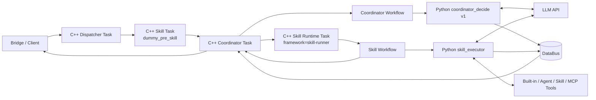
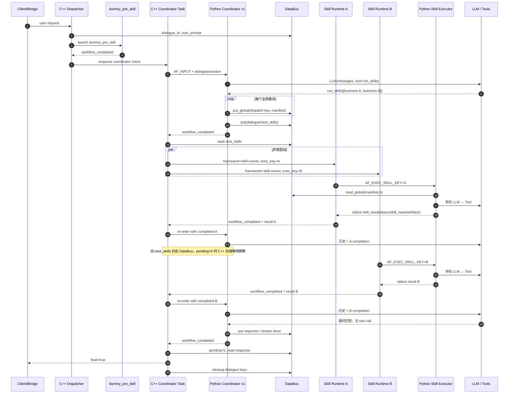
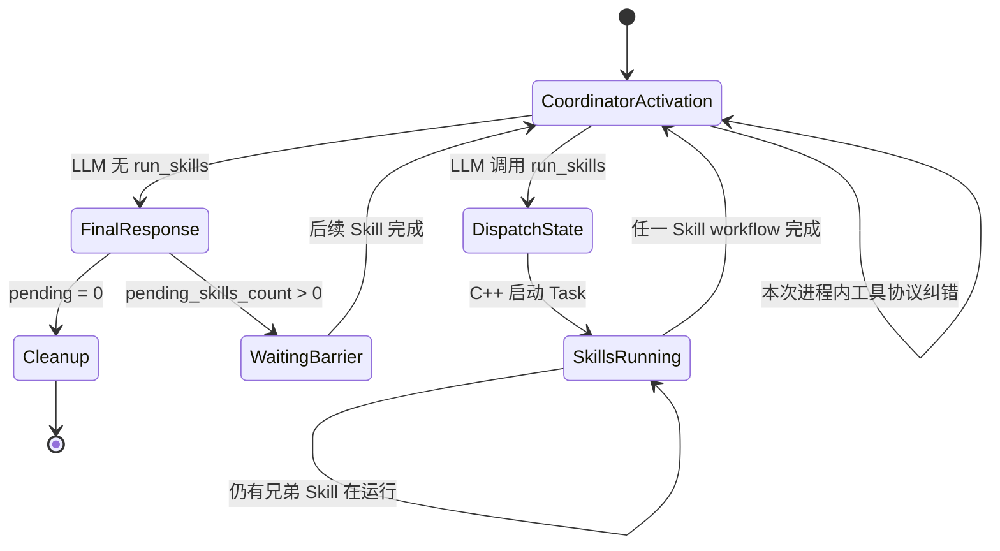

# Harness v1 源码级导读

> 阅读基线：`harness_agent_poc_evo` / `118c4be`
>
> 目标：不是只解释“它大概怎么工作”，而是建立一张能逐函数追踪、能据此重写 Rust、也能指导后续轨迹采集的代码地图。

并行修改方案与实施结果：[`HARNESS_PARALLEL_MODIFICATION_PLAN.md`](./HARNESS_PARALLEL_MODIFICATION_PLAN.md) 只处理多 Skill 并行的身份、输出隔离、队列、槽位、Batch Join 和 Final Gate；当前已通过定向测试和真实 Harness v1 hchat 验证。

## 0. 先给结论

Harness v1 不是一个常驻 Python Agent 循环。它是一个由 **C++ AgentFlow Runtime 反复启动短生命周期 Python 节点**组成的事件驱动系统：

- C++ 管任务、工作流、并发、超时、DataBus 和完成事件；
- Python Coordinator 每次被触发，只做一次“继续委派或最终回答”的决策；
- Python Skill Executor 在一次进程内运行多轮 LLM ↔ Tool 循环；
- Coordinator 与 Skill 不直接调用彼此，二者通过 `next_skills`、dispatch manifest、工作流输出和 C++ 完成事件衔接；
- 同一对话的完整 Coordinator Loop，是多次 C++ 工作流重入拼出来的，不是 `coordinator_decide.py` 里一个从头跑到尾的永久循环。

最重要的关系可以压缩成：

```text
Coordinator v1 = 决策器 / 编排器
Skill Executor  = 单次委派的执行循环
C++ Runtime     = 驱动二者反复重入的状态机
DataBus         = 跨进程、跨工作流的共享状态面
```

如果只读两个 Python 文件，会误判系统边界；如果只读 C++，又看不到 LLM 协议、消息历史和工具收敛逻辑。必须把四层一起读。

---

## 1. 推荐阅读顺序

第一次阅读不要按目录顺序。按下面的调用链读，效率最高：

1. `examples/agent/outfit-assistant/agent.json`
   - 先认清 dispatcher、coordinator、`dummy_pre_skill`、`skill-runner` 四类 Task。
2. `examples/agent/outfit-assistant/workflows/coordinator_workflow.json`
   - 看 Coordinator 的输入、输出和 900 秒 C++ 硬超时。
3. `examples/agent/outfit-assistant/workflows/skill_workflow.json`
   - 看 Skill Executor 的输入、输出和 240 秒硬超时。
4. `examples/agent/outfit-assistant/nodes/coordinator_decide.sh`
   - 确认 `AF_COORDINATOR_VERSION=v1` 才会进入本文件讨论的 v1。
5. [`coordinator_decide.py`](../../packages/agentflow-runtime/src/agentflow_runtime/coordinator_decide.py#L322)
   - 先读 `execute()`，再回头读 `handle_run_skills_call()`。
6. [`MMAgent::handle_task_data_exchange`](../../src/agent/agent.cpp#L1768)
   - 这是 Python Coordinator 输出之后真正决定“启动 Skill、等待还是返回用户”的地方。
7. [`MMAgent::process_next_skills_launch`](../../src/agent/agent.cpp#L2969)
   - 看 `next_skills` 如何变成 Skill Runtime Task。
8. [`skill_executor.py`](../../packages/agentflow-runtime/src/agentflow_runtime/skill_executor.py#L320)
   - 看业务 Skill 文档、工具注册、LLM/Tool 循环和结果输出。
9. [`MMAgentRuntime` 的工作流完成回传](../../src/runtime/runtime.cpp#L1601)
   - 看 Skill 工作流输出如何变成 Coordinator 的下一次输入。
10. [`DataBusClient`](../../packages/agentflow-runtime/src/agentflow_runtime/databus_client.py#L35)
    - 最后统一理解所有 key 的作用域和生命周期。

第二遍再读 `prompts/`、`hooks/`、`recorder.py`、artifact pipeline 和 tests。它们很重要，但不应遮住主链。

---

## 2. 名词必须先对齐

| 名称 | 代码里的真实含义 | 不要误解成 |
|---|---|---|
| AgentFlow | C++ Runtime/Workflow/Task/DataBus 基础设施 | LLM Agent 本身 |
| Harness | 建在 AgentFlow 上的 Python LLM 编排与工具执行层 | 一个单独类或单进程 |
| Coordinator v1 | 只拥有 `run_skills` 工具的决策节点 | 直接执行业务工具的 ReAct Agent |
| Skill | 一份 `SKILL.md` 行为说明，加可选的同目录 scripts/references | 一个独立 Python service 或固定函数 |
| `skill-runner` | `agent.json` 中通用 Skill Task 模板的框架名 | 业务 Skill 名 |
| `outfit-stylist` 等 | dispatch manifest 中的业务 Skill 名 | C++ Task 模板名 |
| Coordinator round | 一次 Coordinator 工作流重入 | Skill 内一轮 LLM ↔ Tool |
| Skill round | `skill_executor.execute()` 内一次 LLM 调用 | 一次 C++ Workflow |
| dispatch key | 一次业务委派实例的唯一引用 | 业务 Skill 的永久 ID |
| dialogue | 一次前端请求/响应生命周期的状态域 | 整个用户 session |
| session | 多个 dialogue 的上层容器，也承载共享历史/trace | 单轮用户请求 |

### 2.1 两种 Skill 身份

一次业务委派同时存在两种名字：

```text
框架 Task 名: skill-runner
业务 Skill 名: outfit-stylist
```

Coordinator 写入：

```json
{
  "name": "skill-runner",
  "exec_skill_key": "dispatch:<dialogue>:<uuid>:0"
}
```

dispatch manifest 再把这个 key 解析成：

```json
{
  "skill_name": "outfit-stylist",
  "prompt": "为用户生成穿搭建议",
  "load_skills": []
}
```

因此：

- C++ 调度与并发计数看到的通常是 `skill-runner`；
- Python Skill Executor 执行的是 `outfit-stylist`；
- Runtime 完成时再从工作流输出 `skill_name` 取回业务名，写成 `business_skill_name`；
- Coordinator 下一轮收到的 `AF_COMPLETED_SKILL_NAME` 应是业务名。

迁移 Rust 时必须保留这两个 ID 层次，否则判重、并发计数、轨迹归因会混在一起。

---

## 3. 静态拓扑：系统里实际有什么



### 3.1 `agent.json` 的四类 Task

当前 outfit assistant 配置中：

| Task | 类型 | 工作流 | 用途 |
|---|---|---|---|
| task 0 | dispatcher | 无 | 接收用户请求，先启动预处理 Skill |
| task 1 | coordinator | `coordinator_workflow.json` | 反复运行 Coordinator v1 |
| task 2 | skill template | `dummy_pre_skill_workflow.json` | 首次请求的预处理/环境准备门 |
| task 3 | skill template | `skill_workflow.json` | 所有业务 Skill 共用的 `skill-runner` |

`dummy_pre_skill` 目前只是打印 `{}` 的薄预处理节点。它的主要作用不是完成业务，而是把 dispatcher 的首跳也统一成“Skill 完成事件 → Coordinator”。

### 3.2 Python 进程都是短命的

Coordinator 和 Skill 的 shell 节点都由 Worker fork 子进程执行：

- C++ 把 workflow input 转成 `AF_*` 环境变量；
- shell entry 选择 v1/v2、虚拟环境和 Python 模块；
- Python 从环境变量与 DataBus 恢复状态；
- Python 向 stdout 输出一个 JSON object；
- Worker 解析 stdout，发布 workflow output；
- 进程退出，下一轮重新启动新进程。

所以任何跨轮状态不能只放 Python 内存，必须进入 DataBus 或由 C++ Task 保存。

---

## 4. 完整成功路径时序

下面是一轮“用户请求 → Coordinator 委派两个业务 Skill → 两个 Skill 完成 → Coordinator 总结”的真实主路径。



关键不是时序图本身，而是以下四个边界：

1. `CP → DB → C`：Coordinator 不是直接调用 Skill，而是写调度意图。
2. `C → Skill Runtime`：真正的并发限制与 Task 创建在 C++。
3. `Skill Runtime → C → CP`：Skill 完成不是直接回调 Python，而是 C++ 重启 Coordinator workflow。
4. `CP → DB → C → Client`：Python 最终文本也不是直接发客户端，而是 C++ 读取后发送与清理。

---

## 5. 从用户请求到第一次 Coordinator

### 5.1 Dispatcher 接收请求

入口位于 [`MMAgent::handle_task_intent_request`](../../src/agent/agent.cpp#L1466)。对于当前配置的 dispatcher：

1. 从消息读取或生成 `dialogue_id`；
2. 获取 session 级 dialogue lock；
3. 把 `dialogue_id` 和 `user_prompt` 写入 DataBus；
4. 因 dispatcher 配置了 `next_skills=[dummy_pre_skill]` 且没有自己的 workflow，直接启动 `dummy_pre_skill`；
5. 原请求暂不返回用户。

### 5.2 “多 dialogue”与实际串行边界

[`MMAgentSession::release_dialogue_lock`](../../src/agent/session.cpp#L416) 对应一个 session 内的 active dialogue 锁。当前路径在首个请求进入时获得它，在最终响应或清理时释放。

这意味着：

- 不同 session 可以并行；
- 同一 session 内，当前实现倾向于一次只让一个 dialogue 完整跑完；
- 所谓 `dialogue_id` 隔离了数据，但不代表同 session 的多个 dialogue 一定并发执行。

后续做轨迹树时，`session_id` 和 `dialogue_id` 都必须保留，不能只存一个。

### 5.3 dummy 完成后转交 Coordinator

Runtime 将 dummy workflow completion 回送给 source dispatcher。dispatcher 再把原始用户内容封装成 Coordinator intent。Coordinator Task 由 C++ `build_runtime_task()` 克隆运行时 Task，把 message metadata 转成 workflow inputs。

Coordinator workflow 的 shell 节点最终得到：

```text
AF_INPUT
AF_SESSION_ID
AF_DIALOGUE_ID
AF_COMPLETED_SKILL_NAME
AF_SKILL_SUCCESS
AF_SKILL_RESULT
AF_SKILL_ARTIFACTS
```

第一次进入时，completed skill 是空值或 `dummy_pre_skill`，所以 Python 把它视为第 1 个 Coordinator outer round。

---

## 6. Coordinator v1：逐块读 `execute()`

主函数：[`coordinator_decide.execute`](../../packages/agentflow-runtime/src/agentflow_runtime/coordinator_decide.py#L322)。

### 6.1 初始化路径和业务 Skill 列表

`_init_skills()` 从 `agent.md` frontmatter 的 `skills` 字段读取业务 Skill 名称，然后：

- 生成 Coordinator system protocol；
- 深拷贝 `run_skills` tool schema；
- 把 `skills[].name` 限制成配置里的 enum。

Coordinator 看得到 Skill 名和协议，却不会加载各 Skill 的 `SKILL.md` 正文。也就是说，它知道“可委派给谁”，但不天然知道每个 Skill 的全部执行细节；这些细节由 Skill Executor 自己加载。

### 6.2 读取本轮触发上下文

`execute()` 从环境变量读取：

- 用户原始输入；
- session/dialogue；
- 刚完成的业务 Skill 名；
- C++ 认定的 workflow success；
- Skill result 与 artifacts；
- stream 配置。

然后解析 `agent.md` 的 model/config，初始化 LLM recorder、DataBus、Hooks 和 tracing。

### 6.3 三种历史来源

Coordinator 看到的上下文来自三处：

1. `AF_INPUT`：当前工作流输入，首轮以它构造用户消息；
2. `llm/session_messages`：Recorder 保存的 Coordinator 对话历史；
3. 当前 `AF_SKILL_RESULT`：本次刚完成 Skill 的权威结果。

如果 `AF_SKILL_RESULT` 已存在，代码不会再走 `collect_skill_results()` 的 DataBus fallback，避免一个可能长达 30 秒的缺键等待。

Skill Executor **看不到 Coordinator 的完整历史**。它只收到 dispatch manifest 中 Coordinator 写给它的 `prompt`，所以 Coordinator prompt 必须是自包含委派说明。

### 6.4 外层 round 与内层 tool correction round

Coordinator 有两个容易混淆的计数器：

| 计数器 | 生命周期 | 增长条件 | 用途 |
|---|---|---|---|
| `_coordinator_round` | 跨 Python 进程，存 DataBus | 每次真实业务 Skill 完成后重入 | 限制整个编排回路 |
| `_tool_loop_round` | 当前 Python 进程内 | LLM 给出无效/被阻断/未知工具，且没有成功 dispatch | 让 LLM 在本次触发内纠正 |

此外还有 HTTP client 内部的 transport retry；它不是 Agent round。

因此轨迹数据至少要分开记录：

```text
coordinator_activation_index
coordinator_tool_correction_index
llm_transport_attempt
```

### 6.5 本轮消息如何构造

第一次进入：

```text
system = Coordinator protocol + agent.md body
user   = parse(AF_INPUT)
```

Skill 完成后重入：

```text
system = 同上
history = recorder 中上一轮 messages
user = “Skill X 成功/失败，结果为 …，工件为 …”
```

在调用 LLM 前还会：

- 压缩超过 token 阈值的历史；
- 注入 round/time budget reminder；
- 触发 `coordinator_v1.before_llm_call` hook；
- 只向模型暴露 `run_skills` 一个工具。

### 6.6 LLM 返回最终文本

没有 tool call 时：

1. 去掉 `</think>` 之前的推理内容；
2. 把 Skill artifacts 转换/追加成可访问链接；
3. 写 response 或流式完成消息；
4. 写 `_e2e_response` 测试/观测侧通道；
5. 保存 session messages；
6. stdout 输出 `{"response": ...}`；
7. Python 进程返回。

最终是否发给用户、何时清理，仍由 C++ 决定。

### 6.7 LLM 返回 `run_skills`

对每个 tool call，Coordinator 会：

1. 解析 JSON 参数；
2. 拒绝未知 tool；
3. 根据 completed skill + last prompt 做重复委派检测；
4. 允许 hook 阻断/改写；
5. 调用 [`handle_run_skills_call`](../../packages/agentflow-runtime/src/agentflow_runtime/coordinator_decide.py#L207)；
6. 将 tool result 追加回 messages；
7. 只要至少一个业务 Skill 成功写入调度状态，本次 Python 进程就退出，交还 C++。

如果所有 tool call 都无效或被拦截，代码删除陈旧 `next_skills`，在同一进程内继续 `_tool_loop_round`，让模型纠错。

### 6.8 `handle_run_skills_call()` 的真正职责

每个业务 Skill 会生成一个唯一 key：

```text
dispatch:<dialogue_id>:<uuid-prefix>:<index>
```

然后先写全局 manifest：

```text
/session/<sid>/sys/dispatch:<dialogue>:<uuid>:<i>
```

再写 dialogue-scoped 调度数组：

```text
/session/<sid>/sys/<dialogue>/next_skills
```

数组中的每项是框架 Task：

```json
{
  "name": "skill-runner",
  "exec_skill_key": "dispatch:...",
  "force": false
}
```

这里有一个重要不变量：**manifest 必须先于 `next_skills` 可见**。否则 C++ 已启动 Skill，而 Skill Executor 读不到委派内容。

当前实现虽然遵守写入顺序，但没有检查每次 `put` 的返回值，也不是事务写入。因此它是“顺序约定”，不是原子保证。

### 6.9 Prompt 协议与代码不完全一致

Coordinator tool schema 暴露了每个 spec 的可选 `exec_skill_key`，但 `handle_run_skills_call()` 不使用模型传入的这个字段，而是无条件生成新的 dispatch key。

结论：当前 v1 中，`exec_skill_key` 是 Harness 自己生成的一次委派 ID，不是允许 LLM 控制的字段。Rust 接口应删掉 schema 中这个假能力，或明确实现其语义。

---

## 7. C++ 如何把 `next_skills` 变成并发 Task

Coordinator workflow stdout 被解析并发布后，会进入 [`MMAgent::handle_task_data_exchange`](../../src/agent/agent.cpp#L1768)。对于 Coordinator completion：

1. 调用 `process_next_skills_launch()`；
2. 读取 dialogue-scoped `next_skills`；
3. 用 `launched_skills` 判重；
4. 在 `max_concurrent_skills` 内启动新 Task；
5. 增加 `pending_skills_count`；
6. 若仍有未启动 Skill，等待后续 completion trigger 再补发；
7. 若都启动，等待它们完成；
8. 若没有 next skills，读取 response 并结束。

### 7.1 调度判重键

[`process_next_skills_launch`](../../src/agent/agent.cpp#L2969) 不只用框架名判重，而用：

```text
name:exec_skill_key
```

例如：

```text
skill-runner:dispatch:d1:abc:0
skill-runner:dispatch:d1:def:0
```

这样同一个通用 `skill-runner` 可以在多个 Coordinator round 中执行不同业务委派。

### 7.2 并发控制在哪里

Python Coordinator 可以一次请求多个 Skill，但并发上限不在 Python，而在 C++ Task：

- `source_task->can_launch_more_skills()` 决定还能否启动；
- [`launch_skill_task`](../../src/agent/agent.cpp#L2653) 创建 runtime task；
- `on_skill_started()` 更新 task 级 running count；
- `pending_skills_count` 更新 dialogue 级等待状态；
- Task 放入 `generated_tasks_`，Runtime 后续调度 workflow。

因此“Skill 编排优化”要同时观察两件事：Coordinator 想启动什么，以及 C++ 实际在何时启动了什么。只采 Python `run_skills` 会把排队、限流和失败启动都丢掉。

### 7.3 force 的语义

`force=true` 会把相同复合调度键从 `launched_skills` 移除并允许重启，之后 C++ 将 DataBus 中的 force flag 重置。

它不是简单的“不判重”开关，还会尝试清理旧 result、修正 pending count。因此 Rust 迁移前必须先给 force 建状态机测试；直接照字段名实现很容易破坏计数平衡。

---

## 8. Skill Executor：逐块读 `execute()`

主函数：[`skill_executor.execute`](../../packages/agentflow-runtime/src/agentflow_runtime/skill_executor.py#L320)。

### 8.1 通过 dispatch manifest 还原业务委派

Skill workflow 输入只有 `exec_skill_key` 等框架字段。Executor 用它读取 session-global manifest，得到：

- `skill_name`：业务 Skill；
- `prompt`：本次自包含任务；
- `load_skills`：额外要加载的 Skill 文档。

如果 manifest 缺失，业务名退化成 `unknown-skill`，任务说明退回 `AF_INPUT`。这不是可忽略的异常：它通常说明 Coordinator/DataBus 写入与 C++ 启动之间断链。

### 8.2 Skill 在这里是一份行为说明

[`load_skill_md`](../../packages/agentflow-runtime/src/agentflow_runtime/skills_loader.py#L62) 读取：

```text
harness/skills/<business-skill>/SKILL.md
```

并替换 `${SKILL_DIR}`、`${SKILLS_DIR}` 等路径。Executor 总是先加载自己的业务 Skill 文档，再加载 `load_skills` 指定的辅助 Skill 文档。

这些文档被拼进 system prompt，而不是 import 成一个 Python 类。因此项目中的 Skill 更接近：

```text
可注入的领域操作手册
+ 同目录可发现的工具脚本
+ references/assets 等资源
```

它和某些框架中“注册好的函数工具”不是同一个概念。

### 8.3 工具是怎么装进来的

[`_LocalToolRegistry`](../../packages/agentflow-runtime/src/agentflow_runtime/tool_registry.py#L53) 按顺序加载：

1. runtime built-in tools；
2. agent package 的 `harness/tools`；
3. 当前业务 Skill 的 `scripts`；
4. MCP tools。

执行时，普通工具调用其模块的 `execute(args, sandbox_endpoint)`；MCP 走自己的远程调用分支。

一个细节：同名模块后加载会覆盖 `_modules[name]`，所以执行选择“后者”；但 tool schema 会不断 append，可能让 LLM 同时看到重复名称的定义。迁移 Rust 时应把“override”同时作用于 schema 和 executor map。

### 8.4 Skill 的消息上下文

初始消息只有：

```text
system = Skill 文档 + Harness 收敛/网络/工件/报告约束
user   = dispatch manifest.prompt
```

Skill 不读取 Coordinator 的 `session_messages`，也不知道兄弟 Skill 的工具历史。它能看到什么，完全取决于 Coordinator prompt 和 Hooks 注入。

### 8.5 Skill loop

默认最多 8 个 LLM round。每轮按顺序：

1. 检查总 elapsed time；
2. 查询全局 interrupt flag；
3. 记录事件/span/progress；
4. 注入 round/time reminder；
5. 压缩 messages；
6. 触发 `skill_executor.before_llm_call` hook；
7. 调用 LLM；
8. 检查 transport error、空响应和工具参数合法性；
9. 有 tool calls 时批量执行并回灌 tool messages；
10. 无 tool calls 时把文本当最终 `skill_result` 输出。

这才是项目里真正意义上的单进程 Agent Loop。

### 8.6 三种重试/停止机制

| 机制 | 所在层 | 条件 | 结果 |
|---|---|---|---|
| HTTP transport retry | `OpenAiCompatibleClient` | DNS、连接、timeout 等瞬时错误；stream 未收到首 chunk | 指数退避，最多配置次数 |
| semantic tool-call recovery | Skill outer loop | `finish_reason=length` 或工具 args JSON 非法 | 提高 completion budget，要求模型重写 |
| exact tool loop detection | Skill outer loop | 连续 3 轮相同 tool name + 相同规范化 args 集合 | 强制中止并汇总 |

不要把它们合成一个 `retry_count`。轨迹树里应分别存 reason、attempt 和最终 stop cause。

### 8.7 工具并发不是“所有调用全并行”

[`tool_policies.execute_in_batches`](../../packages/agentflow-runtime/src/agentflow_runtime/tool_policies.py#L169) 先分类再组批：

- 明确只读：可并行；
- 明确写不同输出路径：可按路径并行；
- 写操作或无法判断：串行；
- 一个并行 batch 最多 4 个 worker。

分类依赖工具名和 bash command 字符串启发式规则，不是严格 effect system。轨迹中应记录“策略判定类别”，否则只看开始/结束时间很难解释为什么两个工具没有并行。

### 8.8 Artifact 路径

每次工具结果回灌后，artifact pipeline 会：

1. 从结构化字段和文本中抽取文件路径；
2. 排除用户上传输入；
3. 必要时从 sandbox 下载到 agent package；
4. 可选上传到 artifact storage；
5. 累积 `generated_artifacts`；
6. 在 Skill stdout 中输出 `artifacts_json`；
7. Runtime 回传给 Coordinator；
8. Coordinator 最终将本地引用改写为可访问 URL/Markdown。

因此 artifact 是从 Tool → Skill → Workflow → Runtime → Coordinator 的独立数据通道，不应只从最终文本反向猜。

### 8.9 stdout 是工作流 ABI

Skill Executor 正常结束打印：

```json
{
  "skill_result": "...",
  "status": "completed",
  "skill_name": "outfit-stylist",
  "rounds_used": 3,
  "artifacts_json": "[...]"
}
```

C++ Worker 在子进程退出成功时解析 stdout JSON；`skill_workflow.json` 现在把真实
ABI 完整声明为 `skill_result/status/skill_name/rounds_used/artifacts_json/error`，
其中 `error` 只在错误出口出现。Coordinator workflow 的 stdout 只声明
`response/status`；`next_skills` 是 dialogue-scoped DataBus 控制键，不是节点输出。

---

## 9. Skill 完成后为什么 Coordinator 会再次运行

Runtime workflow completion 位于 [`runtime.cpp`](../../src/runtime/runtime.cpp#L1601)：

1. 判断 workflow 是否有 failed node；
2. 构造 `workflow_completed` 或 `workflow_failed` message；
3. 对 Skill Task，读取 `skill_result`、`skill_name`、`artifacts_json`；
4. 把消息直接 enqueue 给 `source_task_id`；
5. 当前 Skill 的 source task 是 Coordinator，所以消息进入 Coordinator data-exchange queue。

然后 [`handle_task_data_exchange`](../../src/agent/agent.cpp#L1798) 在最前面识别 Skill completion：

1. `on_skill_completed()` 降低 task running count；
2. `pending_skills_count--`；
3. 将 framework Skill 名替换/补充为 `business_skill_name`；
4. 将 result/artifacts 写入新的 Coordinator trigger metadata；
5. 取回原始 user prompt；
6. 把 trigger 加入 Coordinator intent queue；
7. 下一次 Runtime 调度 Coordinator workflow，新 Python 进程启动。

这就是 Coordinator Loop 的“回边”。



---

## 10. DataBus 状态地图

Python `DataBusClient` 有两个关键作用域：

```text
databus.put/get/delete(key)
  -> /session/<sid>/sys/<dialogue>/<key>

databus.put_global/get_global(key)
  -> /session/<sid>/sys/<key>
```

LLM recorder 使用另一 namespace：

```text
/session/<sid>/llm/<key>
```

### 10.1 主路径 key 表

| Key | 作用域 | 主要写者 | 主要读者 | 生命周期/用途 |
|---|---|---|---|---|
| `user_prompt` | dialogue sys | C++ dispatcher | C++ completion handler | 重入时恢复原问题 |
| `next_skills` | dialogue sys | Python Coordinator | C++ Agent | 待启动框架 Task 数组，也是 pending barrier 的锚点 |
| `launched_skills` | dialogue sys | C++ Agent | C++ Agent | 复合 dispatch key 判重 |
| `skills_scheduled` | dialogue sys | C++ Agent | C++ Agent | 是否全部调度 |
| `pending_skills_count` | dialogue sys | C++ Agent | C++ Agent | 启动 +1，完成 -1 |
| `response` | dialogue sys | Coordinator workflow output | C++ Agent | 单响应最终文本 |
| `stream` | dialogue sys | Python Coordinator | Python/C++ stream path | 对话是否流式 |
| `_coordinator_round` | dialogue sys | Python Coordinator | Python Coordinator | 跨进程 outer round |
| `skill_failed` | dialogue sys | C++ Agent | C++ Agent | workflow-level Skill 失败标记 |
| `dispatch:*` | session-global sys | Python Coordinator | Python Skill Executor | 单次业务委派 manifest |
| `last_prompt:<dialogue>:<skill>` | session-global sys | Python Coordinator | Python Coordinator | 重复委派判断 |
| `interrupt` | session-global sys | 外部控制面 | Coordinator/Skill | 整个 session 的取消标志 |
| `session_messages` | session-global llm | Coordinator recorder | Coordinator recorder | Coordinator 历史 |
| `traces/<call>/...` | session-global llm | Recorder | trace UI/分析器 | LLM request/response/meta |
| `traces/index/<dialogue>` | session-global llm | Recorder | trace UI/分析器 | dialogue 内 call 顺序 |

### 10.2 为什么 workflow id 不在 framework key 中

[`build_framework_key`](../../src/runtime/runtime.cpp#L109) 明确忽略 `workflow_id`，理由是支持跨工作流通信：

```text
/session/<session>/sys/<dialogue>/<output>
```

这使 Coordinator 能读 Skill 输出，也使不同 workflow 共享状态；它既是设计能力，也是并发风险来源。

### 10.3 清理边界

最终响应后，C++ 清理 dialogue 下的 sys/ctx/llm/tool/stream 相关 prefix 和 dispatch keys，并释放 dialogue lock。

但 `llm/session_messages` 是 session-global，不带 dialogue 前缀；它用于跨 Coordinator activation 恢复历史，不随普通 dialogue prefix 一起自然隔离。当前 session dialogue lock 降低了并发污染概率，但 Rust 设计最好把 message history 明确建模为 `session_id + dialogue_id` 或显式 conversation branch。

---

## 11. 六种“循环”不能混为一谈

| 循环 | 驱动者 | 退出条件 | 主要状态 |
|---|---|---|---|
| Session message loop | C++ Task threads | Task/session 销毁 | intent/data-exchange queues |
| Workflow re-entry loop | C++ Runtime + completion event | Coordinator final + pending=0 | DataBus + Task state |
| Coordinator correction loop | Python `while True` | 成功 dispatch 或 final | `_tool_loop_round`, messages |
| LLM transport retry | HTTP client | 成功、非瞬时错误或耗尽 | attempt/backoff/data_received |
| Skill Agent loop | Python `for round_i` | final、error、interrupt、timeout、loop、max rounds | messages/tool history/artifacts |
| Tool batch concurrency | ThreadPoolExecutor | 当前 batch 全部完成 | tool policy batches |

用户课题中的“无效 loop 次数”必须先选择测量单位。例如：

- 重复 Coordinator activation；
- Skill 内没有新增状态的 LLM round；
- 相同 Tool signature 的重复调用；
- transport retry；
- completion 后无新 dispatch/response 的空重入。

如果全部叫 loop，30%–60% 指标将不可解释。

---

## 12. Prompt、Hooks、Recorder 分别处在哪一层

### 12.1 Prompt 是行为契约，不是硬约束

Coordinator prompt 要求：

- 最少轮次；
- 可并行就一次 dispatch；
- 不重复已完成 Skill；
- 所有 Skill 完成前不最终回答。

Skill prompt 要求：

- 任务信息够用即收敛；
- 同一工具失败两次停止；
- 网络资源失败不反复下载；
- 报告实际执行过什么；
- artifact 由系统自动收集。

这些多数是 LLM 指令，不是 C++/Python 强制状态机。读代码时要始终问：这句话是 prompt 约束，还是代码 guard？

### 12.2 Hooks 可观察，也可干预

[`hooks.engine.trigger`](../../packages/agentflow-runtime/src/agentflow_runtime/hooks/engine.py#L27) 按 order 调用订阅者：

- handler 返回 dict，可合并/覆盖 payload；
- handler 可修改 `AgentContext.messages/artifacts`；
- `ctx.blocked` 可阻断 LLM 或工具；
- hook 异常被隔离，只告警，不中止主流程。

outfit assistant 的 `preload_user_context` 在首次 LLM 调用前把 profile、history、style guide、workspace tree 等直接追加到 system prompt，从而省掉一次 LLM 自主探查轮。

这正是未来 Skill/Prompt 自进化的一个现实控制面：不改主循环也能改变模型看到的状态。

### 12.3 Recorder 记录 LLM，不等于记录完整 Agent 轨迹

[`recorder.py`](../../packages/agentflow-runtime/src/agentflow_runtime/recorder.py) 会记录：

- 完整 request；
- 完整 response；
- token、latency、finish reason；
- dialogue trace index；
- session messages。

但它没有完整覆盖：

- C++ Task 创建、排队与限流；
- DataBus 状态变化；
- 每个 Tool 的标准化前后状态；
- workflow output 与 completion message 的一一对应；
- cleanup/lock；
- 逻辑 status 与进程 exit status 的差异。

所以现有 trace 是轨迹树的重要输入，但不能直接当完整 replay log。

---

## 13. 迁移 Rust 前必须先澄清的代码事实与风险

这里分成“源码可直接确认”和“高风险、需并发实验确认”两类。

### 13.1 已由源码控制流确认

#### A. Skill 的逻辑失败可能被 C++ 标成成功

Skill Executor 遇到 `llm_error`、`tool_call_error`、`max_rounds`、`tool_call_loop_detected`、`interrupted` 等情况时，通常打印一个带非 completed `status` 的 JSON，然后正常 `return`，Python 进程退出码仍是 0。

C++ Runtime 的 `complete_ok` 看的是 workflow node 是否失败；Coordinator 的 `skill_success` 看的是 message content 是否为 `workflow_completed`，并不读取 Skill stdout 的 `status`。

所以可能出现：

```text
Skill JSON status = llm_error
C++ workflow       = workflow_completed
Coordinator input  = AF_SKILL_SUCCESS=true
```

Coordinator 仍能从 `skill_result` 文本看出错误，但 success 布尔语义已经失真。Rust 重写前应决定：

- 非 completed status 是否映射成非零进程退出；或
- workflow completion 是否显式携带 logical status；或
- Coordinator success 是否由 `status` 计算。

#### B. semantic recovery 的 `continue` 缩进与注释意图相反

[`skill_executor.py` 的恢复分支](../../packages/agentflow-runtime/src/agentflow_runtime/skill_executor.py#L753) 中，`continue` 位于 `response_push()` 的 `except` 内：

```python
try:
    response_push(...)
except Exception:
    ...
    continue

output = tool_call_error
return
```

因此：

- progress push 成功：直接落入 `tool_call_error` 并退出；
- progress push 失败：反而 `continue` 到下一轮恢复。

这与注释、变量名和 recovery prompt 表达的意图相反。现有 recovery tests 只测 `validate_tool_calls()` 和 `remove_invalid_tool_turns()` 辅助函数，没有覆盖这个 `execute()` 控制流。

#### C. `remove_invalid_tool_turns()` 当前未接入 `execute()`

函数和测试都存在，但主执行路径没有调用它。当前 invalid response 也没有先 append assistant/tool turn，所以未必立即造成坏历史；但不能依据测试名认为“每次恢复都会执行清理”。

#### D. Python 的软时间预算与 C++ 硬超时不一致

- Coordinator workflow hard timeout：900 秒；
- Skill workflow hard timeout：240 秒；
- Skill Python 默认读取 `AF_NODE_EXECUTION_TIMEOUT`，找不到时按配置默认 240 秒；
- Coordinator round reminder 使用的 `node_timeout_sec` 默认 180 秒；
- C++ Worker 会注入 workflow inputs 为 `AF_*`，但当前源码没有注入 `AF_NODE_EXECUTION_TIMEOUT`。

所以“模型看到的剩余时间”“Python 自己检查的时间”和“C++ kill 子进程时间”不是统一来源。

#### E. LLM trace 的 retry 数不反映 HTTP client 内部真实 retry

HTTP retry 在 `OpenAiCompatibleClient.chat_completion()` 内完成；Recorder 外层的 `attempt` 没有随内部 retry 更新，meta 中 `retries_used`/`retries_attempted` 通常仍是 0。

后续若用 trace 优化无效 loop，不应把现有该字段当真实网络重试次数。

#### F. Coordinator schema 中的 `exec_skill_key` 不生效

LLM 可以生成它，但 handler 无条件生成新 key。它是接口漂移，不是可用能力。

#### G. manifest + `next_skills` 不是事务

代码保证先写 manifest，再写 `next_skills`，但忽略 DataBus write 的布尔返回值。中间失败时可能留下孤儿 manifest，或让 Skill 启动后读不到 manifest。

#### H. 多 Skill 最终等待依赖旧 `next_skills` 仍存在

当一个并发 Skill 先完成，Coordinator 可能已经生成最终 response。C++ 之所以不立即返回，是因为旧 `next_skills` 还在：`found_next_skills=true`、`all_launched=true`、`pending>0`，于是进入等待屏障。

如果某条 Coordinator 纠错路径删除了 `next_skills`，而兄弟 Skill 尚未完成，no-next-skills 最终分支本身没有再次检查 `pending_skills_count`。这使等待正确性依赖一个隐含的不变量：有在途 Skill 时不能丢失旧 `next_skills`。

Rust 版应把 `pending > 0` 做成显式 finalization guard，而不是依赖陈旧调度文档存在。

### 13.2 高风险推断，需要专门并发实验确认

#### I. 并发 `skill-runner` 可能交叉读取工作流输出

所有 Skill workflow 的终端输出使用：

```text
/session/<sid>/sys/<dialogue>/skill_result
/session/<sid>/sys/<dialogue>/skill_name
/session/<sid>/sys/<dialogue>/artifacts_json
```

[`build_framework_key`](../../src/runtime/runtime.cpp#L109) 明确排除了 `workflow_id`。Runtime 在各 workflow complete 时又从这些共享 key 读取结果并附到 completion event。

若两个 `skill-runner` 在同一 dialogue 并发完成，它们可能先后覆盖同一组 key，存在 result/name/artifacts 串线风险。源码足以确认 key 共享；是否在实际调度时必然触发，取决于节点发布和 completion callback 的精确时序，需压力测试验证。

正确的轨迹/重写标识应至少包含：

```text
session_id + dialogue_id + workflow_execution_id + exec_skill_key
```

#### J. 配置中的 Skill instance pool 与动态 launch 路径关系不直观

session 创建时会建立 skill template/instances，但 `launch_skill_task()` 搜索基础 template 后再构造 runtime task。是否充分复用了预建 pool，要结合 Runtime workflow pool 行为做动态观测，不能仅从 `instance_pool_size` 推断真实复用。

---

## 14. 主路径、兼容路径与不要先读的路径

`agent.cpp` 很长，存在多代逻辑。当前主路径的判断原则：

1. Runtime 把 Skill completion 直接发给它的 `source_task_id`；
2. 业务 Skill 的 source 是 Coordinator；
3. `handle_task_data_exchange()` 顶部的 `SKILL COMPLETION DETECTION` 已处理并 `return`；
4. 文件后面标为 `SKILL HANDLING` 的分支更多是兼容/旧路径，不是 v1 当前成功链的第一阅读入口；
5. `BuiltinDispatcher` 自己也有 next-skills 处理逻辑，但当前 outfit 配置首轮采用 agent.cpp 的 preconfigured dummy path，后续业务调度由 Coordinator Task 的 unified path 处理。

判断某段是不是主路径，不要看注释“看起来像”，要追：

```text
message.receiver_id
source_task_id
task_type
workflow_id
是否在前面已经 return
```

---

## 15. 函数地图

### 15.1 Coordinator Python

| 函数 | 输入 | 输出/副作用 | 下一跳 |
|---|---|---|---|
| `_init_skills()` | agent.md | protocol + run_skills schema | `execute()` |
| `_is_duplicate_dispatch()` | completed skill、last prompt、新 specs | bool/reason | tool call 接受或拒绝 |
| `handle_run_skills_call()` | business specs | manifests + next_skills | C++ process launch |
| `build_skill_completion_message()` | result/success/artifacts | 一条 user message | 下一次 LLM |
| `collect_skill_results()` | Skill names | legacy fallback results | completion message |
| `execute()` | AF_* + DataBus | response 或调度意图 | Worker stdout/C++ |

### 15.2 Skill Python

| 函数 | 作用 |
|---|---|
| `validate_tool_calls()` | 拒绝截断或非法 JSON tool args |
| `_detect_tool_call_loop()` | 检测连续相同 tool signature |
| `_summarize_tool_history()` | loop 中止时拼 fallback summary |
| `remove_invalid_tool_turns()` | 移除残缺 assistant/tool turn；当前未接主循环 |
| `execute()` | manifest → Skill docs/tools → 多轮 LLM/Tool → stdout result |

### 15.3 C++ Agent

| 函数 | 作用 |
|---|---|
| `build_runtime_task()` | 静态 Task config + message → 一次 runtime task |
| `handle_task_intent_request()` | 接收 intent，启动 dispatcher/coordinator workflow |
| `handle_task_data_exchange()` | 处理 schedule/completion，重入 Coordinator 或返回用户 |
| `launch_skill_task()` | 从 template 创建一次 Skill runtime task，更新计数 |
| `process_next_skills_launch()` | DataBus 调度数组 → 判重/force/限流/启动 |

### 15.4 Runtime/Node

| 位置 | 作用 |
|---|---|
| `runtime.cpp::execute_workflow()` | 克隆 workflow execution state，排可执行节点 |
| `node.cpp::execute_script()` | 把 inputs 注入 AF_*，执行 shell/python，解析 JSON stdout |
| `runtime.cpp` workflow complete block | 将 terminal outputs 附到 completion event |
| `worker/exe_loader.cpp` | fork/exec、stdout/stderr、timeout kill process group |

---

## 16. 一次手工追踪应该看什么

建议按六个最小场景读日志和 DataBus。不要一上来跑复杂图像/视频任务。

### 场景 A：Coordinator 直接回答

预期：

```text
dispatcher -> dummy -> coordinator
coordinator LLM 无 tool call
response 发布
C++ final + cleanup
```

确认没有创建业务 Skill Task。

### 场景 B：单个业务 Skill

预期：

```text
dispatch manifest 先出现
next_skills 后出现
pending 0 -> 1
skill workflow complete
pending 1 -> 0
coordinator round 2
final
```

同时核对 framework name 与 business name。

### 场景 C：两个并发 Skill

重点记录：

- 两个 exec key；
- 两个 workflow execution id；
- shared output key 每次写入时间；
- completion event 实际携带的 name/result 是否匹配；
- 第一个完成后 Coordinator 是否被重入；
- pending barrier 是否等待第二个。

这是验证并发串线风险的首要实验。

### 场景 D：非法 tool arguments

让假 LLM 首轮返回截断 JSON，再返回合法调用。验证当前是否真的进入第二轮。按源码，progress push 成功时很可能直接 `tool_call_error`。

### 场景 E：Skill 输出逻辑错误但进程 exit 0

模拟 `_llm_error`，检查 Coordinator 收到：

```text
AF_SKILL_SUCCESS
AF_SKILL_RESULT.status
```

验证二者是否矛盾。

### 场景 F：interrupt 与 timeout

分别触发：

- DataBus global interrupt；
- Python elapsed guard；
- C++ workflow hard timeout。

观察三者的 workflow status、Skill status、pending count、cleanup 是否一致。

---

## 17. 为“完全读懂”建立断点/日志地标

每次完整请求至少用以下 ID 串起来：

```text
session_id
dialogue_id
trace_id
task_id
workflow_id / workflow_execution_id
exec_skill_key
business_skill_name
llm_call_id
tool_call_id
```

推荐搜索日志标记：

```text
[HANDLE_INTENT_REQUEST]
[BUILD_RUNTIME_TASK]
[COORDINATORDataExchange]
[LAUNCH_SKILL]
[SKILL_COMPLETION]
[WORKFLOW_COMPLETE]
[NODE_TIMEOUT]
[flow]
[timing]
[E2E_SUMMARY]
```

其中 `exec_skill_key` 是连接 Coordinator dispatch 与 Skill Executor 的核心，`workflow_execution_id` 是隔离并发运行实例的核心。两者缺一不可。

---

## 18. 对后续轨迹树设计的直接约束

虽然当前任务是读代码，但源码已经给出了轨迹 schema 必须表达的对象：

```text
Session
└── Dialogue
    ├── UserRequest
    ├── CoordinatorActivation [0..n]
    │   ├── LlmAttempt [1..n transport attempts]
    │   ├── ToolDecision(run_skills)
    │   └── Dispatch [0..n]
    ├── SkillExecution [0..n, parallel]
    │   ├── SkillRound [1..max]
    │   ├── ToolBatch [0..n]
    │   ├── ToolCall [0..n]
    │   └── Artifact/Result
    ├── StateTransition
    ├── Evaluation
    └── FinalResponse/Cleanup
```

回放不是只重放 LLM messages。至少还要保存：

- dispatch manifest；
- `next_skills` 与 C++ 实际 launch 结果；
- pending/launched/force 的每次状态迁移；
- workflow execution id 和 completion metadata；
- Tool 输入输出与 artifact；
- prompt/hook 注入后的最终 messages；
- transport retry；
- stop reason；
- logical status、workflow status、process exit code三者。

这也是为什么“先完全读懂当前闭环，再设计 Protobuf”是正确顺序。

---

## 19. Rust 重写时的模块边界建议（仅作代码理解映射）

不要按 Python 文件一比一翻译。按现有职责拆：

```text
harness-core
├── coordinator
│   ├── protocol
│   ├── activation
│   ├── dispatch
│   └── convergence
├── skill
│   ├── manifest
│   ├── prompt_loader
│   ├── executor_loop
│   └── stop_policy
├── tools
│   ├── registry
│   ├── effect_policy
│   └── batch_executor
├── state
│   ├── databus_keys
│   ├── dialogue_state
│   └── transitions
├── llm
│   ├── client
│   ├── transport_retry
│   └── trace
├── artifacts
├── hooks
└── protocol
    ├── workflow_io
    └── protobuf_trace
```

其中最先固化的不是 LLM client，而是：

1. ID 与作用域；
2. 状态迁移；
3. logical/workflow/process 三层结果；
4. 调度与完成事件 ABI；
5. replay event schema。

---

## 20. 当前验证状态

本导读基于：

- v1 shell/entry/config；
- Coordinator 与 prompt；
- Skill Executor、Tool Registry、Tool Policy、Skill Loader；
- DataBus client/runtime context；
- C++ Agent/Task/Session/Runtime/Node/Worker 主链；
- Hooks、Recorder、artifact 回传；
- 相关 Python tests 的静态核对。

当前系统 Python 与 `reasoningqat` 环境都没有安装 `pytest`，所以未临时改环境、也未声称测试已通过。关键风险中：

- semantic recovery 控制流、logical status 与 workflow success、timeout/env 不一致：可由源码直接确认；
- 并发 Skill shared output key 串线：源码确认共享 key，实际触发概率仍需动态并发实验。

---

## 21. 最短记忆版

如果几天后忘了细节，只记住下面十句：

1. v1 是 C++ 驱动的多次短 Python 进程重入。
2. Coordinator 只做委派/最终回答，不执行业务工具。
3. Skill Executor 才有多轮 LLM ↔ Tool loop。
4. `skill-runner` 是框架 Task，`outfit-stylist` 才是业务 Skill。
5. `exec_skill_key` 把一次委派和 manifest 连起来。
6. Python 写 `next_skills`，C++ 才真正启动 Skill。
7. Skill 完成先回 C++，C++ 再启动下一次 Coordinator。
8. DataBus 是跨进程状态机，不只是缓存。
9. `status`、workflow success、process exit code 当前不是同一个语义。
10. 并发与回放必须用 workflow execution id 隔离，不能只靠 dialogue id。
