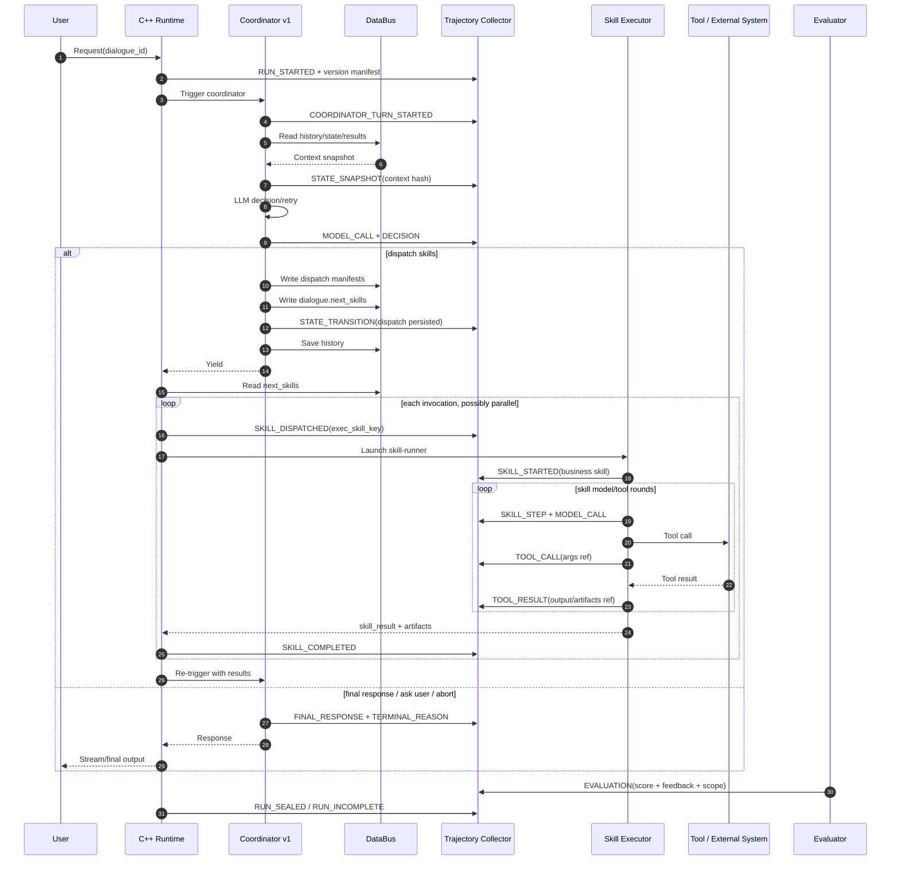
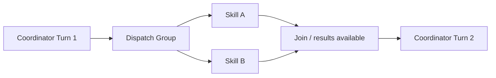
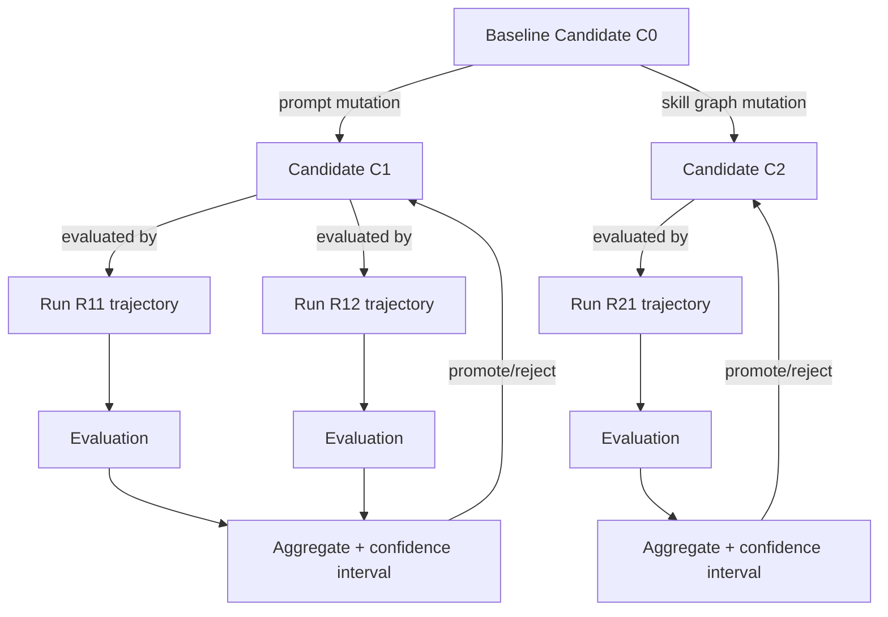

# Harness v1 Python 实验基线：轨迹树、Skill 编排与 Loop 自进化

> 文档状态：设计基线（Python 实验阶段）
>
> 对应分支：`harness_agent_poc_evo`
>
> 代码校验点：`118c4be`
>
> 最后更新：2026-08-24
>
> 配套协议草案：[proto/trajectory.proto](./proto/trajectory.proto)

## 1. 这项工作的最终目标

在把 Harness 改写为 Rust 之前，先以当前 v1 为可观测、可回放的 Python 实验基线，验证下面这条闭环是否成立：

```text
Harness 运行
    ↓ 采集不可变事件
执行轨迹树 / 因果 DAG
    ↓ 重建、回放、归因、评测
候选策略搜索树
    ↓ 离线验证与筛选
Skill 编排进化 + Prompt 自进化 + Loop 结束策略优化
    ↓
平均无效 Loop 次数下降 30%～60%，且任务质量不退化
```

本人的主要工作边界是：在其他成员完成轨迹采集之后，实现轨迹的树结构化存储、Protobuf 序列化、确定性回放、查询与指标计算，使以下信息都能被恢复：

- 每一次 Coordinator 外层循环和内部重试；
- 每一次 Skill 派发、开始、结束和产物回传；
- Skill Executor 内部的模型轮次和工具调用；
- 每一次显式状态变迁及其前后状态摘要；
- 每一次评测结果、文本反馈及其归因对象；
- 当时生效的 Prompt、Skill、模型、工具和 Loop 策略版本；
- 并发、重试、分支、汇合、失败以及缺失事件。

这些数据不是普通日志，而是后续“收敛优化与编排进化”的数据燃料。

## 2. 范围和非目标

### 2.1 Python 实验阶段要完成什么

1. 冻结采集器与轨迹存储之间的事件协议；
2. 实现 append-only 原始事件存储；
3. 把事件构造成可查询的执行轨迹树，同时保留完整因果边；
4. 生成单次运行的 Protobuf 快照；
5. 支持结构回放、录制结果回放和选点分支回放；
6. 定义并计算“无效 Loop”指标；
7. 保存评测反馈，为 Skill 编排、Prompt 和结束策略的候选搜索提供训练数据；
8. 形成 Python/Rust 共用的 golden fixtures 和兼容性测试。

### 2.2 这一阶段暂时不做什么

- 不直接重写 Harness 为 Rust；
- 不把现有 `TraceSpan` 或 `FlowTraceEvent` 强行改造成训练数据模型；
- 不允许生产环境中的 Agent 无审核地在线修改自身；
- 不把模型隐藏思维链作为回放前提；
- 不承诺实时、跨机、强事务存储，先验证单机 Python 闭环；
- 不用轨迹树替代常规日志、性能 Trace 和调度可视化。

## 3. 为什么以 v1 作为实验基线

v1 的关键特点不是“它有一个很长的 while 循环”，而是它把一次 Agent 工作拆成了可持久化、可重新进入的状态机：

1. C++ Runtime 触发一次 Coordinator；
2. Coordinator 恢复会话历史并只做本次有效决策；
3. 如果决策是 `run_skills`，Coordinator 先写入 dispatch manifest 和 `next_skills`，保存历史，然后退出本轮；
4. C++ Runtime 读取 `next_skills`，启动通用的 `skill-runner`；
5. Skill Executor 加载业务 `SKILL.md`，在内部完成自己的模型/工具循环；
6. Runtime 收集结果和 artifacts，并再次触发 Coordinator；
7. Coordinator 看到新状态后决定继续派发、询问用户或输出最终结果。

这种“决策后让出控制权、结果回来后再进入”的结构，天然提供了清晰的轨迹边界：Coordinator Turn、Skill Invocation、Skill Step、Tool Call、State Transition 和 Final Response。

> 注意：当前 Shell 的默认 Coordinator 版本可能是 v2。复现实验时必须显式设置 `AF_COORDINATOR_VERSION=v1`，并把该配置写入每条轨迹的版本清单，避免把 v1/v2 样本混在同一数据集中。

核心代码入口：

- [coordinator_decide.py](../../packages/agentflow-runtime/src/agentflow_runtime/coordinator_decide.py)：v1 Coordinator 决策与 `run_skills` 派发；
- [skill_executor.py](../../packages/agentflow-runtime/src/agentflow_runtime/skill_executor.py)：Skill 内部模型/工具循环；
- [databus_client.py](../../packages/agentflow-runtime/src/agentflow_runtime/databus_client.py)：状态读写边界；
- [runtime_context.py](../../packages/agentflow-runtime/src/agentflow_runtime/common/runtime_context.py)：运行上下文；
- [coordinator.py](../../packages/agentflow-runtime/src/agentflow_runtime/prompts/coordinator.py)：Coordinator Prompt；
- [agent.cpp](../../src/agent/agent.cpp)：C++ Agent 调度侧；
- [runtime.cpp](../../src/runtime/runtime.cpp)：Runtime 执行与结果回收。

## 4. v1 的循环必须分成三层记录

“Loop 次数”如果不先定义层级，30%～60% 的目标将无法比较。

| 层级 | 含义 | 开始与结束边界 | 典型无效行为 |
|---|---|---|---|
| Framework re-entry | Runtime 再次触发 Coordinator | 一次框架触发到 Coordinator 退出 | 没有新结果或新状态仍反复进入 |
| Coordinator retry | Coordinator 为获得合法决策而进行的内部模型重试 | 一次 Coordinator Turn 内的模型调用 | 重复非法工具、未知 Skill、相同无效 action |
| Skill loop step | Skill Executor 内一次模型/工具推进 | Skill 调用中的一次模型决策到结果观测 | 相同参数重复调用、无进展推理、错误恢复不当 |

三类计数必须分别保存，最后再按研究口径合并。否则把 Skill 内部的十轮工具调用与十次 Runtime 重入视为同一种 Loop，会产生错误优化方向。

## 5. v1 运行时序和采集点



两个顺序必须成为存储校验规则：

1. dispatch manifest 必须早于引用它的 `next_skills`；
2. Coordinator 在派发成功后必须保存历史并退出当前 Turn，不能在同一轮继续假设 Skill 已完成。

## 6. 不要把三种“树”混为一谈

项目中至少需要三个相互关联、但语义不同的结构。

| 结构 | 回答的问题 | 根和子节点 | 是否是本课题主要产物 |
|---|---|---|---|
| 性能 Span Tree | 时间花在哪里、哪个调用失败 | Request → Agent/Workflow/Node/LLM/Tool span | 否，沿用现有 Trace |
| 执行轨迹树 | 这次运行为什么采取这些动作、状态如何变化 | Run → Turn → Decision/Skill → Step → Tool/Evaluation | 是 |
| 进化搜索树 | 哪个候选由哪个候选变异而来、效果如何 | Baseline candidate → mutation/crossover → evaluation | 是，但建立在执行轨迹之上 |

现有 [TRACING.md](../TRACING.md) 中的 `TraceSpan` 适合耗时、错误和父子调用观测；`FlowTraceEvent` 适合调度过程可视化。它们都可以成为轨迹采集器的输入，但都不具备以下完整语义：

- 决策前后状态哈希和状态差量；
- 所有候选 action 与最终被选 action；
- Prompt、Skill、工具和策略的精确版本；
- Tool 输入输出与外部副作用录制；
- Evaluation 对具体节点或子树的归因；
- 分支回放所需的随机种子、录制结果和依赖清单。

因此轨迹系统应该是第三套“学习与回放事实源”，再从它投影出 Span 视图、流程视图和数据集，而不是继续给性能 Span 无限增加字段。

## 7. 为什么底层必须是因果 DAG，界面才是树

v1 允许多个 Skill 并行执行，并且它们可能读取同一个 Coordinator 状态，最后在下一次 Turn 汇合。真实因果关系因此不是严格树：



若强行只存一个 `parent_id`，`Coordinator Turn 2` 只能选择 Skill A 或 Skill B 作为父节点，另一条真实依赖会丢失。

建议采用两层表示：

- `primary_parent_id`：用于稳定地渲染和遍历“规范树”；
- `causal_parent_ids` / `TrajectoryEdge`：保存完整的 causes、depends-on、joins、retries、evaluates 等关系。

这样既能满足“轨迹树结构化存储”，也不会牺牲并发执行的真实性。

## 8. 规范执行轨迹树

建议的规范树如下：

```text
RunRoot
├── VersionManifest
├── CoordinatorTurn #1
│   ├── StateSnapshot
│   ├── ModelCall #1
│   ├── Decision: DISPATCH_SKILLS
│   └── DispatchGroup
│       ├── SkillInvocation A
│       │   ├── SkillLoopStep #1
│       │   │   ├── ModelCall
│       │   │   ├── ToolCall
│       │   │   └── ToolResult
│       │   ├── StateTransition
│       │   └── SkillResult / Artifact
│       └── SkillInvocation B
│           └── ...
├── Join
├── CoordinatorTurn #2
│   ├── StateSnapshot
│   ├── ModelCall
│   ├── Decision: RESPOND
│   └── FinalResponse
└── Evaluation
    ├── task success
    ├── output quality
    ├── invalid-loop labels
    └── textual feedback
```

### 8.1 节点类型

第一版至少支持：

- `RUN_ROOT`：一次可独立评测的请求；
- `COORDINATOR_TURN`：一次框架重入；
- `STATE_SNAPSHOT`：决策时刻的可重建状态；
- `MODEL_CALL`：可观察输入、输出、模型参数和用量；
- `DECISION`：候选 action、选择结果和结构化理由；
- `DISPATCH_GROUP`：同一决策产生的一组串行或并行 Skill；
- `SKILL_INVOCATION`：一次业务 Skill 调用；
- `SKILL_LOOP_STEP`：Skill 内部一次推进；
- `TOOL_CALL` / `TOOL_RESULT`：工具调用的配对记录；
- `STATE_TRANSITION`：状态机前后状态与差量；
- `JOIN`：多个并发结果到齐或部分到齐；
- `FINAL_RESPONSE`：最终对用户输出；
- `EVALUATION`：分数、判定、文本反馈及归因范围；
- `HUMAN_FEEDBACK`：显式人工反馈；
- `MISSING_EVENT`：预期存在但采集缺失的事件占位。

### 8.2 边类型

- `CONTAINS`：层级包含；
- `CAUSES`：直接导致；
- `DEPENDS_ON`：读取了其结果或状态；
- `RETRIES`：前一动作失败后的重试；
- `BRANCHES_FROM`：从某节点创建反事实分支；
- `JOINS`：并发分支汇合；
- `OBSERVES`：读取了某结果但未必由它直接导致；
- `EVALUATES`：评测作用于节点或子树；
- `DERIVED_FROM`：数据或候选版本的派生关系。

### 8.3 身份标识必须分层

Skill 相关字段不能只存一个 `skill_name`。至少要同时保存：

- `runner_name`：框架任务名，当前通常是 `skill-runner`；
- `business_skill_id`：真实业务 Skill，例如 `outfit-stylist`；
- `business_skill_version` / digest：本次加载的 `SKILL.md` 版本；
- `exec_skill_key`：本次调用实例 ID，例如 `dispatch:{dialogue}:{uuid}:{index}`；
- `dispatch_group_id`：同一 Coordinator 决策产生的派发组。

runner 是执行容器，business skill 是行为定义，exec key 是调用实例。三者混淆后，无法判断“重复执行同一个 Skill”还是“同一个 runner 执行了不同业务 Skill”。

## 9. 采集器与轨迹存储的契约

其他成员负责采集时，轨迹树模块不应该依赖其具体 Hook 实现，只接收统一的不可变 `TrajectoryEvent`。

### 9.1 每个事件的公共信封

事件必须至少包含：

```text
schema_version
event_id
run_id / trace_id / session_id / dialogue_id / task_id
timestamp_us
producer_id / producer_sequence
idempotency_key
semantic node kind / lifecycle phase
primary_parent_event_id
causal_parent_event_ids[]
typed payload
attributes
redaction metadata
```

### 9.2 顺序与去重

- `event_id` 全局唯一；
- 每个 producer 内的 `producer_sequence` 严格单调；
- 跨进程不能只依赖墙上时钟排序，应按因果父边、producer sequence、timestamp、event ID 依次消歧；
- 采集和写入按 at-least-once 设计，存储按 `event_id + idempotency_key` 去重；
- 迟到事件允许补入，但不能静默覆写已经归档的原始事件；
- Run 结束时发送 `RUN_SEALED`，异常退出发送 `RUN_INCOMPLETE`；
- 水位线以后仍缺失的事件必须转成 `MISSING_EVENT`，不能假装运行完整。

### 9.3 状态记录

完整回放不等于每一步复制整个 DataBus。建议保存：

1. Run 开始时的基线快照；
2. 每次 Coordinator/Skill 决策之前的状态哈希；
3. 每次状态写入的规范化 delta；
4. 关键边界的校验快照；
5. 大对象以 content-addressed blob 引用保存。

状态 reducer 使用“基线快照 + 有序 delta”重建状态，并验证每一步的 `before_hash` 和 `after_hash`。哈希不匹配时回放应失败并指出第一个分叉节点。

### 9.4 版本清单

每个 Run 必须冻结而不是只记录“当前版本”：

- Coordinator v1/v2 及代码 commit；
- Coordinator system/user Prompt digest；
- 每个 `SKILL.md` 的 ID、版本和 digest；
- Tool schema、实现版本和副作用等级；
- 模型 provider、model ID、sampling 参数；
- Loop/Stop Policy 版本；
- Evaluator、数据集和评分规则版本；
- Protobuf schema 版本；
- Python 包锁定文件或环境 digest。

### 9.5 隐私与安全

- 不记录 API key、token、cookie 和认证头；
- 模型隐藏思维链不是必采字段，回放依赖结构化 action、可观察输入输出和状态，不依赖隐藏推理；
- 用户内容、Tool 输入输出和文本反馈支持脱敏策略与访问等级；
- 大 payload 通过 `BlobRef` 保存，Protobuf 中只存哈希、URI、大小、媒体类型和加密信息；
- 有外部写副作用的 Tool 默认只允许录制结果回放，禁止在普通 replay 中再次执行。

## 10. Protobuf 序列化设计

配套 [trajectory.proto](./proto/trajectory.proto) 同时定义三类顶层结构：

1. `TrajectoryEvent`：采集器逐条追加的事件；
2. `TrajectoryRun`：Builder 完成关联、去重和归档后生成的单次运行快照；
3. `EvolutionSearchTree`：Prompt、Skill 编排或 Stop Policy 候选的搜索树。

设计原则：

- 枚举的 `0` 永远是 `UNSPECIFIED`；
- 已发布字段号只保留、废弃或 `reserved`，绝不复用；
- 核心语义用强类型 message，不把所有内容都塞进 JSON；
- 未知扩展允许通过 `BlobRef` 和 attributes 旁路保存；
- 原始事件 append-only，物化快照可以重新生成；
- Python 先写入的二进制必须由未来 Rust 实现无损读取；
- 数据内容 schema version 与 Protobuf wire compatibility 分开管理。
- 任何参与状态哈希或 content digest 的消息都使用确定性序列化；`map` 字段先规范排序，URI、时间等非语义字段不得混入状态哈希。
- `.pbstream` 的帧层记录长度与校验和，崩溃恢复时只截断最后一个不完整帧，不修改此前合法事件。

推荐的落盘布局：

```text
trajectory-store/
├── events/
│   └── {run_id}.pbstream       # length-delimited TrajectoryEvent，事实源
├── runs/
│   └── {run_id}.pb             # 物化后的 TrajectoryRun
├── evolution/
│   └── {experiment_id}.pb      # 候选搜索树
├── blobs/
│   └── sha256/ab/cd...         # 大对象、消息、Tool I/O、artifact
└── index.sqlite                # run/node/version/metric 二级索引，不是事实源
```

选择 length-delimited event stream 而不是直接不断改写一个大 `TrajectoryRun`，是为了支持流式追加、崩溃恢复、去重和迟到事件。Run 结束后再物化快照以提高查询与回放速度。

## 11. Tree Builder 算法

```text
append(event)
  1. 校验 schema、身份字段和 payload
  2. 按 event_id / idempotency_key 去重
  3. 追加到原始 pbstream
  4. 建立 event → semantic node 的关联
  5. 合并同一节点的 STARTED / UPDATED / COMPLETED / FAILED 生命周期
  6. 建立 primary parent 与完整 causal edges
  7. 配对 ToolCall/ToolResult、Dispatch/SkillResult、Turn/Decision
  8. 通过 reducer 验证状态前后哈希
  9. 关联 Evaluation 到 scope node/subtree
 10. 更新增量索引

finalize(run_id, watermark)
  1. 等待水位线内事件到达
  2. 为永久缺口生成 MissingEvent
  3. 检查 v1 不变量
  4. 生成规范树顺序和因果 DAG
  5. 计算派生指标
  6. 写入 TrajectoryRun 快照
  7. 标记 SEALED 或 INCOMPLETE
```

迟到事件到达已 sealed 的 Run 时，原始事件仍可追加，但应产生新 `materialization_revision`；旧快照保留，避免实验结果随存储重建而不可追溯。

## 12. 回放分四级实现

### Level 1：结构回放

只读取事件和节点，重建时序、父子关系、因果边、状态哈希和评测归因，不执行模型或工具。

用途：调试轨迹完整性、可视化、离线分析、生成数据集。

### Level 2：录制结果确定性回放

模型和 Tool 都返回原轨迹录制的输出，状态 reducer 重新执行。每一步必须得到相同 `after_state_hash`、action 和 terminal reason。

用途：验证存储完整性、重构 reducer、Python/Rust 行为对齐。

### Level 3：选点分支回放

在某个 Coordinator Turn 或 Skill Step 前 fork：此前使用录制结果，此后替换 Prompt、Skill 编排或 Stop Policy。所有外部依赖仍优先使用录制/沙箱结果。

用途：低成本比较候选策略、构造反事实样本、做局部归因。

### Level 4：Shadow/Live 回放

在隔离环境中重新调用模型和允许的只读 Tool。任何外部写操作必须显式审批、使用 sandbox 或替身服务，并带新的 idempotency key。

用途：验证候选在当前模型/环境下是否仍然成立，不能作为默认 replay。

### 12.1 “可回放”的验收含义

“所有步骤都可回放”不要求随机模型现场重跑得到逐字相同答案，而要求：

- 结构回放能无歧义重建全部已采集节点和因果边；
- 录制结果回放能得到相同状态哈希、动作序列和结束原因；
- 未采集到的内容以缺口显式出现，而不是静默丢失；
- 分支回放能准确声明从哪个节点、哪个版本 fork；
- 新候选运行产生新的 Run，不篡改原始轨迹。

## 13. “无效 Loop”的操作性定义

研究目标不能只用 LLM 主观判断，需要可重复的标签体系。

一个 loop step 满足以下任一高置信条件时，可标记为无效候选：

1. **完全重复**：相同 action/tool、规范化参数和输入状态哈希重复，且中间没有新观察；
2. **无状态进展**：执行前后状态、事实集合、artifact 和 pending work 均未变化；
3. **不可恢复错误重复**：已经判定为 non-retryable 的错误仍以相同方式重试；
4. **结果未消费**：忽略刚得到的 Tool/Skill 结果，再次请求同一结果；
5. **已满足仍继续**：终止条件已经满足或 evaluator 已确认充分，仍继续产生模型/工具轮次；
6. **非法动作重放**：已收到明确 schema/unknown-skill 错误，却未修正 action；
7. **循环振荡**：有限状态签名在 A→B→A 或更长周期内重复，没有新增证据。

以下情况不能仅凭“重复”自动判无效：

- Tool 的结果随时间变化，且任务明确需要轮询；
- 重试策略包含退避、不同 endpoint 或修正参数；
- 多次采样是投票或一致性算法的一部分；
- 安全校验、幂等确认或最终一致性等待是协议要求；
- 状态哈希相同但不可见外部依赖已经变化。

建议保存三层标签：

- `rule_label`：高精度确定性规则；
- `evaluator_label`：版本化 evaluator 的判定和文本反馈；
- `human_label`：抽样人工复核。

三者冲突时不覆盖原值，由训练/分析任务决定采用哪一层。

### 13.1 主指标

设第 `r` 个完成运行中无效的 eligible loop step 数为 `I_r`：

```text
avg_invalid_loops = Σ I_r / completed_run_count

reduction =
  (baseline_avg_invalid_loops - treatment_avg_invalid_loops)
  / baseline_avg_invalid_loops
```

课题目标：`reduction` 达到 30%～60%。

必须同时报告：

- 三种 loop 层级各自的无效次数；
- task success / pass rate；
- 输出质量分数及置信区间；
- token、模型调用次数、Tool 调用次数；
- P50/P95 时延和成本；
- 错误率、安全违规率、人工升级率。

如果无效 Loop 降低是以成功率明显下降为代价，则实验不算成功。

## 14. 三条进化路线如何消费轨迹

### 14.1 Skill 编排进化

优化对象不是 `skill-runner` 本身，而是状态到业务 Skill 图的策略：

```text
current state
  → candidate business skills
  → serial/parallel grouping
  → parameter bindings
  → join condition
  → result consumption
  → next state / response
```

每个候选需要保存：父候选、变异/交叉操作、目标状态分布、调用成本、执行轨迹、评测和失败类别。运行时只能选取已经注册的 Skill 和允许的组合，不让模型任意生成不可执行名称。

### 14.2 Prompt 自进化

Prompt 不是一个全局字符串，应以目标组件分开版本化：

- Coordinator system Prompt；
- Coordinator action/schema 提示；
- 非法动作恢复 Prompt；
- 业务 Skill 指令；
- Tool 选择/参数修复 Prompt；
- Loop 结束判断 Prompt；
- Evaluator Prompt。

评测产生的文本反馈应保存为“可观察 textual feedback”，并通过 `EVALUATES` / `DERIVED_FROM` 关系追溯到被优化的 Prompt 版本。禁止把不可审计的隐藏思维链当作所谓梯度。

### 14.3 Loop 结束条件优化

结束策略建议显式建模为版本化 `StopPolicy`，输入包括：

- 当前 loop 层级和 round index；
- 最近 action/tool signature 的重复次数；
- 状态哈希、事实和 artifact 的变化量；
- 最近错误类型及 retryability；
- pending Skill 数量与 join 状态；
- 任务满足度/evaluator confidence；
- token、时间和成本预算；
- 用户是否仍需补充信息。

输出必须是有限动作之一：

```text
CONTINUE | DISPATCH | RESPOND | ASK_USER | ABORT
```

硬安全边界（最大轮次、最大成本、禁止的 Tool、副作用审批）不能被自进化策略删除；策略只能在边界内决定更早、质量更好的收敛。

## 15. 参考工作的正确借鉴方式

### 15.1 AFlow

[AFlow: Automating Agentic Workflow Generation](https://arxiv.org/abs/2410.10762) 把由 LLM 节点和边组成的工作流表示成代码，并用 Monte Carlo Tree Search、执行反馈和树状经验迭代候选工作流。

本课题借鉴：

- 把 Skill 编排表示成可执行、可评测的结构化候选；
- 单独维护候选搜索树；
- 使用执行反馈指导后续 mutation；
- 保留 parent candidate、操作和评测结果。

不要照搬之处：AFlow 的搜索树是“候选工作流之间”的树，不是单次 Harness 运行内部的轨迹树。这两棵树只能通过 candidate/version ID 和 run/evaluation ID 连接。

官方实现可参考 [FoundationAgents/MetaGPT examples/aflow](https://github.com/FoundationAgents/MetaGPT/tree/main/examples/aflow)。

### 15.2 TextGrad

[TextGrad: Automatic “Differentiation” via Text](https://arxiv.org/abs/2406.07496) 把复合 AI 系统表示为计算图，以 LLM 生成的文本反馈沿图反向归因，并优化文本变量。

本课题借鉴：

- Evaluation 不只存分数，也存版本化文本反馈；
- 反馈必须指向明确的 scope node、Prompt/Skill/Policy 版本；
- 从终局失败向相关 Turn、Skill 子树和 Prompt 变量传播 credit；
- 保留“反馈 → 候选修改 → 新执行 → 新评测”的完整链。

这里的 textual gradient 是结构化反馈和归因信号，不是数值微分，也不应等同于模型隐藏推理。官方实现见 [zou-group/textgrad](https://github.com/zou-group/textgrad)。

### 15.3 MIPRO

[Optimizing Instructions and Demonstrations for Multi-Stage Language Model Programs](https://aclanthology.org/2024.emnlp-main.525/) 面向多阶段 LLM 程序，同时优化各模块的自然语言指令与 few-shot demonstrations，使用程序/数据感知提案、小批量评测和代理目标进行搜索。

本课题借鉴：

- 对不同 Coordinator/Skill 阶段分别维护 Prompt 候选；
- 保存 proposal 的数据集版本、训练/验证切分和采样批次；
- 先以低成本 mini-batch 筛选，再做完整评测；
- Prompt 与 demonstration 的版本必须能回溯到运行轨迹。

MIPRO 优化的是模块级文本参数，不直接解决并发 Skill 的运行时因果记录，因此仍需要本设计的执行轨迹 DAG。

### 15.4 EvoMAS：必须消除同名歧义

2026 年存在两项同名但侧重点不同的工作，文档和实验配置中应使用明确别名：

1. **EvoMAS-Config**：[Evolutionary Generation of Multi-Agent Systems](https://arxiv.org/abs/2602.06511)，官方代码 [amazon-science/EvoMAS](https://github.com/amazon-science/EvoMAS)。它把 MAS 生成表示为结构化配置生成，通过执行 trace 反馈、mutation/crossover、候选池和经验记忆进行离线演化。适合参考 Skill/Agent 配置和编排候选的进化。
2. **EvoMAS-Runtime**：[EvoMAS: Learning Execution-Time Workflows for Multi-Agent Systems](https://arxiv.org/abs/2605.08769)。它把执行时工作流构造建模为沿单条任务轨迹的元层顺序决策，依据显式任务状态动态选择阶段性工作流。适合参考 state-conditioned Skill 编排和过程/终局奖励。

因此，本项目可以用 EvoMAS-Config 指导离线候选演化，用 EvoMAS-Runtime 指导每个 v1 Turn 的运行时编排，但不能把两篇工作的结论当成同一个算法。

## 16. 执行轨迹树与进化搜索树的连接



连接键至少包含：

- `experiment_id`；
- `candidate_id`；
- `run_id`；
- `evaluation_node_id`；
- `dataset_id/split/example_id`；
- 所有目标组件的 `VersionRef`。

## 17. Python 实验模块建议

在不侵入 v1 调度逻辑的前提下，先独立实现：

```text
packages/agentflow-runtime/src/agentflow_runtime/trajectory/
├── __init__.py
├── generated/              # protoc 生成，禁止手改
├── envelope.py             # 采集器适配与事件校验
├── event_log.py            # length-delimited pbstream
├── builder.py              # event → tree/DAG
├── reducer.py              # snapshot + delta → state
├── store.py                # run/blob/index 存储
├── replay.py               # 四级回放
├── validators.py           # v1 不变量与完整性
├── metrics.py              # invalid-loop 与成本质量指标
└── evolution.py            # candidate/search tree 读写
```

对外接口保持小而稳定：

```python
class TrajectorySink(Protocol):
    def append(self, event: TrajectoryEvent) -> None: ...

class TrajectoryStore(Protocol):
    def materialize(self, run_id: str) -> TrajectoryRun: ...
    def load_run(self, run_id: str) -> TrajectoryRun: ...
    def replay(self, request: ReplayRequest) -> ReplayResult: ...
```

采集器只依赖 `TrajectorySink.append`；Builder 和 replay 不反向依赖具体采集 Hook。未来 Rust 版本只要实现同一 Protobuf 协议和状态 reducer 语义，即可替换 Python 模块。

## 18. 当前代码到新轨迹节点的映射

| 当前信号/位置 | 新轨迹语义 | 仍需补采的信息 |
|---|---|---|
| Runtime request/session | `RUN_ROOT` | 完整版本清单、输入 blob、实验 candidate |
| Coordinator Trace span | `COORDINATOR_TURN` / `MODEL_CALL` | 外层 turn 与内部 retry 序号、状态哈希 |
| `run_skills` tool call | `DECISION` + `DISPATCH_GROUP` | 候选 action、chosen action、结构化拒绝原因 |
| global `dispatch:*` manifest | `SKILL_INVOCATION` | business skill digest、参数 blob、dispatch group |
| `next_skills` | 派发状态变迁 | 写入前后哈希、manifest 引用完整性 |
| `SKILL_LAUNCHED/COMPLETED` | Skill 生命周期 | exec key 与 business skill 的稳定关联 |
| Skill Executor LLM span | `SKILL_LOOP_STEP` + `MODEL_CALL` | round、输入输出、progress signal、版本 |
| Tool span/result | `TOOL_CALL` + `TOOL_RESULT` | 规范化参数、输出、错误类型、副作用等级 |
| skill result/artifacts | Skill output / blob refs | artifact digest、消费方、状态 delta |
| stdout/stream response | `FINAL_RESPONSE` | terminal reason、内容 digest、完整性 |
| 当前项目暂无统一信号 | `EVALUATION` | evaluator/dataset/version/scope/feedback |

现有信号足以搭出骨架，但不够做确定性回放和可靠 credit assignment。尤其需要采集状态快照/差量、版本清单、Tool I/O、评测归因和明确的层级 round ID。

## 19. 实验设计

### 19.1 数据集划分

- `train`：生成反馈和候选；
- `dev`：候选筛选与阈值选择；
- `test`：冻结后只做最终报告；
- 增加时间切分 holdout，防止只适配旧 Tool/旧 Skill；
- 同一个用户任务模板的近重复样本不得跨 split 泄漏。

### 19.2 对照组

至少比较：

1. v1 原始基线；
2. 只优化 Prompt；
3. 只优化 Skill 编排；
4. 只优化 Stop Policy；
5. 三者联合优化。

实验采用 paired task、固定模型版本和 sampling 配置；若必须使用非确定模型，应重复采样并报告 bootstrap 置信区间。

### 19.3 晋级约束

候选从离线到上线依次经过：

```text
schema validation
→ structural replay
→ recorded-result replay
→ dev mini-batch
→ full frozen test
→ side-effect-safe shadow
→ canary
→ manual/automatic promotion
```

候选只有在以下条件同时满足时才能晋级：

- 平均无效 Loop 有统计意义地下降；
- 任务成功率和质量满足非劣约束；
- 安全、成本和时延没有越过硬阈值；
- 能追溯到 candidate、数据集、版本、运行和评测；
- 回滚时可以恢复上一已知良好版本。

## 20. 验收标准

### 20.1 轨迹完整性

- 测试 fixtures 中所有 v1 外层 Turn、内部 retry、Skill step、Tool call/result、状态变迁和评测均可重建；
- Tool call/result 和 Skill dispatch/result 可一一配对，缺失时生成显式占位；
- 并发 Skill 的汇合保留全部因果父节点；
- 录制结果回放的每个状态哈希与原始运行一致；
- 相同事件重复写入不会产生重复节点；
- 乱序和迟到事件最终得到相同规范树；
- Python 写出的 golden `.pb` 可被 Rust 解码，Rust 写出的也可被 Python 解码。

### 20.2 优化效果

- 主目标：平均无效 Loop 次数相对基线下降 30%～60%；
- 质量：核心任务成功率/评分满足预先定义的非劣边界；
- 归因：每个优化候选都能追溯到反馈、父候选和验证轨迹；
- 稳定性：测试集、时间 holdout 和不同 Skill 类别上均报告效果，而非只报总体平均值。

## 21. 分阶段实施路线

### Phase 0：先冻结契约

- 与采集团队确定事件 envelope、ID、clock、完整性和脱敏规则；
- 确定三层 loop 的 ID 和计数口径；
- 冻结 Protobuf `v1`，准备最小 golden fixtures。

### Phase 1：事实源和轨迹 Builder

- pbstream 追加写、去重、崩溃恢复；
- 规范树 + 因果 DAG；
- 状态 reducer；
- SQLite 查询索引；
- incomplete/missing event 处理。

### Phase 2：确定性回放

- 结构回放；
- 录制的模型/Tool 输出回放；
- 状态哈希差异定位；
- Python/Rust 双向 golden test 框架。

### Phase 3：评测与无效 Loop 基线

- 规则标签、evaluator 标签、人工抽检；
- 固化 baseline 数据集；
- 计算三层无效 Loop、质量、成本和时延。

### Phase 4：Prompt 候选进化

- 文本反馈归因；
- 模块级 PromptVersion；
- mini-batch 提案、筛选和完整评测；
- 先验证最容易隔离的恢复 Prompt/结束 Prompt。

### Phase 5：Skill 编排与 Stop Policy

- 结构化候选图与 mutation/crossover；
- state-conditioned 编排；
- 分支回放；
- 联合优化与消融实验。

### Phase 6：Rust 迁移

- Protobuf schema 和 golden fixtures 作为语言无关边界；
- 逐个替换 event log、builder、reducer、replay；
- 同一输入事件流必须产生语义等价的树、状态哈希和指标；
- Python 保留为 oracle/reference implementation，直到 Rust 通过兼容测试。

## 22. 本人与采集团队的交付边界

| 角色 | 必须交付 |
|---|---|
| 轨迹采集团队 | 正确 Hook、统一事件 envelope、完整 ID、版本信息、Tool/模型/状态事件、结束与缺失信号、脱敏 |
| 轨迹树负责人 | Protobuf、事件日志、Builder、DAG/树、reducer、blob/store/index、replay、完整性校验、指标 |
| 评测/算法负责人 | evaluator、数据集划分、无效 Loop 标签、候选生成、promotion 标准 |
| 共同维护 | schema compatibility、golden fixtures、端到端 contract tests、数据治理 |

轨迹树负责人不应猜测采集器遗漏的语义；采集器也不应自行生成不同版本的树结构。双方以 `TrajectoryEvent` 和 fixtures 为边界做 contract test。

## 23. 立即需要确认的开放问题

这些问题应在实现前形成 ADR 或协议结论：

1. 一个 `run_id` 对应一次用户请求、一次 dialogue，还是一次可独立评测任务？建议对应一次可独立评测请求，session/dialogue 只作为上层关联。
2. Coordinator 的每次 framework re-entry 是否已有稳定 ID？若没有必须新增，不能从时间戳推断。
3. Skill Executor 内部每个模型 round 和 Tool pair 是否能在源头分配稳定 ID？
4. DataBus 是否能输出规范化 delta，还是需要轨迹层比较前后快照？
5. 并行 Skill 的 join 是 all、any、quorum 还是超时部分完成？必须显式记录。
6. 哪些 Tool 有外部副作用，哪些支持 sandbox/replay adapter？
7. 模型输入输出和用户数据的保存期限、脱敏和访问策略是什么？
8. Evaluator 是同步还是异步附加？异步评测如何修订已 sealed Run？
9. “无效 Loop”的最终业务定义和质量非劣阈值由谁签字冻结？
10. Rust 侧选用 prost、protobuf 或其他实现；如何在 CI 中做双向兼容？

## 24. 最重要的设计结论

1. v1 是一个由 Runtime 重入驱动的持久状态机，不是单一 Python while loop；轨迹必须记录框架重入、Coordinator retry 和 Skill step 三层循环。
2. 单次运行的真实结构是因果 DAG；`primary_parent_id` 只提供规范树视图。
3. 原始 append-only 事件才是事实源，`TrajectoryRun` 是可重建的物化结果。
4. 执行轨迹树与进化搜索树必须分开存储，再通过 candidate/run/evaluation ID 连接。
5. 完整回放依赖状态 delta、版本、可观察 I/O 和副作用录制，不依赖模型隐藏思维链。
6. Skill runner、业务 Skill 和调用实例必须分开标识。
7. 无效 Loop 的 30%～60% 改善必须在质量非劣、安全和成本约束下衡量。
8. Protobuf schema、状态 reducer 语义和 golden fixtures 应先于 Rust 改写冻结，它们将成为 Python 与 Rust 之间真正的基线。

