# AgentFlow 项目详解：源码架构、输入输出、自进化机制与实验现状

核查日期：2026-10-09。核查仓库：`/data/xyj/harness/AgentFlow`。当前分支：`xyj/harness_agent_poc_evo`。源码基准：`f44bbaf4a9531731bfbd3eb6c115fe4210df95b1`，相对远程分支 ahead 54。

本文面向希望接管代码、解释系统机制、理解实验与继续研究的读者。阅读目标是回答四个问题：一个用户任务在仓库里如何执行；过程中产生什么数据；这些数据怎样变成下一次任务可使用的策略；现有成绩能够证明什么、还不能证明什么。

本次工作只读核查业务源码和已有实验产物，新增本报告及复算文件。没有构建软件、启动 daemon、调用模型、重新评分、运行实验或修改已有 memory、策略、成绩。后文提到“源码支持”表示实现存在，“现存结果”表示本地保存的产物，“历史记录”表示文档或发布包保留的摘要，“建议”表示下一步工作，四者不互相替代。

## 阅读导航

| 阅读目标 | 章节 | 读完应能回答的问题 |
|---|---|---|
| 先建立系统全貌 | [1. 项目定位与核心概念](#overview) | AgentFlow、Harness、自进化组件各负责什么？ |
| 追一条真实执行链 | [2. 源码架构与执行生命周期](#architecture) | 从聊天请求到最终回答经过哪些对象和进程？ |
| 理解数据接口 | [3. 输入输出、协议与配置](#contracts) | 请求、派发、工具结果、轨迹和策略产物分别有哪些契约？ |
| 掌握自进化算法 | [4. L0–L4、记忆闭环与策略搜索](#evolution) | 每一层改变什么、如何授权、如何验证实际应用与收益？ |
| 审视已有实验 | [5. 实验设计、现存结果与证据边界](#experiments) | 哪些完成、哪些未达标、哪些只是准备或历史摘要？ |
| 接管与继续研究 | [6. 当前问题、下一步方向与源码阅读路线](#next) | 哪些问题先解决，怎样设计能回答问题的实验？ |

报告中的源码链接相对本目录解析，行号标注在正文或链接名称中。简化 JSON 明确标为“结构示意”，不作为可以直接提交的完整请求或真实执行回执。原始缺失产物以路径文本展示，避免把不存在的文件作为可点击证据。

<a id="overview"></a>

## 1. 项目定位与核心概念

### 1.1 这个项目实际上由三套互相协作的系统组成

第一套是 **AgentFlow 的 C++ 执行底座**。它负责 daemon、会话、Agent、任务、工作流、节点执行、事件总线、数据总线，以及命令、宿主机或沙箱的实际运行。可以把它理解成可靠地承载“现在做什么、交给谁做、结果如何回来”的系统。即使关闭自进化，这一层仍然有完整的业务执行价值。

第二套是 **Python Agent Harness**，位于 `packages/agentflow-runtime/src/agentflow_runtime/`。这里实现 Coordinator 如何构造模型输入、解析模型决策、派发 skill，以及 skill 如何调用工具、处理结果并返回。C++ 底座提供执行能力，Python Harness 定义模型驱动的任务行为。业务的 `agent.md`、skill 定义和工具配置共同决定模型能看到哪些能力。

第三套是 **轨迹自进化组件**，位于 `tools/trajectory_evolution/`。它具有自己的 CMake 构建、CLI、原生库、HTTP 集成服务、记忆与策略模块、任务评测服务和 GEPA 搜索。Harness 通过边界打点向它提供运行事实，在模型请求、动作提交、循环决策等位置请求建议；组件把历史轨迹转成有来源的经验和被冻结、被授权的策略，再用任务评测决定候选能否发布。

三套系统通过明确的接口协作。自进化组件没有取代业务 Agent，也没有直接把任意历史文本变成执行权限。模型仍然产生决策，工具仍由 Harness 与执行底座调用，策略能做的事受宿主能力、授权范围和当前预算限制。

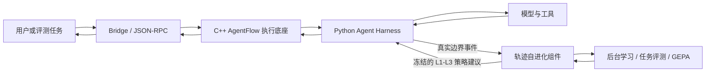

此图表示职责和数据方向，不表示所有调用都处于一个进程或同步完成。Bridge、daemon、Python worker、工具宿主与独立学习服务可能运行在不同进程；原生接入也能在调用者进程内持有本地运行时。

### 1.2 这里的“自进化”进化的是行为策略

当前主线的优化对象是经验正文、经验适用条件、经验停用/选择、模型输入模板、动作过滤约束、批次编排约束、停止或重新规划条件。**现有代码没有实现通过这些实验训练基础大模型权重，也不能据此声称 Agent 会任意修改 C++/Python 源码、自动创造新工具或无限放宽自己的权限。**

一次轨迹反思可以提出“调用 API 时使用关键字参数”“生成成功后避免重复生成”等候选。候选要经过身份范围、来源、内容修订、状态、能力和策略授权检查。被放入策略包仍然只是可供某个 run 使用；真正触发、被消费、改变执行和改善任务成绩还需要不同证据。

理解它最重要的顺序是：

```text
运行事实 → 可评估轨迹 → 问题/候选经验 → 记忆与关系整理
→ 冻结快照 → 授权策略 → 在线边界应用 → 同题任务评测
→ 搜索选优/发布 → 下一次 run 使用 → 训练反馈更新记忆
```

这条链有多道门。可以在某一道门失败或暂时停留；“记忆条数变多”“策略等级是 L3”“目录名是 published”都不能单独代表完整闭环已经成功。

### 1.3 先区分执行对象，避免把不同数量相加

| 名称 | 意义 | 常见误读 |
|---|---|---|
| 用户 / client / dialogue | Bridge 入口的调用者和对话路由信息 | `client_id` 不等于某一次模型调用编号 |
| Session | daemon 中的会话对象，承载 Agent 与 DataBus 等状态 | 会话中的 global 数据不等于跨所有用户的系统全局变量 |
| Agent / Coordinator | 接收任务并决定直接回答或调用哪些 skill 的业务主体 | 每次 Coordinator 激活不等于新的一道实验题 |
| Task / Skill Task | 需要执行的工作；skill 派发会创建对应任务和标识 | 收到派发 ACK 不等于 skill 已执行成功 |
| Workflow / Node | 描述执行结构的工作流与其中节点 | 工作流配置文件不是正在运行的那份实例 |
| execution_id | 一次具体 workflow 执行的身份 | 同一个模板可被多次独立执行 |
| Tool call | skill 内的一次实际工具请求及结果 | 工具退出码成功不自动等于用户需求完成 |
| Batch / exec_skill_key | 并发派发与 ALL join 使用的批次和技能执行键 | manifest 接收成功不等于批次全部完成 |
| Run / activity / Episode | 自进化层的运行、边界活动及分析片段 | run 闭合不等于业务通过；Episode 不等于单个用户问题 |
| Evaluation task / trial | 冻结数据集中一道任务与某版本的一次试次 | 一个 trial 可以包含多轮用户输入和多个 run |
| Memory / policy / version | 学得的经验、在线执行策略和冻结发布产物 | 当前可读 memory 视图不等于历史已发布策略的内容 |

源码中这些对象不是一一对应关系。一个多轮评测 task 可以触发多个 run；一个用户任务可以产生多次 Coordinator 决策、多个 Skill Task 和多个 workflow execution；一个 skill 可以执行许多模型轮次和工具动作。做监控和统计时必须先确定计数单位。

### 1.4 L0–L4 各自要优化什么

以下是全局读图，详细判定和源码见第 4 章。

| 层级 | 进化目标 | 行为改变的落点 | 本层成功应怎样验证 |
|---|---|---|---|
| L0 | 建立可信的观察、评估和对照基线 | 采集事实，不因策略改变当前业务行为 | 轨迹完整、评分完整，原始 Agent 正常执行；没有 L1–L3 应用 |
| L1 | 让模型参考适用的已授权经验，减少重复错误 | 模型请求前的上下文构造 | 经验确实进入实际模型请求，有 `advice.applied`；同题成绩改善且回归受控 |
| L2 | 避免已知不合法动作，改善现有候选任务的编排 | `action.filter`、`schedule.dispatch` 等动作/批次提交边界 | 真实动作被拒绝或真实批次发生合法调整；不是仅产生建议 |
| L3 | 避免无进展循环，决定继续、停止或重新规划 | `loop.decide` 与后续真实上下文消费 | 触发停止或真正消费 replan 上下文；保留必要行为且任务成绩不退化 |
| L4 | 自动搜索与选择更好的 L1–L3 行为策略 | 后台训练反思、候选评测、选择、发布 | 新策略被有效接受、通过冻结门禁并在新 run 使用；有独立验收与版本证据 |

L0 是对照条件，也是学习数据来源的一部分；L4 是后台优化过程。在线 RuntimePolicy 的合法策略等级是 L1–L3，不能把 L4 枚举理解成额外的第四类任意在线控制接口。高等级策略可以包含低等级能力，但某一轮实验未必实际触发了所有能力。

### 1.5 用哪些证据判断“做到了”

| 证据层 | 能支持的结论 | 不能替代的证据 |
|---|---|---|
| 源码与单元/集成测试设计 | 实现了某项机制、规定了某种契约 | 当前环境已可运行、真实模型已接受 |
| 配置、dataset、策略包 | 输入和候选条件已经固定 | 任务已执行、控制实际触发 |
| 原生逐题报告、轨迹与应用回执 | 可检查一次执行、判分和控制的实际路径 | 自动证明跨场景泛化或因果收益 |
| 聚合 JSON 摘要 | 可以复算摘要内部的一致性与配对变化 | 原始工具事实、Judge 正确性、历史源码身份 |
| README / WORK_STATUS | 保留历史设计、问题和阶段记录 | 当前进程存活、实验已完成、当前源码重新运行成绩 |

本文会在实验章节逐项标注证据层。本地历史产物引用过 `/root/lai-code/Agent/AgentFlow/`，当前仓库路径是 `/data/xyj/harness/AgentFlow/`；做存在性检查时已映射前缀，映射后仍缺失的文件继续记为缺失。没有通过改写路径或补造结果来填齐证据。

### 1.6 仓库目录地图

| 路径 | 主要职责 | 阅读顺序 |
|---|---|---|
| [include/external](../../include/external/) 与 [include/internal](../../include/internal/) | 公开接口与内部对象声明 | 先找对象职责，再追实现 |
| [src/agent](../../src/agent/) | Agent、Session、Task、协调与路由 | 跟随一次用户任务 |
| [src/workflow](../../src/workflow/) | 工作流、节点与图结构 | 与Task/Runtime联读 |
| [src/runtime](../../src/runtime/) | 调度、部署、Worker、DataBus与执行状态 | 区分定义与execution |
| [src/daemon](../../src/daemon/) | 服务初始化、Agent登记、RPC与响应轮询 | 先读请求入口与返回 |
| [src/sandbox](../../src/sandbox/) | 沙箱执行环境的C++适配 | 联读daemon和Python executor |
| [packages/agentflow-runtime](../../packages/agentflow-runtime/) | 公共Python Coordinator、Skill Executor、工具与产物链 | 第2、3章主线 |
| [frontend/bridge](../../frontend/bridge/) | HTTP/WS、会话历史、多模态、上传和用户交付 | 用户视角输入输出 |
| [resource/agent-packages](../../resource/agent-packages/)、[resource/skill_hub](../../resource/skill_hub/) | 可加载Agent资源与技能 | 验证包如何绑定公共实现 |
| [examples/agent](../../examples/agent/) | 具体Agent包、业务模拟与实验宿主 | 与通用机制区别开 |
| [tools/trajectory_evolution](../../tools/trajectory_evolution/) | 自进化独立组件、协议、SDK、评测、记忆与GEPA | 第4、5章主线 |
| [tools/flow_trace_viewer](../../tools/flow_trace_viewer/)、[tools/span_trace_viewer](../../tools/span_trace_viewer/) | 执行观测资料的查看工具 | 用于解释执行事实 |
| [benchmark](../../benchmark/) 与 [tests](../../tests/) | 业务数据/评测与底座测试 | 输入规模、检查与效果分开 |
| [trace_output](../../trace_output/) | 本地保留的实验/学习产物 | 文件存在性与来源逐项核查 |

目录地图用于导航，不能把一个目录存在当作其中流程已运行或依赖已完整部署的证据。


<a id="architecture"></a>

## 2. 源码架构与执行生命周期

<a id="architecture-1"></a>

### 2.1 系统定位：执行引擎、Agent 宿主和演化组件怎样组成一个系统

#### AgentFlow 当前要解决的是什么问题

AgentFlow 的底层任务，是把“用户的一次需求”变成可调度、可执行、可关联和可收尾的工作。上层 Agent 可以根据模型结果改变下一步行动；底层仍需要知道哪个会话发起了工作、有哪些分支尚未结束、结果应交给谁、什么时候可以向用户返回。这些职责决定了仓库同时包含 C++ 执行引擎、Python Agent Harness、Bridge 接口和自进化组件。理解系统时，应先看一轮任务怎样运行，再看这轮任务留下的事实怎样影响后续策略。

本章以提交 `f44bbaf4a9531731bfbd3eb6c115fe4210df95b1` 的源码为依据。下文的“当前实现”表示可以在该提交中找到的代码路径；它不自动表示某个实际部署启用了全部功能，更不表示相关策略已经取得任务收益。源码、启动配置、真实应用回执和实验结果分别回答不同问题。

最外层的 Bridge 接收 REST/SSE 或 WebSocket 消息，处理会话历史、上传文件和响应交付。C++ `agentflowd` 向外提供 JSON-RPC 服务，在内部管理 Agent、会话、任务、工作流和 Worker。Python Harness 在工作流节点中运行，调用模型、选择技能、执行工具并整理业务结果。`tools/trajectory_evolution` 则是一套可独立构建的 C++ 组件，通过明确边界观察和干预宿主，把轨迹转成评测、经验、策略及候选版本。它不要求主 Agent 的每次请求都同步进行后台反思，也不是模型权重训练器。

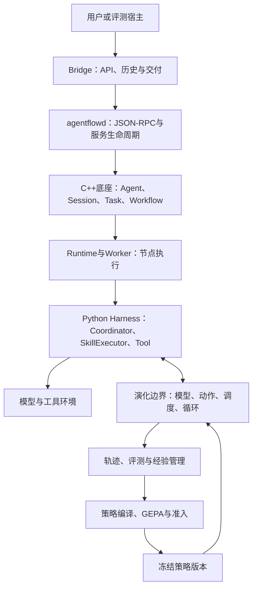

图中的反馈发生在清楚的执行边界上。模型调用前可以查询输入增强，动作前可以查询约束，下一轮循环前可以查询继续、重规划或停止的决定。后台新形成的策略供后续运行加载；已经开始的运行持有自己的策略快照。该边界使系统能够说明一次干预改变了什么，而不是只比较两份最终回答。[模型接线：llm_call.py，第 89 行](../../packages/agentflow-runtime/src/agentflow_runtime/llm_call.py)、[原生策略创建：local_runtime.cpp，第 292 行](../../tools/trajectory_evolution/src/service/local_runtime.cpp)。

#### 技术栈及构建关系应怎样理解

根项目采用 C++17，CMake 最低版本为 3.10，根构建创建 `libagentflow.so` 和 `agentflowd`。头文件分为公开接口和内部实现：`include/external` 面向外部调用者，`include/internal` 描述底座内部对象；`src` 实现这些对象。CMake 在部分依赖缺失时允许使用替代实现，例如 Protoactor 适配器、JSON 解析器或较简单的测试框架。因此，“CMake 能成功生成”不能直接等同于“使用了完整生产依赖”；判断运行环境还要看实际配置采用了哪些分支。[根构建与依赖分支：CMakeLists.txt，第 1、87、94、355、429 行](../../CMakeLists.txt)。

Python 公共执行包名为 `agentflow-runtime`，要求 Python 3.12 及以上，声明了 OpenAI 客户端、E2B、MCP、PyYAML 和 requests 等依赖。Agent 包中的短入口脚本导入这套公共实现，并将包路径绑定到对应模块；算法主体位于 `packages/agentflow-runtime/src/agentflow_runtime`，不是每个 Agent 包里另写一份协调器。Bridge 采用 FastAPI/Uvicorn、httpx、Pydantic 等工具，承担 HTTP 层的适配与交付。[Python 包声明](../../packages/agentflow-runtime/pyproject.toml)、[Bridge 运行依赖](../../frontend/bridge/requirements.txt)、[v2 入口脚本](../../frontend/bridge/templates/agent_template/harness_agent/nodes/coordinator_decide_v2.py)。

演化组件有自己的 CMake 工程，最低版本为 3.16，使用 C++17，并明确依赖 CURL、OpenSSL Crypto、Protobuf、Threads 和 RapidJSON；PNG 是可选项。它生成核心静态库、`trajectory_evolution` CLI 和 `trajectory_evolution_local` 原生共享库，还安装协议和客户端。根项目的普通构建与演化组件构建是两件事：构建 `agentflowd` 不意味着演化 CLI、原生 SDK 和全部组件测试也已构建。[独立组件构建：CMakeLists.txt，第 1、14、155、217、240 行](../../tools/trajectory_evolution/CMakeLists.txt)。

当前统一入口是 `./scripts/build.sh`。日常开发应明确使用 `./scripts/build.sh dev`，输出到 `build/dev`；release 和 production 使用其他目录。脚本当前缺省 profile 为 production，该分支会寻找 CoreMind SDK，并在缺少 `PLATFORM_DIR` 时拒绝继续。这里的“production”主要描述构建依赖及产物配置，不能作为已经部署到生产的证明。文档中早期的 `./build.sh build` 不应覆盖当前脚本的实际参数语义。[构建脚本，第 5、19、61、98 行](../../scripts/build.sh)。

从学习角度，可以把构建过程理解为三步：CMake 根据源文件、依赖和选项生成构建规则；编译器把 `.cpp` 编译并链接成库或程序；CTest/pytest 再运行指定测试。源码可读、配置可解析、编译成功、测试通过和真实模型任务验收，属于逐步增加证据的过程，任何一项都不能代替后面的阶段。

<a id="architecture-2"></a>

### 2.2 C++ 对象模型：从“一个 Agent”到“某次节点执行”

#### 哪些对象代表定义，哪些对象代表实际工作

理解 C++ 底座的关键，是把可复用定义与某次执行分开。`MMAgent` 表示一个已加载的 Agent 对象，持有配置、工作流模板、会话集合和消息路由。`MMAgentSession` 表示分配给某个用户与客户端路由的底座会话，保存任务和消息队列。`MMAgentTask` 表示待运行或正在协作的一份工作，保存任务类型、工作流标识和业务参数。`MMWorkflow` 表示节点与边组成的执行图；Runtime 每次真正执行时复制模板，创建独立的执行状态。`MMNode` 才是最终交给执行器运行的基本单元。

因此，一道用户题目不会天然对应一个 Task，也不会天然对应一次 Workflow execution。一次 Dialogue 可以包含多次 Coordinator activation、一个或多个技能批次、多个 Skill Task，以及若干工作流执行。自进化里的 Run 又有自己的采集身份和终态契约。统计时必须先明确分母：用户输入次数、技能分支数、模型调用数和循环迭代数互不相同。[Agent 对象](../../include/internal/agent/agent.h)、[Session 对象](../../include/internal/agent/session.h)、[Task 对象](../../include/internal/agent/task.h)、[Runtime 逐执行状态，第 190 行起](../../include/internal/runtime/agent_runtime.h)。

| 对象或身份 | 表示的内容 | 典型生命周期与输出 |
|---|---|---|
| Agent package | 可加载的文件集合与配置 | 被加载成 MMAgent；包括流程、节点入口和 Agent 资源 |
| MMAgent | 运行时中的 Agent 对象 | 管理工作流、Session、Task 和响应队列 |
| user_id / client_id | 业务用户及其客户端会话路由 | 为同用户的不同客户端区分上下文 |
| session_id | 底座内部 Session 身份 | 会话分配、Task 路由、DataBus 命名空间 |
| dialogue_id | 一轮输入到返回的业务关联身份 | 串联取消、模型/技能事实、最终候选和交付 |
| MMAgentTask / task_id | 一份协调、派发或技能工作 | 进入 Runtime 调度，产生完成或失败消息 |
| workflow_id | 被执行的流程定义 | 同一定义可多次执行 |
| workflow_execution_id | 某次工作流实际运行 | 独立 inputs、节点状态、终态输出及 UDS 生命周期 |
| batch_id / exec_skill_key | 一次技能派发及其中一个分支 | 对应 manifest、独立终态、ALL join 和结果回接 |

这张表同时解释了为什么不能只用“同一个 workflow_id”隔离并发结果：两个技能分支完全可以执行同一 `skill_workflow` 模板；真正隔离的是不同 execution 的克隆、状态和终态快照。它们可能共享底层服务，但不应互相覆盖业务身份。

#### MMAgent 与 AgentRegistry 各自负责什么

`AgentRegistry::load_agent()` 接收包路径和可选名称覆盖，先检查包内 `package.json`，再调用 `MMAgent::create_from_package()` 创建 Agent、执行 `initialize()`，随后注册到 `MMAgentRuntime`，最后保存可查询的 AgentEntry。Registry 主要回答“这个 agent_id 对应哪个已加载对象、来自哪个包”；真正的会话与技能运行仍由 Agent 和 Runtime 完成。卸载时 Registry 停止 Agent、向 Runtime 注销并移除登记。[加载与卸载实现：agent_registry.cpp，第 17、62 行](../../src/daemon/agent_registry.cpp)。

`MMAgent` 对外提供 `route_request_message()`、`dequeue_response_message()`、`get_or_create_session()`、`pop_generated_task()` 等方法。它既是工作流模板的拥有者，也是消息进入具体 Session/Task 的枢纽。Agent 的生命周期策略包含 PER_REQUEST、FACTORY、SINGLETON，但不应仅凭枚举名称推断某个包实际采用了何种重用行为；这要由包配置与创建流程确认。[Agent 接口与配置：agent.h，第 77 行起](../../include/internal/agent/agent.h)。

Agent 还有 DataBus 访问指针、会话及对话清理方法，以及 Session/Dialogue/Task 生命周期回调。这里的 `save()`、`load()` 等包或配置存储接口，与“正在执行的工具进程在断电后可续跑”是不同契约。保存 Agent 定义只说明定义可以重新加载；是否保存执行上下文，必须继续追踪 Runtime 和轨迹组件的状态所有权。

#### Session 为什么既有业务路由，又有内部池化身份

用户消息通常携带 `user_id` 和 `client_id`。`SessionRouter::handle_route_message()` 将其组合为路由键，调用 `allocate_session_for_route()` 查找或分配 Session，再将消息交给路由回调。同一路由在 Session 初始化期间要等待；传入已有 session_hint 也不能覆盖其他路由已拥有的 Session。Router 维护物理 Session、活动 route 与两者间的所有权关系，避免只因知道某个内部 ID 就改变其用户归属。[Session 分配实现：session_router.cpp，第 154、175 行](../../src/agent/session_router.cpp)。

Session 本身保存用户/客户端绑定、最后活动时间、配置中的队列容量和超时，以及 dispatcher、coordinator 和普通 Task。`activate()`、`complete()`、`terminate()`、`reset_for_pool()` 描述的是底座会话生命周期。`active_seq` 在每次激活时增加，用于识别会话已经归还又被重新使用的情况：旧清理回调不能仅凭相同 session_id 删除新使用者的数据。[Session 接口：session.h，第 116 行起](../../include/internal/agent/session.h)、[按复用序号清理：agent.h，第 143 行起](../../include/internal/agent/agent.h)。

同会话轮次的并发保护有不同位置。Bridge 的 `_active_dialogues` 按 `(user_id, client_id)` 登记活动轮次，已登记时拒绝再占用该路由。C++ Session 也提供 `DialogueLockGuard`：等待当前 Dialogue 释放执行槽，守卫销毁后唤醒下一个等待者。当前 `agent.cpp` 中显式获取该锁的位置在“预配置 dispatcher、且无 workflow”的分支。因此可以说系统存在这些保护机制，但不能据此断言所有 SDK、RPC 或自定义包入口都自动获得完全相同的会话串行保证。[Bridge 活动轮次登记，第 129 行](../../frontend/bridge/routes/chat_rest.py)、[Session 锁实现，第 367 行](../../src/agent/session.cpp)、[实际调用分支，第 1583、1613 行](../../src/agent/agent.cpp)。

#### Task 怎样转为工作流执行

Task 的输入是配置和消息：`task_type` 说明它是 dispatcher、coordinator 还是 skill 等角色，`workflow_id/workflow_file` 指定执行模板，参数表携带 input、dialogue、skill、batch 和结果等信息。Task 保存自身状态 PENDING、RUNNING、COMPLETED、FAILED、CANCELLED、INTERRUPTED，并维护 intent_request、data_exchange、response 三类队列。其消息线程和 dispatch record 处理的是“工作消息有没有送达、是否收到回应”，并不直接做语言模型推理。[Task 配置、状态与队列：task.h，第 22 行起](../../include/internal/agent/task.h)、[Task 状态转换：task.cpp，第 30 行起](../../src/agent/task.cpp)。

一个容易误解的点是：Task 头文件保存的是工作流 ID 和文件，并没有直接持有一个运行中的 `MMWorkflow` 图对象。真正启动图的是 `MMAgentRuntime::agent_task_poller_loop()`。它取出 Agent 生成的 Task，读取参数，确保有对应工作流池，形成 `TaskScheduleRequest`，取得调度结果，再调用 `execute_workflow()`。输入参数包含 `exec_skill_key`、`batch_id`、`completed_batch_key` 等，供后续 Python 节点恢复准确的业务身份。[Task 轮询与派发：runtime.cpp，第 2074、2162、2214、2264 行](../../src/runtime/runtime.cpp)。

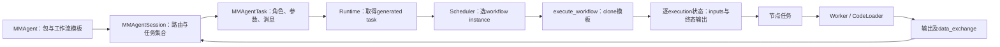

C++ `SessionTaskCoordinator` 也会根据消息与配置生成 Task、解析应该使用哪个工作流，并聚合会话结果。它是任务路由协调器。Python `coordinator_decide.py` 则调用模型决定直接回答还是运行技能。两个模块名字相近，输入输出却不同：前者处理底座消息和工作流映射，后者处理模型消息、工具选择和业务规划。[C++ Coordinator 接口](../../include/internal/agent/coordinator.h)、[C++ Coordinator 实现](../../src/agent/coordinator.cpp)、[Python v1 入口，第 910 行](../../packages/agentflow-runtime/src/agentflow_runtime/coordinator_decide.py)。

#### Workflow、Scheduler、Deployer 和 Worker 为什么需要分开

Workflow 是“怎样执行”的图定义，包含 Node、Edge、条件、循环及错误策略。节点可以使用 C++ function、Shell、外部可执行程序、Python、Go、Java 或共享库模式。Graph 层具备条件和环回相关控制接口，不能因为自进化分析器会对标准事件 DAG 做校验，就把宿主所有工作流都描述为一次性、无循环的 DAG。这是执行图与事件因果图的区别。[工作流控制类型及 MMWorkflow](../../include/internal/workflow/workflow.h)、[节点执行模式：node.h，第 64 行](../../include/internal/workflow/node.h)。

`execute_workflow()` 每次先从 Agent 取得模板，调用 `clone()`，然后生成 execution_id 并建立 `WorkflowExecutionState`。该状态保存输入、completed/failed/queued/running 节点、在途异步计数、源 Task 身份、逐执行 terminal_outputs 和对应 UDS。`process_node()` 按该状态取输入并执行节点；`schedule_workflow_executable_nodes()` 找下一批就绪节点；`update_workflow_state()` 推进执行及收尾。这样并发运行同一模板时，节点的执行状态不共享。[执行克隆：runtime.cpp，第 564、585 行](../../src/runtime/runtime.cpp)、[逐执行状态：agent_runtime.h，第 190 行起](../../include/internal/runtime/agent_runtime.h)、[节点推进：runtime.cpp，第 785、1465、1531 行](../../src/runtime/runtime.cpp)。

Scheduler 决定“Task 使用哪个 Workflow instance”。其输入包含 task_id、Agent object/instance、workflow_id/file，输出是 scheduled、workflow_instance_id 和 worker_id。默认算法先筛相同定义和文件，再优先同 Agent instance、同 Agent object，最后使用任意匹配实例；选取时结合实例引用计数与已分配 Task 的负载。这里的“智能调度”是资源映射，不是模型判断下一步工具。[调度请求与结果](../../include/internal/runtime/master/scheduler.h)、[默认算法：scheduler.cpp，第 67 行](../../src/runtime/master/scheduler.cpp)。

Deployer 管理 Workflow instance 到 Worker 的映射，跟踪 Worker 状态、负载与心跳，也提供部署请求、rebalance 和失效处理接口。Scheduler 与 Deployer 分开，意味着选一个合适的流程实例和把该实例放到某个 Worker 上是两类决定。当前共享状态接口的一个具体实现是 `InMemoryRuntimeSharedState`，其 workflow/task 表由内存 map 和 mutex 维护。代码有 Master/Worker 角色及映射接口，不构成“任意分布式部署已经可靠运行”的实验凭据。[Deployer 接口](../../include/internal/runtime/master/deployer.h)、[共享状态定义及内存实现：shared_runtime_state.h，第 12、56 行](../../include/internal/runtime/shared_runtime_state.h)。

Worker 最终接收 `ExecutionRequest`，将业务输入、工作目录、timeout、模型配置、DataBus 和沙箱信息整理成执行配置，然后交给 CodeLoader 或沙箱执行。Worker 在输入循环中将参数名转为 `AF_...` 环境名；Python 的 runtime_context 再以统一函数读取。因此跨语言边界主要传递的是明确字段，而不是直接访问 C++ Task 对象。执行响应包含 success、stdout、stderr 和输出等，但进程正常返回仍可能报告业务失败。[Worker 执行：worker.cpp，第 31、170、294、456 行](../../src/runtime/worker/worker.cpp)、[Python runtime_context](../../packages/agentflow-runtime/src/agentflow_runtime/common/runtime_context.py)。

#### DataBus 是协调通道，不是所有状态的持久化数据库

`MMDataBus` 封装本地与远程访问，提供 put/get/remove、前缀清理、订阅和数据引用接口。数据引用记录 payload 的身份、地址和校验信息，便于控制消息只携带引用；普通键值则用于节点间交换 prompt、结果和派发清单。DataBus 的会话命名空间形如 `/session/{session_id}/{namespace}/...`，Python 公共 wrapper 又在 sys 中加入 dialogue 前缀，防止不同轮次读到同名键。[DataBus 接口：databus.h，第 21 行](../../include/internal/runtime/databus/databus.h)、[节点命名空间](../../include/internal/runtime/databus/node_databus_client.h)、[Python wrapper，第 41、48 行](../../packages/agentflow-runtime/src/agentflow_runtime/databus_client.py)。

例如 `databus.put("next_skills", ...)` 不是向全系统写一个永远通用的 `next_skills`。wrapper 结合当前 session/dialogue，把它映射到该轮的 sys 位置，C++ 据同样规则读取。`put_global()` 则不再附加 Dialogue 前缀，但仍使用当前 Session 的 sys namespace；它并不表示跨用户、跨 Agent 的全局数据库。这个命名区别特别影响 manifest：manifest 键自身包含 Dialogue 和分发轮次，所以即使使用 global 方法，也仍有明确业务唯一性。[普通及 global 键访问：databus_client.py，第 114、192 行](../../packages/agentflow-runtime/src/agentflow_runtime/databus_client.py)。

DataBus 当前路径涉及内存、本地 channel、共享内存、UDS 和文件桥等实现。它为运行时交换服务，不能从 put 成功推出跨掉电的持久保证。Bridge 的会话历史、SessionLog、演化组件的 run 状态和权威 memory 分别有自己的保存路径与恢复语义。学习系统不能仅依赖某个临时 DataBus 键存在，就认为整条轨迹已经完整归档。

<a id="architecture-3"></a>

### 2.3 Python Harness：v1 派发技能，v2 在同一循环中直接使用工具

#### v1 为什么会多次进入 Coordinator

v1 的核心模式是“模型决定 → 提交技能工作 → 让出控制 → 技能完成 → 重新进入协调器”。`coordinator_decide.execute()` 从环境和 DataBus 恢复本轮输入、历史 messages、已完成技能或 batch 结果，构造模型请求。模型可以直接给出回答，也可以请求 `run_skills`。后者不是普通的本地工具函数调用：它需要把分支身份写到 DataBus，交由 C++ 创建 Task 并执行对应 Workflow。

`handle_run_skills_call()` 先校验输入，再为一次派发生成 batch_id，为每个请求生成不同 dispatch key。manifest 包括真实 skill_name、prompt、load_skills、batch_id、request_index 和 force。必须先写 manifest，再提交 `next_skills`；否则 C++ 已启动的 skill-runner 可能还读不到自己应该执行的技能。所有业务技能可以通过通用 `skill-runner` Task 运行，真实身份从 manifest 恢复。函数返回的是 accepted dispatches、rejected、warnings 等派发确认，不是技能已完成的回答。[派发函数：coordinator_decide.py，第 441 行](../../packages/agentflow-runtime/src/agentflow_runtime/coordinator_decide.py)。

v1 会防止已经以相同技能和 prompt 完成的工作被无理由重复派发，也保留明确 force 的重新执行通道。它还处理部分 manifest 写入失败、`next_skills` 提交失败、异步 batch 回接和 Coordinator 上限。后续进入时，结果必须接回原来模型提出的 Tool Call，避免产生“assistant 声称调用了工具、但没有对应 tool result”的消息序列。模型上下文不只是把所有日志串起来，还需要维护调用与返回配对。[完成结果回接，第 622、716、745 行](../../packages/agentflow-runtime/src/agentflow_runtime/coordinator_decide.py)、[完成结果消费标记，第 698 行](../../packages/agentflow-runtime/src/agentflow_runtime/coordinator_decide.py)。

一旦 batch 结果可用，Coordinator 先解析并接受聚合，在可能提前退出的 guard 前写消费标记。C++ 的最终返回门禁会检查这一步；如果所有分支已终止，但 Coordinator 从未消费 completion_batch，就不能仅因为本次 Python 进程退出而认为整个业务已结束。这个机制把“子工作完成”与“父协调器已理解并处理结果”分开。[批次恢复与消费：coordinator_decide.py，第 1057 行起](../../packages/agentflow-runtime/src/agentflow_runtime/coordinator_decide.py)、[C++ pending 门禁：agent.cpp，第 3573 行起](../../src/agent/agent.cpp)。

#### v2 改变的是协调方式，不是把 C++ 底座删掉

v2 的 `coordinator_agent_loop.execute()` 在一个 Python 执行过程中持续推进模型与工具循环。它提供给模型的是工具注册表中的工具，而不是仅提供 `run_skills`。工具执行后继续当前循环，不把每次模型决策都作为新技能 Task 让出给框架；进程内 messages 保留当前工具上下文，因此不依赖 v1 的 completed_skill 回接变量。这是源码自己列出的 v1/v2 差异。[v2 主入口说明：coordinator_agent_loop.py，第 131 行](../../packages/agentflow-runtime/src/agentflow_runtime/coordinator_agent_loop.py)。

v2 仍通过工作流节点和 Worker 启动，也仍使用 DataBus、Agent 包资源、模型 recorder、hooks、工具注册表及产物整理。它把较多协调过程放入一个 Agent loop；它不是绕开 agentflowd 后直接运行一个无状态模型 API。理解这种变化有助于划分优化目标：v1 有技能分支派发与异步回接成本，v2 有进程内工具循环和消息压缩成本，两者的性能及进化收益需要在同一任务、预算和配置下分别测量。

默认模板的 shell wrapper 在 `AF_COORDINATOR_VERSION` 未设置时选择 v2 脚本。与此同时，`llm_call.py` 对该环境变量的缺省值按 v1 判断；`skill_executor.py` 也在显式非 v1 时关闭其隐式演化包装。v2 导入并调用同一个 call_llm，而 wrapper 选择 v2 时没有自动 export 环境值。因此，缺省脚本选择、Python 判断和演化配置必须一起核验：显式 v2 环境会关闭这些 wrapper；环境未设且演化配置有效时，共享模型调用仍可能进入模型打点。这属于当前集成的一致性边界，完整 v2 接线尚不能从单个文件的引用数量推断。[模板选择，第 24 行](../../frontend/bridge/templates/agent_template/harness_agent/nodes/coordinator_decide.sh)、[模型环境判定，第 89 行](../../packages/agentflow-runtime/src/agentflow_runtime/llm_call.py)、[v2 共享模型函数，第 32、370 行](../../packages/agentflow-runtime/src/agentflow_runtime/coordinator_agent_loop.py)。

专用复现和实验宿主显式设置 v1，例如 v1-L3 manifest、BFCL host 和 AppWorld runtime。描述这些实验时，可以说明受测路径的版本；不能自动把实验结果推广到默认业务模板、所有 Agent 包或所有部署模式。[v1 复现配置，第 29 行](../../configs/reproduction/v1-l3/manifest.json)、[BFCL host，第 306 行](../../tools/trajectory_evolution/experiments/bfcl-v3/bfcl_v3_host.py)、[AppWorld runtime，第 341 行](../../examples/agent/business-simulator/appworld/appworld_agent_runtime.py)。

#### SkillExecutor 的输入和输出究竟是什么

`skill_executor.execute()` 的直接输入不是一段自由文本，而是环境中的业务身份加上 DataBus 中对应 manifest。它用 exec_skill_key 读取清单，取得 skill_name、prompt 和需要加载的技能文档，确保自己的技能文档也在加载范围内。然后组合任务指令、Skill 文档、工具集合及执行约束，进入模型/工具循环。manifest 缺失、格式错误或身份不完整走明确错误出口；不能把这类问题当成“模型没有找到答案”。[Skill 输入恢复：skill_executor.py，第 409、449、553 行](../../packages/agentflow-runtime/src/agentflow_runtime/skill_executor.py)。

Skill 是任务能力与指导材料，Tool 是能够执行的一次操作。一个 Skill 可以调用多个 Tool；同名 Skill 的两个独立请求也可以有不同 prompt 和 exec key。`_LocalToolRegistry` 负责工具发现和路由，加载对应目录的工具模块，也支持 MCP server 工具。其 `execute(name, args)` 检查工具名称和参数、保护敏感内容，区分 MCP 和宿主/沙箱路径，并返回可回灌给模型的结果。[工具注册表：tool_registry.py，第 103、216 行](../../packages/agentflow-runtime/src/agentflow_runtime/tool_registry.py)。

因此，Tool 失败不必然等于 Skill 失败。模型可能从一个失败观察中调整参数，再完成任务；反过来，Python 进程退出码为 0 也不必然等于 Skill 完成，因为它可能正常返回 `max_rounds_reached`、`llm_error` 或 interrupted。Skill 输出包含真实 skill_name、status、skill_result 和 artifacts 等结构化字段，Worker/Runtime 需要分别解释框架成功和业务成功。[Skill 结构化完成出口，第 1664 行起](../../packages/agentflow-runtime/src/agentflow_runtime/skill_executor.py)、[Runtime 业务状态映射，第 1710 行起](../../src/runtime/runtime.cpp)。

#### 两种并行不能混成同一个优化点

第一种并行是 C++ 中不同 Skill Task 的并行：Coordinator 一次提出多个技能请求，底座按 max_concurrent_skills 放行分支。第二种并行是 Python 中一轮模型提出多个 Tool Call 后的批次执行。它们共享“请求与结果必须对应”的要求，但父节点、预算和资源冲突不同。

`tool_policies.build_batches()` 按工具性质把连续请求分组；可安全并行的只读调用可以同批，允许独立新文件写入的调用也有对应分类，未知或普通写操作保守串行。只读和 parallel-write 不混在同批，避免生成后立即读取却读到旧数据。同类写入如引用相同输出路径，也需要断批。`execute_in_batches()` 在批次间保持原顺序，并返回与原 Tool Call 列表一一对应的结果，消息回灌及产物合并由调用者按原顺序处理。[工具批次构造：tool_policies.py，第 143 行](../../packages/agentflow-runtime/src/agentflow_runtime/tool_policies.py)、[批次执行，第 265 行](../../packages/agentflow-runtime/src/agentflow_runtime/tool_policies.py)。

这里的分类和超时执行器不是一个一般性的冲突证明器，不能保证任意两个业务工具互不影响。源码中“只读白名单、明确输出身份、保守未知分类”是当前实现落实并行的边界；对于专用工具是否能够并行，还要根据真实资源身份和工具语义确认。自进化生成的技能依赖规则同样必须落到实际派发位置，不能仅把建议文本写进经验库就称为编排已改变。

<a id="architecture-4"></a>

### 2.4 一次请求的完整生命周期：从输入到返回，以及中间的 ALL join

#### 进入服务时先建立哪些身份和事实

`agentflowd_main.cpp` 先解析 CLI，再按 CLI > ENV > File > Default 应用配置，验证后构造 Daemon、初始化并进入 run。Daemon 启动日志和 trace、配置 DataRef bridge 与沙箱管理、创建 Runtime 和 AgentRegistry、加载 Agent、启动 Runtime 与 Agent，最后建立 RPC Server、ResponsePoller 和 EventBroker。这里的顺序有实际意义：RPC 可以接受用户请求之前，运行对象及响应关联机制应已可用。[进程入口：agentflowd_main.cpp，第 16 行](../../src/daemon/agentflowd_main.cpp)、[服务初始化：daemon.cpp，第 82 行](../../src/daemon/daemon.cpp)。

正常 REST 请求由 `chat_rest()` 解析，生成或绑定一轮 dialogue_id，结合用户和客户端加载会话历史，将请求发送给 Daemon。`RpcHandler::handle_agent_execute()` 要求 agent_id、user_id、client_id 和 content 非空，并校验身份组件；它为请求建立 trace_id 和 message_id，构造 TASK_REQUEST/intent_request，附加 dialogue、用户、客户端以及沙箱上下文等信息。最终通过 Agent 路由消息并注册响应关联。[REST 调用 Daemon，第 471 行](../../frontend/bridge/routes/chat_rest.py)、[RPC execute，第 418、646、661 行](../../src/daemon/rpc_handler.cpp)。

沙箱创建与文件路径改写发生在进入业务路由之前，以便 Worker 取得明确的执行环境。这与 Artifact 下载地址是两套配置：前者告诉工具在哪里执行，后者告诉生成物怎样上传或被用户读取。Model API、sandbox endpoint、artifact endpoint 和演化 endpoint 也不能混成一个“服务地址”。理解配置时应始终追踪读取该字段的具体模块，而不是只看 `.env` 中变量名字。

#### C++ 怎样把一份派发清单变成多个独立分支

v1 Coordinator 把 manifest 写好并提交 `next_skills` 后，C++ `process_harness_batch_launch()` 检查批次身份和分支清单，将 expected exec keys、dispatch_order、queued 与 active 集合、terminal_results、source_task_id 等保存在 BatchState。它将 next_skills 作为一次性提交消费；后续推进以 BatchState 为准，不重复读取同一清单并再次派发。[批次注册：agent.cpp，第 3133、3198 行](../../src/agent/agent.cpp)。

`pump_harness_batch()` 每次检查活动分支数是否达到上限，再按 dispatch_order 选择仍在 queued 集合的分支。选中后把它移到 active，调用已有技能 Task 启动路径。技能执行完成回传 batch_id 与 exec_skill_key，`handle_harness_batch_terminal()` 只接受当前批次中已知分支的终态；未知 key、非终态通知和重复终态不会再次推进计数。启动失败也要填入对应终态槽，避免一个无法启动的分支永远阻止合流。[放行分支：agent.cpp，第 3228 行](../../src/agent/agent.cpp)、[终态处理，第 3453 行](../../src/agent/agent.cpp)。

下面这段实际条件说明了 ALL join 的判据：

```cpp
if(state.terminal_results.size() == state.expected_exec_keys.size()) {
  if(state.coordinator_triggered) {
    return launched_count;
  }
  state.coordinator_triggered = true;
}
```

这里比较的是“已经取得多少个预期分支的终态”，不是“有多少分支成功”。失败、取消和明确的启动失败同样能够结算一个分支。所有分支收齐后，底座按原派发顺序聚合结果到 `completion_batch:{batch_id}`，写出 workflow_success、skill_success、skill_status、skill_result 和 artifacts，再向来源 Task 触发一次 Coordinator。部分成功得到 partial，全部业务失败得到 false。[ALL join 与一次触发：agent.cpp，第 3252、3285、3346、3374 行](../../src/agent/agent.cpp)。

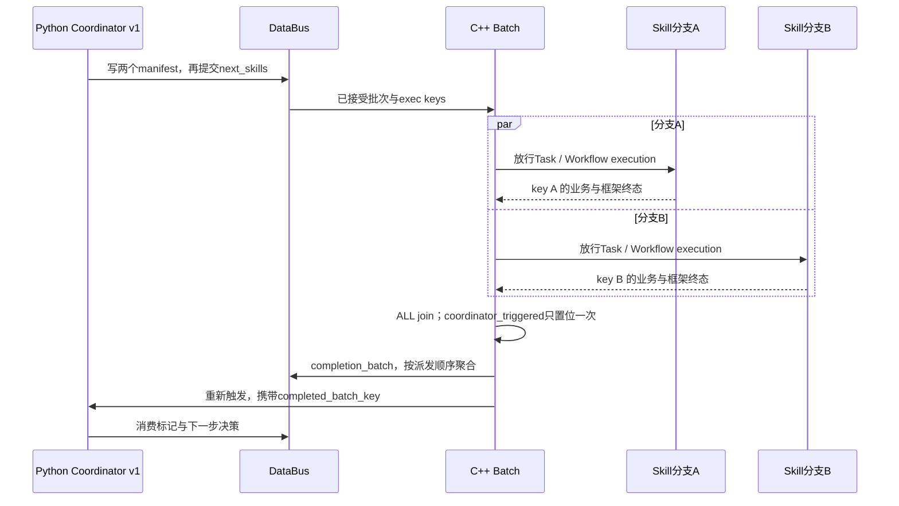

这也说明了一个方法边界：批次先失败后恢复的事实，必须保留同一个分支 identity 才能被正确分析。若只收集一个“batch failed”，就无法区分工具失败、Skill 不满足需求、Workflow 框架错误、部分分支取消和 Coordinator 未消费结果等原因。

#### Node 执行的完成为什么还需要异步屏障

Runtime 中每次 Workflow execution 有 queued/running/completed/failed 节点集合，并记录异步 pending 计数。节点调用 AsyncCall SDK 后可以进入 ASYNC_PENDING；回调可能早于状态切换到达，因此代码保存 pending callback 并在节点状态就绪后重新调度。仅因为启动某段代码的主函数返回，不能直接说该节点的异步业务已经全部结束。[异步状态与回调处理：runtime.cpp，第 1374、1395、2977 行](../../src/runtime/runtime.cpp)。

这里存在两类“待完成”：Runtime 的异步节点/回调 pending，以及 Harness 批次尚未结算或尚未消费的 pending。它们分别属于执行器和业务协调层。读取日志时，如果不区分二者，容易把“程序已经返回 ACK”误认为“工具任务完成”，或者把“技能全部结束”误认为“最终答复已经生成”。

#### 响应如何回到正确用户，以及什么时候完成交付

`ResponsePoller::register_request()` 保存 message_id、agent_id、client fd 和 dialogue_id。poll_loop 从 Agent 响应队列取消息，优先匹配 message_id；对工作流结果或没有 message_id 的 progress 通知，则用 agent_id + dialogue_id 精确关联。对于携带 dialogue_id 的响应，不能因为没找到请求，就发给同 Agent 的另一轮。这个机制保证同一个 Agent 同时服务多个用户时，进度与结果不会仅依赖“Agent 相同”来猜接收者。[响应登记与精确关联：response_poller.cpp，第 60、91、113 行](../../src/daemon/response_poller.cpp)。

Bridge 进一步把业务候选处理成 REST 或 SSE 响应，转换内容和 Artifact，引入最终交付观察，并持久化会话历史。progress、LLM token 和最终 answer 是不同内容；流式展示不能自动成为完整 assistant 历史。代码对 error、done、final、disconnect 分别处理；出错未完成的轮次不能因为已经发送一些 progress 就被保存成正常完整答复。[流式交付与历史保存：chat_rest.py，第 1198、1259、1310、1338 行](../../frontend/bridge/routes/chat_rest.py)。

如果连接在轮次完成前断开，Bridge 调用 `_cancel_dialogue()`，按准确用户/客户端/Dialogue 查询 Session 并发送 DIALOGUE-INTERRUPT，释放资源。C++ 的 `handle_dialogue_interrupt()` 找出该 Dialogue 的任务与批次，标记中断，并设置 Python 可观察的 interrupt flag。取消不仅是“不再等待”，还要让尚未启动和正在运行的工作得到明确终态。[Bridge 取消，第 144 行](../../frontend/bridge/routes/chat_rest.py)、[C++ Dialogue 中断，第 1190 行](../../src/agent/agent.cpp)。

#### 怎样正确理解五种失败和多种“完成”

| 状态轴 | 输入依据 | 输出含义 | 不能自动推断的结论 |
|---|---|---|---|
| Tool 业务状态 | 工具返回、超时或拒绝 | 此次操作成功、失败或未执行 | 整个 Skill 必然失败 |
| Skill 业务状态 | 工具观察、模型结果、回合预算 | 委派需求是否完成 | 进程退出码一定非零 |
| Workflow 执行状态 | 节点执行器、框架终态与异步屏障 | 该次图执行是否按协议完成 | 用户任务严格通过 |
| Batch 状态 | 全部预期exec key的结算 | 全成功、部分成功或全失败 | Coordinator已消费或用户已收到 |
| Delivery 状态 | Bridge发送/断开事实 | 服务端如何交付本轮内容 | 客户端已确认接收 |

Runtime 收尾读取当前 execution 的 terminal_outputs，而不是用兄弟分支可能覆盖的 Dialogue 同名结果当权威。业务 status 若属于明确失败集合，skill_success 会为 false，即使工作流框架返回正常。若旧路径没有结构化业务字段，代码仍存在兼容回退；这种回退属于兼容语义，不应被用来代替外部 benchmark 的严格验收。[逐执行终态及成功映射：runtime.cpp，第 1710—1758 行](../../src/runtime/runtime.cpp)。

“框架完成但业务失败”是合法组合；“某个 Tool 失败后 Skill 成功”也是合法组合。正确的自进化反馈必须保留这些不同层次的事实。否则系统可能奖励了正常返回错误文本的程序，或惩罚了有效识别问题并完成恢复的行为。

<a id="architecture-5"></a>

### 2.5 可观测性：哪些材料能够解释行为，哪些只能说明系统还活着

#### FlowTrace、Span 和 SessionLog 各提供什么

FlowTrace 主要描述框架消息流和运行路径，例如输入、派发、执行、响应。Span 描述执行区间、父子关系、调用身份和耗时，适合定位时间花在模型、工具还是跨进程协调上。SessionLog 则围绕 User/Conversation/Dialogue 整理业务事实：头部身份、Coordinator 决策、Skill 与 Tool 事件、LLM 调用、业务终态和 Bridge 交付。三者有交集，但不是三份完全相同的数据。[Daemon trace初始化：daemon.cpp，第 108、121 行](../../src/daemon/daemon.cpp)、[Python观测接口：observability.py，第 49 行](../../packages/agentflow-runtime/src/agentflow_runtime/observability.py)。

当前 SessionLog hook 示例默认由 `AF_SESSIONLOG_ENABLED` 控制，不是每个启动环境无条件生成。路径按用户、会话和 Dialogue 组织；header 保存 model、code_revision、code_dirty 等背景。事件信封包含 event_id、producer_sequence、producer_id、trace/span、task/node 和 causal parent 等，用于后续配对和追踪。[SessionLog hook，第 37、221、232、296 行](../../resource/agent-packages/outfit-assistant/harness/hooks/sessionlog_hook.py)。

有文件并不表示每种事件都有记录。若某个 hook 没启用，某类调用未进入 recorder，或者进程异常退出未形成终态，缺失就应作为缺失说明。调用次数、token、无效 loop 等指标必须附带覆盖范围，不能把未记录的字段补零，再用这些零宣称成本减少。

#### 并发因果为什么不能按日志时间排序猜测

时间戳适合观察“何时发生”，却不足以证明“由谁导致”。同一进程的 producer_sequence 可以排序该生产者的事件，不代表多个 Python 进程形成统一连续序列。跨进程因果需要稳定业务键：Dialogue 对应轮次、batch 对应一次派发、exec_skill_key 对应分支、tool_call_id 对应调用与返回、workflow_execution_id 对应一次图运行。

标准演化 Identity 包含 run_id、agent_id、user_id、conversation_id；底座 session_id 是另一层路由身份。两者关联但不应强行合并字段。自进化的 `caused_by`、point 的 parent/ref 和 SessionLog 的 causal_parent_event_ids 也属于不同数据结构里的关联工具。它们最终要指向真实父子事实，不能仅因字段名类似就自动互换。[标准 Identity，第 28 行](../../tools/trajectory_evolution/proto/trajectory_trace.proto)、[边界协议](../../tools/trajectory_evolution/api/boundary-v1.schema.json)。

例如一个 Coordinator 同时提出读文件与生成图片，两条分支可能乱序完成。聚合给模型的结果可以按 dispatch_order 保序，但原始时间线要保留真实结束顺序；“输出顺序较早”不意味着“执行较早”。这对识别资源依赖、重复失败和无效循环尤其重要。

#### 应用回执与最终交付的证据强度不同

策略打点通常经历 before 查询、宿主实际执行、after 观察。`advice.applied` 表示组件按约定核验了真实边界是否执行了建议，例如模型请求包含预期注入、动作遵守决定，或循环采用了 stop/replan。它证明机制介入，不证明介入有益；收益仍要根据任务成功和反事实/配对对照测量。

Bridge 追加的 `client.delivery` 明确带 `delivery_claim="server_side_observation"`、`client_acknowledged=False`。这说明服务端观察到送出内容或结束流的动作；没有客户端 ACK 时不能写成“已经证实用户收到了完整答案”。模型候选答复与服务端交付也应保留各自的正文 hash，方便发现转换、Artifact 增补或断开造成的区别。[交付信封：sessionlog_delivery.py，第 257—267 行](../../frontend/bridge/services/sessionlog_delivery.py)。

运维上也要区分“进程存活”与“任务完成”。进程、端口、GPU 或 metrics 有活动，只说明资源和服务状态；是否完成一轮业务，要看终态和输出；是否完成学习，要看 evaluation/job；是否产生合格策略，要看准入和发布结果。使用这些证据层次，可以防止把长时间运行的搜索进程当成有效迭代已经推进。

<a id="architecture-6"></a>

### 2.6 持久化与恢复：需要分别追踪运行状态、采集状态和学习状态

#### 哪些状态还在内存，哪些已经进入权威文件

主 Runtime 的 workflow/task 分配以及活动执行状态大量由内存表持有。Bridge 会话历史、SessionLog 和演化 data_dir 保存不同层的资料；其中私人 `evolution-memory.pb` 是权威记忆，JSON 是便于阅读的视图。公共 memory PB 是公共治理账本产生的可用投影，不能与私人 schema 混用。run 文件、trace、evaluation、batch、memory 和 agent-evaluation 状态是逐阶段产物，不是一次数据库事务中的同一张表。[运行时内存状态](../../include/internal/runtime/shared_runtime_state.h)、[权威与派生存储说明](../../tools/trajectory_evolution/docs/18-storage-and-recovery.md)。

这意味着一个任务已经答复，可以仍等待轨迹落盘或后台评测；一个 evaluation 已完成，可以仍没有批准经验；一个策略已导出，也可以只是未达目标的最佳可用版本。阅读产物时，应回答“这个文件对应哪一步的权威事实”，再判断下一步是否结束，而不是根据文件存在推定整个链条成功。

#### 原生 LocalRuntime 为什么快，以及因此不保证什么

原生客户端通过 C ABI 在进程内调用 LocalRuntime。初始化阶段加载服务环境及记忆、分配有界 slot；run 开始时筛选私有/公共经验、编译策略并绑定 PolicyRuntime。业务打点主要修改有界内存，不在每个边界同步写磁盘或调用反思模型。后台 writer 做持久化，learner 推进学习及状态刷新。这种分离降低了主链的阻塞，但接受回执不等于 durable receipt。[原生客户端](../../tools/trajectory_evolution/clients/python/evolution_local.py)、[初始化及固定策略：local_runtime.cpp，第 179、292 行](../../tools/trajectory_evolution/src/service/local_runtime.cpp)。

当前 slot 状态为 `free_slot → active → closed → writing → persisted`。`drain()` 对 active slot 只保存一次初始状态；后续活动事件留在 slot.state，等 closed 时写最终快照。它没有为每个中间事件维护增量 WAL 和 durable watermark。所以，在强杀或掉电时，已接收但尚未纳入已落盘快照的中间事实可能丢失；不能仅凭原生 run.end 返回就宣称全部轨迹可恢复。[slot 状态，第 116 行；drain，第 671—738 行](../../tools/trajectory_evolution/src/service/local_runtime.cpp)。

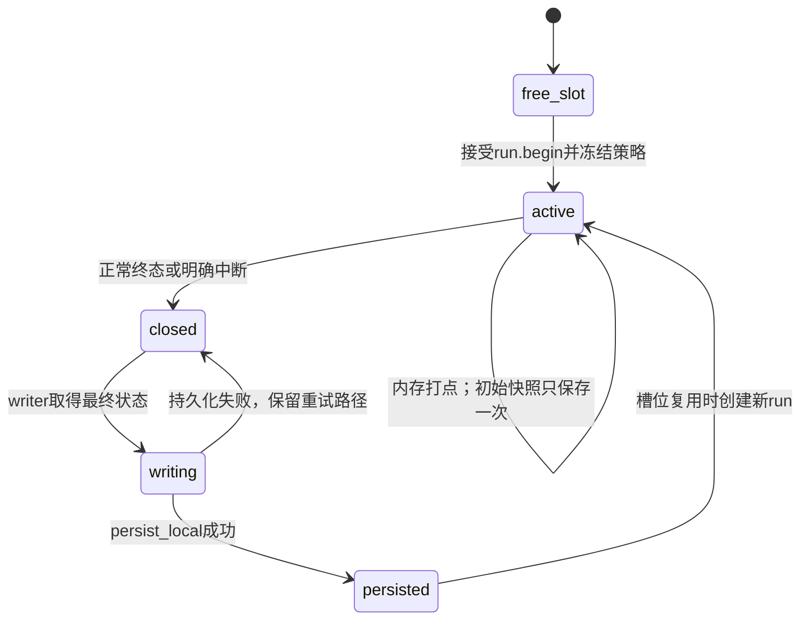

正常析构会停止后台线程，将仍活动的槽位标记 `producer_shutdown` 并尽力 drain。这个路径只能处理实际运行了析构的情况。SIGKILL、系统掉电或进程崩溃可能根本没有机会执行析构。源码中的恢复设计不等于本轮已经完成故障注入；允许多大的丢失窗口仍需要明确的产品或研究契约。

另外，多工作进程各自使用原生 SDK，不会自动共享一个 run 的所有内存状态。常驻单进程、生命周期完整的宿主比较适合原生入口；跨多个短进程续写同一 run，应使用 HTTP 常驻所有者，或另外实现明确的事件所有者/转发机制。这里是部署形态约束，不应通过临时更改 run_id 来掩盖。[部署选择说明](../../tools/trajectory_evolution/docs/01-overview.md)。

#### HTTP 也要区分 durable 与 buffered

IntegrationService 支持显式 `http_persistence.mode` 的 durable 或 buffered 模式。配置包含该对象而没有 mode 时，其字段缺省按 buffered 解释；省略整个配置对象时不能按同一缺省推断。随包 boundary-service 模板明确设置 buffered。durable 路径在 save 中原子写 run 文件；buffered 路径先放入 capture_writes/capture_dirty，并由后台 writer 写最新 snapshot。[模式读取：integration_service.cpp，第 431 行](../../tools/trajectory_evolution/src/service/integration_service.cpp)、[随包模式配置](../../tools/trajectory_evolution/config/boundary-service.json)。

buffered 响应会返回 `persisted=false`；`run.status` 根据 dirty 状态确认当前保存是否完成，`flush_capture()` 等待采集队列清空。flush 不等待模型评测、记忆审核或 GEPA。因而“HTTP run.end 成功即已落盘”的简写只适用于相应 durable 语义，不能无条件用于 buffered 配置。[save 与 writer，第 1330、1357 行；status，第 2685 行；响应，第 2743 行；flush，第 2804 行](../../tools/trajectory_evolution/src/service/integration_service.cpp)。

原子写使用临时文件、write、文件 fsync、rename 和目录 fsync。文件 fsync 的结果被严格检查，目录 fsync 调用的结果没有同等检查。它旨在保护单个文件发布的一致性，不会把跨阶段多个文件自动变成一个事务，也不能阻止模型请求完成后尚未来得及保存结果时出现不确定费用和重试。这种边界应通过实际故障注入检验，而不是仅凭函数名认定全部掉电窗口安全。[atomic_write，第 179 行](../../tools/trajectory_evolution/src/service/integration_service.cpp)。

#### 重启恢复与业务续跑为什么不同

IntegrationService 启动读取已落盘 run。若 local_capture 或 buffered_capture 的运行尚未 closed，它标记 incomplete 和 `producer_interrupted`，执行 run.abort，并将不完整轨迹放入 quarantine，避免进入正常健康学习。已落盘但评测状态 running 可以重新进入 pending；recover_jobs 恢复后台学习阶段。恢复系统能够利用已经保存的事实继续后台处理，不能恢复从未写盘的事件。[启动处理，第 669—695 行；学习作业恢复，第 1599 行](../../tools/trajectory_evolution/src/service/integration_service.cpp)。

更不能据此声称 Agent 自动从上次外部工具动作继续原业务。外部动作可能已经产生副作用，也可能只执行一半；重新执行需要动作幂等、环境快照、资源身份和业务恢复协议。当前 `run.abort` 的目标是正确记录并隔离未知终态，不是替工具推断它到底有没有完成。GEPA 作业 resume、holdout replay、同 request_id 回执复用和 L3 replan 也分别属于搜索恢复、冻结评测重验、协议幂等与当前循环控制，不能统称为崩溃业务续跑。

#### 归档和磁盘回收当前做到哪一步

`maintain_runs()` 会处理超过 lease 的某些活动运行，并在在线 stored_count 达到 `max_stored_runs` 时，将符合条件的记录移到 `archive/runs/<前缀>/<run_id>.json`。默认阈值为 10000，目标是降到 75%，每次最多移动 64 条。`run_file()` 仍可以在 live 与 archive 中找到历史记录，保留协议重放和追踪能力。[维护与归档，第 844 行；历史路径读取，第 833 行](../../tools/trajectory_evolution/src/service/integration_service.cpp)。

这降低的是在线记录数量，移动没有释放磁盘容量；用户 traces、quarantine 和 archive 仍然占空间。该维护函数不能当成已经实现了完整 TTL、总字节配额、空闲空间门槛和物理删除策略。长期运行若要新增磁盘回收，需要先决定保留什么、谁引用这些文件、怎样保护权威记忆和冻结成绩，以及容量不足时优先保持业务连续性还是采集完整性。这些是后续方案选择，不能混入当前已实现描述。

<a id="architecture-7"></a>

### 2.7 用输入输出实例检查自己是否真正理解了执行链

#### 对外请求的返回与业务终态之间有什么距离

可以用一份不执行的示意请求理解 JSON-RPC 层的契约：

```json
{
  "jsonrpc": "2.0",
  "id": 1,
  "method": "agent.execute",
  "params": {
    "agent_id": "demo-agent",
    "user_id": "user-a",
    "client_id": "conversation-a",
    "dialogue_id": "dialogue-001",
    "content": "读取资料并生成总结"
  }
}
```

示例只是说明字段，不是已运行任务。RpcHandler 首先校验请求与 Agent 是否可用，再构造消息进入异步系统。HTTP 客户端收到 execute 的接受响应后，还需要沿该 Dialogue 等待最终结果；否则无法区分“消息已被接受”“工作流已开始”“所有技能已结束”和“总结已交付”。Bridge 的调用代码先拿 task 身份，再继续等待后续事件，正是把启动与完成分开。[RPC 接受路径，第 418、646、661 行](../../src/daemon/rpc_handler.cpp)、[Bridge 等待与错误处理，第 471—555 行](../../frontend/bridge/routes/chat_rest.py)。

假设协调器把工作分成两个技能分支，一个负责读取资料，另一个负责生成图表。两个分支可以使用同一 Skill Workflow 模板，但必须有不同 exec_skill_key 和 workflow_execution_id。读取成功、图表明确失败时，Batch 的所有预期终态仍然可以收齐，随后给 Coordinator 一个 partial 结果。Coordinator 可以依据失败原因决定重新派发、采用替代方案，或直接说明图表未完成。若把 ALL join 写成“等待所有技能成功”，就无法解释失败如何返回父节点，也无法保证批次能够终止。

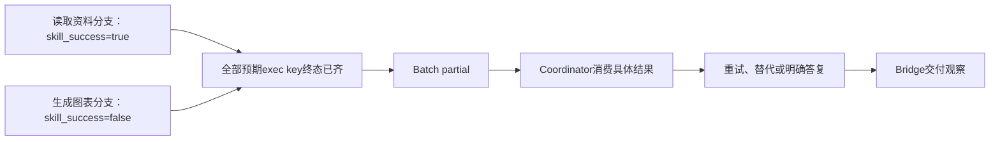

#### 为什么进程成功与任务成功必须分别保留

再看一个合法出口：Skill Executor 达到回合上限，打印结构化结果，退出码为零。这时 CodeLoader 可能认为程序按协议正常结束，Workflow 的框架终态也可能正常；但业务 status 是 max_rounds_reached，Runtime 会将它映射为 skill_success=false。这里不需要把正常错误报告强行变成进程崩溃。区别两层状态，是为了让父协调器能够知道“执行器正常告诉我任务没完成”，而不是只能知道“某段代码没跑通”。[业务失败状态集合：runtime.cpp，第 124 行](../../src/runtime/runtime.cpp)、[Skill 回合上限出口，第 1739 行](../../packages/agentflow-runtime/src/agentflow_runtime/skill_executor.py)。

同样，一个工具返回失败，Skill 在后续轮次修复参数并成功，不应被首个失败日志覆盖为整个任务失败。标准轨迹必须同时保留失败动作、恢复动作和最终业务结果。这样后台才能区分“重复相同错误的无效循环”与“提供新证据、最终有效的恢复尝试”。这也是为什么模型调用、工具观察、循环轮次和终态都需要独立事件，而不能只保留最终回答文本。

#### 遇到“卡住”应先判断哪个状态边界没有闭合

“用户还没有收到答案”可能对应多个不同位置。若 execute 拒绝，应检查身份与包加载；若分支仍排队，应检查批次并发槽位和已有活动分支；若分支没有终态，应看具体 Workflow 的 running/async pending，以及 Skill 的截止时间；若全部分支收齐但 Coordinator 没被激活，应检查一次触发及来源 Task；若 Coordinator 已被激活却没有交付，应看 completion 的消费标记、最终 pending 门禁和响应关联。这些判断都从现有状态与稳定身份出发，不需要一开始扫描全部日志或增加模型调用。

排查时还应记录三个时间：消息被接受、业务生成最终结果、服务端完成交付。它们之间的差距可分别归因于排队与执行、协调与收尾、传输与持久化。只统计一次模型 API 延迟无法解释完整用户时延；只看到 Python 进程消失，也无法证明 Batch、异步回调和交付都已闭合。状态边界分清之后，才知道需要修执行器、协调器、响应路由还是观测缺口。

<a id="architecture-8"></a>

### 2.8 分层验证与源码阅读：怎样从“看懂代码”走到“能够负责修改”

#### 每类测试验证的契约不同

根项目 C++ 测试覆盖 Agent、Workflow、Node、DataBus、Runtime、Daemon 与 RPC 等底座契约。比如 SessionRouter isolation 检查用户/会话路由，Runtime master-worker 检查调度及实例关系，DataBus isolation/concurrent 检查命名空间和并发访问。测试代码能够帮助理解不变量，但文件存在不代表当前环境已运行且通过。[底座测试入口](../../tests/CMakeLists.txt)、[会话路由测试](../../tests/unit/src/test_session_router_isolation.cpp)、[运行时调度测试](../../tests/unit/src/test_runtime_master_worker_gtest.cpp)。

Python runtime 测试覆盖 manifest、Coordinator 结果回接、重复派发、Skill 工具并行和恢复控制流等。这一层适合检验“相同 Tool Call 是否只消费一个结果”“manifest 写失败是否仍派发”“错误状态是否被保留”等业务协议。它通常可以使用 fake client 或 mock model，因此通过它不能直接证明实际厂商模型、外部工具和沙箱环境都已验收。[manifest 测试](../../packages/agentflow-runtime/tests/test_skill_executor_dispatch_manifest.py)、[重复派发测试](../../packages/agentflow-runtime/tests/test_coordinator_duplicate_dispatch_block.py)、[工具并行测试](../../packages/agentflow-runtime/tests/test_skill_executor_tool_parallel.py)。

演化组件单独注册 LocalRuntimeTests、EvolutionPointsTests，以及 Python/Go 等客户端与评测、搜索、训练 bootstrap 测试。这里需要核验打点状态机、身份/参数校验、应用回执、预算、候选准入和持久化边界。根目录 CTest 通过不等于独立组件这些测试也通过；组件 mock 宿主通过也不等于某个 AgentFlow v1 包完成了真实 L1/L2/L3 介入。[组件测试注册：CMakeLists.txt，第 293 行起](../../tools/trajectory_evolution/CMakeLists.txt)、[原生运行时测试](../../tools/trajectory_evolution/tests/test_local_runtime.cpp)、[集成服务测试](../../tools/trajectory_evolution/tests/test_integration_service.cpp)。

Bridge 与 E2E 测试承担跨进程任务：HTTP/JSON-RPC、Daemon 启动、会话历史、取消、Artifact 和 SessionLog delivery。真正的验收还要执行实际生产 launcher、cwd、环境变量及 Python 路径。只在测试环境 import 一个模块，不能保证 shell wrapper 通过 Agent 包 `.venv`、公共 package 和 Worker 注入运行时采用了同一实现。[Bridge 交付测试](../../frontend/bridge/tests/test_sessionlog_delivery.py)、[Bridge/Daemon 集成测试](../../frontend/bridge/tests/test_e2e_mock_daemon_stream.py)、[底座 E2E 测试入口](../../tests/e2e/CMakeLists.txt)。

#### 适合当前项目的验证顺序

| 阶段 | 要回答的问题 | 最有价值的产物 |
|---|---|---|
| 静态源码与配置 | 改的是哪个边界，谁读取配置，实际入口在哪 | 精确符号、输入输出、当前版本和作用域 |
| 定向单元/协议测试 | 具体身份、状态、错误和回执是否满足不变量 | 与修改契约对应的断言及测试结果 |
| 实际 launcher 集成 | shell/cwd/env/Python路径是否完整一致 | 一轮真实跨进程输入、结果和终态 |
| 真实模型/工具验收 | 建议是否进入实际请求或动作 | prepared query、真实输入、应用回执、业务结果 |
| 收益实验 | 同题同口径是否改善且保持成本与成功 | L0、父策略、当前策略逐题配对及资源覆盖 |
| 泛化与稳定性 | 是否能迁移到未开发题目并重复得到收益 | 冻结确认集、重复运行、失败分类和完整成本 |

验证不应无止境重复全量测试，也不能以速度为由省略决定性的契约检查。对于本仓库，先找到阻止真实运行、有效选优和明确交付的关键路径，修正后运行必要定向验证；实验结果需要保存原始数据、冻结 memory 和版本身份，不能修改旧指标来替代恢复后的新成绩。

#### 建议按六个问题阅读源码

第一遍只回答“输入怎样进入、结果怎样出去”。从 `agentflowd_main.cpp` 与 Daemon 初始化读到 RPC execute，再看 SessionRouter 和 ResponsePoller，最后回 Bridge chat_rest。读完应能够解释 user/client/dialogue/message/trace 的区别，知道哪个字段负责路由，哪个字段负责观测，不需要先掌握所有 C++ 模板和线程实现。

第二遍回答“一个任务怎样开始运行”。从 Task 配置与消息队列读到 Runtime task poller、Scheduler、execute_workflow 和 process_node。重点是模板如何 clone、inputs 如何进入逐 execution state、Worker 怎样把它变成 Python 可读取的环境，以及节点完成怎样变成 data_exchange。应能指出“Task已有参数”与“节点已真正执行”之间的转换位置。

第三遍回答“多个技能怎样不会互相覆盖”。在 v1 handle_run_skills_call 读 manifest 先写、next_skills 后提交，再沿 C++ batch 注册、放行、终态、ALL join 和 Coordinator 回接走一圈。选一份已有 batch 结果手工对齐 request_index、exec_skill_key、workflow_execution_id 和 skill_status，会比按时间戳阅读长日志更容易掌握真实因果。

第四遍回答“模型和工具怎样推进”。读 llm_call、SkillExecutor、tool_registry 和 tool_policies；再读 v2 execute 的一轮循环。注意哪些是模型参数、哪些是工具结果、哪些是 hook 能改写的内容，哪些是 framework 启动变量。比较 v1 的让出与重激活，和 v2 的进程内 continue，而不要只比较文件长度。

第五遍回答“轨迹怎样改变后续行为”。从 evolution_configured 或 LocalEvolution 入口读 IntegrationService/LocalRuntime，再进入 boundary runtime、评测、候选、记忆、shadow/policy runtime 和 GEPA。先理解当前代码的采集、资格、授权、固定版本和真实应用，再阅读研究候选优化。这里的目标不是一口气记住所有算法，而是能指出一条经验的来源、什么时候可用、怎样影响真实请求、怎样被验收。

第六遍回答“运行异常以后还能知道什么”。读持久化模式、drain、save/write_capture、startup recovery、job checkpoints 和 archive。挑一条 incomplete 轨迹或未完成作业，区分“已经写盘的证据”“内存里可能已发生但未知的事件”“后台可恢复阶段”和“需要重新执行的外部业务”。掌握这些边界，才能把可靠性与自进化收益研究建立在可信事实之上。

可优先从当前组件统一手册的概念、打点、存储、控制和 GEPA 章节进入，再用源码检查实际实现；根 README 的旧完成百分比和旧快照设计文档适合作历史背景，不能作为当前验收依据。[组件概念与架构](../../tools/trajectory_evolution/docs/01-overview.md)、[打点位置](../../tools/trajectory_evolution/docs/08-instrumentation.md)、[存储与恢复](../../tools/trajectory_evolution/docs/18-storage-and-recovery.md)、[运行控制](../../tools/trajectory_evolution/docs/16-runtime-controls.md)、[GEPA 闭环](../../tools/trajectory_evolution/docs/24-evolution-and-gepa.md)。

<a id="contracts"></a>

## 3. 输入输出、协议与配置

本章依据 2026-10-09 仓库 HEAD `f44bbaf4a9531731bfbd3eb6c115fe4210df95b1` 的源码解释各层如何交换数据。这里的“支持”表示存在源码实现；“已配置”“已发生”“已验证”分别需要配置、运行回执和实验产物证明。本次没有启动服务或实验，也没有读取 `.env`、密钥或修改原始结果。文中 JSON 均为**结构示意，所有身份值均为示意值，不是真实请求、实际任务或实验回执**；省略字段时明确标为片段。

<a id="contracts-1"></a>

### 3.1 外部聊天接口：一次提交如何成为一轮对话

AgentFlow 对外聊天接口和自进化接口是两组不同协议。用户通过 Bridge 的 REST 接口发起对话，Bridge 经 JSON-RPC 把任务交给 daemon；Python 节点与 C++ 工作流通过 DataBus 交换调度和结果；进化组件观察模型、工具和循环边界。这些接口分别承担用户会话、执行调度和策略观测职责。理解一个字段时，首先需要确认它属于哪一层，不能因为都有 `status`、`input` 或 `request_id` 就把它们当成同一种对象。

REST 路由是 `POST /api/chat/{agent_id}`，`stream` 是查询参数，默认 `false`。请求体的三个核心字段为 `user_id`、`client_id`、`content`，前两个通过身份格式校验，`content` 接受字符串或多模态内容列表。这里没有让用户填写 daemon 内部执行槽位的 `session_id`。Bridge 为每次请求生成 `dialogue_id`，并以 `(user_id, client_id)` 维护当前活跃会话，重复活跃请求返回 409。这个限制说明相同用户和客户端的一轮执行不能无限并发；它并不限制不同用户、不同客户端或框架内部的技能并行。[请求模型，第 261 行；路由，第 758 行；活跃请求，第 799 行](../../frontend/bridge/routes/chat_rest.py)。

下面是 REST 请求结构示意，`user_demo`、`client_demo`、`agent_demo` 都是示意身份。调用路径为 `/api/chat/agent_demo?stream=false`：

```json
{"user_id":"user_demo","client_id":"client_demo","content":"整理这份材料"}
```

Bridge 并非把用户的 `content` 原样作为唯一模型消息发送。它先处理多模态内容，再读取会话历史和记忆，将历史消息与当前用户消息组合，最后把 `{stream, messages}` 序列化成字符串，放入 `agent.execute` 的 `content`。因此 daemon 的业务入口看到的是字符串，字符串内部才是消息数组。同步或流式交付也同时存在于外层传输参数和内部消息载荷。历史读取失败时，代码记录警告后继续当前请求，不能据此假定每次模型执行都具有完整历史。[消息组合，第 424–453 行；读取历史，第 839 行](../../frontend/bridge/routes/chat_rest.py)。

JSON-RPC 客户端实际构造 `agent_id`、`user_id`、`client_id`、`content`，按需增加 `dialogue_id`、`platform_context`、`request_id` 和 `stream`。`session_id` 是客户端方法兼容参数：没有 `dialogue_id` 时，它可以成为对话路由键；它不是此方法总会向 daemon 发送的独立参数。客户端默认空 `user_id` 会补成 `bridge-user`，默认 `client_id` 为 `bridge`；REST 路径则使用请求体明确给出的身份。客户端先登记接收队列再发送任务，避免非常快的 daemon 回包先于订阅准备。[真实客户端，第 325–369 行](../../frontend/bridge/client.py)。

下面是 JSON-RPC 提交与返回的结构示意，内部 `content` 故意保留字符串形式；`rpc_demo`、`dialogue_demo`、`message_demo` 均为示意值：

```json
{"jsonrpc":"2.0","id":1,"method":"agent.execute","params":{"agent_id":"agent_demo","user_id":"user_demo","client_id":"client_demo","dialogue_id":"dialogue_demo","request_id":"rpc_demo","stream":true,"content":"{\"stream\":true,\"messages\":[{\"role\":\"user\",\"content\":\"整理材料\"}]}"}}
```

```json
{"jsonrpc":"2.0","id":1,"result":{"message_id":"message_demo","status":"submitted"}}
```

daemon 在入口检查 `agent_id/user_id/client_id/content` 非空，限制用户、客户端和对话身份的字符格式，查询 AgentRegistry 是否存在目标 agent。它接受的额外字段还有 `trace_labels` 和 `skill_name`，但这不是 REST 请求模型自动开放的字段。`request_id` 在这条链路主要用于端到端 trace 关联；不能把它直接等同于进化服务用于幂等重放的请求身份。任务被路由后，daemon 注册异步响应，再返回 `message_id` 与 `submitted`。此刻说明任务已提交，不说明技能已执行、回复已生成或业务已完成。[daemon 参数检查，第 418–446 行；提交 ACK，第 660–664 行](../../src/daemon/rpc_handler.cpp)。

在路由任务以前，daemon 可以为用户和客户端准备 sandbox，并把 endpoint、mode、workspace 等信息写入消息 metadata，后续转成节点输入和 `AF_*` 环境变量。sandbox 创建失败与业务节点失败是不同阶段，时延也不能混为一次模型调用的耗时。由此可以解释为什么一个 `agent.execute` 接口本身可能花费较长时间，而返回仍只是 submitted：它的同步部分包含运行环境准备，真正工作流结果仍走异步通道。[sandbox 创建，第 485 行；注入，第 529–545 行；工作目录，第 599 行](../../src/daemon/rpc_handler.cpp)。

同步 REST 消费异步事件直到最终 chunk，再返回统一信封 `{success,data,error}`。`data` 的主要字段为 `task_id`、`content`、`artifacts`，其中 `task_id` 兼容提取 daemon 的 `message_id`。没有必要据字段名猜测它是进化 `run_id`。代码把面向显示的 content 和用于持久化的原始 content 分开，防止公开 URL、base64 或占位符转换污染下一轮模型上下文。[响应模型，第 273 行；任务标识，第 317 行；最终结果处理，第 882 行](../../frontend/bridge/routes/chat_rest.py)。

流式 REST 返回 SSE，但它不是所有帧都只有 OpenAI 的 `delta.content`。`llm_chunk` 解析节点提供的原始 OpenAI chunk JSON 后透传；文本和进度帧采用 `choices[0].message.content`，表示完整文本。Bridge 增加 `_dialogue_id`、`_artifacts`、`_progress`、`_final`、`_chunk_type`，以及来源、技能和轮次元信息。最终标记优先读取 daemon `metadata.final` 的字符串 `true/false`；当该字段不存在时，仍保留顶层 `final` 的旧版兼容读取。因此应把“优先真相源”和“仍有兼容退路”同时讲清。[final 解析，第 330–345 行；SSE 帧，第 1138–1175 行](../../frontend/bridge/routes/chat_rest.py)。

示意 SSE 数据内容如下，它是 Bridge 自定义文本最终帧的一种结构，不是实际返回：

```json
{"choices":[{"message":{"content":"整理结果"},"index":0}],"_dialogue_id":"dialogue_demo","_final":true,"_chunk_type":"text"}
```

`[DONE]` 只代表传输结束。成功完成的流应有此前的 `_final=true` 帧；错误帧可以明确携带 `_final=false`、`_terminal_status=error` 后结束。服务端记录 `server_stream_completed`，证明服务器输出流收尾，不自动证明浏览器收到、用户下载或业务目标满足。这条边界对“系统是否成功”的讲述非常重要：网络请求成功、模型正常返回、框架正常收尾、业务达标是四个不同结论。[流式终态，第 1239–1288 行](../../frontend/bridge/routes/chat_rest.py)。

<a id="contracts-2"></a>

### 3.2 Skill、工具与 DataBus：执行身份比名字更重要

Python coordinator 的 `run_skills` 是一个调度工具调用。它要求参数对象包含非空 `skills` 数组，每项至少有非空 `name` 和 `prompt`，可有 `load_skills`，还检查布尔 `force` 及字符串 `reason`。对可用技能列表的校验存在于统一参数校验函数；最终执行前也需要真实 skill 文档和脚本可加载。`name` 是业务技能名字，实际框架节点统一为 `skill-runner`，这两者并不矛盾：框架复用同一执行节点，通过调用身份选定真实技能。[参数校验，第 369 行；统一 runner，第 441–448 行](../../packages/agentflow-runtime/src/agentflow_runtime/coordinator_decide.py)。

下面是 `run_skills` 参数结构示意；`report_skill_demo` 是示意技能名，实际调用必须存在于当前可用技能集合：

```json
{"skills":[{"name":"report_skill_demo","prompt":"根据输入材料生成报告","load_skills":[],"force":false}],"reason":"需要生成报告产物"}
```

每次调度生成一个 `batch_id`，每个技能项生成一个 `exec_skill_key`。代码的键结构分别为 `batch:{dialogue_id}:{dispatch_round}` 和 `dispatch:{dialogue_id}:{dispatch_round}:{index}`。coordinator 先把每项 manifest 写到 DataBus，再提交 `next_skills`，manifest 内含 `skill_name/prompt/load_skills/batch_id/request_index/force`。顺序具有实际意义：runner 一旦启动，必须已经能读到完整调用参数，不能依靠同名技能的上一轮数据猜测输入。[manifest 写入，第 460–487 行](../../packages/agentflow-runtime/src/agentflow_runtime/coordinator_decide.py)。

`run_skills` 的即时返回是调度回执。成功状态为 `dispatched`，部分 manifest 失败时为 `partially_dispatched`，提交失败时为 `dispatch_failed`。返回包括 `batch_id`、接受的技能名、`exec_skill_keys`、逐项 `dispatches`、`rejected`、`warnings` 和 `reason`。`last_prompt` 是成功提交之后才写的辅助数据，失败不会回滚已经提交的调度。这种设计减少“未执行任务污染去重判断”的情况，但也意味着系统可能已经提交任务而辅助数据写入失败。接收方必须看真实 dispatch 身份和完成批，不能只靠提示文字“已调度”。[失败回执，第 536–555 行；成功回执，第 557–593 行](../../packages/agentflow-runtime/src/agentflow_runtime/coordinator_decide.py)。

`exec_skill_key` 标识一次技能调用，`batch_id` 标识一组调用，`skill_name` 标识技能类型。重复执行相同 skill 会产生不同调用键；并行执行不同 skill 也会共享一个批次身份。完成批读取要求非空 `batch_id`，各项都有 `exec_skill_key`。这一要求正是为了解决“名字相同但不是同一次执行”的归属问题，也让完成结果能够回挂到原来的 tool call。[完成批校验，第 721–742 行](../../packages/agentflow-runtime/src/agentflow_runtime/coordinator_decide.py)。

DataBusClient 通过 UDS SDK访问当前执行 session 的数据。普通 `put/get` 的 sys 键带 `dialogue_id` 前缀，实际位置相当于 `/session/{sid}/sys/{dialogue_id}/{key}`；`put_global/get_global` 不带对话前缀，位置相当于 `/session/{sid}/sys/{key}`。这里的 global 指**当前 session 内跨 dialogue 共享**，不是全系统、全部用户共用的全局库。dispatch manifest 正是利用这一位置，让 coordinator 和具有不同 dialogue 上下文的 runner 找到同一次调用。对话历史另在 ctx 命名空间，不能和调度 sys 数据混为长期经验 memory。[初始化及作用域，第 41–67 行；普通访问，第 114–149 行；global 访问，第 192–207 行](../../packages/agentflow-runtime/src/agentflow_runtime/databus_client.py)。

普通 DataBus 读取在断连或异常时返回空值；关键完成批使用 `get_strict` 区分“键缺失”和“传输/协议失败”，避免把 UDS 超时误报成没有结果。`response_push` 把进度放入队列，返回 true 表示成功入队，它不代表 Bridge、前端或用户已经看到这条消息。secret redaction 发生在数据写入和进度发出边界，但这不能替代各工具对秘密参数和文件路径的保护。[严格读取，第 152 行；进度入队，第 238–278 行](../../packages/agentflow-runtime/src/agentflow_runtime/databus_client.py)。

C++ worker 把节点 `inputs` 映射为 `AF_<字段大写>` 环境变量，同时写入 DataBus 文件区域；额外注入 UDS 路径、sandbox endpoint 和绝对化 trace 输出目录。节点运行完后，worker 保存 stdout、stderr、exit_code 和执行器 success。对于 SO_LIBRARY 模式，它还解析 stdout 的 `key=value` 输出，并特殊处理异步 pending 标记；不能因此认为所有 Python 节点 stdout 都由 worker 自动解析成业务字段。[输入映射，第 165–189 行；trace 目录，第 203 行；执行结果，第 456–489 行](../../src/runtime/worker/worker.cpp)。

skill executor 加载 dispatch manifest 后，组合技能说明、工具定义和请求消息，调用模型，执行工具，再把工具结果作为 `role=tool` 消息加入历史。工具 Registry 要求模块提供 `TOOL_NAME/TOOL_DESCRIPTION/TOOL_PARAMS/execute(args)`；内置工具、agent 定制工具、主技能和伴随技能脚本、MCP 工具共同形成可用集合。MCP 工具先按服务路由；普通工具按其实现与 sandbox endpoint 执行。Registry 会检查凭据与受保护路径，配置秘密且使用无隔离宿主工具时存在明确拦截条件。它不是只把模型字符串交给任意 shell 的单层函数。[工具加载，第 112 行；执行与限制，第 216 行](../../packages/agentflow-runtime/src/agentflow_runtime/tool_registry.py)。

`ToolExecutorFactory` 从显式参数或 `AF_SANDBOX_MODE/AF_SANDBOX_ENDPOINT` 选择执行器：none 或未设置使用 HostExecutor；local/docker 使用 HTTPExecutor；e2b 使用 E2BExecutor。后三种明确模式若缺 endpoint 会报错，但不识别的 mode 会落到 HostExecutor。Bridge 自身 sandbox 配置默认 local，与工具 factory 默认 none 是不同消费者的默认值。实际工具运行位置要检查 daemon 注入、worker 环境和 factory 的最终选择；不能仅凭某个配置文件写着 local 就宣布全部工具已隔离。[工厂选择，第 37–70 行](../../packages/agentflow-runtime/src/agentflow_runtime/executors/factory.py)。

工具执行前，executor 通过进化 wrapper 发送 action 边界，包含真实参数、调用引用、父调用身份；wrapper 返回的 `input` 才成为实际工具执行输入，执行后记录实际输入、输出及 executed。通用 `PointCalls.call` 最多调用一次原始业务函数，策略拒绝时记录 `executed=false`，业务异常交回原调用方，不把观测端失败变成工具重试。这是“进化作为执行边界附加机制”的核心接口：它能改上下文、拒绝动作或限制循环，但不是另建一套隐式业务执行系统。[工具边界，第 1359 行](../../packages/agentflow-runtime/src/agentflow_runtime/skill_executor.py)；[包装契约，第 49–94 行](../../tools/trajectory_evolution/clients/python/evolution_point.py)。

skill 最终输出包含 `skill_result`、`status`、`skill_name`、`rounds_used` 和 `artifacts_json`。其中 `artifacts_json` 是 JSON 数组再序列化后的字符串，并不是外层直接嵌入的数组。空模型结果变成 `llm_error`，未解决工具失败变成 `tool_error`，正常返回为 completed。这些是 skill 节点完成状态，依然需要 coordinator 后续汇总以及业务评测。下面为结果结构示意，路径与内容均为示意：

```json
{"skill_result":"报告生成结果","status":"completed","skill_name":"report_skill_demo","rounds_used":2,"artifacts_json":"[\"outputs/user_demo_client_demo/report.pdf\"]"}
```

真实代码将结果写入与框架 runner 对应的 `skill_result:skill-runner` 键，业务 skill 身份放在结果内部；DataBus JSON 采用 ASCII escape 兼容 SDK 的 UTF-8 读取问题，终端 stdout 则可以输出中文。因此“取哪个键”和“输出属于哪个技能”应分别解释。[完成输出，第 1629–1690 行](../../packages/agentflow-runtime/src/agentflow_runtime/skill_executor.py)。

<a id="contracts-3"></a>

### 3.3 产物交付：从工具生成到用户能够取回

生成文件只是产物流程的第一步。当前 skill 主循环的产物 ledger 只接受工具结果中的结构化字段，按优先顺序取 `artifacts/files/outputs/result/path` 中第一个非空列表。任意 stdout、网页正文、错误文字或模型回答里提到一个路径，不能证明该文件由当前工具生成。仓库仍保留文本正则提取和双通道工具函数，部分辅助场景也使用文本提取，但主循环的真实账本调用是 `extract_structured_artifacts`。因此阅读孤立 helper 时需要继续追调用点，避免把兼容能力误写成当前默认产物来源。[结构化提取，第 197–250 行](../../packages/agentflow-runtime/src/agentflow_runtime/artifact_pipeline.py)；[主循环账本，第 1588–1602 行](../../packages/agentflow-runtime/src/agentflow_runtime/skill_executor.py)。

本地文件还经过存在性、非空、后缀和上传输入目录等检查；相对路径从 Agent package 根目录解释，e2b 的 sandbox 路径可先承认，再拉回。用户上传的输入文件不能被无条件重新声明为当前生成产物。被接受文件由 `_ensure_artifacts_in_package` 保留包内层级或迁入 outputs，同一次收集中不同源的同名文件使用后缀避冲突；同一 session 后续轮次同名文件可以覆盖旧文件，历史链接可能指向最新内容。这是明确存在的交付语义，不能把当前 artifact URL 自动当作不可变历史文件身份。[路径检查，第 92–194 行；目录处理，第 450–475 行](../../packages/agentflow-runtime/src/agentflow_runtime/artifact_pipeline.py)。

迁移后自动尝试上传到 Bridge 的 `/api/artifacts/upload`，sandbox HTTP server 承担执行或下载，Bridge 承担产物存储，两种 endpoint 不应该互换。上传体含 `agent_name`、产物 session、`files[{path,data_b64}]`，存储侧按 agent/session/相对文件路径构建 artifact_id。产物 session 使用 `{user_id}_{client_id}` 的稳定路由身份，不采用内部执行槽位。下面为上传结构示意；base64 值只表示示意数据，不代表有效 PDF：

```json
{"agent_name":"agent_demo","session_id":"user_demo_client_demo","files":[{"path":"outputs/report.pdf","data_b64":"ZGVtbw=="}]}
```

上传前为每项记录 size 和 SHA-256，并记录外部 URL、缺失、读取失败、prepared、uploaded 等事实。上传失败采用 fail-open：skill 主流程继续，仍可能构造 URL，而存储端并无文件，访问会 404。因此 artifacts 数组存在或消息包含下载链接不能单独证明交付成功，需要上传回执与存储可取回证据。这条实际降级也提示后续改进应针对交付验收，而不只是要求模型在回答里声称“已生成”。[上传责任与失败语义，第 609–641 行；上传字段及哈希，第 660–723 行](../../packages/agentflow-runtime/src/agentflow_runtime/artifact_pipeline.py)。

Bridge 上传端校验路径段、realpath 与存储根的包含关系，解码数据后写入；下载端按 artifact_id 查询，要求通过签名验证，还校验路径和允许的文件类型。对外 content 可以使用 Markdown link 或 placeholder，payload 可以使用 URL 或 base64，这两维配置独立。图片 base64 默认压缩，非图片超过默认 1 MiB 上限时保留 URL 而省略嵌入内容，不能把“未提供 base64”误判成完全没有产物。最终聊天持久化尽量保留转换前内容，再面向用户应用引用和载荷模式。[上传，第 248–317 行；下载，第 337 行](../../frontend/bridge/routes/artifacts.py)；[两维输出配置，第 195–227 行](../../frontend/bridge/config.py)。

<a id="contracts-4"></a>

### 3.4 自进化协议：查询、应用、观测与持久化分开

进化组件可发现的框架无关协议为 `evolution.boundary.v1`，contract_version 为 1。公开操作包含 `point`、`run.begin/heartbeat/end/abort/status`、`activity.begin/end/abort/status`、`loop.check/commit/abort`、`schedule.observe`、`event.record`、`capture.gap`、`evaluation.retry` 和 `memory.status`；启用 policy evaluation 配置后才增加 agent_evaluation 管理操作。这是边界 API 的实际 operation 名称。内部 integration 层仍有 `task.begin`、`action.begin` 等操作；例如 boundary 的 `run.begin` 被转换成 `task.begin`。标准 trace 的 `run.start` 是事件 kind，不能当成边界请求名写进接口示例。[能力描述与转换，第 1483–1547 行](../../tools/trajectory_evolution/src/runtime/boundary_runtime.cpp)。

boundary 显式请求都携带 `operation/request_id`。`run.begin` 要求 input，可以指定 conversation_id、level 和 capabilities；未指定时 conversation_id 使用派生 run 身份、level 默认为 L0、capabilities 为空。身份的 `agent_id` 来自配置，`user_id` 来自认证 principal，不靠调用者在每条请求里随意填用户。run_id 是根据 application/agent、用户和开始请求或 ref.run 派生的 40 位十六进制身份。运行内会保存请求指纹和响应：同一 request_id 同一载荷返回原响应，改载荷则报 request_id_conflict。幂等机制避免重复观测，不等于自动重试业务函数或任意跨运行去重。[开始默认值，第 1518 行](../../tools/trajectory_evolution/src/runtime/boundary_runtime.cpp)；[run 派生、身份和幂等，第 2642–2703 行](../../tools/trajectory_evolution/src/service/integration_service.cpp)。

下面为 boundary 显式开始和模型边界的结构示意，所有 id 是示意值；40 个零只满足示例形状，实际必须使用开始响应返回的 run_id：

```json
{"operation":"run.begin","request_id":"begin_demo","conversation_id":"conversation_demo","input":{"task":"整理材料"},"level":"L1","capabilities":["model"]}
```

```json
{"operation":"activity.begin","request_id":"model_begin_demo","run_id":"0000000000000000000000000000000000000000","kind":"model","name":"llm.call","actor_id":"coordinator_demo","scope_id":"default","input":{"messages":[{"role":"user","content":"整理材料"}]},"binding":{"pointer":"/messages","mode":"system_message"}}
```

activity.begin 要求 kind/name/input；model/action 有内置语义，其它 kind 是 custom 或由 activity_types 显式映射。策略可以提供允许或拒绝、经调整输入、context 和用于后续归属的 activity/context。activity.end 必须有 status 与 output；对于正常 model/action，必须明确 executed，model 还要求 actual_input。模型 usage 可以附显式 input/output/tokens/cached tokens，工具失败则优先记录结构化错误码。没有执行的活动不能以 completed 假装成功，未知或中断状态会使 capture incomplete。[活动开始，第 508–539 行；活动结束，第 937–998 行；实际观测，第 1116–1128 行](../../tools/trajectory_evolution/src/runtime/boundary_runtime.cpp)。

模型结束的结构示意如下，activity id 是示意值，实际必须回传前置回执中的身份。这里 actual_input 的目的，是证明宿主使用了哪一份最终请求，而不是把提议输入当成已采用：

```json
{"operation":"activity.end","request_id":"model_end_demo","run_id":"0000000000000000000000000000000000000000","activity_id":"activity_demo","status":"completed","executed":true,"actual_input":{"messages":[{"role":"user","content":"整理材料"}]},"output":{"choices":[{"message":{"content":"整理结果"}}]},"metrics":{"input_tokens":100,"output_tokens":30}}
```

Python 宿主更常使用 `point` 简化前后调用。`phase` 有 before/after/abort/event/heartbeat/guard/gap；可使用返回 context，或使用 `ref={run,key,parent,after}` 稳定引用。`ref.run` 是宿主给出的运行键，`key` 是本次活动身份，parent/after 描述祖先或依赖关系。它们不是标准 trace 中已经派生的事件 id。SDK 会自动补 operation 和 request_id；调用者把 after 与 before 指向相同 ref，以保证结束记录回到原活动。[point schema，第 784–924 行](../../tools/trajectory_evolution/api/boundary-v1.schema.json)；[前后归属，第 18–47 行](../../tools/trajectory_evolution/clients/python/evolution_point.py)。

下例是 action 前后 point 结构示意，`tool_demo`、`dispatch_demo`、`dialogue_demo` 全部是示意引用；示意 output 不声明真实产物或真实工具成功：

```json
{"operation":"point","request_id":"point_before_demo","phase":"before","kind":"action","name":"tool_demo","ref":{"run":"dialogue_demo","key":"tool_demo_1","parent":"dispatch_demo"},"actor_id":"skill_demo","input":{"query":"示意查询"}}
```

```json
{"operation":"point","request_id":"point_after_demo","phase":"after","kind":"action","ref":{"run":"dialogue_demo","key":"tool_demo_1","parent":"dispatch_demo"},"executed":true,"actual_input":{"query":"示意查询"},"status":"completed","output":{"result":"示意结果"}}
```

L1 query 返回匹配经验，查询结果的 application_status 恒为 not_applied。真实 model request 结束后，组件校验实际请求和 binding 才产生应用回执。L2 action 要观测 executed/skipped，L2 schedule 要观测实际 action 状态和原宿主依赖，L3 则需要 loop.check 的提议与 loop.commit 的实际采用决定；其中 replan 的 commit 本身还不构成 applied，必须由下一次真实 model request 包含并消费对应 replan context 后才能确认成功应用。仅设置 L3、加载某条规则、获得 matched 或 stop 建议，均不是实际应用次数。计数要求标准 trace 事件 `kind="advice.applied"` 且 `application.status="applied"`；失败或拒绝回执也可能使用同一事件 kind，不能只按名称计数。聚合还按 run/event 去重，依 receipt.boundary 区分 L1/L2动作/L2编排/L3，并保留 policy/version 来源。[AdviceResult，第 99–112 行](../../tools/trajectory_evolution/proto/shadow_policy.proto)；[RuntimeObservation，第 219 行](../../tools/trajectory_evolution/proto/runtime_policy.proto)；[replan延迟回执，第1287–1296行](../../tools/trajectory_evolution/src/runtime/boundary_runtime.cpp)；[应用计数，第 697–744 行](../../tools/trajectory_evolution/experiments/appworld/layout.py)。

run.end 要求 output，并分别记录执行 status 与 business_status。执行 completed 但业务 failed 完全可以成立，例如 Agent 完整运行并接受评分后任务未达标。若有未结束 activity 或未提交 control，正常结束会拒绝；defer_if_pending 可返回 closed=false/pending=true，等宿主再结束。abort 将未完成活动归为 unknown，并使轨迹不完整。下面为结束结构示意，明确业务结果仍未知；调用者不能为了“正常关闭”把 unknown 随意改成 succeeded：

```json
{"operation":"run.end","request_id":"end_demo","run_id":"0000000000000000000000000000000000000000","status":"completed","business_status":"unknown","capture_complete":true,"output":{"response":"示意结果"}}
```

采集回执还必须区分接受与落盘。buffered 模式在保存前响应里可以有 persisted=false；run.status 可查询是否还有 dirty capture。客户端拿到闭合回执也不能跳过 flush/drain 与最终 trace 核查。组件关闭、排空、后台学习不是同一个动作；缺口必须显式标记，不能以某条后续成功事件覆盖此前失败。[结束契约，第 1613–1644 行](../../tools/trajectory_evolution/src/runtime/boundary_runtime.cpp)；[持久化状态，第 2674–2686、2741–2748 行](../../tools/trajectory_evolution/src/service/integration_service.cpp)。

<a id="contracts-5"></a>

### 3.5 Native ABI、HTTP 与学习产物的版本边界

native 客户端通过 C ABI 创建 handle、调用 te_local_invoke，读取 metrics、设置 enabled、执行维护 manage、drain 和 close。返回字符串必须通过库提供的 te_local_free 释放，不能使用 Python 或另一套 C allocator 直接释放。Python wrapper 用 ctypes 声明参数与返回指针类型，保存创建时 PID，拒绝 fork 后复用旧 handle；序列化也限制深度、请求字节数并拒绝 NaN。这些细节构成跨语言契约，使用错误不仅会导致打点缺失，还可能造成内存所有权问题。[ABI 定义，第 18–41 行](../../tools/trajectory_evolution/include/trajectory_evolution/local_c.h)；[Python 初始化与释放，第 31–75 行](../../tools/trajectory_evolution/clients/python/evolution_local.py)。

native 的主设计是把同步查询限制为本地有界计算，把采集交给有界后台处理。默认 max_request_bytes 为 65536，缓冲 64 MiB，pending run 64，poll 20 ms，contention budget 1000 μs；这些是 native 选项默认值，和 HTTP service 的 1 MiB 请求上限是不同设置。manage、drain、close 允许阻塞，不能塞进每个模型或工具边界。实现也存在评测 trial forwarding 分支，因此应表述为“正常本地执行模式的低时延设计”，不能推成任何 native 调用场景绝不访问网络。[选项与管理接口，第 14–47 行](../../tools/trajectory_evolution/include/trajectory_evolution/local_runtime.h)；[trial 转发实现，第 890 行](../../tools/trajectory_evolution/src/service/local_runtime.cpp)。

native 失败降级保留原业务 input，并给出 degraded=true、capture_complete=false、policy_applied=false；loop 默认继续、activity 默认 allow，但没有制造正常观测身份。结束降级不能伪造 closed 或有效评测。`PointCalls` 会记住运行内降级并把 capture_gap 传到后续打点；wrapper 的业务执行最多一次。也就是说 fail-open 主要保护宿主业务可用性，同时将该次经验和评测证据隔离，不能把“业务还能跑”汇报为“进化接入完全成功”。[native 降级，第 107–146 行](../../tools/trajectory_evolution/clients/python/evolution_local.py)；[缺口跟踪，第 14–38 行](../../tools/trajectory_evolution/clients/python/evolution_point.py)。

HTTP 客户端使用相同 operation/字段协议，通过 POST `/v1/invoke` 和 bearer 身份传输。一般客户端只接受 HTTPS 或 loopback HTTP，禁止 URL 中用户名密码、query/fragment 和非根路径，不使用环境代理、不跟重定向；默认普通 invoke 超时 7000 ms、response 2 MiB、重试 1 次。重试在循环之前序列化完整 body，保持 request_id 和载荷一致，它重试的是观测协议传输。point 单次默认预算 20 ms，configured convenience client 使用 retries=0，只允许 loopback endpoint，并在 trial URL/token 缺失时避免回退生产端。直接 HTTP client、configured point client 和 native handle 不能笼统统称为同一个时延默认值。[HTTP 限制，第 43–96、159–195 行](../../tools/trajectory_evolution/clients/python/evolution.py)；[configured 加载及调用，第 140–214 行](../../tools/trajectory_evolution/clients/python/evolution_configured.py)。

学习输入可以来自闭合标准 trajectory 或 SessionLog 转换后的评测证据。标准 trace 身份为 run/agent/user/conversation，事件保留 producer、sequence、timestamp、actor、caused_by、input/output、错误和 outcome；Application 单独保存 query_id/policy_id/policy_revision/decision_id/status，经验 content_revision 保存在来源引用等对应对象中。这让“执行事实”“任务评分”“策略应用来源”能够分别追溯。HybridEvaluation 把事件组装成 episode evidence，保留工具指纹、诊断、邻居、dispatch、评测证据，再结合规则和模型判定 useful/invalid/necessary_retry/premature_stop/uncertain。无效 loop 是对已观测执行的语义判定，不是模型调用数、工具失败数或固定重复字符串数的同义词。[标准 trace 协议](../../tools/trajectory_evolution/proto/trajectory_trace.proto)；[证据与评测，第 121–211 行](../../tools/trajectory_evolution/proto/hybrid_evaluation.proto)。

学习输出首先是候选和 batch report，而不是直接改业务代码。候选保存 target_type/scope、trigger、observed_problem、proposed_change、expected_benefit、支持和反证、置信度、gate_reason；batch report 保存输入发现数、评测成功/失败、元反思和 memory_update。权威 memory store 保存 revision、applied_batch_ids、entries、内容修订、关系、evaluation_feedback 以及 GEPA feedback。memory_update.applied 表示一次入库事务被应用，review_pending/review_unresolved 则单独表示关系复核进展；不能把 applied 读成所有内容都已批准或所有关系都已解决。[候选，第 358–386 行；入库结果，第 455–484 行；权威 memory，第 487–551 行](../../tools/trajectory_evolution/proto/hybrid_evaluation.proto)。

memory、snapshot、runtime policy 是三种不同持久化对象。当前 memory reader 要求 schema_version=1、store_kind=trajectory_evolution_memory、store_version=evolution-memory-store-v1。编译器生成 schema_version=2 的 ShadowPolicySnapshot，它包含 identity、memory_revision、共享 revision、经过筛选的 experience 和排除计数；ShadowRuntime 兼容 snapshot 1/2。主动 RuntimePolicy 则要求 schema 2 snapshot，自身 schema_version=1，包含 options/effective_level/policy_id，并在加载时重新校验摘要和有效等级。相同文件都有 schema_version=1，不意味着它们互相可替换。[memory 和 snapshot 校验，第 284、350–356 行](../../tools/trajectory_evolution/src/runtime/shadow_runtime.cpp)；[runtime 编译与加载，第 309–366 行](../../tools/trajectory_evolution/src/runtime/policy_runtime.cpp)。

content_revision 固定某条经验内容，memory_revision 固定库版本，snapshot_id 固定当前可见投影，policy_id 固定快照和运行选项。ExperienceApproval 由 memory_id 与 content_revision 共同指定；同 memory_id 的新内容不能自动继承旧内容授权。ExperienceOverride 只在当前 policy 中改写提示内容，来源记忆资格保持不变；disabled_injections 可以关闭 L1 文本，同时保留来源对控制的授权。这些字段是实现可归因比较和避免旧批准漂移的基础。[批准和改写，第 12–25 行；运行选项，第 121–151 行](../../tools/trajectory_evolution/proto/runtime_policy.proto)。

开始一个 run 时，service 按用户和 scope 读取 memory，编译 snapshot、RuntimeOptions 与 policy，之后该 run 沿用固定版本。自动入库或后台管理发生后，已运行任务不会因此自然切换策略；新版本要在新运行或明确发布路径生效。离线 artifact/version 分支则加载已编译版本，验证身份和报告来源，避免 trial 直接读训练源目录。由此讲解“系统自进化”的合适粒度是：执行后收集证据、生成经验或策略候选、评价授权、在后续任务使用固定版本，而非一边运行一边任意修改当前所有 Agent。[开始编译，第 2033–2068 行](../../tools/trajectory_evolution/src/service/integration_service.cpp)。

还有一层需要单独说明：被评测或发布的 Agent artifact 并不等于单独的 RuntimePolicy。artifact 的白名单字段为 schema_version、agent、user_id、level、policy 和可选 runtime_options；agent.revision 必须非空，level 限定 L0–L3，L0 必须 policy=null，非 L0 要求 policy 的用户和 effective_level 与 artifact 一致。最终版本身份是规范化完整对象得到的 `agent-version-v1:` 摘要。这使相同 policy 配上不同 host revision 或收尾模板后，仍能成为不同受测版本。另一方面，agent.revision 是宿主声明，哈希证明声明与产物内容绑定，不会自行证明源码工作区正好处于某个 Git commit，也不会检查旧实验数据是否在当前 HEAD 重跑。[artifact 版本契约，第 183–211 行](../../tools/trajectory_evolution/src/evaluation/agent_evaluation.cpp)。

artifact 内的 runtime_options 与 RuntimePolicy.options 也不是同一个开放配置对象：当前 artifact 只允许 finalization_context 这个影响收尾行为的模板，禁止把任意部署参数或凭据塞进策略包。将冻结 policy 绑定到真实 trial 身份时，代码重编译 conversation 绑定；绑定改变了运行身份，但没有让候选借机取得其它用户的记忆。这解释了同一候选为何可以在独立试次运行，同时 trace 又必须记录当前 agent_version_id/evaluation_trial_id。[收尾选项白名单，第 193–200 行；重新绑定，第 214–221 行](../../tools/trajectory_evolution/src/evaluation/agent_evaluation.cpp)。

正式离线 bundle 导入还要求 schema、artifact 摘要与 evaluation.gate.passed 一致，检查 agent 身份和最大等级，导入后关闭自动评测和共享；trial version 文件则检查隔离目录、trial_id、entry binding 与版本摘要。文件存在、被某脚本复制到 published 目录、发布 manifest 写 delivered，与这条加载器的正式 gate 是不同证据。报告应追溯实际发布工具及加载路径，才能说清某份候选是“最好可交付候选”还是“已通过该发布门槛的策略”。这一说明是代码契约，不代替本轮实验章对具体 manifest 的核验。[offline bundle 与 trial version，第 488–524 行](../../tools/trajectory_evolution/src/service/integration_service.cpp)。

应用回执的证明强度也有边界。L1 的 applied 是组件确认宿主真实传输请求中包含规定 context，证明提示注入被采用；它不保证模型遵循建议或业务收益由建议造成。L2 拒绝动作的 applied 要求相应 action 出现在 skipped 集合且没有出现在 executed 集合。schedule 回执根据真实开始和结束序列推进状态，不能用派发确认伪装整批完成。L3 的 replan 只把有界上下文附加到当前既有循环，宿主仍负责下一步决策，并不自动调用一个新的全局规划器。这几条约束让应用次数成为可观测事实，同时提醒研究者仍需要关闭注入、保留来源授权、匹配同题等消融才能分析收益。[实际回执校验，第 746–780 行](../../tools/trajectory_evolution/src/runtime/policy_runtime.cpp)；[观测字段，第 219–238 行](../../tools/trajectory_evolution/proto/runtime_policy.proto)。

<a id="contracts-6"></a>

### 3.6 评测 Dataset、宿主与 AppWorld：环境由宿主真正启动

EvaluationTask 的主要输入是 task_id/group_id、task_input/followup_inputs、expected_behavior、category/difficulty、initial_state、constraints、budget、provenance、review_status/split/task_version 和 attributes。group 用于隔离同源任务；learning_exposed 与 source fingerprints 记录来源暴露；task_version 内容摘要固定任务，不能只比较 task_id 字面相同。JSON Schema 检查形状，C++ 还检查 UTF-8 字节限制、隐私、组隔离、来源和内容哈希，因此 schema valid 不等于 trial ready。[任务协议，第 26 行](../../tools/trajectory_evolution/proto/evaluation_dataset.proto)；[任务 schema，第 7–79 行](../../tools/trajectory_evolution/api/evaluation-task-v1.schema.json)。

下面是 EvaluationTask 结构示意；task_demo/group_demo 都是示意身份，initial_state 中的 source_task_id 是 AppWorld host 消费的真实字段，但值仅为示意：

```json
{"task_id":"task_demo","group_id":"group_demo","task_input":"示意公开任务指令","expected_behavior":"示意隐藏评分标准","category":"appworld","difficulty":"medium","initial_state":{"source_task_id":"demo_1"},"constraints":[],"budget":{"max_steps":40,"max_tool_calls":200,"timeout_ms":600000},"provenance":{"kind":"golden","learning_exposed":false},"review_status":"reviewed","split":"holdout"}
```

initial_state 是声明式初态。通用评测器会把它绑定到 entry 请求或写成 initial-state.json，再给宿主路径；**它不会因为看见 initial_state 就自动安装 AppWorld、启动数据库、创建浏览器或构建业务环境**。宿主负责解释声明并启动真实环境。启用 entry 时，非空初态若没有明确 binding 且未选 file transport，配置被拒绝为 evaluation_entry_initial_state_unbound；这个检查保证数据被交付，不保证宿主已经正确执行初态。[初态传输与检查，第 423–488 行](../../tools/trajectory_evolution/src/evaluation/task_evaluation.cpp)。

评测有两种输入路径：普通命令从 stdin 收到一次请求 JSON；设置 entry 的宿主通过 evaluation.next 领取每轮输入。entry 模板仅使用 `{$eval:字段名}` 这种单键对象，支持 input/messages/user_id/conversation_id/run_key/turn/initial_state/constraints/budget。任务输入或 messages 必须被绑定，output_pointer 使用 JSON Pointer 提取本轮最终输出，随后作为 assistant 历史供下一轮；当轮 trace 必须闭合并以 run.end 收尾，回调返回本身不能解锁下一轮。[entry 展开与可绑定字段，第 19–59 行；推进，第 95–123 行](../../tools/trajectory_evolution/src/evaluation/evaluation_entry.h)。

下面为 variant.entry 配置片段示意，不是完整 evaluation config；绑定名是实际允许字段，`/response` 是由示意宿主承诺的输出位置：

```json
{"entry":{"input":{"task_input":{"$eval":"input"},"initial_state":{"$eval":"initial_state"},"run_key":{"$eval":"run_key"},"budget":{"$eval":"budget"}},"output_pointer":"/response"}}
```

通用 runner 构建 trial 隔离 workspace、version.json、instrumentation.json、随机 trial token，并把 auto_evaluate/sharing 关闭，移除学习源目录和生产发布文件入口。评分量表、split、review 元数据与 scorer assertions 不进入宿主进程；宿主只收到 task input、followups、initial_state、constraints、budget 等执行必要数据。HTTP instrumentation 为该 trial 创建私有 loopback observer，入口环境标记引导 SDK连接该观察器。进程执行受 command、环境、cwd、输出上限、资源约束和超时共同管理；超时采用任务 budget 与配置 timeout 的较小者。[隔离配置，第 427–488 行；宿主载荷与启动，第 2760–2799 行](../../tools/trajectory_evolution/src/evaluation/task_evaluation.cpp)。

收尾后，评测器校验 trace 的版本、用户和 trial 归属、闭合完整性，再组装 output/evidence/checks。确定性 checks 对 JSON Pointer 的证据判分，预算和调度契约也可产生硬失败；judge 在允许范围内补目标判断、逐轮证据和 loop review。缺少有效业务判据时结果可为 uncertain，而不是默认 passed；有硬失败时 judge 仍可能审查效率，但不能把硬失败提升成成功。trial report 的 complete 表示计划试次都达到终态，不表示全部通过。[原生 checks 和 uncertain，第 3067–3097 行](../../tools/trajectory_evolution/src/evaluation/task_evaluation.cpp)；[trial/report 协议](../../tools/trajectory_evolution/proto/evaluation_dataset.proto)。

AppWorld 的宿主是仓库 Python 的 appworld_host.py。它从 initial_state.source_task_id 获取官方任务标识，读取公开指令，创建独立实验名及 evidence 目录，再真正调用 `AppWorld(task_id=..., experiment_name=..., raise_on_unsafe_syntax=True, null_patch_unsafe_execution=True, timeout_seconds=...)`。模型看到公开任务、supervisor、API 文档和已有观测，不应看到评分 ground truth。synthetic TRAIN 有专门的公开 fixture 与 postcondition checker；这部分原始 source task 的目标不被当作该 synthetic instruction 的目标评分，不能与官方任务直接混称。[任务读取与世界创建，第 2094–2150 行](../../examples/agent/business-simulator/appworld/appworld_host.py)；[训练补充任务目标说明，第 63 行](../../tools/trajectory_evolution/experiments/appworld/dataset.py)。

模型每步生成 AppWorld code，宿主在 appworld.execute action 边界观察，调用 world.execute(code) 得到真实 observation，再把 code 和 observation 放回消息历史。变量在 world 内持续存在，后续步骤不是每次从空 Python 解释器开始。world.task_completed() 或提交完成代码可以结束运行，但这只说明执行停止，不能证明官方任务成功。运行后宿主才调用 world.evaluate() 或 synthetic checker，把 tracker 转为 appworld_reward、strict_passed、quality_score 和测试数；训练反馈可在明确 TRAIN 分支返回，heldout 不把 ground-truth 反馈回模型。[真实执行，第 2340、2421 行；停止与评分，第 2462–2505 行](../../examples/agent/business-simulator/appworld/appworld_host.py)。

宿主原生 appworld_reward 是官方 state checker 的全成功信号，quality_score 为检查通过占比，两者不是同一个分数。仓库正式 AppWorld evaluation 还配置 `/output/appworld_reward == 1.0` 的 strict check，并启用与 business 共享的 objectives judge、loop review 与一致性检查。因此最终 trial verdict 由原生 deterministic signal、执行采集有效性和 judge 契约共同决定。聚合 strict_passed 从正式 trial passed 计数，official_strict_passed/task_success_rate 从可评分官方 reward 另外计算，官方检查成功仍可能正式 trial 未通过。报告里两种结果必须分列，不应把仓库混合口径直接称为官方榜单成绩。[AppWorld checks/judge，第 192–219 行；指标定义，第 669–744 行](../../tools/trajectory_evolution/experiments/appworld/layout.py)。

成本也有分层。宿主记录 Agent 模型调用、已知 token、模型 usage 是否完整、降级和采集失败；只有计数完整时才输出可比较 tokens/model_calls，否则保留 null 与 known_agent_tokens；统一聚合另提供 llm_calls 等别名。trial.duration_ms 来自 runner 计时，宿主内部 latency 来自真实 monotonic clock，judge/model review 的额外成本与 Agent 执行成本要区别。宿主对 invalid_loop_count 返回 null、basis=model_review，正式无效循环值由评测 loop review 得到；不能用 host loop_count 或 repeated code 的诊断计数直接替代。[成本完整性，第 2081 行；终态输出，第 2480 行](../../examples/agent/business-simulator/appworld/appworld_host.py)；[coverage 与均值，第 683–737 行](../../tools/trajectory_evolution/experiments/appworld/layout.py)。

AppWorld 还有保存的官方 code/IO 证据投影：投影读取已保存事实，不负责执行 Python，不读取 GT，并校验 task/run/trial/evidence 目录和模型因果链。宿主检查结果、标准 trace 与 evidence projection 共同支持 scorer 判断；仓库 summary 不足以代替原始 state checker、完整 trace 与 judge 输入输出。部署 AppWorld host、官方 runtime、daemon、原生进化 binary、模型 endpoint 任意一项缺失，接口文档和历史产物也不会自动让本机进入可复跑状态。[保存证据投影，第 370 行](../../examples/agent/business-simulator/appworld/appworld_host.py)。

评测报告保存 task_version、group、variant、repetition、execution_status、verdict、checks、metrics、evidence、error_code、duration 和 warnings；顶层另有 dataset_version、evaluator_version、config_fingerprint、complete 与 configuration。一个 CSV 的“成功率”若没有这些来源，就无法确认题目是否一致、重复次数是否一致、judge 是否一致，也无法解释没有评分的任务去了哪里。源码聚合保留 planned/completed/missing/scored/unscored/errored，各指标独立给 coverage 与完整状态；只把有值的指标求平均，也必须展示覆盖分母。部分 token 已知不能把其余任务补零，未启动任务不能被错误地计成一次 L0 回执，缺失 loop review 不能计成零次无效循环。[trial 与 report 字段，第 78–110 行](../../tools/trajectory_evolution/proto/evaluation_dataset.proto)；[聚合完整性与 coverage，第 669–744 行](../../tools/trajectory_evolution/experiments/appworld/layout.py)。

这也给复现定义了三个不同层次。第一层是读取现有 JSON/CSV，按照代码重算汇总；第二层是检查每题原始 trace、原生检查和 judge 证据，验证汇总确实来自有效试次；第三层是在冻结配置与依赖齐备的环境重新执行。三者可以逐步增强结论，却不能互相替代。研究汇报中注明处于哪一层，既能准确呈现已经取得的成果，也能把下一步工作落到证据闭环、版本冻结和同题对照，而不靠重复宣称某个百分比取得进展。

<a id="contracts-7"></a>

### 3.7 配置由谁消费，何时生效

配置不能只按文件名排列。一个完整判断应包含消费者、读取时机、默认来源、作用域和版本影响。下表把源码默认值和示例模板值明确区分；表中 template 表示仓库提供的样例配置，不能当作当前服务实际加载值。本次没有读取运行密钥、生产 `.env`，也没有宣称下表就是现存实验的实际生效配置。

| 配置入口 | 消费者与生效时机 | 默认或模板值 | 作用域与解释 |
| --- | --- | --- | --- |
| Bridge `AF_BR_ENV` / YAML / Settings | Bridge Settings 初始化时决定文件与变量 | 代码环境默认 dev；只选首个匹配 YAML | Bridge 进程；不是 daemon 或学习模型配置 |
| `AF_BR_REQUEST_TIMEOUT_SECONDS` | Bridge 出站 RPC调用 | 代码默认 5 s | 单次 daemon RPC，不能替代整轮聊天期限 |
| `AF_BR_CHAT_TURN_TIMEOUT_SECONDS` | REST 对话消费事件 | 代码默认 900 s | 一轮聊天；与节点、模型和工具超时共同约束 |
| `AF_BR_AGENT_LOAD_TIMEOUT_SECONDS` | agent.load 调用 | 代码默认 300 s | 环境准备/加载，与聊天超时不同 |
| `session_context_limit_rounds` / session_provider | Bridge 历史拼装和持久化 | 代码 5轮 / local SQLite | `(user,client)` 会话历史；不是 trajectory memory |
| `artifact_reference/artifact_payload` | Bridge 转换最终内容及产物 metadata | 代码 link / url | 两维输出形式，独立于 skill 是否成功生成文件 |
| `AF_LLM_*`、`AF_COORDINATOR_LLM_MODEL`、`AF_SKILL_LLM_MODEL`、agent.md model | Python coordinator/skill 解析模型配置 | model 顺序为 agent.md→节点专用→全局→fallback→gpt-4o-mini | 业务 Agent 模型；没有验证当前运行使用了最后默认值 |
| Python LLM timeout/retries | 模型请求准备 | 代码 120 s / connect 5 s / retries 2 | Agent 模型传输，不是 native 打点或 judge 配置 |
| `AF_SANDBOX_MODE/ENDPOINT/WORKSPACE` | daemon 准备、worker 注入、ToolExecutorFactory 选择 | factory none；Bridge sandbox 字段 local | 各消费者默认不同，最终要查真实节点环境 |
| `EVOLUTION_POINT_CONFIG`、trial config/URL/token | configured point client 首次加载并缓存；trial 优先 | point_timeout 默认 20 ms，retries 0 | 一条接入路径；关闭接入不会删业务安全边界 |
| LocalRuntimeOptions | native handle 创建 | 64 KiB请求、64 MiB缓冲、64pending、20ms poll、1000μs锁预算 | handle 生命周期；维护调用可阻塞 |
| boundary-service instrumentation | service/评测隔离配置创建 | template L0 / capabilities [] | 宿主请求的默认等级；max_level=L3 只是最大授权 |
| boundary-service memory、runtime_options | 新 run 开始编译 snapshot/policy | template approved []、auto_approve false、context 4096 B | 固定到该 run；存在控制模板不等于该规则已应用 |
| boundary-service persistence/limits | service 构造和保存路径 | template buffered，1 MiB request，16 MiB run，10000 events，128 active | 采集容量/持久化；native 选项有独立上限 |
| boundary-service learning | 后台任务满足触发条件后 | template 20新run、最长600s、间隔60s、批32/32MiB | 学习调度，不直接修改当前运行 policy |
| standard-runtime evaluation/evolution/model | hybrid evaluator、候选生成、memory curator | template 支持2dialogue/2episode、memory512、model timeout30s/retries1 | 学习与 judge 模型，和业务 `AF_LLM_*` 分开配置 |
| evaluation variants/entry/checks/judge | 创建 frozen evaluation 后每 trial 消费 | template 1 repetition、parallelism2、timeout1800s、require_trace true | 评测身份、宿主命令、输入绑定和判分 |
| agent-evaluation gate/training | 自动策略评测调度及验收 | template coverage1.0、quality/pass下降上限0；training batch16 | 该调度器的发布门槛；实验目标另有stage gate |
| `APPWORLD_ROOT/APPWORLD_MAX_STEPS/APPWORLD_CODE_TIMEOUT/APPWORLD_EVIDENCE_ROOT` | AppWorld host 创建世界与执行 code | code timeout 源码默认30 s；其余由布局/宿主读取 | 每 trial真实世界和证据；声明初态不启动这些资源 |

Bridge 文档描述“默认→YAML→环境”覆盖顺序，但实现细节是 Pydantic 先读环境，再只对仍等于字段默认值的项填 YAML；因此某环境值恰好等于默认值时，仍可能被 YAML 填充。解释加载逻辑时应以实现为准。YAML 文件选择也不是把多个目录所有配置合并，而是首个匹配文件。无需为了这一边角条件展开全部部署规则，却不能简单写成无例外的覆盖顺序。[配置加载，第 35–60、102–137 行；时间与历史默认，第 261–342 行](../../frontend/bridge/config.py)。

Python AgentConfig 对空或明显占位值执行回退；coordinator 与 skill 模型字段、温度等设置可分别生效。Agent 请求 timeout 与学习 standard-runtime model timeout 不同。改变 coordinator 的模型环境不会自然改变 judge 的冻结配置，改变 standard-runtime 也不会自然覆盖已加载的业务 agent.md。这种独立配置既支持模块化研究，也要求实验 manifest 记录真实模型、prompt、host、dataset 和策略版本，才能解释收益来自哪个变化。[业务模型顺序与超时，第 54–164 行](../../packages/agentflow-runtime/src/agentflow_runtime/common/agent_config.py)；[学习模型模板，第 41–54 行](../../tools/trajectory_evolution/config/standard-runtime.json)。

boundary-service template 的 max_level=L3、instrumentation.level=L0、approved_experiences=[]、auto_approve=false 同时存在，表明“最大允许能力”“宿主实际请求”“来源授权”各有独立控制。请求 L1/L2/L3 还必须声明相应 model/actions/loop 或 schedule 能力；编译 policy 校验用户、会话、scope、来源 content_revision，并生成固定摘要。因此不能因为文件里列出了 loop_rules 就统计一次 L3，也不能因为实验名是 L3 就推断每项动作均受控制。[模板，第 10、24、31、52–65 行](../../tools/trajectory_evolution/config/boundary-service.json)；[能力授权，第 1991–2007 行](../../tools/trajectory_evolution/src/service/integration_service.cpp)；[policy 校验，第 309–355 行](../../tools/trajectory_evolution/src/runtime/policy_runtime.cpp)。

评测配置也有两组上限来源：sample config 的 parallelism=2 与源码未配置时默认值=1 是不同事实；`TRAJECTORY_EVALUATION_PARALLELISM` 可以减少真实 worker 数，但不改变冻结题目和评分口径。AppWorld layout 进一步为长 trace 调整 judge 输入上限、调用预算和 artifact retention；使用实际 frozen evaluation 的配置身份比拿样例 evaluation.json 当实验说明更可靠。[评测模板](../../tools/trajectory_evolution/config/evaluation.json)；[解析默认与并行限制，第 3400–3440 行](../../tools/trajectory_evolution/src/evaluation/task_evaluation.cpp)；[AppWorld覆盖，第 192–219 行](../../tools/trajectory_evolution/experiments/appworld/layout.py)。

数据大小也是配置作用域的一部分。普通 HTTP 客户端允许序列化到 2 MiB，service 模板 max_request_bytes 是 1 MiB，native 默认是 64 KiB，模型请求和 judge 输入又各有自己的预算。客户端通过本地大小检查，仅说明没有超出该客户端上限；接收端仍可因为更小限制拒绝。UTF-8 字节上限也不能拿字符个数代替，中文正文、工具 schema 和完整对话会快速放大载荷。将一个接入例子从 HTTP 改成 native 时，需要重新检查真实请求大小、超限降级和采集完整性，而不是只更换构造函数。[HTTP请求字节上限，第 174 行](../../tools/trajectory_evolution/clients/python/evolution.py)；[native请求默认，第 15 行](../../tools/trajectory_evolution/include/trajectory_evolution/local_runtime.h)。

公开 schema 与运行实现还应联合阅读。当前 run.begin schema 的 capabilities 列表列出 model/actions/loop，而 integration 的真实开始逻辑还接受 schedule；这说明静态接口材料可能比实现的能力集合窄。本文示例只使用两边都明确接受的 model，不把运行源码支持 schedule 擅自改写成所有校验工具已经一致支持。同样，proto 中存在更广的等级枚举，不意味着当前 artifact 验证器允许超出 L0–L3；数据类型能表示、接口允许提交、宿主能够执行、实验实际采用，是四个逐步收窄的集合。[开始运行的实际能力校验，第 1998–2007 行](../../tools/trajectory_evolution/src/service/integration_service.cpp)；[boundary静态 schema](../../tools/trajectory_evolution/api/boundary-v1.schema.json)；[artifact等级校验，第 190–192 行](../../tools/trajectory_evolution/src/evaluation/agent_evaluation.cpp)。

<a id="contracts-8"></a>

### 3.8 把跨层回执转成可以验证的系统结论

沿着真实执行链，一次对话可以依次取得：REST 请求被接受；JSON-RPC submitted；run_skills dispatched；worker进程正常退出；skill输出completed；coordinator最终回复；文件上传成功；SSE输出结束；boundary run闭合且持久化；官方环境检查通过；正式 trial passed；候选通过发布门槛。每一步都提供新的证据，后一步不能从前一步自动推出。当前仓库用 batch/exec key、run/activity/control id、memory/snapshot/policy version 和 trial/version 身份把这些证据连接起来，但连接也要求采集完整和实际 artifacts 可追溯。

因此读源码时可以用一个固定方法：从真实输入消费者开始，找到默认与校验，再跟踪它如何写入执行数据、由谁实际调用业务函数、如何产出终态，以及哪个判据把终态升级为业务成功。遇到 stdout、ACK、matched、applied、complete 或 delivered，要先问它在该层究竟表示什么。本章对源码契约的说明不替代实验进展与原始结果审核；后续实验对比需要固定同题、同版本和同评分口径，保留缺失、错误、部分覆盖与未独立验证的状态。

若导师追问“一个回答是否真实受益于自进化”，应沿输入身份找到具体调用，再找到该调用采用的策略版本、前置建议、实际请求与应用回执，最后检查同题业务结果。只有输出文字相似或成功率增加，不能完成这条归属链；反过来，完整应用回执但任务失败，也仍是有价值的失败证据。源码机制讲解和实验解释在这里相接：前者定义什么可以被观察，后者证明观察实际发生并产生了什么结果。

<a id="evolution"></a>

## 4. L0–L4、记忆闭环与策略搜索

理解自进化，需要沿同一份执行事实追踪它怎样成为经验、进入固定策略、改变真实行为，再接受独立验收。本章依照当前源码解释这条链，不以代码存在推定实验成功。文中的 JSON 均为省略字段的结构示意，不是真实执行回执，也不能直接粘贴运行；引用标签中的 L 表示源码行号。

<a id="evolution-1"></a>

### 4.1 系统究竟在进化什么？

AgentFlow 的自进化不发生在基础模型权重里，而发生在模型外部的行为策略里。模型仍负责理解用户任务和提出下一步行动；演化组件决定哪些历史经验可以进入本次请求、哪些动作可以执行、已有技能应满足怎样的依赖，以及当前循环是否继续、重新规划或停止。后台学习和搜索改变这些行为定义，下一次运行使用更新后的冻结版本。阅读代码时，如果把“经验越来越多”“节点越来越多”直接理解为模型越来越强，会错过整个系统最关键的验收层。

这里的经验、候选、策略是三个不同对象。经验记录来自何处、什么条件下适用以及建议怎样行动；候选是尚待验证的改动；策略把批准来源、经验改写、动作规则和循环规则编译成可解释的固定版本。即使某条建议已经在记忆库里，它也可能支持不足、有反证、范围不匹配或未经批准，因此不能进入实际模型请求。即使某条控制已经实际应用，它也可能造成任务退步。因此本章始终区分“生成了改动”“合法且有运行资格”“真实应用”“同题改善”“独立未见任务验收”。

从运行角度看，系统有两条路径。在线路径处理本次任务，使用固定策略和真实观察执行有界决策；后台路径处理已关闭轨迹，完成评估、反思、记忆管理和候选搜索。后台更新记忆不会把正在执行的 run 换成另一个策略，在线也不为每次建议临时调用完整反思模型。这一分工既限制了运行时开销，也为版本归属和同题对照提供了基础。[local_runtime.cpp L292–374](../../tools/trajectory_evolution/src/service/local_runtime.cpp)、[policy_runtime.h L16–60](../../tools/trajectory_evolution/include/trajectory_evolution/policy_runtime.h)

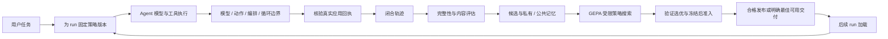

这张图描述已有工程关系，不能用箭头推定任何一批实验已经全部通过。尤其“最佳可用交付”是有明确未达标状态的交付动作，与通过发布门禁的生产策略不同。

<a id="evolution-2"></a>

### 4.2 L0–L4分别学习什么，又受到什么限制？

#### 4.2.1 L0：先把一次运行变成可学习事实

L0 的目标是采集和评估原始 Agent 行为，给后续学习提供真实输入、动作、观察、循环和最终结果。它不在本次运行中增加演化经验或施加学习到的控制。L0 仍可以把已完成轨迹送入后台评估、提炼记忆；“零级”描述的是在线介入，不意味着关闭后台研究。AppWorld 的训练专用服务被明确设为 L0，以免一边应用既有策略，一边把其结果误当作原始训练证据。[layout.py L331–346](../../tools/trajectory_evolution/experiments/appworld/layout.py)

L0 的主要输入是稳定的 run、用户、应用身份以及活动 begin/end 事件，输出是标准 `TraceRun` 和显式收尾状态。`RunOutcome` 把 execution_status 与 business_status 分开：程序完成可以是业务失败或未知，程序取消也不能补成业务成功。任务结束时，服务检查仍未闭合的活动；完整轨迹必须通过校验，采集缺口进入 quarantined，而不是给出虚假的零错误评分。[trajectory_trace.proto L28–99](../../tools/trajectory_evolution/proto/trajectory_trace.proto)、[integration_service.cpp L2285–2351](../../tools/trajectory_evolution/src/service/integration_service.cpp)

L0 学习得到的东西是诊断和候选经验，不是立即生效的新执行规则。它不能修改工具实现、任务答案、模型权重或既有验收结果。适用实例是保留“调用参数错误—修正调用—任务最终完成”的完整链，而不是只记录一条错误字符串。失败边界包括事件缺失、run 未关闭、来源身份不一致和输入被截断。这些故障会限制能够得出的结论，不能被描述成“模型没有学会”或“该题没有无效循环”。

**示例一：标准轨迹的事件片段。仅为结构示意，省略其他生命周期事件，不是一份通过校验的完整轨迹。**

```json
{
  "trace_kind": "trajectory.v1",
  "identity": {"run_id": "demo-run", "agent_id": "demo-agent", "user_id": "demo-user"},
  "events": [{
    "event_id": "action-end-2", "kind": "action.end",
    "execution_id": "branch-a", "step_id": "step-2",
    "action_id": "call-2", "loop_id": "loop-a", "iteration": 2,
    "caused_by": ["action-start-2"], "operation": "lookup",
    "status": "failed", "error": {"code": "invalid_argument", "retryability": "non_retryable"}
  }]
}
```

#### 4.2.2 L1：演化经验正文和适用条件，影响真实模型输入

L1 的学习对象是经验建议、适用条件和启用集合。一个建议可以保留原文，可以在策略内改写，也可以在这个版本里停用。改写保存在 `experience_overrides`，停用保存在 `disabled_injections`；它们不要求直接篡改来源记忆。source 的 memory_id 和 content_revision 让改写始终能指回原经验，策略身份又能说明本次 Agent 到底使用了哪个文本。[policy_runtime.cpp L320–339、L531–561](../../tools/trajectory_evolution/src/runtime/policy_runtime.cpp)

L1 的运行输入是 `RuntimeQuery` 的 llm 边界、当前 task/state、身份、scope、批准来源和有界观察。输出是 `RuntimeDecision.context` 及经验引用。编译时需要 `context.request` 宿主能力、用户和会话授权、正文与数量预算；查询时再做 scope 和适用性筛选。学习模型不能把一段不属于获选组件的记忆随意替换掉，也不能借改写扩大用户权限或变更工具 schema。当前 v1 接线中的真正发送位置在 `call_llm()` 中：演化 wrapper 返回增强 request，真实 recorder 使用该 request 的 messages 和 tools 发起调用。[llm_call.py L89–104](../../packages/agentflow-runtime/src/agentflow_runtime/llm_call.py)

“一条经验只注入一次”必须带宿主限定。`PolicyRuntime` 用同一 run 的 memory_id 集合记住已经准备的注入，并保存原 prepared query；同一查询可以幂等重放，后面的新查询不再次准备同 memory_id 的注入。LocalRuntime 每 run 保留一个对象。HTTP 服务只有 `preserve_runtime_policy_state=true` 才保留并从已保存查询重建状态，默认 false；AppWorld 明确开启。CLI 的 `query-batch` 也保留一个对象，而分开的 `query` 调用每次新建对象。因此一次注入不是普遍的跨接口、跨进程保证，更不是“模型只看过一次经验”：后续消息可能继续保留已注入内容。[policy_runtime.cpp L376–389、L514–560](../../tools/trajectory_evolution/src/runtime/policy_runtime.cpp)、[integration_service.cpp L1767–1787](../../tools/trajectory_evolution/src/service/integration_service.cpp)、[policy_cli.cpp L37–48、L100–104](../../tools/trajectory_evolution/src/cli/policy_cli.cpp)

L1 应用确认检查增强正文确实存在于真实请求、transport_allowed 为真且 call_id 有效，不能只凭检索命中或 wrapper 返回 ready 计数。适用例子是看到位置参数 TypeError 后提示检查工具定义、改用命名参数。它的失败边界包括条件误匹配、上下文预算不足、未进入真实请求、模型不遵循建议，以及正确建议导致额外无收益操作。实际请求核验只能证明介入发生，仍需任务对照确认收益。[policy_runtime.cpp L739–764](../../tools/trajectory_evolution/src/runtime/policy_runtime.cpp)

#### 4.2.3 L2：演化动作准入与已有技能依赖，不重写任意参数

L2 包含 actions 与 schedule 两个边界。actions 检查当前动作的 operation、参数、schema 必填项和已有失败/尝试记录，返回 allow 或 reject。当前 `ActionDecision` 不含替换参数字段；boundary 在动作路径也只读取决定与原因。因此不能把当前能力写成“模型自动覆盖工具参数”。合法的参数修正仍由 Agent 在后续模型轮次提出，L2 可以阻止不满足已有契约的动作先执行。[runtime_policy.proto L203–207](../../tools/trajectory_evolution/proto/runtime_policy.proto)、[boundary_runtime.cpp L620–665](../../tools/trajectory_evolution/src/runtime/boundary_runtime.cpp)

L2 的学习对象是受限动作规则及已有技能之间的先后/成功依赖，不能增加工具、创造新业务动作或改写任务答案。生成的动作规则要绑定批准经验，并通过 operation、scope、原语和参数授权检查；部署者预先设置的基础规则可以没有学习来源，它们是硬边界的一部分。把“基础规则可无来源”与“生成规则必须有批准来源”分开，才能理解为什么某个策略既有人工基线，又有学习收紧的控制。[policy_runtime.cpp L164–174、L583–615](../../tools/trajectory_evolution/src/runtime/policy_runtime.cpp)、[control_generation.cpp L283–304](../../tools/trajectory_evolution/src/gepa/control_generation.cpp)

schedule 的输入是真实同批技能动作及宿主硬依赖，输出为有界调度计划；模型生成规则可以在已有动作之间选择依赖与顺序，但实际派发仍由宿主完成。当前 v1 coordinator 的 `_evolution.dispatch()` 把 accepted exec_skill_key、batch_id 和后续结果绑定起来，核验不能仅看模型写了“先做 A 再做 B”。应用确认按实际 schedule events 推进状态、检查执行和跳过列表。actions 则要求被拒绝动作在 skipped 中且不在 executed 中。[coordinator_decide.py L1776–1798](../../packages/agentflow-runtime/src/agentflow_runtime/coordinator_decide.py)、[policy_runtime.cpp L765–791](../../tools/trajectory_evolution/src/runtime/policy_runtime.cpp)

适用实例是动作必填参数缺失时阻止调用，或让“取得必要信息”先于“使用该信息执行下一步”的既有技能。失败边界是缺 typed binding、动作已经在打点前被宿主拒绝、规则从未匹配实际 batch、依赖形成不合法图或执行回执不完整。AppWorld 当前冻结策略没有 schedule.dispatch、schedule_rules 为零；框架支持编排不能证明这批实验做过编排。其 L2 动作零应用也只能说明未观察到该层介入，不能推断所有任务都没有潜在机会。

**示例二：L2 的动作决定。仅为结构示意，不是真实拒绝回执。**

```json
{
  "action_id": "call-demo",
  "decision": "reject",
  "rule_id": "demo-required-fields",
  "reason": "缺少运行时工具 schema 声明的必填字段"
}
```

#### 4.2.4 L3：演化分支循环预算与恢复条件

L3 的学习对象是当前分支的最大轮数、连续无进展条件、恢复预算和受授权的重规划上下文。它依附部署基础 loop rule，只能在授权空间内收紧，不得放松基础限制。某条自然语言建议说“失败时重新规划”，并不会自动变成可执行 L3；还需要结构化来源、基础规则、能力和编译校验。[control_generation.cpp L432–459](../../tools/trajectory_evolution/src/gepa/control_generation.cpp)

输入包括执行实例、loop_id、iteration、state fingerprint、重复动作/失败、pending actions 和能否收尾。输出是 continue/replan/stop 以及有界进度状态。对于同分支在途活动，组件固定返回 continue，不停止或重新规划该分支；独立兄弟分支不因此被整体结束。continue 也不代表系统已经证明“还有可推进步骤”，它可能只是尚未达到条件、没有适用规则或缺能力。达到无进展阈值时，预算尚余可以 replan，耗尽后按规则 stop；生成的恢复规则又要求实际重复结构化失败，不能把首次失败随意当作停止理由。[policy_runtime.cpp L631–723](../../tools/trajectory_evolution/src/runtime/policy_runtime.cpp)、[boundary_runtime.cpp L1247–1250](../../tools/trajectory_evolution/src/runtime/boundary_runtime.cpp)

当前 v1 Coordinator 和 Skill Executor 都在下一轮前调用 `allow_loop()`。stop 后可以沿原有无工具收尾出口交付已有结果，这与强制取消整个 Session 不同。`loop.commit` 提交 `decision=replan` 只表示宿主接受下一轮指令，不能立即计为 L3 应用；必须看到下一真实模型请求含重规划上下文，才形成成功回执。否则规则产生了建议，行为链没有闭合。[coordinator_decide.py L1362–1374](../../packages/agentflow-runtime/src/agentflow_runtime/coordinator_decide.py)、[skill_executor.py L834–849](../../packages/agentflow-runtime/src/agentflow_runtime/skill_executor.py)、[boundary_runtime.cpp L1287–1296](../../tools/trajectory_evolution/src/runtime/boundary_runtime.cpp)

适用实例是在同一分支重复相同已知失败调用时改变方案，或在授权轮数上限处结束重复操作。失败边界是把暂时没有观察误判为无进展、停止必要工作、重规划上下文未被模型消费、同轮重复查询指纹变化和预算绑定缺失。减少循环只有在目标完成和严格通过不受损时才是有价值的改善；过早停止也可以让平均轮数更低，却让系统更差。

#### 4.2.5 L4：后台搜索能力，不是第五个在线运行边界

协议枚举有 L4，但 `validate_options()` 只接受运行 requested_level 在 L1–L3 范围。L4 描述后台 GEPA 的反思、变异、组合、真实试验与版本准入能力；运行 max_level 仍按实际需要配置 L0–L3。这种区分能避免把“开启 L4”误读为运行时突然具备更高权限。[trajectory_trace.proto L11–18](../../tools/trajectory_evolution/proto/trajectory_trace.proto)、[policy_runtime.cpp L109–113](../../tools/trajectory_evolution/src/runtime/policy_runtime.cpp)

L4 的输入是冻结 seed/baseline、批准来源、受限组件集合、已审核 train/val/holdout、真实训练反馈和搜索预算；输出是候选树、组件改动、验证表现、来源/应用记录和最终冻结 artifact。它不能修改工具实现、基础模型、评分器、训练/验证任务答案，不能用 holdout 轨迹继续反思。适用实例是改写一条实际用过的 L1 建议，比较是否保留有效检查同时减少重复核验；也可以在真实控制机会存在时收紧 L2/L3。

L4 的“应用确认”不是后台模型生成了 JSON，而是新策略能编译、在真实 Agent 的边界改变行为、在验证题上得到可归属的改善，并经过最终准入。重复草稿、没有可执行条件变化、没有触发机会、关键违规、未完成评分以及没有收益的规则都可能在不同阶段被淘汰。搜索轮数和反思调用数是成本，不是进化效果。

<a id="evolution-3"></a>

### 4.3 如何从执行事件得到Episode，为什么需要两种评估？

标准 `TraceEvent` 把 event_id、producer sequence、actor、execution、step、action、loop 和 iteration 放在同一事件中，用 caused_by 表达显式前因。时间戳帮助展示先后，却不能独自恢复并发因果。两个兄弟技能可能同时失败，但它们不是同一循环的两次重试；两个不同 run 可能都有 step-1，却不是相同证据。来源身份和执行边界先被固定，后续模型判断才能引用正确的事实。[trajectory_trace.proto L61–90](../../tools/trajectory_evolution/proto/trajectory_trace.proto)

标准路径先 `parse_trace_json()`、`validate_trace()`，再 `analyze_trace()`。当前标准分析器按 step.start/end 构造 `LoopEpisode`，保留作用域、actor、execution/loop、输入和结果指纹；没有 step 时回退到整个 run 的起止。Episode 是组织证据的分析单元，不保证等于一个用户轮次、一个工具调用或一次模型迭代。模型活动、自定义活动可以保留分析证据，却不因此被算成工具调用。[sessionlog_evaluator.cpp L1055–1083](../../tools/trajectory_evolution/src/analysis/sessionlog_evaluator.cpp)、[trace_analyzer.cpp L104–191、L257–269](../../tools/trajectory_evolution/src/analysis/trace_analyzer.cpp)

确定性诊断非常克制。标准路径在同 actor/execution/loop、相同输入操作、前次已结束且 iteration 递增、同样明确不可重试失败等条件下，才将重复判为 invalid；并发未结束动作不能互相充当重试。最终按 iteration 身份去重，因此同一轮两个错误不一定算两个无效 loop。该结果叫 `invalid_loop_lower_bound`，它表示规则能确认的浪费下界，不能替代完整语义评审。历史 SessionLog 路径还有更多类别，也不能把其规则自动套在标准轨迹上。[trace_analyzer.cpp L271–318](../../tools/trajectory_evolution/src/analysis/trace_analyzer.cpp)、[loop_episode_analyzer.h L18–34、L86–122](../../tools/trajectory_evolution/include/agentflow/trajectory/loop_episode_analyzer.h)

仓库有两种常被混为一谈的评估用途。`HybridTrajectoryEvaluator` 面向轨迹和 Episode，融合确定性诊断、内容语义与反思，服务于候选经验生成。`TaskEvaluationService` 面向冻结 dataset 的真实 trial，检查任务目标、严格通过、无效 loop 和资源，服务于策略对照和发布。前者判断“这段行为可能有什么问题、能学什么”，后者判断“这个版本在同题协议下是否更好”。两者相互提供证据，却不能用一条学习反思替代完整任务验收。[hybrid_evaluator.h L112–154](../../tools/trajectory_evolution/include/agentflow/trajectory/hybrid_evaluator.h)、[task_evaluation.cpp L2462–2485](../../tools/trajectory_evolution/src/evaluation/task_evaluation.cpp)

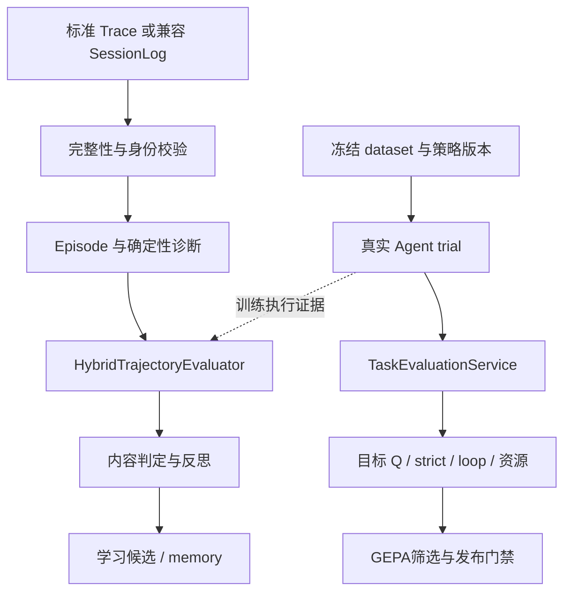

内容评估先用关闭模型的评估器产生确定性分析，再按 `none/suspicious/all` 选择语义判断。标准 trace 在内容层以整个 run 的范围处理，分别保留执行结果和业务结果。反思模型收到的是受控证据视图，不应据某个子分支失败覆盖整个任务状态。模型返回必须满足 JSON、枚举、证据 ID、文本预算和隐私检查；传输成功不等于结果合法。严格模式可以失败退出，非严格模式明确保留 degraded、skipped 或 failed，不能把未经校验的输出当成功。[sessionlog_evaluator.cpp L1087–1156、L1260–1285](../../tools/trajectory_evolution/src/analysis/sessionlog_evaluator.cpp)、[hybrid_evaluator.cpp L1110–1205](../../tools/trajectory_evolution/src/analysis/hybrid_evaluator.cpp)

任务验收的 Q 是普通目标加权完成比例，constraint 不进入普通目标权重；未知保留质量上下界和 coverage。统一有效质量入口要求完整覆盖，critical 失败归零，确定性硬检查失败也不能被模型部分分抵消。strict 则是另一条完整验收：无 failed/critical、无 error/unknown 且覆盖完整，才 passed。模型 loop_review 完整时统计 waste，缺审查时 count 为 null；rule_lower_bound 与 model_review 不同口径，比较必须说明 method 和 observations。[goal_assessment.h L148–207](../../tools/trajectory_evolution/src/evaluation/goal_assessment.h)、[task_evaluation.cpp L2466–2481、L3192–3224](../../tools/trajectory_evolution/src/evaluation/task_evaluation.cpp)

<a id="evolution-4"></a>

### 4.4 反思怎样成为有资格的候选？

后台学习由 `IntegrationService::process_evaluations()` 驱动。完整关闭轨迹先原子写入可学习文件，再按数量、最长等待和批次预算排队。同批独立轨迹分析可以并行，但 job 状态、预算、候选合成和记忆提交仍由学习线程控制；在线打点不进入该阻塞路径。单个模型分析失败记入 job.errors，其他分析继续，已成功报告可以复用。存储失败、来源变化、缓存缺失与模型质量失败有不同错误语义。[integration_service.cpp L4131–4185、L4275–4440](../../tools/trajectory_evolution/src/service/integration_service.cpp)

`TrajectoryEvolutionPipeline::synthesize_reports()` 接收合法 `HybridEvaluationReport`。确定性无效诊断可生成模板候选；成功的对话反思可以生成技能编排、经验注入和循环停止等候选。旧纯文本报告仍可保留为离线候选，但没有明确 scope/trigger/body 契约时不能自动成为在线经验。新增反证还会检查既有记忆，不能只持续累积正面支持。[evolution_pipeline.cpp L2200–2283](../../tools/trajectory_evolution/src/analysis/evolution_pipeline.cpp)

`EvolutionCandidate` 保留 target_type、target_scope、trigger_pattern、observed_problem、proposed_change、expected_benefit 和支持/反证。每份 `CandidateEvidence` 又带 source 身份、source_fingerprint、Episode、diagnostic 和 event 引用。因此 source 说明事实来自哪个执行身份及内容，evidence 说明哪一段事实支持这项建议；两者不是模型声称“有帮助”即可替代的字段。指纹用于内容身份和重放校验，不能当作“来源正确”“规则安全”或“收益已证明”的独立证明。[hybrid_evaluation.proto L345–385](../../tools/trajectory_evolution/proto/hybrid_evaluation.proto)

候选门槛同时检查结构和支持：缺执行者/适用条件/正文或没有支持证据会 rejected_by_gate；存在反证会 conflicted；独立 Dialogue/Episode 支持不足会 insufficient_support；达到门槛才 proposed。confidence 由证据均值和支持覆盖组成，有反证还会下调，它是整理信号，不是任务成功率。相同操作/参数支持契约才能合并支持，不能让一个工具上的恢复经验借用另一个动作的成功记录。[evolution_pipeline.cpp L668–750、L1642–1658](../../tools/trajectory_evolution/src/analysis/evolution_pipeline.cpp)

**示例三：学习候选的阅读视图。仅为结构示意，未展示完整证据与身份，不代表已批准或已验证。**

```json
{
  "target_type": "CANDIDATE_TARGET_TYPE_EXPERIENCE_INJECTION",
  "target_scope": "agent:demo/actor:worker",
  "trigger_pattern": "观察到已知位置参数类型错误",
  "proposed_change": "核对工具 schema，使用命名参数，避免重复相同调用",
  "status": "EVOLUTION_CANDIDATE_STATUS_INSUFFICIENT_SUPPORT",
  "support_dialogue_count": 1,
  "support_evidence": [{"source_fingerprint": "示意摘要", "evidence_event_ids": ["error-demo"]}]
}
```

这段结构尤其说明“建议看起来合理”和“支持足够”可以同时一真一假。若后续反例表明某类任务必须重复核验，正确处理应是修订适用条件、保留例外和证据，而不是为减少 loop 删除用户要求的工作。候选也不自动翻译成动作拒绝或停止规则；可执行控制需要专门编译和真实边界条件。

<a id="evolution-5"></a>

### 4.5 私有与公共memory如何积累支持、处理冲突和归档？

私有记忆是按用户保存的 `EvolutionMemoryStore`，entry 内包含候选快照、revision、批次来源、别名候选、关系和评估反馈。candidate/proposed 是候选状态，memory/CANDIDATE 或 VALIDATED 是库状态，运行 approved 是固定的应用授权，三者不能互相替代。一个 proposed 候选可能保存在库中，却因没有 validated evidence 或批准项而无法被当前策略使用。[hybrid_evaluation.proto L504–551](../../tools/trajectory_evolution/proto/hybrid_evaluation.proto)

管理器先检查候选身份、同类型、scope、经验契约和观察支持契约，再判断 exact/duplicate/related/contradicts/distinct/unresolved。相似词面只负责形成短名单，后台模型只能在合法 memory_id 和允许关系内作判定。DUPLICATE 需要结构兼容，RELATED 不应被当作合并证据，CONTRADICTS 要作为反证关系保留，UNRESOLVED 也不能默认合并。这样可以避免把措辞相似而语义范围不同的建议混成一条“万能经验”。[evolution_pipeline.cpp L1642–1647、L1890–1995](../../tools/trajectory_evolution/src/analysis/evolution_pipeline.cpp)

增量整理之外还存在 full curation、容量控制和归档状态。`curate_memory_file()` 为同用户整理持独立锁，模型审查结果与提交工作有单独 journal；中断 running 没有结果时保留 pending/unresolved，而不是制造成功。提交 memory 与 journal 是两个原子文件，跨文件中断靠缓存结果重放本地合并，不能声称一次文件 rename 解决所有事务问题。protobuf 是权威存储，JSON 是阅读视图；幂等重放修复阅读视图，也不应让旧批次重新增加支持数。[evolution_pipeline.cpp L3948–4008、L4012–4084](../../tools/trajectory_evolution/src/analysis/evolution_pipeline.cpp)

公共经验通过另一条治理链产生：私有来源进入队列，独立证据不足留 private_only；模型先 distill，再 review 隐私安全、可推广、支持和不覆盖既有权限等条件。公共条目可处于 pending_support、published、disputed、reserve 或 retired。`published` 在这里表示公共经验当前符合支持与冲突条件，并不表示某个完整运行策略已经通过任务门禁。用户独立支持和训练组支持是两条可配置路径：默认至少两个支持用户，或至少两个独立训练组；不能因单用户训练提炼成功就宣称跨用户泛化。[shared_memory.cpp L130–188、L265–291、L677–741](../../tools/trajectory_evolution/src/memory/shared_memory.cpp)

公共管理会随新反证、证据过期和容量重新计算状态，不仅在第一次入库时审核。来源与反对关系按用户、内容 revision 固定，公共经验有反证时可以 disputed，过期可 retired，超过活跃容量可以 reserve。跨私有/公共 duplicate 优先使用私有规范记录；冲突或未决关系可能排除公共副本，避免私有策略停用一条经验后公共副本绕回旧正文。[shared_memory.cpp L191–226](../../tools/trajectory_evolution/src/memory/shared_memory.cpp)、[shadow_runtime.cpp L508–528](../../tools/trajectory_evolution/src/runtime/shadow_runtime.cpp)

通用服务共享默认开启，自动批准默认关闭。这个结论必须同时读配置模板与 `shared_memory_options()`，不能因为模板未写 sharing 就推定关闭。AppWorld训练开启共享，候选评测/GEPA显式关闭共享写回；真正GEPA又开启 auto_approve，并要求 require_validated_evidence。这些区别服务于“积累经验”和“冻结对照”的隔离，不能压成一个全局开关。[service.json L21–27](../../tools/trajectory_evolution/config/service.json)、[shared_memory.cpp L265–291](../../tools/trajectory_evolution/src/memory/shared_memory.cpp)、[offline_gepa.py L282–291](../../tools/trajectory_evolution/experiments/appworld/offline_gepa.py)

<a id="evolution-6"></a>

### 4.6 快照、检索与RuntimePolicy如何衔接？

通用服务模板设 `max_level=L3`、`auto_approve_experiences=false`，运行批准集合初始为空；shadow候选容量128条，单次最多3条建议、4096字节、至少两个匹配词。模板没有开启 `require_validated_evidence`，不能据“存在shadow快照”推定每个条目都已获得VALIDATED状态。AppWorld离线GEPA的准备脚本则明确设自动批准、要求有效验证证据，容量64条、最多2条建议及2048字节。准备脚本的当前默认值不能倒写到历史冻结artifact：运行真实选项应以实际加载版本为准。批准、验证证据与适用条件是彼此独立的检查。[service.json L21–41](../../tools/trajectory_evolution/config/service.json)、[shadow_policy.proto L12–25](../../tools/trajectory_evolution/proto/shadow_policy.proto)、[offline_gepa.py L282–291](../../tools/trajectory_evolution/experiments/appworld/offline_gepa.py)

`compile_shadow_policy()` 首先检查库 schema、identity、application/user 归属和容量，再过滤 scope、ownership、target type、status 与 conflict。它的输出 `ShadowPolicySnapshot` 记录私有/公共revision、固定经验及跨库关系。快照并不直接包含业务执行结果，也不是“所有经验均获授权”的声明。随后 `compile_runtime_policy()` 把快照、固定批准来源和 RuntimeOptions 组合起来，校验身份、scope、能力、预算和规则，生成 policy_id。[shadow_runtime.cpp L344–429](../../tools/trajectory_evolution/src/runtime/shadow_runtime.cpp)、[policy_runtime.cpp L309–356](../../tools/trajectory_evolution/src/runtime/policy_runtime.cpp)

在线检索以确定性词面和结构锚点为主，没有 embedding 或同步语义模型。文本投影排除 system/developer、既有经验标签和传输字段名，当前 task 取最新用户及其后的可见助手/工具消息；因此不能把全部检索文本称为已执行工具事实。工具计划文本可以参与相关性，却不能据此认定动作发生。observed_operations 和结构错误码提供额外实际观察约束，部分改写要求匹配允许操作之一，scope 又限制并发分支间借用。[retrieval_text.h L35–84、L99–139](../../tools/trajectory_evolution/src/runtime/retrieval_text.h)、[policy_runtime.cpp L440–471](../../tools/trajectory_evolution/src/runtime/policy_runtime.cpp)

词项匹配对强词、字面错误、中文窗口、词频权重和 top-K/字节预算作有界处理，默认配置要求至少两个独立匹配词。私有优先只解决重复副本，不让不相关私有经验压过相关公共经验。词面方式可解释、开销低，但不保证否定、前提已满足、任务阶段和跨语言表达的语义正确；这些是适用条件研究的真实空间，而不是可以直接宣称“当前检索已经解决”的能力。[shadow_runtime.cpp L792–856](../../tools/trajectory_evolution/src/runtime/shadow_runtime.cpp)

L2 动作规则和 L3 循环规则在 `match_mode=predicate` 或 `aggressive_controls=true` 时，来源匹配直接检查已批准来源，不要求该来源进入当前 advice 的 top-K；无来源的部署基础规则也直接通过来源匹配。保留旧检索触发模式的有来源规则，仍要求 memory_id 与 content_revision 出现在当前检索 advice 中，因此不能概括为全部 L2/L3 都不依赖 L1 检索。L2 编排走独立 `plan_schedule` 路径。编译时的来源修订与批准校验仍分别适用。运行时允许严格能力校验或降级；requested_level 只是请求，effective_level 由宿主能力计算。L3 不自动说明每种 lower-level 功能都实际应用，完整策略也可能有规则但没有命中记录。[policy_runtime.cpp L164–174、L211–214、L238–258、L483–495、L583–593、L618–629、L650–654](../../tools/trajectory_evolution/src/runtime/policy_runtime.cpp)

**示例四：冻结运行选项片段。仅为结构示意，省略基础规则和来源校验字段，不能直接编译。**

```json
{
  "requested_level": "L3",
  "allowed_users": ["demo-user"],
  "host_capabilities": ["context.request", "action.filter", "loop.decide"],
  "approved_experiences": [{"memory_id": "demo-memory", "content_revision": "demo-revision"}],
  "experience_overrides": [{
    "source_experience": {"memory_id": "demo-memory", "content_revision": "demo-revision"},
    "trigger_pattern": "api_failure positional_type_error", "content": "核对schema并改用命名参数"
  }],
  "schedule_rules": []
}
```

运行时使用该版本的授权与正文，当前查询只提供事实，不能把它替换为另一用户的策略。`verify()` 再把准备决定与真实边界观察对齐：L1看实际请求，L2看未执行拒绝与完成依赖，L3看真实停止或消费重规划上下文。来源、查询、决定和回执身份是归属链，应用次数只统计该链闭合的 applied。[policy_runtime.cpp L739–807](../../tools/trajectory_evolution/src/runtime/policy_runtime.cpp)

<a id="evolution-7"></a>

### 4.7 GEPA如何选择组件、生成改动并保留互补分支？

`AgentEvaluationService` 在后台调用 `run_gepa_search()`，输入完整 seed、baseline、dataset、评估和反思配置、门禁与控制授权。启动要求 train/val/holdout 三份非空、任务全部 reviewed、seed 有批准来源，并预留最终候选和必要 L0 对照的 trial 预算。这里的 train 是搜索反馈角色；某些实验原有训练集先负责记忆积累，再把开发范围划成搜索 train/val。仅凭文件名或目录名不能判断真正独立性。[agent_evaluation.cpp L1180–1202](../../tools/trajectory_evolution/src/evaluation/agent_evaluation.cpp)、[gepa_search.cpp L10123–10143](../../tools/trajectory_evolution/src/gepa/gepa_search.cpp)

一个节点保存完整策略而非孤立一句提示，组件包含 experience 条目、action_rules、schedule_rules 和 loop_rules。选择单组件减少一次同时改动多项造成的解释困难；round_robin 只是组件轮换方式，当前实现还结合真实训练机会和应用记录判断哪些组件有可编辑证据。L1优先查看用过获选经验的样本，控制反馈优先保留实际边界、参数契约、依赖和分支循环事实。没有可触发绑定时不能凭模型计划制造“成功控制”。[gepa_strategy.cpp L591–627](../../tools/trajectory_evolution/src/gepa/gepa_strategy.cpp)、[gepa_search.cpp L6537–6569](../../tools/trajectory_evolution/src/gepa/gepa_search.cpp)

反思改写必须只作用于获选组件，生成草案经过 mutation、来源和受限控制编译。输入和模型调用都有固定预算；正式 Q、strict、loop 与 coverage 不能因压缩而被 raw字段替代，缺值也不能补0。控制提案只改 reason 而没有改变可执行谓词时会 duplicate；未观察到行为差异的纯删除控制也有预检，不必浪费完整 Agent 评测。但预检只能证明是否可能改变既有证据上的行为，不能证明新策略会改善任务。[gepa_search.cpp L9643、L9775–9840](../../tools/trajectory_evolution/src/gepa/gepa_search.cpp)

COMBEE提供分组反思和汇总。旧路径按反馈量约平方根构造 map 组，再 reduce同一组件；当前另有 `propose_full_pool()`，按完整父训练池的不同任务分片，记录每组与最终请求覆盖，避免以小包“反馈”名义漏掉绝大部分题。它仍受每个请求的字节/题数与全局调用预算约束，不能据“有32题训练”推定32题细节都进入一次模型输入。逐阶段记录的 feedback_records/bytes 与coverage才回答实际看到了多少证据。[gepa_search.cpp L8704–8824](../../tools/trajectory_evolution/src/gepa/gepa_search.cpp)

逐任务前沿用于保留不同任务上的专长，父节点选择并非只取总体平均最高。多父融合使用共同祖先进行三方比较：一个父改动某组件，另一个父保留祖先时取有效改动；两边都改同组件则记录冲突并使用稳定优先级。名义双亲必须实际贡献两个分支的改动，否则只是单亲复制，不构成有用融合。即使结构融合合法，也要在真实试验中确认没有组合退化。[gepa_strategy.cpp L324–454、L560–588](../../tools/trajectory_evolution/src/gepa/gepa_strategy.cpp)

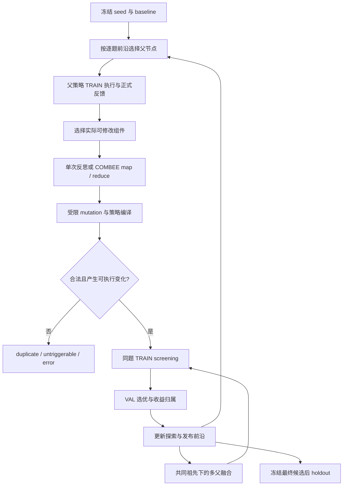

搜索 fitness 是目标质量减去 loop、token、时延的有界惩罚，各权重由配置决定。质量、严格通过和成本不是同一指标，也不能认为“fitness提高”自动通过发布要求。确定性 hard check 失败会使正式质量归零；资源report-only模式又有单独语义，应如实注明哪些成本只是展示而未成为当前准入约束。[gepa_search.cpp L5631–5654](../../tools/trajectory_evolution/src/gepa/gepa_search.cpp)

<a id="evolution-8"></a>

### 4.8 为什么TRAIN、VAL和冻结后的holdout承担不同职责？

TRAIN screening 使用同题父子成绩、实际 control_coverage、applied_changes 和获选组件的 causal_changes。它检查新规则是否实际观察、是否产生行为变化、受影响题与整批是否有收益，以及 critical 风险。当前Pareto允许局部专长和有限平均波动：loop/time/token存在父均值1.10保护，受影响题至少六道且其中质量下降达三分之一会拒绝。批次整体改善可以进入独立val求证，但先标 attribution_pending，不能据此宣称控制已有效。[gepa_search.cpp L7361–7413、L7504–7626](../../tools/trajectory_evolution/src/gepa/gepa_search.cpp)

这里需要特别警惕注释与实现的差别。`loops_no_worse()` 注释称逐题约束，实际先检查逐题观测完整、同口径，再比较平均invalid_loops；它并未保证每道题不退化。整体质量上升、平均loop下降仍可能掩盖尾部任务变差。这个边界是阅读源码得出的事实，不等于本轮已做故障实验或证明存在某个未修回归。[gepa_strategy.cpp L53–83](../../tools/trajectory_evolution/src/gepa/gepa_strategy.cpp)

VAL用于比较和选优。`attributed_validation_gain()`只看实际改变行为、父子都可比的验证题子集，要求 no_worse 和 local_gain；未触发题仍计入完整验证均值，却不能为新规则证明效果。未归属收益的节点可能 unobserved_changes，新控制未应用则 unobserved_controls；探索前沿和最终winner还各自有资格条件。源码注释使用因果措辞，但方法本质仍是实际应用题上的配对收益核验，没有自动完成随机干预、多次重复或统计因果证明。[gepa_search.cpp L9495–9555、L9775–9864](../../tools/trajectory_evolution/src/gepa/gepa_search.cpp)、[gepa_strategy.cpp L196–249](../../tools/trajectory_evolution/src/gepa/gepa_strategy.cpp)

最终候选名单和版本在 holdout_started 时冻结。每个候选以固定 campaign 实际执行holdout，候选不借普通缓存跳过本次执行；L0可以复用已锁定、校验过来源的完整基线。报告保存真实holdout摘要、版本、来源与状态，不把历史val摘要冒充新观察。若某个阶段字段还叫 running，而 job/tree 已 cancelled 或结果未完整，就只能说明状态尚未闭合，不能报告已完成。[gepa_search.cpp L11336–11415](../../tools/trajectory_evolution/src/gepa/gepa_search.cpp)

组件门禁检查 complete、coverage、errors、paired trials、critical、质量与loop目标、可配置资源比率。原生 `min_quality_gain`是绝对加值，例如0.03表示Q增加三个百分点；AppWorld入口“相对提升5%”是相对L0的比例，必须用各自口径计算。默认 require_level_coverage=false，只有严格覆盖模式才拒绝全部生成规则或已声明能力未实际应用的候选。所以passed说明当前配置的效果门槛通过，不自动说明L1/L2/L3每级均发挥了作用。[agent_evaluation.cpp L850–981](../../tools/trajectory_evolution/src/evaluation/agent_evaluation.cpp)

算法安排train/val/holdout不自动创造独立评测。当前AppWorld固定500范围被开发反馈、阶段前缀和排障使用，README明示开发对照，不能换名成为独立holdout。真正泛化验收应按任务族先冻结未触碰范围，冻结策略后评价，不把该范围失败轨迹反馈到搜索。若沿失败继续修规则，就已把该集转成开发数据，必须另设确认集。

<a id="evolution-9"></a>

### 4.9 搜索怎样反向修订memory，同时隔离留出反馈？

GEPA不只输出一个策略，还输出训练配对反馈。`AgentEvaluationService`只交付搜索期间的训练记录，holdout replay不产生第二份入库事件。反馈按不同任务去重，保存变化组件、来源revision和必要成绩/报告引用，避免重复恢复或同题多次回执虚增支持。完整策略副本不是反馈的主体，原始记忆仍保留权威身份。[agent_evaluation.cpp L1196–1202](../../tools/trajectory_evolution/src/evaluation/agent_evaluation.cpp)、[hybrid_evaluation.proto L540–551](../../tools/trajectory_evolution/proto/hybrid_evaluation.proto)

正负证据会形成 supported、regressed、conflicting 或 insufficient_support。足够正证可形成validated反馈并提升memory状态；足够负证可归档；原来VALIDATED出现冲突可回CANDIDATE。公共正文的独立启停效果还进入公共可信状态，不应把组合策略失利盲目归罪于每个成员。这样形成了“经验提出—应用—验证—修订资格”的回路，而不是只按成功次数增加confidence。[gepa_feedback.cpp L205–226、L280–316](../../tools/trajectory_evolution/src/memory/gepa_feedback.cpp)、[shared_memory.cpp L149–172](../../tools/trajectory_evolution/src/memory/shared_memory.cpp)

**示例五：反馈摘要。仅为结构示意，不代表某条真实记忆已完成两次正证。**

```json
{
  "content_revision": "demo-revision",
  "status": "validated",
  "positive_trial_count": 2,
  "negative_trial_count": 0,
  "report_ids": ["demo-train-report-a", "demo-train-report-b"]
}
```

这套反馈可以提高可追溯性，却仍不能替代跨任务泛化验证。两道同题或同环境变体上的收益不一定迁移到新任务族，记忆越多也不保证检索更好。研究应分别测建议内容、触发条件和实际控制：同一经验正文只改条件，才能检验条件价值；只关闭新增动作/loop组件，才能检验控制增量；全部组冻结相同模型、宿主、预算、裁判和环境，才能减少替代解释。

<a id="evolution-10"></a>

### 4.10 发布和交付有什么区别，后续run怎样加载版本？

正常组件发布必须门禁passed、作业仍为当前lane的最新版本、parent_version与现有发布祖先一致。服务先持久化publications和published状态，再向消费者曝光artifact，避免半发布版本被运行读到。`export_publication()`保存bundle，包含version、artifact及evaluation的job/context/gate；同路径已有内容不得静默替换。导出的包记录验证身份，不是修改旧报告以取得新分数。[agent_evaluation.cpp L801–815、L1334–1352](../../tools/trajectory_evolution/src/evaluation/agent_evaluation.cpp)

后续run调用 `apply_agent_version()` 选择策略。evaluation_version绑定特定trial；offline_version加载固定包；policy_evaluation_file读取已评测发布视图，没有兼容版本则L0并记录awaiting_evaluated_policy。若没有该评测门禁配置，也存在直接使用当前编译策略的接入路径。因此“代码有验证发布能力”不能解释为“所有宿主永远验证后才能上线”。[agent_evaluation_support.h L15–58](../../tools/trajectory_evolution/src/evaluation/agent_evaluation_support.h)

离线部署重新绑定当前run身份，校验等级、用户、host capabilities、target scopes与基础限制。包具有自己的固定行为，不能因另一个服务的模板补全就悄悄改变正文；它不要求历史检索配置完全相同，但不得扩大基础动作/loop/调度授权。用户或等级不匹配可以L0，缺必要能力或范围则明确错误，客户端降级又需从轨迹中识别，不能把降级运行计成该策略有效评测。[agent_evaluation_support.h L59–138](../../tools/trajectory_evolution/src/evaluation/agent_evaluation_support.h)

“published”至少有三种语境：公共memory当前可信发布、组件策略通过门禁发布、实验目录保存交付artifact。AppWorld截止交付允许输出 best_available_not_qualified；其manifest有goal_passed=false、未宣称GEPA完成等语义。交付0模型调用只指复用已评分结果的导出动作，原训练/裁判/重试成本不能抹去。加载版本、实际应用、任务passed与实验goal_passed也必须分别检查。[AppWorld README L56–66](../../tools/trajectory_evolution/experiments/appworld/README.md)

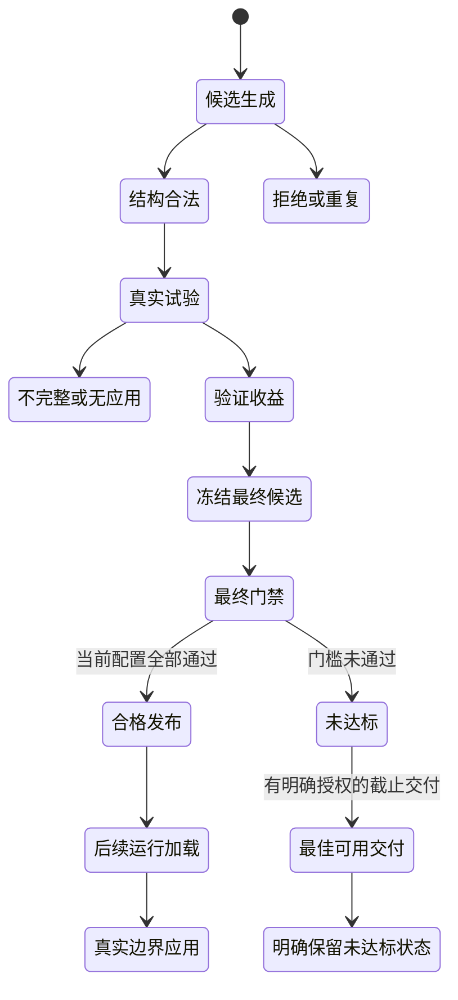

<a id="evolution-11"></a>

### 4.11 怎样读懂一条完整链，目前还有什么需要证明？

建议先选一条普通任务，沿run身份阅读原始输入、step/action/loop事件和最终验收；再从真实错误/恢复进入HybridEvaluationReport，核对反思引用的event是否在该run里；再读CandidateEvidence、候选状态、memory revision与关系；再读ShadowPolicySnapshot和RuntimeOptions批准项；最后查实际query、prepared request、应用回执和任务对照。这样掌握的是同一来源沿各层被怎样约束，而不是一串互不相干的文件名。

对GEPA则选一个有真实改动的节点，读parent、components、reflection输入实际覆盖、draft、编译artifact、TRAIN screening、VAL applied_changes、accepted与optimization，再核查是否被选入冻结holdout和实际published。遇到accepted却不qualified，要看哪些质量/资源条件不满足；遇到unobserved_changes，要看有没有真实改变行为、是否只有未应用题随机涨分；遇到error，要区分输入预算、绑定、采集、存储、裁判和业务模型失败。

当前静态实现最有价值的基础是：行为版本能冻结，规则来源能回链，模型计划与执行事实能分开，入库/批准/应用/收益有不同状态，训练反馈与最终评价有隔离路径。尚不能仅据这些代码证明的是：策略在随机执行下稳定改善、多个控制层各自贡献、跨用户/跨任务泛化、全成本更低和任意崩溃无损恢复。正常路径和历史专项测试存在也不能替代当前版本的真实模型验收。

下一阶段最可收敛的研究路径，是先完善可迁移的原报告与版本证据，再在有真实机会的小范围任务验证触发和回执，继而做相同经验内容下的条件机制比较、L2动作/编排与L3逐层消融、重复配对和人工裁判核验，最后一次性评价真正未触碰确认集。测试组不向memory写回，保留退化和额外尝试，报告任务成功、无效loop、提前停止、触发错误、资源覆盖和总成本。只有这些证据闭合之后，扩大候选空间或增加搜索轮数才有明确研究意义。

本章不把当前工程描述为已经实现完全自主且可靠的持续智能提升。更准确的定位是：系统提供了真实执行证据支撑的受限行为自进化基础，并把“能生成策略”推进到“能够验证和解释策略何时应用、是否改善”的工程路径；研究上的稳定性、泛化和成本仍须独立实验确认。

<a id="experiments"></a>

## 5. 实验设计、现存结果与证据边界

### 5.1 先固定比较口径与版本

实验不是一张统一排行榜。AppWorld、业务模拟、早期 v1 服装 Agent、daily-qa、BFCL 和 tau2 的任务、判分和数据范围不同，不能把通过数或 loop 平均值跨表相加。尤其是业务 Q 可为多个目标的部分完成分数，而当前 AppWorld 500 摘要中 Q 恰好为单目标 0/1，等于正式严格通过率；这个等式不适用于所有任务。

当前读取的源码 HEAD 为 `f44bbaf4…`。AppWorld 历史结果记录宿主 `appworld-agentflow-v22`、Judge 指纹 `d81d7445…`、冻结策略 `agent-version-v1:3cf539a85ea45457a3040faa3b6881e92a25b0b32be56b5a03c92da302595bb5`。业务结果记录 Judge 指纹 `60547002…` 与策略 `agent-version-v1:64bc4542a60ec5b0438c400c20c426485f1fecf464682bf4fff804095a688dec`。旧 v1 发布包为 `agent-version-v1:ef7b87b98add4abaf0b3e91d89c925d3b5a304ee397eaebca7fdd3bffefd94c7`。这些是不同实验身份，现有产物没有完整证明历史运行的 Git commit 等于当前 HEAD。

因此，本文报告的是“当前代码支持的机制”及“仓库现存历史产物反映的结果”，没有把历史成绩写成当前 HEAD 的新运行成绩，也没有将不同 Judge、Host 或策略版本的结果合并。

对任意一份实验，建议依次看以下字段：

| 检查项 | 本文采用的含义 |
|---|---|
| 样本范围 | 相同 task_id、相同任务修订、相同试次/重复口径；健康交集需单独说明 |
| 完成数 | 执行与评分分别检查；`complete` 标签不替代逐题 coverage |
| 质量 Q | 任务目标质量，保留 unknown、critical 与判分覆盖 |
| 严格通过 | 所有必需业务目标及硬检查通过的正式 task verdict |
| 平均无效 loop | 同一种完整评审口径下的无效轮次均值；不是所有模型轮次 |
| 时延 / 调用 / Token | Agent 任务成本，注明覆盖；优化器、Judge、学习、重试成本另算 |
| L1 / L2 / L3 | 实际 `advice.applied`，区分发生次数与受影响任务数 |
| 父/当前身份 | GEPA 的实际 parent 字段，不能把上一编号自动当父节点 |
| 发布结论 | coverage、性能目标、门禁、导出交付与独立泛化分别判断 |

### 5.2 AppWorld 的任务与训练范围

AppWorld 在仓库中通过专用 Host 驱动真实 AgentFlow v1。业务模型在 skill 内产生并执行对应用 API 的程序，Host 管理任务对应的 world，读取官方任务评估，再与原生目标 Judge、硬检查及无效 loop review 形成正式试次结果。这里应分别理解官方任务通过与系统正式通过，后面展示两者的差异。

当前数据文件是 [AppWorld datasets](../../tools/trajectory_evolution/experiments/appworld/datasets/)，工作流与范围说明在 [AppWorld README](../../tools/trajectory_evolution/experiments/appworld/README.md)，执行与阶段门禁分别见 [training.py](../../tools/trajectory_evolution/experiments/appworld/training.py)、[stage_gate.py](../../tools/trajectory_evolution/experiments/appworld/stage_gate.py)。

| 数据或对象 | 当前可核查数量 | 正确解释 |
|---|---:|---|
| 当前 `train.jsonl` | 134 | 90 道官方 train 加 44 道公共 TRAIN 补充任务 |
| 当前 `val.jsonl` | 12 | 用于开发选择的验证范围 |
| 当前 `holdout.jsonl` | 500 | 文件名虽为 holdout，实际是固定开发对照 |
| 当前 `comparison-500.jsonl` | 500 | 与上述 holdout 500 的任务列表相同 |
| 旧 GEPA 作业冻结训练范围 | 132 | 与当前 134 不同，不代表少执行两道当前任务 |
| 最佳冻结 seed manifest 的计划训练量 | 120 | 属于该 seed 的历史来源范围 |
| 当前训练 memory 可读视图 | 164 条 entry，revision 33 | 全部为 CANDIDATE，不等于已批准策略经验 |
| 当前 memory 的 applied_batch_ids | 28 | 记忆更新批次账本；不是 28 次在线策略应用 |
| 冻结交付策略的批准来源 | 99 条 | 与当前 164 条候选视图是不同对象和版本 |

当前固定 500 按 `attributes.appworld.source_view` 分为 `test_normal` 131、`test_challenge` 327、`dev` 42。32/100 阶段样本属于同一开发范围的前缀或子集；开发失败曾用于后续分析与调整。因此，README 和 manifest 明确记录 `independent_holdout=false`。不能通过改变文件名恢复独立性。

训练、筛选、选择和验收各有意义：TRAIN 可用于反思、构造候选和训练反馈；VAL 用于选择；真正独立 HOLDOUT 应只在策略及协议完全冻结后验收。现有 AppWorld 500 已参与开发，适合解释开发收益与问题，不适合直接支持未见任务泛化的结论。

### 5.3 AppWorld 500：完整开发对照，提升真实但未达目标

本次读取并重新聚合 [L0 result.json](../../trace_output/appworld/gepa/l0-current-stage500/result.json) 和 [seed comparison.json](../../trace_output/appworld/gepa/seed-search-71-stage500/comparison.json)。两侧各 500 个 task_id 唯一且顺序相同，也与当前 comparison/holdout 列表一致。复算没有重新调用模型或 Judge。

下表的“父/冻结 seed”是当前 GEPA 树 Node0，历史候选标签为 71；“当前 Node30”是本轮搜索的最后新节点，其同 500 结果并未生成。

| 同题 500 指标 | L0 | 父 / 冻结 seed Node0 | 当前新 Node30 |
|---|---:|---:|---|
| 完成执行 / 质量评分 | 500 / 500 | 500 / 500 | 同 500 待生成 |
| 正式 Q | 0.644 | 0.676 | 暂无 |
| 正式严格通过 | 322/500，64.4% | 338/500，67.6% | 暂无 |
| 平均无效 loop，model_review | 0.380 | 0.204 | 暂无 |
| 无效 loop 总数 | 190 | 102 | 暂无 |
| 平均任务时延 | 暂无，标准字段覆盖 0/500 | 172.434 秒，500/500 | 暂无 |
| 平均 Token | 暂无，标准字段覆盖 0/500 | 172,923.98，497/500 | 暂无 |
| 平均模型调用 | 暂无，标准字段覆盖 0/500 | 25.722，497/500 | 暂无 |
| L1 实际应用次数 | 0 | 595 | 同 500 暂无 |
| L2 动作 / 编排实际应用次数 | 0 / 0 | 0 / 0 | 同 500 暂无 |
| L3 实际应用次数 | 0 | 4 | 同 500 暂无 |

计算结果：

```text
质量绝对提升 = 0.676 - 0.644 = 0.032，即 3.2 个百分点
质量/严格通过相对提升 = (338 - 322) / 322 = 4.968944%
无效 loop 相对减少 = (190 - 102) / 190 = 46.315789%
若严格通过相对提升至少 5%，需要 ceil(322 × 1.05) = 339 题
```

配对结果为 78 题改善、62 题退步、360 题持平，净增加 16 题。总体提升存在，但许多改善被回归抵消；不能把“78 题改善”单独作为纯净收益，也不能把 595 次 L1 应用理解为 595 题。实际有 L1 应用的任务是 360/500，有 L3 应用的是 4/500，L2 两类均为零。

当前 frozen policy 的 `requested_level` 和 `effective_level` 都是 L3；其策略包含 action rule 1 条、loop rule 2 条、schedule rule 0 条、experience override 28 条。**配置中具有 L2/L3 能力和规则，与在这 500 题中实际触发并形成收益，是两个问题。**这组数据主要说明 L1 参与的开发收益，不能单独给出 L2 效果，也不足以估计 L3 的稳定增益。

AppWorld 的正式目标要求完整 coverage、Q 与严格通过相对提升至少 5%、无效 loop 减少至少 15%。`stage_gate.py` 的当前流程将资源变化列为诊断，核心目标调用 `require_resources=False`；资源硬约束不能从业务实验移植到这组门禁。L0 成本标准字段缺失仍是报告证据不足，不能补 0 或用 candidate 单侧成本声称加速/省 Token。

[交付 manifest](../../trace_output/appworld/published/strategy/manifest.json) 同时记录：

```json
{
  "status": "delivered",
  "published": true,
  "release_status": "best_available_not_qualified",
  "goal_passed": false,
  "independent_holdout": false,
  "gepa_completion_claimed": false
}
```

这是对真实文件字段的摘录。它表示**最佳可用策略已交付，但目标未通过**。4.968944% 不能四舍五入成已经达到 5%。导出阶段记录零 API 调用，仅说明这一次导出没有重新执行任务，不表示整个训练与搜索免费完成。

### 5.4 总体之外：哪些任务改善，哪些任务退步

以下为本次新增的描述性分组复算，仍是原有 500 题，不是新实验或新验收集。分组预先存在于数据元信息；分组成绩不能再拿来选择新“好看”的验收子集。

| 同题来源组 | 样本数 | L0 严格通过 | 冻结 seed 严格通过 | 净变化 | L0 → seed 平均无效 loop | 改善 / 退步 / 持平 |
|---|---:|---:|---:|---:|---|---|
| test_normal | 131 | 97 | 95 | −2 | 0.465649 → 0.320611 | 12 / 14 / 105 |
| test_challenge | 327 | 202 | 214 | +12 | 0.376147 → 0.183486 | 58 / 46 / 223 |
| dev | 42 | 23 | 29 | +6 | 0.142857 → 0 | 8 / 2 / 32 |
| 合计 | 500 | 322 | 338 | +16 | 0.380 → 0.204 | 78 / 62 / 360 |

这揭示两件事。第一，降低无效循环不保证严格成功同步提升：normal 组 loop 减少但严格通过下降。第二，总体收益的较大一部分来自挑战组，dev 也有提升，但 dev 参与开发，不能当作新的迁移证据。这里没有声称差异达到统计显著；一次执行和有限分组还不足以区分模型随机波动、经验误触发、宿主行为和任务难度的影响。

后续应保存 62 题回归与 78 题改善的配对轨迹，逐条看新增应用、必要动作是否被抑制、前提是否误匹配、官方与原生 verdict 是否一致，并进行固定种子的重复对照。单靠汇总均值无法完成这种诊断。

### 5.5 官方通过数与正式通过数不能互换

现存摘要的官方严格通过为 L0 323、seed 339，正式严格通过为 L0 322、seed 338。L0 的 `appworld-9a16324_3` 和 seed 的 `appworld-3b8fb7a_2` 各有一题官方通过但正式未通过。由于引用的原始原生报告在本地缺失，本次不能独立核查额外失败原因。

正确做法是并列展示两组数及判分来源。错误做法是拿 candidate 官方 339 对 formal baseline 322 计算增益，或者用官方 339 宣称正式 339 的门槛已满足。正式 gate 使用正式 verdict，官方 reward 是重要输入与辅助结果，但不覆盖其他目标、硬检查和评估完整性要求。

### 5.6 GEPA 当前树：30 个新节点没有形成新的有效胜者

现存搜索树：[tree.json](../../trace_output/appworld/gepa/workspace/agent-evaluation/f0d143a0298773c1bb0b0fbe1733f68feab42c2e53cf49b33e005c1d46f193b2/search/tree.json)。

| 字段 | 当前产物 |
|---|---|
| algorithm | `gepa-reflective-dag-v4-constrained-portfolio` |
| 总节点数 | 31 = seed Node0 + 30 个新节点 |
| rounds | 30 |
| 优化器 model_calls | 395；不是 Agent/Judge/训练全部调用 |
| 新 accepted 节点 | 0 |
| 新节点 parent | 全部为 0；Node30 的父也是 Node0 |
| winner | 0，即原冻结 seed |
| selected_version | null |
| job/tree status | cancelled，error 为 gepa_cancelled |
| final_holdout.status | 遗留记录 running；不能据此判断当前运行或完成 |

新节点状态分布如下：

| 状态 | 数量 | 解释 |
|---|---:|---|
| error | 13 | 某个必要生成、执行或评估环节报错；需逐节点看原因 |
| duplicate | 5 | 与已有策略相同或没有可接受的新差异 |
| untriggerable_controls | 4 | 控制缺少可触发机会或预检不满足 |
| interrupted | 3 | 中断的节点，不当作性能失败或成功 |
| inconclusive | 2 | 证据不足以完成判定 |
| unobserved_changes | 2 | 改动没有真实应用证据 |
| rejected_minibatch | 1 | 训练筛选拒绝 |

这棵树不是“31 代逐步变好”。它是一个 seed 的 30 次新探索，目前均未成为接受节点。框架支持 DAG、多父融合、前沿与候选选优，不代表这一批已经形成多代成功累积。

最新 Node30 只有历史 [WORK_STATUS](../../tools/trajectory_evolution/docs/WORK_STATUS.md) 记录了同 31 道健康 TRAIN 题的父子比较。当前树 `screening.candidate` 为空，不能从现存逐题缓存独立复算这 31 行：

| 历史同 TRAIN31 健康交集 | L0 同31 | 父 Node0 | 当前 Node30 |
|---|---|---:|---:|
| 完成且可评分 | 暂无同口径数据 | 31 | 31 |
| 严格通过 | 暂无 | 20 | 20 |
| Q | 暂无 | 20/31 = 0.645161 | 20/31 = 0.645161 |
| 平均无效 loop | 暂无 | 4/31 = 0.129032 | 11/31 = 0.354839 |
| 时延 / Token / 调用 | 暂无 | 暂无 | 暂无 |
| L1 / L2动作 / L2编排 / L3 | 暂无 | 暂无同31范围 | 暂无同31范围 |

文档记录 32 次执行中 31 次健康、1 次采集退化；不能拿树中 parent 32 题的 Q、loop 与 child 31 题混比。Node30 保留的总体 control coverage 不是这 31 题可追溯明细，故没有强行填入上表。

### 5.7 两个节点说明“分数涨了”为何仍不晋级

**Node26：全池净增不等于被修改策略的收益。**其 TRAIN32 的完整父子缓存可读，父为 Node0：

| Node26 所用同 TRAIN32 | L0 同32 | 父 Node0 | Node26 |
|---|---|---:|---:|
| 评分完成数 | 暂无同口径 | 32 | 32 |
| 严格通过 | 暂无 | 22 | 24 |
| Q | 暂无 | 0.6875 | 0.7500 |
| 平均无效 loop | 暂无 | 0 | 0 |
| 平均任务时延 | 暂无 | 134.608 秒 | 142.609 秒 |
| 平均 Token | 暂无 | 122,439.06 | 131,175.31 |
| 平均模型调用 | 暂无 | 20.875 | 21.875 |
| 当前节点实际应用 | — | 按原策略执行 | L1=33；L2动作/编排=0；L3=0 |

新增变更实际影响 8 题，其严格通过父子都是 6/8、Q 都是 0.75；一题改善被另一题退步抵消。还出现一项新增 critical failure：在保留 cart 的 wishlist 训练任务中误把非目标商品移入 wishlist。节点最终 `rejected_minibatch`。即使全池严格通过多 2，也没有证明修改部分产生净收益，更不能忽略新增关键违规。

**Node28：有机会不等于实际控制。**它用的是另一个 TRAIN32，不能与 Node26 的 32 题拼成一条曲线：

| Node28 所用同 TRAIN32 | L0 同32 | 父 Node0 | Node28 |
|---|---|---:|---:|
| 评分完成数 | 暂无同口径 | 32 | 32 |
| 严格通过 | 暂无 | 25 | 26 |
| Q | 暂无 | 0.78125 | 0.81250 |
| 平均无效 loop | 暂无 | 0.56250 | 0.28125 |
| 平均任务时延 | 暂无 | 120.735 秒 | 111.960 秒 |
| 平均 Token | 暂无 | 111,640.22 | 99,530.44 |
| 平均模型调用 | 暂无 | 19.6875 | 18.0625 |
| 当前节点实际应用 | — | 按原策略执行 | L1=32；L2动作/编排=0；L3=0 |

预检发现过 3 个机会窗口，但新增 L3 变更实际应用为 0。已有 L1 的应用不能替新增 L3 证明收益，所以节点为 `unobserved_changes`，没有进入正式 500 验收。这是保守且可解释的筛选，不是“数字改善了就应该发布”。

### 5.8 AppWorld 成本与原始证据还缺什么

本机 AppWorld 目录保存 13 个 JSON，约 6.4 MB，主要是紧凑摘要、策略、memory 视图和搜索树。交付 manifest 引用 6 份 candidate 原生报告及 1 份 L0 原生报告，映射旧路径前缀后 7 份都未在本地找到。

因此可以复算 1,000 行 compact item 的严格通过、Q、loop、应用计数和分组变化，可以确认摘要是否自洽；**不能据此独立复核原始工具执行、模型输入、Judge 解释、实际应用回执链和历史运行源码身份。**这不是说历史成绩已被证伪，而是可验证范围受到产物缺失限制。

现存结果另外记录 L0 额外执行尝试 34 次、seed 3 次，`execution_costs_complete=false`。candidate 的单侧成功试次平均成本，以及 optimizer 的 395 次反思调用，都不是系统全部费用。完整成本应该包括训练、反思、任务 Agent、Judge、失败/重试和恢复；没有这些账本时，不应汇总成一个“总 Token/总成本降低”的结论。

### 5.9 业务 seed004：交付范围有提升，但不能解释为独立泛化

证据入口：[final comparison.json](../../trace_output/business-simulator/published/seed004/comparison.json)、[manifest.json](../../trace_output/business-simulator/published/seed004/manifest.json)、[300 与 full400 对照](../../trace_output/business-simulator/published/seed004/baseline-cache/comparison300.json)。

最终 500 摘要的 `scope=known_business300_plus_training_replay200`、`independent_holdout=false`、`all_goals_met=true`。它是已知业务 300 加训练回放 200。实际验收含 Q/严格通过相对提升至少 5%、loop 减少至少 15%、Token/调用/时延不增加、共同可观测意图 F1 改善；这组资源是硬要求，与当前 AppWorld 的资源诊断契约不同。

| 同题交付范围500 | L0 | 父 / 冻结业务 seed004 | 后续新节点 |
|---|---:|---:|---|
| completed | 500 | 500 | 待生成 / 暂无 |
| Q | 0.502823 | 0.567788 | 暂无 |
| 严格通过 | 206/500，41.2% | 246/500，49.2% | 暂无 |
| 平均无效 loop | 3.158 | 2.382 | 暂无 |
| 平均任务时延 | 98.347 秒 | 96.028 秒 | 暂无 |
| 平均模型调用 | 16.574 | 16.186 | 暂无 |
| 平均 Token，共同493题 | 104,808.44 | 103,388.01 | 暂无 |
| 意图 micro-F1，共同101题/轮 | 0.892704 | 0.918455 | 暂无 |
| L1 实际应用 | 暂无，levels=null | 1,667 | 暂无 |
| L2 动作 / 编排；L3 | 暂无 | 0 / 0；0 | 暂无 |

注意 baseline levels 为 null，不能为了表格整齐改成 0。该范围的提升可以描述为“固定交付范围的开发收益”。然而原始 300 业务范围经过成绩知情选择，200 是训练回放；它没有建立独立未见场景验收。

必须同时看选择前的反证：

| 已保存的不同业务范围 | L0 Q → candidate Q | 严格通过 | 平均无效 loop | 结论 |
|---|---|---|---|---|
| 选择后的业务300 | 0.469022 → 0.557833 | 113 → 145 | 3.073333 → 1.973333 | 所选范围提升 |
| 同文件原业务 full400 | 0.528392 → 0.511717 | 177 → 168 | 2.870 → 2.955 | 整体质量和通过下降，loop 变差 |

`comparison300.json` 的 method 为 `performance_informed_business_acceptance`，limitations 明确说明范围按已测成绩选择。manifest 也保存 `selection_uses_measured_performance=true`。后来新增的 200 训练回放有自己的冻结、分层和非选分声明；这不能取消之前 300 的选择偏差。

两层选择要分开讲：最终交付文件可保持冻结、没有继续挑掉其中失败题；但构成这个文件的业务 300 已经按成绩被选过。直接把 final500 与原 full400 对换，会误导读者以为一次统一验收始终通过。

较早 `training-200/result.json` 标记 complete，但评分覆盖为 L0 198/200、candidate 196/200，合计 6 个 Judge 错误。最终 500 可能经过后续补评；本地缺少被引用的 attempt2 原始报告和部分 evidence，无法核查补评链。应把它记录为 provenance 缺口，不能拿早期文件机械否定终版，也不能当作终版补评已被独立证实。

### 5.10 早期真实 v1：保留了小规模验收摘要

仓库还有一组容易被 AppWorld 主线遮盖的早期实验。数据在 [coldstart manifest](../../trace_output/v1-l4-coldstart/dataset/manifest.json)，固定复现说明在 [v1-l3 README](../../configs/reproduction/v1-l3/README.md)，完整导出策略及验收 gate 保存在 [policy-transfer published-version.json](../../configs/experiments/v1-policy-transfer/published-version.json)。

coldstart 共有 60 个任务，train 30、val 15、holdout 15，33 个 group；manifest `review_complete=true`、`l4_ready=false`。任务集已生成、已审核和适合启动 L4 不是同一概念，不能只根据三分集非空把 l4_ready 改写为 true。

保存的发布包对应 2026-09-14 真实 v1 outfit Agent 的 15 道验收任务，每侧一次。下表直接来自包内 gate 聚合，原始逐题验收目录本地已缺失，所以这是历史发布摘要层证据：

| 历史同15题验收包 | L0 | 固定 L3 候选 | 当前新复现 |
|---|---:|---:|---|
| scored / trials | 15 / 15 | 15 / 15 | 未运行 / 暂无 |
| passed | 14/15 | 15/15 | 暂无 |
| Q | 包中未保存统一 Q | 包中未保存统一 Q | 暂无 |
| 平均无效 loop，model_review | 0.666667 | 0.333333 | 暂无 |
| 平均 Agent 时延 | 54.172 秒 | 52.584 秒 | 暂无 |
| p95 Agent 时延 | 95.189 秒 | 104.080 秒 | 暂无 |
| 平均 Token | 52,564.40 | 50,854.13 | 暂无 |
| 平均 LLM 调用 | 7.333 | 6.333 | 暂无 |
| L1 / L2 / L3 实际应用 | 包中暂无 | 包中暂无 | 暂无 |
| gate | 对照基线 | passed=true | 暂无 |

平均无效 loop 减少 50%，但 p95 时延增加；应避免把平均变好等同所有尾部也变好。策略等级 L3 和包中的 loop rule 不能填补实际应用次数的缺失。小规模历史通过也不能替代当前 500 或跨场景检验。

复现脚本是 [reproduce_v1_l3.py](../../scripts/reproduce_v1_l3.py)，manifest 冻结二进制、源码/输入文件 SHA-256、任务及版本，`--check` 用于前置核查。当前本机缺少 `build/trajectory-evolution/v1-coldstart-input/`、所引用 selective-acceptance 原始目录和二进制等必要材料，不能宣称已经能够直接完整重放。本次没有运行这份成本较高的历史复现。

### 5.11 固定策略迁移：配置完整，当前结果缺失

[v1-policy-transfer README](../../configs/experiments/v1-policy-transfer/README.md) 定义 15 道新任务、每任务 2–3 轮、L0/L3 两组各重复两次，共 60 完整试次。L3 只增加被冻结的 `published-version.json`，两组使用同一个真实 daemon、Bridge、任务预算和 Agent；不同试次隔离工作区与数据库，同一试次保留多轮状态。

这是很有价值的问题设定：固定导出策略能否在新任务上迁移，区别于继续在开发题上搜索。其全部任务标为 holdout，没有 train/val，因而 `l4_ready=false` 是预期结果，不能用“没有 L4 ready”否定固定策略验证的用途。

但当前本地 `trace_output/v1-policy-transfer-20260915/evaluation/report.json` 不存在。README 记载过修复后的 4/4 试次完成评分、8 个 run 闭合、业务通过 2/4；这是局部历史回执，不是 60 试次的最终成绩，也不是今天仍在运行的状态。故完整 L0/父/当前、质量、loop、时延、严格通过和层级应用均记为暂无。

### 5.12 daily-qa：多轮任务暴露了基础能力问题

可读取的逐案例报告为 [report-20260908-133013.json](../../examples/agent/daily-qa-assistant/evals/reports/report-20260908-133013.json)，日期为 2026-09-08，Judge 模型配置 `deepseek-v4-flash`、通过阈值 4。它没有 L0 与演化候选两侧，因此**是基础业务能力 benchmark，不是自进化效果实验**。

本次按 `cases/turns` 重新统计：

| 指标 | 现存结果 |
|---|---:|
| 案例 / 轮数 | 25 / 86 |
| 案例成功 | 4/25 = 16.0% |
| 轮次成功 | 50/86 = 58.14% |
| 规则通过 | 70/86 = 81.40% |
| Judge 通过 | 52/86 = 60.47% |
| 意图集合完全匹配 | 81.40% |
| 多意图匹配 | 80.0%，10 个多意图轮次 |
| 缺失 SessionLog | 0 轮 |
| Judge errors | 0 |
| L0/父/当前、Q、无效loop、层级应用对照 | 暂无；不是该报告的实验协议 |

判定源码见 [daily-qa run_eval.py](../../examples/agent/daily-qa-assistant/evals/run_eval.py) 417–442 行：轮成功需要规则通过且 Judge 通过；案例成功要求其每一轮都成功。较高意图匹配和较低案例成功能够同时存在，因为多轮连贯性、实际答复质量或某轮技能派发失败会使整案例失败。

例如报告 SI-001 第一轮已查询东莞天气，第二轮“那未来三天的预报呢”却反问城市并没有派发 weather-query。报告中的规则/Judge 认为它没有承接上下文。这个案例适合研究对话状态和跨轮检索，却不能只靠单轮正确派发率证明系统已可靠完成多轮任务。

分类结果也提供线索：cross-turn 5 个案例成功率 0，multi-intent 6 个案例成功率 0，negative 4 个案例成功率 50%。这些是这次历史报告的有限结果，不能当作当前 HEAD 重跑后仍然相同，但值得纳入回归任务与经验触发设计。

### 5.13 BFCL：数据与入口存在，完整结果暂无

[BFCL README](../../tools/trajectory_evolution/experiments/bfcl-v3/README.md) 保存两套划分；新 `seen-scenarios-v1` 定义 200 个场景，每场景 2 个变体训练、2 个变体评测。实际初始训练 400，GEPA search 150，selection 50，holdout 200；search/selection/holdout 分别覆盖 75/25/100 个场景。

任务 ID 互斥不代表场景未见。新协议测试的是**训练已见场景的不同条件**，不能描述为未见场景泛化。原生 `train.jsonl` 容器含 train400 + search150 共 550；初始重建 memory 必须只读 `source/train_ids.txt` 的 400，不能训练全部 550。

旧 memory 已看过部分新评测题，仓库保留的 provenance 记录旧 train 对新 search/selection/holdout 有 66/16/118 的交集。所以新实验要求从新 train400 重建独立 memory，不能通过仅更换 dataset 名称复用旧经验。

独立入口 [run_bfcl_v3.sh](../../tools/trajectory_evolution/experiments/bfcl-v3/run_bfcl_v3.sh) 已提供 seen-start/seen-resume/seen-status/seen-check。当前本地 `trace_output/bfcl-v3/` 不存在，因此 L0、父、当前节点完成数、Q、loop、时延、strict 与 L1/L2/L3 均暂无。WORK_STATUS 旧 267/400 训练进度不能写成当前存活或已完成。

### 5.14 tau2：声明的流程尚缺必要宿主与运行材料

本机仅看到 [tau2_experiment.py](../../tools/trajectory_evolution/experiments/tau2-retail-verified/tau2_experiment.py) 控制脚本。它声明 train44、pool15、val15、holdout40，以 `tau2_reward=1` 作为确定性严格检查；代码引用 `tau2_host.py`、`datasets/gepa-view.json`、独立运行环境以及已发布业务运行二进制。

这些必要路径在本地未闭合，结果目录 `trace_output/tau2-retail-verified/` 也不存在。因此它是已有控制流程设计与部分代码，不是完成了真实 tau2 接入或正式效果验收。任务完成数、Q、loop、时延、strict、层级应用均暂无。

### 5.15 通用 benchmark 数据已准备到什么程度

[benchmark/](../../benchmark/) 是普通业务测试框架，`evalset.v2` 与原生 `EvaluationDataset` 是不同接口。前者经 Bridge 测聊天、意图、技能与规则/Judge；后者用于独立版本试次、目标评估及 GEPA。转换器和适配器能连接部分数据结构，但两者不会因为都叫 evalset 就天然采用相同统计协议。

本次直接统计当前文件：

| benchmark 数据文件 | 案例数 | 用户轮数 | 文件内划分 |
|---|---:|---:|---|
| daily-qa.json | 25 | 86 | 未写 split |
| product.json | 1,074 | 1,910 | 未写 split |
| coldstart.json | 60 | 60 | train30 / val15 / holdout15 |
| hotpotqa.json | 900 | 900 | train500 / val200 / holdout200 |

这些是输入规模，不是完成的执行量。`--validate-only` 只能证明对应 schema/配置检查，不证明模型调用、业务通过或演化收益。基础 benchmark 的 `min_pass_rate` 等门槛与原生版本发布、业务500、AppWorld 三核心目标应分别解释。

### 5.16 当前环境和“复现”应如何理解

当前代码提供 AppWorld 完整流程说明：准备独立 runtime/world、模型配置和原生组件，真实 API TRAIN→采集学习→seed→32→100→GEPA→真实候选500对照→选择导出，另支持接续原作业。该说明证明存在可操作路线，不证明这台机器已经准备齐全。

还要区分不同的最终入口：[stage_gate.py](../../tools/trajectory_evolution/experiments/appworld/stage_gate.py) 的 `verify_final()` 要求恰好三份完整候选500对照，分别检查 coverage 与 goal；当前正常选优/交付流程支持实际获得的非空候选名单及明确的 seed 截止交付，不能为了数量复制候选。这两条路径的契约不能互相替代。现存一份 seed500 交付不表示“三候选最终验证”已经完成。

本次存在性核查发现下列本地材料缺失：

```text
build/agentflowd
tools/trajectory_evolution/build-v4/trajectory_evolution
tools/trajectory_evolution/build/trajectory_evolution
examples/agent/business-simulator/appworld/runtime/venv/bin/python
examples/agent/business-simulator/appworld/runtime/world
build/trajectory-evolution/v1-coldstart-input
trace_output/v1-policy-transfer-20260915/evaluation/report.json
trace_output/v1-l3-reproduction/
```

这里只检查了上述声明路径，没有据此宣称全机所有位置都没有可用二进制，也没有检查远程服务器状态。现有历史产物可分析、当前源码可阅读，与立即执行完整真实复现是不同阶段。

### 5.17 本次复算文件和它的验证范围

脚本：[recompute_results.py](recompute_results.py)。产物：[实验指标复算_20261009.json](实验指标复算_20261009.json)。它只读现存 JSON/JSONL，在报告目录输出新汇总。

完成 20 项断言，覆盖 AppWorld 同题500/唯一性/正式322与338/Q/loop190与102/配对78与62/层级应用/官方与正式分离/资源 coverage/分组131与327与42/交付未达标/seed 与 Node0/30新节点与395次调用/原生来源文件缺失、业务选择与 full400 回归/500非独立、daily-qa 逐轮复算、历史15题 gate 及 coldstart 划分。

这些断言验证**当前可读产物的内部一致性**。它们不等于业务软件测试通过、真实环境接受通过、全链路实验重新完成或原始 provenance 已被补齐；JSON 也明确写 `original_native_provenance_verified=false` 与 `historical_run_git_commit_verified=false`。


<a id="next"></a>

## 6. 当前问题、下一步方向与源码阅读路线

### 6.1 目前已实现到哪里，效果证据到哪里

| 能力 | 当前源码/产物支持 | 当前效果证据与限制 |
|---|---|---|
| C++ 执行底座与 Python Harness | Agent/Session/Task/Workflow/Worker、模型/技能/工具链路存在 | 有历史真实业务与 AppWorld 运行产物；本次未重新构建或执行 |
| 标准轨迹采集与完整性隔离 | 原生/HTTP、显式边界、幂等请求、quarantine、应用回执 | compact 摘要可分析，部分历史原始轨迹缺失 |
| L1 经验输入增强 | 有来源筛选、授权、词项/事实条件、预算、消费校验 | AppWorld 595 次，业务1667次；总体收益伴随回归 |
| L2 动作过滤与编排 | 结构化规则、参数契约、范围和实际执行校验存在 | 最佳 AppWorld 和业务范围内均未实际应用；暂无收益估计 |
| L3 循环控制 | 继续/停止/replan、真实提交/消费、预算约束存在 | 最佳 AppWorld500实际4次；样本太少且未单独消融 |
| 私有/公共 memory 生命周期 | 候选、关系整理、跨库冲突、共享提炼、反馈晋升/归档 | 有保存的 memory/发布包；未由条数证明普遍跨用户迁移 |
| GEPA 受限候选搜索 | 单组件改动、TRAIN筛选、VAL归属、前沿、holdout、发布存在 | 当前30新节点0accepted，没有新胜者的实验结果 |
| 固定版本导出/导入 | 完整策略包与版本校验存在 | 早期15题gate可读；新任务60试次最终报告本地缺失 |
| 持久化与恢复 | capture保存、请求幂等、学习/评测作业恢复、归档存在 | 不等同工具副作用恢复、业务断点续跑、每事件持久化日志 |
| 独立泛化验收 | 框架提供dataset隔离与holdout路径 | 当前主要500成绩均非独立，BFCL/tau2结果缺失 |

当前最值得保留的成果，是把“经历→经验→授权策略→实际应用→评测→发布”分成了可定位、可检查的对象，而不是只有一段反思 prompt。当前最明显的研究缺口，是还没有用独立、完整且可归因的实验，证明这些机制能稳定带来跨任务收益。

### 6.2 把问题分为执行、策略和研究证据三类

**执行与可观测性问题。**真实实验依赖完整宿主、二进制、工具环境、凭据与跨进程接线。当前本地缺少若干运行材料及原生报告，首先影响的是复现和诊断能力。已有 fail-open 能让业务继续，但发生缺口的 run 应隔离；已有 run/job 恢复不能推导为工具进程断点恢复。还需明确每种 ACK 的含义、同会话并发保护覆盖，以及 v1/v2 环境变量与 wrapper 分支是否一致。

**策略有效性问题。**现有实际应用回执以 L1 为主，L2 未触发、L3 少量触发；没有消融实验，不能据此独立估计各层收益贡献。词面检索和结构事实可以约束误匹配，但不能自动保证经验语义适用。某些经验让模型减少重复动作，也可能抑制必要核验或改变错误分支；降低 loop 与提高任务完成率不是同一目标。GEPA 用实际变更归属和 critical 防线来拦截这类风险，但启发式筛选仍可能误杀或漏放。

**研究证据问题。**开发500和成绩知情选样不能回答独立泛化；单次模型运行不能充分区分随机波动与策略贡献；同时改变多个经验、宿主和 prompt 会削弱归因；历史运行 commit、完整成本和原始报告缺失又限制审计。框架中已有 schema/版本/哈希不意味着每份旧产物都保存了所有必要 provenance，应逐份核查。

这些分类决定下一步动作：运行缺陷靠定向集成验证；经验误触发靠触发与回归任务；泛化与因果收益靠冻结设计和消融。用一种测试代替所有问题，会得到看似完整却回答不了核心问题的结果。

### 6.3 建议的推进顺序与每一步交付物

以下是后续工作建议，本次没有启动这些实验或修改实现。

| 顺序 | 要解决的问题 | 具体工作 | 可检查的交付物 |
|---|---|---|---|
| 1 | 现有结果能否从原证据追溯 | 找回只读原生报告与轨迹，登记运行commit/dirty、Host/Judge/模型/策略/dataset身份，核对成功/失败/补评账本 | 一份来源清单；每个正式数字能定位到原始 trial，不修改旧成绩 |
| 2 | 当前源码的真实关键链路能否运行 | 准备隔离环境，按正式生产launcher/cwd/PYTHONPATH做1–2题smoke，验证请求→工具→run闭合→评分→applied | 完整真实回执；分开记录代码测试、环境准备、模型接受与任务通过 |
| 3 | L1 为什么改善或退化 | 固定版本与任务，分析AppWorld78改善/62退步，重点normal组、必要核验和触发前提；补误触发负例 | 错误分类表、可重放触发证据、回归任务集 |
| 4 | L2/L3 能否真正发挥作用 | 在TRAIN构造确有控制机会的任务，区分“没有机会”“有机会但没应用”“应用但无益”；保留合法必要动作 | 每条规则的机会、提议、实际应用与配对结果矩阵 |
| 5 | GEPA 是否比种子更好 | 固定模型、seed、任务版本与预算，比较seed与搜索胜者，报告每轮损耗/接受数/总费用，独立观察筛选误差 | 可解释搜索树、有效新节点、冻结验证成绩与失败原因 |
| 6 | 收益能否迁移 | 先冻结真正未触碰的分组holdout；固定策略，按场景或源问题切分，并做重复对照与消融 | 独立验收报告；明确未见条件与未见场景各自结论 |

应优先恢复能回答上述问题的最小关键链路，不为报告美观进行无关重构，也不因迟迟未达标降低最终门槛。没有更好有效候选时，保留 best_available_not_qualified 是有信息的工程结论。

### 6.4 建议的消融实验：明确每种机制的贡献

下表是建议的实验设计，不是仓库已有成绩。

| 对照条件 | 改变什么 | 主要回答什么 |
|---|---|---|
| L0 | 关闭策略干预，保留相同采集与评分 | 原始Agent基线与额外观测开销 |
| 固定L1 | 加同一个冻结经验快照和检索配置 | 单靠经验输入是否减少重复错误并提高质量 |
| 固定L1 + L2 | 加动作/编排规则，其他输入相同 | 结构约束的实际贡献与误拦截率 |
| 固定L1 + L3 | 加循环控制，其他输入相同 | 无进展处理是否更好，必要重试是否被误停 |
| 完整固定L1–L3 | 同时启用被验证的规则 | 机制是否互相补充或抵消 |
| GEPA胜者 vs 原seed | 同一冻结验收，不再调参 | 搜索是否提供超过种子的净收益 |
| 私有memory vs 含共享memory | 固定内容来源与跨用户条件 | 共享经验的迁移收益、冲突与隐私范围 |

实施时保持同题、同模型/版本、同Host、同Judge、同budget和相同初态；预先固定重复次数及报告方法。至少报告任务质量、严格通过、critical、无效loop、时延分位数、完整Token/调用、采集/评分coverage和真实应用次数。还要按来源/场景呈现配对回归，不能只保留平均总分。

完整矩阵成本较高，可以先在冻结的、覆盖关键机会的TRAIN/VAL上验证链路与触发，再只让必要条件进入独立holdout。这个成本控制不能变成在holdout上按成绩删题或重新挑选策略。

### 6.5 建议的指标树

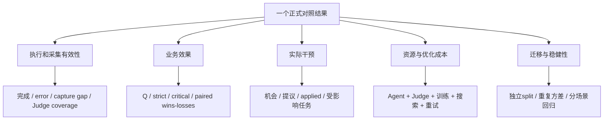

这棵指标树的用途是避免将机制活动量和业务收益混合。比如 `L1=595` 属于实际干预，`strict=338` 属于业务效果，`395 optimizer calls` 属于优化成本，三者无法互相替代。

### 6.6 对 v1/v2、配置和部署的接管建议

当前 AppWorld/BFCL 实验显式设 `AF_COORDINATOR_VERSION=v1`。模板默认选择 v2 脚本，但 shell 没有同时导出相同环境值；公共 llm wrapper 的缺省分支又是 v1，因此存在“入口选v2、wrapper看v1”的配置理解风险。应在接管时检查真实进程环境和模型/工具边界调用，而不是根据文件名判定演化功能是否启用。

`EVOLUTION_POINT_CONFIG` 缺失可导致不创建 configured client；策略服务的 runtime options、发布版本文件和当前用户授权又决定真正等级与可用经验。需要记录四层：启动脚本选择、进程环境、服务配置规范化后的值、实际运行回执。只看一个配置文件的 `level=L3` 不足以说明部署状态。

对于共享与学习，通用服务经规范化默认共享启用，最低独立支持用户/训练组默认2；实验专用路径可能关闭共享或把TRAIN min users设为1。报告应以真实消费路径为准。单用户训练可用于构造候选，不等于公共经验已经具备跨用户验证。

对于跨进程打点，原生handle不能fork后重用，HTTP试次不能退回生产collector，buffered接收不等于落盘，flush不等于后台学习完成。这些是实现中的具体约束，应写进部署验证项，而不是笼统要求“看服务有没有起来”。

### 6.7 建议按六轮读源码

无需从根目录每个文件逐行开始。每轮沿一个真实输入追到输出，画出自己理解的对象和身份；然后用本报告相关章节检查。

| 轮次 | 推荐路径与入口 | 本轮任务 |
|---|---|---|
| 1. 全貌与构建 | [根CMakeLists](../../CMakeLists.txt)、[build.sh](../../scripts/build.sh)、[runtime包](../../packages/agentflow-runtime/pyproject.toml)、[组件CMakeLists](../../tools/trajectory_evolution/CMakeLists.txt) | 区分daemon、Python包、Bridge、独立组件、每种测试产物 |
| 2. 用户到任务 | [chat_rest.py](../../frontend/bridge/routes/chat_rest.py)、[rpc_handler.cpp](../../src/daemon/rpc_handler.cpp)、[session_router.cpp](../../src/agent/session_router.cpp)、[agent.cpp](../../src/agent/agent.cpp) | 追user/client/dialogue如何绑定、请求何时被接受、response如何回去 |
| 3. 工作流与并发 | [runtime.cpp](../../src/runtime/runtime.cpp)、[worker.cpp](../../src/runtime/worker/worker.cpp)、[coordinator_decide.py](../../packages/agentflow-runtime/src/agentflow_runtime/coordinator_decide.py)、[skill_executor.py](../../packages/agentflow-runtime/src/agentflow_runtime/skill_executor.py) | 追Task到clone execution、run_skills manifest、ALL join与终态去重 |
| 4. 在线演化 | [boundary_runtime.cpp](../../tools/trajectory_evolution/src/runtime/boundary_runtime.cpp)、[policy_runtime.cpp](../../tools/trajectory_evolution/src/runtime/policy_runtime.cpp)、[shadow_runtime.cpp](../../tools/trajectory_evolution/src/runtime/shadow_runtime.cpp)、[evolution_configured.py](../../tools/trajectory_evolution/clients/python/evolution_configured.py) | 比较L1/L2/L3提议、授权、消费、applied与失败降级 |
| 5. 后台学习与评测 | [integration_service.cpp](../../tools/trajectory_evolution/src/service/integration_service.cpp)、[hybrid_evaluation.proto](../../tools/trajectory_evolution/proto/hybrid_evaluation.proto)、[task_evaluation.cpp](../../tools/trajectory_evolution/src/evaluation/task_evaluation.cpp) | 区分轨迹语义评估与冻结任务验收、候选入库与memory状态 |
| 6. 搜索与成绩 | [gepa_search.cpp](../../tools/trajectory_evolution/src/gepa/gepa_search.cpp)、[agent_evaluation.cpp](../../tools/trajectory_evolution/src/evaluation/agent_evaluation.cpp)、[AppWorld README](../../tools/trajectory_evolution/experiments/appworld/README.md)、[复算JSON](实验指标复算_20261009.json) | 沿一个parent/child看真实变更、screening、val、holdout、门禁与导出 |

第 6 轮建议先读 Node26 和 Node28，而不是直接读全部上万行搜索实现。这两个节点分别说明实际变更归属、关键违规，以及未应用的控制为何不能晋级。能把它们讲清楚后，再追候选组合、前沿与发布状态，会更容易理解搜索流程。

### 6.8 可用于检验自己是否理解的问答

| 问题 | 应能给出的答案 |
|---|---|
| 一道任务为什么有多个run和workflow execution？ | 用户/评测task、Harness激活、技能分支和工作流运行是不同计数层 |
| `run_skills` 返回 dispatched 后，用户任务成功了吗？ | 尚不能判断；还要等执行终态、ALL join、最终回答和任务评测 |
| workflow_success 与 skill_success 为什么可能不同？ | 前者描述执行流程/进程，后者描述业务结果；正常执行可以返回失败业务结论 |
| DataBus global 是否跨所有用户共享？ | 公共wrapper的global通常去掉dialogue前缀，仍在当前Session sys范围 |
| L1经验候选为何没被使用？ | 可能未批准、版本/用户/scope不符、状态不合格、触发不匹配、预算不足或未实际消费 |
| L2会不会自动修复任意工具参数？ | 当前通用契约重点是过滤/拒绝与编排，不是开放式参数重写 |
| L3返回replan为何未计applied？ | 需要真实提交与后续模型请求消费对应context，建议本身不算 |
| memory_update.applied 是在线应用吗？ | 是入库事务结果；在线应用另看trace advice.applied |
| 两个评估器是否是一套分数？ | 轨迹语义评估用于反思，冻结Task评测用于正式业务验收，输入/输出不同 |
| run.end completed 是否等于strict passed？ | 不等于，执行闭合、采集完整、业务成功分别表示 |
| 归档是否释放磁盘并提供TTL？ | 目录维护不等于删除策略或容量上限保证 |
| 当前策略是L3，为什么L2=0？ | 等级包含允许能力，实际调用机会、条件、采用和回执才决定计数 |
| AppWorld338比322高，为什么goal_passed=false？ | 相对提升4.968944%低于5%，正式至少需339，不能换用官方339 |
| 500题名为holdout为何仍非独立？ | 是否参与开发和选择决定独立性，文件名不改变暴露历史 |
| 业务500通过为何还要展示full400？ | 500包含成绩知情选出的300与训练回放200，full400反映选择前回归 |
| 有GEPA搜索代码是否证明L4成功？ | 还需有效新节点、被冻结验收和实际使用；当前30新节点0accepted |

### 6.9 向导师解释当前阶段时，可以使用的准确表述

“目前系统已经具备完整的执行底座、跨语言 Harness、轨迹记忆和受限策略搜索框架。现有开发实验中，冻结策略能减少重复行为，AppWorld500正式严格通过从322到338、无效loop从0.380到0.204，但未达到预设5%质量/通过提升门槛；实际应用以L1为主，L2暂无应用证据，L3应用很少，各层贡献还需消融确认。当前GEPA新探索尚未得到有效胜者。业务交付范围有提升，但存在成绩知情选样和训练回放，原full400出现回归。下一步重点是补齐原始证据与真实复现链路，诊断触发及回归，设计专项层级消融和真正独立的迁移验收。”

这段话同时保留了工程成果、真实提升、未达标与下一步问题。它不把未完成的实验包装成成功，也不因为尚未证明泛化就否定已经实现的机制。

