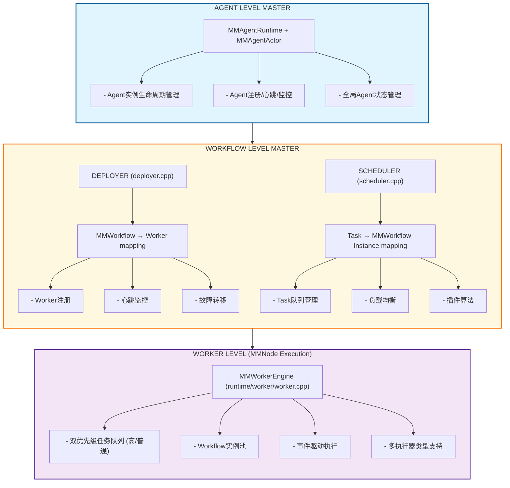
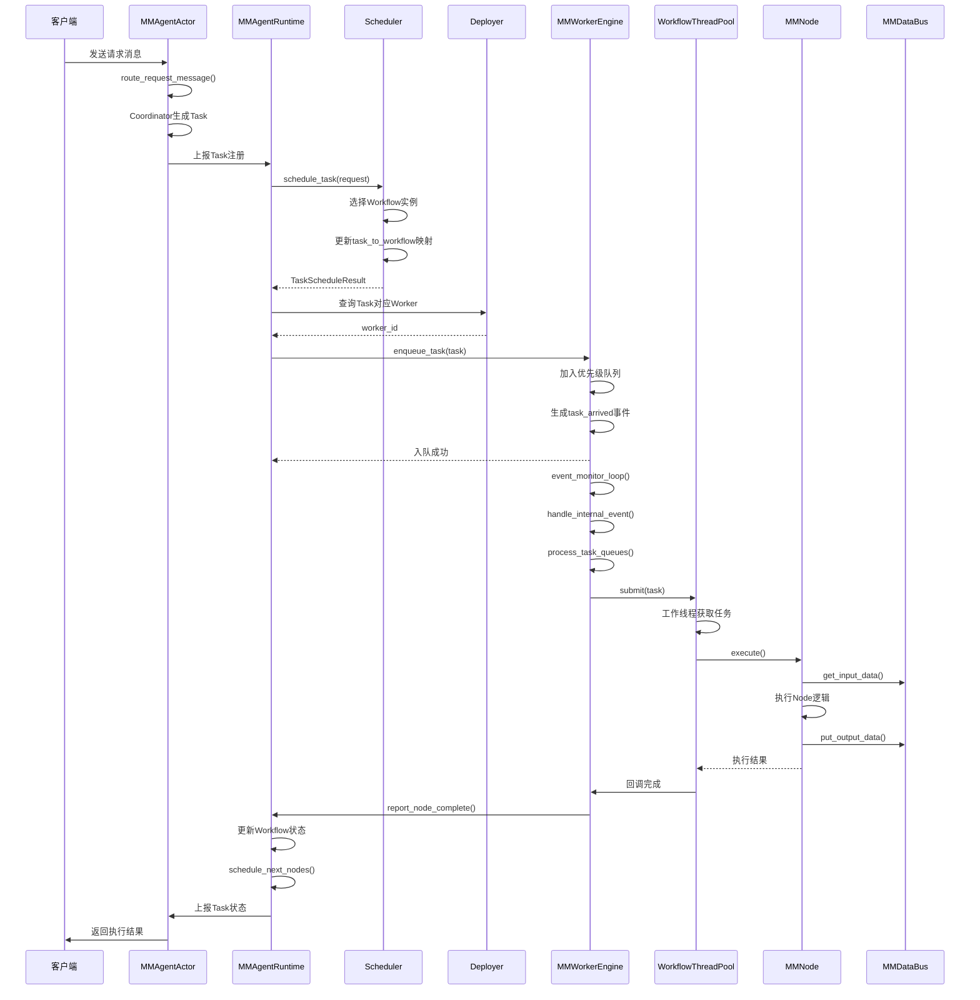
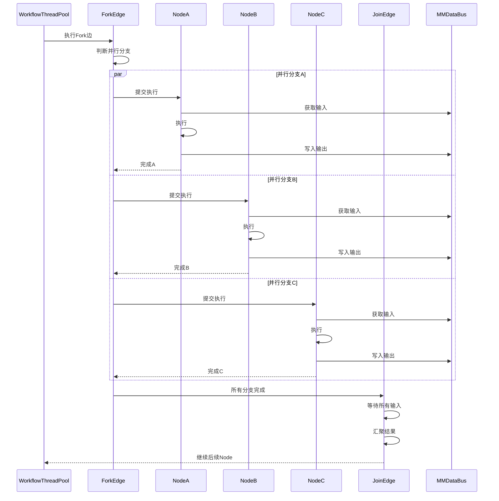
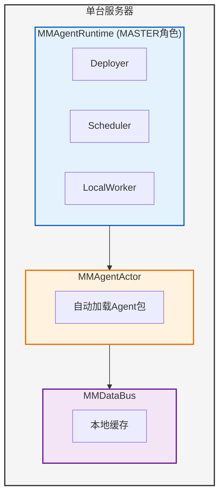
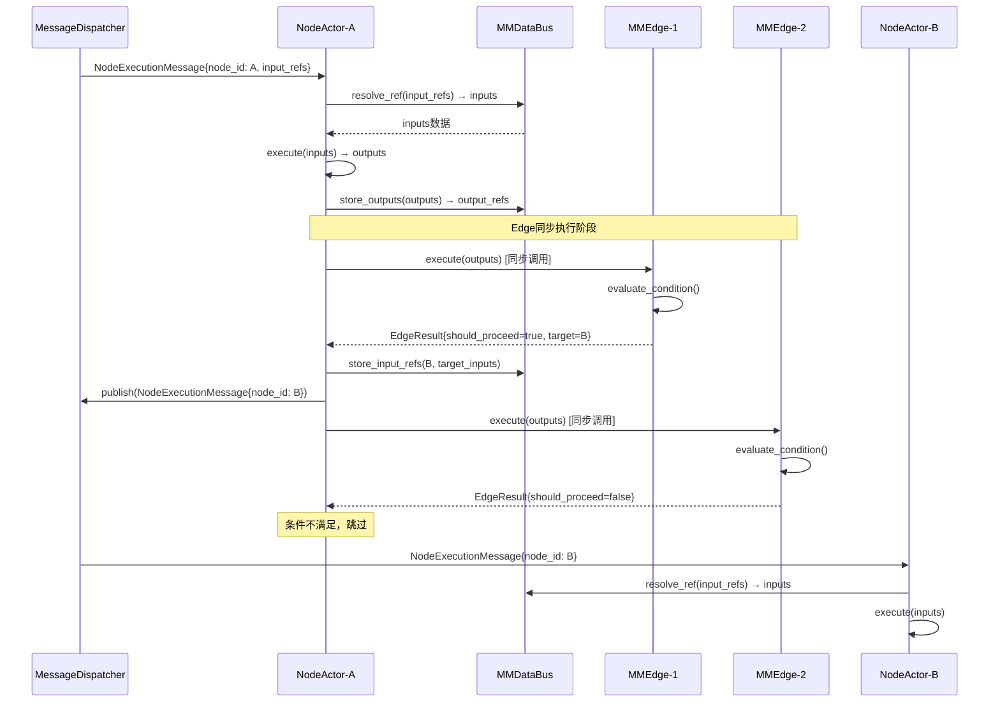
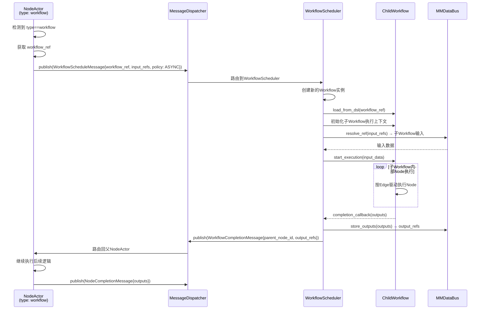
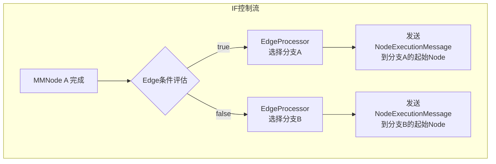
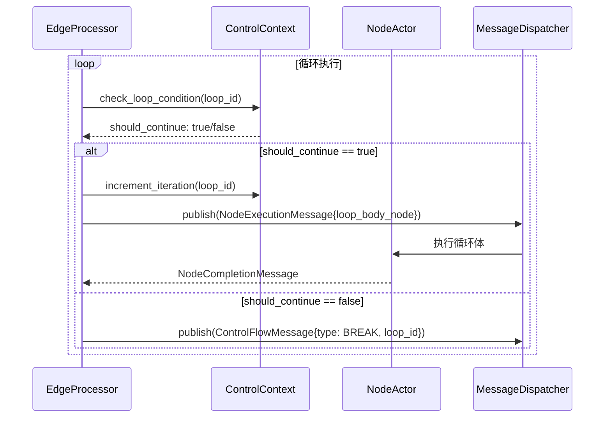
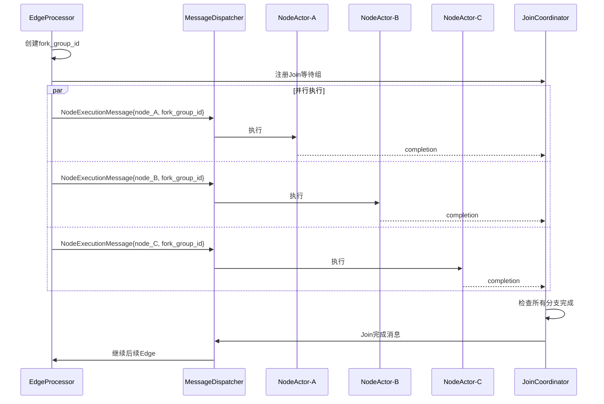

# MMAgent-MMWorkflow-MMNode 调度机制实现分析

> 本文档对比设计规范与代码实现，评估调度机制的符合度。
> - 分析日期：2026-02-27
> - 涉及文档：REFACTORING.md、REQUIREMENTS_ANALYSIS.md、ARCHITECTURE.md
> - 涉及代码：src/runtime/*.cpp、src/runtime/master/*.cpp、src/agent/agent_actor.cpp

---

## 0. 核心概念关系说明

### 0.1 TaskItem、MMWorkflow、MMNode 的关系

#### 开发态 vs 运行态

```
┌─────────────────────────────────────────────────────────────────────────────────────┐
│                              开发态 (Design Time)                                    │
│                                                                                      │
│  ┌──────────────────────────────────────────────────────────────────────────────┐   │
│  │                           MMAgent 包开发                                          │   │
│  │                                                                                │   │
│  │  workflow_XXX.json ──────┐                                                     │   │
│  │       │                  │                                                     │   │
│  │       ▼                  ▼                                                     │   │
│  │  ┌──────────┐      ┌──────────┐      ┌──────────────────┐                    │   │
│  │  │ MMWorkflow │──────┤  MMNode A  │      │ node_a.so        │                    │   │
│  │  │ (流程图)  │      ├──────────┤      │ (可执行代码)      │                    │   │
│  │  │          │      │  MMNode B  │      ├──────────────────┤                    │   │
│  │  │ - nodes[]│      ├──────────┤      │ node_b.py        │                    │   │
│  │  │ - edges[]│──────┤  MMNode C  │      │ (Python脚本)      │                    │   │
│  │  │          │      └──────────┘      └──────────────────┘                    │   │
│  │  │ MMNode:执行 │                                                                │   │
│  │  │ MMEdge:控制 │      MMEdge 定义控制流:                                           │   │
│  │  └──────────┘      - if: 条件分支                                             │   │
│  │                    - loop: 循环                                               │   │
│  │                    - fork/join: 并行                                          │   │
│  │                    - async: 异步                                              │   │
│  └──────────────────────────────────────────────────────────────────────────────┘   │
│                                                                                      │
│  关键特点：                                                                           │
│  - MMWorkflow 是静态定义的DAG（有向图）                                                  │
│  - MMNode 包含执行代码的引用（SO/Python/Shell等）                                         │
│  - MMEdge 定义控制流逻辑，Node只负责动作执行                                              │
│  - 此时没有 TaskItem，只有 MMWorkflow/MMNode 的定义                                        │
└─────────────────────────────────────────────────────────────────────────────────────┘
                                          │
                                          │ Agent包加载
                                          ▼
┌─────────────────────────────────────────────────────────────────────────────────────┐
│                              运行态 (Runtime)                                        │
│                                                                                      │
│  ┌──────────────────────────────────────────────────────────────────────────────┐   │
│  │                           消息触发                                              │   │
│  │                                                                                │   │
│  │  用户请求 ────────┐                                                            │   │
│  │       │          ▼                                                            │   │
│  │       │    ┌──────────┐     ┌──────────────────────────────────────────┐     │   │
│  │       └───▶│  MMAgent   │────▶│           MMAgentTask (agent/task.h)        │     │   │
│  │            │ Session  │     ├──────────────────────────────────────────┤     │   │
│  │            └──────────┘     │ task_id        │ 唯一标识                 │     │   │
│  │                             │ workflow_id    │ 关联Workflow定义         │     │   │
│  │                             │ session_id     │ 所属会话                 │     │   │
│  │                             │ task_type      │ 任务类型                 │     │   │
│  │                             │ state          │ PENDING/RUNNING...       │     │   │
│  │                             └──────────────────────────────────────────┘     │   │
│  │                                         │                                    │   │
│  │                                         │ 1:N (一个Task可能触发多个Node执行)  │   │
│  │                                         ▼                                    │   │
│  └──────────────────────────────────────────────────────────────────────────────┘   │
│                                            │
│                                            │ Scheduler调度
│                                            ▼
┌─────────────────────────────────────────────────────────────────────────────────────┐
│  ┌──────────────────────────────────────────────────────────────────────────────┐   │
│  │                        TaskItem (runtime/worker.h)                            │   │
│  │  ┌────────────────────────────────────────────────────────────────────────┐  │   │
│  │  │                              TaskItem                                   │  │   │
│  │  │  ┌─────────────────┬──────────────────────────────────────────────────┐ │  │   │
│  │  │  │ task_id         │ 继承自AgentTask，标识一次具体执行                  │ │  │   │
│  │  │  │ workflow_id     │ 关联Workflow定义 (开发态定义)                      │ │  │   │
│  │  │  │ workflow_inst   │ 关联Workflow实例 (运行态实例)                      │ │  │   │
│  │  │  │ priority        │ HIGH/NORMAL，决定队列优先级                        │ │  │   │
│  │  │  │ metadata        │ 运行时上下文数据                                   │ │  │   │
│  │  │  └─────────────────┴──────────────────────────────────────────────────┘ │  │   │
│  │  └────────────────────────────────────────────────────────────────────────┘  │   │
│  │                                                                               │   │
│  │  TaskItem 是运行时的"任务调度单元"，用于：                                      │   │
│  │  1. 在Scheduler和Worker之间传递任务                                            │   │
│  │  2. 在Worker内部队列中排队等待执行                                              │   │
│  │  3. 携带执行所需的上下文信息                                                    │   │
│  │                                                                               │   │
│  └──────────────────────────────────────────────────────────────────────────────┘   │
│                                            │
│                                            ▼
┌─────────────────────────────────────────────────────────────────────────────────────┐
│  ┌──────────────────────────────────────────────────────────────────────────────┐   │
│  │                         MMWorkflow 运行时实例                                    │   │
│  │                                                                                │   │
│  │   MMWorkflow Instance (workflow.cpp)                                             │   │
│  │   ┌──────────────────────────────────────────────────────────────────────┐    │   │
│  │   │  control_context_    │ 运行时控制流上下文（循环变量、条件状态）         │    │   │
│  │   │  executed_nodes_     │ 已执行Node记录                                 │    │   │
│  │   │  active_loops_       │ 当前活跃循环状态                               │    │   │
│  │   │  get_executable_nodes() │ 根据Edge控制流判断可执行Node                │    │   │
│  │   └──────────────────────────────────────────────────────────────────────┘    │   │
│  │                                                                                │   │
│  │   开发态的Workflow定义 ──────▶ 运行态的Workflow实例                            │   │
│  │   (静态DAG定义)              (带执行状态的动态实例)                             │   │
│  │                                                                                │   │
│  └──────────────────────────────────────────────────────────────────────────────┘   │
│                                            │
│                                            ▼
┌─────────────────────────────────────────────────────────────────────────────────────┐
│  ┌──────────────────────────────────────────────────────────────────────────────┐   │
│  │                              MMNode 执行                                         │   │
│  │                                                                                │   │
│  │   MMNode Instance                                                                │   │
│  │   ┌────────────────────────────────────────────────────────────────────┐      │   │
│  │   │ state_           │ WAITING → READY → EXECUTING → SUCCESS/FAILED   │      │   │
│  │   │ inputs_          │ 输入数据（来自DataBus或上游Node）                 │      │   │
│  │   │ outputs_         │ 输出数据（写入DataBus供下游使用）                 │      │   │
│  │   │ execute()        │ 实际执行Node逻辑（SO/Python/Shell等）             │      │   │
│  │   │ retry_count_     │ 当前重试次数                                     │      │   │
│  │   └────────────────────────────────────────────────────────────────────┘      │   │
│  │                                                                                │   │
│  │   注意：Node在运行态是"无状态"的，状态由Workflow实例维护                        │   │
│  │   多个Task可以复用同一个Node定义，但各自有独立的执行状态                        │   │
│  │                                                                                │   │
│  └──────────────────────────────────────────────────────────────────────────────┘   │
│                                                                                      │
└─────────────────────────────────────────────────────────────────────────────────────┘
```

#### 核心关系总结

| 关系 | 说明 | 示例 |
|------|------|------|
| **MMAgentTask → MMWorkflow** | 1个AgentTask对应1个Workflow定义 | 用户查询任务 → 执行"QueryWorkflow" |
| **MMAgentTask → TaskItem** | 1个AgentTask可能产生多个TaskItem | 复杂任务分阶段执行，每阶段一个TaskItem |
| **TaskItem → MMWorkflow Instance** | 1个TaskItem对应1个Workflow运行时实例 | Task被调度到WorkerA的Workflow实例X |
| **MMWorkflow Instance → MMNode** | 1个Workflow实例包含多个Node（按DAG图） | Workflow包含：Start→Validate→Process→End |
| **MMNode → TaskItem** | N:N关系，多个TaskItem可触发同一个Node | 不同用户请求都执行"Validate" MMNode |

#### 为什么需要 TaskItem？

| 层级 | 对象 | 职责 | 存在时机 |
|------|------|------|---------|
| **Agent层** | MMAgentTask | 业务任务概念，含生命周期管理（start/pause/stop） | Agent生成任务时 |
| **Runtime层** | TaskItem | 调度单元，用于Worker间任务传递和队列管理 | 进入调度系统后 |
| **Worker层** | TaskItem | 执行单元，关联具体Workflow实例和Node | Worker执行时 |

**TaskItem的核心作用**是**跨进程/跨Worker的任务传递载体**：
- 它比AgentTask更轻量，只携带调度必需的元数据
- 它关联Workflow实例而非Workflow定义，确保执行时获取正确的运行时状态
- 它支持优先级队列，Worker可以按优先级处理任务

---

## 1. 架构总览

### 1.1 三层调度架构设计

```
┌─────────────────────────────────────────────────────────────┐
│                    AGENT LEVEL MASTER                       │
│              (MMAgentRuntime + MMAgentActor)                    │
│     - Agent实例生命周期管理                                  │
│     - Agent注册/心跳/监控                                   │
│     - 全局Agent状态管理                                     │
└───────────────────────┬─────────────────────────────────────┘
                        │
┌───────────────────────▼─────────────────────────────────────┐
│                 WORKFLOW LEVEL MASTER                       │
│    (Deployer & Scheduler - runtime/master/*.cpp)            │
│                                                             │
│  ┌─────────────────┐    ┌─────────────────────────────┐    │
│  │    DEPLOYER     │    │         SCHEDULER           │    │
│  │  (deployer.cpp) │    │      (scheduler.cpp)        │    │
│  │                 │    │                             │    │
│  │ MMWorkflow ->     │    │ Task -> MMWorkflow Instance   │    │
│  │ Worker mapping  │    │ mapping                     │    │
│  │                 │    │                             │    │
│  │ - Worker注册    │    │ - Task队列管理              │    │
│  │ - 心跳监控      │    │ - 负载均衡                  │    │
│  │ - 故障转移      │    │ - 插件算法                  │    │
│  └─────────────────┘    └─────────────────────────────┘    │
└───────────────────────┬─────────────────────────────────────┘
                        │
┌───────────────────────▼─────────────────────────────────────┐
│              WORKER LEVEL (MMNode Execution)                  │
│        (MMWorkerEngine - runtime/worker/worker.cpp)           │
│                                                             │
│  - 双优先级任务队列 (高/普通)                                │
│  - Workflow实例池                                           │
│  - 事件驱动执行                                             │
│  - 多执行器类型支持                                         │
└─────────────────────────────────────────────────────────────┘
```

**Mermaid 版本：**



### 1.2 核心组件映射

| 设计层级 | 设计目标 | 代码实现 | 符合度 |
|---------|---------|---------|--------|
| **MMAgent Level Master** | 管理多Agent实例生命周期 | `MMAgentRuntime` + `MMAgentActor` | 高 |
| **MMWorkflow Level Master** | Deployer(workflow→worker) + Scheduler(task→workflow) | `runtime::master::Deployer` + `runtime::master::Scheduler` | 高 |
| **MMNode Level Worker** | 执行引擎、任务队列、事件驱动 | `MMWorkerEngine` | 中 |

---

## 2. 详细符合性分析

### 2.1 MMAgent Level Master - 符合度：高

#### 设计规范（REFACTORING.md 第15节）

- AgentActor从`AgentService.config`读取`package_root`与`manifests`
- 自动加载agent包并创建Agent实例
- 启动包监控线程，目录变化时增量加载新版本实例
- 支持多版本并行运行
- 维护agent/task实例清单
- 提供`start/pause/resume/stop`控制消息入口
- 向RuntimeActor发送注册/心跳/状态上报消息

#### 代码实现验证

```cpp
// src/agent/agent_actor.cpp
monitor_packages_loop()       // 包监控线程
parse_service_config()        // 解析配置文件
create_agent_from_package()   // 自动创建Agent实例
heartbeat_loop()              // 心跳上报
report_agent_registered()     // 注册消息
apply_agent_control()         // start/pause/resume/stop控制
```

#### 符合性检查表

| 设计要点 | 实现状态 | 代码位置 |
|---------|---------|---------|
| 配置驱动自动加载 | ✅ 已实现 | `parse_service_config()` |
| 多版本并行运行 | ✅ 已实现 | `instance_id`含版本号+时间戳 |
| 包监控与增量加载 | ✅ 已实现 | `monitor_packages_loop()` |
| 生命周期控制 | ✅ 已实现 | `apply_agent_control()` |
| 心跳与状态上报 | ✅ 已实现 | `report_agent_heartbeat()`, `report_agent_status()` |
| Task生成与上报 | ✅ 已实现 | `collect_agent_tasks_and_report()` |

---

### 2.2 MMWorkflow Level Master - 符合度：高

#### 2.2.1 Deployer（workflow→worker调度）

##### 设计规范（REFACTORING.md 第14节）

- worker注册队列与处理线程
- 部署调度线程
- 心跳超时故障隔离（默认10秒）
- 支持workflow增量部署与`rebalance`
- SO可插拔部署算法（失败自动回退内置算法）
- 同agent实例的workflow优先部署到同一worker

##### 代码实现验证

```cpp
// src/runtime/master/deployer.cpp
registration_loop()         // Worker注册处理线程
scheduling_loop()           // 部署调度线程 + 故障检测
rebalance()                 // 负载重平衡
load_plugin_algorithm()     // SO插件加载
run_default_algorithm()     // 默认算法
```

##### 符合性检查表

| 设计要点 | 实现状态 | 代码位置 |
|---------|---------|---------|
| Worker注册队列 | ✅ 已实现 | `worker_registration_queue_` |
| 部署调度线程 | ✅ 已实现 | `scheduling_thread_` |
| 心跳超时检测(10s) | ✅ 已实现 | `heartbeat_timeout_ms = 10000` |
| 故障Worker隔离 | ✅ 已实现 | `find_unhealthy_workers_locked()` |
| 故障时重新部署 | ✅ 已实现 | 收集故障worker的workflow并重新部署 |
| Agent故障时workflow注销 | ✅ 已实现 | `handle_agent_state_change()` |
| 可插拔算法(SO) | ✅ 已实现 | `load_plugin_algorithm()` |
| 同Agent实例优先部署 | ✅ 已实现 | `run_default_algorithm()`匹配逻辑 |

#### 2.2.2 Scheduler（task→workflow调度）

##### 设计规范

- task注册队列与处理线程
- 调度到匹配的workflow实例
- 同agent实例task优先调度到同agent workflow
- 可插拔调度算法
- Agent故障时task重调度

##### 代码实现验证

```cpp
// src/runtime/master/scheduler.cpp
scheduling_loop()            // 调度处理线程
run_default_algorithm()      // 默认算法
schedule_task()              // 主调度逻辑
```

##### 默认调度算法逻辑

```cpp
// 三级优先级策略
1. best_same_instance: 同一agent_instance_id的workflow实例
2. best_same_object:   同一agent_object_id的workflow实例
3. best_any:           任意可用workflow实例（最低负载优先）
```

##### 符合性检查表

| 设计要点 | 实现状态 | 代码位置 |
|---------|---------|---------|
| Task注册队列 | ✅ 已实现 | `task_queue_` |
| 调度处理线程 | ✅ 已实现 | `scheduling_thread_` |
| 同Agent实例优先 | ✅ 已实现 | 三级优先级匹配 |
| 负载均衡 | ✅ 已实现 | `workflow_task_load_`跟踪 |
| 可插拔算法(SO) | ✅ 已实现 | `load_plugin_algorithm()` |
| Agent故障时task重调度 | ✅ 已实现 | `handle_agent_state_change()` |

---

### 2.3 MMNode Level Worker - 符合度：中

#### 设计规范（REFACTORING.md 第13节）

- Worker有task队列（高优先级及一般优先级）
- workflow实例队列
- 事件队列监控线程
- **每个workflow有独立的处理线程池**
- **Node执行需要支持多线程并行**
- 事件可以改变状态、刷新数据

#### 代码实现验证

```cpp
// src/runtime/worker/worker.cpp
enqueue_task()              // 双优先级任务队列
process_task_queues()       // 任务处理
ensure_workflow_pool()      // workflow线程池创建
event_monitor_loop()        // 事件监控线程
```

#### 差距分析

| 设计要点 | 实现状态 | 差距说明 |
|---------|---------|---------|
| 双优先级任务队列 | ✅ 已实现 | `high_priority_tasks_` + `normal_priority_tasks_` |
| workflow处理线程池 | ⚠️ 部分实现 | 线程池创建但未充分用于node级并行 |
| Node执行多线程 | ❌ 未完全实现 | Worker提交的任务仅记录日志，实际Node执行在`MMAgentRuntime::worker_thread_main` |
| Event驱动执行 | ✅ 已实现 | `event_monitor_loop()`完整实现 |

#### 主要问题

**问题：** Node执行逻辑分散，Worker与Runtime职责不清

当前执行流程：
```
MMAgentRuntime::schedule_task()
  -> Scheduler调度
  -> MMWorkerEngine::enqueue_task() // 仅入队，无实际执行
  -> MMAgentRuntime::worker_thread_main() // 实际执行Node
```

**建议改进：**
- 将Node执行逻辑统一下沉到WorkerEngine
- 每个workflow实例的线程池真正用于Node并行执行
- AgentRuntime只负责任务分发，不直接执行Node

---

## 3. 与需求分析文档(UC)的符合度

| 用例编号 | 用例名称 | 实现状态 | 验证代码 |
|---------|---------|---------|---------|
| S1-02-S2-02-S3-03-UC-01 | 任务对应Workflow实例调度 | ✅ 已实现 | `Scheduler::schedule_task()` |
| S1-02-S2-01-S3-02-UC-01 | Agent实例部署 | ✅ 已实现 | `Deployer::deploy_workflow_instance()` |
| S1-02-S2-01-S3-01-UC-02 | Agent实例生命周期管理 | ✅ 已实现 | `MMAgentActor`全功能 |
| S1-02-S2-02-S3-02-UC-02 | 任务生命周期管理 | ⚠️ 基础实现 | `Scheduler::update_task_status()` |
| S1-02-S2-02-S3-04-UC-01 | Workflow及Node执行引擎 | ⚠️ 基础实现 | `MMAgentRuntime::worker_thread_main()` |

---

## 4. 存在的问题与改进建议

### 问题1：Worker与Runtime的Node执行职责混淆

**现状：**
- Node执行逻辑分散在`MMAgentRuntime::worker_thread_main()`和`MMWorkerEngine::process_task_queues()`
- WorkerEngine接收task但仅记录日志，未实际执行Node

**建议：**
- 将Node执行逻辑统一下沉到WorkerEngine
- AgentRuntime只负责任务分发和协调
- WorkerEngine负责实际的Node执行和生命周期管理

### 问题2：Workflow级线程池未充分利用

**现状：**
- `ensure_workflow_pool()`创建了线程池，但实际Node执行未使用
- Node执行集中在全局worker线程中

**建议：**
- Node执行应提交到对应workflow的线程池中
- 实现真正的workflow级并行执行
- 支持同一workflow内多个Node的并行执行（受edge控制流约束）

### 问题3：Control Flow边驱动验证

**现状：**
- Workflow控制流（if/loop/fork/join/async/goto）在文档中有定义
- 需验证执行引擎中的控制流驱动逻辑完整性

**建议：**
- 确认`workflow->get_executable_nodes()`是否完整实现edge控制流语义
- 验证有环图（带goto）的执行正确性
- 补充控制流的单元测试

### 问题4：DataBus与消息队列协同

**现状：**
- 文档要求 msgque 只携带 DataRef，实际数据走 DataBus
- 需验证集成的完整性

**建议：**
- 验证`MMAgentMsgQue`与`MMDataBus`的集成是否符合设计
- 确保大payload通过DataBus传输，消息只传引用

---

## 5. 总体评估

### 5.1 维度评分

| 维度 | 评分 | 说明 |
|-----|------|-----|
| 架构分层 | ⭐⭐⭐⭐⭐ | 三层Master-Worker架构清晰，职责划分明确 |
| Agent管理 | ⭐⭐⭐⭐⭐ | AgentActor自动化能力强，完整实现设计规范 |
| 调度机制 | ⭐⭐⭐⭐☆ | Deployer/Scheduler符合设计，算法可插拔，负载均衡完善 |
| Worker执行 | ⭐⭐⭐☆☆ | 基础功能有，但并行度和职责划分需优化 |
| 事件驱动 | ⭐⭐⭐⭐☆ | 事件队列机制完善，支持自定义事件处理器 |
| 可扩展性 | ⭐⭐⭐⭐⭐ | SO插件、配置驱动、多角色部署设计良好 |

### 5.2 结论

**MMAgent-MMWorkflow-Node调度机制的整体实现基本符合设计文档**。

- **优势：**
  - 三层架构清晰，Master-Worker模式实现规范
  - Agent管理层完整实现自动化能力
  - 调度层支持可插拔算法，负载均衡策略完善
  - 事件驱动机制灵活

- **待改进：**
  - Worker层的Node执行需要优化，明确与Runtime的职责边界
  - Workflow级线程池需要真正用于Node并行执行
  - 控制流执行的完整性需要进一步验证

### 5.3 关键文件清单

| 类型 | 文件路径 | 说明 |
|-----|---------|-----|
| 核心代码 | `src/runtime/runtime.cpp` | AgentRuntime实现 |
| 核心代码 | `src/runtime/master/deployer.cpp` | MMWorkflow→Worker调度 |
| 核心代码 | `src/runtime/master/scheduler.cpp` | Task→Workflow调度 |
| 核心代码 | `src/runtime/worker/worker.cpp` | Worker引擎 |
| 核心代码 | `src/agent/agent_actor.cpp` | Agent自动化管理 |
| 设计文档 | `docs/REFACTORING.md` | 重构规范（第13-15节） |
| 设计文档 | `docs/REQUIREMENTS_ANALYSIS.md` | 需求分析（用例映射） |
| 设计文档 | `docs/ARCHITECTURE.md` | 架构总览 |

---

## 6. 未完成实现部分补充设计

针对 **MMNode Level Worker** 层未完全实现的部分（Worker与Runtime职责划分、Workflow级线程池利用、Node并行执行），本节补充详细设计方案。

### 6.1 目标架构

#### 6.1.1 职责重新划分

| 组件 | 当前职责 | 目标职责 | 变更说明 |
|------|---------|---------|---------|
| **MMAgentRuntime** | 任务调度 + Node执行 | 任务调度协调 | 将Node执行下沉到WorkerEngine |
| **MMWorkerEngine** | 任务队列 + 事件处理 | Node执行引擎 | 增加NodeExecutor，实际执行Node |
| **MMWorkflow** | 控制流判断 | 可执行Node发现 | 保持现状，优化`get_executable_nodes()` |

#### 6.1.2 核心交互流程

```
Task调度阶段：
  MMAgentRuntime::schedule_task()
    -> Scheduler::schedule_task()          [选择Workflow实例]
    -> MMWorkerEngine::enqueue_task()         [投递到Worker队列]
    -> WorkerEvent("task_arrived")          [触发事件]

Task执行阶段：
  MMWorkerEngine::event_monitor_loop()
    -> handle_internal_event("task_arrived")
    -> process_task_queues()
    -> WorkflowThreadPool::submit()         [提交到Workflow线程池]
    -> NodeExecutor::execute()              [执行Node]
    -> MMNode::execute()                      [实际Node逻辑]
    -> report_node_complete()               [上报完成]
```

---

### 6.2 时序图

#### 6.2.1 Task调度与执行完整流程



#### 6.2.2 Node并行执行流程（Fork/Join场景）



#### 6.2.3 Worker故障转移流程


---

### 6.3 运行视图

#### 6.3.1 进程/线程模型

```
┌─────────────────────────────────────────────────────────────────────────┐
│                           AgentRuntime进程                              │
│                                                                         │
│  ┌─────────────────┐  ┌─────────────────┐  ┌─────────────────────────┐ │
│  │ AgentRegistration│  │  AgentMonitor   │  │   WorkflowScheduler     │ │
│  │     Thread       │  │    Thread       │  │      Thread             │ │
│  │                  │  │                 │  │                         │ │
│  │ - 处理注册请求    │  │ - 心跳检查(10s) │  │ - 调度可执行Node        │ │
│  │ - 处理注销请求    │  │ - 故障检测      │  │ - 更新执行状态          │ │
│  └─────────────────┘  └─────────────────┘  └─────────────────────────┘ │
│                                                                         │
│  ┌─────────────────────────────────────────────────────────────────┐   │
│  │                      全局Worker线程池                            │   │
│  │  ┌─────────┐ ┌─────────┐ ┌─────────┐        ┌─────────┐         │   │
│  │  │ Worker0 │ │ Worker1 │ │ Worker2 │  ...   │ WorkerN │         │   │
│  │  │ Thread  │ │ Thread  │ │ Thread  │        │ Thread  │         │   │
│  │  └─────────┘ └─────────┘ └─────────┘        └─────────┘         │   │
│  │  [当前实际执行Node的线程，应下沉到WorkerEngine]                   │   │
│  └─────────────────────────────────────────────────────────────────┘   │
│                                                                         │
└─────────────────────────────────────────────────────────────────────────┘
                                    │
                                    │ RPC/消息队列
                                    │
┌─────────────────────────────────────────────────────────────────────────┐
│                         WorkerEngine进程 (可独立部署)                    │
│                                                                         │
│  ┌─────────────────┐  ┌─────────────────┐  ┌─────────────────────────┐ │
│  │  EventMonitor   │  │  Registration   │  │    HeartbeatReporter    │ │
│  │    Thread       │  │     Thread      │  │       Thread            │ │
│  │                 │  │                 │  │                         │ │
│  │ - 监控事件队列   │  │ - 注册到Deployer│  │ - 定期上报心跳          │ │
│  │ - 分发事件处理   │  │ - 处理注册响应  │  │ - 上报负载状态          │ │
│  └─────────────────┘  └─────────────────┘  └─────────────────────────┘ │
│                                                                         │
│  ┌─────────────────────────────────────────────────────────────────┐   │
│  │                    Workflow实例线程池 (每个Workflow独立)         │   │
│  │                                                                 │   │
│  │  ┌───────────────────┐  ┌───────────────────┐                  │   │
│  │  │  MMWorkflow-A Pool  │  │  MMWorkflow-B Pool  │  ...             │   │
│  │  │  ┌─────┐ ┌─────┐  │  │  ┌─────┐ ┌─────┐  │                  │   │
│  │  │  │MMNode │ │MMNode │  │  │  │MMNode │ │MMNode │  │                  │   │
│  │  │  │Exec │ │Exec │  │  │  │Exec │ │Exec │  │                  │   │
│  │  │  │Thr0 │ │Thr1 │  │  │  │Thr0 │ │Thr1 │  │                  │   │
│  │  │  └─────┘ └─────┘  │  │  └─────┘ └─────┘  │                  │   │
│  │  └───────────────────┘  └───────────────────┘                  │   │
│  │                                                                 │   │
│  │  [目标：每个Workflow有独立线程池，执行其Node]                    │   │
│  └─────────────────────────────────────────────────────────────────┘   │
│                                                                         │
│  ┌─────────────────────────────────────────────────────────────────┐   │
│  │                      任务队列 (双优先级)                         │   │
│  │  ┌─────────────────────┐    ┌─────────────────────┐             │   │
│  │  │  High Priority      │    │  Normal Priority    │             │   │
│  │  │  ┌─────┐┌─────┐    │    │  ┌─────┐┌─────┐    │             │   │
│  │  │  │Task1││Task2│... │    │  │Task5││Task6│... │             │   │
│  │  │  └─────┘└─────┘    │    │  └─────┘└─────┘    │             │   │
│  │  └─────────────────────┘    └─────────────────────┘             │   │
│  └─────────────────────────────────────────────────────────────────┘   │
│                                                                         │
│  ┌─────────────────────────────────────────────────────────────────┐   │
│  │                       事件队列                                   │   │
│  │  ┌─────────┐┌─────────┐┌─────────┐┌─────────┐                  │   │
│  │  │task_arr ││node_comp││wf_reg   ││wf_unreg │  ...             │   │
│  │  │ived     ││lete     ││istered  ││istered  │                  │   │
│  │  └─────────┘└─────────┘└─────────┘└─────────┘                  │   │
│  └─────────────────────────────────────────────────────────────────┘   │
│                                                                         │
└─────────────────────────────────────────────────────────────────────────┘
```

#### 6.3.2 部署拓扑视图

```
单节点部署模式 (开发/测试)
┌─────────────────────────────────────────────────────────────────┐
│                        单台服务器                                │
│                                                                 │
│  ┌─────────────────────────────────────────────────────────┐   │
│  │              MMAgentRuntime (MASTER角色)                   │   │
│  │  ┌──────────────┐  ┌──────────────┐  ┌──────────────┐  │   │
│  │  │   Deployer   │  │  Scheduler   │  │ LocalWorker  │  │   │
│  │  └──────────────┘  └──────────────┘  └──────────────┘  │   │
│  └─────────────────────────────────────────────────────────┘   │
│                                                                 │
│  ┌─────────────────────────────────────────────────────────┐   │
│  │                   MMAgentActor                             │   │
│  │              (自动加载Agent包)                            │   │
│  └─────────────────────────────────────────────────────────┘   │
│                                                                 │
│  ┌─────────────────────────────────────────────────────────┐   │
│  │                   MMDataBus (本地缓存)                     │   │
│  └─────────────────────────────────────────────────────────┘   │
│                                                                 │
└─────────────────────────────────────────────────────────────────┘

多节点部署模式 (生产环境)
┌─────────────────────────────────────────────────────────────────────────┐
│                              生产集群                                    │
│                                                                         │
│  ┌─────────────────────────┐        ┌─────────────────────────────────┐│
│  │   Master节点 (1~3台)     │        │       Worker节点池 (N台)         ││
│  │                         │        │                                 ││
│  │  ┌─────────────────┐   │        │  ┌─────────────────────────┐   ││
│  │  │  MMAgentRuntime   │   │        │  │      MMWorkerEngine       │   ││
│  │  │  ┌───────────┐  │   │◄──────►│  │  ┌─────────────────┐    │   ││
│  │  │  │  Deployer │  │   │  调度  │  │  │ MMWorkflow Pools  │    │   ││
│  │  │  └───────────┘  │   │        │  │  │  ┌───┐┌───┐    │    │   ││
│  │  │  ┌───────────┐  │   │        │  │  │  │WF1││WF2│... │    │   ││
│  │  │  │ Scheduler │  │   │◄──────►│  │  │  └───┘└───┘    │    │   ││
│  │  │  └───────────┘  │   │ Task调度│  │  └─────────────────┘    │   ││
│  │  └─────────────────┘   │        │  └─────────────────────────┘   ││
│  │                         │        │                                 ││
│  │  ┌─────────────────┐   │        │  ┌─────────────────────────┐   ││
│  │  │  MMAgentActor     │   │        │  │      MMWorkerEngine       │   ││
│  │  │  (Agent管理)     │   │        │  │         ...             │   ││
│  │  └─────────────────┘   │        │  └─────────────────────────┘   ││
│  └─────────────────────────┘        └─────────────────────────────────┘│
│                                                                         │
│  ┌─────────────────────────────────────────────────────────────────┐   │
│  │                     共享DataBus层 (Redis集群)                     │   │
│  │              存储：workflow实例、task状态、Node数据               │   │
│  └─────────────────────────────────────────────────────────────────┘   │
│                                                                         │
└─────────────────────────────────────────────────────────────────────────┘
```

**Mermaid 版本：**

**单节点部署模式 (开发/测试)**



**多节点部署模式 (生产环境)**

```mermaid
flowchart TB
    subgraph Cluster["生产集群"]
        direction TB

        subgraph MasterNodes["Master节点 (1~3台)"]
            direction TB

            subgraph AR["MMAgentRuntime"]
                direction LR
                D["Deployer"]
                Sch["Scheduler"]
            end

            subgraph AA["MMAgentActor"]
                AADesc["Agent管理"]
            end
        end

        subgraph WorkerNodes["Worker节点池 (N台)"]
            direction TB

            subgraph WE1["MMWorkerEngine #1"]
                subgraph WP1["MMWorkflow Pools"]
                    direction LR
                    WF11["WF1"]
                    WF12["WF2"]
                    WF13["..."]
                end
            end

            subgraph WE2["MMWorkerEngine #N"]
                subgraph WP2["MMWorkflow Pools"]
                    direction LR
                    WF21["WF1"]
                    WF22["WF2"]
                    WF23["..."]
                end
            end
        end

        subgraph SharedDB["共享DataBus层 (Redis集群)"]
            DBDesc["存储：workflow实例、task状态、Node数据"]
        end

        AR -->|调度| WE1
        AR -->|Task调度| WE2
        MasterNodes --> WorkerNodes
        MasterNodes --> SharedDB
        WorkerNodes --> SharedDB
    end

    style Cluster fill:#f5f5f5,stroke:#333,stroke-width:2px
    style MasterNodes fill:#e8f5e9,stroke:#2e7d32,stroke-width:2px
    style WorkerNodes fill:#fff3e0,stroke:#ef6c00,stroke-width:2px
    style SharedDB fill:#fce4ec,stroke:#c2185b,stroke-width:2px
    style AR fill:#e3f2fd,stroke:#1565c0,stroke-width:2px
```

---

### 6.4 接口变更设计

#### 6.4.1 新增接口

##### MMWorkerEngine 新增方法

```cpp
// include/internal/runtime/worker.h

class MMWorkerEngine {
 public:
  // ... 现有接口 ...

  // ===== 新增接口 =====

  /**
   * @brief 执行指定Node
   * @param task 任务信息
   * @param node Node实例
   * @param workflow Workflow实例
   * @return 执行结果
   */
  struct NodeExecutionResult {
    bool success = false;
    std::string error_message;
    int64_t execution_time_ms = 0;
    std::string output_data_ref;
  };

  NodeExecutionResult execute_node(
      const TaskItem& task,
      std::shared_ptr<framework::MMNode> node,
      std::shared_ptr<framework::MMWorkflow> workflow);

  /**
   * @brief 注册Node执行完成回调
   * @param callback 回调函数
   */
  using NodeCompleteCallback = std::function<void(
      const std::string& task_id,
      const std::string& node_id,
      const NodeExecutionResult& result)>;

  void set_node_complete_callback(NodeCompleteCallback callback);

  /**
   * @brief 获取指定Workflow的线程池
   * @param workflow_instance_id Workflow实例ID
   * @return 线程池指针
   */
  std::shared_ptr<basic::ThreadPool> get_workflow_thread_pool(
      const std::string& workflow_instance_id);

  /**
   * @brief 设置Node执行器的工厂函数
   * @param factory 工厂函数
   */
  using NodeExecutorFactory = std::function<std::unique_ptr<NodeExecutor>(
      std::shared_ptr<framework::MMNode>)>;

  void set_node_executor_factory(NodeExecutorFactory factory);

 private:
  // ... 现有成员 ...

  // ===== 新增成员 =====
  NodeCompleteCallback node_complete_callback_;
  NodeExecutorFactory node_executor_factory_;
  std::mutex executor_mutex_;
  std::map<std::string, std::shared_ptr<NodeExecutor>> active_executors_;
};
```

##### 新增 NodeExecutor 接口

```cpp
// include/internal/runtime/node_executor.h

namespace agentflow {
namespace runtime {

/**
 * @brief Node执行器抽象接口
 * 支持不同执行模式：SO库、Python、Shell、C++回调等
 */
class NodeExecutor {
 public:
  virtual ~NodeExecutor() = default;

  /**
   * @brief 初始化执行器
   * @param node 关联的Node实例
   * @return 是否成功
   */
  virtual bool initialize(std::shared_ptr<framework::MMNode> node) = 0;

  /**
   * @brief 执行Node逻辑
   * @param input_data 输入数据引用
   * @return 执行结果
   */
  virtual MMWorkerEngine::NodeExecutionResult execute(
      const DataMap& input_data) = 0;

  /**
   * @brief 取消正在执行的Node
   */
  virtual void cancel() = 0;

  /**
   * @brief 获取执行器状态
   */
  virtual ExecutorStatus get_status() const = 0;

  /**
   * @brief 清理执行资源
   */
  virtual void cleanup() = 0;
};

/**
 * @brief SO库执行器
 */
class SONodeExecutor : public NodeExecutor {
 public:
  bool initialize(std::shared_ptr<framework::MMNode> node) override;
  MMWorkerEngine::NodeExecutionResult execute(const DataMap& input_data) override;
  void cancel() override;
  ExecutorStatus get_status() const override;
  void cleanup() override;

 private:
  std::shared_ptr<framework::MMNode> node_;
  void* so_handle_ = nullptr;
  std::atomic<bool> cancelled_{false};
};

/**
 * @brief Python脚本执行器
 */
class PythonNodeExecutor : public NodeExecutor {
 public:
  bool initialize(std::shared_ptr<framework::MMNode> node) override;
  MMWorkerEngine::NodeExecutionResult execute(const DataMap& input_data) override;
  void cancel() override;
  ExecutorStatus get_status() const override;
  void cleanup() override;

 private:
  std::shared_ptr<framework::MMNode> node_;
  std::unique_ptr<ProcessExecutor> process_executor_;
};

/**
 * @brief Shell脚本执行器
 */
class ShellNodeExecutor : public NodeExecutor {
  // 类似PythonNodeExecutor实现
};

}  // namespace runtime
}  // namespace agentflow
```

##### MMAgentRuntime 接口调整

```cpp
// include/internal/runtime/agent_runtime.h

class MMAgentRuntime {
 public:
  // ... 现有接口 ...

  // ===== 修改接口 =====

  /**
   * @brief 处理Node执行完成
   * 从WorkerEngine回调，替代原来的直接执行模式
   */
  void on_node_execution_complete(
      const std::string& task_id,
      const std::string& workflow_instance_id,
      const std::string& node_id,
      const MMWorkerEngine::NodeExecutionResult& result);

  /**
   * @brief 注册WorkerEngine回调
   */
  void setup_worker_callbacks(std::shared_ptr<MMWorkerEngine> worker);

  // ===== 移除/废弃接口 =====
  // 以下接口应由WorkerEngine接管

  // REMOVE: void process_node(AgentPtr agent, WorkflowPtr workflow, NodePtr node);
  // REMOVE: void worker_thread_main();  // Worker线程主循环下沉到WorkerEngine

 private:
  // ... 现有成员 ...

  // REMOVE: std::vector<std::thread> worker_threads_;  // 下沉到WorkerEngine
  // REMOVE: std::queue<std::pair<AgentPtr, NodePtr>> node_task_queue_;  // 下沉到WorkerEngine
};
```

#### 6.4.2 数据结构变更

##### TaskItem 扩展

```cpp
// include/internal/runtime/worker.h

struct TaskItem {
  std::string task_id;
  std::string workflow_id;
  std::string workflow_instance_id;
  std::string agent_instance_id;
  TaskPriority priority = TaskPriority::NORMAL;

  // ===== 新增字段 =====

  /**
   * @brief 入口Node ID
   */
  std::string entry_node_id;

  /**
   * @brief 输入数据引用
   */
  std::string input_data_ref;

  /**
   * @brief Task创建时间
   */
  int64_t created_at_ms = 0;

  /**
   * @brief Task超时时间(毫秒)
   */
  int32_t timeout_ms = 30000;
};
```

##### WorkflowRegistration 扩展

```cpp
// include/internal/runtime/worker.h

struct WorkflowRegistration {
  std::string workflow_id;
  std::string workflow_instance_id;
  int thread_count = 1;

  // ===== 新增字段 =====

  /**
   * @brief 绑定的Agent实例ID
   */
  std::string agent_instance_id;

  /**
   * @brief Workflow对象指针
   */
  std::shared_ptr<framework::MMWorkflow> workflow;

  /**
   * @brief 执行策略
   */
  enum class ExecutionPolicy {
    PARALLEL,   // 并行执行可执行Node
    SEQUENTIAL  // 顺序执行
  } execution_policy = ExecutionPolicy::PARALLEL;
};
```

#### 6.4.3 配置变更

```cpp
// MMWorkerEngine::Config 扩展

struct Config {
  std::string worker_id;
  bool is_preconfigured = false;
  int default_workflow_threads = 1;
  int event_threads = 1;
  size_t max_queue_size = 1024;

  // ===== 新增配置 =====

  /**
   * @brief Node执行超时时间(毫秒)
   */
  int node_execution_timeout_ms = 30000;

  /**
   * @brief 最大并发Node执行数
   */
  int max_concurrent_nodes = 100;

  /**
   * @brief 是否启用Node执行缓存
   */
  bool enable_node_cache = false;

  /**
   * @brief Node缓存大小
   */
  size_t node_cache_size = 100;
};
```

---

### 6.5 迁移路径

#### 阶段1：接口准备 (兼容模式)
- 在WorkerEngine中新增接口
- 保持现有`MMAgentRuntime::process_node()`不变
- 新增`MMWorkerEngine::execute_node()`，内部调用`process_node()`

#### 阶段2：双轨运行
- AgentRuntime根据配置选择执行路径
- 默认路径：直接执行（保持兼容）
- 新路径：通过WorkerEngine调度

#### 阶段3：完全迁移
- 移除AgentRuntime中的直接执行逻辑
- WorkerEngine成为唯一的Node执行入口
- 更新所有示例和文档

---

### 6.6 风险与缓解

| 风险 | 影响 | 缓解措施 |
|------|------|---------|
| 性能回退 | 高 | 增加基准测试，确保线程池效率 |
| 死锁 | 中 | 严格控制锁顺序，增加超时机制 |
| 内存泄漏 | 中 | NodeExecutor增加cleanup()，使用智能指针 |
| 兼容性问题 | 低 | 分阶段迁移，保持API兼容 |

---

## 7. MMNode-Edge同步执行与Node-Workflow调度机制

> 本章节设计Edge与源Node同步执行的调度机制。
> - 设计日期：2026-03-04
> - 更新日期：2026-03-04
> - 核心原则：**Edge的执行与源Node是同步的**，由框架在执行完源Node代码后，直接调用Edge代码，再根据Edge返回值给下一跳Node发消息
> - 目标：实现Edge驱动的Node间通信、Workflow嵌套调度

### 7.1 设计背景与核心原则

#### 7.1.1 同步Edge执行原则

**核心设计：**
```
Node执行流程（同步）
    |
    v
node->execute() → [同步] → edge->execute() → [同步] → publish(next_node_msg)
    |                              |
    |                              v
    |                    Edge在同一调用栈中执行
    |                    可访问当前执行上下文
    v
Edge执行是Node执行的一部分
```

**设计优势：**
1. **执行顺序确定性**：Edge紧随Node执行，顺序可预测
2. **上下文完整性**：Edge可直接访问Node输出，无需消息传递
3. **调试友好**：调用栈清晰，便于问题定位
4. **事务一致性**：MMNode+Edge可作为一个原子操作
5. **简化实现**：无需维护Edge的订阅/消息路由机制

#### 7.1.2 架构设计

```
┌─────────────────────────────────────────────────────────────────────────────┐
│                        MMNode-Edge同步执行架构                                  │
│                                                                             │
│  ┌───────────────────────────────────────────────────────────────────────┐  │
│  │                      同步执行单元 (同一调用栈)                           │  │
│  │                                                                       │  │
│  │  ┌─────────────┐      ┌─────────────┐                                │  │
│  │  │   MMNode A    │─────>│   MMEdge      │                                │  │
│  │  │             │ 同步  │   execute() │                                │  │
│  │  │ execute()   │ 调用  │             │                                │  │
│  │  │ outputs     │      │ 条件评估    │                                │  │
│  │  └─────────────┘      │ 数据映射    │                                │  │
│  │        │              └──────┬──────┘                                │  │
│  │        │                     │                                       │  │
│  │        v                     │ 返回EdgeResult                        │  │
│  │  ┌─────────────┐             │                                       │  │
│  │  │  MMDataBus    │             v                                       │  │
│  │  │  (存储输出) │      ┌─────────────┐                                │  │
│  │  └─────────────┘      │ 发布消息    │                                │  │
│  │                       │ NodeExecution│                               │  │
│  │                       │ Message     │                                │  │
│  │                       └──────┬──────┘                                │  │
│  └──────────────────────────────┼────────────────────────────────────────┘  │
│                                 │                                           │
│                                 │ 消息队列（仅用于跨Node通信）                │
│                                 v                                           │
│  ┌─────────────┐      ┌─────────────┐                                      │
│  │   MMNode B    │      │  Message    │                                      │
│  │             │<─────│ Dispatcher  │                                      │
│  │ execute()   │ 异步  │             │                                      │
│  └─────────────┘ 调度  └─────────────┘                                      │
│                                                                             │
└─────────────────────────────────────────────────────────────────────────────┘
```

**关键设计点：**
- **Node与Edge同步**：Node执行完成后立即执行Edge，在同一个线程/调用栈
- **消息仅用于跨Node**：Edge返回后，通过消息触发下一个Node执行
- **EdgeResult**：Edge执行结果决定是否触发下游Node

#### 7.1.3 多出边并行执行设计

**场景：一个Node完成后，需要执行多个出边**

```
                    ┌─────────────┐
                    │   MMNode A    │
                    │  (完成执行)  │
                    └──────┬──────┘
                           │
           ┌───────────────┼───────────────┐
           │               │               │
           v               v               v
    ┌─────────────┐ ┌─────────────┐ ┌─────────────┐
    │   MMEdge 1    │ │   MMEdge 2    │ │   MMEdge 3    │
    │ (IF分支A)   │ │ (IF分支B)   │ │ (无条件)    │
    │ condition:  │ │ condition:  │ │             │
    │ x > 0       │ │ x <= 0      │ │             │
    └──────┬──────┘ └──────┬──────┘ └──────┬──────┘
           │               │               │
           v               v               v
    ┌─────────────┐ ┌─────────────┐ ┌─────────────┐
    │   MMNode B    │ │   MMNode C    │ │   MMNode D    │
    └─────────────┘ └─────────────┘ └─────────────┘
```

**执行策略：**

1. **顺序执行所有出边**（同一调用栈内）
   ```
   MMNode A 执行完成
       │
       ├── MMEdge 1::execute(outputs) → EdgeResult{should_proceed=true}
       │       └── 满足条件，publish(NodeExecutionMessage{MMNode B})
       │
       ├── MMEdge 2::execute(outputs) → EdgeResult{should_proceed=false}
       │       └── 不满足条件，跳过
       │
       └── MMEdge 3::execute(outputs) → EdgeResult{should_proceed=true}
               └── publish(NodeExecutionMessage{MMNode D})
   ```

2. **EdgeResult 结构**
   ```cpp
   struct EdgeResult {
       bool should_proceed = false;      // 是否触发下游Node
       std::string target_node_id;       // 目标Node ID
       DataMap target_inputs;            // 传递给目标Node的数据
       std::string skip_reason;          // 跳过原因（条件不满足等）
       int priority = 0;                 // 执行优先级
   };
   ```

3. **并行触发下游Node**
   - 所有Edge在同一调用栈顺序执行
   - 满足条件的Edge通过消息并行触发下游Node
   - 下游Node在不同Worker线程并行执行

**代码示例：**

```cpp
void NodeActor::handle_execution_request(const NodeExecutionMessage& msg) {
    // 1. 执行Node
    auto outputs = node_->execute(inputs);

    // 2. 存储输出到DataBus
    store_outputs(outputs);

    // 3. 获取所有出边（按优先级排序）
    auto outgoing_edges = workflow_->get_outgoing_edges(node_->get_id());

    // 4. 顺序执行所有Edge（同步）
    for (auto& edge : outgoing_edges) {
        EdgeResult result = edge->execute(outputs);  // 同步调用

        if (result.should_proceed) {
            // 通过消息触发下游Node（异步）
            dispatcher_->publish(NodeExecutionMessage{
                .node_id = result.target_node_id,
                .input_refs = store_to_databus(result.target_inputs)
            });
        }
    }
}
```

#### 7.1.4 FORK控制流的并行执行

**FORK场景：一个Node分叉出多个并行执行路径**

```
                    ┌─────────────┐
                    │   MMNode A    │
                    │  (FORK点)   │
                    └──────┬──────┘
                           │
              ┌────────────┼────────────┐
              │            │            │
              v            v            v
       ┌──────────┐ ┌──────────┐ ┌──────────┐
       │  MMEdge 1  │ │  MMEdge 2  │ │  MMEdge 3  │
       │(FORK成员)│ │(FORK成员)│ │(FORK成员)│
       └────┬─────┘ └────┬─────┘ └────┬─────┘
            │            │            │
            v            v            v
       ┌──────────┐ ┌──────────┐ ┌──────────┐
       │  MMNode B  │ │  MMNode C  │ │  MMNode D  │
       │(并行执行)│ │(并行执行)│ │(并行执行)│
       └────┬─────┘ └────┬─────┘ └────┬─────┘
            │            │            │
            └────────────┼────────────┘
                         │
                         v
                  ┌─────────────┐
                  │   MMNode E    │
                  │  (JOIN点)   │
                  └─────────────┘
```

**FORK执行逻辑：**

```cpp
EdgeResult MMEdge::execute(const DataMap& source_outputs) {
    EdgeResult result;

    switch (get_control_type()) {
        case ControlType::FORK: {
            // FORK边无条件执行
            result.should_proceed = true;
            result.target_node_id = get_target();

            // 数据映射
            transfer_data(source_outputs, result.target_inputs);

            // 注册到JoinCoordinator（用于后续Join同步）
            auto& control = get_control_config();
            join_coordinator_->register_fork_branch(
                control.fork_group,
                get_target()
            );
            break;
        }

        case ControlType::IF: {
            // 条件判断
            if (evaluate_condition(get_condition_expression(), source_outputs)) {
                result.should_proceed = true;
                result.target_node_id = get_target();
                transfer_data(source_outputs, result.target_inputs);
            }
            break;
        }

        default: {
            // 无条件边
            result.should_proceed = true;
            result.target_node_id = get_target();
            transfer_data(source_outputs, result.target_inputs);
            break;
        }
    }

    return result;
}
```

**关键点：**
- FORK的多个Edge在Node执行后**顺序执行**（同步）
- 每个FORK Edge产生一个`NodeExecutionMessage`
- 下游Node由MessageDispatcher分发到不同Worker**并行执行**
- JOIN点等待所有分支完成

### 7.2 核心消息类型定义

#### 7.2.1 消息类型层次结构

```cpp
// include/internal/runtime/message_types.h

namespace agentflow {
namespace runtime {

/**
 * @brief 消息基类
 */
struct MessageBase {
  std::string message_id;      // 消息唯一ID
  std::string correlation_id;  // 关联ID（用于请求-响应）
  int64_t timestamp_ms;        // 消息时间戳
  int32_t ttl_ms = 30000;      // 消息生存时间
  int32_t retry_count = 0;     // 重试次数
};

/**
 * @brief Node执行请求消息
 *
 * 由Edge或Workflow调度器发送，触发Node执行
 */
struct NodeExecutionMessage : MessageBase {
  std::string node_id;
  std::string workflow_instance_id;
  std::string task_id;

  // 输入数据引用（通过DataBus获取实际数据）
  std::map<std::string, MMDataBus::DataRef> input_refs;

  // 执行上下文
  std::string agent_instance_id;
  std::string session_id;

  // 优先级
  enum class Priority { LOW = 0, NORMAL = 1, HIGH = 2 } priority = Priority::NORMAL;
};

/**
 * @brief Node执行完成消息
 *
 * Node执行完成后发送，携带输出数据引用
 */
struct NodeCompletionMessage : MessageBase {
  std::string node_id;
  std::string workflow_instance_id;
  std::string task_id;

  bool success = false;
  std::string error_message;

  // 输出数据引用
  std::map<std::string, MMDataBus::DataRef> output_refs;

  // 执行统计
  int64_t execution_time_ms = 0;
  int64_t memory_used_bytes = 0;
};

/**
 * @brief Edge数据传递消息
 *
 * Edge将源Node的输出转换为目标Node的输入
 */
struct EdgeTransferMessage : MessageBase {
  std::string edge_id;
  std::string source_node_id;
  std::string target_node_id;
  std::string workflow_instance_id;

  // 数据映射关系
  struct DataMapping {
    std::string source_output;    // 源Node输出端口名
    std::string target_input;     // 目标Node输入端口名
    MMDataBus::DataRef data_ref;    // 数据引用
  };
  std::vector<DataMapping> mappings;

  // 控制流信息
  MMEdge::ControlType control_type = MMEdge::ControlType::NONE;
  std::string condition_result;   // 条件表达式计算结果
};

/**
 * @brief Workflow调度请求消息
 *
 * 用于嵌套Workflow调用（type: workflow的Node）
 */
struct WorkflowScheduleMessage : MessageBase {
  std::string workflow_id;           // 目标Workflow ID或workflow_ref
  std::string workflow_file;         // MMWorkflow DSL文件路径
  std::string parent_workflow_instance_id;  // 父Workflow实例ID
  std::string parent_node_id;        // 父Node ID

  // 输入数据引用
  std::map<std::string, MMDataBus::DataRef> input_refs;

  // 调度策略
  enum class SchedulePolicy {
    SYNC_WAIT,     // 同步等待完成
    ASYNC_CALLBACK // 异步回调
  } policy = SchedulePolicy::ASYNC_CALLBACK;
};

/**
 * @brief Workflow完成消息
 *
 * 嵌套Workflow执行完成后通知父Workflow
 */
struct WorkflowCompletionMessage : MessageBase {
  std::string workflow_instance_id;
  std::string parent_workflow_instance_id;
  std::string parent_node_id;

  bool success = false;
  std::string error_message;

  // 输出数据引用
  std::map<std::string, MMDataBus::DataRef> output_refs;
};

/**
 * @brief 控制流消息
 *
 * 用于if/loop/fork/join等控制流操作
 */
struct ControlFlowMessage : MessageBase {
  std::string workflow_instance_id;
  std::string edge_id;

  MMEdge::ControlType control_type;

  // IF分支
  struct IfControl {
    bool condition_result;
    std::string selected_branch;
  } if_control;

  // LOOP循环
  struct LoopControl {
    std::string loop_id;
    int current_iteration;
    int max_iterations;
    bool should_continue;
  } loop_control;

  // FORK/JOIN并行
  struct ForkJoinControl {
    std::string fork_group_id;
    std::vector<std::string> parallel_nodes;
    std::set<std::string> completed_nodes;
  } fork_join_control;
};

}  // namespace runtime
}  // namespace agentflow
```

### 7.3 核心组件设计

#### 7.3.1 MessageDispatcher - 消息分发中心

```cpp
// include/internal/runtime/message_dispatcher.h

namespace agentflow {
namespace runtime {

/**
 * @brief 消息分发器
 *
 * 集中处理所有组件间的消息路由，支持发布-订阅模式
 */
class MessageDispatcher {
public:
  using MessageHandler = std::function<void(const std::shared_ptr<MessageBase>&)>;

  struct Config {
    int worker_threads = 4;
    size_t max_queue_size = 1024;
    int64_t message_timeout_ms = 30000;
  };

  explicit MessageDispatcher(const Config& config);
  ~MessageDispatcher();

  // 启动/停止
  bool start();
  void stop();

  // 发布消息
  bool publish(const std::shared_ptr<MessageBase>& message);

  // 订阅消息类型
  void subscribe(const std::string& message_type, MessageHandler handler);

  // 取消订阅
  void unsubscribe(const std::string& message_type);

  // 请求-响应模式
  std::shared_ptr<MessageBase> request(
      const std::shared_ptr<MessageBase>& message,
      int64_t timeout_ms = 5000);

  // 注册组件地址
  void register_component(const std::string& component_id, const std::string& address);

private:
  void dispatch_loop();
  void handle_message(const std::shared_ptr<MessageBase>& message);

  Config config_;
  std::atomic<bool> running_{false};

  // 消息队列
  std::queue<std::shared_ptr<MessageBase>> message_queue_;
  std::mutex queue_mutex_;
  std::condition_variable queue_cv_;

  // 消息处理器映射
  std::unordered_map<std::string, std::vector<MessageHandler>> handlers_;
  std::mutex handlers_mutex_;

  // 线程池
  std::unique_ptr<basic::ThreadPool> worker_pool_;
  std::thread dispatch_thread_;
};

}  // namespace runtime
}  // namespace agentflow
```

#### 7.3.2 NodeActor - Node执行Actor

```cpp
// include/internal/workflow/node_actor.h

namespace agentflow {
namespace framework {

/**
 * @brief Node执行Actor
 *
 * 每个Node实例绑定一个NodeActor，负责接收执行消息并执行
 */
class NodeActor : public actor::adapter::IActor {
public:
  explicit NodeActor(std::shared_ptr<MMNode> node,
                     std::shared_ptr<runtime::MMDataBus> databus,
                     std::shared_ptr<runtime::MessageDispatcher> dispatcher);
  ~NodeActor() override = default;

  void on_message(std::shared_ptr<actor::adapter::IContext> ctx) override;
  void on_start() override;
  void on_stop() override;
  std::string actor_type() const override { return "NodeActor"; }

private:
  // 处理执行请求
  void handle_execution_request(const runtime::NodeExecutionMessage& msg);

  // 处理取消请求
  void handle_cancellation(const runtime::MessageBase& msg);

  // 执行完成通知
  void notify_completion(const runtime::NodeExecutionMessage& request,
                         bool success,
                         const DataMap& outputs,
                         const std::string& error = "");

  // 获取输入数据
  bool resolve_inputs(const std::map<std::string, runtime::MMDataBus::DataRef>& input_refs,
                      DataMap& inputs);

  // 存储输出数据
  void store_outputs(const DataMap& outputs,
                     std::map<std::string, runtime::MMDataBus::DataRef>& output_refs);

  std::shared_ptr<MMNode> node_;
  std::shared_ptr<runtime::MMDataBus> databus_;
  std::shared_ptr<runtime::MessageDispatcher> dispatcher_;

  std::atomic<bool> executing_{false};
  std::string current_message_id_;
};

}  // namespace framework
}  // namespace agentflow
```

#### 7.3.3 MMEdge - 同步执行的Edge

```cpp
// include/internal/workflow/edge.h (扩展)

namespace agentflow {
namespace framework {

/**
 * @brief Edge执行结果
 *
 * Edge执行后返回的结果，决定是否触发下游Node
 */
struct EdgeResult {
  bool should_proceed = false;      // 是否触发下游Node
  std::string target_node_id;       // 目标Node ID
  DataMap target_inputs;            // 传递给目标Node的数据
  std::string skip_reason;          // 跳过原因（条件不满足等）
  int priority = 0;                 // 执行优先级
};

/**
 * @brief Edge类扩展 - 同步执行方法
 */
class MMEdge {
public:
  // ... 现有方法 ...

  /**
   * @brief 同步执行Edge
   *
   * 由Node执行完成后直接调用，在同一个调用栈中执行
   *
   * @param source_outputs 源Node的输出数据
   * @return EdgeResult 执行结果，决定是否触发下游Node
   */
  EdgeResult execute(const DataMap& source_outputs);

  /**
   * @brief 设置消息分发器（用于触发下游Node）
   */
  void set_dispatcher(std::shared_ptr<runtime::MessageDispatcher> dispatcher);

  /**
   * @brief 设置DataBus（用于数据存储）
   */
  void set_databus(std::shared_ptr<runtime::MMDataBus> databus);

private:
  std::shared_ptr<runtime::MessageDispatcher> dispatcher_;
  std::shared_ptr<runtime::MMDataBus> databus_;
};

}  // namespace framework
}  // namespace agentflow
```

#### 7.3.4 NodeActor - Node执行Actor（扩展）

```cpp
// include/internal/workflow/node_actor.h

namespace agentflow {
namespace framework {

/**
 * @brief Node执行Actor
 *
 * 每个Node实例绑定一个NodeActor，负责：
 * 1. 接收执行消息并执行Node
 * 2. 同步执行所有出边
 * 3. 发布下游Node执行消息
 */
class NodeActor : public actor::adapter::IActor {
public:
  explicit NodeActor(std::shared_ptr<MMNode> node,
                     std::shared_ptr<MMWorkflow> workflow,
                     std::shared_ptr<runtime::MMDataBus> databus,
                     std::shared_ptr<runtime::MessageDispatcher> dispatcher);

  void on_message(std::shared_ptr<actor::adapter::IContext> ctx) override;
  void on_start() override;
  void on_stop() override;

private:
  // 处理执行请求
  void handle_execution_request(const runtime::NodeExecutionMessage& msg);

  // 同步执行所有出边
  void execute_outgoing_edges(const DataMap& outputs);

  // 获取出边（按优先级排序）
  std::vector<std::shared_ptr<MMEdge>> get_outgoing_edges() const;

  std::shared_ptr<MMNode> node_;
  std::shared_ptr<MMWorkflow> workflow_;
  std::shared_ptr<runtime::MMDataBus> databus_;
  std::shared_ptr<runtime::MessageDispatcher> dispatcher_;
};

}  // namespace framework
}  // namespace agentflow
```

### 7.4 MMNode-Edge同步执行流程

#### 7.4.1 时序图



#### 7.4.2 调用栈详解

```
【Node执行阶段 - 同步调用Edge】
NodeActor-A::handle_execution_request(msg)
    ├── resolve_inputs(input_refs, inputs)     // 从DataBus获取输入
    ├── node_->set_inputs(inputs)
    ├── node_->execute()                        // 执行Node逻辑
    ├── store_outputs(outputs, output_refs)    // 输出写入DataBus
    │
    ├── execute_outgoing_edges(outputs)        // 同步执行所有出边
    │   │
    │   ├── MMEdge-1::execute(outputs)           // MMEdge 1 同步调用
    │   │   ├── evaluate_condition()           // 条件判断
    │   │   ├── transfer_data()                // 数据映射
    │   │   └── return EdgeResult{true, B}     // 返回执行结果
    │   │
    │   ├── if (result.should_proceed)
    │   │   ├── store_target_inputs(result.target_inputs)
    │   │   └── dispatcher_->publish(NodeExecutionMessage{B})  // 触发下游
    │   │
    │   ├── MMEdge-2::execute(outputs)           // MMEdge 2 同步调用
    │   │   ├── evaluate_condition()
    │   │   └── return EdgeResult{false}       // 条件不满足
    │   │
    │   └── // Edge执行完成，当前调用栈结束
    │
    └── // Node执行完成

【目标Node接收阶段 - 异步消息驱动】
MessageDispatcher::dispatch_loop()
    └── handle_message(NodeExecutionMessage)
        └── handlers_["node.execution"][i](msg)

NodeActor-B::handle_execution_request(msg)
    ├── resolve_inputs(input_refs, inputs)
    ├── node_->execute()
    └── execute_outgoing_edges(outputs)
```

**关键点：**
1. **Edge在Node调用栈内同步执行**：`execute_outgoing_edges()`在`handle_execution_request()`中被直接调用
2. **顺序执行多个Edge**：Edge按优先级顺序执行，每个Edge返回后决定是否发布下游消息
3. **下游Node通过消息触发**：满足条件的Edge发布消息，触发下游Node在Worker线程中执行

### 7.5 MMNode-Workflow嵌套调度

#### 7.5.1 嵌套Workflow时序图



#### 7.5.2 WorkflowScheduler实现

```cpp
// include/internal/runtime/workflow_scheduler.h

namespace agentflow {
namespace runtime {

/**
 * @brief Workflow调度器
 *
 * 负责Workflow实例的创建、调度和生命周期管理
 */
class WorkflowScheduler {
public:
  struct Config {
    int max_concurrent_workflows = 100;
    int workflow_executor_threads = 4;
    int64_t workflow_timeout_ms = 300000;  // 5分钟
  };

  explicit WorkflowScheduler(const Config& config,
                             std::shared_ptr<MessageDispatcher> dispatcher,
                             std::shared_ptr<MMDataBus> databus);
  ~WorkflowScheduler();

  bool start();
  void stop();

private:
  // 消息处理器
  void handle_workflow_schedule(const WorkflowScheduleMessage& msg);
  void handle_workflow_completion(const WorkflowCompletionMessage& msg);

  // Workflow实例管理
  std::string create_workflow_instance(const std::string& workflow_id,
                                        const std::string& workflow_file);
  bool destroy_workflow_instance(const std::string& instance_id);

  // 执行控制
  void start_workflow_execution(const std::string& instance_id,
                                const std::map<std::string, MMDataBus::DataRef>& input_refs);

  // 完成回调
  void on_workflow_complete(const std::string& instance_id,
                            bool success,
                            const DataMap& outputs);

  Config config_;
  std::shared_ptr<MessageDispatcher> dispatcher_;
  std::shared_ptr<MMDataBus> databus_;

  // Workflow实例映射
  struct WorkflowInstance {
    std::string instance_id;
    std::string workflow_id;
    std::shared_ptr<framework::MMWorkflow> workflow;
    std::string parent_instance_id;
    std::string parent_node_id;
    std::chrono::steady_clock::time_point start_time;
  };
  std::unordered_map<std::string, WorkflowInstance> instances_;
  std::mutex instances_mutex_;

  // 线程池
  std::unique_ptr<basic::ThreadPool> executor_pool_;
};

}  // namespace runtime
}  // namespace agentflow
```

### 7.6 控制流消息处理

#### 7.6.1 IF条件分支



#### 7.6.2 LOOP循环



#### 7.6.3 FORK/JOIN并行



### 7.7 实现路径

#### 7.7.1 阶段一：基础设施（2周）

| 任务 | 输出 | 依赖 |
|------|------|------|
| MessageDispatcher实现 | `message_dispatcher.cpp/h` | 无 |
| 消息类型定义 | `message_types.h` | 无 |
| MMDataBus DataRef增强 | `databus.h` 扩展 | 无 |
| 单元测试 | `test_message_dispatcher.cpp` | 以上全部 |

#### 7.7.2 阶段二：MMNode-Node通信（2周）

| 任务 | 输出 | 依赖 |
|------|------|------|
| NodeActor实现 | `node_actor.cpp/h` | 阶段一 |
| EdgeProcessor实现 | `edge_processor.cpp/h` | 阶段一 |
| 集成测试 | `test_node_node_async.cpp` | 以上全部 |

#### 7.7.3 阶段三：控制流支持（2周）

| 任务 | 输出 | 依赖 |
|------|------|------|
| IF/LOOP控制流 | `control_flow_handler.cpp` | 阶段二 |
| FORK/JOIN并行 | `fork_join_coordinator.cpp` | 阶段二 |
| 控制流测试 | `test_control_flow.cpp` | 以上全部 |

#### 7.7.4 阶段四：嵌套Workflow（2周）

| 任务 | 输出 | 依赖 |
|------|------|------|
| WorkflowScheduler实现 | `workflow_scheduler.cpp/h` | 阶段三 |
| 嵌套调用支持 | `nested_workflow_handler.cpp` | 阶段三 |
| E2E测试 | `test_nested_workflow.cpp` | 以上全部 |

### 7.8 与现有系统的集成

#### 7.8.1 兼容模式

```cpp
// 在Workflow类中增加执行模式选择
class MMWorkflow {
public:
  enum class ExecutionMode {
    SYNC_TOPO,      // 现有同步拓扑执行
    ASYNC_MESSAGE   // 新的异步消息执行
  };

  void set_execution_mode(ExecutionMode mode) { execution_mode_ = mode; }

private:
  ExecutionMode execution_mode_ = ExecutionMode::SYNC_TOPO;  // 默认保持兼容
};
```

#### 7.8.2 迁移策略

```
阶段1：双轨运行
├── 新增MessageDispatcher，与现有同步执行并存
├── 通过配置开关选择执行模式
└── 默认使用SYNC_TOPO，保持向后兼容

阶段2：逐步迁移
├── 新开发的Workflow默认使用ASYNC_MESSAGE
├── 现有Workflow逐步迁移
└── 性能对比测试

阶段3：全面切换
├── ASYNC_MESSAGE成为默认模式
├── SYNC_TOPO作为降级选项
└── 最终废弃SYNC_TOPO
```

### 7.9 性能考量

#### 7.9.1 消息吞吐量

| 场景 | 目标吞吐量 | 优化手段 |
|------|-----------|---------|
| Node执行消息 | 10K msg/s | 线程池批处理 |
| Edge数据传递 | 5K msg/s | DataBus零拷贝 |
| 控制流消息 | 20K msg/s | 内存池复用 |

#### 7.9.2 延迟控制

| 消息类型 | 目标延迟 | 超时处理 |
|---------|---------|---------|
| NodeExecution | < 10ms | 丢弃+重试 |
| EdgeTransfer | < 5ms | 直接传递 |
| WorkflowSchedule | < 50ms | 排队等待 |

### 7.10 监控与可观测性

#### 7.10.1 关键指标

```yaml
# Prometheus指标示例
agentflow_messages_published_total{type="node_execution"}
agentflow_messages_processed_total{type="node_completion"}
agentflow_message_latency_seconds{type="edge_transfer"}
agentflow_workflow_depth{workflow_id="xxx"}  # 嵌套深度
agentflow_node_execution_duration_seconds{node_id="xxx"}
```

#### 7.10.2 链路追踪

```
Span: WorkflowExecution
  ├── Span: NodeExecution[node_A]
  │     └── Span: MMDataBus::get
  ├── Span: EdgeTransfer[e_A_to_B]
  │     ├── Span: ConditionEvaluation
  │     └── Span: MMDataBus::put
  └── Span: NodeExecution[node_B]
        └── Span: WorkflowSchedule[child_workflow]
              └── Span: NodeExecution[child_node_A]
```

---

## 8. 同步Edge执行实现细节

> 本章节补充Node-Edge同步执行的具体实现代码和流程。
> 核心原则：Edge在Node调用栈内同步执行，通过消息触发下游Node。

### 8.1 Edge同步执行实现

```cpp
// src/workflow/edge.cpp (扩展)

#include "workflow/edge.h"
#include "runtime/message_types.h"
#include "utils/logger.h"

namespace agentflow {
namespace framework {

EdgeResult MMEdge::execute(const DataMap& source_outputs) {
  EdgeResult result;
  result.target_node_id = config_.target_node;

  switch (config_.control.type) {
    case ControlType::IF: {
      // IF条件判断
      if (evaluate_condition(config_.control.expression, source_outputs)) {
        result.should_proceed = true;
        transfer_data(source_outputs, result.target_inputs);
        Logger::instance().debug_f("[MMEdge] %s: IF condition passed, target=%s",
                                   config_.id.c_str(), config_.target_node.c_str());
      } else {
        result.skip_reason = "IF condition not met";
        Logger::instance().debug_f("[MMEdge] %s: IF condition failed", config_.id.c_str());
      }
      break;
    }

    case ControlType::FORK: {
      // FORK无条件执行，注册到JoinCoordinator
      result.should_proceed = true;
      transfer_data(source_outputs, result.target_inputs);
      result.priority = config_.priority;

      // 注册FORK分支（用于后续JOIN同步）
      if (!config_.control.fork_group.empty() && join_coordinator_) {
        join_coordinator_->register_branch(config_.control.fork_group, config_.target_node);
      }
      Logger::instance().debug_f("[MMEdge] %s: FORK branch, target=%s, fork_group=%s",
                                 config_.id.c_str(), config_.target_node.c_str(),
                                 config_.control.fork_group.c_str());
      break;
    }

    case ControlType::LOOP: {
      // LOOP循环控制
      if (check_loop_condition(config_.control.loop_id, source_outputs)) {
        result.should_proceed = true;
        transfer_data(source_outputs, result.target_inputs);
        Logger::instance().debug_f("[MMEdge] %s: LOOP iteration %d",
                                   config_.id.c_str(), loop_iterations_[config_.control.loop_id]);
      } else {
        result.skip_reason = "LOOP completed";
        Logger::instance().debug_f("[MMEdge] %s: LOOP finished", config_.id.c_str());
      }
      break;
    }

    case ControlType::GOTO: {
      // GOTO跳转
      result.should_proceed = true;
      result.target_node_id = config_.control.goto_target;  // 覆盖默认target
      transfer_data(source_outputs, result.target_inputs);
      Logger::instance().debug_f("[MMEdge] %s: GOTO to %s",
                                 config_.id.c_str(), config_.control.goto_target.c_str());
      break;
    }

    default: {
      // 无条件边
      result.should_proceed = true;
      transfer_data(source_outputs, result.target_inputs);
      Logger::instance().debug_f("[MMEdge] %s: Unconditional transfer to %s",
                                 config_.id.c_str(), config_.target_node.c_str());
      break;
    }
  }

  return result;
}

bool MMEdge::evaluate_condition(const std::string& expression, const DataMap& context) {
  // 简单表达式求值（生产环境应使用表达式引擎）
  // 示例: "outputs['confidence'] > 0.5"
  // ... 表达式解析逻辑 ...
  return true;  // 简化实现
}

void MMEdge::transfer_data(const DataMap& source_outputs, DataMap& target_inputs) {
  // 按配置映射数据
  for (size_t i = 0; i < config_.source_outputs.size() && i < config_.target_inputs.size(); ++i) {
    const auto& src_key = config_.source_outputs[i];
    const auto& tgt_key = config_.target_inputs[i];

    auto it = source_outputs.find(src_key);
    if (it != source_outputs.end()) {
      target_inputs[tgt_key] = it->second;
    }
  }
}

}  // namespace framework
}  // namespace agentflow
```

### 8.2 NodeActor实现（含同步Edge执行）

```cpp
// src/workflow/node_actor.cpp

#include "workflow/node_actor.h"
#include "runtime/message_types.h"
#include "utils/logger.h"

namespace agentflow {
namespace framework {

NodeActor::NodeActor(std::shared_ptr<MMNode> node,
                     std::shared_ptr<MMWorkflow> workflow,
                     std::shared_ptr<runtime::MMDataBus> databus,
                     std::shared_ptr<runtime::MessageDispatcher> dispatcher)
    : node_(std::move(node)),
      workflow_(std::move(workflow)),
      databus_(std::move(databus)),
      dispatcher_(std::move(dispatcher)) {
}

void NodeActor::on_start() {
  Logger::instance().info_f("[NodeActor] Started for node: %s", node_->get_id().c_str());

  // 订阅执行消息
  dispatcher_->subscribe("node.execution",
      [this](const std::shared_ptr<runtime::MessageBase>& msg) {
        auto* exec_msg = dynamic_cast<runtime::NodeExecutionMessage*>(msg.get());
        if (exec_msg && exec_msg->node_id == node_->get_id()) {
          handle_execution_request(*exec_msg);
        }
      });
}

void NodeActor::handle_execution_request(const runtime::NodeExecutionMessage& msg) {
  Logger::instance().info_f("[NodeActor] Executing node: %s", node_->get_id().c_str());

  // 1. 从DataBus获取输入数据
  DataMap inputs;
  for (const auto& [key, ref] : msg.input_refs) {
    DataVariant value;
    if (databus_->resolve_ref(ref.data_id, value)) {
      inputs[key] = value;
    }
  }

  // 2. 设置Node输入
  node_->set_inputs(inputs);

  // 3. 执行Node
  bool success = false;
  DataMap outputs;
  try {
    success = node_->execute();
    outputs = node_->get_outputs();
  } catch (const std::exception& e) {
    Logger::instance().error_f("[NodeActor] MMNode %s threw exception: %s",
                               node_->get_id().c_str(), e.what());
    return;
  }

  if (!success) {
    Logger::instance().error_f("[NodeActor] MMNode %s execution failed", node_->get_id().c_str());
    return;
  }

  // 4. 存储输出到DataBus
  std::map<std::string, runtime::MMDataBus::DataRef> output_refs;
  runtime::MMDataBus::OwnerContext owner;
  owner.node_id = node_->get_id();
  for (const auto& [key, value] : outputs) {
    runtime::MMDataBus::DataRef ref;
    databus_->store_with_ref(key, value, owner, ref);
    output_refs[key] = ref;
  }

  // 5. 同步执行所有出边
  execute_outgoing_edges(outputs);
}

void NodeActor::execute_outgoing_edges(const DataMap& outputs) {
  auto edges = get_outgoing_edges();  // 按优先级排序

  Logger::instance().debug_f("[NodeActor] Executing %zu outgoing edges for node %s",
                             edges.size(), node_->get_id().c_str());

  for (auto& edge : edges) {
    // 同步调用Edge执行
    EdgeResult result = edge->execute(outputs);

    if (result.should_proceed) {
      // 存储目标Node的输入数据到DataBus
      std::map<std::string, runtime::MMDataBus::DataRef> input_refs;
      runtime::MMDataBus::OwnerContext owner;
      owner.node_id = result.target_node_id;

      for (const auto& [key, value] : result.target_inputs) {
        runtime::MMDataBus::DataRef ref;
        databus_->store_with_ref(key, value, owner, ref);
        input_refs[key] = ref;
      }

      // 发布下游Node执行消息
      auto exec_msg = std::make_shared<runtime::NodeExecutionMessage>();
      exec_msg->message_id = "exec_" + std::to_string(
          std::chrono::steady_clock::now().time_since_epoch().count());
      exec_msg->node_id = result.target_node_id;
      exec_msg->input_refs = input_refs;

      dispatcher_->publish(exec_msg);

      Logger::instance().debug_f("[NodeActor] Triggered node %s via edge %s",
                                 result.target_node_id.c_str(), edge->get_id().c_str());
    } else {
      Logger::instance().debug_f("[NodeActor] Skipped edge %s: %s",
                                 edge->get_id().c_str(), result.skip_reason.c_str());
    }
  }
}

std::vector<std::shared_ptr<MMEdge>> NodeActor::get_outgoing_edges() const {
  std::vector<std::shared_ptr<MMEdge>> outgoing;
  for (const auto& edge : workflow_->get_edges()) {
    if (edge->get_source() == node_->get_id()) {
      outgoing.push_back(edge);
    }
  }

  // 按优先级排序
  std::sort(outgoing.begin(), outgoing.end(),
            [](const std::shared_ptr<MMEdge>& a, const std::shared_ptr<MMEdge>& b) {
              return a->get_priority() > b->get_priority();
            });

  return outgoing;
}

}  // namespace framework
}  // namespace agentflow
```

### 8.3 MessageDispatcher实现

```cpp
// src/runtime/message_dispatcher.cpp

#include "runtime/message_dispatcher.h"
#include "utils/logger.h"

namespace agentflow {
namespace runtime {

MessageDispatcher::MessageDispatcher(const Config& config) : config_(config) {
}

MessageDispatcher::~MessageDispatcher() {
  stop();
}

bool MessageDispatcher::start() {
  bool expected = false;
  if (!running_.compare_exchange_strong(expected, true)) {
    return false;
  }

  worker_pool_ = std::make_unique<basic::ThreadPool>(config_.worker_threads);
  dispatch_thread_ = std::thread(&MessageDispatcher::dispatch_loop, this);
  return true;
}

void MessageDispatcher::stop() {
  bool expected = true;
  if (!running_.compare_exchange_strong(expected, false)) {
    return;
  }

  queue_cv_.notify_all();
  if (dispatch_thread_.joinable()) {
    dispatch_thread_.join();
  }
  worker_pool_.reset();
}

bool MessageDispatcher::publish(const std::shared_ptr<MessageBase>& message) {
  if (!running_ || !message) {
    return false;
  }

  {
    std::lock_guard<std::mutex> lock(queue_mutex_);
    if (message_queue_.size() >= config_.max_queue_size) {
      return false;
    }
    message_queue_.push(message);
  }
  queue_cv_.notify_one();
  return true;
}

void MessageDispatcher::dispatch_loop() {
  while (running_) {
    std::shared_ptr<MessageBase> message;
    {
      std::unique_lock<std::mutex> lock(queue_mutex_);
      queue_cv_.wait(lock, [this]() { return !message_queue_.empty() || !running_; });
      if (!running_) break;
      if (message_queue_.empty()) continue;
      message = message_queue_.front();
      message_queue_.pop();
    }
    handle_message(message);
  }
}

void MessageDispatcher::handle_message(const std::shared_ptr<MessageBase>& message) {
  // 根据消息类型分发到对应处理器
  std::string message_type;
  if (auto* node_msg = dynamic_cast<NodeExecutionMessage*>(message.get())) {
    message_type = "node.execution";
  } else if (auto* wf_msg = dynamic_cast<WorkflowScheduleMessage*>(message.get())) {
    message_type = "workflow.schedule";
  }

  std::vector<MessageHandler> handlers;
  {
    std::lock_guard<std::mutex> lock(handlers_mutex_);
    auto it = handlers_.find(message_type);
    if (it != handlers_.end()) {
      handlers = it->second;
    }
  }

  for (const auto& handler : handlers) {
    if (worker_pool_) {
      worker_pool_->submit([handler, message]() { handler(message); });
    } else {
      handler(message);
    }
  }
}

}  // namespace runtime
}  // namespace agentflow
```

### 8.4 WorkflowScheduler实现

```cpp
// src/runtime/workflow_scheduler.cpp

#include "runtime/workflow_scheduler.h"
#include "workflow/workflow_parser.h"
#include "utils/logger.h"

namespace agentflow {
namespace runtime {

WorkflowScheduler::WorkflowScheduler(const Config& config,
                                     std::shared_ptr<MessageDispatcher> dispatcher,
                                     std::shared_ptr<MMDataBus> databus)
    : config_(config), dispatcher_(std::move(dispatcher)), databus_(std::move(databus)) {
}

WorkflowScheduler::~WorkflowScheduler() {
  stop();
}

bool WorkflowScheduler::start() {
  executor_pool_ = std::make_unique<basic::ThreadPool>(config_.workflow_executor_threads);

  // 订阅消息
  dispatcher_->subscribe("workflow.schedule",
      [this](const std::shared_ptr<MessageBase>& msg) {
        auto* wf_msg = dynamic_cast<WorkflowScheduleMessage*>(msg.get());
        if (wf_msg) {
          handle_workflow_schedule(*wf_msg);
        }
      });

  dispatcher_->subscribe("workflow.completion",
      [this](const std::shared_ptr<MessageBase>& msg) {
        auto* wf_msg = dynamic_cast<WorkflowCompletionMessage*>(msg.get());
        if (wf_msg) {
          handle_workflow_completion(*wf_msg);
        }
      });

  return true;
}

void WorkflowScheduler::stop() {
  executor_pool_.reset();
}

void WorkflowScheduler::handle_workflow_schedule(const WorkflowScheduleMessage& msg) {
  // 创建Workflow实例
  std::string instance_id = create_workflow_instance(msg.workflow_id, msg.workflow_file);
  if (instance_id.empty()) {
    Logger::instance().error_f("[WorkflowScheduler] Failed to create workflow instance for %s",
                               msg.workflow_id.c_str());
    return;
  }

  // 记录父子关系
  {
    std::lock_guard<std::mutex> lock(instances_mutex_);
    auto it = instances_.find(instance_id);
    if (it != instances_.end()) {
      it->second.parent_instance_id = msg.parent_workflow_instance_id;
      it->second.parent_node_id = msg.parent_node_id;
    }
  }

  // 开始执行
  start_workflow_execution(instance_id, msg.input_refs);
}

void WorkflowScheduler::handle_workflow_completion(const WorkflowCompletionMessage& msg) {
  // 处理嵌套Workflow完成
  if (!msg.parent_workflow_instance_id.empty() && !msg.parent_node_id.empty()) {
    // 通知父Workflow继续执行
    auto node_completion = std::make_shared<NodeCompletionMessage>();
    node_completion->message_id = "wf_completion_" + msg.message_id;
    node_completion->node_id = msg.parent_node_id;
    node_completion->workflow_instance_id = msg.parent_workflow_instance_id;
    node_completion->success = msg.success;
    node_completion->error_message = msg.error_message;
    node_completion->output_refs = msg.output_refs;

    dispatcher_->publish(node_completion);
  }

  // 清理实例
  destroy_workflow_instance(msg.workflow_instance_id);
}

std::string WorkflowScheduler::create_workflow_instance(const std::string& workflow_id,
                                                        const std::string& workflow_file) {
  auto workflow = std::make_shared<framework::MMWorkflow>(framework::MMWorkflow::Config{});
  workflow->set_id(workflow_id);

  // 加载DSL
  if (!workflow_file.empty()) {
    WorkflowParser parser;
    auto result = parser.parse_file(workflow_file);
    if (!result.success) {
      Logger::instance().error_f("[WorkflowScheduler] Failed to parse workflow file: %s",
                                 workflow_file.c_str());
      return "";
    }
    workflow = result.workflow;
  }

  std::string instance_id = workflow_id + "_" + std::to_string(
      std::chrono::steady_clock::now().time_since_epoch().count());

  {
    std::lock_guard<std::mutex> lock(instances_mutex_);
    WorkflowInstance instance;
    instance.instance_id = instance_id;
    instance.workflow_id = workflow_id;
    instance.workflow = workflow;
    instance.start_time = std::chrono::steady_clock::now();
    instances_[instance_id] = instance;
  }

  return instance_id;
}

bool WorkflowScheduler::destroy_workflow_instance(const std::string& instance_id) {
  std::lock_guard<std::mutex> lock(instances_mutex_);
  return instances_.erase(instance_id) > 0;
}

void WorkflowScheduler::start_workflow_execution(
    const std::string& instance_id,
    const std::map<std::string, MMDataBus::DataRef>& input_refs) {
  std::shared_ptr<framework::MMWorkflow> workflow;
  {
    std::lock_guard<std::mutex> lock(instances_mutex_);
    auto it = instances_.find(instance_id);
    if (it == instances_.end()) return;
    workflow = it->second.workflow;
  }

  // 获取起始节点
  auto start_nodes = workflow->get_executable_nodes();
  if (start_nodes.empty()) {
    Logger::instance().warn_f("[WorkflowScheduler] No start nodes for workflow %s",
                              instance_id.c_str());
    return;
  }

  // 为每个起始节点发送执行消息
  for (const auto& node_id : start_nodes) {
    auto exec_msg = std::make_shared<NodeExecutionMessage>();
    exec_msg->message_id = "exec_" + node_id + "_" + instance_id;
    exec_msg->node_id = node_id;
    exec_msg->workflow_instance_id = instance_id;
    exec_msg->input_refs = input_refs;

    dispatcher_->publish(exec_msg);
  }
}

}  // namespace runtime
}  // namespace agentflow
```

### 8.5 集成示例

```cpp
// examples/sync_edge_workflow_demo.cpp

#include "runtime/message_dispatcher.h"
#include "runtime/workflow_scheduler.h"
#include "runtime/databus/databus.h"
#include "workflow/node_actor.h"
#include "workflow/workflow.h"

using namespace agentflow;

int main() {
  // 1. 创建核心组件
  runtime::MessageDispatcher::Config dispatcher_config;
  dispatcher_config.worker_threads = 4;
  auto dispatcher = std::make_shared<runtime::MessageDispatcher>(dispatcher_config);
  dispatcher->start();

  auto databus = std::make_shared<runtime::MMDataBus>(1024 * 1024);

  // 2. 创建Workflow和Node
  auto workflow = std::make_shared<framework::MMWorkflow>(framework::MMWorkflow::Config{});
  workflow->set_id("demo_workflow");

  auto node_a = std::make_shared<framework::MMNode>(framework::MMNode::Config{
      .id = "node_a",
      .name = "Input MMNode",
      .type = "source"
  });
  node_a->set_execute_callback([](const DataMap& inputs, DataMap& outputs) {
    outputs["result"] = std::string("Hello from MMNode A");
    return true;
  });

  auto node_b = std::make_shared<framework::MMNode>(framework::MMNode::Config{
      .id = "node_b",
      .name = "Process MMNode",
      .type = "transform"
  });
  node_b->set_execute_callback([](const DataMap& inputs, DataMap& outputs) {
    auto it = inputs.find("input");
    if (it != inputs.end()) {
      std::string val = std::get<std::string>(it->second);
      outputs["processed"] = val + " -> Processed by MMNode B";
    }
    return true;
  });

  workflow->add_node(node_a);
  workflow->add_node(node_b);

  // 3. 创建Edge（支持多出边）
  auto edge1 = std::make_shared<framework::MMEdge>(framework::MMEdge::Config{
      .id = "edge_a_to_b",
      .source_node = "node_a",
      .target_node = "node_b",
      .source_outputs = {"result"},
      .target_inputs = {"input"}
  });
  edge1->set_dispatcher(dispatcher);
  edge1->set_databus(databus);

  workflow->add_edge(edge1);

  // 4. 创建NodeActor（Edge同步执行在NodeActor中）
  auto actor_a = std::make_shared<framework::NodeActor>(node_a, workflow, databus, dispatcher);
  auto actor_b = std::make_shared<framework::NodeActor>(node_b, workflow, databus, dispatcher);

  actor_a->on_start();
  actor_b->on_start();

  // 5. 触发执行
  auto exec_msg = std::make_shared<runtime::NodeExecutionMessage>();
  exec_msg->message_id = "exec_001";
  exec_msg->node_id = "node_a";
  exec_msg->workflow_instance_id = "demo_workflow";

  dispatcher->publish(exec_msg);

  // 6. 等待完成
  std::this_thread::sleep_for(std::chrono::seconds(1));

  // 清理
  actor_a->on_stop();
  actor_b->on_stop();
  dispatcher->stop();
  dispatcher->stop();

  return 0;
}
```

### 8.6 文件结构

```
include/internal/runtime/
├── message_dispatcher.h      # 消息分发器（仅用于Node间通信）
├── message_types.h           # 消息类型定义
├── workflow_scheduler.h      # Workflow调度器
└── databus/
    └── databus.h             # DataBus接口

src/runtime/
├── message_dispatcher.cpp    # 消息分发器实现
├── workflow_scheduler.cpp    # Workflow调度器实现
└── databus/
    └── databus.cpp           # DataBus实现

include/internal/workflow/
├── node_actor.h              # MMNode Actor（含同步Edge执行）
├── edge.h                    # Edge定义（含EdgeResult）
└── workflow.h                # Workflow定义

src/workflow/
├── node/
│   └── node_actor.cpp        # MMNode Actor实现（execute_outgoing_edges）
├── edge/
│   └── edge.cpp              # Edge实现（同步execute方法）
└── workflow.cpp              # Workflow实现

tests/
├── test_sync_edge_execution.cpp    # Edge同步执行测试
├── test_multi_edge_node.cpp        # 多出边Node测试
├── test_fork_join.cpp              # FORK/JOIN测试
└── test_workflow_integration.cpp   # 集成测试
```

---

## 9. 设计总结

### 9.1 核心设计原则

| 原则 | 说明 |
|------|------|
| **Edge与Node同步执行** | Edge在Node调用栈内直接调用，不通过消息队列 |
| **多出边顺序执行** | 一个Node的多个出边按优先级顺序执行 |
| **下游Node异步触发** | Edge返回后通过消息触发下游Node，实现并行 |
| **FORK并行执行** | FORK的多个Edge同步执行，下游Node并行执行 |

### 9.2 执行流程对比

```
【旧设计 - 异步Edge执行】
MMNode A execute → publish(Completion) → MessageDispatcher → EdgeProcessor → publish(Execution) → MMNode B

【新设计 - 同步Edge执行】
MMNode A execute → MMEdge execute (同步) → publish(Execution) → MessageDispatcher → MMNode B
```

### 9.3 关键代码改动

1. **Edge类**：新增`EdgeResult execute(const DataMap& source_outputs)`同步方法
2. **NodeActor类**：新增`execute_outgoing_edges()`方法，在Node执行后同步调用
3. **移除EdgeProcessor**：不再需要独立的Edge消息处理器

---

*文档更新时间：2026-03-04*
*同步Edge执行设计版本：v2.0*
