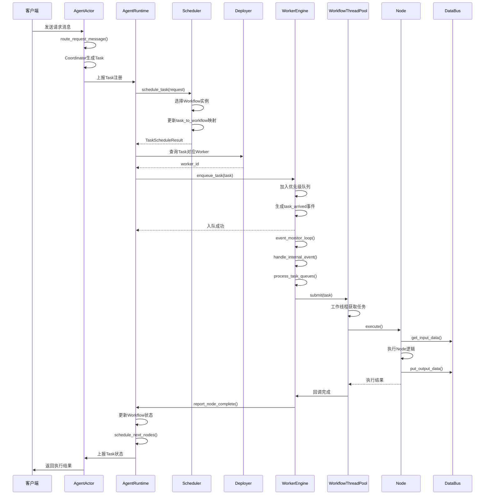
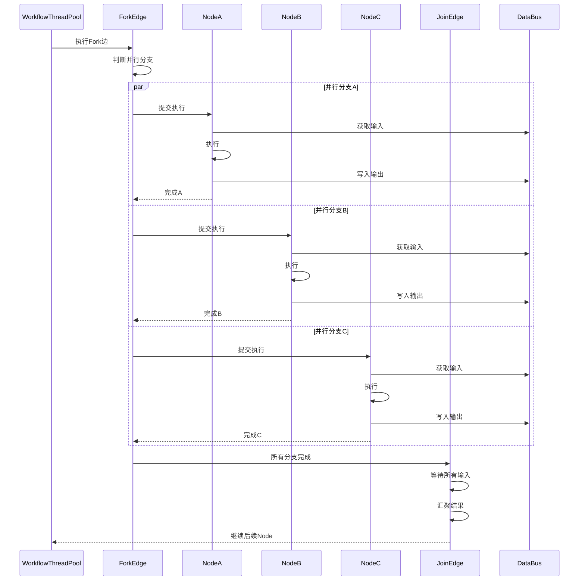
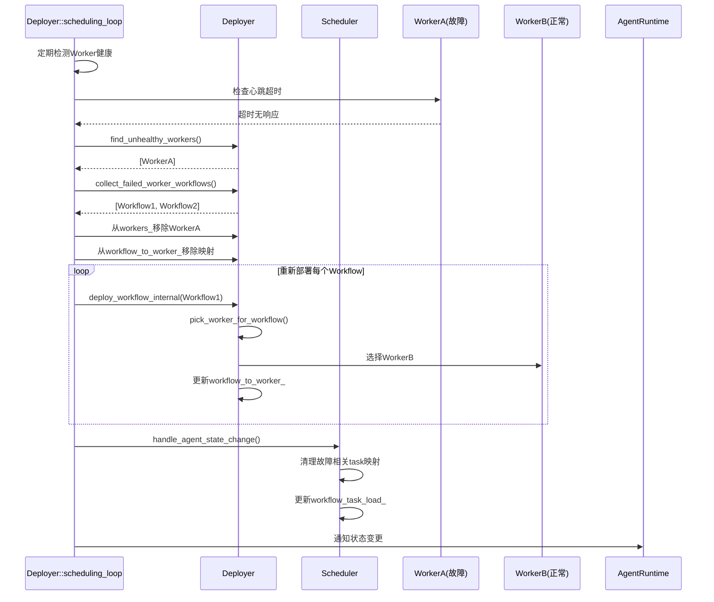

# Agent-Workflow-Node 调度机制实现分析

> 本文档对比设计规范与代码实现，评估调度机制的符合度。
> - 分析日期：2026-02-27
> - 涉及文档：REFACTORING.md、REQUIREMENTS_ANALYSIS.md、ARCHITECTURE.md
> - 涉及代码：src/runtime/*.cpp、src/runtime/master/*.cpp、src/agent/agent_actor.cpp

---

## 0. 核心概念关系说明

### 0.1 TaskItem、Workflow、Node 的关系

#### 开发态 vs 运行态

```
┌─────────────────────────────────────────────────────────────────────────────────────┐
│                              开发态 (Design Time)                                    │
│                                                                                      │
│  ┌──────────────────────────────────────────────────────────────────────────────┐   │
│  │                           Agent 包开发                                          │   │
│  │                                                                                │   │
│  │  workflow_XXX.json ──────┐                                                     │   │
│  │       │                  │                                                     │   │
│  │       ▼                  ▼                                                     │   │
│  │  ┌──────────┐      ┌──────────┐      ┌──────────────────┐                    │   │
│  │  │ Workflow │──────┤  Node A  │      │ node_a.so        │                    │   │
│  │  │ (流程图)  │      ├──────────┤      │ (可执行代码)      │                    │   │
│  │  │          │      │  Node B  │      ├──────────────────┤                    │   │
│  │  │ - nodes[]│      ├──────────┤      │ node_b.py        │                    │   │
│  │  │ - edges[]│──────┤  Node C  │      │ (Python脚本)      │                    │   │
│  │  │          │      └──────────┘      └──────────────────┘                    │   │
│  │  │ Node:执行 │                                                                │   │
│  │  │ Edge:控制 │      Edge 定义控制流:                                           │   │
│  │  └──────────┘      - if: 条件分支                                             │   │
│  │                    - loop: 循环                                               │   │
│  │                    - fork/join: 并行                                          │   │
│  │                    - async: 异步                                              │   │
│  └──────────────────────────────────────────────────────────────────────────────┘   │
│                                                                                      │
│  关键特点：                                                                           │
│  - Workflow 是静态定义的DAG（有向图）                                                  │
│  - Node 包含执行代码的引用（SO/Python/Shell等）                                         │
│  - Edge 定义控制流逻辑，Node只负责动作执行                                              │
│  - 此时没有 TaskItem，只有 Workflow/Node 的定义                                        │
└─────────────────────────────────────────────────────────────────────────────────────┘
                                          │
                                          │ Agent包加载
                                          ▼
┌─────────────────────────────────────────────────────────────────────────────────────┐
│                              运行态 (Runtime)                                        │
│                                                                                      │
│  ┌──────────────────────────────────────────────────────────────────────────────┐   │
│  │                           消息触发                                              │   │
│  │                                                                                │   │
│  │  用户请求 ────────┐                                                            │   │
│  │       │          ▼                                                            │   │
│  │       │    ┌──────────┐     ┌──────────────────────────────────────────┐     │   │
│  │       └───▶│  Agent   │────▶│           AgentTask (agent/task.h)        │     │   │
│  │            │ Session  │     ├──────────────────────────────────────────┤     │   │
│  │            └──────────┘     │ task_id        │ 唯一标识                 │     │   │
│  │                             │ workflow_id    │ 关联Workflow定义         │     │   │
│  │                             │ session_id     │ 所属会话                 │     │   │
│  │                             │ task_type      │ 任务类型                 │     │   │
│  │                             │ state          │ PENDING/RUNNING...       │     │   │
│  │                             └──────────────────────────────────────────┘     │   │
│  │                                         │                                    │   │
│  │                                         │ 1:N (一个Task可能触发多个Node执行)  │   │
│  │                                         ▼                                    │   │
│  └──────────────────────────────────────────────────────────────────────────────┘   │
│                                            │
│                                            │ Scheduler调度
│                                            ▼
┌─────────────────────────────────────────────────────────────────────────────────────┐
│  ┌──────────────────────────────────────────────────────────────────────────────┐   │
│  │                        TaskItem (runtime/worker.h)                            │   │
│  │  ┌────────────────────────────────────────────────────────────────────────┐  │   │
│  │  │                              TaskItem                                   │  │   │
│  │  │  ┌─────────────────┬──────────────────────────────────────────────────┐ │  │   │
│  │  │  │ task_id         │ 继承自AgentTask，标识一次具体执行                  │ │  │   │
│  │  │  │ workflow_id     │ 关联Workflow定义 (开发态定义)                      │ │  │   │
│  │  │  │ workflow_inst   │ 关联Workflow实例 (运行态实例)                      │ │  │   │
│  │  │  │ priority        │ HIGH/NORMAL，决定队列优先级                        │ │  │   │
│  │  │  │ metadata        │ 运行时上下文数据                                   │ │  │   │
│  │  │  └─────────────────┴──────────────────────────────────────────────────┘ │  │   │
│  │  └────────────────────────────────────────────────────────────────────────┘  │   │
│  │                                                                               │   │
│  │  TaskItem 是运行时的"任务调度单元"，用于：                                      │   │
│  │  1. 在Scheduler和Worker之间传递任务                                            │   │
│  │  2. 在Worker内部队列中排队等待执行                                              │   │
│  │  3. 携带执行所需的上下文信息                                                    │   │
│  │                                                                               │   │
│  └──────────────────────────────────────────────────────────────────────────────┘   │
│                                            │
│                                            ▼
┌─────────────────────────────────────────────────────────────────────────────────────┐
│  ┌──────────────────────────────────────────────────────────────────────────────┐   │
│  │                         Workflow 运行时实例                                    │   │
│  │                                                                                │   │
│  │   Workflow Instance (workflow.cpp)                                             │   │
│  │   ┌──────────────────────────────────────────────────────────────────────┐    │   │
│  │   │  control_context_    │ 运行时控制流上下文（循环变量、条件状态）         │    │   │
│  │   │  executed_nodes_     │ 已执行Node记录                                 │    │   │
│  │   │  active_loops_       │ 当前活跃循环状态                               │    │   │
│  │   │  get_executable_nodes() │ 根据Edge控制流判断可执行Node                │    │   │
│  │   └──────────────────────────────────────────────────────────────────────┘    │   │
│  │                                                                                │   │
│  │   开发态的Workflow定义 ──────▶ 运行态的Workflow实例                            │   │
│  │   (静态DAG定义)              (带执行状态的动态实例)                             │   │
│  │                                                                                │   │
│  └──────────────────────────────────────────────────────────────────────────────┘   │
│                                            │
│                                            ▼
┌─────────────────────────────────────────────────────────────────────────────────────┐
│  ┌──────────────────────────────────────────────────────────────────────────────┐   │
│  │                              Node 执行                                         │   │
│  │                                                                                │   │
│  │   Node Instance                                                                │   │
│  │   ┌────────────────────────────────────────────────────────────────────┐      │   │
│  │   │ state_           │ WAITING → READY → EXECUTING → SUCCESS/FAILED   │      │   │
│  │   │ inputs_          │ 输入数据（来自DataBus或上游Node）                 │      │   │
│  │   │ outputs_         │ 输出数据（写入DataBus供下游使用）                 │      │   │
│  │   │ execute()        │ 实际执行Node逻辑（SO/Python/Shell等）             │      │   │
│  │   │ retry_count_     │ 当前重试次数                                     │      │   │
│  │   └────────────────────────────────────────────────────────────────────┘      │   │
│  │                                                                                │   │
│  │   注意：Node在运行态是"无状态"的，状态由Workflow实例维护                        │   │
│  │   多个Task可以复用同一个Node定义，但各自有独立的执行状态                        │   │
│  │                                                                                │   │
│  └──────────────────────────────────────────────────────────────────────────────┘   │
│                                                                                      │
└─────────────────────────────────────────────────────────────────────────────────────┘
```

#### 核心关系总结

| 关系 | 说明 | 示例 |
|------|------|------|
| **AgentTask → Workflow** | 1个AgentTask对应1个Workflow定义 | 用户查询任务 → 执行"QueryWorkflow" |
| **AgentTask → TaskItem** | 1个AgentTask可能产生多个TaskItem | 复杂任务分阶段执行，每阶段一个TaskItem |
| **TaskItem → Workflow Instance** | 1个TaskItem对应1个Workflow运行时实例 | Task被调度到WorkerA的Workflow实例X |
| **Workflow Instance → Node** | 1个Workflow实例包含多个Node（按DAG图） | Workflow包含：Start→Validate→Process→End |
| **Node → TaskItem** | N:N关系，多个TaskItem可触发同一个Node | 不同用户请求都执行"Validate" Node |

#### 为什么需要 TaskItem？

| 层级 | 对象 | 职责 | 存在时机 |
|------|------|------|---------|
| **Agent层** | AgentTask | 业务任务概念，含生命周期管理（start/pause/stop） | Agent生成任务时 |
| **Runtime层** | TaskItem | 调度单元，用于Worker间任务传递和队列管理 | 进入调度系统后 |
| **Worker层** | TaskItem | 执行单元，关联具体Workflow实例和Node | Worker执行时 |

**TaskItem的核心作用**是**跨进程/跨Worker的任务传递载体**：
- 它比AgentTask更轻量，只携带调度必需的元数据
- 它关联Workflow实例而非Workflow定义，确保执行时获取正确的运行时状态
- 它支持优先级队列，Worker可以按优先级处理任务

---

## 1. 架构总览

### 1.1 三层调度架构设计

```
┌─────────────────────────────────────────────────────────────┐
│                    AGENT LEVEL MASTER                       │
│              (AgentRuntime + AgentActor)                    │
│     - Agent实例生命周期管理                                  │
│     - Agent注册/心跳/监控                                   │
│     - 全局Agent状态管理                                     │
└───────────────────────┬─────────────────────────────────────┘
                        │
┌───────────────────────▼─────────────────────────────────────┐
│                 WORKFLOW LEVEL MASTER                       │
│    (Deployer & Scheduler - runtime/master/*.cpp)            │
│                                                             │
│  ┌─────────────────┐    ┌─────────────────────────────┐    │
│  │    DEPLOYER     │    │         SCHEDULER           │    │
│  │  (deployer.cpp) │    │      (scheduler.cpp)        │    │
│  │                 │    │                             │    │
│  │ Workflow ->     │    │ Task -> Workflow Instance   │    │
│  │ Worker mapping  │    │ mapping                     │    │
│  │                 │    │                             │    │
│  │ - Worker注册    │    │ - Task队列管理              │    │
│  │ - 心跳监控      │    │ - 负载均衡                  │    │
│  │ - 故障转移      │    │ - 插件算法                  │    │
│  └─────────────────┘    └─────────────────────────────┘    │
└───────────────────────┬─────────────────────────────────────┘
                        │
┌───────────────────────▼─────────────────────────────────────┐
│              WORKER LEVEL (Node Execution)                  │
│        (WorkerEngine - runtime/worker/worker.cpp)           │
│                                                             │
│  - 双优先级任务队列 (高/普通)                                │
│  - Workflow实例池                                           │
│  - 事件驱动执行                                             │
│  - 多执行器类型支持                                         │
└─────────────────────────────────────────────────────────────┘
```

### 1.2 核心组件映射

| 设计层级 | 设计目标 | 代码实现 | 符合度 |
|---------|---------|---------|--------|
| **Agent Level Master** | 管理多Agent实例生命周期 | `AgentRuntime` + `AgentActor` | 高 |
| **Workflow Level Master** | Deployer(workflow→worker) + Scheduler(task→workflow) | `runtime::master::Deployer` + `runtime::master::Scheduler` | 高 |
| **Node Level Worker** | 执行引擎、任务队列、事件驱动 | `WorkerEngine` | 中 |

---

## 2. 详细符合性分析

### 2.1 Agent Level Master - 符合度：高

#### 设计规范（REFACTORING.md 第15节）

- AgentActor从`AgentService.config`读取`package_root`与`manifests`
- 自动加载agent包并创建Agent实例
- 启动包监控线程，目录变化时增量加载新版本实例
- 支持多版本并行运行
- 维护agent/task实例清单
- 提供`start/pause/resume/stop`控制消息入口
- 向RuntimeActor发送注册/心跳/状态上报消息

#### 代码实现验证

```cpp
// src/agent/agent_actor.cpp
monitor_packages_loop()       // 包监控线程
parse_service_config()        // 解析配置文件
create_agent_from_package()   // 自动创建Agent实例
heartbeat_loop()              // 心跳上报
report_agent_registered()     // 注册消息
apply_agent_control()         // start/pause/resume/stop控制
```

#### 符合性检查表

| 设计要点 | 实现状态 | 代码位置 |
|---------|---------|---------|
| 配置驱动自动加载 | ✅ 已实现 | `parse_service_config()` |
| 多版本并行运行 | ✅ 已实现 | `instance_id`含版本号+时间戳 |
| 包监控与增量加载 | ✅ 已实现 | `monitor_packages_loop()` |
| 生命周期控制 | ✅ 已实现 | `apply_agent_control()` |
| 心跳与状态上报 | ✅ 已实现 | `report_agent_heartbeat()`, `report_agent_status()` |
| Task生成与上报 | ✅ 已实现 | `collect_agent_tasks_and_report()` |

---

### 2.2 Workflow Level Master - 符合度：高

#### 2.2.1 Deployer（workflow→worker调度）

##### 设计规范（REFACTORING.md 第14节）

- worker注册队列与处理线程
- 部署调度线程
- 心跳超时故障隔离（默认10秒）
- 支持workflow增量部署与`rebalance`
- SO可插拔部署算法（失败自动回退内置算法）
- 同agent实例的workflow优先部署到同一worker

##### 代码实现验证

```cpp
// src/runtime/master/deployer.cpp
registration_loop()         // Worker注册处理线程
scheduling_loop()           // 部署调度线程 + 故障检测
rebalance()                 // 负载重平衡
load_plugin_algorithm()     // SO插件加载
run_default_algorithm()     // 默认算法
```

##### 符合性检查表

| 设计要点 | 实现状态 | 代码位置 |
|---------|---------|---------|
| Worker注册队列 | ✅ 已实现 | `worker_registration_queue_` |
| 部署调度线程 | ✅ 已实现 | `scheduling_thread_` |
| 心跳超时检测(10s) | ✅ 已实现 | `heartbeat_timeout_ms = 10000` |
| 故障Worker隔离 | ✅ 已实现 | `find_unhealthy_workers_locked()` |
| 故障时重新部署 | ✅ 已实现 | 收集故障worker的workflow并重新部署 |
| Agent故障时workflow注销 | ✅ 已实现 | `handle_agent_state_change()` |
| 可插拔算法(SO) | ✅ 已实现 | `load_plugin_algorithm()` |
| 同Agent实例优先部署 | ✅ 已实现 | `run_default_algorithm()`匹配逻辑 |

#### 2.2.2 Scheduler（task→workflow调度）

##### 设计规范

- task注册队列与处理线程
- 调度到匹配的workflow实例
- 同agent实例task优先调度到同agent workflow
- 可插拔调度算法
- Agent故障时task重调度

##### 代码实现验证

```cpp
// src/runtime/master/scheduler.cpp
scheduling_loop()            // 调度处理线程
run_default_algorithm()      // 默认算法
schedule_task()              // 主调度逻辑
```

##### 默认调度算法逻辑

```cpp
// 三级优先级策略
1. best_same_instance: 同一agent_instance_id的workflow实例
2. best_same_object:   同一agent_object_id的workflow实例
3. best_any:           任意可用workflow实例（最低负载优先）
```

##### 符合性检查表

| 设计要点 | 实现状态 | 代码位置 |
|---------|---------|---------|
| Task注册队列 | ✅ 已实现 | `task_queue_` |
| 调度处理线程 | ✅ 已实现 | `scheduling_thread_` |
| 同Agent实例优先 | ✅ 已实现 | 三级优先级匹配 |
| 负载均衡 | ✅ 已实现 | `workflow_task_load_`跟踪 |
| 可插拔算法(SO) | ✅ 已实现 | `load_plugin_algorithm()` |
| Agent故障时task重调度 | ✅ 已实现 | `handle_agent_state_change()` |

---

### 2.3 Node Level Worker - 符合度：中

#### 设计规范（REFACTORING.md 第13节）

- Worker有task队列（高优先级及一般优先级）
- workflow实例队列
- 事件队列监控线程
- **每个workflow有独立的处理线程池**
- **Node执行需要支持多线程并行**
- 事件可以改变状态、刷新数据

#### 代码实现验证

```cpp
// src/runtime/worker/worker.cpp
enqueue_task()              // 双优先级任务队列
process_task_queues()       // 任务处理
ensure_workflow_pool()      // workflow线程池创建
event_monitor_loop()        // 事件监控线程
```

#### 差距分析

| 设计要点 | 实现状态 | 差距说明 |
|---------|---------|---------|
| 双优先级任务队列 | ✅ 已实现 | `high_priority_tasks_` + `normal_priority_tasks_` |
| workflow处理线程池 | ⚠️ 部分实现 | 线程池创建但未充分用于node级并行 |
| Node执行多线程 | ❌ 未完全实现 | Worker提交的任务仅记录日志，实际Node执行在`AgentRuntime::worker_thread_main` |
| Event驱动执行 | ✅ 已实现 | `event_monitor_loop()`完整实现 |

#### 主要问题

**问题：** Node执行逻辑分散，Worker与Runtime职责不清

当前执行流程：
```
AgentRuntime::schedule_task()
  -> Scheduler调度
  -> WorkerEngine::enqueue_task() // 仅入队，无实际执行
  -> AgentRuntime::worker_thread_main() // 实际执行Node
```

**建议改进：**
- 将Node执行逻辑统一下沉到WorkerEngine
- 每个workflow实例的线程池真正用于Node并行执行
- AgentRuntime只负责任务分发，不直接执行Node

---

## 3. 与需求分析文档(UC)的符合度

| 用例编号 | 用例名称 | 实现状态 | 验证代码 |
|---------|---------|---------|---------|
| S1-02-S2-02-S3-03-UC-01 | 任务对应Workflow实例调度 | ✅ 已实现 | `Scheduler::schedule_task()` |
| S1-02-S2-01-S3-02-UC-01 | Agent实例部署 | ✅ 已实现 | `Deployer::deploy_workflow_instance()` |
| S1-02-S2-01-S3-01-UC-02 | Agent实例生命周期管理 | ✅ 已实现 | `AgentActor`全功能 |
| S1-02-S2-02-S3-02-UC-02 | 任务生命周期管理 | ⚠️ 基础实现 | `Scheduler::update_task_status()` |
| S1-02-S2-02-S3-04-UC-01 | Workflow及Node执行引擎 | ⚠️ 基础实现 | `AgentRuntime::worker_thread_main()` |

---

## 4. 存在的问题与改进建议

### 问题1：Worker与Runtime的Node执行职责混淆

**现状：**
- Node执行逻辑分散在`AgentRuntime::worker_thread_main()`和`WorkerEngine::process_task_queues()`
- WorkerEngine接收task但仅记录日志，未实际执行Node

**建议：**
- 将Node执行逻辑统一下沉到WorkerEngine
- AgentRuntime只负责任务分发和协调
- WorkerEngine负责实际的Node执行和生命周期管理

### 问题2：Workflow级线程池未充分利用

**现状：**
- `ensure_workflow_pool()`创建了线程池，但实际Node执行未使用
- Node执行集中在全局worker线程中

**建议：**
- Node执行应提交到对应workflow的线程池中
- 实现真正的workflow级并行执行
- 支持同一workflow内多个Node的并行执行（受edge控制流约束）

### 问题3：Control Flow边驱动验证

**现状：**
- Workflow控制流（if/loop/fork/join/async/goto）在文档中有定义
- 需验证执行引擎中的控制流驱动逻辑完整性

**建议：**
- 确认`workflow->get_executable_nodes()`是否完整实现edge控制流语义
- 验证有环图（带goto）的执行正确性
- 补充控制流的单元测试

### 问题4：DataBus与消息队列协同

**现状：**
- 文档要求msgque/event只携带DataRef，实际数据走DataBus
- 需验证集成的完整性

**建议：**
- 验证`AgentMsgQue`与`DataBus`的集成是否符合设计
- 确保大payload通过DataBus传输，消息只传引用

---

## 5. 总体评估

### 5.1 维度评分

| 维度 | 评分 | 说明 |
|-----|------|-----|
| 架构分层 | ⭐⭐⭐⭐⭐ | 三层Master-Worker架构清晰，职责划分明确 |
| Agent管理 | ⭐⭐⭐⭐⭐ | AgentActor自动化能力强，完整实现设计规范 |
| 调度机制 | ⭐⭐⭐⭐☆ | Deployer/Scheduler符合设计，算法可插拔，负载均衡完善 |
| Worker执行 | ⭐⭐⭐☆☆ | 基础功能有，但并行度和职责划分需优化 |
| 事件驱动 | ⭐⭐⭐⭐☆ | 事件队列机制完善，支持自定义事件处理器 |
| 可扩展性 | ⭐⭐⭐⭐⭐ | SO插件、配置驱动、多角色部署设计良好 |

### 5.2 结论

**Agent-Workflow-Node调度机制的整体实现基本符合设计文档**。

- **优势：**
  - 三层架构清晰，Master-Worker模式实现规范
  - Agent管理层完整实现自动化能力
  - 调度层支持可插拔算法，负载均衡策略完善
  - 事件驱动机制灵活

- **待改进：**
  - Worker层的Node执行需要优化，明确与Runtime的职责边界
  - Workflow级线程池需要真正用于Node并行执行
  - 控制流执行的完整性需要进一步验证

### 5.3 关键文件清单

| 类型 | 文件路径 | 说明 |
|-----|---------|-----|
| 核心代码 | `src/runtime/runtime.cpp` | AgentRuntime实现 |
| 核心代码 | `src/runtime/master/deployer.cpp` | Workflow→Worker调度 |
| 核心代码 | `src/runtime/master/scheduler.cpp` | Task→Workflow调度 |
| 核心代码 | `src/runtime/worker/worker.cpp` | Worker引擎 |
| 核心代码 | `src/agent/agent_actor.cpp` | Agent自动化管理 |
| 设计文档 | `docs/REFACTORING.md` | 重构规范（第13-15节） |
| 设计文档 | `docs/REQUIREMENTS_ANALYSIS.md` | 需求分析（用例映射） |
| 设计文档 | `docs/ARCHITECTURE.md` | 架构总览 |

---

## 6. 未完成实现部分补充设计

针对 **Node Level Worker** 层未完全实现的部分（Worker与Runtime职责划分、Workflow级线程池利用、Node并行执行），本节补充详细设计方案。

### 6.1 目标架构

#### 6.1.1 职责重新划分

| 组件 | 当前职责 | 目标职责 | 变更说明 |
|------|---------|---------|---------|
| **AgentRuntime** | 任务调度 + Node执行 | 任务调度协调 | 将Node执行下沉到WorkerEngine |
| **WorkerEngine** | 任务队列 + 事件处理 | Node执行引擎 | 增加NodeExecutor，实际执行Node |
| **Workflow** | 控制流判断 | 可执行Node发现 | 保持现状，优化`get_executable_nodes()` |

#### 6.1.2 核心交互流程

```
Task调度阶段：
  AgentRuntime::schedule_task()
    -> Scheduler::schedule_task()          [选择Workflow实例]
    -> WorkerEngine::enqueue_task()         [投递到Worker队列]
    -> WorkerEvent("task_arrived")          [触发事件]

Task执行阶段：
  WorkerEngine::event_monitor_loop()
    -> handle_internal_event("task_arrived")
    -> process_task_queues()
    -> WorkflowThreadPool::submit()         [提交到Workflow线程池]
    -> NodeExecutor::execute()              [执行Node]
    -> Node::execute()                      [实际Node逻辑]
    -> report_node_complete()               [上报完成]
```

---

### 6.2 时序图

#### 6.2.1 Task调度与执行完整流程



#### 6.2.2 Node并行执行流程（Fork/Join场景）



#### 6.2.3 Worker故障转移流程



---

### 6.3 运行视图

#### 6.3.1 进程/线程模型

```
┌─────────────────────────────────────────────────────────────────────────┐
│                           AgentRuntime进程                              │
│                                                                         │
│  ┌─────────────────┐  ┌─────────────────┐  ┌─────────────────────────┐ │
│  │ AgentRegistration│  │  AgentMonitor   │  │   WorkflowScheduler     │ │
│  │     Thread       │  │    Thread       │  │      Thread             │ │
│  │                  │  │                 │  │                         │ │
│  │ - 处理注册请求    │  │ - 心跳检查(10s) │  │ - 调度可执行Node        │ │
│  │ - 处理注销请求    │  │ - 故障检测      │  │ - 更新执行状态          │ │
│  └─────────────────┘  └─────────────────┘  └─────────────────────────┘ │
│                                                                         │
│  ┌─────────────────────────────────────────────────────────────────┐   │
│  │                      全局Worker线程池                            │   │
│  │  ┌─────────┐ ┌─────────┐ ┌─────────┐        ┌─────────┐         │   │
│  │  │ Worker0 │ │ Worker1 │ │ Worker2 │  ...   │ WorkerN │         │   │
│  │  │ Thread  │ │ Thread  │ │ Thread  │        │ Thread  │         │   │
│  │  └─────────┘ └─────────┘ └─────────┘        └─────────┘         │   │
│  │  [当前实际执行Node的线程，应下沉到WorkerEngine]                   │   │
│  └─────────────────────────────────────────────────────────────────┘   │
│                                                                         │
└─────────────────────────────────────────────────────────────────────────┘
                                    │
                                    │ RPC/消息队列
                                    │
┌─────────────────────────────────────────────────────────────────────────┐
│                         WorkerEngine进程 (可独立部署)                    │
│                                                                         │
│  ┌─────────────────┐  ┌─────────────────┐  ┌─────────────────────────┐ │
│  │  EventMonitor   │  │  Registration   │  │    HeartbeatReporter    │ │
│  │    Thread       │  │     Thread      │  │       Thread            │ │
│  │                 │  │                 │  │                         │ │
│  │ - 监控事件队列   │  │ - 注册到Deployer│  │ - 定期上报心跳          │ │
│  │ - 分发事件处理   │  │ - 处理注册响应  │  │ - 上报负载状态          │ │
│  └─────────────────┘  └─────────────────┘  └─────────────────────────┘ │
│                                                                         │
│  ┌─────────────────────────────────────────────────────────────────┐   │
│  │                    Workflow实例线程池 (每个Workflow独立)         │   │
│  │                                                                 │   │
│  │  ┌───────────────────┐  ┌───────────────────┐                  │   │
│  │  │  Workflow-A Pool  │  │  Workflow-B Pool  │  ...             │   │
│  │  │  ┌─────┐ ┌─────┐  │  │  ┌─────┐ ┌─────┐  │                  │   │
│  │  │  │Node │ │Node │  │  │  │Node │ │Node │  │                  │   │
│  │  │  │Exec │ │Exec │  │  │  │Exec │ │Exec │  │                  │   │
│  │  │  │Thr0 │ │Thr1 │  │  │  │Thr0 │ │Thr1 │  │                  │   │
│  │  │  └─────┘ └─────┘  │  │  └─────┘ └─────┘  │                  │   │
│  │  └───────────────────┘  └───────────────────┘                  │   │
│  │                                                                 │   │
│  │  [目标：每个Workflow有独立线程池，执行其Node]                    │   │
│  └─────────────────────────────────────────────────────────────────┘   │
│                                                                         │
│  ┌─────────────────────────────────────────────────────────────────┐   │
│  │                      任务队列 (双优先级)                         │   │
│  │  ┌─────────────────────┐    ┌─────────────────────┐             │   │
│  │  │  High Priority      │    │  Normal Priority    │             │   │
│  │  │  ┌─────┐┌─────┐    │    │  ┌─────┐┌─────┐    │             │   │
│  │  │  │Task1││Task2│... │    │  │Task5││Task6│... │             │   │
│  │  │  └─────┘└─────┘    │    │  └─────┘└─────┘    │             │   │
│  │  └─────────────────────┘    └─────────────────────┘             │   │
│  └─────────────────────────────────────────────────────────────────┘   │
│                                                                         │
│  ┌─────────────────────────────────────────────────────────────────┐   │
│  │                       事件队列                                   │   │
│  │  ┌─────────┐┌─────────┐┌─────────┐┌─────────┐                  │   │
│  │  │task_arr ││node_comp││wf_reg   ││wf_unreg │  ...             │   │
│  │  │ived     ││lete     ││istered  ││istered  │                  │   │
│  │  └─────────┘└─────────┘└─────────┘└─────────┘                  │   │
│  └─────────────────────────────────────────────────────────────────┘   │
│                                                                         │
└─────────────────────────────────────────────────────────────────────────┘
```

#### 6.3.2 部署拓扑视图

```
单节点部署模式 (开发/测试)
┌─────────────────────────────────────────────────────────────────┐
│                        单台服务器                                │
│                                                                 │
│  ┌─────────────────────────────────────────────────────────┐   │
│  │              AgentRuntime (MASTER角色)                   │   │
│  │  ┌──────────────┐  ┌──────────────┐  ┌──────────────┐  │   │
│  │  │   Deployer   │  │  Scheduler   │  │ LocalWorker  │  │   │
│  │  └──────────────┘  └──────────────┘  └──────────────┘  │   │
│  └─────────────────────────────────────────────────────────┘   │
│                                                                 │
│  ┌─────────────────────────────────────────────────────────┐   │
│  │                   AgentActor                             │   │
│  │              (自动加载Agent包)                            │   │
│  └─────────────────────────────────────────────────────────┘   │
│                                                                 │
│  ┌─────────────────────────────────────────────────────────┐   │
│  │                   DataBus (本地缓存)                     │   │
│  └─────────────────────────────────────────────────────────┘   │
│                                                                 │
└─────────────────────────────────────────────────────────────────┘

多节点部署模式 (生产环境)
┌─────────────────────────────────────────────────────────────────────────┐
│                              生产集群                                    │
│                                                                         │
│  ┌─────────────────────────┐        ┌─────────────────────────────────┐│
│  │   Master节点 (1~3台)     │        │       Worker节点池 (N台)         ││
│  │                         │        │                                 ││
│  │  ┌─────────────────┐   │        │  ┌─────────────────────────┐   ││
│  │  │  AgentRuntime   │   │        │  │      WorkerEngine       │   ││
│  │  │  ┌───────────┐  │   │◄──────►│  │  ┌─────────────────┐    │   ││
│  │  │  │  Deployer │  │   │  调度  │  │  │ Workflow Pools  │    │   ││
│  │  │  └───────────┘  │   │        │  │  │  ┌───┐┌───┐    │    │   ││
│  │  │  ┌───────────┐  │   │        │  │  │  │WF1││WF2│... │    │   ││
│  │  │  │ Scheduler │  │   │◄──────►│  │  │  └───┘└───┘    │    │   ││
│  │  │  └───────────┘  │   │ Task调度│  │  └─────────────────┘    │   ││
│  │  └─────────────────┘   │        │  └─────────────────────────┘   ││
│  │                         │        │                                 ││
│  │  ┌─────────────────┐   │        │  ┌─────────────────────────┐   ││
│  │  │  AgentActor     │   │        │  │      WorkerEngine       │   ││
│  │  │  (Agent管理)     │   │        │  │         ...             │   ││
│  │  └─────────────────┘   │        │  └─────────────────────────┘   ││
│  └─────────────────────────┘        └─────────────────────────────────┘│
│                                                                         │
│  ┌─────────────────────────────────────────────────────────────────┐   │
│  │                     共享DataBus层 (Redis集群)                     │   │
│  │              存储：workflow实例、task状态、Node数据               │   │
│  └─────────────────────────────────────────────────────────────────┘   │
│                                                                         │
└─────────────────────────────────────────────────────────────────────────┘
```

---

### 6.4 接口变更设计

#### 6.4.1 新增接口

##### WorkerEngine 新增方法

```cpp
// include/internal/runtime/worker.h

class WorkerEngine {
 public:
  // ... 现有接口 ...

  // ===== 新增接口 =====

  /**
   * @brief 执行指定Node
   * @param task 任务信息
   * @param node Node实例
   * @param workflow Workflow实例
   * @return 执行结果
   */
  struct NodeExecutionResult {
    bool success = false;
    std::string error_message;
    int64_t execution_time_ms = 0;
    std::string output_data_ref;
  };

  NodeExecutionResult execute_node(
      const TaskItem& task,
      std::shared_ptr<framework::Node> node,
      std::shared_ptr<framework::Workflow> workflow);

  /**
   * @brief 注册Node执行完成回调
   * @param callback 回调函数
   */
  using NodeCompleteCallback = std::function<void(
      const std::string& task_id,
      const std::string& node_id,
      const NodeExecutionResult& result)>;

  void set_node_complete_callback(NodeCompleteCallback callback);

  /**
   * @brief 获取指定Workflow的线程池
   * @param workflow_instance_id Workflow实例ID
   * @return 线程池指针
   */
  std::shared_ptr<basic::ThreadPool> get_workflow_thread_pool(
      const std::string& workflow_instance_id);

  /**
   * @brief 设置Node执行器的工厂函数
   * @param factory 工厂函数
   */
  using NodeExecutorFactory = std::function<std::unique_ptr<NodeExecutor>(
      std::shared_ptr<framework::Node>)>;

  void set_node_executor_factory(NodeExecutorFactory factory);

 private:
  // ... 现有成员 ...

  // ===== 新增成员 =====
  NodeCompleteCallback node_complete_callback_;
  NodeExecutorFactory node_executor_factory_;
  std::mutex executor_mutex_;
  std::map<std::string, std::shared_ptr<NodeExecutor>> active_executors_;
};
```

##### 新增 NodeExecutor 接口

```cpp
// include/internal/runtime/node_executor.h

namespace agentflow {
namespace runtime {

/**
 * @brief Node执行器抽象接口
 * 支持不同执行模式：SO库、Python、Shell、C++回调等
 */
class NodeExecutor {
 public:
  virtual ~NodeExecutor() = default;

  /**
   * @brief 初始化执行器
   * @param node 关联的Node实例
   * @return 是否成功
   */
  virtual bool initialize(std::shared_ptr<framework::Node> node) = 0;

  /**
   * @brief 执行Node逻辑
   * @param input_data 输入数据引用
   * @return 执行结果
   */
  virtual WorkerEngine::NodeExecutionResult execute(
      const DataMap& input_data) = 0;

  /**
   * @brief 取消正在执行的Node
   */
  virtual void cancel() = 0;

  /**
   * @brief 获取执行器状态
   */
  virtual ExecutorStatus get_status() const = 0;

  /**
   * @brief 清理执行资源
   */
  virtual void cleanup() = 0;
};

/**
 * @brief SO库执行器
 */
class SONodeExecutor : public NodeExecutor {
 public:
  bool initialize(std::shared_ptr<framework::Node> node) override;
  WorkerEngine::NodeExecutionResult execute(const DataMap& input_data) override;
  void cancel() override;
  ExecutorStatus get_status() const override;
  void cleanup() override;

 private:
  std::shared_ptr<framework::Node> node_;
  void* so_handle_ = nullptr;
  std::atomic<bool> cancelled_{false};
};

/**
 * @brief Python脚本执行器
 */
class PythonNodeExecutor : public NodeExecutor {
 public:
  bool initialize(std::shared_ptr<framework::Node> node) override;
  WorkerEngine::NodeExecutionResult execute(const DataMap& input_data) override;
  void cancel() override;
  ExecutorStatus get_status() const override;
  void cleanup() override;

 private:
  std::shared_ptr<framework::Node> node_;
  std::unique_ptr<ProcessExecutor> process_executor_;
};

/**
 * @brief Shell脚本执行器
 */
class ShellNodeExecutor : public NodeExecutor {
  // 类似PythonNodeExecutor实现
};

}  // namespace runtime
}  // namespace agentflow
```

##### AgentRuntime 接口调整

```cpp
// include/internal/runtime/agent_runtime.h

class AgentRuntime {
 public:
  // ... 现有接口 ...

  // ===== 修改接口 =====

  /**
   * @brief 处理Node执行完成
   * 从WorkerEngine回调，替代原来的直接执行模式
   */
  void on_node_execution_complete(
      const std::string& task_id,
      const std::string& workflow_instance_id,
      const std::string& node_id,
      const WorkerEngine::NodeExecutionResult& result);

  /**
   * @brief 注册WorkerEngine回调
   */
  void setup_worker_callbacks(std::shared_ptr<WorkerEngine> worker);

  // ===== 移除/废弃接口 =====
  // 以下接口应由WorkerEngine接管

  // REMOVE: void process_node(AgentPtr agent, WorkflowPtr workflow, NodePtr node);
  // REMOVE: void worker_thread_main();  // Worker线程主循环下沉到WorkerEngine

 private:
  // ... 现有成员 ...

  // REMOVE: std::vector<std::thread> worker_threads_;  // 下沉到WorkerEngine
  // REMOVE: std::queue<std::pair<AgentPtr, NodePtr>> node_task_queue_;  // 下沉到WorkerEngine
};
```

#### 6.4.2 数据结构变更

##### TaskItem 扩展

```cpp
// include/internal/runtime/worker.h

struct TaskItem {
  std::string task_id;
  std::string workflow_id;
  std::string workflow_instance_id;
  std::string agent_instance_id;
  TaskPriority priority = TaskPriority::NORMAL;

  // ===== 新增字段 =====

  /**
   * @brief 入口Node ID
   */
  std::string entry_node_id;

  /**
   * @brief 输入数据引用
   */
  std::string input_data_ref;

  /**
   * @brief Task创建时间
   */
  int64_t created_at_ms = 0;

  /**
   * @brief Task超时时间(毫秒)
   */
  int32_t timeout_ms = 30000;
};
```

##### WorkflowRegistration 扩展

```cpp
// include/internal/runtime/worker.h

struct WorkflowRegistration {
  std::string workflow_id;
  std::string workflow_instance_id;
  int thread_count = 1;

  // ===== 新增字段 =====

  /**
   * @brief 绑定的Agent实例ID
   */
  std::string agent_instance_id;

  /**
   * @brief Workflow对象指针
   */
  std::shared_ptr<framework::Workflow> workflow;

  /**
   * @brief 执行策略
   */
  enum class ExecutionPolicy {
    PARALLEL,   // 并行执行可执行Node
    SEQUENTIAL  // 顺序执行
  } execution_policy = ExecutionPolicy::PARALLEL;
};
```

#### 6.4.3 配置变更

```cpp
// WorkerEngine::Config 扩展

struct Config {
  std::string worker_id;
  bool is_preconfigured = false;
  int default_workflow_threads = 1;
  int event_threads = 1;
  size_t max_queue_size = 1024;

  // ===== 新增配置 =====

  /**
   * @brief Node执行超时时间(毫秒)
   */
  int node_execution_timeout_ms = 30000;

  /**
   * @brief 最大并发Node执行数
   */
  int max_concurrent_nodes = 100;

  /**
   * @brief 是否启用Node执行缓存
   */
  bool enable_node_cache = false;

  /**
   * @brief Node缓存大小
   */
  size_t node_cache_size = 100;
};
```

---

### 6.5 迁移路径

#### 阶段1：接口准备 (兼容模式)
- 在WorkerEngine中新增接口
- 保持现有`AgentRuntime::process_node()`不变
- 新增`WorkerEngine::execute_node()`，内部调用`process_node()`

#### 阶段2：双轨运行
- AgentRuntime根据配置选择执行路径
- 默认路径：直接执行（保持兼容）
- 新路径：通过WorkerEngine调度

#### 阶段3：完全迁移
- 移除AgentRuntime中的直接执行逻辑
- WorkerEngine成为唯一的Node执行入口
- 更新所有示例和文档

---

### 6.6 风险与缓解

| 风险 | 影响 | 缓解措施 |
|------|------|---------|
| 性能回退 | 高 | 增加基准测试，确保线程池效率 |
| 死锁 | 中 | 严格控制锁顺序，增加超时机制 |
| 内存泄漏 | 中 | NodeExecutor增加cleanup()，使用智能指针 |
| 兼容性问题 | 低 | 分阶段迁移，保持API兼容 |

---

*文档更新时间：2026-02-27*
*补充设计章节版本：v1.0*
