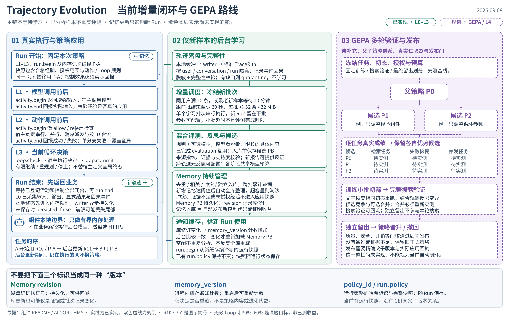
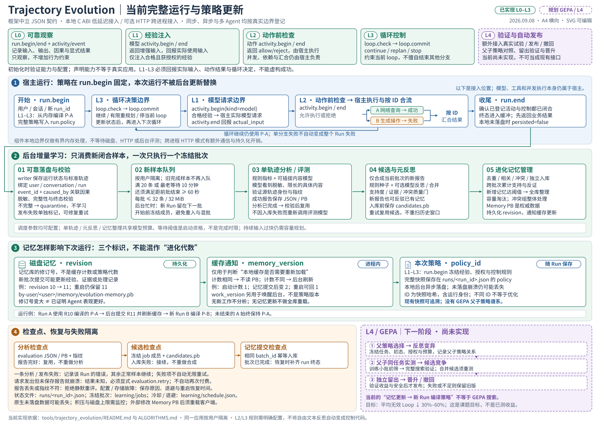

# Trajectory Evolution 独立交付与完整 L4 能力补充方案

方案基础日期：2026-09-07；图件与下方读图说明更新于 2026-09-08。

本文说明当前 `tools/trajectory_evolution` 实现独立交付和完整 L4 自进化需要补充的内容。
新增组件和接口均为设计目标，不代表当前已经实现。

2026-09-08 交付更新：框架中立 JSON 边界、本地 C ABI 接入、可选 HTTP 跨进程接入和
L0–L3 已实现；自动学习已改为持久化增量批次、检查点复用和变化通知。当前入口以 [使用说明书](../../tools/trajectory_evolution/README.md)
中的统一接口为准；[机器可读 API](../../tools/trajectory_evolution/api/openapi.json) 保留完整字段。后文保留 L4 规划，
GEPA 搜索、自动实验与发布/回滚仍未实现；本次范围止于 L3。

后续 L4 计划采用 GEPA 式多轮策略搜索：以真实执行轨迹驱动反思变异，通过任务级成绩
选择父版本、筛选候选并尝试合并，再接入验证和发布。第 6 节说明算法及项目扩展，
第 10 节区分已交付单元与后续工作；本次补充算法设计，不代表 GEPA 已经实现。

实施原则：复用现有离线代码，所有进化实现继续集中在一个目录，遵循最小改动，优先
通过 Harness 接入，尽量不修改 AgentFlow C++ 执行底座。L0–L4 是本组件拟定义的能力
等级，不是行业现成标准；交付时需要同时提供等级规范、公共接口和验证程序。



图 1：左栏为已实现的真实执行与固定策略，中栏为已实现的增量学习、记忆管理与缓存通知；
右栏紫色虚线为尚未实现的 GEPA/L4。下方区分记忆修订号、缓存通知计数与运行策略标识。
候选成绩格只标“待实测”，不使用虚构的性能分数；30%–60% 是无效 Loop 降幅目标，不是已测收益。
三栏布局借鉴 [ACBench Figure 1](https://arxiv.org/pdf/2505.19433#page=3)，内容和图形
按本项目重新绘制；搜索验证成绩可以回流候选选择，最终留出不参与本轮搜索。

图件：[可编辑 SVG](figures/trajectory-evolution-overview.svg) ·
[高清 PNG](figures/trajectory-evolution-overview.png) ·
[单页 PDF](figures/trajectory-evolution-overview.pdf)。


### A4 详细运行图



图 2：A4 横向单页，上方五张卡片给出 L0–L4 的嵌入位置。蓝色为当前宿主执行，绿色为
当前后台学习与记忆更新，橙色为检查点和失败恢复，紫色虚线仅用于 GEPA/L4 规划。
图中的 run.begin/end、activity.begin/end、loop.check/commit 是现有边界操作；L4 试验与发布仍未实现。
默认调度为同用户满 20 条新轨迹或最老样本等待 10 分钟后具备启动条件，批次间隔至少 60 秒，
每批最多 32 条/32 MiB；这些参数可配置，不是每次 run.end 都立即启动进化。

图件：[A4 单页 PDF](figures/trajectory-evolution-runtime-a4.pdf) ·
[可编辑、可缩放 SVG](figures/trajectory-evolution-runtime-a4.svg) ·
[高清 PNG](figures/trajectory-evolution-runtime-a4.png)。
推荐下载 PDF 按 A4 横向查看或打印；在 VS Code 预览 SVG 时可以放大阅读。

读图顺序：

1. **先看宿主要加什么。** L0 登记 Run、活动和事件；L1 在模型调用前后接 activity.begin/end；
   L2 在动作调用前后接同一活动接口；L3 在循环决策处接 loop.check/commit。
   宿主仍负责真实执行、并发和按 ID 汇合；等级是累积能力，不是五套独立程序。
2. **再看数据如何到记忆。** writer 落盘并校验，完整新样本进入按用户隔离的队列。
   只有满足数量、等待和间隔条件才冻结新批次；当前批次运行期间，新 run 留在下一批。
   成功分析和已生成候选分别复用检查点，避免重复模型评测或重复扫描历史报告。
   新报告仍可为已有记忆提供支持或反证；入库继续去重、管理冲突、周期整理和淘汰。
3. **接着看记忆如何影响执行。** Memory revision 是持久化修订号；memory_version 只是
   进程内缓存通知计数，变化时才刷新缓存。L1–L3 的 run.begin 从内存编译并固定完整策略，
   policy_id 标识该快照。后台更新只影响之后开始的 run，不替换正在使用的策略。
   完整策略随 run 状态保存；本地尚未异步落盘的尾部仍可能在崩溃时丢失。
4. **最后看 GEPA 如何证明收益。** 冻结任务划分与运行条件，从基线成绩选父版本，
   在训练小批上真实执行、反思并修改一个组件；子版本恢复同一初态重跑，通过小批
   筛选后才进入完整搜索验证。成绩反馈候选池，可选合并也要重测。搜索停止并固定
   最终候选后，才进行最终留出、发布或保留旧版。

图中 R10/R11、P-A/P-B 是便于读图的简称，实际 policy_id 是快照哈希。
当前已保存运行快照，但尚未建立“父策略 → 子策略 → 对照验证 → 晋升”的谱系，
不能把 memory_version 当成下次进化的父版本。图 2 的检查点带还说明了单样本失败隔离、
显式重试、模型调用中断结果未知、配置/存储退避，以及原生采集尚未落盘的风险。

规划中的 GEPA 特别区分两个反馈：搜索验证可以反馈父版本选择，最终留出不能反馈本轮搜索。
按完整会话隔离数据和固定版本，不能将同一会话不同轮次拆进训练与留出。独立分支
失败不自动变成全 Run 失败；试验成绩按身份关联，不能按照并行返回位置拼接。

相关现有说明：

- [SessionLog 到记忆库的流程](SESSIONLOG_TO_EVOLUTION_MEMORY.md)
- [Evaluation 字段](EVALUATION_FIELDS.md)
- [Batch 与 Memory 字段](BATCH_AND_MEMORY_FIELDS.md)
- [模型输入内容限制](CONTENT_LIMITS.md)
- [组件当前使用方式](../../tools/trajectory_evolution/README.md)

以下保留原方案的详细规划。涉及实现完成状态、可调用接口或默认值时，以以上更新图和组件使用手册为准。

## 1. 当前基础与目标边界

当前已经完成离线前半闭环：

```text
SessionLog
  → Episode 重建和确定性分析
  → 规则 / 模型评测
  → 跨轨迹候选合成与元反思
  → 质量门
  → 去重、关系判断、全库整理和容量淘汰
  → EvolutionMemoryStore
```

完整闭环还需要：

```text
EvolutionMemoryStore
  → 冻结记忆快照并编译基线策略
  → GEPA 多轮搜索：选择父版本、反思变异、实验筛选、可选合并
  → 获得候选版本及可追溯的应用回执、轨迹和成绩
  → 独立留出验证
  → 晋升、发布或撤回
  → 后续运行的新轨迹
```

下表保留制定方案时的基础与差距口径；已实现状态以第 10 节为准。

| 部分 | 当前实现 | 需要补充 |
|---|---|---|
| 独立 C++ 构建 | 单独 CMake，未链接 AgentFlow 执行底座 | 安装、导出、打包和独立环境验收 |
| 规则与模型评测 | Hybrid Evaluator 和模型适配接口 | 通用轨迹语义、实验效果评测 |
| 元反思与候选生成 | 已有 | 可验证的结构化策略提案 |
| 记忆管理 | 去重、相关/冲突关系、全库整理、容量淘汰 | 应用效果、验证和失效状态关联 |
| 配置与 Prompt | 外置文件，每批读取只读快照 | 安装后的路径发现、常驻运行时的版本切换 |
| 持久化 | Protobuf、文件锁、原子替换、有限窗口幂等 | 后台任务恢复、实验状态、发布一致性 |
| 在线检索与应用 | 尚未形成公共接口 | PolicyCompiler、PolicyRuntime 和应用回执 |
| 等级检查 | 尚未实现 | 能力声明、验证报告和实际启用限制 |
| 多轮优化算法 | 单批反思和记忆整理，不是 GEPA 搜索 | 策略候选池、逐任务成绩、反思变异、真实试验和可选合并 |
| L4 实验发布 | 尚未形成闭环 | 对照实验、自动验证、晋升、发布、回滚 |

现状依据见 [构建文件](../../tools/trajectory_evolution/CMakeLists.txt)、
[流水线接口](../../tools/trajectory_evolution/include/agentflow/trajectory/evolution_pipeline.h)
和 [现有 Protobuf](../../tools/trajectory_evolution/proto/hybrid_evaluation.proto)。

## 2. 补充一：框架中立的轨迹输入契约

当前分析器通过 `coordinator` / `skill`、AgentFlow 事件名称和节点信息恢复执行过程，
见 [LoopScope 与 Episode](../../tools/trajectory_evolution/include/agentflow/trajectory/loop_episode_analyzer.h)。
独立编译已具备基础，但通用分析还需要解除这些语义假设。

保留“必选字段、可选字段、自定义字段”的设计，按等级增加必要条件：

| 字段类别 | 内容 |
|---|---|
| 基础必选 | 协议版本、运行 ID、事件 ID、事件类型、事件来源、时间或顺序信息 |
| L0 所需 | 运行输入、输出、结束状态；业务结果允许明确为 `unknown` |
| L1 所需 | 决策点、经验选择记录、实际注入回执 |
| L2 所需 | 动作调用 ID、调用结果关联、执行实例、依赖关系 |
| L3 所需 | 循环实例、轮次、状态变化、继续/停止原因 |
| L4 所需 | 策略版本、实验分组、实际应用记录、可比较的结果指标 |
| 自定义 | 业务字段、产物引用、领域评测结果 |

输入契约必须处理以下语义：

- 并行事件依靠调用 ID、来源序号和依赖关系恢复，不能只按时间戳排序。
- 汇合节点可以依赖多个分支，除 `parent_id` 外还需表达多条因果关联。
- 业务失败、执行基础设施失败、取消和结果未知分别表达。
- 缺少证据是 `unknown`；不存在对应执行结构才是 `not_applicable`。
- 日志未闭合、内容截断或证据不可读时，显式降低可评估范围，不能伪造结果。

原始内容可以内嵌，也可以通过受控内容读取接口提供。指纹负责校验和关联，不能替代
模型反思或重新执行所需的实际内容。模型输入继续保留脱敏、长度限制、证据引用校验
和不可信内容边界。业务结果未知的轨迹可以分析，但不能直接作为策略成功的证明。

接入方式：

1. Agent 直接生成标准事件。
2. 字段简单不同的 JSON 日志使用字段映射配置。
3. 当前 SessionLog 通过内置 importer 保持兼容。

映射配置只转换已有信息，不能补出日志中不存在的 Loop 状态或动作控制接口。
核心分析器消费通用事件，AgentFlow 特定语义集中到可选 integration。

## 3. 补充二：独立交付的工程包装

当前 CMake 已有库、CLI 和测试目标，需要继续补充：

- `cmake --install`：安装头文件、库、Protobuf、配置和 Prompt。
- CMake package：外部项目通过 `find_package(...)` 引用。
- 独立版本号、依赖说明、协议演进和兼容规则。
- 安装后的配置发现方式，支持显式路径，不依赖 AgentFlow 仓库目录。
- 不含 AgentFlow 源码的最小接入示例。
- 干净环境中仅使用交付包完成构建和运行的验证。

公共接口采用中立命名，现有内部命名空间可以暂时保留，避免大范围重命名。
Protobuf 字段和枚举的演进需要保留兼容性；删除的字段号和名称应设为 `reserved`。

C++ SDK 保留为进程内调用方式。通用用户接入以 C++ 提供的 HTTP + JSON 服务为目标，
配套 TypeScript、Rust 等语言客户端；不把 Python、C ABI/FFI 或本地子进程权限作为
所有宿主的共同前提。已有 CLI 保持兼容，不同时另建多套语义不同的接入协议。
Protobuf 定义数据契约，本身不等于传输协议或稳定的 C++ ABI。

所有进化实现继续放在 `tools/trajectory_evolution` 下，AgentFlow importer 和 Harness
接入作为可选 integration。优先新增接口边界，逐步迁移，复用现有评测和记忆代码。

### 3.1 跨语言事件式接入补充约束

状态：以下跨语言要求已通过独立 C++ 服务和原生 TS/Rust 客户端实现到 L3。
复用既有评测、Memory、PolicyRuntime；已实测多用户、多会话、异步 ReAct、并发失败、
真实请求回执及重启恢复。模型链路验收采用本地可控接口桩，不等于真实收益验证。

用户应接入事件/控制边界，不需要提供一个可整体调用的 Agent：

| 用户侧已有位置 | 通用接入层应提供 | 保留的真实观察 |
|---|---|---|
| 收到任务、消息处理器或请求路由 | 开始任务，返回可跨回调传递的句柄；固定配置/策略版本 | 本次输入及可信用户/会话身份 |
| 单次模型请求的发送边界 | 取得并应用适用经验，支持真实请求格式 | 最终请求、实际调用标识、发送许可、响应/错误 |
| 工具、动作、子 Agent 的派发点 | 按调用标识过滤，原调度器继续执行允许项 | 真实执行、拒绝、结果与错误，逐分支回报 |
| 即将安排下一轮推理、节点或队列消息 | 当前实例的 continue/replan/stop，不要求外层 while | 最终采用的调度决定；Replan 的真实请求回执 |
| 回答结束、业务取消或确认失败的事件 | 结束逻辑任务，后台评测/反思与更新记忆 | 执行结果和业务结果分别记录 |

“开始/结束任务”是逻辑事件，不是要求 begin/end 出现在同一函数、线程或进程。
任务标识在用户已有消息上下文中传递，事件句柄和请求标识由客户端管理；用户只交
当前边界能观察到的输入、输出、状态与结果，不负责构造内部快照或整份 TraceRun。
SDK 可包装一次模型/工具调用，也必须提供显式前后事件接口，不能强制持有完整 Agent。

通用层负责事件接收、状态保存、完整轨迹组装和后台评测触发，兼容已有离线文件入口。
这些职责不能再留给每个使用者重写，客户端也不复制 C++ 的评测、记忆或策略算法。
HTTP 服务默认限制本机访问；远程接入须有鉴权、授权及传输保护。可信用户和 Run
身份不能仅由未认证请求体指定，浏览器自报执行成功也不能当独立验证证据。

异步与并行必须满足：

- 同一任务的事件可分批到达，重试使用稳定事件标识；不能每次回调都新建一个任务。
- 同一生产者保留发生顺序，跨生产者显式记录因果；不能用网络到达顺序替代执行顺序。
- 每个动作和执行分支有独立关联，结果不按回调到达顺序错配；一个分支失败不结束其他分支。
- 模型返回、流式输出片段或单个工具完成不等于任务结束；实际终态到达后才能正常收尾。
- 失联、重启或长期未收尾保留未完成/中断事实，不伪造成功；不得把残缺轨迹投入正常经验生成。
- 记录数据只实现 L0；L1–L3 还要能实际改变请求、动作或下一步调度，并取得真实回执。
  能力不足时按用户选项明确拒绝或降级，不把 SDK 初始化成功当成在线接入完成。

最低交付验收须包含原生 TypeScript 和 Rust 宿主，以及没有整体 run 函数的异步 ReAct
用例：从不同回调/Worker 接入模型、工具和下一步调度，覆盖并发、异常、取消、重复与
乱序事件、恢复和任务终态。至少验证完整采集及适用的 L1–L3 行为与回执；不能用
Python 替代宿主或只验证最终输入/输出，宣称完成通用独立交付。已有 AgentFlow 回归继续保留。

## 4. 补充三：等级声明、验证和能力限制

### 4.1 等级定义

| 等级 | 能力 | 接入条件 | 组件能够提供 |
|---|---|---|---|
| L0 | 可观察 | 运行边界、输入、输出、结果和事件身份 | 离线分析、评测、候选经验生成 |
| L1 | 可注入 | L0 + 决策前 Hook、上下文注入、应用回执 | 检索并注入适用经验 |
| L2 | 可干预动作 | L1 + 动作/工具调用关联、编排或重试接口 | 编排、前置条件和重试优化 |
| L3 | 可干预循环 | L2 + Loop 身份、状态、进度和结束决策点 | Continue、Replan、Stop 优化 |
| L4 | 可验证进化 | L3 + 可比较实验、效果归因、版本发布和回滚 | 自动实验、验证、晋升和淘汰 |

等级按适用能力累积，内部使用细粒度 capability 判断。没有 Tool 或 Loop 的 Agent
应明确标注相关能力 `not_applicable`，不能获得相应控制策略，也不能将“不适用”
写成“已测试通过”。认证报告列出适用范围；交付方的完整 L4 测试集仍覆盖所有能力。

### 4.2 三个对象与运行模式

- `CapabilityManifest`：接入方声明的能力和目标等级。
- `CapabilityReport`：验证证据、结果、缺失项和适用范围。
- `EffectiveCapabilities`：本次运行实际允许使用的能力。

实际权限采用集合交集：

```text
实际允许能力 = 用户启用能力 ∩ 已验证能力 ∩ 当前可用能力
```

选择 L4 但缺少实验接口时，`downgrade` 模式降至已验证的适用等级；`strict` 模式不
启用请求的进化能力，并返回原因。两种模式均不得默默宣称 L4 已开启；原 Agent
按既定业务逻辑继续运行。

等级与运行模式分别配置：

| 模式 | 行为 |
|---|---|
| Shadow | 计算并记录建议，不改变 Agent 行为 |
| Experiment | 只对指定实验组应用指定候选版本 |
| Active | 使用已通过验证且获准发布的策略 |

通过 L4 检查后仍然可以选择 Shadow。以下三项必须独立记录：

```text
接入条件通过 ≠ 策略具备实验资格 ≠ 策略已证明有效
```

### 4.3 验证方式

| 检查阶段 | 检查内容 |
|---|---|
| 静态检查 | 配置、协议版本、必需字段、Hook 注册和声明 |
| 可控探针 | Hook 是否真正调用、并行关联是否正确、应用回执是否产生 |
| 持续检查 | 事件丢失、调用与结果关联、回执完整性、控制接口可用性 |

启动探针优先使用无副作用的测试夹具。付费生成、网络请求和业务状态修改需要明确
的实验配置。持续检查发现能力不可用时，暂停相关策略或实验并记录原因。普通版本
切换在新 Run 边界生效，紧急撤回另有处理路径。

## 5. 补充四：策略编译、在线查询和应用回执

新增主链路：

```text
Memory → PolicyCompiler → PolicyBundle → PolicyRuntime → Advice
```

| 对象 | 职责 |
|---|---|
| Memory | 保存候选、证据、关系和修订 |
| PolicyCompiler | 按发布模式和能力筛选，处理冲突，生成适用条件和版本 |
| PolicyBundle | 不可变策略产物，回链到来源记忆和内容版本 |
| PolicyRuntime | 根据上下文匹配、排序、互斥、限量，并返回 Advice |

Runtime 使用本地确定性匹配，模型评测留在后台。查询失败或超时时，接入方继续原有
Agent 行为并记录本次未生效原因。编译器和 Runtime 都检查能力范围，L1 用户不能
因为加载了含 L3 策略的包就获得 Loop 控制能力。

建议分为经验注入、动作编排、重试控制和 Loop 控制。后三类需要可校验的结构化内容，
例如：

```text
适用操作：image_edit
前置条件：source_image_available
前置条件不满足：REPLAN
作用范围：当前执行实例
```

现有 `proposed_change` 主要是自然语言，可以先成为文本经验。强制停止、重排或重试
控制要生成并校验结构化提案，再进入实验，不能临时把任意自然语言解析成强指令。

应用过程必须可观察：

```text
建议返回
  → 接入方接受 / 拒绝
  → 注入或执行成功 / 失败
  → 关联后续结果
```

回执关联 query、decision、policy、执行实例和策略版本，保留拒绝或失败原因。
经验进入 Prompt 只证明注入发生，不能证明模型遵守经验；实际行为从后续事件判断。

并行控制限定作用范围：停止一个失败分支不等于停止整个 Run；改变顺序必须满足
依赖、资源约束和宿主授权；不可取消的外部操作不能假装已停止。

AgentFlow 可通过 Python Harness 接入，进化计算和 Runtime 仍使用本组件的 C++ 实现。
建议统一生命周期为 `StartRun`、`RecordEvent`、`QueryAdvice`、`EndRun`，应用回执通过
标准事件记录。这是完整 Runtime 的逻辑接口设计，并非全部已实现的 SDK。
现已提供经验类 Shadow 的 compile_shadow_policy / ShadowRuntime::query_advice，
以及 AgentFlow v1/v2 旁路 Hook；只返回和记录 not_applied，不具备实际应用能力。

### 5.1 为多轮优化补充统一试验接口

优化器通过一个框架中立的试验契约请求真实执行。以下是逻辑接口设计，不是当前已
存在的 SDK 方法或 Protobuf 字段定义：

```text
ExecuteTrial
  输入：试验身份、任务及初始状态引用、不可变候选策略版本、执行授权和资源预算
  输出：同一试验身份、实际应用回执、新生成的标准轨迹、显式执行结果和业务结果
```

评分复用 Evaluator；宿主也可以提供受信任的业务判定或产物验证结果。试验结果通过
身份关联，不能靠并行返回顺序对应任务。业务失败必须作为该任务结果返回，不能从
成绩分母中删除；基础设施失败、候选未应用和结果缺失另行标记，不能伪造成成功或
可比较的低分。一个任务失败不自动终止其他独立试验或业务分支。

候选自身导致的参数错误、循环耗尽或任务超时仍计入候选结果；只有妨碍公平比较的
环境故障等情况才标记不可比较，并报告缺失数量，不能用此理由隐藏候选退化。

执行接口必须证明实际应用的是请求的策略内容版本；仅回传期望版本号或复用旧日志
不构成应用证据。接入方负责在授权环境中恢复任务状态、调用自己的 Agent 和处理
外部副作用，组件负责策略搜索、评测和验证。核心不识别 Coordinator、skill-runner
或某个框架的内部调度类，AgentFlow 通过可选 Harness integration 实现相同契约。

只有日志输入时仍可完成 L0 分析和候选建议；没有应用候选并重新执行的能力，不能
宣称 GEPA 已经验证策略收益。固定响应回放只用于控制逻辑测试，见第 6.1 节。

## 6. 补充五：GEPA 多轮搜索、实验与效果验证

现有分析和反思判断问题及改进方向。L4 还要评价实际应用后的收益，需要补充实验
任务、基线/候选版本、稳定分组、执行接口、指标配置和判定结果。

结果至少区分通过、失败、证据不足、中断和不可比较，不能让所有完成的实验都晋升。

这里将 GEPA 用作多轮搜索核心，不是额外调用一次模型反思。复用其反思变异、按任务
保留强者、试验筛选和可选合并机制；质量与隐私门槛、能力限制、记忆版本管理和发布
回滚是本组件的工程扩展，不能将这些扩展全部描述为 GEPA 原生算法。

### 6.1 回放能力的区别

| 能力 | 能验证什么 |
|---|---|
| 重读日志 | 历史执行关系和证据能否恢复 |
| 重放固定模型/工具响应 | 策略匹配和控制逻辑是否正确 |
| 从相同任务和初始条件重新执行 | 策略是否改善实际任务结果 |

改变经验或动作后，旧运行的工具结果未必仍适用。不能仅复用旧响应就宣称新策略有效。
离线对照需要可恢复的状态、产物和执行环境；不适合重新执行的任务可使用受控在线
A/B。接入报告必须说明实际支持的验证方式、适用范围和限制。

### 6.2 指标与实验判定

课题目标是平均无效 Loop 减少 30%–60%，还需同时评价任务成功率、结果质量、Token、
耗时和工具错误率。提前终止所有任务也会减少 Loop，因此不能只靠轮次数下降晋升。

实验固定评测版本、配置、基线策略和候选策略。按任务、会话等实际独立单位分组，
防止同一会话中途换组。重复回放同一任务不能当成多个独立样本。
候选生成数据与验证数据隔离，避免用产生经验的同一批轨迹证明经验有效。
具体划分为训练、搜索验证和最终留出三部分：训练任务及反馈用于反思；搜索验证集
用于候选选择和排名，因此仍然参与优化；最终留出集不向本轮反思或搜索提供反馈，
只在确定待发布版本后验证。划分单位是任务或完整会话，不能把同一会话的不同轮次
分到不同集合。留出失败后保留旧版；若将失败案例用于下一轮训练，需要另设留出集。
隔离也覆盖初始记忆与检索证据：已用于形成候选经验的同源任务不能充当独立留出。
新数据不足时报告证据不足，不通过重复拆分已有轨迹制造独立验证。

样本量、收益门槛、允许的质量回退和不确定性处理需要配置，并在实验前固定。
取消、超时和样本缺失应有明确处理方式。模型可参与质量判断，其自评置信度不能
替代对照效果证据。

### 6.3 防止自证循环

自然运行证据与策略干预结果分别记录。应用事件关联策略内容版本、实验、组别和
后续结果，不能把“使用经验后产生符合经验的行为”直接计为新的独立支持证据。

### 6.4 搜索对象：完整策略版本，而非单条记忆

候选表示为若干命名组件组成的不可变策略快照。GEPA 的核心接口以“组件名称到组件
文本的映射”表达候选；本组件将它映射到以下进化方向，不涉及训练模型权重。
参见 [GEPA 候选和执行契约](https://gepa-ai.github.io/gepa/api/core/GEPAAdapter/)。

| 组件 | 拟优化内容 | 应用边界 |
|---|---|---|
| 经验注入 | 经验选择、适用条件、表达方式和注入限制 | 只在允许的上下文位置注入 |
| 技能 / 动作编排 | 能力选择、前置条件、依赖、串并行和失败恢复 | 必须满足宿主动作权限与依赖约束 |
| Loop 收敛 | 继续、有限重试、重规划、补充信息和停止条件 | 只作用于明确授权的循环或执行实例 |

自然语言经验可以直接成为注入候选；动作和 Loop 的强控制提案必须经结构化编译和
校验。GEPA 生成的文字不自动取得执行权限。仅支持文本注入的接入方只能验证文字
建议的效果，不能认证其已经具备强制编排或停止能力。

首版每轮只变异一个组件，其余组件保持不变，便于控制改动范围；这不保证组件之间
没有交互影响，因此每次仍要测试完整 Agent。候选保存完整内容或可恢复的不可变引用，
不能只记录会随 Memory 更新而改变的 ID，也不重新引入旧的 `PROMPT` 进化类别。

最小搜索状态单独放在 Experiment 中，不把这些字段扩充到每条 Memory：

- 候选策略版本、来源记忆内容版本、父版本和变异 / 合并来源。
- 候选在每个验证任务上的成绩、实际运行证据和可比较状态，而非仅有一个 Batch 均分。
- 任务划分、模型 / 工具 / 评测 / 配置快照、预算、随机种子和迭代恢复进度。

父子关系用于解释策略如何进化，不要求额外建设运行轨迹树。已有标准轨迹继续承担
单次执行的证据记录。

### 6.5 单轮迭代：选择、变异、试验、更新

先在固定搜索验证集上执行基线，初始化候选池和逐任务成绩矩阵。以下是算法伪码，
不是当前命令或 SDK；实际实现还需遵守不可比较结果、预算和恢复规则：

```text
冻结任务划分、记忆、策略、模型、工具和评测配置
候选池 = {基线版本}
成绩矩阵 = 真实执行并评测(基线版本, 搜索验证集)

预算允许且尚未满足停止条件时：
    父版本 = 按各验证任务的最优者加权选择(成绩矩阵)
    组件 = 选择本轮允许修改的一个组件
    小批任务 = 从训练集抽样
    父结果 = 在约定初始条件下真实执行并评测(父版本, 小批任务)
    提案 = 模型反思(父组件内容, 具体轨迹, 评测反馈)
    子版本 = 只替换选中组件后编译和校验(父版本, 提案)
    校验失败则记录原因，结束本次提案并继续其他迭代
    子结果 = 恢复相同初始条件后真实执行并评测(子版本, 小批任务)
    若结果可比较、满足安全约束且子版本小批总分严格提升：
        完整执行搜索验证集，获得子版本逐任务成绩
        验证结果齐全且安全约束通过后加入候选池，更新成绩矩阵和任务最优者
    否则记录拒绝或证据不足；不直接加入可选父版本集合
    若启用合并且存在兼容父版本，按第 6.6 节尝试合并和独立验证

按预先固定的约束与排名选出待发布版本，执行最终留出验证
验证通过才进入晋升 / 发布；否则保留当前正式版本
```

**父版本选择。** 首版采用按验证样本维护最优者的 per-instance frontier；候选在多少
个任务上取得最优，就按相应权重获得被选择的机会，不是始终修改均分最高的版本。
这对应 GEPA 的 per-key frontier 思路，不等于保留所有经典多目标非支配解。
参见 [GEPA 候选选择](https://gepa-ai.github.io/gepa/guides/candidate-selection/)。

下面是假设分数，越高越好，且所有候选均满足本轮安全约束：

| 候选版本 | 普通检索 | 多轮澄清 | 失败恢复 | 并发汇总 |
|---|---:|---:|---:|---:|
| A | 95 | 92 | 60 | 65 |
| B | 80 | 82 | 96 | 75 |
| C | 84 | 85 | 78 | 95 |

在这个无并列的简化例子中，A、B、C 的父版本选择权重分别是 2、1、1，即概率
50%、25%、25%。B、C 即使不是整体均分冠军，也可以保留其特定任务上的优势。
实现时必须明确并列、重复候选和缺失成绩的处理，不能把未评测当作零分或最优。

**反思变异。** 反思输入包含当前组件、任务要求、经脱敏的实际输入输出、工具错误、
状态变化及成功 / 失败反馈，而非只给指纹或“无效 Loop 多”这样的汇总。模型提出
新组件内容，确定性校验器检查作用域、权限、结构、内容限制和证据，不让轨迹中的
不可信指令改变优化器规则。GEPA 使用具体轨迹驱动自然语言变异，参见
[GEPA 论文](https://arxiv.org/abs/2507.19457)。

例如：原策略是“工具失败后最多重试五次”，轨迹显示必需文件未上传导致连续失败。
候选可以改为“缺少必需输入时暂停当前分支并请求补充；暂时性网络故障有限重试；
独立分支继续”。这只是待验证的收敛提案，不能因模型描述合理就直接上线。

**接受条件。** 对反思变异，GEPA 默认使用同一小批任务上的总分严格提升作为接受
条件；本设计在此之前增加安全与可比较性检查，通过后执行完整搜索验证集。
参见 [GEPA 接受规则](https://gepa-ai.github.io/gepa/guides/acceptance-criterion/)。
小批获胜仅说明值得继续验证，不等于全局获胜或取得发布资格。完整验证后的候选即使
未超过当前冠军均分，只要在某些任务上成为最优者，仍可能被选为下一轮父版本。

### 6.6 可选合并：组合兼容分支的改进

在具备两个以上有互补效果的候选后，才尝试系统感知合并；没有兼容对象时跳过，不
为了完成固定流程而强行生成。优先使用具有共同祖先、组件集合和环境快照一致的
分支，例如：

```text
V0：基线经验 + 基线编排 + 基线收敛
V1：改进经验 + 基线编排 + 基线收敛，父版本 V0
V2：基线经验 + 基线编排 + 改进收敛，父版本 V0
V3：改进经验 + 基线编排 + 改进收敛，合并来源 V1、V2
```

官方合并实现利用共同祖先和组件差异构造候选；不同组件的改动可以组合，同一组件
出现不同改动时不能直接拼接。合并还会在选取的验证子集上与父版本比较，再交由
引擎完整评测。它的子集接受规则与反思变异的严格提升规则不是同一个判断，参见
[GEPA 合并实现](https://github.com/gepa-ai/gepa/blob/main/src/gepa/proposer/merge.py)。

本组件首版先支持不冲突的组件级组合；同一组件存在冲突则跳过该组合，并记录原因。
这是有意缩小搜索范围的工程变体，不宣称逐项复现官方所有合并分支。筛选子集应
覆盖双方优势任务，并具有可比较的父版本成绩；合并候选至少不低于双方中的较好者，
且通过安全检查，才进入完整搜索验证。最终仍要独立留出验证，不能假设收益可相加。

### 6.7 评分、隔离、预算和停止条件

评分复用 Hybrid Evaluator，任务成功和结果质量来自业务判定、产物检查或独立模型
评测，不能使用提案模型自评替代执行证据。供 GEPA 比较的任务分数需统一为越高越好，
同时保留原始成功率、质量、无效 Loop、Token、耗时和错误指标。安全限制不可被
加权抵消；只有在预设成功率和质量约束满足时，才认可效率改善。

初始实现不要求每个任务都严格提升，否则会扼杀场景专长；但任何候选要发布，都
必须通过预先约定的整体和关键场景回退门槛。30%–60% 是待实验验证的课题目标，
不是算法保证。需与原策略、单次反思、只优化均分冠军等基线使用相同任务和预算比较。

并行和多轮实验遵守以下边界：

- 按任务或完整会话固定候选版本；子版本从相同初始条件开始，不继承父试验的副作用。
- 分支失败只按依赖和授权影响相应范围，不能由优化器误判为全部业务失败。
- 成绩关联试验、任务、候选内容版本和实际应用证据，不按完成时间或返回位置拼接。
- 输入、状态或外部条件不可比较时标记原因，不伪装成候选胜负；同一任务的多次运行
  用于估计波动，不计为多个独立样本。缓存仅在任务、状态和所有相关版本均匹配时使用。
- 付费生成、网络访问、删除和其他外部动作必须在授权环境和预算内执行；重试需考虑
  外部幂等性，暂停或回滚策略不等于撤销已经发生的动作。

迭代上限、真实执行次数、Token / 费用、总时长、单次超时、连续无改进轮次、候选
容量、合并预算和随机种子均外置配置；每次搜索读取固定快照，不能在比较中途热换。
预算不足时不启动无法完成必要比较的试验。停止搜索不等于证明收敛或允许发布，仍
需报告停止原因和证据是否充分。

搜索进度和试验身份持久化。重启后复用已确认结果；对已发出但结果未知的外部动作
先查询或核对，不能盲目重放。恢复、背压和故障隔离沿用第 8 节的持续运行要求。

### 6.8 与记忆库、能力等级和现有代码的分工

| 部分 | 在算法中的职责 |
|---|---|
| Evaluation / 元反思 | 提供问题、证据、评测和可修改方向 |
| GEPA 搜索 | 选择父版本、生成局部变异、实际试验、更新任务最优者和可选合并 |
| Memory | 保存可复用经验、来源和关系，为候选生成与后续注入提供材料 |
| PolicyCompiler / Runtime | 校验、编译和应用指定策略版本，输出真实回执 |
| 实验验证与发布 | 判断效果和不确定性，执行版本晋升、撤回和审计 |

候选池不等于记忆库。搜索期间冻结正式记忆视图，候选修改只进入实验快照；其他
日志仍可接收或排队，但新记忆不进入正在比较的版本。验证结束后再依证据更新记忆，
通过后续编译形成新的策略版本，不使原本已验证的包在后台悄悄改变。

Memory 可以保存未验证的候选，但候选入库或模型审查通过不等于取得 Active 注入
资格。整个策略包获胜，也不能给包内每条记忆自动标记独立有效；验证绑定包的内容
版本和适用范围，单条经验若要获得独立效果结论，需要对应消融或专门实验。

只有日志的接入继续提供 L0，不运行可宣称收益的 GEPA 闭环；已有经验注入和试验
接口的接入可以在授权范围研究注入效果，但不能据此冒充完整 L4。完整 L4 仍按
第 4 节的适用能力、探针、实际执行和发布验证条件判断。

C++ 内部增加搜索状态机，复用现有评测、模型客户端、元反思基础设施、记忆管理和
持久化，全部代码仍集中在 `tools/trajectory_evolution`。反思模板、算法参数和评分
配置外置并版本化；不将官方 Python 库设为用户必须启动的额外程序，不把核心算法
绑定到 AgentFlow 调度类。现有 `evaluate` 和 SessionLog 路径保持兼容，GEPA 只在
显式启用实验且满足能力条件时运行，统一自动入口在内部编排各阶段。

## 7. 补充六：验证状态、版本发布和回滚

现有协议定义了 `VALIDATED`，但正常创建记忆时仍为 `CANDIDATE`，见
[create_memory_entry](../../tools/trajectory_evolution/src/evolution_pipeline.cpp)。
需要实验结果驱动的晋升与失效流程。

| 对象 | 状态职责 |
|---|---|
| Memory | 候选、已验证、拒绝、归档 |
| Experiment | 待执行、执行中、通过、失败、证据不足 |
| Policy 发布 | Shadow、实验使用、Active、撤回 |

将三类状态分开，避免把全部实验字段加入每条 Memory。

### 7.1 验证必须绑定内容版本

当前 `merge_into_memory_entry` 会更新 Candidate 内容，不会自动重新判断 Memory 的
验证状态。当前还没有自动晋升；以后增加上线能力时必须避免：

```text
经验 A 已验证
  → 新批次合并成 A'
  → 沿用 VALIDATED
  → A' 未验证即上线
```

验证记录绑定“策略内容指纹 + 适用范围 + 验证环境版本”。策略正文、触发条件或
作用范围实质变化后，不继承旧版本验证资格。仅追加证据的更新也要检查新反证或
冲突，但无需无条件重建所有实验。

### 7.2 发布一致性与撤回

需要不可变策略包、原子发布、历史版本保留和 Run 级快照固定。运行日志记录确切
版本，不能只写 `latest`。Memory 与 PolicyBundle 分别管理修订号。

同一冲突组不同时注入相互矛盾的策略。明确验证胜出的版本可以发布；未决候选继续
实验或等待证据。发布后根据收益衰退、反证和环境变化暂停、重新验证或撤回。

普通更新供新 Run 使用；紧急撤回还应阻止已知有害策略的后续执行并记录作用范围。
只让新 Run 使用旧版本不能覆盖全部撤回需求；回滚策略也不会撤销已经发生的外部副作用。

## 8. 补充七：自动持续运行与数据隔离

当前以一次性 `evaluate` 为主要入口。完整交付需要统一驱动入口，在内部推进：

```text
接收完成的轨迹
  → 评测与反思
  → 更新记忆
  → 冻结搜索快照并通过 GEPA 多轮生成、执行和筛选候选
  → 独立留出验证并记录版本效果
  → 发布或继续积累证据
```

用户通过同一 SDK 配置和启动整个流程。模型调用在后台，在线查询快速返回；各阶段
保留独立状态，但无需用户手动运行一串不同程序。

持续运行需要持久化输入确认和处理进度、阶段状态、输入版本、错误与重试、实验
分组与进度、策略发布记录，并提供队列上限、背压、超时、取消和预算控制。

当前 Memory 的 Batch 幂等只有有限窗口。后台消费需要自己的处理进度和幂等键，
防止重启后重复纳入旧数据、重复启动实验或重复发布。外部动作重试也需要明确幂等
语义，文件原子替换不等于整条业务链路恰好执行一次。

现有文件锁和原子替换继续用于单机部署。若交付承诺跨机器写入，需要另行定义共享
存储与协调契约，不能默认本地文件机制已覆盖。后台不可用时业务按约定继续，缺失
评测和反馈明确记录。

### 8.1 用户与租户隔离

明确区分用户私有、租户共享和允许公开共享的经验。按用户分目录不等于查询、实验
和策略发布已隔离。检索必须携带可信作用域，跨用户泛化应有明确数据使用规则。

现有脱敏和证据校验覆盖到新增运行时上下文、经验包、回执、实验产物和错误日志。
保留的原始内容通过受控引用提供，部署经验包不携带原始用户证据或凭据。

## 9. 补充八：完整 L4 的验收测试

| 场景 | 验收结果 |
|---|---|
| 非 AgentFlow 的简单 Agent 接入 | 不修改进化核心，使用公共协议完成适用闭环 |
| 用户选择 L1 | 不返回 L2/L3 控制建议 |
| 选择 L4 但缺少实验接口 | 明确失败或按配置降级 |
| 没有 Tool/Loop 的 Agent | 报告不适用范围，不伪造通过证据 |
| 多分支并行、乱序结果、局部失败 | 归因正确，不误停其他分支 |
| 建议返回但接入方拒绝 | 不计为已应用，不错算收益 |
| 注入成功但模型未遵守 | 区分注入回执与实际行为 |
| Loop 减少但成功率恶化 | 不通过发布门槛 |
| 只有旧日志，没有候选真实应用接口 | 可生成建议，不宣称 GEPA 已验证效果 |
| 不同候选各有优势任务 | 保留任务级成绩，按约定选择父版本，不只保留均分冠军 |
| 小批获胜但完整验证或留出失败 | 不自动晋升，不向本轮反思泄露留出反馈 |
| 合并两个有效候选后出现交互退化 | 独立比较并拒绝，不默认收益相加 |
| 试验返回乱序、应用版本不符或结果缺失 | 按身份归因，未应用和不可比较结果不计作胜负 |
| 验证后的经验内容变化 | 新内容不能继承上线资格 |
| 冲突经验同时命中 | 互斥处理，结果可追踪 |
| 评测、入库或发布时崩溃 | 恢复后不丢进度、不重复关键动作 |
| 搜索中记忆更新或试验进程重启 | 当前快照不变，进度恢复，不盲目重放未知外部动作 |
| 不同用户同时运行 | 不串用私有经验、证据或实验状态 |
| 发布后效果恶化 | 能撤回到已知版本并记录原因 |
| 长期运行和队列积压 | 资源有界、预算可控、失败可恢复 |
| 仅使用独立交付包 | 能安装、链接、运行并通过公共接口测试 |

这些是后续验收标准，不代表当前已经通过。保留已有测试，新增测试围绕公共行为和
跨组件闭环，避免只检查字段是否存在。

## 10. 实施顺序与完成判定

2026-09-08 通用接入落地：独立 C++ HTTP/JSON 服务已实现 L0–L3 增量采集、边界查询、
实际回执、隔离和自动评测/记忆管理。以 OpenAPI 为语言无关契约，随包提供多语言客户端；
支持 ReAct、分散回调和多执行分支，不依赖 AgentFlow Hook 或某种宿主语言。
使用方法和当前验收边界统一以 tools/trajectory_evolution/README.md 为准。
L4 的策略搜索、实验、发布与回滚仍属于后续工作。下列条目保留早期实施记录。

2026-09-07 第一单元落地：已新增标准 TraceRun JSON/Protobuf 输入、保留 SessionLog
入口的中立分析桥接、L0–L4 能力报告、独立 CMake 安装与消费示例。
当前实际验证上限为 L0；高等级只是声明/数据检查，不代表在线能力已实现。
当前接入和验证说明见 [统一手册的离线入口](../../tools/trajectory_evolution/README.md#offline)。
2026-09-07 第二单元落地：经验类 Shadow 快照、C++ 查询、AgentFlow v1/v2 影子
Hook 与 SessionLog 未应用观察。默认关闭，同一 dialogue 固定快照、完整身份隔离、
失败不干预原流程；没有修改 AgentFlow C++ 底座。
当前记忆筛选与授权说明见 [统一手册](../../tools/trajectory_evolution/README.md#memory)。
第二单元的 Shadow 本身仍不是 L1。
2026-09-07 第三单元：已新增默认关闭的 C++ L1–L3 PolicyRuntime 与 AgentFlow 薄接入：
经验版本白名单、最终请求回执、逐调用动作过滤、实例级 Continue / Replan / Stop。
当前使用方式见 [统一手册的 L0–L3 插入点](../../tools/trajectory_evolution/README.md#instrumentation)。
未实现 L4 的 GEPA、自动对照、发布或回滚；L2 本次是前置条件 / 拒绝控制，不是新调度器。
前面的总览 / A4 图保留完整规划，不能将规划能力或宿主声明当作验证通过。

| 阶段 | 主要交付 | 完成判定 |
|---|---|---|
| 1 | 公共协议、独立安装、能力报告 | 外部项目能使用包，缺失能力明确报告 |
| 2 | 标准事件入口、SessionLog importer | 原轨迹结果不回退，其他框架轨迹能分析 |
| 3 | Shadow Runtime、查询和回执（经验类已实现） | 选择与版本可回放，不影响原决策 |
| 4 | 经验注入、编排、重试、Loop 控制 | L1–L3 探针和并行边界通过 |
| 5 | 统一试验接口、GEPA 搜索、指标和验证记录 | 完成多轮真实比较、任务级选择和可选合并，能判断收益、无收益及证据不足 |
| 6 | 晋升、发布、撤回和持续运行 | 日志到新策略再到反馈自动推进，故障可恢复 |

复用现有 Evaluator、元反思、记忆整理、配置加载和持久化。新增主体集中在 Runtime、
GEPA 搜索与实验发布，现有分析器中的 AgentFlow 语义逐步移入 integration。

第 5 阶段内部按最小可验证单元推进：先完成基线与一个变异候选的同任务真实比较；
再增加候选池、逐任务成绩和多轮父版本选择；最后增加兼容合并、预算恢复和留出验证。
这些属于同一进化组件内部能力，不要求用户逐一操作多个程序。首版算法应记录实际
实现版本和相对官方 GEPA 的差异，并通过相同预算下的对照实验检验价值。

完整 L4 的完成标准是：独立交付包能接入具备必要执行能力的 Agent，接受用户选择的
等级并验证接入条件，在授权实验范围内完成策略应用、效果对照、晋升或撤回，持续
把应用和结果反馈到轨迹。接入能力与实际策略收益分别呈现。

## 11. 核查范围

本文基于 2026-09-07 当前工作区源码，包括已有未提交修改。GitNexus 索引时间为
2026-09-04，探索查询提示缺少全文索引且未解析到当前流水线类，因此现状判断以
源码和公共接口核对为依据，未把空图查询当作无依赖证明。

同日将远程分支 fast-forward 更新到 `79e1bb4`，新增内容集中在
`examples/agent/daily-qa-assistant`，未改变本文核查的进化组件实现。
本文为设计和差距清单，本次未实现或认证 L4 能力。

同日补充第 5.1 节试验契约、第 6 节 GEPA 多轮搜索和对应验收 / 实施要求。算法依据
为文中链接的 GEPA 官方论文、接口文档与实现；任务评分、结构化控制、保守合并和
发布门槛是面向本组件的设计选择。引用的在线实现可能继续演进，落地时需固定版本，
不能仅凭“GEPA”名称认定已完整复现。此次只更新文档，未新增算法代码或进行真实实验。
