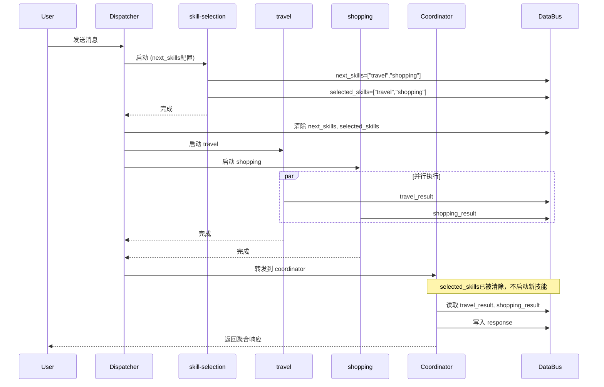

# SystemAgentMock 调度流程分析

## 修复后的调度顺序

```
时间线：16:50:59
```

### Phase 1: 用户消息处理

| 时间 | 事件 | 详情 |
|------|------|------|
| 16:50:59.327 | **DISPATCHER处理请求** | task_id=0_task_0 |
| 16:50:59.327 | 启动 skill-selection | next_skills配置触发 |

### Phase 2: skill-selection 执行

| 时间 | 事件 | 输入/输出 |
|------|------|-----------|
| 16:50:59.369 | **输出到DataBus** | next_skills, selected_skills |
| 16:50:59.369 | **WORKFLOW_COMPLETE** | skill-selection-workflow |

### Phase 3: 动态技能启动 ✅ 修复后

| 时间 | 事件 | 说明 |
|------|------|------|
| 16:50:59.369 | **DATA_EXCHANGE检测next_skills** | 发现2个技能 |
| 16:50:59.369 | **清除selected_skills** | 防止重复启动 ✅ |
| 16:50:59.377 | LAUNCH_SKILL: travel | 第一次启动 |
| 16:50:59.388 | LAUNCH_SKILL: shopping | 第一次启动 |

### Phase 4: 技能执行 & Coordinator

| 时间 | 事件 | 说明 |
|------|------|------|
| 16:50:59.388 | 转发到 coordinator | |
| 16:50:59.389 | **Coordinator处理** | |
| 16:50:59.401 | **Coordinator无技能启动** ✅ | selected_skills已被清除 |
| 16:50:59.412 | travel-workflow完成 | |
| 16:50:59.435 | shopping-workflow完成 | |
| 16:50:59.435 | coordinator-workflow完成 | |
| 16:50:59.435 | **返回响应** | |

---

## 流程图（修复后）

```
┌─────────────────────────────────────────────────────────────────────────────┐
│                              用户消息                                        │
│                   "What are the best travel, shopping, and food options?"   │
└─────────────────────────────────────┬───────────────────────────────────────┘
                                      │
                                      ▼
┌─────────────────────────────────────────────────────────────────────────────┐
│                           BuiltinDispatcher                                 │
│                      (next_skills: ["skill-selection"])                     │
│                                                                             │
│  [HANDLE_INTENT_REQUEST] task_id=0_task_0                                  │
│  [LAUNCH_SKILL] skill-selection                                             │
└─────────────────────────────────────┬───────────────────────────────────────┘
                                      │
                                      ▼
┌─────────────────────────────────────────────────────────────────────────────┐
│                         skill-selection Skill                               │
│  ┌───────────────────────────────────────────────────────────────────────┐ │
│  │  Node: select_skills                                                   │ │
│  │  输入: user_text, session_id                                           │ │
│  │  输出: next_skills=["travel","shopping"], selected_skills=[...]        │ │
│  └───────────────────────────────────────────────────────────────────────┘ │
│                                                                             │
│  [PROCESS_NODE_PUBLISH] next_skills, selected_skills                       │
│  [WORKFLOW_COMPLETE] success=1                                              │
└─────────────────────────────────────┬───────────────────────────────────────┘
                                      │
                                      ▼
┌─────────────────────────────────────────────────────────────────────────────┐
│                         DATA_EXCHANGE (Dispatcher)                          │
│                                                                             │
│  [检测] next_skills = ["travel", "shopping"]                                │
│  [清除] next_skills = ""                                                    │
│  [清除] selected_skills = ""  ✅ 防止重复启动                               │
│  [启动] travel skill                                                        │
│  [启动] shopping skill                                                      │
└──────────────────────┬──────────────────────────────────┬───────────────────┘
                       │                                  │
                       ▼                                  ▼
┌──────────────────────────────────┐   ┌──────────────────────────────────┐
│         travel Skill             │   │        shopping Skill            │
│  ┌────────────────────────────┐  │   │  ┌────────────────────────────┐  │
│  │  Node: travel_node         │  │   │  │  Node: shopping_node       │  │
│  │  输出: skill_result,       │  │   │  │  输出: skill_result,       │  │
│  │        confidence          │  │   │  │        confidence          │  │
│  │  DataBus: travel_result    │  │   │  │  DataBus: shopping_result  │  │
│  └────────────────────────────┘  │   │  └────────────────────────────┘  │
│  [WORKFLOW_COMPLETE]            │   │  [WORKFLOW_COMPLETE]             │
└──────────────┬───────────────────┘   └──────────────┬───────────────────┘
               │                                      │
               └──────────────────┬───────────────────┘
                                  │
                                  ▼
┌─────────────────────────────────────────────────────────────────────────────┐
│                              Coordinator                                    │
│  ┌───────────────────────────────────────────────────────────────────────┐ │
│  │  Node: aggregate_results                                               │ │
│  │  输入: session_id, user_text                                           │ │
│  │  读取 DataBus: travel_result, shopping_result                         │ │
│  │  输出: response, final_answer, coordinator_done                        │ │
│  └───────────────────────────────────────────────────────────────────────┘ │
│                                                                             │
│  [COORDINATORDataExchange] 检测 selected_skills = 空 ✅                     │
│  [COORDINATORDataExchange] Coordinator completed without skill             │
│  [返回响应]                                                                 │
└─────────────────────────────────────┬───────────────────────────────────────┘
                                      │
                                      ▼
┌─────────────────────────────────────────────────────────────────────────────┐
│                              用户响应                                        │
│  "Aggregated response for query: 'What are the best...'"                   │
│  [Travel Skill] ...                                                         │
│  [Shopping Skill] ...                                                       │
│  Total 2 skills contributed to this response.                               │
└─────────────────────────────────────────────────────────────────────────────┘
```

---

## 调度流程验证

### ✅ 设计要求满足情况

| 设计要求 | 状态 | 说明 |
|----------|------|------|
| 1. Dispatcher启动skill-selection | ✅ | 通过next_skills配置 |
| 2. skill-selection随机选择2个技能 | ✅ | 输出next_skills |
| 3. 框架检测next_skills启动技能 | ✅ | DATA_EXCHANGE处理 |
| 4. 技能并行执行 | ✅ | travel和shopping并行 |
| 5. Coordinator聚合结果 | ✅ | 读取DataBus |
| 6. 返回响应给用户 | ✅ | 测试通过 |
| 7. selected_skills向后兼容 | ✅ | 同时写入两个键 |
| 8. 不重复启动技能 | ✅ | 清除selected_skills |

### 关键修复

**问题**: 技能被重复启动
**原因**: `selected_skills` 未被清除，Coordinator再次检测到它
**修复**: 在 `DATA_EXCHANGE` 处理 `next_skills` 时，同时清除 `selected_skills`

```cpp
// src/agent/agent.cpp
publish_data("next_skills", std::string(""));
publish_data("selected_skills", std::string(""));  // 添加此行
```

---

## 时序图



---

## 性能指标

| 指标 | 值 |
|------|-----|
| 总执行时间 | ~110ms |
| skill-selection | ~30ms |
| travel + shopping (并行) | ~33-37ms |
| coordinator | ~32ms |
| 测试通过 | ✅ 100% |