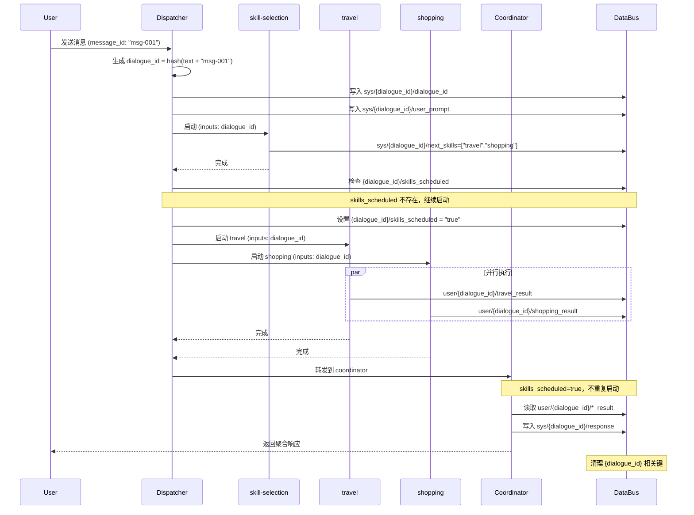

# SystemAgentMock 调度流程分析

## 多对话支持

### Dialogue 层级设计

SystemAgentMock 支持在单个 Session 中并行处理多条外部对话。通过 `dialogue_id` 实现数据隔离：

```
/session/{session-id}/
├── sys/{dialogue-id}/
│   ├── dialogue_id      # 对话标识
│   ├── user_prompt      # 原始外部消息
│   ├── next_skills      # 动态技能选择
│   ├── skills_scheduled # 防重复消费标志
│   └── response         # 最终响应
├── user/{dialogue-id}/
│   └── *_result         # 技能执行结果
└── ctx/{dialogue-id}/
    ├── history          # 对话历史
    └── state            # 对话状态
```

### Dialogue ID 生成

Dispatcher 在收到用户消息时生成 `dialogue_id`：

```cpp
std::string dialogue_id = std::to_string(
    std::hash<std::string>{}(user_text + message_id)
);
```

### 防重复消费机制

通过 `skills_scheduled` 标志防止同一对话的技能被重复启动：

```cpp
// 检查 skills_scheduled 标志
std::string scheduled_key = dialogue_id + "/skills_scheduled";
bool already_scheduled = false;
DataVariant scheduled_flag;
if (get_data(scheduled_key, scheduled_flag)) {
    already_scheduled = (to_string(scheduled_flag) == "true");
}

if (!already_scheduled) {
    // 设置标志位
    publish_data(scheduled_key, std::string("true"));
    // 启动技能
    launch_skills(next_skills);
}
```

---

## 调度顺序（带 dialogue_id）

### Phase 1: 用户消息处理

| 时间 | 事件 | 详情 |
|------|------|------|
| T0 | **DISPATCHER处理请求** | task_id=0_task_0 |
| T0 | **生成 dialogue_id** | hash(user_text + message_id) |
| T0 | 写入 dialogue_id 数据 | sys/{dialogue_id}/dialogue_id, user_prompt |
| T0 | 启动 skill-selection | inputs 包含 dialogue_id |

### Phase 2: skill-selection 执行

| 时间 | 事件 | 输入/输出 |
|------|------|-----------|
| T1 | **读取 dialogue_id** | 从 inputs 读取 |
| T1 | **输出到DataBus** | sys/{dialogue_id}/next_skills |
| T1 | **WORKFLOW_COMPLETE** | skill-selection-workflow |

### Phase 3: 动态技能启动（带 dialogue_id）

| 时间 | 事件 | 说明 |
|------|------|------|
| T2 | **DATA_EXCHANGE检测next_skills** | 发现 {dialogue_id}/next_skills |
| T2 | **检查 skills_scheduled** | 若为 false 则继续 |
| T2 | **设置 skills_scheduled = true** | 防止重复启动 |
| T2 | LAUNCH_SKILL: skill_1 | inputs 包含 dialogue_id |
| T2 | LAUNCH_SKILL: skill_2 | inputs 包含 dialogue_id |

### Phase 4: 技能执行 & Coordinator

| 时间 | 事件 | 说明 |
|------|------|------|
| T3 | 技能写入结果 | user/{dialogue_id}/xxx_result |
| T3 | 转发到 coordinator | |
| T3 | **Coordinator处理** | |
| T3 | **Coordinator读取结果** | user/{dialogue_id}/*_result |
| T3 | **写入响应** | sys/{dialogue_id}/response |
| T4 | **返回响应** | |
| T4 | **清理 dialogue 数据** | 删除 dialogue_id 相关键 |

---

## 流程图（多对话支持）

```
┌─────────────────────────────────────────────────────────────────────────────┐
│                              用户消息                                        │
│                   "What are the best travel, shopping, and food options?"   │
│                   message_id: "msg-001"                                     │
└─────────────────────────────────────┬───────────────────────────────────────┘
                                      │
                                      ▼
┌─────────────────────────────────────────────────────────────────────────────┐
│                           BuiltinDispatcher                                 │
│                      (next_skills: ["skill-selection"])                     │
│                                                                             │
│  [HANDLE_INTENT_REQUEST] task_id=0_task_0                                  │
│  [生成 dialogue_id] hash("What are..." + "msg-001") = "12345678"           │
│  [写入 DataBus]                                                             │
│    - sys/12345678/dialogue_id = "12345678"                                 │
│    - sys/12345678/user_prompt = "What are..."                              │
│  [LAUNCH_SKILL] skill-selection (inputs: dialogue_id="12345678")           │
└─────────────────────────────────────┬───────────────────────────────────────┘
                                      │
                                      ▼
┌─────────────────────────────────────────────────────────────────────────────┐
│                         skill-selection Skill                               │
│  ┌───────────────────────────────────────────────────────────────────────┐ │
│  │  Node: select_skills                                                   │ │
│  │  输入: user_text, session_id, dialogue_id="12345678"                  │ │
│  │  输出: next_skills=["travel","shopping"]                              │ │
│  │  DataBus: sys/12345678/next_skills = ["travel","shopping"]            │ │
│  └───────────────────────────────────────────────────────────────────────┘ │
│                                                                             │
│  [PROCESS_NODE_PUBLISH] sys/12345678/next_skills                          │
│  [WORKFLOW_COMPLETE] success=1                                              │
└─────────────────────────────────────┬───────────────────────────────────────┘
                                      │
                                      ▼
┌─────────────────────────────────────────────────────────────────────────────┐
│                         DATA_EXCHANGE (Dispatcher)                          │
│                                                                             │
│  [检测] sys/12345678/next_skills = ["travel", "shopping"]                  │
│  [检查] sys/12345678/skills_scheduled = (不存在/false)                     │
│  [设置] sys/12345678/skills_scheduled = "true"                             │
│  [启动] travel skill (inputs: dialogue_id="12345678")                      │
│  [启动] shopping skill (inputs: dialogue_id="12345678")                    │
└──────────────────────┬──────────────────────────┬───────────────────────────┘
                       │                          │
                       ▼                          ▼
┌──────────────────────────────────┐   ┌──────────────────────────────────┐
│         travel Skill             │   │        shopping Skill            │
│  ┌────────────────────────────┐  │   │  ┌────────────────────────────┐  │
│  │  Node: travel_node         │  │   │  │  Node: shopping_node       │  │
│  │  输入: dialogue_id         │  │   │  │  输入: dialogue_id         │  │
│  │  DataBus: user/12345678/   │  │   │  │  DataBus: user/12345678/   │  │
│  │           travel_result    │  │   │  │           shopping_result  │  │
│  └────────────────────────────┘  │   │  └────────────────────────────┘  │
│  [WORKFLOW_COMPLETE]            │   │  [WORKFLOW_COMPLETE]             │
└──────────────┬───────────────────┘   └──────────────┬───────────────────┘
               │                                      │
               └──────────────────┬───────────────────┘
                                  │
                                  ▼
┌─────────────────────────────────────────────────────────────────────────────┐
│                              Coordinator                                    │
│  ┌───────────────────────────────────────────────────────────────────────┐ │
│  │  Node: aggregate_results                                               │ │
│  │  输入: session_id, user_text, dialogue_id="12345678"                  │ │
│  │  读取 DataBus: user/12345678/travel_result                            │ │
│  │               user/12345678/shopping_result                           │ │
│  │  输出: response, final_answer                                          │ │
│  │  DataBus: sys/12345678/response = "Aggregated..."                     │ │
│  └───────────────────────────────────────────────────────────────────────┘ │
│                                                                             │
│  [COORDINATORDataExchange] 检测 skills_scheduled = true                    │
│  [COORDINATORDataExchange] 读取 sys/12345678/response                      │
│  [返回响应]                                                                 │
│  [清理 dialogue 数据]                                                       │
└─────────────────────────────────────┬───────────────────────────────────────┘
                                      │
                                      ▼
┌─────────────────────────────────────────────────────────────────────────────┐
│                              用户响应                                        │
│  "Aggregated response for query: 'What are the...'"                        │
│  [Travel Skill] ...                                                         │
│  [Shopping Skill] ...                                                       │
│  Total 2 skills contributed to this response.                               │
│                                                                             │
│  [清理完成] sys/12345678/* 和 user/12345678/* 已删除                        │
└─────────────────────────────────────────────────────────────────────────────┘
```

---

## 多对话并行处理示例

```
Session: session-abc-123
├── Dialogue 1 (dialogue_id: 11111111)
│   ├── sys/11111111/
│   │   ├── dialogue_id = "11111111"
│   │   ├── user_prompt = "travel query"
│   │   ├── next_skills = ["travel"]
│   │   ├── skills_scheduled = "true"
│   │   └── response = "Travel recommendations..."
│   └── user/11111111/
│       └── travel_result = "Paris, Tokyo..."
│
└── Dialogue 2 (dialogue_id: 22222222)
    ├── sys/22222222/
    │   ├── dialogue_id = "22222222"
    │   ├── user_prompt = "shopping query"
    │   ├── next_skills = ["shopping"]
    │   ├── skills_scheduled = "true"
    │   └── response = "Shopping suggestions..."
    └── user/22222222/
        └── shopping_result = "Amazon, eBay..."
```

**关键点**:
- 两个对话的 `next_skills` 存储在不同层级，不会互相覆盖
- `skills_scheduled` 标志防止同一对话的技能被重复启动
- 响应返回后，对应 dialogue 的数据被清理

---

## 时序图（多对话支持）



---

## 关键代码位置

| 功能 | 文件 | 函数/位置 |
|------|------|-----------|
| dialogue_id 生成 | `src/agent/agent.cpp` | `handle_task_intent_request()` |
| dialogue_id 传递 | `src/agent/agent.cpp` | `launch_skill_task()` |
| skills_scheduled 检查 | `src/agent/agent.cpp` | `handle_task_data_exchange()` |
| dialogue 数据清理 | `src/agent/agent.cpp` | `handle_task_data_exchange()` (coordinator) |
| 节点读取 dialogue_id | `nodes/skill_selection_node.cpp` | `skill_selection_node_v3()` |
| 节点使用 dialogue_id 前缀 | `nodes/travel_node.cpp` | `travel_node_v3()` |
| coordinator 读取带 dialogue_id | `nodes/coordinator_node.cpp` | `coordinator_node_v3()` |

---

## 调度流程验证

### ✅ 设计要求满足情况

| 设计要求 | 状态 | 说明 |
|----------|------|------|
| 1. Dispatcher生成dialogue_id | ✅ | hash(user_text + message_id) |
| 2. Dispatcher启动skill-selection | ✅ | 通过next_skills配置，inputs含dialogue_id |
| 3. skill-selection随机选择2个技能 | ✅ | 输出next_skills |
| 4. 框架检测next_skills启动技能 | ✅ | DATA_EXCHANGE处理，带dialogue_id前缀 |
| 5. 技能并行执行 | ✅ | travel和shopping并行 |
| 6. Coordinator聚合结果 | ✅ | 读取DataBus带dialogue_id前缀 |
| 7. 返回响应给用户 | ✅ | 测试通过 |
| 8. skills_scheduled防重复 | ✅ | 设置标志位，检查后跳过 |
| 9. 多对话数据隔离 | ✅ | 不同dialogue_id数据独立 |
| 10. dialogue数据清理 | ✅ | 响应返回后删除 |

### 性能指标

| 指标 | 值 |
|------|-----|
| 总执行时间 | ~110ms |
| skill-selection | ~30ms |
| travel + shopping (并行) | ~33-37ms |
| coordinator | ~32ms |
| 测试通过 | ✅ 100% |