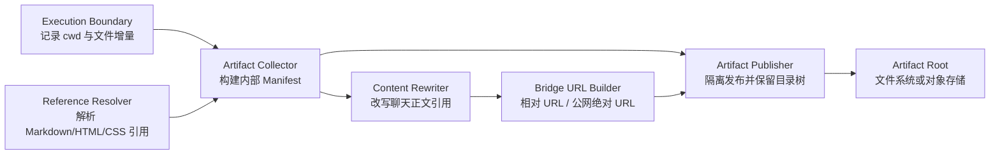

# Chat API 接口契约

> **层级**: L4 · `architecture/modules/chat-api.md`
> **状态**: 目标设计已更新 · 2026-07-03 增加 Skill 无侵入 Artifact 归一化契约
> **创建者**: `design-doc-organizer`

---

## What

本文档定义 Bridge 聊天功能的完整 API 接口契约，包含 WebSocket 和 REST 两种模式的端点、帧格式、请求/响应体 Schema 和错误码。

**核心设计原则**: `session_id` 是 daemon 内部概念，外部客户端不感知。客户端通过 `user_id` + `client_id` 标识身份，daemon 内部按 `user_id:client_id` 复合键自动分配/复用 session。

---

## 1. WebSocket 流式聊天

### 1.1 端点

| 项目 | 值 |
|------|-----|
| 端点 | `ws://<bridge_host>:<bridge_port>/ws/chat/{agent_id}` |
| 协议 | JSON-RPC 2.0 格式消息 over WebSocket (RFC 6455) |
| 路径参数 | `agent_id` — 目标 Agent 标识符 |
| 超时 | 120s（单次 turn） |
| 保活 | 服务端每 30s 发送 `ping` 帧 |

### 1.2 帧格式

#### 客户端 → Bridge

**ChatRequest**（用户消息）：

```json
{
  "user_id": "web-user",
  "client_id": "client_a1b2c3",
  "content": "用户输入的消息文本"
}
```

| 字段 | 类型 | 必填 | 说明 |
|------|------|------|------|
| `user_id` | string | 是 | 用户标识符（前端内置固定值） |
| `client_id` | string | 是 | 客户端/会话标识符（新建会话时生成） |
| `content` | string | 是 | 用户消息内容 |

**StopSignal**（中断当前 turn）：

```json
{"type": "stop"}
```

**PingSignal**（心跳保活）：

```json
{"type": "ping"}
```

#### Bridge → 客户端

**ChatChunk**（流式输出块）：

```json
{"type": "chunk", "content": "部分响应文本", "final": false}
```

| 字段 | 类型 | 说明 |
|------|------|------|
| `type` | string | 固定值 `"chunk"` |
| `content` | string | 本次推送的文本片段；可包含 Markdown Artifact URL |
| `final` | bool | `true` 表示本轮最后一块 |

**ChatDone**（本轮结束信号）：

```json
{"type": "done", "final": true}
```

| 字段 | 类型 | 说明 |
|------|------|------|
| `type` | string | 固定值 `"done"` |
| `final` | bool | 固定值 `true` |

> 不再返回 `session_id` — session 是 daemon 内部概念，前端不需要感知。

**ErrorFrame**（错误信号）：

```json
{"type": "error", "message": "错误描述", "code": -32000}
```

错误帧发送后 Bridge 会关闭 WebSocket 连接。错误码语义：

| code | 语义 |
|------|------|
| -32600 | 无效消息格式 |
| -32000 | 通用 daemon 错误 / 超时 |
| 1011 | Bridge 内部错误 |

### 1.3 连接生命周期

```
客户端                          Bridge
  |                               |
  |-- WS connect ----------------->|
  |<-- accept ---------------------|
  |-- {"user_id":"web-user",      >|
  |    "client_id":"c_abc",        |
  |    "content":"你好"}           |
  |<-- {"type":"chunk", ...} ------|  (0..N 次)
  |<-- {"type":"chunk", "final":t} |
  |<-- {"type":"done"} ------------|
  |-- {"user_id":"web-user",      >|  (多轮复用同一连接)
  |    "client_id":"c_abc",        |
  |    "content":"继续"}           |
  |<-- ... ------------------------|
  |-- {"type":"stop"} ------------>|  (中断本轮)
  |<-- {"type":"done"} ------------|
```

- 每个连接绑定一个 `agent_id`
- 多轮对话通过 `user_id` + `client_id` 串联（daemon 内部映射到同一个 session）
- 同一连接同一时刻只能有一个 in-flight turn
- 客户端可发送 `stop` 提前终止本轮
- 连接断开时 in-flight turn 自动取消

---

## 2. REST 同步聊天

### 2.1 端点

| 项目 | 值 |
|------|-----|
| 方法 | `POST` |
| 路径 | `/api/chat/{agent_id}` |
| 路径参数 | `agent_id` — 目标 Agent 标识符 |
| 请求 Content-Type | `application/json` |
| 超时 | 120s |
| 成功响应 | `200 OK` |

### 2.2 请求体

```json
{
  "user_id": "web-user",
  "client_id": "client_a1b2c3",
  "content": "用户消息文本"
}
```

ChatRestRequest：

| 字段 | 类型 | 必填 | 默认值 | 说明 |
|------|------|------|--------|------|
| `user_id` | string | 是 | — | 用户标识符 |
| `client_id` | string | 是 | — | 客户端/会话标识符 |
| `content` | string | 是 | — | 用户消息内容 |

### 2.3 响应体（成功）

```json
{
  "success": true,
  "data": {
    "task_id": "task_xyz789",
    "content": "Agent 的完整响应文本"
  },
  "error": null
}
```

ChatRestResponse：

| 字段 | 类型 | 说明 |
|------|------|------|
| `task_id` | string | daemon 侧的任务 ID |
| `content` | string | 完整响应文本（已拼接所有 chunk）；可包含 Markdown Artifact URL |

### 2.4 执行流程

```
客户端                          Bridge                        Daemon
  |                               |                              |
  |-- POST /api/chat/{id} ------->|                              |
  |   {user_id, client_id,        |                              |
  |    content}                    |                              |
  |                               |-- agent.execute ------------>|
  |                               |   {user_id, client_id,       |
  |                               |    content}                   |
  |                               |<-- {message_id, status} -----|
  |                               |                              |
  |                               |  (轮询: wait_for_response)   |
  |                               |<-- {content, final: false} --|  (0..N 次)
  |                               |<-- {content, final: true}  --|
  |                               |                              |
  |<-- {success, data: {content}} |                              |
```

### 2.5 错误码

| 条件 | HTTP | `error` 消息 |
|------|------|-------------|
| Daemon 返回 `InvalidParamsError` | 400 | daemon 错误消息 |
| Daemon 返回 `NotFoundError` | 404 | daemon 错误消息 |
| Daemon 连接失败 | 502 | 连接失败描述 |
| `agent.execute` 超时 (120s) | 504 | `"agent.execute timed out after 120.0s"` |
| `wait_for_response` 超时 (120s) | 504 | 超时描述 |
| agent 未返回 `task_id` | 500 | `"agent.execute did not return a task_id"` |
| 其他 Daemon 错误 | 500 | daemon 错误消息 |

---

## 3. 双模式比较

| 维度 | WebSocket 模式 | REST 模式 |
|------|---------------|-----------|
| 连接持久性 | 长连接（多轮复用） | 无状态（每轮独立请求） |
| 流式输出 | ✅ 逐帧推送 ChatChunk | ❌ 等完整返回 |
| 心跳保活 | ✅ 双向 ping/pong | 不需要 |
| 中断本轮 | ✅ 发送 `stop` 信号 | ❌ 不支持（发起了就必须等） |
| 适用客户端 | Vue 前端交互式对话 | 程序化调用、自动化脚本 |

---

## 4. 通用契约

### 4.1 Daemon 错误 → HTTP 状态码映射

| 错误场景 | 异常类 | HTTP |
|----------|--------|------|
| 无效参数 | `InvalidParamsError` | 400 Bad Request |
| 资源不存在 | `NotFoundError` | 404 Not Found |
| 请求超时 | `DaemonTimeoutError` | 504 Gateway Timeout |
| 连接失败 | `DaemonConnectionError` | 502 Bad Gateway |
| 其他错误 | `DaemonError` | 500 Internal Server Error |

### 4.2 dialogue_id 生成规则

当客户端未显式提供 `dialogue_id` 时，Bridge 自动生成：

```
{dialogue_id} = {MMDDHHmmSS}-{uuid4.hex[:12]}
```

示例：`0625152345-abc123def456`

此规则确保每轮对话的 `dialogue_id` 唯一，避免 `coord_forwarded` 冲突。

## 5. Artifact 归一化与文件访问契约

### 5.1 设计目标与兼容边界

Artifact 交付必须兼容未知来源、未经平台改造的用户 Skill。平台不得以修改 Skill 为前提，不得要求 Skill：

- 调用 AgentFlow 专用 Artifact 注册接口；
- 输出固定 JSON、Manifest 或特定 Markdown 模板；
- 把相对路径预先改成 Bridge URL；
- 统一使用某个生成工具或固定输出目录。

Skill 可以生成图片、HTML、CSS、JavaScript、JSON、SVG、视频或其他允许发布的文件，并可在返回内容中使用以下引用形式：

```text

[查看报告](reports/lookbook/index.html)

<video src="media/demo.mp4" controls>
```

平台负责将“运行时文件路径”转换为“客户端可访问 URL”。显式 Artifact 注册接口将来可以作为性能优化或强语义补充，但不得成为正确交付的必要条件。

### 5.2 当前实现事实与目标差距

| 关注点 | 当前实现事实 | 目标设计 |
|--------|--------------|----------|
| 文件发现 | Outfit Assistant 通用执行器从工具输出提取图片路径 | 执行边界文件增量为主，内容引用解析为辅 |
| 相对路径基准 | 当前执行器按 Agent Package 根目录解析 | 使用产生该内容的 Skill/工具工作目录 |
| 文件发布 | 包内文件保留原目录树；包外文件仍复制到统一 `outputs/` | 按 turn/execution 隔离并保留目录树 |
| 内容改写 | 已覆盖收集清单内的相对/绝对 Markdown 与 HTML `src`/`href` | 平台级解析 Markdown、HTML 与 CSS 引用后按 Manifest 改写 |
| 公网 URL | Bridge 对 Markdown 片段做字符串替换 | Bridge URL Builder 统一生成相对/绝对 URL |
| Agent 隔离 | `agent_id` 仅是 URL 语义 | `agent_id` 必须参与发布根目录选择和授权校验 |

当前实现完成迁移阶段 1 的业务闭环，但发现与改写仍位于 Outfit Assistant 节点内，尚未成为所有 Agent/Skill 自动获得的平台能力。

### 5.3 逻辑组件与职责

下图承载组件图语义，描述 Artifact 交付的静态职责与依赖，不表示执行时序。



- **Execution Boundary** 在每次 Skill/工具执行前后采集工作目录和文件元数据，不感知具体 Skill 业务。
- **Artifact Collector** 只接受本轮可证明存在的文件，生成平台内部 Manifest。
- **Reference Resolver** 负责语法级引用解析，不使用单一正则覆盖所有格式。
- **Artifact Publisher** 生成隔离发布目录并保持相对目录树。
- **Content Rewriter** 只改写最终聊天内容中的本地引用；HTML Artifact 文件内部相对引用保持原样。
- **Bridge URL Builder** 是 URL 前缀和公网域名的唯一生成点。

### 5.4 内部 Artifact Manifest

Manifest 是运行时中间模型，不直接要求 Skill 产生，也不作为 WS/REST 对外响应字段。建议最小结构：

```json
{
  "agent_id": "outfit-assistant",
  "dialogue_id": "0703152345-abc123def456",
  "execution_id": "skill-exec-01",
  "source_root": "/runtime/work/outfit-assistant/skill-exec-01",
  "artifacts": [
    {
      "artifact_id": "artifact-01",
      "kind": "html_bundle",
      "source_path": "reports/lookbook/index.html",
      "publish_path": "reports/lookbook/index.html",
      "entrypoint": true,
      "media_type": "text/html"
    },
    {
      "artifact_id": "artifact-02",
      "kind": "image",
      "source_path": "reports/lookbook/assets/look.png",
      "publish_path": "reports/lookbook/assets/look.png",
      "entrypoint": false,
      "media_type": "image/png"
    }
  ]
}
```

字段层级：

| 字段 | 层级 | 对外可见性 | 语义 |
|------|------|------------|------|
| `source_root`、`source_path` | 运行时内部 | 不可见 | 解析 Skill 相对路径的文件系统依据 |
| `publish_path` | 发布内部 | 仅通过 URL 间接可见 | 发布根目录内的层级保真路径 |
| `artifact_id` | 运行时内部 | 当前不可见 | 本轮内稳定标识，禁止用 basename 代替 |
| `media_type` | 发布内部/HTTP | 通过 Content-Type 可见 | 根据文件内容与受控映射确定 |
| Artifact URL | 最终交付 | 可见 | Bridge 生成的客户端访问地址 |

### 5.5 自动发现算法

#### 5.5.1 文件候选集

每次 Skill/工具执行使用独立或可区分的工作目录。平台在执行前后记录文件快照，候选集由以下来源合并：

1. 本轮新增文件；
2. 本轮修改且修改时间、大小或内容摘要发生变化的文件；
3. 返回内容中引用、且能在本轮工作目录内安全解析到的既有文件；
4. 可选的显式工具元数据；该来源只能增强发现结果，不能替代前三项。

仅凭模型文本提及但文件不存在的路径不进入 Manifest。仅存在于工作目录但未被正文引用的新增文件可以作为独立 Artifact 保留，是否进入最终聊天正文由交付策略决定。

#### 5.5.2 引用解析

引用解析必须先识别内容类型，再使用对应解析器：

| 内容 | 必须识别的引用 |
|------|----------------|
| Markdown | 图片、普通链接、嵌入 HTML 的 `src`/`href` |
| HTML | `src`、`href`、`poster`、`srcset` |
| CSS | `url(...)`、`@import` |
| 普通文本 | 明确存在的绝对或相对文件路径，仅作为低置信度候选 |

相对引用统一按 `source_root + 内容来源目录` 解析。HTTP(S)、`data:`、`mailto:`、锚点和其他非本地 URI 不改写、不下载。

#### 5.5.3 Bundle 闭包与目录保真

HTML、Markdown 或 CSS 文件被识别为入口 Artifact 时，平台递归解析其本地依赖，形成 Bundle 闭包。所有依赖按相对入口目录的原始层级发布：

```text
source_root/reports/lookbook/index.html
source_root/reports/lookbook/assets/look.png
source_root/reports/lookbook/assets/theme.css

→ publish_root/reports/lookbook/index.html
→ publish_root/reports/lookbook/assets/look.png
→ publish_root/reports/lookbook/assets/theme.css
```

禁止把以上文件扁平化为 `outputs/index.html`、`outputs/look.png`、`outputs/theme.css`。同一 Bundle 内部文件内容默认不改写，浏览器依靠 URL 目录语义解析相对引用。

#### 5.5.4 聊天正文改写

聊天正文不是文件，不具备天然基准 URL，因此其中的本地引用必须改写：

```text
输入：
输出：

输入：
输出：
```

改写依据必须来自 Manifest 的 `source_path → publish_path` 映射，禁止对任意字符串路径直接拼 URL。无法解析、越界、文件不存在或不允许发布的引用保持不可访问状态，并记录结构化诊断；不得把宿主机路径返回客户端。

WS 非终态 chunk 不承诺包含可立即访问的 Artifact 引用。Artifact 归一化必须在 `final=true` 之前完成，最终 chunk 与 REST 完整响应遵守同一内容契约。

### 5.6 发布目录与推荐端点

推荐发布路径引入 turn/execution 隔离：

```text
GET /api/artifacts/{agent_id}/{dialogue_id}/{execution_id}/{relative_path:path}
```

示例：

```text
GET /api/artifacts/outfit-assistant/0703152345-abc123def456/skill-exec-01/reports/lookbook/index.html
GET /api/artifacts/outfit-assistant/0703152345-abc123def456/skill-exec-01/reports/lookbook/assets/look.png
```

路径参数语义：

| 参数 | 说明 |
|------|------|
| `agent_id` | 参与发布根目录选择，不得仅作为展示字段 |
| `dialogue_id` | 隔离不同 turn，避免同名文件相互覆盖 |
| `execution_id` | 隔离同一 turn 内不同 Skill/工具执行 |
| `relative_path` | 相对于本 execution 发布根目录的层级保真路径 |

现有 `/api/artifacts/{agent_id}/files/{relative_path}` 作为迁移期兼容端点保留，只服务已经位于 Agent Package 内的历史 Artifact URL；新产生的 Artifact 使用隔离端点。

### 5.7 URL 生成与内外部访问

Bridge URL Builder 是 Artifact URL 的唯一权威生成点：

- `ARTIFACT_PUBLIC_BASE_URL` 为空：返回 Bridge 挂载下的同源相对 URL，供内置 UI 或同源代理访问；
- `ARTIFACT_PUBLIC_BASE_URL` 非空：返回以该地址为前缀的绝对 URL，供远程调用方访问；
- 配置值必须包含外部实际可达的反向代理路径前缀，例如 Bridge 业务路由挂载在 `/health` 时，公网基地址必须反映该拓扑；
- URL 构造必须操作结构化路径，不得依赖 `content.replace()` 识别 Markdown 括号。

HTML Bundle 内部继续使用相对引用，因此只需把 HTML 入口 URL 公网化；浏览器会在相同绝对 URL 目录下加载其依赖。

### 5.8 安全与生命周期

- 发布根目录必须由 `agent_id + dialogue_id + execution_id` 映射得到，并在 `resolve()` 后执行 containment 校验；
- `agent_id` 必须参与实际路径选择，不能继续被忽略；
- 只发布允许的文件类型，图片 MIME 优先按魔数识别；HTML、SVG、JavaScript 等主动内容应配置 CSP，并优先部署在与管理 UI 隔离的 Artifact 域名；
- 不跟随指向发布根目录外的符号链接；
- 不把 `source_root`、绝对路径、临时目录或对象存储内部 key 返回客户端；
- 已发布文件在本轮响应完成前不得清理；保留期限、磁盘配额、单文件和 Bundle 大小上限属于待确认规格。

### 5.9 失败与回退语义

| 失败 | 平台行为 | 对外结果 |
|------|----------|----------|
| 引用文件不存在 | 不进入 Manifest，记录诊断 | 正文不得伪造可访问 URL |
| 相对路径逃逸 `source_root` | 拒绝发布 | 保留安全错误，不暴露目标路径 |
| Bundle 依赖缺失 | 入口可发布但标记 `incomplete` | 返回入口时附明确缺失提示 |
| 发布复制失败 | Artifact 标记失败 | 文本结果可继续，不能宣称文件可查看 |
| 后续模型失败 | 保留已发布 Manifest | 返回平台生成的 Artifact 链接与降级说明 |
| 公网基地址未配置 | 返回同源相对 URL | 内置 UI 可用；远程调用方收到明确配置缺失信息或由部署网关补全 |

### 5.10 测试不变量

| 不变量 | 层级 | 验证点 |
|--------|------|--------|
| 未改造 Skill 的相对 Markdown 图片可访问 | E2E | Skill 仅返回 ``，外部客户端 GET 成功 |
| 未改造 Skill 的 HTML `img src` 可访问 | E2E | 聊天 HTML 标签被改写，图片 GET 成功 |
| HTML Bundle 目录层级不变 | Integration/E2E | HTML、CSS、图片相对引用逐一 GET 成功 |
| 同名文件不冲突 | Integration | 不同 dialogue/execution 的 `look.png` 字节互不覆盖 |
| 本地绝对路径不泄漏 | Contract | REST 与 WS 最终内容不含 `source_root` |
| 内外部 URL 契约一致 | Contract | 相对模式与公网模式只改变 URL 基地址 |
| Skill 无侵入 | E2E | 测试 Skill 不调用 Artifact API、不输出 Manifest |
| Agent 路径隔离 | Security | 使用其他 agent_id/dialogue_id 不能读取文件 |

### 5.11 待确认规格

以下数值当前没有正式产品承诺，实施前需集中拍板：

- 单文件最大大小、单 Bundle 最大大小与单 turn 文件数量；
- 文件快照使用元数据还是内容摘要，以及大目录扫描预算；
- Artifact 保留期限、磁盘配额和清理触发策略；
- HTML/JS/SVG 的发布域名隔离、CSP 与下载策略；
- Bundle 依赖递归深度、循环引用和缺失资源的验收口径；
- 未被正文引用但本轮新增文件是否自动附加到最终回复。

### 5.12 开发视图与迁移阶段

目标职责建议落到以下代码单元；文件名是开发视图中的建议落点，不构成对外接口：

| 职责 | 建议代码落点 | 依赖方向 |
|------|--------------|----------|
| 执行前后文件增量采集 | Runtime/Worker 执行边界的 `artifact_collector` | 只依赖执行上下文与文件系统抽象 |
| Manifest 数据模型 | Runtime 公共内部模型 `artifact_manifest` | 不依赖具体 Agent 或 Skill |
| Markdown/HTML/CSS 引用解析 | 独立 `artifact_reference_resolver` | 依赖解析库，不依赖 Bridge 路由 |
| 目录树发布 | Bridge/Runtime 共享的 `artifact_publisher` 接口 | 后端可替换为文件系统或对象存储 |
| URL 构造 | Bridge `artifact_url_builder` | 依赖部署配置与路由前缀 |
| HTTP 文件服务 | Bridge `routes/artifacts` | 只消费发布根目录与 Manifest 索引 |
| 最终正文改写 | agent response 出站边界的 `artifact_content_rewriter` | 消费 Manifest 与 URL Builder |

迁移按以下阶段进行：

1. **契约锁定**：先增加相对 Markdown、HTML `img`、HTML Bundle、同名文件隔离和远程绝对 URL 的失败测试；测试 Skill 保持原样，不调用平台 API。
2. **内部模型落地**：引入平台生成的 Manifest 和 Reference Resolver，但暂时继续使用现有兼容端点提供文件。
3. **执行边界采集**：在通用 Skill/工具执行边界采集文件增量，替换 outfit assistant 内的图片正则作为权威来源；旧正则仅保留为低置信度兼容提示。
4. **隔离发布与 URL Builder**：启用新端点，按 agent/dialogue/execution 发布目录树，并在统一出站边界改写最终正文。
5. **移除业务特例**：新旧 E2E 等价后，移除 outfit assistant 中的复制扁平化、硬编码 agent id 和公网 URL 拼接逻辑。

迁移期间同一个 Artifact 只允许一个权威发布记录。兼容端点可以读取旧文件，但不得再次复制或重命名新发布目录中的文件。

### 5.13 旧版文件端点兼容契约

#### 5.13.1 兼容端点

| 项目 | 值 |
|------|-----|
| 方法 | `GET` |
| 路径 | `/api/artifacts/{agent_id}/files/{relative_path:path}` |
| 路径参数 | `agent_id` — 生成产物的 Agent 标识；`relative_path` — 相对于 Agent Package 根目录的文件路径 |
| 成功响应 | `200` 文件流 |

示例：

```text
GET /api/artifacts/outfit-assistant/files/outfit-assistant/outputs/task-123/report.html
GET /api/artifacts/outfit-assistant/files/outfit-assistant/outputs/task-123/assets/look.png
```

Bridge 保留目录层级。若 `report.html` 使用 `assets/look.png`，浏览器会请求同级目录下的 `assets/look.png`，无需重写 HTML 内容。

兼容端点 `GET /api/artifacts/{agent_id}?path=...` 仍可读取包根目录内文件，但它允许传入服务端路径，仅用于兼容已有调用，不应作为新的外部集成契约。

#### 5.13.2 路径与文件类型约束

- 服务根目录固定为 `settings.agent_packages_path`；Bridge 对目标路径做规范化并验证其仍位于该根目录内。
- `agent_id` 当前仅用于 URL 语义，不是授权边界；不能依赖它隔离不同租户或 Agent 的文件。
- 支持图片以及 `html`、`htm`、`css`、`js`、`json`、`svg` 等网页产物类型。
- 图片响应优先按文件魔数识别 MIME，避免扩展名与实际编码不一致导致浏览器无法显示。

| 条件 | HTTP | 说明 |
|------|------|------|
| 文件存在且位于包根目录 | 200 | 返回文件流与对应 Content-Type |
| 路径逃逸包根目录 | 403 | 拒绝目录穿越和根目录外文件 |
| 文件不存在或不是普通文件 | 404 | 不暴露宿主机其他路径信息 |
| 文件类型不允许 | 415 | 拒绝未列入白名单的类型 |

#### 5.13.3 旧版聊天 URL

WS 与 REST 不新增结构化 `artifacts` 字段，Artifact URL 直接包含在 `content` Markdown 中：

```json
{
  "type": "chunk",
  "content": "搭配结果：",
  "final": true
}
```

URL 生成规则：

- `ARTIFACT_PUBLIC_BASE_URL` 为空：保留 `/api/artifacts/...` 相对 URL，适用于内置 UI 或同源反向代理。
- `ARTIFACT_PUBLIC_BASE_URL` 非空：WS 与 REST 在返回前补全为绝对 URL，适用于外部服务调用。
- 公网基地址应指向外部客户端实际可访问的 Bridge 入口；如反向代理挂载在子路径，配置中需包含该路径前缀。

外部客户端能否访问图片取决于 Bridge 是否真正对该客户端可达。仅配置 URL 不会自动建立公网入口、防火墙规则或反向代理。

#### 5.13.4 当前限制

当前实现的安全边界是“只允许读取 Agent Package 根目录内的白名单文件”，尚未实现以下生产能力：

- Artifact 身份认证与按用户/Agent 授权；
- 不透明 Artifact ID 与签名、限时 URL；
- 产物保留期限、配额和自动清理；
- 独立对象存储或 CDN 分发。

因此，公网部署时应由反向代理或 API Gateway 增加认证和访问控制；不能把当前 `agent_id` 路径参数视为权限校验。

---

**权威章节映射**：

| 概念 | 权威章节 |
|------|----------|
| WS 帧格式（ChatRequest/ChatChunk/ChatDone） | 本文档 §1.2 |
| REST 请求/响应 Schema | 本文档 §2.2–2.3 |
| 错误码映射 | 本文档 §2.5，§4.1 |
| dialogue_id 生成规则 | 本文档 §4.2 |
| Artifact 自动发现、Manifest 与引用改写 | 本文档 §5.1–5.5 |
| Artifact 新发布端点与 URL 生成 | 本文档 §5.6–5.7 |
| Artifact 安全、失败与测试不变量 | 本文档 §5.8–5.10 |
| Artifact 待确认规格 | 本文档 §5.11 |
| Artifact 开发落点与迁移阶段 | 本文档 §5.12 |
| 旧版 Artifact 兼容端点 | 本文档 §5.13 |
| 双模式选择依据 | `features/chat.md` L2 |
| Pydantic 模型定义 | `frontend/bridge/models.py` |

**相关文档**:
- `docs/design/features/chat.md` — 聊天功能设计（L2）
- `docs/design/features/bridge-overview.md` — Bridge 总体架构
