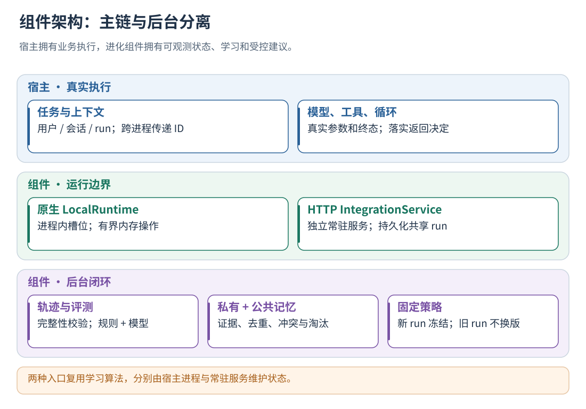

# Trajectory Evolution

同一后台评测模块用于 L0 基线、L1–L3 策略准入与 L4 GEPA 多轮反思搜索。
GEPA 保存多父候选谱系：既能反思改写，也能将不同分支的改进重组到同一个后代；使用真实 Agent 试验筛选，经留出集准入后发布，支持恢复搜索和离线加载。
配置与接入步骤见[任务评测指南](docs/19-datasets-and-benchmarks.md)，状态管理见[私有记忆](docs/13-private-memory.md)。

框架与语言无关的轨迹采集、评测反思、两级记忆管理和受控策略组件。核心用 C++ 实现，提供进程内原生 ABI 与独立 HTTP 服务，通过统一执行边界接入各类 Agent。

[完整文档](docs/README.md) · [快速开始](docs/04-quickstart.md) · [公共＋私有记忆机制](docs/14-shared-memory.md) · [全部配图](docs/figures/README.md)



## 功能分级

- L0：真实边界采集、结构校验、规则/模型评测、反思与持续入库。
- L1：将匹配且获授权的经验加入实际模型输入。
- L2：技能编排，在既有任务之间选择先后依赖和并行关系；另保留逐动作参数护栏。
- L3：按当前 loop 的状态作 Continue/Replan/Stop，并核验宿主实际执行。
- L4：GEPA 反思改写、逐题／多目标前沿、多提案筛选、双亲重组、留出集准入和策略持久化；可选 ComBEE 分组反思。候选使用已有 L1–L3 打点。

已接入 L1–L3 后，在 `agent-evaluation.json` 增加 `"gepa_config": "gepa.json"`，
配置训练/验证/留出任务和反思模型即可启用后台搜索；无需增加宿主打点。
[GEPA 配置、算法与离线版本使用](docs/24-evolution-and-gepa.md#启用-gepa)。

没有历史会话，或现有可用经验不足时，后台可先从冻结训练集补充经验，再进入 GEPA。
按过滤和授权后的有效经验数判断，而不是只判断空库；训练分批、去重、有预算，验证集和留出集不入库。
[自动补充训练与状态说明](docs/24-evolution-and-gepa.md#经验不足时自动补充训练)。

**公共＋私有记忆管理默认开启。** 省略 sharing 同样启用；显式 enabled=false 可关闭公共机制。
经验注入由 auto_approve_experiences 授权，默认 false；使用公共语义提炼前，请在配置模板中设置评测模型。

## 最短上手路径

新接入只需配置参数，并在原程序中插入包提供的 `point`：传入已有的任务 ID、调用 ID、父调用 ID，
组件负责上下文关联、轨迹记录、策略准备、并行合流和待完成任务收尾。不需要新增 observer、适配器或上下文存储文件。
Python、JS/TS、Rust、Go、Java、C# 与 C/C++ 都提供调用包装和循环判断，可直接包住原有调用或循环条件；
也可只使用相同的 JSON 打点协议。模型、工具仍由原程序执行，后台评测和学习不在主流程里等待。
具体插入代码见[统一打点教程](docs/08-instrumentation.md#统一打点推荐入口)。
Python 还提供按配置取得用户客户端的 `from evolution_configured import points`，
只需设置 `EVOLUTION_POINT_CONFIG`，不必在宿主另写初始化、连接或身份管理文件。
常见模型请求的注入位置、工具定义和响应 token 用量由包内识别；不需要逐个维护工具/参数白名单。
L2 编排使用 `schedule_rules`，例如 A 完成后才释放 B，无依赖的 C 继续并行；宿主原有硬依赖不会被删除。
参数护栏从实际工具 JSON Schema 检查必填参数，与技能编排和 GEPA 可变策略分别记录。
自定义输入格式可在同一打点提供 binding；接入事实和可选高级配置见[接入参数审查](docs/03-configuration.md#接入参数审查)。
AgentFlow v1 已在现有 Python 入口插入这组打点，启用步骤见[异步接入中的 v1 配置](docs/09-async-and-multi-agent.md#agentflow-v1-已有打点如何启用)。

先[独立安装](docs/02-installation.md)，复制完整 config 并配置自己的身份和数据目录，再执行[第一条真实任务](docs/04-quickstart.md)。

评测真实 Agent 时，使用[任务入口绑定](docs/19-datasets-and-benchmarks.md#任务入口绑定推荐)：
在应用初始化后把已有任务接收函数交给包内 `evaluate / aevaluate`，评测配置指向原有启动命令。
不需要另写评测启动器、读取 stdin 任务包或组装结果 JSON。组件投题、等待真实 run 结束并评分；
同步调用、异步派发与多轮对话共用这一入口。Python、JS/TS、Rust、Go、Java、C# 与 C ABI 均提供封装。
未启用评测模式时，入口封装直接返回，不连接服务、不启动线程，也不调用任务接收函数。

```sh
cmake -S tools/trajectory_evolution -B build/trajectory-evolution -DCMAKE_BUILD_TYPE=Release
cmake --build build/trajectory-evolution -j2
cmake --install build/trajectory-evolution --prefix "$PWD/build/evolution-install"
```

以上从源码仓库根目录执行；独立拿到组件源码时将 -S 改为组件目录即可，不需构建整个 AgentFlow。
安装包包含 docs 及 SVG 配图，使用时不依赖本仓库根目录的 docs 或任何个人远程环境。

## 先选对生命周期

| 宿主形态 | 入口 | 关键条件 |
| --- | --- | --- |
| 常驻进程、需要主链低延迟 | [原生 LocalRuntime](docs/06-native-runtime.md) | 实例必须覆盖整个 run；资源竞争可以降级 |
| 多个短进程共同完成任务 | [HTTP 服务](docs/07-http-and-clients.md) | 服务持有状态；打点传已有业务 ID，无须新增消息字段 |
| 已有日志 | [learn 导入](docs/23-import-and-migration.md) | 同一身份、来源校验与学习队列，用于历史轨迹学习 |

原生与 HTTP 入口都不会自动监听 Agent 进程。HTTP 有通信与持久化开销；原生后台线程随宿主退出而结束。
派发后 Coordinator 退出的场景，按[异步生命周期](docs/09-async-and-multi-agent.md)接入，由常驻服务维护跨进程 run。

## 文档导航

指南已归并到组件内部的 docs，按安装、快速开始、设计、实现与边界展开，共 24 个专章。
按下表进入对应专题。

| 主题 | 文档 |
| --- | --- |
| <a id="levels"></a>概念、目标与整体架构 | [打开专章](docs/01-overview.md) |
| <a id="setup"></a>安装、构建与部署 | [打开专章](docs/02-installation.md) |
| <a id="languages"></a>HTTP 服务与跨语言客户端 | [打开专章](docs/07-http-and-clients.md) |
| <a id="protocol"></a>接口协议、身份和自定义字段 | [打开专章](docs/05-protocol.md) |
| <a id="instrumentation"></a>接入位置：同步、ReAct 与多层 Agent | [打开专章](docs/08-instrumentation.md) |
| <a id="concurrency"></a>异步、并发、消息队列与任务收尾 | [打开专章](docs/09-async-and-multi-agent.md) |
| <a id="extensions"></a>接口协议、身份和自定义字段 | [打开专章](docs/05-protocol.md) |
| <a id="memory"></a>公共与私有协作：晋升、冲突、信任与淘汰 | [打开专章](docs/14-shared-memory.md) |
| <a id="operations"></a>状态查询、排错与长期运行 | [打开专章](docs/21-operations.md) |
| <a id="compatibility"></a>导入历史日志、SDK 与兼容迁移 | [打开专章](docs/23-import-and-migration.md) |
| <a id="offline"></a>导入历史日志、SDK 与兼容迁移 | [打开专章](docs/23-import-and-migration.md) |
| <a id="sdk"></a>导入历史日志、SDK 与兼容迁移 | [打开专章](docs/23-import-and-migration.md) |
| <a id="verification"></a>测试、验收、扩展与源码阅读 | [打开专章](docs/22-testing-and-extension.md) |

完整章节目录、阅读路线和源码索引见[文档首页](docs/README.md)。
