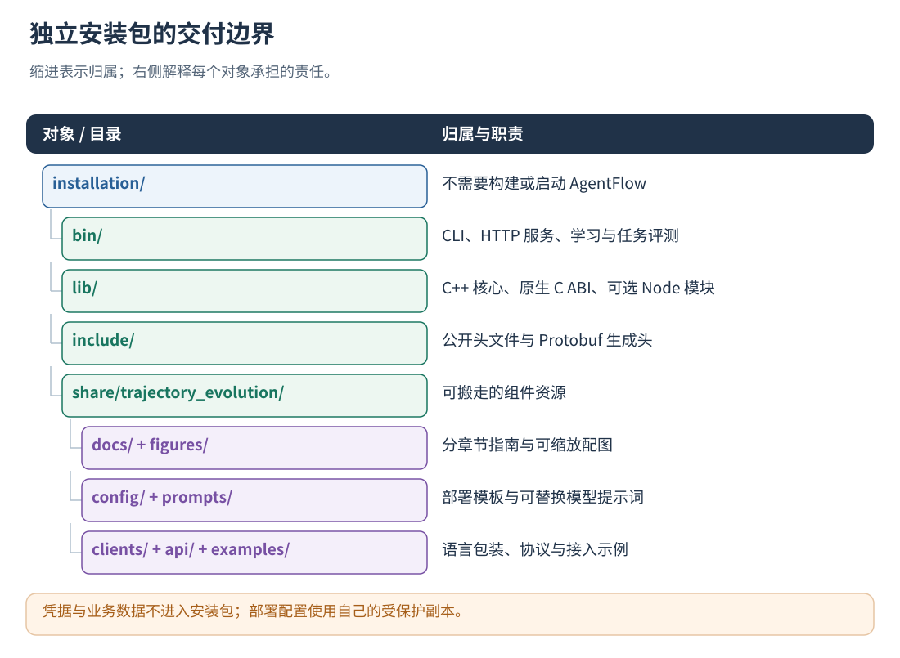
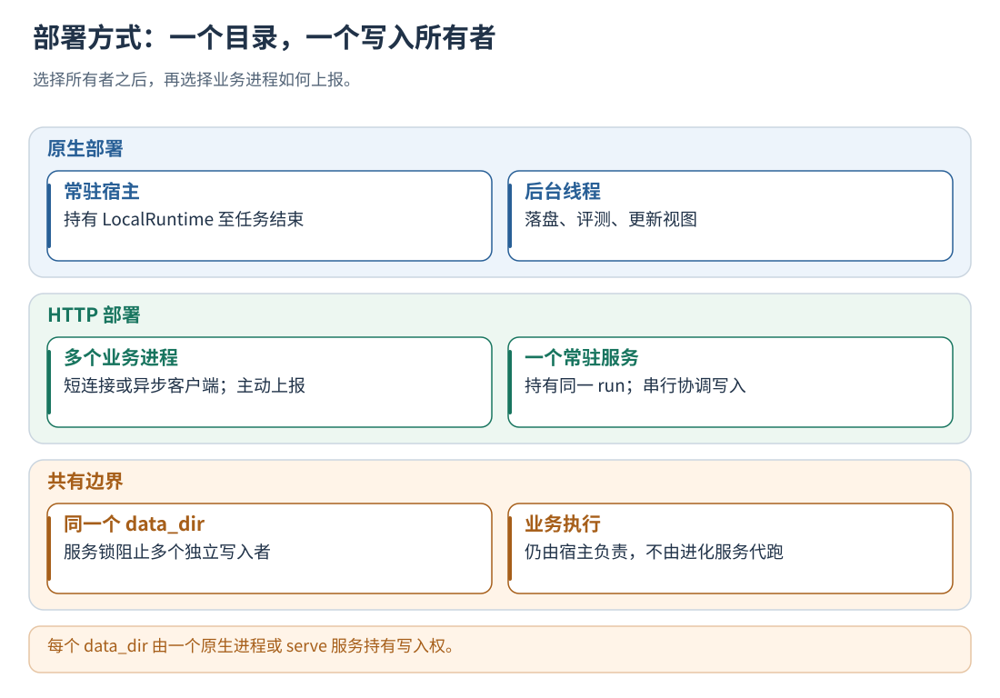

# 02 · 安装、构建与部署

[文档首页](README.md)

## 本章目标

独立构建或安装组件，准备模型之外的服务身份，选择正确的运行形态。

## 设计思路

核心可独立构建。原生库运行在宿主进程内，HTTP 服务独立常驻；每个 data_dir 由一个进程持有写入权。



读图：凭据与业务数据不进入安装包；部署配置使用自己的受保护副本。 [放大 SVG](figures/02-package.svg)。

## 构建或使用安装包

源码构建依赖 C++17、CMake、Protobuf/Protoc、libcurl、OpenSSL、Threads 和 RapidJSON。
以下命令在本仓库根目录执行；如果独立拿到组件源码，将 `-S` 改为组件目录即可，不需要构建整个 AgentFlow。

```sh
cmake -S tools/trajectory_evolution -B build/trajectory-evolution -DCMAKE_BUILD_TYPE=Release
cmake --build build/trajectory-evolution -j2
cmake --install build/trajectory-evolution --prefix "$PWD/build/evolution-install"
```

安装包包含 `bin/trajectory_evolution`、`lib/libtrajectory_evolution_local.so`，以及 `share/trajectory_evolution/` 下的本手册、算法说明、配置、客户端、
协议和示例。已有安装包可跳过构建；不需要启动 AgentFlow daemon、Bridge 或 DataBus。
原生库和服务端面向 Linux，当前隔离试验启动器需要 glibc 2.34 及以上的 spawn close-from 接口（例如 Ubuntu 22.04），
用于阻止试验继承服务锁和其他未授权描述符。Windows 等平台的客户端可通过 HTTP 连接服务。
构建环境可找到 Node N-API 开发头文件时，还会生成 `lib/trajectory_evolution_local_node.node`。
没有该文件时需安装对应 Node 开发头文件，重新配置和构建；Python/C ABI 不依赖 Node。
原生库与宿主进程需使用兼容的 C++ 运行库。出现 `GLIBCXX_* not found` 时，安装匹配的运行库、
启动宿主前配置动态库搜索路径，或使用部署环境的工具链重新构建。

下文使用源码仓库路径；安装包中的对应配置和客户端位于 `share/trajectory_evolution/`。
升级建议安装到新目录，覆盖旧目录不会自动删除旧版遗留文档。

Python 宿主在**执行 Agent 的同一 Python 环境**安装随包客户端（标准库实现，无运行时第三方依赖）：

```sh
python -m pip install ./tools/trajectory_evolution/clients/python
```

安装包用户将路径换为 `installation/share/trajectory_evolution/clients/python`。
SDK 包含 HTTP、原生、调用打点及配置入口；无须复制 Python 文件到宿主。
配置入口的具体用法见[统一打点](08-instrumentation.md#按配置直接使用-python-打点)。




读图：每个 data_dir 由一个原生进程或 serve 服务持有写入权。 [放大 SVG](figures/02-owners.svg)。

## 选择启动方式

服务接入令牌用于组件鉴权，至少 24 字符；与业务模型 API Key 分开配置，正式部署从秘密管理器或受保护环境文件加载。
本地演示可生成一次；默认配置的用户为 `user-a`，令牌变量为 `EVOLUTION_USER_A_TOKEN`：

本地原生方式只需准备令牌，然后按[原生入口、内存状态与低延迟](06-native-runtime.md)在应用启动时初始化一次；**不运行 serve，不需要端口或 EVOLUTION_URL**：

```sh
export EVOLUTION_USER_A_TOKEN="$(openssl rand -hex 24)"
export EVOLUTION_TOKEN="$EVOLUTION_USER_A_TOKEN"
```

如果选择 HTTP 方式，再单独运行：

```sh
export EVOLUTION_URL="http://127.0.0.1:8766"
./build/trajectory-evolution/trajectory_evolution serve --config /你的部署目录/config/boundary-service.json
```

看到 `listening=127.0.0.1:8766` 后保持服务运行，并为客户端加载相同的服务令牌。
安装包用户将命令中的程序路径换为安装的 `bin/trajectory_evolution`。
默认监听本机；跨机器访问通过 HTTPS 网关转发，并保护长期令牌。
启动实例前，确认目标 data_dir 的写入者已正确配置。
同一进程、同一个配置文件路径创建的多个用户原生客户端共享后台服务，不需要各起一个端口。

## 建议的部署目录

```text
deployment/
  config/                  从随包 config 完整复制，保留 prompts/
  evolution-data/          程序管理；应用用户不要直接修改
  secrets.env              部署方保护，不进入 Git、日志或公共目录
installation/
  bin/trajectory_evolution
  lib/
  include/
  share/trajectory_evolution/
    README.md
    docs/                  分章节手册与 figures/
    config/ clients/ api/ proto/ examples/ integrations/
```

命令中的仓库相对路径只是源码布局，不依赖某台远程服务器、SSH 别名或特定 Conda 环境。
安装包使用者按安装前缀替换路径。建议使用绝对配置路径与 data_dir，保持各进程的路径解析一致。

## 第一次启动的检查顺序

1. 确认 C++ 动态库、Protobuf 和模型传输依赖可加载，二进制 `--help` 能执行。
2. 完整复制配置目录；公共管理默认开启，因此三个公共提示词也应随部署交付。
3. 准备服务用户令牌；它与评测模型 Key 是不同凭据。
4. 选择原生或 HTTP 的唯一数据目录所有者，再接入业务进程。
5. 完成[快速开始](04-quickstart.md)，检查生成的轨迹与后台状态。

## 升级和停止

默认开关在服务/原生对象初始化时读取。升级二进制或改部署配置后，应先等待业务任务收尾，再停止并重启。
停止 HTTP 服务会断开其客户端；关闭原生对象会结束对应实例。切换写入者前正常关闭原进程并释放目录锁。

已有配置明确写了 `sharing.enabled=false` 的，升级后仍保持关闭。
旧配置没有 sharing 的，现在会启用公共管理；若根 memory 是旧的混合用户库，程序不会把它自动当作公共经验。
迁移步骤见[历史日志与兼容迁移](23-import-and-migration.md)，操作前保留原始日志。

## 实现定位

- `CMakeLists.txt`
- `cmake/TrajectoryEvolutionConfig.cmake.in`
- `clients/`
- `examples/standalone-consumer/`

---

[文档首页](README.md) · [上一章：概念、目标与整体架构](01-overview.md) · [下一章：配置、身份与热更新](03-configuration.md)
