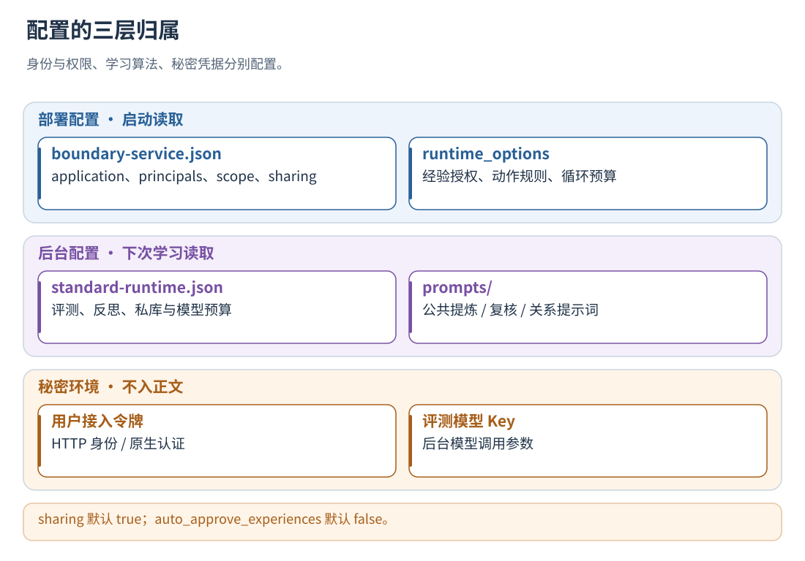
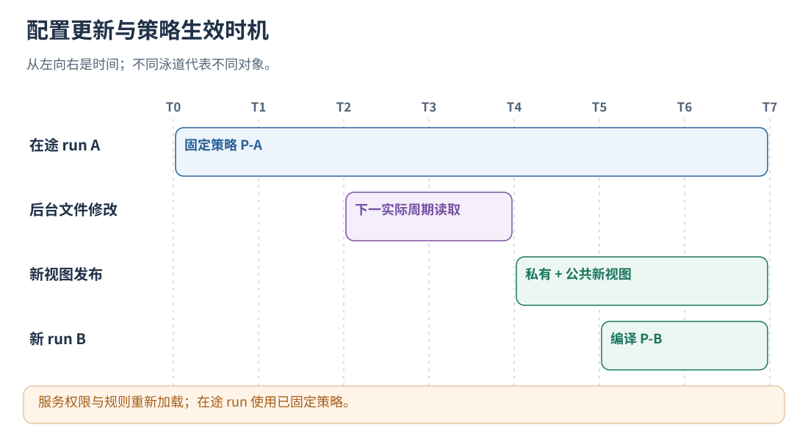

# 03 · 配置、身份与热更新

[文档首页](README.md)

## 本章目标

知道每个配置放在哪个文件、由谁读取、何时生效，避免模型和权限配置混用。

## 设计思路

service 配置控制应用身份与运行权限，runtime 配置控制后台评测，环境变量保存模型凭据。各项配置的加载时机见本章热更新表。



读图：sharing 默认 true；auto_approve_experiences 默认 false。 [放大 SVG](figures/03-config.svg)。

## 配置应用和用户

复制整个 [config](../config/) 到自己的部署目录，保留 `prompts/`，编辑 [boundary-service.json](../config/boundary-service.json)。
在部署副本中配置路径，凭据由环境变量或秘密管理器提供。

| 字段                         | 填什么                                                                        |
| ---------------------------- | ----------------------------------------------------------------------------- |
| `application_id`           | 应用/协作系统的稳定名称                                 |
| `data_dir`                 | 结果目录，建议绝对路径；相对路径按启动工作目录解析                            |
| `principals`               | 用户 ID 与对应服务接入令牌的环境变量名                                        |
| `max_level`                | 本部署允许的最高等级，模板为 L3                                               |
| `policy_scopes`            | 可选的经验/规则分区，默认`["default"]`                  |
| `activity_types`           | 可选自定义活动类型与输入约束，见[接口协议、身份和自定义字段](05-protocol.md)                                       |
| `auto_evaluate`            | 完整任务结束后自动评测与入库，模板为 true                                     |
| `auto_approve_experiences` | 是否授权自动应用通过筛选的经验，模板为 false；需要自动经验注入时明确设为 true |
| `runtime_config`           | 评测、模型和记忆配置，模板为同目录`standard-runtime.json`                   |
| `runtime_options`          | 动作规则、循环预算、注入上下文上限等                                          |
| `instrumentation`          | point 的默认 level、实际 capabilities、模型 binding 和可选 scope_id；可在单次打点覆盖 |
| `query_context`            | `max_task_bytes` / `max_state_bytes` 各默认 8192，范围 128–32768；只限制检索摘录 |
| `run_lease_ms`             | 无打点或心跳的 run 租约，默认 24 小时；超时回收采集状态并隔离，不取消业务 |
| `sharing`                  | 自动公共经验晋升、跨库检查、频率和淘汰限制，见[公共与私有协作：晋升、冲突、信任与淘汰](14-shared-memory.md)                       |

通常一个 `default` 分区就够；不同业务需要隔离经验/规则时再增加 scope。
执行者通过活动上的 `actor_id` 自由标记，不用在配置中逐个登记。
两个用户的 `principals` 示例，替换配置中的同名字段：

```json
[
  {"user_id":"alice","token_env":"EVOLUTION_ALICE_TOKEN"},
  {"user_id":"bob","token_env":"EVOLUTION_BOB_TOKEN"}
]
```

服务根据 Bearer 令牌确定用户，不信任请求自报 `user_id`。参与同一用户任务的服务进程使用该用户授权，
不同用户使用不同凭据。浏览器通过应用后端的身份网关访问组件，长期服务令牌保存在后端。

### 工具正常返回，但业务结果失败

`call/acall` 只知道原函数是否正常返回。若工具把失败放在返回的 JSON 里，可在 service 配置的
`instrumentation.action_outcomes` 声明映射，所有语言的 `point` 共用此处理，不需要增加宿主回调：

```json
{
  "instrumentation": {
    "action_outcomes": [
      {"pointer":"/status","equals":"security_policy_blocked","status":"failed",
       "error":{"code":"security_policy_blocked","retryability":"non_retryable"}},
      {"pointer":"/status","equals":"failed","status":"failed"},
      {"pointer":"/error","nonempty":true,"status":"failed",
       "error":{"code":"tool_error","retryability":"unknown"}}
    ]
  }
}
```

把该字段合入已有配置，保留 level、binding 等配置。规则只作用于 `kind=action` 或声明为 action
语义的活动，在 `after` 且 `executed=true` 时匹配；不影响模型、run、异常中断或被跳过的调用。
返回值可以是 JSON 对象，也可以是包含一层 JSON 的字符串；原始 output 和交还 Agent 的值不改写。

- 最多 32 条，按顺序取第一条匹配规则。`pointer` 是 RFC 6901 路径，最长 256 字节。
- `equals` 为精确匹配的 JSON 标量，或使用 `nonempty:true`，二者只能选一个。
  后者不匹配缺失值、null、false、0、空字符串、空数组和空对象。
- `status` 可为 completed、failed、cancelled、unknown；可选 `error` 只接受固定 code 和
  retryability（unknown、retryable、non_retryable），不从错误文本猜测是否能重试。
- 宿主显式提供 status 或 error 时优先使用宿主结果，不由映射覆盖。未配置、未命中或文本不是 JSON 时保持原行为。
- 映射只记录该动作结果，不改变业务控制流、并发兄弟分支和 Run 的 execution_status。
  将 `/error` 用作普通业务数据的工具应配置其实际状态字段，不启用示例中的通用 error 规则。

修改后重新加载采集服务配置，用于新实验；不要改写既有轨迹。是否可重试只有在宿主有明确依据时才填写，
例如文件暂时不存在并不天然等于永远不可重试。

### 模型调用以返回值报告错误

部分模型客户端遇到超时或供应商拒绝时返回错误对象，不抛异常。这种情况可单独配置
`instrumentation.model_outcomes`，沿用上面的规则格式、优先级和校验：

```json
{
  "instrumentation": {
    "model_outcomes": [
      {"pointer":"/error","nonempty":true,"status":"failed",
       "error":{"code":"model_error","retryability":"unknown"}}
    ]
  }
}
```

只有模型客户端确实用 `/error` 表示调用失败时才使用此示例；其他返回结构配置对应路径。
规则仅作用于 model 语义的活动（含通过 activity_types 声明的别名），不沿用 action_outcomes，
不改变原始返回值、Agent 的错误恢复方式、并发分支或 run 完成状态。没有上报 usage 时仍保持指标未知，
不会因失败而补写零 token。未配置 model_outcomes 时维持现有行为；宿主显式 status/error 优先。

## 可选：启用模型评测和元反思

### 可选：策略生效前先运行 Agent 任务评测

service 增加 `policy_evaluation_file`，指向 [agent-evaluation.json](../config/agent-evaluation.json) 的部署副本，
配置已审核的 dataset、真实 Agent 测试入口、判分标准及准入门槛。该配置启动独立后台评测，不改变业务模型的端点或密钥。
候选通过后供新 run 使用；无已发布版本时回到 L0。旧配置不新增此字段则保持原行为。
`evaluation_version_file` 仅给隔离评测实例使用，加载冻结版本并关闭自身学习，不能指向生产状态目录。
两项 service 配置启动时加载；修改任务集、评测宿主或评分配置后重启评测服务，重新建立评测上下文。
详细配置、状态查询和宿主接入见[第 19 章](19-datasets-and-benchmarks.md)。

### 模型连接

模板不配置评测模型，只运行规则。需要模型时，修改部署副本 `standard-runtime.json` 中的对应字段，保留其余设置：

```json
{
  "model": {
    "endpoint": "https://你的供应商/兼容接口/chat/completions",
    "model_id": "你的模型ID",
    "api_key_env": "EVOLUTION_EVALUATOR_API_KEY",
    "no_api_key": false,
    "timeout_ms": 1800000
  },
  "evaluation": {"model_selection": "all"},
  "evolution": {"enable_meta_reflection": true}
}
```

将以上字段合入完整配置。Key 从指定环境变量读取；启动前由部署流程加载 `.env` 或秘密管理器。
`endpoint` 是评测模型完整的 Chat Completions 兼容地址。评测模型和 Agent 的业务模型相互独立，
被观测 Agent 可以使用任意供应商及请求格式。
`model_selection=all` 纳入全部 Episode；`suspicious` 主要评估可疑 Episode；`none` 关闭此阶段模型评测。
仅设置 `none` 不会关闭另行启用的元反思或语义记忆整理。

`timeout_ms=1800000` 表示一次模型调用的 HTTP 阶段共用最多 30 分钟，包含连接、响应等待、传输重试及退避。
每次尝试按“剩余时间 / 剩余可尝试次数”分配响应等待，避免第一次卡住就耗尽重试机会。
例如允许重试一次时，首次最多约 15 分钟；后续尝试使用退避后的剩余时间，总计仍不超过 30 分钟。
`max_retries=0` 时一次请求可使用全部时间；`max_retries` 仍限制重试次数，短暂故障可在剩余预算内恢复。
`connect_timeout_ms` 限制单次连接等待，且仍受总预算约束。JSON/引用协议恢复是另一次有界模型调用，单独计入调用次数。
使用 `thinking_mode=disabled` 前，确认所选模型接口支持该参数。

支持 JSON 输出模式的模型可在 `model` 中设置 `"json_object_output": true`，
组件会发送 `response_format: {"type": "json_object"}`。省略或设为 `false` 时不发送该参数，
保持旧接口兼容；模型不支持时应关闭，不会自动切换服务地址。
此开关作用于使用该配置的评测、反思和 GEPA 请求，不改变主 Agent 的聊天输出。
JSON 模式只约束输出格式，不替代既有的结构、证据、隐私和业务校验，也不能避免输出预算耗尽。

支持 SSE 的兼容接口可另外启用：

```json
{"model": {"stream": true, "idle_timeout_ms": 60000}}
```

将这两个字段合入完整配置。`stream` 默认 `false`；`idle_timeout_ms` 默认 `0`（关闭），非零值要求开启 stream。
`idle_timeout_ms` 约束一次请求连续没有响应正文数据的等待时间，包含首个正文数据到达前的等待；
心跳数据也会重置该计时，它不判断模型是否产生了语义进展。到期可按已有重试预算恢复，仍受 timeout_ms 总上限约束。
正常持续输出可以超过 idle_timeout_ms；总超时、输出字节限制和模型调用预算仍然生效。
流必须完整闭合后才做评分和入库；缺失结束标记、错误帧、多选项或截断输出都不采纳。
供应商忽略 stream、返回正常 JSON 响应时仍可解析；明确不支持此参数的接口保持 stream=false。
普通与流式响应均拒绝协议对象中的重复字段；单候选响应若显式提供 index，必须为 0。
这些异常返回 invalid_api_response，不取冲突字段中的某一个值继续评分，也不进入 JSON 内容修复。
适配器内部复用连接，最多保留 8 个空闲句柄；并发调用各自持有独立句柄，不新增全局凭据或跨实例缓存。
这些选项只改变本组件的后台模型通信，不改变 Agent 的业务请求。

模型 Prompt、规则和预算都在 [config](../config/) 中，不需要重新编译。
服务规则修改需重启并用于新任务；评测配置用于下一次评测，正在执行的任务/批次不在中途换快照。




读图：服务权限与规则重新加载；在途 run 使用已固定策略。 [放大 SVG](figures/03-hot-reload.svg)。

## 不同配置的更新时机不同

| 变化 | 当前生效时机 | 不会发生什么 |
| --- | --- | --- |
| 本组件提交记忆 PB 更新 | 通知后台刷新缓存，新 Run 编译新快照 | 不替换正在运行的策略、不空闲反复读 PB |
| 手工经验授权版本 | 部署重新加载相应服务/客户端配置后，新 Run 生效 | 老版本授权不自动通配新 content_revision |
| 动作/循环规则、注入模板、服务身份配置 | 服务/客户端建立时读取，修改文件后需重新加载部署 | 由服务/客户端持有配置 |
| evaluator 的 runtime_config 和评测/反思/整理模板 | 后台开始下一次评测时重新加载 | 不回头改写已有 evaluation 或正在进行的请求 |
| 本地 set_enabled | 当前客户端内存开关生效 | 作用于当前客户端 |

已有 evaluation 文件存在时，后台会复用它。更换模型或提示词不会自动把所有历史轨迹重新评一遍。
重新评测使用对应评测入口；入库重试复用已生成的报告和候选。
外部离线修改记忆 PB 后需重启客户端加载；维护受管文件时先停止对应写入者。

## 关键默认值

以 [standard-runtime.json](../config/standard-runtime.json) 和 [boundary-service.json](../config/boundary-service.json) 为准：

| 参数 | 随包值 | 算法作用 |
| --- | --- | --- |
| learning.min_new_runs / max_batch_runs | 20 / 32 | 同用户新样本启动阈值 / 单批上限 |
| learning.max_wait_ms / min_interval_ms | 600000 / 60000 | 小批等待期限 / 批次间隔 |
| learning.max_batch_bytes / retry_backoff_ms | 33554432 / 60000 | 批次容量 / 存储故障退避 |
| min_supporting_dialogues / min_supporting_episodes | 2 / 2 | 达到 PROPOSED 的支持门槛 |
| enable_meta_reflection | false | 是否跨轨迹模型合并 |
| enable_memory_semantic_matching | true | 是否启用模型关系判断；需要可用模型 |
| max_memory_match_candidates | 8 | 记忆语义比较短名单大小 |
| min_memory_duplicate_confidence | 0.90 | 自动融合重复记忆门槛 |
| min_memory_relation_confidence | 0.75 | 相关/冲突关系门槛 |
| full_curation_new_entry_threshold | 20 | 累计新增记忆触发全库整理 |
| max_memory_entries / max_memory_bytes | 512 / 256 MiB | Pipeline SDK 上限；统一后台还受 run/快照读取上限约束 |
| shadow_options.max_memory_bytes | 16 MiB | 在线快照读取记忆的大小上限 |
| max_policy_entries / max_advice_items | 128 / 3 | 快照条数与单次建议条数 |
| min_matched_terms | 2 | 条件词面命中的最小数量 |
| runtime_options.max_context_bytes | 4096 | 增强上下文字节预算，非 token 数 |
| auto_approve_experiences | false | 默认不自动授予经验注入权限 |
| max_iterations / max_no_progress / max_replans | 12 / 3 / 1 | default scope 的模板循环约束 |
| model.timeout_ms / connect_timeout_ms | 30000 / 5000 | 后台模型调用与连接等待限制 |
| model.stream / idle_timeout_ms | false / 0 | 可选流式传输 / 连续无正文数据的超时；默认关闭 |
| model.sessionlog_max_output_tokens | 4096 | 当前内容感知后台采用的输出预算 |

配置中的通用 `model.max_output_tokens` 默认 800；服务的内容感知路径在没有入口显式覆盖时选用 sessionlog_max_output_tokens。
按各入口的配置表分别设置预算。
统一后台入库时将私人记忆字节上限收紧到 evolution.max_memory_bytes、max_run_bytes 和 shadow_options.max_memory_bytes 的最小值，
避免后台成功写出运行时却读不了的库。直接使用 Pipeline SDK 的调用方仍须自行协调读写预算；没有大库分页加载机制。

默认值可按业务负载调整。确定性公式、结构硬限制和部分规则文本属于代码实现，调整时同步更新测试。

## 公共＋私有的默认开关

| 配置 | 当前默认 | 作用 |
| --- | --- | --- |
| `sharing.enabled` | `true`，省略 sharing 或传空对象同样启用 | 启用公共提炼、支持计票、跨库关系、公共淘汰与公共快照输入 |
| `auto_evaluate` | 模板 `true` | 完整新轨迹自动进入后台学习 |
| `auto_approve_experiences` | `false` | 不自动授予经验运行时注入权限 |
| `evolution.enable_meta_reflection` | `false` | 是否启用批次元反思模型 |
| `evolution.enable_memory_semantic_matching` | `true` | 有模型和预算时执行私库语义关系判断 |
| 评测模型 | 模板为空 | 需部署方提供端点、模型和秘密环境变量 |

只要业务数据已经正确采集，私库的按用户入库一直存在；没有单独的“私库共享开关”。
关闭公共管理使用 `"sharing":{"enabled":false}`。这不删除既有公共文件，也不停止私人学习。
开启公共管理不绕过独立证据、隐私、scope、授权和长度限制。

同样，`evaluation.model_selection=none` 只控制相应评测阶段，并不关闭已配置的公共审查。
禁用所有模型调用时，同时检查模型配置、元反思、私库语义匹配和 sharing。

## 配置文件的相对路径规则

- service 的 runtime_config、experience_template_file：相对 service 配置文件所在目录。
- sharing 的三个 prompt_file：相对 runtime_config 所在目录；默认 `prompts/shared-*.txt` 等随包路径。
- data_dir：相对启动进程工作目录；正式部署建议绝对路径。
- 评测提示词由 runtime_config 的 prompts 配置解析，不从 Agent 的工作目录猜测。
- 业务模型端点不由进化服务替换；这里的 model 配置只用于后台评测、反思、整理等调用。

## 哪些修改会重新审查公共经验

管理周期会将 sharing 配置、三个提示词正文和评审器 name/model_id 组成签名。
签名变化时清除正向来源批准并重新排队，普通跨库关系重新检查，但不因更换评审器而删除已确认冲突。
签名检查覆盖显式模型配置和提示词内容；供应商以相同模型 ID 更新服务时，由部署方按需要安排重评。

公共提示词在管理周期开始时读取，修改后的内容随下一次周期生效。
数字型 sharing 配置和服务权限参数由启动配置持有，修改后重新加载部署；新配置只影响之后构造的策略。

## 实现定位

- `src/integration_service.cpp::Impl`
- `src/runtime_config.cpp`
- `config/boundary-service.json`
- `config/standard-runtime.json`

---

[文档首页](README.md) · [上一章：安装、构建与部署](02-installation.md) · [下一章：快速开始：完成第一条真实轨迹](04-quickstart.md)
