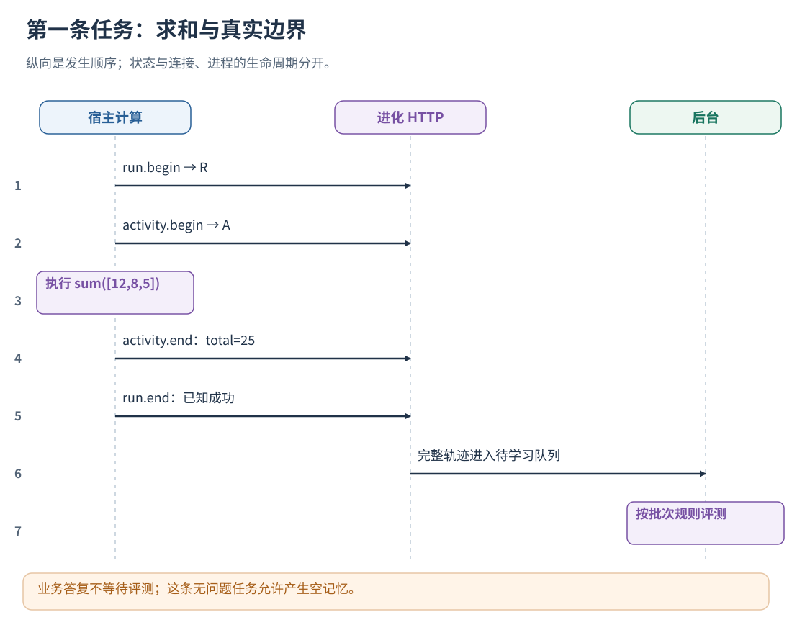
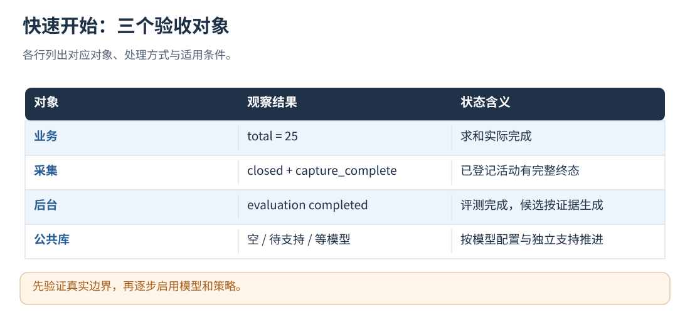

# 04 · 快速开始：完成第一条真实轨迹

[文档首页](README.md)

## 本章目标

从可复制命令开始，用无外部模型的计算任务验证采集、持久化和后台结果。

## 设计思路

从 L0 的计算任务开始，验证任务开始、活动记录、终态持久化和后台评测，再逐步接入模型与控制边界。




读图：业务答复不等待评测；这条无问题任务允许产生空记忆。 [放大 SVG](figures/04-first-run.svg)。

## 1. 准备文件与服务身份

以下命令在源码仓库根目录执行；独立安装包将二进制、config 和 clients 替换为安装包中的位置，
对应关系见[安装](02-installation.md)。不需要启动 AgentFlow、Bridge 或 Sandbox。

```sh
cmake -S tools/trajectory_evolution -B build/trajectory-evolution -DCMAKE_BUILD_TYPE=Release
cmake --build build/trajectory-evolution -j2
cp -R tools/trajectory_evolution/config build/evolution-demo-config
export EVOLUTION_USER_A_TOKEN="$(openssl rand -hex 24)"
export EVOLUTION_TOKEN="$EVOLUTION_USER_A_TOKEN"
export EVOLUTION_URL="http://127.0.0.1:8766"
```

首次部署时复制模板，后续维护已有配置。打开 build/evolution-demo-config/boundary-service.json：

- 将 data_dir 改成你准备使用的结果目录绝对路径。
- 为了这次演示尽快看到评测，将 learning.min_new_runs 改为 1、min_interval_ms 改为 0。
- 保留 runtime_config、全部 prompts 和 sharing.enabled=true。
- 保留 auto_approve_experiences=false、模型配置为空；本章不调用付费模型。

这两个批次参数只用于演示；生产默认按 20 条/最长等待 10 分钟的规则合批。




读图：先验证真实边界，再逐步启用模型和策略。 [放大 SVG](figures/04-results.svg)。

## 2. 启动服务

```sh
./build/trajectory-evolution/trajectory_evolution serve --config build/evolution-demo-config/boundary-service.json
```

保持服务终端运行。在另一个终端加载相同的服务令牌和 URL。
正式部署通过秘密管理器或受保护环境文件提供令牌。

本例通过 HTTP 展示服务如何持有任务状态；高频本地边界可使用[原生入口](06-native-runtime.md)。
原生接法见[原生入口](06-native-runtime.md)，它不运行 serve。

## 3. 执行一条真实、无外部依赖的任务

```sh
PYTHONPATH=tools/trajectory_evolution/clients/python python3 - <<'PY'
import json
import os
from evolution import Evolution

evo = Evolution(os.environ["EVOLUTION_URL"], os.environ["EVOLUTION_TOKEN"])
run = evo.point({
    "phase": "before", "kind": "run",
    "ref": {"run": "first-task"},
    "conversation_id": "first-conversation",
    "input": "计算三个项目的总数量：12、8、5。",
    "level": "L0",
}, timeout_ms=1000)
activity = evo.point({
    "phase": "before", "ref": {"run": "first-task", "key": "sum-1"}, "kind": "custom", "name": "sum_items",
    "input": {"items": [12, 8, 5]},
}, timeout_ms=1000)
result = {"total": sum([12, 8, 5])}
evo.point({
    "phase": "after", "kind": "custom", "ref": {"run": "first-task", "key": "sum-1"}, "output": result,
}, timeout_ms=1000)
closed = evo.point({
    "phase": "after", "kind": "run", "ref": {"run": "first-task"},
    "business_status": "succeeded", "output": result,
}, timeout_ms=1000)
print(json.dumps({"run_id": run["context"]["run_id"], "result": result, "closed": closed},
                 ensure_ascii=False, indent=2))
PY
```

这里的计算确实由宿主 Python 执行；进化服务只接收边界数据，不替你运行求和、模型或工具。
接入业务时，在成功、异常和取消回调中分别结束对应活动。
本例给首次部署检查显式设置 1 秒 HTTP 预算；生产 point 默认只尝试一次、预算 20 ms，
可以进一步调低，或用原生入口。若返回 degraded=true，业务结果仍有效，但该次采集不能参与学习。

## 4. 看结果，区分三个阶段

1. 业务输出 total=25：说明这段计算完成。
2. 任务 after 返回 closed=true、capture_complete=true：说明已登记边界正常收尾，HTTP 终态已持久化。
3. 后台 evaluation_status=completed：该轨迹的评测已完成；候选与公共经验按各自的证据门槛生成。

在配置的 data_dir/by-user/user-a/ 下查看 traces、evaluation、batches 和 memory。
简单求和任务可能得到空候选和空记忆；可使用包含重复调用等场景的任务继续验证候选生成。
公共库管理默认开启但没有模型/独立支持时保持空库或 waiting_for_model，私有规则评测不因此失效。

需要确认时通过客户端调用 `run.status`（带 run_id）或 `memory.status`（不带 run_id）。
后台状态查询用于验收和运维，业务答复按自身流程返回。

## 5. 下一步

- 要观察真实内部行为：接入[模型、动作和循环边界](08-instrumentation.md)。
- 要测试短进程/多 Worker：使用[异步生命周期方案](09-async-and-multi-agent.md)。
- 要用模型生成经验：配置[后台模型](03-configuration.md)，准备有完整证据的多条真实轨迹。
- 要自动使用经验：先理解[策略授权](15-policy-snapshots.md)，再显式开启 auto_approve_experiences。
- 评估性能变化：运行[任务基线评测](19-datasets-and-benchmarks.md)，比较原始版本与候选版本。

## 实现定位

- `clients/python/evolution.py`
- `src/integration_http.cpp`
- `src/boundary_runtime.cpp`
- `examples/standard-agent/`

---

[文档首页](README.md) · [上一章：配置、身份与热更新](03-configuration.md) · [下一章：接口协议、身份和自定义字段](05-protocol.md)
