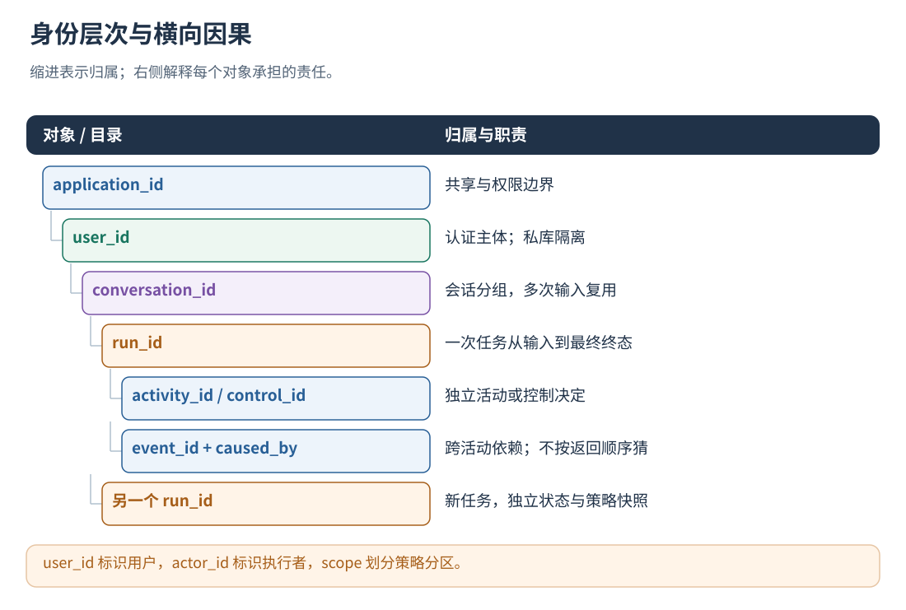
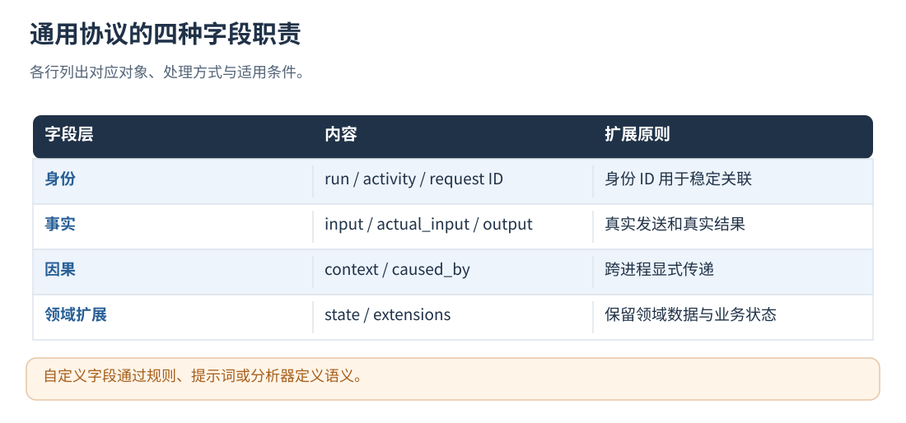

# 05 · 接口协议、身份和自定义字段

[文档首页](README.md)

## 本章目标

确定语言无关的 JSON 协议，以及哪些 ID 要创建、传递和持久化。

## 设计思路

协议区分应用、用户、会话、run、活动、控制和因果事件。接口字段约束业务含义，不将 AgentFlow 的 Skill 或 DataBus 类型写成所有宿主的必选结构。



读图：user_id 标识用户，actor_id 标识执行者，scope 划分策略分区。 [放大 SVG](figures/05-identity.svg)。




读图：自定义字段通过规则、提示词或分析器定义语义。 [放大 SVG](figures/05-contract.svg)。

## 接口和字段速查

所有操作带 `operation/request_id`；除 `run.begin/contract.describe` 外还需要 `run_id`。
同一次逻辑 RPC 使用稳定 request_id，超时重试复用相同 ID 和内容；业务副作用由宿主单独处理。
同一任务中的不同 RPC 使用不同 request_id。

| 操作                        | 必选业务字段                                                                           | 主要返回值                                              |
| --------------------------- | -------------------------------------------------------------------------------------- | ------------------------------------------------------- |
| `contract.describe`       | 无                                                                                     | 协议版本、活动类型、scope、上限                         |
| `run.begin`               | `input`                                                                              | run_id、level、capabilities、protocol                   |
| `activity.begin`          | `kind`、`name`、`input`                                                          | activity_id、input、decision、reason、event_id、context |
| `activity.end`            | `activity_id`、`status`、`output`；模型/动作另需 executed，模型另需 actual_input | ended、event_id                                         |
| `activity.abort`          | `activity_id`、`status`、`output`                                                | ended、event_id；标记采集不完整                         |
| `activity.status`         | `activity_id`                                                                        | 是否结束、状态、输出、结束 event_id                     |
| `loop.check`              | `loop_id`、`state`                                                                 | control_id、decision、context、iteration、event_id      |
| `loop.commit`             | `control_id`、实际 `decision`                                                      | ended、event_id                                         |
| `event.record`            | `type`、`data`                                                                     | event_id                                                |
| `run.end` / `run.abort` | `status`、`output`                                                                 | closed、capture_complete、evaluation_status             |
| `run.status`              | 无                                                                                     | 生命周期、评测状态、边界观测、回执统计                  |
| `capture.gap`             | `reason`                                                                             | capture_complete=false                                  |
| `evaluation.retry`        | 无                                                                                     | evaluation_status=pending；仅可重试已失败评测           |

`input/output/data` 可以是任意 JSON；没有内容时显式传 null，不省略必填字段。
`kind=model` 表示模型调用，`kind=action` 表示可放行/拒绝的动作，其他名称默认是 custom 观察活动。
L1 起模型活动提供 `binding`，结束时显式填写 `status`。

| 可选字段            | 含义与使用位置                                                                                 |
| ------------------- | ---------------------------------------------------------------------------------------------- |
| `conversation_id` | run.begin 的会话分组；非聊天任务省略时使用 run_id。同会话多次输入创建多个 run                  |
| `actor_id`        | activity.begin / loop.check 的执行者标签，可动态变化，不需预注册                               |
| `scope_id`        | activity.begin / loop.check 的策略分区，默认首个配置分区                 |
| `stream_id`       | activity.begin 的执行流归属；支持并行，因果关系由 context / caused_by 表达                                        |
| `control_id`      | activity.begin 关联哪个已回报的循环决定                                                        |
| `state`           | 模型/动作检索经验时的当前业务状态；loop.check 则为必填                                         |
| `binding`         | 模型输入中允许注入的 JSON Pointer 与模式                                                       |
| `caused_by`       | 已存在于本 run 的原因 event_id 数组；用于活动、循环检查和自定义事件等                          |
| `extensions`      | 自定义 JSON 对象，不覆盖系统身份/状态/回执                                                     |
| `error`           | activity.end 可给 code、retryability、message；retryability 为 unknown/retryable/non_retryable |
| `business_status` | run.end 的业务结果，默认为 unknown                                                             |

模型/动作活动未提供 `state` 或值为 null 时，组件默认从当前调用的 `input` 构造检索状态。
消息模式按 `binding.pointer` 取消息数组，排除 system/developer 消息，不把工具定义或已有系统经验当成观察结果；
其他输入形式使用当前 input。显式 state（包括空字符串、空对象、false）始终优先。
检索副本受 `query_context.max_state_bytes` 和 `shadow_options.max_query_bytes` 限制，保留首尾片段；
不裁剪实际模型请求或原始采集内容，不从其他调用/并发分支拼接状态。`apply_policy=false` 与 L0 不做此检索。
这不是模型摘要，也不会增加模型调用；loop.check 的 state 仍由原有循环打点提供。

完整逐字段约束以 [新协议 Schema](../api/boundary-v1.schema.json)、[全部请求 Schema](../api/invoke-v1.schema.json)
和 [OpenAPI](../api/openapi.json) 为准。生命周期、权限、隐私和条件必填由服务进一步校验。
run.begin 可传 `contract_version=1`；未知版本明确拒绝，不静默降级。

## 扩展自定义数据与活动

自定义数据放 input/output/data 或 extensions；控制字段拼错、缺失会报错，不会被默默当成扩展。
例如在 boundary-service.json 中设置 activity_types，替换或合并对应字段：

```json
{
  "company.llm":{"semantic":"model","required_input_paths":["/payload/instructions"]},
  "inventory.lookup":{"semantic":"action","required_input_paths":["/query"]},
  "human.review":{"semantic":"custom","required_input_paths":["/document_id"]}
}
```

调用时 kind=company.llm 就使用模型语义，仍走相同 begin/end/binding。缺少要求的输入路径会拒收。
未配置的新名称默认是 custom，不自动获得动作拦截权限。required_input_paths 仅校验存在性，
业务字段的完整类型/范围校验仍在宿主入口完成。新增这些名称或数据字段不需要重编译组件。

状态、指标或反馈可以独立记录：

```python
rpc("event.record", {
    "run_id": run_id, "type": "quality.feedback",
    "data": {"score": 0.9, "comment": "用户确认结果可用"},
    "extensions": {"domain": "inventory"},
})
```

扩展内容进入轨迹和受限的模型评测内容，但规则不会自动理解任意新字段；可在外置 Prompt 中说明领域含义。
自定义事件保存业务补充信息；activity.end 负责活动收尾，advice.applied 由系统核验生成。扩展字段同样经过隐私检查。

需要将自定义结果关联到具体执行轮次时，`event.record` 可选传同一 Run 的 `control_id`；
关联到具体活动时传 `activity_id`，两者不能同时传。组件继承所选上下文的执行流、轮次和执行者，
不按事件到达时间猜测它属于哪个并行分支。未指定关联时，事件保持 Run 级观察，不生成额外轮次。
使用 `phase: "event"` 的打点接口时无需另行填写这些 ID：组件优先沿用打点上下文中的活动，
没有活动时沿用循环上下文。该打点只记录结果，不启动操作、不应用策略、不代替活动收尾。

## 身份、作用域与执行流

通用身份包含应用、用户、会话和运行。配置使用 `application_id`；当前 Protobuf 内部仍将应用身份写在 `Identity.agent_id`。
字段映射在组件内部完成，接入方使用统一协议。

- `user_id`：由服务令牌鉴权确定。
- `conversation_id`：由宿主创建，并在同一会话的多次 run 间复用。
- `actor_id`：这项活动实际由谁执行，例如 planner、worker-7。
- `scope_id`：经验与规则的授权分区，例如 default、image。执行者使用 actor_id 标识。
- `stream_id`：一次逻辑执行流，内部映射到 `execution_id`。
- `loop_id`：具体循环；同一个 Run 内可以有多个互不相干的循环。

内部作用域按 `agent:<编码后的应用>/actor:<编码后的 scope>` 组织。
该内部路径中的 actor 表示授权分区；执行者身份通过 actor_id 单独记录。
否则每次 Worker ID 改变都会造成经验无法复用，或误把同一分区的多个执行者当作不同策略域。

## 实现定位

- `api/openapi.json`
- `api/boundary-v1.schema.json`
- `src/runtime/boundary_runtime.cpp::describe_boundary_contract`
- `src/service/integration_json.h`

---

[文档首页](README.md) · [上一章：快速开始：完成第一条真实轨迹](04-quickstart.md) · [下一章：原生入口、内存状态与低延迟](06-native-runtime.md)
