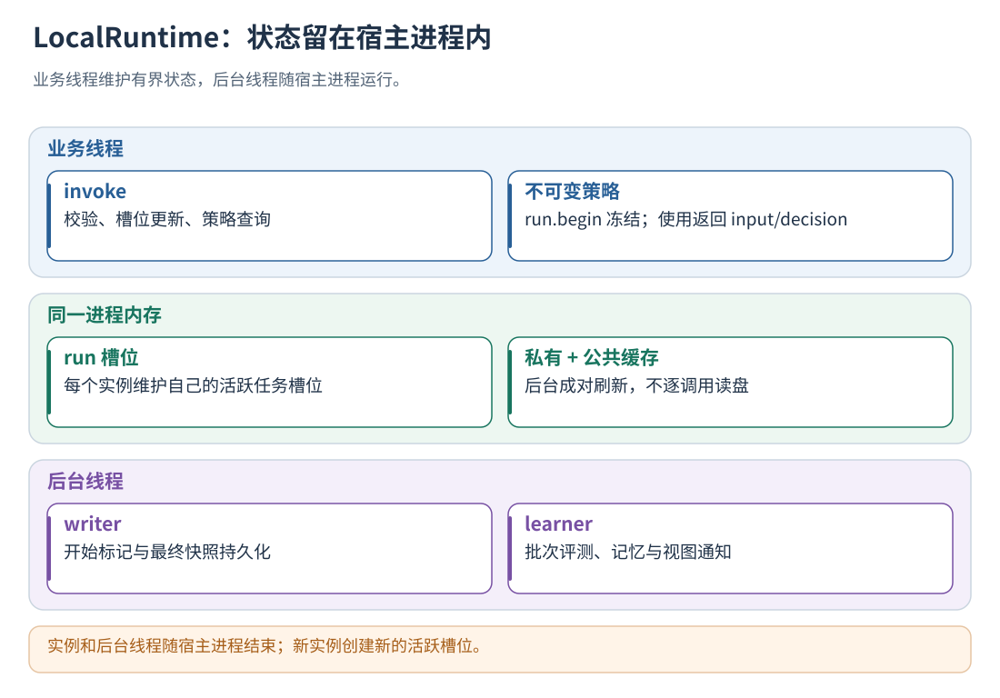

# 06 · 原生入口、内存状态与低延迟

[文档首页](README.md)

后台版本评测的状态、重试与取消使用独立管理入口：Python `evo.manage(operation, fields)`、
C++ `LocalRuntime::manage(JSON)`，或任意支持 FFI 的语言调用 `te_local_manage`。
管理调用可能等待锁及文件落盘，安排在管理线程；模型/动作/循环边界继续使用无外部 I/O 的 invoke。
启用方法与完整命令见[任务评测](19-datasets-and-benchmarks.md)。

## 本章目标

原生 point 默认允许同一 run 的并发临界区竞争最多 1000 微秒，避免短暂重叠直接丢失分支记录。
`contention_budget_us` 可设为 0–10000；0 使用立即降级。超过预算仍返回 degraded，不等待后台 I/O 或模型。
此项是每个临界区的等待上限，不是整个函数耗时承诺；请求大小仍受原生字节预算约束。

把原生库放进能够覆盖任务全生命周期的宿主，理解后台线程和故障降级。

## 设计思路

原生 run 由创建它的 LocalRuntime 实例持有。业务边界执行有界内存操作，后台负责持久化和学习；容量不足或锁竞争时通过降级状态返回。



读图：实例和后台线程随宿主进程结束；新实例创建新的活跃槽位。 [放大 SVG](figures/06-native.svg)。

## 本地原生入口

原生入口使用[统一协议](05-protocol.md)的 run/activity/loop 接口。在应用启动时初始化客户端，
在业务请求处理期间复用实例，所有请求停止后关闭。

Python 使用标准库 ctypes，复制 [evolution_local.py](../clients/python/evolution_local.py) 到自己的模块目录：

```python
import os
from evolution_local import LocalEvolution

evo = LocalEvolution(
    library="/安装前缀/lib/libtrajectory_evolution_local.so",
    config="/部署目录/config/boundary-service.json",
    token=os.environ["EVOLUTION_TOKEN"],
    max_pending_runs=64,
    max_request_bytes=65536,
    max_buffer_bytes=67108864,
)
rpc = evo.invoke  # 仍在真实任务、模型、动作和循环边界调用，不需要 HTTP
```

JavaScript/TypeScript 使用 [evolution-local.mjs](../clients/javascript/evolution-local.mjs) 和相邻类型声明：

```javascript
import { LocalEvolution } from "./evolution-local.mjs";

const evo = new LocalEvolution({
  library: "/安装前缀/lib/trajectory_evolution_local_node.node",
  config: "/部署目录/config/boundary-service.json",
  token: process.env.EVOLUTION_TOKEN,
});
const rpc = (operation, fields) => evo.invoke(operation, fields);
// rpc 是同步内存调用，不是 Promise；业务模型/工具仍可独立 await。
```

应用正常停止时调用 `evo.close()`。Python fork 后在子进程重新初始化，
为不同写入进程配置独立数据目录；跨进程协作传递协议上下文。

其他通用语言通过 `include/trajectory_evolution/local_c.h` 的 C ABI 调用，不需要实现评测器：

| 接口                                                    | 放在哪里/约定                                                  |
| ------------------------------------------------------- | -------------------------------------------------------------- |
| `te_local_open(config, bearer, options_json, &error)` | 应用启动一次，取得不透明句柄；失败返回 NULL 和固定错误码       |
| `te_local_invoke(handle, request, byte_length)`       | 真实业务边界，UTF-8 JSON；包含 operation/request_id 和业务字段 |
| `te_local_metrics(handle)`                            | 运维采样，读取内存计数，不写磁盘                               |
| `te_local_set_enabled(handle, 0/1)`                   | 暂停/恢复此客户端的进化增强，不取消宿主任务                    |
| `te_local_free(result)`                               | 由此接口统一释放 ABI 返回字符串                                |
| `te_local_close(handle)`                              | 停止所有调用方后，在应用关闭阶段排空并退出                     |

C/C++ 直接链接 `trajectory_evolution_local`；Rust 用 `extern "C"`，Go 用 cgo，Java 用 FFM/JNA，
C# 使用 P/Invoke，其他语言使用各自的 FFI。长度参数按 UTF-8 **字节数**传递。
Rust、Go、Java、C# 可通过各自的 FFI 调用 C ABI，也可使用随包 HTTP 客户端连接服务。
C++ 也可以直接使用 `include/trajectory_evolution/local_runtime.h`，链接 `TrajectoryEvolution::core`。

原生 JSON 返回 `{"ok":true,"result":{...}}`；Python/JS 包装返回内部 result。
调用后同时检查 ok 和 degraded。C ABI 返回 NULL 或 ok=false 时撤掉该次进化增强，
按原输入、原调度和原循环限制继续，保留宿主安全检查，并按执行情况记录回执。
初始化失败时，宿主可禁用组件后继续启动，并记录采集未启用状态。

本地限制可以在构造参数中调整，不需要重新编译：

| 参数              | 默认值 | 含义                                                           |
| ----------------- | ------ | -------------------------------------------------------------- |
| max_request_bytes | 64 KiB | 单次边界 JSON 上限，最大 1 MiB；Python/JS 还会保守预估编码大小 |
| max_pending_runs  | 64     | 活跃或尚未持久化的任务槽位上限，最大 1024                      |
| max_buffer_bytes  | 64 MiB | 内存状态保留预算，最大 1 GiB；用于状态内存的保守预留           |
| poll_interval_ms  | 20     | 后台落盘轮询间隔，范围 1–1000 毫秒                            |
| background        | true   | 自动后台落盘/学习；false 仅用于显式维护和测试                  |

容量、竞争、隐私拒收或内部失败时，返回 `degraded=true/capture_complete=false/policy_applied=false`。
降级时保留原始 input、宿主动作用法和循环限制，继续执行原 Agent 的权限与安全检查。
所属轨迹有缺口即 quarantine，不拿缺失样本做正常学习。run.begin 就失败的情况可能没有运行文件，
通过 `metrics()` 的 degraded_calls 和后台状态文件定位该次采集失败。
原生回退不会自动重试，也不会重执行业务副作用。
`contract.describe` 会返回本地实际支持的操作与请求上限。`evaluation.retry` 是 HTTP 后台管理操作，
不通过本地 invoke 执行；失败轨迹可用[导入历史日志、SDK 与兼容迁移](23-import-and-migration.md)离线重评，或在停止原生进程后切到 HTTP 管理模式重试。

原生 run.end 返回 `persisted=false` 时，终态已进入本地内存，等待后台持久化。
`drain()` 与 `close()` 用于维护和关闭阶段；后台评测独立于业务答复执行。
进程退出可能等待正在进行的评测超时。SIGKILL/掉电可能丢失尚未落盘的尾部；已有开始标记会在重启后隔离，
没有持久化开始标记的任务按采集缺口处理。

**本地所有权与并发：** 同一客户端内的不同 run 可以并发；同一 run 的多个逻辑活动可以重叠、逆序结束。
若多个线程在同一时刻调用同一 run 的可变接口，当前实现 try-lock 失败即显式降级，不等待其他线程。
需要无损采集时，在宿主已有调度事件循环/完成回调中串行提交这些短记录，业务工具本身仍并行；
也可选择 HTTP 共享状态模式，并按业务并发量验证时延与吞吐。
活跃 run 通过创建它的原生实例访问；跨实例协作使用 HTTP 服务。
原生幂等缓存只保留到槽位被新任务复用，不支持进程退出后的 RPC 重放；每个新任务必须使用新 request_id。
终态落盘不会清除回调回执；相同请求仍返回原结果，内容变更仍报冲突。
回执计入 `max_buffer_bytes` 的保守预留，新任务回收已落盘槽位时释放；主线程不为重试读取磁盘。
长期审计读取后台持久化结果。跨进程续写方式见[异步、并发、消息队列与任务收尾](09-async-and-multi-agent.md)。


读图：开始快照标记任务，终态发布完整记录；异常退出保留已落盘内容。 [放大 SVG](figures/06-native-lifetime.svg)。

## 本地低延迟采集的实际边界

`src/local_runtime.cpp` 将业务边界和后台工作分开：

1. 应用启动时建立长生命周期客户端，加载配置、鉴权和初始记忆；这些步骤可以有 I/O。
2. `run.begin` 从内存记忆编译并固定本次策略；活动与循环边界只进行有界内存处理。
3. writer 后台保存开始标记和结束后的完整状态；learner 按批次条件评测、整理记忆，只有记忆版本变化才刷新内存快照。
4. `run.end` 返回 `persisted=false` 时，终态已进入内存并等待后台写盘。

默认单请求 64 KiB、64 个任务槽位、64 MiB 状态内存预留预算。部署时同时监控进程 RSS 和调用时延。
资源不足、同一 Run 真正同时争锁、隐私拒收、内部故障或暂停切换时，客户端会显式降级。
受影响轨迹进入 quarantine，不作为正常学习样本。
降级只撤掉进化增强，宿主原有权限检查、重试上限和业务安全约束必须继续执行。

同一 run 的短记录由宿主调度器依次提交，业务工具可继续并行执行。
跨进程共同维护 run 使用 HTTP 服务；请求耗时包含通信、锁和持久化。
进程崩溃可能丢失尚未落盘的尾部；恢复范围以已持久化数据为准，已有开始标记的未完成运行转为隔离记录。

## 实例与后台线程的生命周期

LocalRuntime 的 writer 和 learner 是宿主内线程。应用级长生命周期实例可以在异步函数返回后继续工作；
进程退出时对应内存槽释放。新进程创建自己的实例和 run。

| 事件                              | 实际处理                                       |
| --------------------------------- | ---------------------------------------------- |
| 同一对象内异步回调到达            | 继续按 run/activity ID 更新状态                |
| fork 后复用父对象                 | PID 检查拒绝，返回降级；应在正确进程初始化     |
| 另一个对象接续旧 run              | run_not_local；活跃槽位归属于创建它的实例      |
| 主动 close/析构且仍有活跃 run     | 标记 producer_shutdown，尽力落不完整终态并隔离 |
| SIGKILL/崩溃或未调用 close 就退出 | 保留已落盘内容；内存尾部可能丢失               |
| 重启发现开始快照无终态            | producer_interrupted，隔离而非猜测任务成功     |

活跃阶段 writer 保存固定的开始快照，完整活动内容在最终关闭后发布。
因此 run.end 的 persisted=false 只是进入内存关闭态。关闭时还可能等待已开始的评测调用；
LocalRuntime 实例应覆盖所管理任务的整个生命周期。

## 共享库缓存怎样更新

同进程、同配置路径的原生对象可以共享 IntegrationService 后台，但对象各自持有自己的 run 槽位。
后台提交私库/公共投影后变更用户视图版本，learner 成对载入“私有＋公共”并替换不可变内存视图。
新的 run.begin 基于当时视图编译；旧 run 保留原策略。文件被外部手工修改不会自动发出这个通知。

## 实现定位

- `include/trajectory_evolution/local_c.h`
- `include/trajectory_evolution/local_runtime.h`
- `src/local_c.cpp`
- `src/local_runtime.cpp`
- `clients/python/evolution_local.py`
- `clients/javascript/evolution-local.mjs`

---

[文档首页](README.md) · [上一章：接口协议、身份和自定义字段](05-protocol.md) · [下一章：HTTP 服务与跨语言客户端](07-http-and-clients.md)
