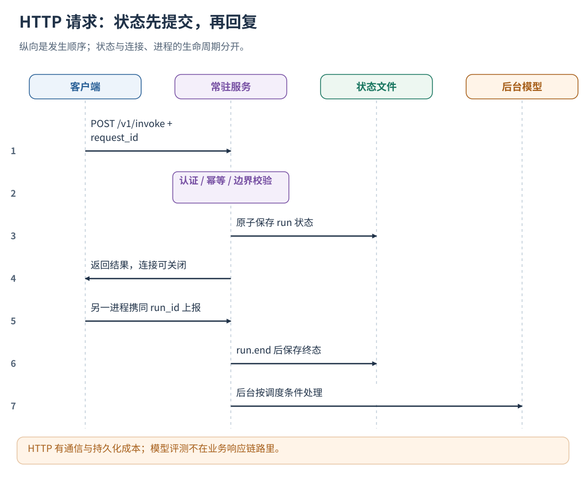
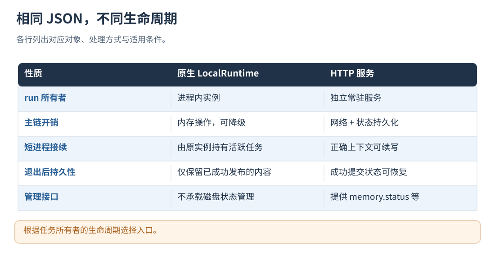

# 07 · HTTP 服务与跨语言客户端

[文档首页](README.md)

配置 `policy_evaluation_file` 后，`/v1/invoke` 还提供 `agent_evaluation.status/feedback/submit/retry/cancel` 管理操作。
这些操作不需要 run_id，按服务令牌限制到当前用户；submit 只提交冻结 artifact，执行命令与评测配置由部署方控制。
不要在业务模型或工具调用前同步等待评测结果，使用[后台任务评测](19-datasets-and-benchmarks.md)完成版本准入。

## 本章目标

通过一个常驻服务持有 run，让不同进程与语言调用相同的接口。

## 设计思路

客户端通过 HTTP 主动上报边界，服务持有 run 状态，任务由 run.end 或 run.abort 收尾。后台学习独立调度；请求耗时包含通信、鉴权和持久化。



读图：HTTP 有通信与持久化成本；模型评测不在业务响应链路里。 [放大 SVG](figures/07-http.svg)。

## HTTP 方式：跨进程共享同一 run

支持 UTF-8 JSON 和 HTTP 的语言均可接入；随包客户端提供常用语言封装。
新接入优先使用 **`point`**；`invoke` 保留低层严格 RPC。

| 语言 | 简化打点调用 | 通信预算 |
| --- | --- | --- |
| Python | `client.point(fields, timeout_ms=20)` | 单次，不重试 |
| JS / TS | `await client.point(fields, 20)` | 单次，不重试 |
| Rust | `client.point(fields).await`；可用 `point_with_timeout` | 默认 20 ms |
| Go | `client.Point(ctx, fields, 20*time.Millisecond)` | 尊重调用者取消与总预算 |
| Java | `client.point(fields)`；可传第二个 budgetMs 参数 | 默认 20 ms |
| C# | `await client.PointAsync(fields, budgetMs:20)` | 尊重取消与总预算 |
| C/C++ 或其他 C ABI 语言 | `te_remote_point(origin,token,json,length,20)` | 返回 UTF-8 JSON；用 `te_local_free` 释放 |

point 的 fields 使用[统一打点教程](08-instrumentation.md#统一打点推荐入口)中的同一结构。
预算范围 1–5000 ms，按本地通信延迟选择；它不控制 Agent 模型调用的 timeout。
失败返回原始 input、allow/continue、degraded context；继续传递 context，缺口进入隔离流程。
`invoke` 的原有严格错误、重试与超时配置保持不变，适合管理操作或需要明确错误处理的调用方。
这是通信预算，线程调度、初始化和 JSON 编解码还有本地开销；客户端应在启动时创建并复用。

| 语言     | 使用哪些文件                                                                                            | 返回值                     |
| -------- | ------------------------------------------------------------------------------------------------------- | -------------------------- |
| Python   | [evolution.py](../clients/python/evolution.py)，仅标准库，无需 requests                                  | 已拆开 result 的 dict      |
| JS / TS  | [evolution.mjs](../clients/javascript/evolution.mjs) / [evolution.ts](../clients/typescript/evolution.ts) | Promise，内容为 result     |
| Rust     | [Cargo 包](../clients/rust/)                                                                             | serde_json::Value          |
| Go       | [evolution.go](../clients/go/evolution.go)，放入自己的包                                                 | map[string]any             |
| Java     | [Evolution.java](../clients/java/Evolution.java)，依赖见 [pom.xml](../clients/java/pom.xml)               | JsonNode                   |
| C#       | [客户端项目](../clients/csharp/)                                                                         | JsonObject                 |
| C / C++  | [C 传输](../clients/c/) / [C++ 包装](../clients/cpp/evolution.hpp)，链接 libcurl                          | 包含 ok/result 的原始 JSON |
| 其他语言 | 自己的 HTTP/JSON 库，或依据[OpenAPI](../api/openapi.json) 生成客户端                                     | 同一协议                   |

## Python

把客户端模块加入自己的项目，应用启动时初始化一次：

```python
import os
from evolution import Evolution

evo = Evolution(os.environ["EVOLUTION_URL"], os.environ["EVOLUTION_TOKEN"], timeout_ms=7000)
rpc = evo.invoke
```

该客户端使用同步网络传输；异步程序可使用 I/O 线程池或异步 HTTP 客户端，
模型发送前仍需等待策略响应；要求本地低延迟时使用[原生入口、内存状态与低延迟](06-native-runtime.md)。

## JavaScript / TypeScript

```javascript
import { Evolution } from "./evolution.mjs"; // TS 工程使用 evolution.ts
const evo = new Evolution({url: process.env.EVOLUTION_URL, token: process.env.EVOLUTION_TOKEN});
const rpc = (operation, fields) => evo.invoke(operation, fields);
const run = await rpc("run.begin", {input: "任务内容", level: "L0"});
```

## Rust

将 [clients/rust](../clients/rust/) 作为本地 Cargo path 依赖；在已有异步执行环境中调用：

```rust
use std::time::Duration;
use serde_json::json;
use trajectory_evolution_client::Evolution;

let evo = Evolution::new(&std::env::var("EVOLUTION_URL")?,
    &std::env::var("EVOLUTION_TOKEN")?, Duration::from_secs(7))?;
let run = evo.invoke("run.begin", json!({"input":"任务内容","level":"L0"})).await?;
```

自定义幂等 ID 时使用 `invoke_id`；异步宿主在各自的事件回调或工作线程中提交请求。



读图：根据任务所有者的生命周期选择入口。 [放大 SVG](figures/07-transports.svg)。

## Go

将客户端放入自己的 `evolution` 包，并在现有函数中调用：

```go
evo, err := evolution.New(os.Getenv("EVOLUTION_URL"), os.Getenv("EVOLUTION_TOKEN"),
    evolution.Options{Timeout: 7 * time.Second, Retries: 1})
if err != nil { return err }
defer evo.Close() // 应用退出时关闭，不是每个动作创建/销毁一次
run, err := evo.Invoke(ctx, "run.begin", map[string]any{"input": "任务内容", "level": "L0"}, "")
if err != nil { return err }
```

最后的空字符串表示自动生成 request_id；恢复不确定请求时传原 ID。

## Java / C#

```java
var evo = new Evolution(System.getenv("EVOLUTION_URL"), System.getenv("EVOLUTION_TOKEN"), 7000, 2097152, 1);
var json = new com.fasterxml.jackson.databind.ObjectMapper();
var run = evo.invoke("run.begin", json.createObjectNode().put("input", "任务内容").put("level", "L0"));
```

```csharp
using TrajectoryEvolution;
using System.Text.Json.Nodes;
using var evo = new Evolution(Environment.GetEnvironmentVariable("EVOLUTION_URL")!,
    Environment.GetEnvironmentVariable("EVOLUTION_TOKEN")!);
var run = await evo.InvokeAsync("run.begin", new JsonObject { ["input"] = "任务内容", ["level"] = "L0" });
```

C# 的 JsonNode 只能有一个父对象，将 `prepared["input"]` 加入另一请求前使用 `DeepClone()`。

## C / C++ 与其他语言

C/C++ 在创建线程前调用 `te_initialize()`，应用结束、全部相关线程退出后调用 `te_cleanup()`。
C 使用 `te_invoke()`，返回缓冲区用 `te_free()` 释放；C++ 使用 `trajectory_evolution_http::Client::invoke()`。
这两个入口接收包含 operation/request_id 的完整 JSON，由宿主的 JSON 库构造。
只需编译 C 传输并链接 libcurl，无需链接整个评测库。

所有语言最终发送相同请求：

```http
POST /v1/invoke
Authorization: Bearer <服务接入令牌>
Content-Type: application/json

{"operation":"run.begin","request_id":"new-task-001","input":"任务内容","level":"L0"}
```

成功返回 `{"ok":true,"result":{...}}`，失败返回固定错误码 `{"ok":false,"error":"..."}`。
使用 HTTP/1.1 Content-Length，不发送 chunked 请求体；Key 放在认证层，不放 JSON 或 URL。
其他语言可直接调用该接口；使用生成客户端时，按快速开始和协议用例验证请求与响应。

## 从一次请求到持久化

1. 客户端构造 operation/request_id/业务字段，令牌仅放认证头。
2. listener 接收连接；有界 worker 解析 Content-Length 和 UTF-8 JSON。
3. IntegrationService 验证令牌所属用户、参数与幂等记录。
4. 按 run_id 装载状态，执行边界操作，生成事件/策略返回值。
5. 持久化状态后响应；评测由后台调度，不在此次请求里调用评测模型。

当前 Python 包装每次调用建立并关闭连接；不需要保持长连接来保住 run。
timeout_ms 控制单次 RPC 的等待时间。若响应超时但操作已提交，
需要以同一 request_id 和完全相同的请求重试；新 request_id 会被视作新操作。

## 重启、并发与结束条件

服务从 runs 目录重新装载已保存状态；未关闭的 HTTP run 不会因为原客户端退出自动结束。
一个 data_dir 由一个服务持有写锁，workers 配置该服务内部的请求处理线程数。
后续事件必须提供相同 run、正确用户和有效因果 ID；结束之后的普通写入会被拒绝。

run.end 核对已登记活动和控制回执；队列任务、进程异常与超时由宿主监督者登记并上报。
没有通用 TTL、租约或 Worker 死亡检测替宿主收尾；长期悬挂会占用活跃容量。

原生 invoke 不支持 memory.status 等磁盘管理操作；HTTP 是共享状态与管理入口，
原生实例与 HTTP 服务分别持有状态，按单写入者要求配置数据目录。

## 安全与跨机器

当前监听固定本机回环地址。跨机器访问由部署方的 HTTPS 网关或安全转发负责认证与暴露范围。
浏览器不直接保存长期服务令牌；多用户网关按真实登录身份选择对应授权。
HTTP 服务不会替你安装系统服务或自动拉起 Agent，部署方负责进程常驻、重启和监控。

## 实现定位

- `src/integration_http.cpp::run_integration_server`
- `src/integration_service.cpp::call`
- `clients/python/evolution.py`
- `clients/typescript/`
- `clients/rust/`
- `clients/go/`
- `clients/java/`
- `clients/csharp/`
- `clients/c/`
- `clients/cpp/`

---

[文档首页](README.md) · [上一章：原生入口、内存状态与低延迟](06-native-runtime.md) · [下一章：接入位置：同步、ReAct 与多层 Agent](08-instrumentation.md)
