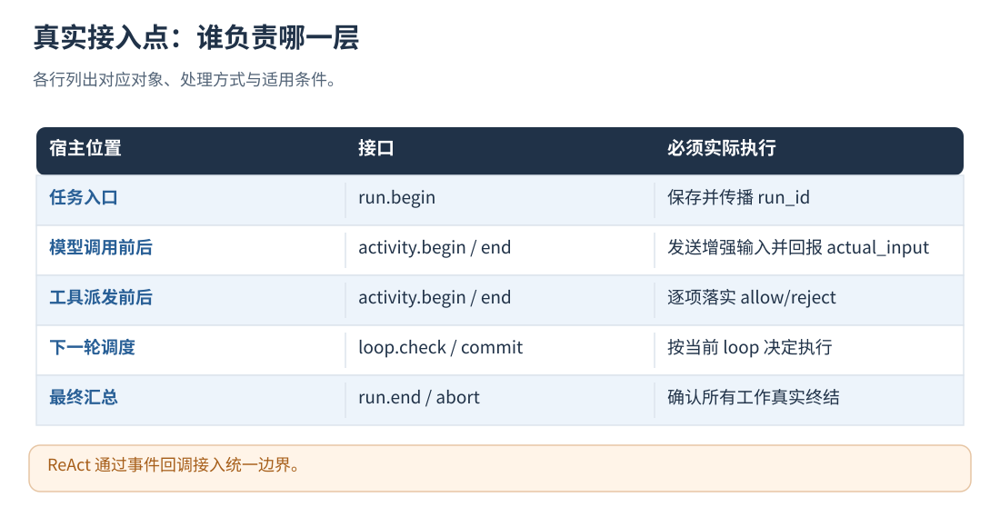
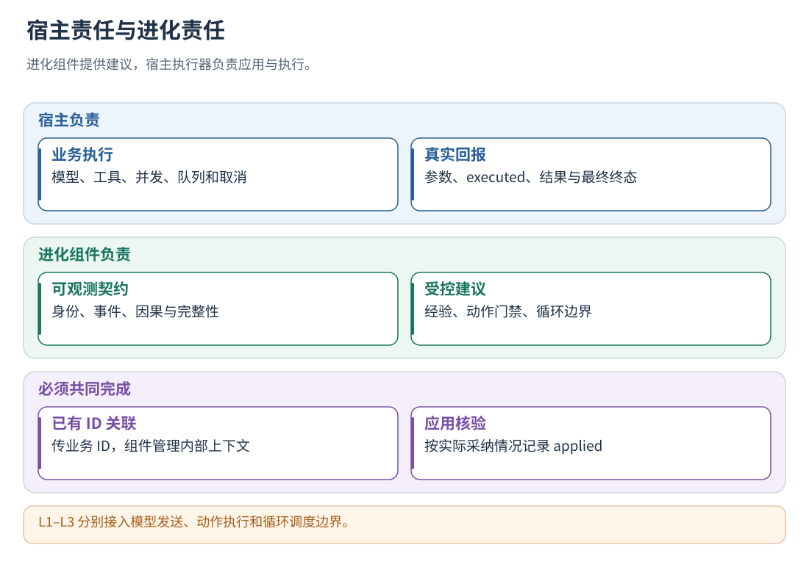

# 08 · 接入位置：同步、ReAct 与多层 Agent

[文档首页](README.md)

## 本章目标

只修改原程序里的打点位置，不要求开发者另写 observer、适配器、日志转换器、上下文管理器或后台工作程序。
下文的变量取自原有代码；所有示例都可以放进已有文件，不需要新增宿主文件。

## 设计思路

程序负责原来的业务，组件负责进化。用已有 ID 关联执行，不依赖函数名、Coordinator、Skill、DataBus、Hook 或特定语言。
没有统一入口的 ReAct 程序也可以接入：在收到任务、实际模型发送、动作执行、下一轮判断和最终完成处插入对应点。



## 统一打点：推荐入口

Python 的 `evo.point(fields)`、JS/TS 的 `await evo.point(fields)`、Go 的 `Point`、Rust/Java 的 `point`、C# 的 `PointAsync`
使用相同的字段。C/C++ 和其他 FFI 语言使用随包 `local_c.h` 中的 `te_local_invoke` 或 `te_remote_point`，
发送 `operation="point"` 的 JSON，返回内存用 `te_local_free` 释放。客户端在进程启动时创建一次。

| 字段                                              | 填什么                                                 | 由谁管理                     |
| ------------------------------------------------- | ------------------------------------------------------ | ---------------------------- |
| `ref.run`                                       | 当前业务任务的现有 ID；一次提问到最终答复使用同一个 ID | 宿主已有字段                 |
| `ref.key`                                       | 这次模型、工具、工作单元或循环轮次的现有 ID            | 宿主已有字段；同一任务内唯一 |
| `ref.parent`                                    | 所属工作单元的 ID；直接属于任务时省略                  | 宿主已有字段                 |
| `ref.after`                                     | 直接触发本次调用的、已完成调用的 ID 数组；无依赖时省略 | 宿主已有依赖字段             |
| `conversation_id`                               | 所属会话 ID，只需在任务开始传入                        | 宿主已有字段                 |
| `input / output / state`                        | 原始输入、实际结果、进展状态                           | 在相应位置直接传变量         |
| 内部`run_id / activity_id / event_id / context` | 不需要接入者生成或保存                                 | 组件管理                     |

ID 是不超过 256 UTF-8 字节的非空字符串。同一调用的 before/after 使用同一个 key，新的调用或重试尝试使用新的 key。
传输重发可复用相同 key 和内容，组件幂等处理；同一个 key 的内容改变会报告冲突。
已有公共任务 ID 必须能到达工作进程；组件不会从一段自然语言猜测两个进程属于同一任务。
`ref` 与旧 `context/causes` 接法二选一。旧接口仍兼容，新接入采用本章方式。

### 按配置直接使用 Python 打点

已安装客户端后，可直接在已有文件导入，不用创建连接管理文件：

```python
from evolution_configured import points as evo

evo.point({"phase": "before", "kind": "run", "ref": {"run": task_id},
           "conversation_id": conversation_id, "input": user_input}, user_id=user_id)
response = evo.call({"kind": "model", "ref": {"run": task_id}, "input": request},
                    lambda actual: original_model_call(actual), user_id=user_id)
```

`call` 的 key 可以省略，由包生成并用于同一次 before/after；分开发送的两个 point 必须传相同的已有 key。
所有原始认证参数留在原调用中，不放入 input。返回 JSON 文本的工具使用 `result_format="json_text"`，
使 L2 拒绝结果也保持字符串类型，并包含 `error` 字段；成功调用的返回值保持原样。

复制随包 `config/point-client.json`，填写本机服务地址、已有用户 ID 与令牌环境变量名，然后在 Agent 启动环境设置：

```sh
export EVOLUTION_POINT_CONFIG="/你的部署目录/config/point-client.json"
```

服务端等级、规则、后台评测仍在 `boundary-service.json`；point-client.json 只管理客户端连接、用户和隐私参数。
该简便入口限定本机 HTTP 服务，默认单次通信预算 20 ms、无重试；同步业务调用不会等待后台评测、模型反思或记忆管理。
客户端初始化和 JSON 编码也有开销，20 ms 是通信预算，不是包括宿主调度在内的端到端绝对上限。
配置未设置、SDK 未安装或采集服务不可用时，v1 保持原业务输入和调用；服务不可用期间的轨迹可能有缺口。
原生与 HTTP 返回给宿主的 JSON 将安全整数输出为整数记号，例如 max_tokens=4096，不输出成 4096.0；
非整数数值保持数值。该传输编码与落盘的规范编码分开，已有轨迹指纹、请求幂等键及策略版本不变。
配置与凭据按路径首次加载后缓存，修改同一文件或轮换令牌后重启对应客户端进程。

配置入口在发送前检查敏感字段、常见凭据形式及密钥类环境变量值。命中时只尝试发送无内容的 gap/abort，
原输入仍供业务执行；不把删改后的输入当成真实模型请求，也不将缺失数据作为完整学习样本。
如果环境变量名含 KEY 但实际是非敏感任务编号，可将**该变量名**加入 `privacy.public_env_names`；
这只取消对应环境变量值的自动匹配，不关闭认证字段和凭据模式检查。
其他不符合命名惯例的密钥环境变量用 `EVOLUTION_SECRET_ENV_NAMES` 指定，显式秘密声明优先。
服务端还会进行独立的敏感内容检查；业务敏感信息需按实际数据类别配置与验证。

后台 HTTP 评测提供隔离的 `TRAJECTORY_EVOLUTION_TRIAL_CONFIG/URL/TOKEN` 时，入口自动改用试验实例及用户，
无需宿主输出版本回执或写评测程序；不会发送到生产采集目录。此入口选 `instrumentation_transport="http"`，
原生评测使用原生 SDK，不从这里回退到生产 HTTP 服务。

## 1. 配置想使用的等级

在服务配置或原生配置里添加：

```json
"instrumentation": {
  "level": "L3",
  "capabilities": ["model", "actions", "loop"]
}
```

只观察设 L0；L1 接模型点；L2 接动作执行点；L3 接循环条件点。capabilities 只填实际接入的能力。
常见输入无需填写 binding：纯文本、messages 消息数组、system 字符串/首个文本块、Responses 的
instructions/input、prompt 字符串，以及已有 systemInstruction.parts[0].text 均可识别。
采用 input_schema 工具定义的 Messages 请求会选择单独的 system 字段，不往 messages 塞入 system 角色。
自定义结构可在模型点直接给 binding（JSON Pointer 和 text/system_message 模式）；显式设置优先于自动识别。
usage 中的 prompt/completion_tokens、input/output_tokens 和 usageMetadata 中的 token 计数自动读取；
缓存输入和独立思考 token 按对应格式合并。output_metrics 或打点 metrics 可覆盖，缺失、冲突或非法值保持未知。
工具定义从结束点的 actual_input 提取，即真正发送的请求；不从模型回复、描述文本或工具执行参数猜必填项。
客户端不需要增加工具注册点，也不需要填写 control_learning.actions。
只有 user/assistant 消息、无法区分模型接口时，包复用最后一条用户消息中已有的文本字段，
不擅自新增 system 角色；需要指定指令层级或采用其他格式时，在同一打点用 binding 覆盖。
授权、评测准入和规则参数见[策略版本](15-policy-snapshots.md)、[运行控制](16-runtime-controls.md)和[任务评测](19-datasets-and-benchmarks.md)。

## 2. 收到新任务时插入

```python
evo.point({"phase": "before", "kind": "run", "ref": {"run": task_id},
           "conversation_id": conversation_id, "input": user_input})
```

不要在每次回调或重新唤醒时建立新任务。重复通知同一任务入口必须保持同一任务 ID 和输入。
不同用户使用各自授权的客户端；用户身份来自服务令牌，不能用 ref.run 切换用户。

## 3. 模型与工具：用包内调用打点包住原来的调用

原来已经有一个接收请求、返回结果的模型函数 `send_model(request)` 时：

```python
# 原来：response = send_model(request)
response = evo.call({"ref": {"run": task_id, "key": call_id, "parent": work_id},
                     "kind": "model", "name": model_name, "input": request}, send_model)

# 原来：response = await send_model(request)
response = await evo.acall({"ref": {"run": task_id, "key": call_id, "parent": work_id},
                           "kind": "model", "name": model_name, "input": request}, send_model)
```

直接属于任务时删去 parent。业务函数接收/返回 JSON 数据；保留原来的模型客户端和认证方式，不把密钥、请求头、客户端对象交给打点。
如果原方法有多个参数，可在同一行用原语言的闭包转发参数，不需要另写适配文件。
若返回值是 SDK 专用对象，在已有结果处理位置使用下一节的两次 point，传入已有 JSON 内容。

工具同样使用已有调用：

```python
result = evo.call({"ref": {"run": task_id, "key": tool_call_id, "parent": work_id},
                   "kind": "action", "name": tool_name, "input": arguments}, execute_tool)
```

JS/TS 对应为 `await evo.call(fields, originalFunction)`，同时支持同步和异步函数。
call 内部完成 before → 使用准备输入执行一次 → after；异常时记录 unknown 并原样抛回业务层，不记录异常文本。
动作被规则拒绝时不执行函数，返回 `{"status":"rejected","reason":"..."}`，并记录 executed=false。
调用包装不重试业务副作用，不负责改变原程序的并发或异常传播规则。

## 4. 任意语言、异步结果回调：在原位置插入前后两点

当发起和结果返回不在同一函数中，用 point，无需保存 before 返回的 context：

```python
# 实际发送模型请求前；认证仍保留在原客户端中。
request = evo.point({"phase": "before", "kind": "model",
    "ref": {"run": task_id, "key": call_id, "parent": work_id}, "input": request})["input"]

# 原来的发送代码和消息结构保持不变。

# 在已有成功结果回调中；ID 和实际请求取自原业务记录。
evo.point({"phase": "after", "kind": "model",
    "ref": {"run": task_id, "key": call_id},
    "actual_input": actual_request, "executed": True, "output": response_json})

# 在已有异常/取消回调中；无法确认实际执行结果时报告 unknown。
evo.point({"phase": "abort", "kind": "model",
    "ref": {"run": task_id, "key": call_id}, "status": "unknown", "output": None})
```

上面成功和异常点分别位于已有分支，并非在一次成功调用后再执行 abort。
在更底层还会修改请求的 SDK 中，actual_input 传真正发出的请求；拿不到时保留未知执行证据。
工具使用 kind=action，派发前读取 decision；只有 allow 才执行，拒绝时在原工具结果路径回报 executed=false。
如果原代码没有错误回调，可使用 call/acall；跨进程工作使用下面一章的任务注册点。

## 5. 在原循环条件中使用循环打点

```python
while original_condition and evo.allow_loop({
    "ref": {"run": task_id, "key": iteration_id, "parent": work_id}, "state": progress_state
}):
    ...  # 原来的一轮业务逻辑，iteration_id 每轮不同
```

异步 Python 使用 `await evo.aallow_loop(...)`，JS/TS 使用 `await evo.allowLoop(...)`。
任意其他语言用 `point({"phase":"guard","kind":"loop","ref":...,"state":...})` 的 decision 不等于 stop 作为原循环的继续条件。
guard 在组件内部一次完成检查和记录，不需要调用方再组装 loop.commit。
不能只调用后丢弃返回决定：循环条件必须使用它。其他宿主限制放在前面的 original_condition 中。

同一 parent 默认对应同一循环；两个独立工作单元的循环互不停止。一个工作单元有多个循环时显式传不同 loop_id。
Continue 继续；Stop 退出该循环；Replan 继续并把调整指令放到该 parent 下下一次模型点中。
同一循环的轮次按原调度器推进；并行工作单元各用自己的 parent。

## 6. 最终结果与任务结束

```python
evo.point({"phase": "after", "kind": "run", "ref": {"run": task_id},
           "output": final_answer, "business_status": "partial"})
```

business_status 可选 succeeded/failed/partial/unknown；业务失败不等于执行器崩溃。
还有已注册子任务时返回 pending，组件等待它们结束后自动闭合，不要求用户另写收尾重试。
不要将普通循环的一次 Python return 当成任务结束；如何区分派发退出和业务终态见[异步接入](09-async-and-multi-agent.md)。



## 运行保证与限制

原生打点只走有界内存路径；HTTP point 默认单次 20 ms 预算且不重试。Python call/acall 及 JS/TS call 的每个前后打点分别使用该预算。
业务不等待落盘、模型评测、记忆管理或策略再编译。服务可使用 buffered 持久化，由后台写盘；durable 模式在响应前确保持久化。
采集失败保留原输入和原业务调用，SDK 在后续同任务打点中自动报告缺口，残缺轨迹进入隔离而不是学习。
客户端实例应复用；进程崩溃或持续断网且没有后续上报时，已注册未完成工作由组件租约识别，默认 24 小时，配置 run_lease_ms。
无法推断从未打点的工作；异步任务必须先登记再入队。仅输入输出点能提供 L0，内部优化需要对应的模型、动作和循环点。

## 实现定位

- `src/instrumentation.cpp`：编号解析、自动合流、延期收尾、循环 guard、指标映射。
- `src/local_runtime.cpp / src/integration_service.cpp`：同一协议的原生与 HTTP 执行。
- `clients/python/evolution_point.py / clients/typescript/evolution.ts`：包内调用包装与采集缺口管理。
- `tests/test_instrumentation.py / tests/test_language_clients.py`：同步、异步、并行和跨语言回归。

[下一章：异步、并发、消息队列与任务收尾](09-async-and-multi-agent.md)
