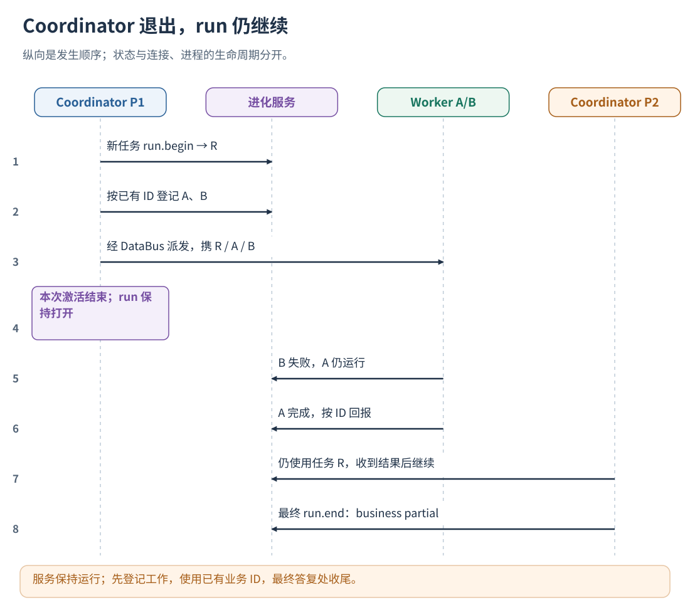
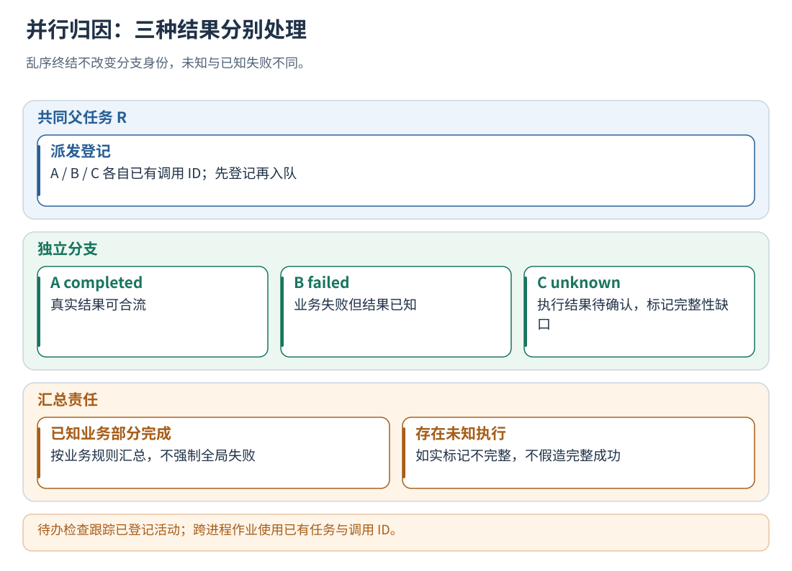

# 09 · 异步、并发、消息队列与任务收尾

[文档首页](README.md)

## 本章目标

多个回调、进程或 Agent 共同完成一个任务时，仍然只插入包内打点，不新增上下文文件或消息转换代码。

## 设计思路

用现有任务 ID 识别 run，用现有调用 ID 识别分支；服务管理内部 ID、等待集合、合流与收尾。
发送方退出不等于任务完成。跨进程任务使用常驻 HTTP 服务，单进程多线程可使用原生客户端。



## 发送方：原来入队的地方加 before

假设已有消息包含 task_id、job_id、parent_job_id、arguments：

```python
# 登记整个远端工作的生命周期，必须在消息发送前。
evo.point({"phase": "before", "kind": "custom", "name": "worker",
           "ref": {"run": task_id, "key": job_id, "parent": parent_job_id},
           "input": arguments})
```

任务直接派发的第一层工作省略 parent。随后保留原来的发送代码和消息结构。
before 只记录原本已存在的 ID，不要求把返回 context 塞入消息、manifest 或 DataBus。
入队操作本身也需要 L2 控制时，在已有发送调用外使用 action 点；远端工作的 custom 点在真正完成时才结束。
消息发送失败时，在原有失败分支为该 job_id 回报 failed 或 cancelled，避免留下不存在的待完成工作。

## 接收方：使用已有消息字段

```python
# 放在实际模型请求发送前，ID 来自工作进程已有的业务变量。
request = evo.point({"phase": "before", "kind": "model",
    "ref": {"run": message.task_id, "key": model_call_id, "parent": message.job_id},
    "input": request})["input"]

# 放在已有模型响应处理处。
evo.point({"phase": "after", "kind": "model",
    "ref": {"run": message.task_id, "key": model_call_id},
    "actual_input": actual_request, "executed": True, "output": response_json})

# 放在整个工作单元的结果返回处。
evo.point({"phase": "after", "kind": "custom",
    "ref": {"run": message.task_id, "key": message.job_id},
    "status": actual_status, "output": result})
```

接收方不用重新 run.begin，不必查找 evolution 记录。双方使用同一应用、同一用户授权和同一个已有 task_id。
模型、工具、轮次 ID 必须在该任务内唯一；两个进程可能重复产生 call-1 时，用已有 job_id 与本地序号拼接。
若程序原本没有可跨进程关联的任务 ID，需要在消息里传一个关联字段。这是必要的身份信息，不是组件专用适配器。

## 并行、嵌套与合流

| 场景 | 打点字段/组件行为 |
| --- | --- |
| 多个独立工作单元并行 | 不同 key；允许任意完成顺序 |
| 工作单元内部模型、工具、子 Agent | parent 指向该工作单元 key |
| 单支明确业务失败 | 该分支 after.status=failed；不改变其他分支状态 |
| 单支输出不能安全采集 | 该分支补 unknown，任务隔离；其他分支仍可结束 |
| 工作单元先返回、子工作未结束 | after 返回 pending；组件待子工作完成后自动闭合 |
| 汇总调用确实依赖若干已完成结果 | ref.after 传这些原有调用 ID |
| 父工作完成 | 自动关联已完成子工作，超过单次因果上限时生成内部 join 事件 |

独立活动不会按返回顺序配对。父子关系与结果依赖不同：parent 表示所属，after 表示本次调用直接依赖的完成结果。
没有提供的跨分支语义依赖保持未知，不通过时间接近猜测因果。



## 什么时候结束 run

存在全局最终答复/任务终态位置时，只在那里发任务 after：

```python
evo.point({"phase": "after", "kind": "run", "ref": {"run": task_id},
           "output": final_answer, "business_status": "partial"})
```

还有已注册工作未完成时返回 pending，组件自动等待最后一个已登记分支，不要求宿主重试 run.end。
如果应用是单次派发、后面不再产生新的工作，派发方可在登记完所有工作后提交任务 after；最终结果仍是该次 after 提供的值，组件不会虚构汇总答案。

对于会反复唤醒调度器、继续派发新一轮工作的 Agent，只在真正业务终态发送任务 after；
普通调度函数退出不发任务 after，否则已知工作清空后组件会按这个结束信号闭合，未来新工作将无法加入。
单个派发活动可以提前 after，子工作登记在它的 parent 下后，组件延后该活动的实际闭合。

## 循环与串并行

每个工作单元自己的循环在判断下一轮时调用 guard，parent 指向工作单元。
组件默认按 parent 划分 loop；同一工作单元含多个循环时配置不同 loop_id。
Stop 只控制调用处正在判断的循环，包不改变原调度器的线程、队列或并发策略。
多个分支失败如何由原框架汇总，仍按原业务规则执行；打点不会因为一个 failed 将 run 直接改成 failed。

## 重复、失联与恢复

- 相同任务/key/phase 和内容重复上报会去重；不同内容视为冲突，新的业务尝试使用新的 key。
- HTTP 的编号关联随任务状态持久化；原生去重范围为尚未复用的内存槽位，跨进程续写使用 HTTP。
- SDK 为失败打点保留有界的任务缺口标记，在后续打点中自动回报。编码失败和超时不导致原业务调用重试。
- 已注册工作失联且不再上报时，组件使用 run_lease_ms 识别未完成任务，默认 24 小时；按实际最长任务时长配置。
- 默认模板使用 buffered 写盘，主调用不等待 fsync；进程故障留下的未完成记录隔离。需要每次应答前保证落盘时可选 durable，并相应调整点位通信预算。
- SDK 和服务重启、持续网络断开仍可能导致采集缺口；缺口记录不用于学习。完全没有打点的数据无法自动恢复。
- 自动延期结束只涵盖已登记工作，所以一定先打点，再入队。

## AgentFlow、ReAct 与其他框架如何对应

AgentFlow v1 可用现有 dialogue_id 作为 ref.run，唯一 dispatch key 作为工作 key，工具调用 ID 作为工具 key，
在原输入、派发、真实调用和结果位置插入上述接口；不读取 SessionLog 或旧 Hook，不新增 observer 文件。
其他框架同样映射自身已有任务/调用/父调用字段，不需要进化包导入该框架的运行时代码。
文档示例不会自动修改宿主；本仓库 v1 的现有代码已按这些位置插入通用 SDK 调用。

### AgentFlow v1 已有打点如何启用

1. 按[安装章节](02-installation.md)在运行 AgentFlow Python 节点的环境安装客户端，并启动本机进化服务。
2. 复制随包 `config/point-client.json`。将 `principals` 的 user_id 改为实际 `AF_USER_ID`，令牌与服务端同用户一致。
3. 在该客户端配置里设置：

   ```json
   "privacy": {"public_env_names": ["AF_EXEC_SKILL_KEY", "AF_COMPLETED_BATCH_KEY"]}
   ```

   这两个环境变量是已存在的派发/批次编号，不是认证密钥。配置中不填写模型密钥。
4. 在启动 AgentFlow daemon 的环境里设置 `AF_COORDINATOR_VERSION=v1`、`EVOLUTION_POINT_CONFIG` 和对应用户的采集令牌变量，
   然后按原方法启动/重启 daemon。已运行进程不会自动继承新终端的 export。
5. 服务端默认 `instrumentation.level=L0`，只采集。需要 L1–L3 时，按[上一章](08-instrumentation.md#1-配置想使用的等级)
   设置等级、真实已接入的 capabilities、`/messages` 绑定与 usage 路径，再配置授权规则及评测准入。

| v1 现有位置 | 插入的通用接口 | 对原流程的作用 |
| --- | --- | --- |
| Coordinator 首次输入 / 最终答复 | run before / after | 一个 dialogue 对应一个 run；完成唤醒不重新开始 |
| next_skills 提交前 | custom before，使用已有 dispatch key | 先登记工作再异步派发；不新增 DataBus 字段 |
| Skill 的实际终态 | custom after | 结束对应工作，不终止兄弟分支 |
| 共享 call_llm 实际调用 | call(kind=model) | 记录原输入 → 按授权注入经验 → 原模型调用 → 记录实际结果 |
| ToolRegistry 实际执行 | call(kind=action) | 使用授权后的参数或返回结构化拒绝；原并行/串行调度不变 |
| Coordinator / Skill 下一轮判断 | allow_loop | 默认继续；显式 L3 授权后可重规划或走原结果通道提前结束循环 |

宿主只改现有的 coordinator_decide.py、skill_executor.py、llm_call.py；没有新增宿主 Observer、Hook、适配器或上下文存储文件。
SDK 不读取 AgentFlow 的 SessionLog 或 Hook，其他框架只需在同类位置传自己的必要身份和原始业务变量。
工具失败保留在该分支的 output/status 内，业务结果与 AgentFlow C++ 工作流状态继续分开处理。

组件内有可选宿主回归测试，使用真实 v1 Python 逻辑、真实进化服务、两个独立工作进程；
DataBus、模型和工具用可控测试替身，不调用付费模型：

```sh
python -B tools/trajectory_evolution/tests/test_agentflow_points.py build/trajectory-evolution
```

结果写入 build 下的 v1-points.*，包含轨迹、原调用输入、实际工具时间与 test-summary.json；无需打开 /tmp。

## 实现定位

- `src/instrumentation.cpp`：ref 关联、待完成父工作、自动合流与结束。
- `src/integration_service.cpp`：跨进程状态、后台写盘和未完成任务恢复。
- `src/local_runtime.cpp`：进程内有界执行与独立运行状态。
- `tests/test_instrumentation.py`：70 个分支逆序完成、异常、拒绝、嵌套及自动收尾。
- `tests/test_task_evaluation.py`：派发进程退出后，仍等待已打点的后台工作完成。

[文档首页](README.md) · [上一章：接入位置](08-instrumentation.md)
