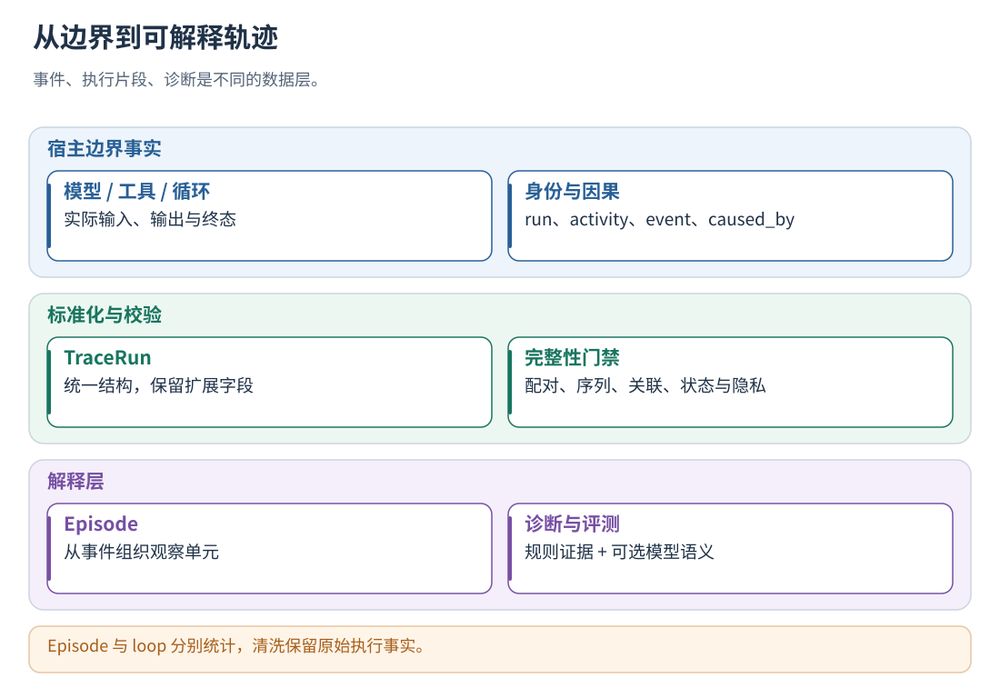
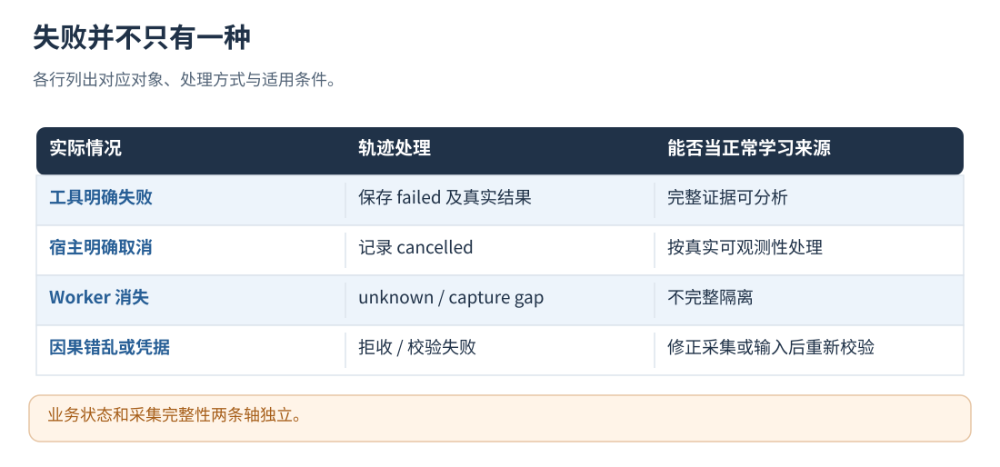

# 10 · 轨迹采集、清洗、校验与 Episode

[文档首页](README.md)

## 本章目标

理解原始边界事件如何变成可分析的标准轨迹，哪些缺口会被隔离。

## 设计思路

先校验身份、因果、活动状态与终态，再分析执行行为。采集缺口保留为 unknown 或隔离记录，原始参数与结果由宿主边界上报。

读图：Episode 与 loop 分别统计，清洗保留原始执行事实。 [放大 SVG](figures/10-trace.svg)。

## 从执行边界生成事件

通用入口由组件生成标准事件，宿主只需在自己掌握的实际执行位置调用边界接口。
源码入口是 `src/runtime/boundary_runtime.cpp`。

| 宿主边界 | 组件生成/保存的主要内容 |
| --- | --- |
| `run.begin` | 用户身份、conversation、run 输入、等级与能力声明、运行开始 |
| `activity.begin` | `step.start`；模型/动作语义还生成 `action.start`，保存原始与准备执行的输入 |
| `activity.end` | 实际输出、执行状态、错误、真实发送参数；关闭 action 和 step，并核对应用回执 |
| `loop.check` | 当前循环状态与轮次、策略查询和下一步建议；实际执行由 commit 回报 |
| `loop.commit` | 宿主实际选择的 continue/replan/stop，关闭本次控制步骤 |
| `event.record` | 自定义观察，保留 type/data/extensions 及显式关联 |
| `run.end` | 最终输出、执行状态、业务状态、采集完整性，进入后台处理 |

`activity_types` 可以把自定义活动映射到 `model`、`action` 或 `custom`，并声明必需的输入路径。
这是数据语义映射，不需要每换一个框架都创建 Coordinator/Skill 适配器。
模型活动应在实际发送前后调用采集接口，并记录发送参数和返回结果。

只有任务输入和输出时也能采集：分析器会创建一个黑盒 Episode。
该接入方式支持任务输出评测；工具调用、循环和分支分析需要继续上报内部活动。

读图：业务状态和采集完整性两条轴独立。 [放大 SVG](figures/10-integrity.svg)。

## 怎样清洗、校验和组织轨迹

### 内容清洗与结构校验

第一种是**结构清洗**：解决重复、缺失、错误关联和不完整采集。
第二种是**内容清洗**：防止凭据、不必要的私密内容或过长文本进入评测与记忆。
结构校验与隐私检查分别执行，覆盖因果关系和内容安全。

边界入口会拒绝已识别的敏感字段/内容；评测旧日志时还会做递归脱敏、已知秘密替换与字符串规则过滤。
模型返回、候选、记忆、策略快照等后续数据也有安全检查。
采集前移除非必要个人信息和认证凭据；上传内容遵循最小必要原则。
认证凭据保存在独立配置中；证据上传前执行字段和内容检查。

### 结构校验流程

`src/analysis/trace_contract.cpp` 的 `validate_trace` 大致执行以下算法：

1. 校验协议版本、身份、事件数、文件大小和 `capture_complete`。
2. 按 `event_id` 去重：同 ID、同 Protobuf 内容保留一条并记录重复；同 ID、不同内容报告冲突。
3. 检查事件类型、生产者序号、状态和必要的执行上下文字段。
4. 校验 step/action 的开始结束配对；配对两侧必须属于同一执行者、执行流、step、loop 和轮次。
5. 检查事件引用、错误的 retryability，以及应用回执必要字段。
6. 建立有向关系并进行拓扑排序；有环、悬空引用或配对错误时记录校验失败。

关系由以下记录共同确定：

- 显式 `caused_by`。
- 同一 `producer_id` 下的序号次序。
- 唯一 run.start 在所有事件之前，唯一 run.end 在所有事件之后。
- 配对的开始 → 结束。
- step 对其内部活动的包含约束。

实现使用 Kahn 拓扑排序；多个事件同时可输出时按事件 ID 确定稳定顺序。
该顺序用于可重复处理；执行依赖由因果边表达，时间戳用于定位和观察。
因此当前已经使用因果图进行验证，但不要求宿主先建立一棵专用轨迹树。

只要存在结构 error 就是无效输入。warning 不一定使轨迹无效。
不完整或无效轨迹保留诊断与隔离产物，正常候选使用通过校验的轨迹。

### 从事件组织 Episode

`src/analysis/trace_analyzer.cpp` 的 `analyze_trace` 以 step 为主要单位：

1. 对每个 step.start / step.end 建立 Episode。
2. 将同一 `step_id` 的动作开始/结束、状态与相关观察归入对应 Episode。
3. 提取实际操作名、参数指纹、结果指纹、错误分类和是否可重试。
4. 根据授权分区形成 `target_scope`，保留 actor/execution/loop 等归因信息。
5. 没有 step 时，将整次 Run 的真实输入输出作为一个黑盒 Episode。

指纹用于确定性对比和身份构造：结构按稳定序列化处理，再计算 SHA-256。
指纹用于识别规范化内容相同的输入；语义关系由后续评测或记忆管理处理。

按 loop_id 和 iteration 去重计算逻辑轮次；同一轮的多个工具与控制活动可形成多个 Episode。
没有显式轮次就不补猜循环数；缺少可观察事实时，最终结论应该是证据不足。

## 采集、分析与回放的数据边界

TraceRun 保存身份与事件，分析器据此组织 Episode。
同一操作可产生多个事件，同一 loop 轮次也可形成多个 Episode；并发执行通过身份、轮次和因果边关联。

| 信息 | 来源 | 缺失时的含义 |
| --- | --- | --- |
| 实际模型输入/输出 | 模型执行前后边界 | 原始正文与经验发送状态缺失 |
| 工具参数和 executed | 动作执行器 | 执行情况待确认 |
| 状态与循环决定 | 宿主真实状态、check/commit | 循环结束原因缺失 |
| 父子/先后依赖 | context 与 caused_by | 跨进程关联信息缺失 |
| 执行终态与业务结果 | 任务/活动收尾方 | 保留 unknown 状态 |

轨迹回放按记录重建执行过程及其归因；重新执行外部工具属于宿主的业务重放流程。
模型随机性、网络数据变化、支付/发布等不可逆副作用仍需业务级重放策略与隔离环境。

## 自定义字段的扩展流程

先通过 activity_types 约束必要输入，再将领域信息放在 input/output/state/extensions。
优先复用语义一致的既有事件类型，新增类型通过扩展配置和分析器接入。
新增字段不会自动形成确定性指标：需要规则时扩展 analyzer；需要模型理解时同步更新外置提示词和验收任务。

完整性未知的轨迹进入 quarantine，不作为正常候选来源；已知业务失败的完整轨迹仍有分析价值。
这两种结果在目录、评测和自动入库阶段始终分开。

## 实现定位

- `proto/trajectory_trace.proto`
- `src/analysis/trace_contract.cpp`
- `src/analysis/trace_analyzer.cpp`
- `src/runtime/boundary_runtime.cpp`
- `src/analysis/sessionlog_evaluator.cpp`

---

[文档首页](README.md) · [上一章：异步、并发、消息队列与任务收尾](09-async-and-multi-agent.md) · [下一章：规则、模型与 Hybrid Evaluator](11-evaluation.md)
