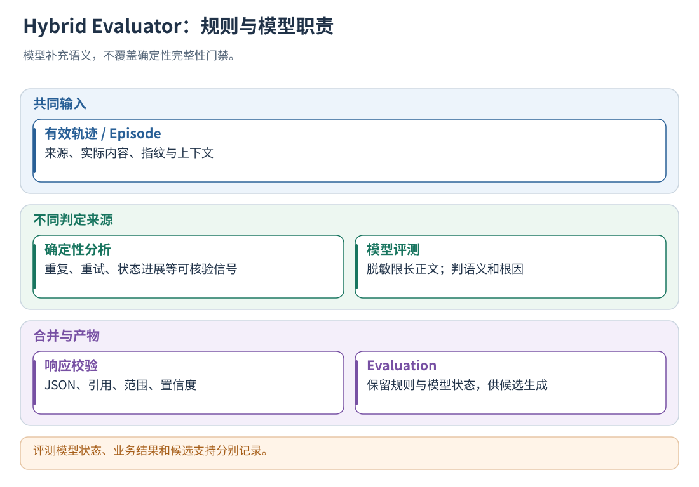
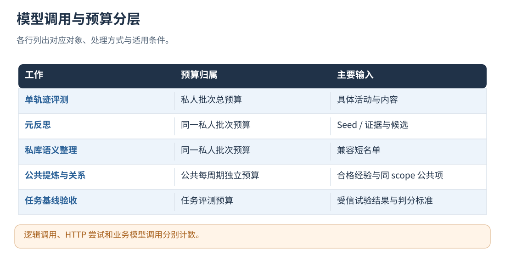

# 11 · 规则、模型与 Hybrid Evaluator

[文档首页](README.md)

本章说明**已有轨迹的分析、评估和反思输入**。验证某个策略版本是否提升 Agent 的实际执行效果，
使用[第 19 章的任务评测模块](19-datasets-and-benchmarks.md)：在独立实例中重新执行固定任务并比较结果。
该模块由 L0–L3 策略准入和后续 L4 优化共同复用，结果还会更新[记忆实测状态](13-private-memory.md)。

## 本章目标

理解模型真正看见的内容、规则指标、输出校验和不同判定的融合。

## 设计思路

确定性检查提供结构与指标，模型补充语义判断。评测失败、业务失败与轨迹不完整分别记录，规则确认的无效结论在融合时保留。

读图：评测模型状态、业务结果和候选支持分别记录。 [放大 SVG](figures/11-hybrid.svg)。

## 怎样识别无效执行与进行模型评测

### 当前通用分析器的确定性诊断范围

目前标准轨迹规则重点实现 `non_retryable_repeat`，即明确不可重试后仍进行相同失败调用。
SessionLog 分析器与标准轨迹分析器按各自输入结构生成诊断，具体类别以对应报告为准。

通用规则只有同时满足下面条件才命中：

1. 两次动作的输入指纹、实际执行者、执行流、loop_id 和操作名相同。
2. 当前轮次大于前一次轮次。
3. 同生产者序号或显式因果链确认当前动作发生在前一次之后。
4. 两次都失败，且都明确标记为 `non_retryable`。
5. 两次错误码非空且相同。

命中后生成置信度 1.0 的确定性诊断，并引用相关调用/结果事件。
实现按匹配键查找前一次动作。
重复重试判定同时检查执行流、操作、输入和先后关系。

`invalid_loop_lower_bound` 统计已有确定性证据支持的无效逻辑轮次。
模型评出的无效 Episode 数、规则下界、总循环数是不同指标。

标准分析器 standard-trace-analyzer-v2 按动作的 attributes.semantic 区分模型、业务工具和自定义活动。
tool_call_count 及其失败计数只统计业务工具；明确 executed=false 的拒绝或跳过不计入执行次数。
模型活动仍保留完整事件证据、失败状态与重复调用诊断。同名模型和工具分别判断重复，避免相互混淆。
旧轨迹没有 semantic 标记时按原 action 约定解释为工具，以保持历史数据可读。

### 执行价值的规则判定

`src/hybrid_evaluator.cpp` 中的规则判定顺序是：

| 证据 | 规则结果 |
| --- | --- |
| 有 `counts_as_invalid` 的诊断 | INVALID，取对应诊断的置信度 |
| 显式评测失败或可疑诊断 | UNCERTAIN，保留相应证据 |
| 只有失败结果，没有足够因果证据 | UNCERTAIN |
| 没有上述证据 | UNASSESSED，置信度 0 |

评测结合业务状态与执行上下文，区分必要探索、可恢复错误和重复操作。

### 模型看见什么

通用轨迹与 SessionLog 的内容感知路径都在 `src/sessionlog_evaluator.cpp`。
该配置同时供标准轨迹和 SessionLog 评测入口使用。

`make_dialogue_request` 将以下内容交给评测模型：

- Episode/事件关联所需的执行标识；用户、会话及落盘来源标识留在本地。
- Episode 与事件的对应关系、动作/结果/规则结论，以及本次需要评测的 `selected_episode_ids`；本地包 ID、结构指纹不重复发送。
- `content_events`：经过脱敏和限长的实际用户输入、模型文本、工具参数与结果、错误、状态等事件内容。
- `allowed_experience_scopes`：模型能够选择的经验作用域。
- 脱敏和截断计数；证据不可信的规则由外置提示词说明。

每次请求都先精简字段，再共享 `content_events[*].data` 中完全相同的脱敏值，不等到超限才处理。
`content_value_refs` 列出原文 `source` 与引用位置 `paths`，路径相对于输入 JSON；原文保留在第一次出现的位置。
只有表中登记的位置才解释为引用，原始内容中的同名对象不参与引用解析。原文可以包含更早的引用，递归读取即可还原。
共享不会删掉事件、合并执行次数、改变事件 ID 或新增截断；原始轨迹也不改写。
通用事件的 ID、类型、时间、轮次只在外层传一次；生产者序号等采集元数据留在原始日志中。
执行者、execution/loop 身份、因果引用、用户要求、实际工具参数/结果、状态及业务自定义内容仍保留。
仅省略协议头中的空字符串默认字段及明确的存储元数据；不会递归删除业务 input/output 中的同名字段、空状态或 null 结果。
Episode 的 selected 标记不重复发送，selected_episode_ids 是唯一评测选择清单。
未命中规则时的固定 UNASSESSED 说明不重复发送；明确的规则判定及不同的具体说明仍保留。
previous_same_owner / next_same_owner 保留 episode_id；只有对应完整 Episode 已提供且值完全相同的属性才从邻居摘要中移除。
目标缺失或属性不一致时保留摘要原值，不用精简掩盖证据差异。
共享记录及替换位置分别最多 4096 项，JSON Pointer 路径最多 4096 字节；超出这些处理范围的值保留原文。
本地共享表保留的原文最多 4 MiB；单项超过 1 MiB 时继续尝试共享其内部消息等较小值。
脱敏过程还有独立的单请求缓存（最多 512 项、原文与结果合计 4 MiB），相同文本不反复运行正则；
每次出现仍累计脱敏/截断次数，缓存不跨请求、用户或模型调用复用，不落盘。

### 各模型入口的最小输入

完整日志、报告、版本、来源、检索分数和记忆状态仍在本地保存；模型接收面向当前任务的副本。

| 模型入口 | 发送内容 | 不重复发送的内容 |
| --- | --- | --- |
| Agent 任务验收 | 任务、多轮输入、验收标准、约束、实际结果/产物、精简事件、完整轮次清单 | 整份结构分析、版本/存储元数据、待生成的评分；历史消息和工具定义共享原文 |
| 内容感知轨迹分析 | Episode 与事件关联、规则信号、具体事件内容、允许经验分区、训练验收依据（存在时） | 结构指纹、重复事件头、重复消息/输入/输出 |
| 旧 analysis 兼容入口 | 单个 Episode 已有的结构证据与规则信号 | 包 ID、结构指纹留在本地；不补造未提供的原文 |
| 元反思 | 候选条件、问题、建议、反证数量、证据 ID、允许合并的分组 | 支持门槛与来源在本地校验；同组目标类型/分区仅传一次 |
| 私有记忆语义匹配 | 新候选的语义字段、短名单内记忆 ID 与语义字段 | 候选内部 ID、预期收益、本地检索分数、记忆状态 |
| 公共经验提炼/审查 | 来源条件与正文、草案、同分区已有公共经验（审查时） | 原始轨迹、整库状态、其他分区记忆；本来已是摘要的输入不再另加摘要调用 |
| 公私关系判断 | 两条经验的分区、条件和正文 | 公共记忆的来源、版本及管理状态 |
| 数据集生成 | 能力说明与已生成输入，或脱敏事件内容 | 轨迹提取时的 Episode 规则包与评测选择字段；Golden 导入不调用模型 |
| GEPA 反思/分组汇总 | 父组件正文一份、经验适用条件、授权组件、训练标准与约束、分 Run 实际操作/结果、评分指标或分组建议 | 整份 Trial、重复组件正文、反复累积的模型请求历史、供应商响应外壳；不发送 val/holdout 内容 |

打点的 `extensions.point_reference` 已解析为执行标识和 `caused_by`，不再重复进入模型；原始轨迹仍保留它。
训练轨迹的 `training_evaluation` 含验收标准和约束，必须保留。产物的本地 `stored_file` 不进入模型，实际文件事实仍保留。
文件验收失败仍记录为业务失败；配置逐轮评审时，继续用已验证的执行轨迹评审效率，不把无法交付误当成无法评测循环。

GEPA 保留每个实际操作结果及循环决策，工具操作名和缺失的调用参数从同一 action_id 的开始事件关联；
模型操作不重复携带输入消息历史。其反馈是带限长标记的反思材料，不是完整回放日志；证据不足时不推断原因。

### 整体速度与并发

任务验收沿用 `parallelism` 的现有工作线程上限，内置 HTTP 适配器可并发等待；总调用预算仍在锁内预留。
通过 C++ 注入的自定义 ModelAdapter 保持原先的串行调用约定，不要求调用方修改线程安全实现。
这里没有新增模型摘要调用，没有提高默认并发数，也没有改变评分标准和训练/验证隔离。
HTTP 等待与传输重试共用 `model.timeout_ms` 总预算，后续尝试只使用剩余时间，退避也计入其中；
`max_retries` 仍是次数上限，不能延长总等待预算。协议修复单独占用一次模型调用，网络故障不进入协议修复。
输入字节下降不等于耗时同比下降，外部 API 排队与输出长度仍会影响时延。
可选 SSE 配合 idle_timeout_ms 提前发现长时间没有正文数据的请求，配置方法见[第 3 章](03-configuration.md)。
HTTP 连接复用减少重复握手；响应完整性、错误码、字节预算、凭据和证据校验保持在采纳结果之前。
模型响应外壳与评分/反思正文均检查重复 JSON 字段，包括嵌套对象及数组中的对象；冲突值不会通过取首项或末项消除。
默认 Episode 输出只要求 verdict、confidence、concise_reason 与证据引用；expected_state_change、observed_state_change
为兼容旧输出仍可提供，但不再要求模型重复写两段描述。缺省字段在报告中留空，不由程序补造。
默认提示词要求最小充分证据集合、简短事实和不同根因，保留必要条件及例外，不以输出简短为由改变验收标准。
内置在线打点读取已发布的策略快照，模型评测和反思在后台进行；同步调用 evaluate CLI/SDK 本身仍等待评测结果。
减少后台积压与主链打点延迟分别验收，不把某次供应商快速响应等同于稳定的在线时延保证。
任务与逐轮提示词合并重复规则，要求简短列出核验事实。逐轮清单的 `anchor_event_id` 指向本轮一条真实已执行
`action.end` 事件；默认提示词要求逐字复制该 ID 作为轮次定位，减少跨轮误引和输出长度。模型仍阅读整轮实际内容，
在理由中说明贡献和前提；锚点不预设 keep/waste，也不是程序补写模型引用。原始因果证据校验和有界协议恢复保持不变，
自定义评测器仍可使用原有合法多证据格式。
模型输入中的 `loop_inventory` 使用本次请求内的短编号（`i1`、`i2` 等），避免反复抄写 64 位轮次哈希。
每项仍包含原来的 Run、执行实例、loop、轮次和真实事件清单；未知编号、重复编号、漏评和错引证据仍拒绝。
校验成功后，报告的 `iteration_reviews` 与 `wasted_iterations` 恢复原始稳定轮次 ID；短编号不进入已验证结果。
协议恢复反馈沿用本次请求的编号，重新调用时不跨请求复用映射，不增加额外模型调用。
一次逐轮评审中，同一 Run 的轨迹解析、完整性验证与因果排序只做一次，后续轮次复用该次结果；
缓存随本次评审结束释放，不跨请求或用户共享。缺少本轮证据锚点时，协议恢复反馈包含对应轮次、
判定和该轮真实事件清单，模型仍须重新核对证据；程序不补造锚点，未修复的评审不计为零浪费。

指纹用于关联和去重，具体文本用于语义分析。
直接评测旧的纯 analysis 报告时，模型只能看到该报告本身拥有的信息，无法恢复未提供的原文。

模型输入限于本次请求包含的字段。任务验收的 `required_checks` 只携带本题与全局生效的硬规则，
以及已有执行指标对应的步骤/工具调用预算；不传无关任务的规则，不传检查 ID 或旧评分。
例如 `{"op":"action_count","operation":"generate_video","max":1}` 明确最多一次实际调用，
业务评分和逐轮效率评审使用同一限制，不能因题目正文未重复说明，就把超限重试当作必要探索。
这些规则只进入评测模型输入，不加入原始轨迹或主 Agent 请求；确定性检查仍保留最终判定权。
业务禁令按具体操作判断：重复派发被拦截且目标工具没有再次执行，不等于再次请求网络或重新生成产物。
该轮没有必要贡献时仍可计为循环浪费；只有标准明确禁止对应的调度尝试，才据此判业务失败。
默认提示要求业务失败理由先引用本题中直接支持失败的验收标准，再列违反事实；
逐轮效率提示不另设业务禁令，工具内部规范或低效行为不能自行抬高验收门槛。
元反思和记忆整理阶段看到的又是候选摘要，不会自动获得全部原始日志，详见[候选与元反思](12-reflection-and-candidates.md)和[私有记忆](13-private-memory.md)。

### 模型选择、限长和响应校验

`model_selection` 的含义：

- `none`：只使用规则。
- `suspicious`：选择规则已关注、失败或具有可疑信号的 Episode。
- `all`：选择所有 Episode。
- `auto`：由入口结合模型配置选择；通用后台有 endpoint 时采用 suspicious，无模型配置时不调用模型。

内容感知路径通常是**一次 Run 构造一次模型请求**，同时要求返回选中 Episode 的评测和整次任务的判断/反思。
`all` 选择全部 Episode，并按输入预算组织请求；选中数为 0 时可评测整次任务内容，Episode 结果使用空数组。

重要的限制是字节与结构限制，不全是 token 限制：

| 位置 | 当前限制/处理 |
| --- | --- |
| 一段内容字符串 | 超过 32 KiB 时按 UTF-8 边界截断，保留截断标记 |
| 对象/数组 | 每容器最多保留 256 项 |
| 递归内容 | 深度超过 32 时截断 |
| 内容感知评测提示词 | 每次先精简与共享；system + user 合计仍超过 2 MiB 则拒绝 |
| 内容感知模型响应 | 最多 256 KiB，还受模型适配器限制 |
| 多数模型结论文本 | 2048 字节以内；响应列表和引用也有独立上限 |
| 模型生成长度/超时 | 外部配置的 max_output_tokens、timeout_ms 等 |

输出记录截断计数与标记，评测器据此识别可用内容和缺失上下文。
已知密钥横跨截断位置时，切点前移到该密钥之前，再执行 UTF-8 边界处理，避免留下无法匹配完整密钥的前缀。
可配置限额见配置表，其余结构上限在 C++ 实现中定义。

模型返回必须通过程序检查：JSON 结构、枚举、置信度范围、选中 Episode 集合、中文说明要求，以及事件引用白名单。
每条经验还需要独立作用域、条件、建议和自身证据。部分经验项不合格可单独丢弃并记警告；关键评测结构不合格会使整次模型语义结果失败。
`strict_model=false` 时记录失败并保留规则结果；开启 strict 时可以直接使该评测阶段失败。
超时、预算不足、输出截断和引用错误记录为模型评测错误。
即使 HTTP 成功且正文是合法 JSON，只要适配器报告错误或供应商明确返回拒绝/异常结束，仍拒绝采纳。
此规则同样用于元反思、私有记忆匹配及公共经验提炼/审查；失败时保留既有证据和有效记忆，不把失败内容当成成功候选。

### 规则与模型怎样融合

融合按以下优先级执行：

1. 规则明确判定 INVALID 时保留该结论。
2. 模型也认定 INVALID，可形成混合来源并保留更高置信度。
3. 模型与确定性无效结论冲突时记录冲突，但保留规则硬结论；UNCERTAIN 本身不当作明确反对。
4. 没有确定性无效结论时，可使用通过校验的模型语义判定。
5. 模型未调用或失败时，保留规则结论；没有证据就仍然 UNASSESSED/UNCERTAIN。

模型还会产出整次任务的 `task_outcome` 和反思：根因、动作编排建议、经验注入建议、结束条件建议、无效 Episode 及事件证据。
`skill_orchestration_changes` 是现有输出字段的历史名称，在通用输入中解释为动作编排建议，不要求宿主存在 Skill。
宿主提供的执行状态、业务状态和模型评估应分别阅读，不把某个分支的失败强行上升为整个工作流失败。

读图：逻辑调用、HTTP 尝试和业务模型调用分别计数。 [放大 SVG](figures/11-budgets.svg)。

## 当前在哪些地方使用模型

| 调用点 | 模型输入 | 模型输出 | 程序保留的决定权 |
| --- | --- | --- | --- |
| 内容感知评测 | 结构证据 + 脱敏后的实际事件内容 | 任务结果、Episode 价值、根因与建议 | 不允许覆盖确定性 invalid，校验引用与结构 |
| 元反思 | 同类型同 scope 的候选内容、seeds 与证据白名单 | 合并组和更明确的经验 | 接受与否、证据继承、状态重算 |
| 增量记忆语义匹配 | incoming candidate + 短名单正文 | 重复、相关、冲突或独立 | 门槛、主键、合并、关系写入 |
| 全库语义整理 | 库内当前条目 + 短名单 | 同上 | 容量、关系一致性、失败保留与提交 |
| 公共提炼与复核 | 经验的 scope/条件/建议，不发送用户身份与原日志；复核还看同 scope 的公共候选 | 泛化建议；new/duplicate/conflict/reject/uncertain | 结构、隐私、独立证据、置信度、支持计票、是否公开 |
| 私人—公共关系 | 当前私人与公共经验的具体内容 | duplicate/related/conflict/independent | 双版本绑定、冲突全局暂停、未知关系不注入 |
| 在线查询与 L1–L3 | 当前边界请求 | 确定性策略决定 | 此阶段不额外调模型；业务模型调用仍属于宿主 |

提示词位于 [config/prompts](../config/prompts/)：

- [standard-dialogue-system.txt](../config/prompts/standard-dialogue-system.txt) 与 [dialogue-user.txt](../config/prompts/dialogue-user.txt)：评测职责、证据不可信声明、JSON 契约。
- [meta-reflection-system.txt](../config/prompts/meta-reflection-system.txt) 与 [meta-reflection-user.txt](../config/prompts/meta-reflection-user.txt)：同范围语义合并、禁止扩权/造证据。
- [memory-curator-system.txt](../config/prompts/memory-curator-system.txt) 与 [memory-curator-user.txt](../config/prompts/memory-curator-user.txt)：四种关系及返回格式。
- [runtime-experience.txt](../config/prompts/runtime-experience.txt)：获准经验怎样呈现给宿主模型，以及条件、权限与预算边界。
- shared-experience-distill.txt、shared-experience-review.txt、cross-memory-relation.txt：公共泛化、复核与跨库关系；下一次实际公共管理周期重读。

模型超时、输出上限、重试和 thinking 参数通过外部配置设置。
thinking 参数按配置传给供应商；省略时使用供应商默认行为。
max_model_calls 限制组件阶段内的逻辑调用，传输重试单独配置；总费用由部署预算控制。

## 报告层级和常用字段

| 层级 | 核心内容 | 使用方式 |
| --- | --- | --- |
| 原始 TraceRun/SessionLog | 真实输入输出、事件与终态 | 作为证据，不直接当作结论 |
| EpisodeEvidencePacket | 当前观察单元、指纹、诊断与来源事件 ID | 解释某个规则或模型 verdict 指向什么 |
| Episode assessment | 规则判断、模型状态、语义结论和置信度 | 区分“规则可疑”“模型确认”“证据不足” |
| dialogue assessment/reflection | 整轮解释、根因、浪费单元与经验建议 | 为 Seed 提供带证据的语义来源 |
| Batch runs | source/evaluation 指纹、成功/失败与数量 | 检查批次成员和阶段完整性 |
| synthesis / candidates | 合格报告数、候选与支持/反证 | 用于后续记忆入库 |
| memory_update | candidate → memory 的决策与修订 | 跟踪真正的持续入库 |

Protobuf 的具体字段定义在[hybrid_evaluation.proto](../proto/hybrid_evaluation.proto)。
JSON 默认或空字段可能按序列化规则省略；通过 model_status 和调用统计查看模型执行情况。

## 模型预算怎样消耗

统一后台的单轨迹评测、元反思和私库整理共享 evaluation.max_model_calls 的批次预算；
关系判定和修复请求均计入调用统计。
公共管理另有 max_model_calls_per_cycle，不在这个批次预算里；任务基线验收又有自己的预算。

模型端点超时、输出截断、非法 JSON、无效引用和语义不确定要保持各自错误或未判定状态。
strict_model 控制模型错误是否升级为评测错误；失败响应保留错误状态，候选生成使用成功评测的证据。
切换模型不修改历史报告的来源/内容指纹，不自动重评已经完成的日志。

## 检查限长是否影响结论

限长按字节、条数和输出 token 分别设置；max_context_bytes 控制运行时注入长度。
模型评测使用当前入口抽取、脱敏并按预算裁剪后的正文。
需要更多上下文时，调整对应预算并重新评测，输出中保留本次截断信息。

## 实现定位

- `src/trace_analyzer.cpp`
- `src/hybrid_evaluator.cpp`
- `src/sessionlog_evaluator.cpp`
- `include/agentflow/trajectory/hybrid_evaluator.h`
- `proto/hybrid_evaluation.proto`

---

[文档首页](README.md) · [上一章：轨迹采集、清洗、校验与 Episode](10-capture-and-validation.md) · [下一章：Seed、候选、反证与元反思](12-reflection-and-candidates.md)
