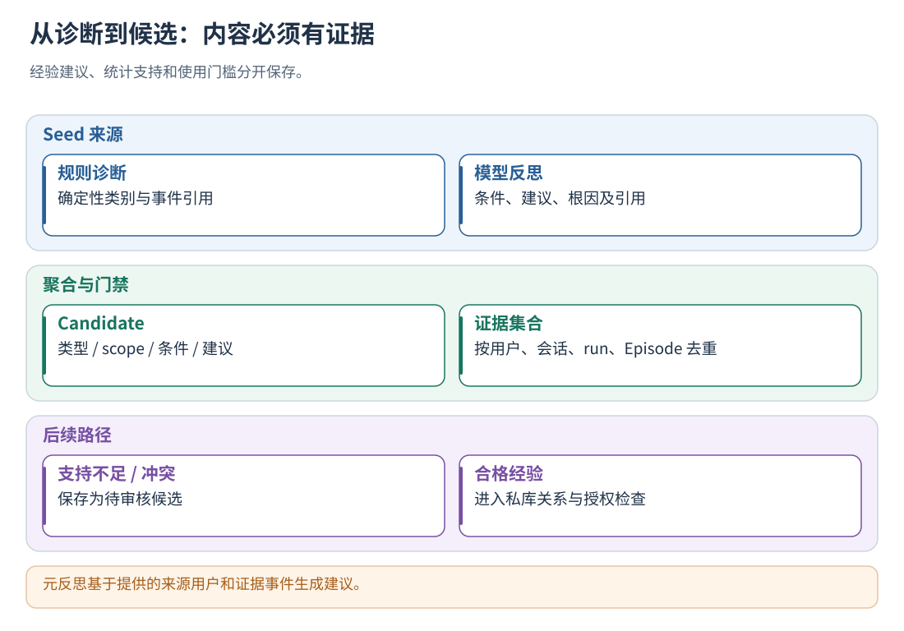
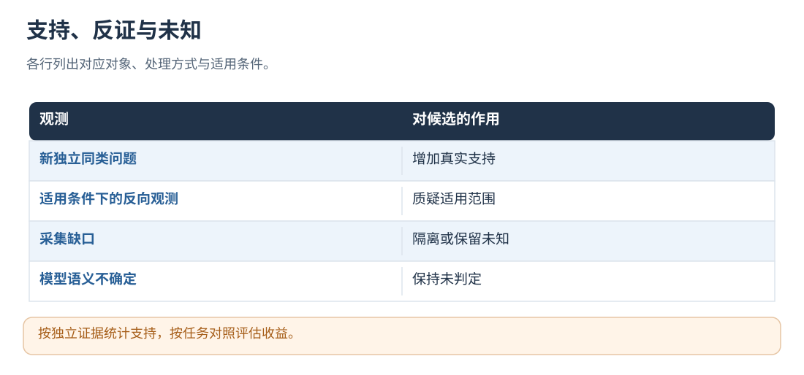

# 12 · Seed、候选、反证与元反思

[文档首页](README.md)

## 本章目标

从单条诊断走到有来源、作用域、触发条件和支持门槛的进化建议。

## 设计思路

候选聚合保留证据引用，元反思基于这些来源组合和提炼建议。置信度用于筛选，任务级评测用于衡量应用效果。



读图：元反思基于提供的来源用户和证据事件生成建议。 [放大 SVG](figures/12-candidate.svg)。

## 怎样从评测生成进化候选

主要入口是 `src/analysis/evolution_pipeline.cpp` 的 `synthesize_reports`。
本阶段读取已经生成的 evaluation，并基于批次报告组织候选。

通用后台只消费尚未学习的新 Run，不再构造滚动的历史报告窗口。按用户分队列，达到
learning.min_new_runs 或最老条目的 max_wait_ms 后才具备启动条件，同时受全局 min_interval_ms 约束。
从已具备条件的队列中优先选择最老样本所在组，按 max_batch_runs/max_batch_bytes 截断后冻结成员。
不同用户不会混合入库；运行期间的新到达项留在后续批次，不打断或重启当前批次。

状态分为“采集闭合 → 待学习 → 单轨迹分析 → 候选合成 → 记忆提交 → 完成”，分别保存检查点：

- runs 中的排队时间与 learning/jobs 的冻结成员用于恢复；schedule.json 保存冷却期限。
- 已生成的 evaluation 在核验运行身份、来源指纹和报告指纹后复用；样本按运行身份区分。
- candidates.pb 保存已经合成的候选；重试入库复用同一候选与 batch_id，记忆提交保留既有幂等检查。
- 一个报告损坏或分析失败，记录该 run 的错误，其余报告继续；批次级故障保存阶段，等待显式重试。
- 若崩溃后发现分析处于 running 且没有报告，不猜测模型调用结果、不自动重发；显式重试可能产生额外计费。
- 完成标记缺失但批次完成记录已保存时，只补齐状态，不重新评测；成功缓存缺失或指纹不符时失败关闭。

候选支持证据通过 Memory 跨批次累积。同时将**本批新报告**与现有记忆对比：只有发现新的反证，
才带上该条旧候选参与更新。无新报告时不会重生成旧候选，也不会为了查反证重新扫描历史日志。
每批模型预算扣除单轨迹调用（含严格模式失败预留），剩余预算用于元反思和记忆整理。
逻辑调用预算与 HTTP 重试分别计数；重启或显式重试可能再次调用供应商并产生费用。

元反思返回格式不合规时，记录具体字段错误码。每批最多追加一次格式修复调用，仍占用
`evaluation.max_model_calls`，并预留后续兼容分组的调用预算、遵守元反思输入长度限制。
修复仅重发原候选和固定错误码，不回传错误响应正文；证据越权、凭据及传输错误不走格式修复。
修复后重新执行完整校验，失败时保留原候选，不把失败响应标为成功，也不重跑 Agent 或轨迹分析。
请求指纹和调用次数包含实际发生的修复调用。

### Seed 的两种来源

**规则来源**：从有确定性无效证据、且生成器认识的诊断类别构造建议。

| 诊断类别 | 候选类型 |
| --- | --- |
| `non_retryable_repeat` | RETRY_POLICY |
| `invalid_action_repeat` | SKILL_ORCHESTRATION |
| `result_not_consumed` | TOOL_RESULT_CONSUMPTION |
| `exact_repeat`、`no_state_progress`、`state_oscillation` | LOOP_STOP_CONDITION |

后三行由候选生成器支持；是否生成对应候选取决于输入报告提供的诊断类别。
规则建议由模板构造，触发信息可包含 category/error_class/retryability；部分规则建议模板仍写在 C++ 中。

**模型来源**：从成功通过校验的对话级反思提取动作编排、经验注入和结束条件建议。
候选来源使用通过校验的模型评测结果，失败响应保留在错误状态中。

模型的经验注入、技能编排、循环停止三个建议数组使用相同的单条契约：

```json
{
  "target_scope": "输入白名单中的一个作用域",
  "trigger_pattern": "执行者当前能够观察到的具体条件",
  "proposed_change": "在该条件下执行的一条行为经验及必要例外",
  "evidence_event_ids": ["直接支持本条经验的事件"]
}
```

三个数组分别映射 L1、L2、L3；协议 `ExperienceAdvice.target_type` 未填写时按旧 L1 处理。
单条建议的格式或证据不合法，只丢弃该条并记录诊断，不使同轮的其他有效建议全部失败。
标准轨迹中的旧字符串仍留在分析报告中，但不再据此生成缺少真实条件的候选；旧 SessionLog
导入保留原有兼容行为。自由文本 L2/L3 建议需要经过后续控制生成与评测，不直接变成执行命令。
新格式以 `scoped-experience-generator-v1` 标记契约，填写有效 scope 和可观察的业务触发条件。
生成器按每条经验引用的事件定位对应 Episode，建立各自的证据集合。

### Candidate 身份与证据去重

文本规范化只做空白折叠、ASCII 小写等确定性处理，保留非 ASCII 字节。
它不会理解“缺少素材”和“未上传图片”是否语义等价。

概念公式为：

```text
proposal_fingerprint = SHA256(normalize(proposed_change))
candidate_key = target_type | generator_version | normalize(target_scope)
                | normalize(trigger_pattern) | proposal_fingerprint
candidate_id = "candidate:" + SHA256(candidate_key)
```

同一候选重复出现时合并证据，不生成无穷多条新候选。
证据自身还有 `evidence_id`：由证据种类、用户/会话/运行身份、源内容指纹、排序去重后的 Episode/诊断/事件集合等构造。
证据按 evidence_id 去重，相同证据重复处理保持计数不变。

候选保存适用范围、问题、建议、预期收益、支持与反证、来源及质量状态。

### 支持度与置信度的具体公式

`finalize_candidate` 根据去重后的证据重新计算支持统计：

- `D`：支持证据中不同用户/会话/Run 组合的数量。
- `U`：不同 user/conversation/run/episode_id 组合的数量；没有 Episode 时退回到支持证据条数。
- `E`：所有支持证据置信度的平均值。
- `Dmin`、`Umin`：要求的支持数量，默认都为 2，计算时至少取 1。

```text
F = min(min(1, D / Dmin), min(1, U / Umin))
C = clamp(0.7 × E + 0.3 × F, 0, 1)
若有反证：C = C × 0.6
```

例如同一候选只有一次 Run、一个 Episode，证据置信度 0.9：
`F=0.5，C=0.7×0.9+0.3×0.5=0.78`。
另一次独立 Run 提供第二个 Episode，平均证据置信度仍为 0.9，则 `F=1，C=0.93`。
0.93 为证据聚合评分，用于候选筛选。

质量状态按顺序确定：

| 条件 | candidate.status | 后续含义 |
| --- | --- | --- |
| 新格式经验缺少有效 scope/条件/行为，或完全无支持证据 | REJECTED_BY_GATE | 跳过正常入库 |
| 存在反证 | CONFLICTED | 保留为冲突候选，等待后续处理 |
| D、U 均达到门槛 | PROPOSED | 具备进一步筛选资格 |
| 其他 | INSUFFICIENT_SUPPORT | 可保存，等待未来证据补充 |

入库时跳过 REJECTED_BY_GATE；支持不足或有冲突的候选可作为待处理记忆保存，继续积累证据。
支持门槛主要限制 PROPOSED 和后续注入资格。否则单次观察永远无法积累成多次支持。

### 反证的匹配与处理

候选有明确 `error_class` 时，生成器会在同作用域的有效报告里寻找：

- 最终判定为 USEFUL 或 NECESSARY_RETRY 的 Episode；
- 其中存在同错误类别的动作证据。

匹配到后追加反证证据，重新计算候选状态和分数。
反证匹配依据同 scope 和 error_class 的反向观测。命中后暂停相关候选注入，后续结合触发条件与任务目标继续复核。




读图：按独立证据统计支持，按任务对照评估收益。 [放大 SVG](figures/12-counterevidence.svg)。

## 怎样跨轨迹进行元反思

元反思判断哪些候选真正等价、选择已有代表并合并独立支持，不扩大代表的适用条件。
随包运行配置的 `enable_meta_reflection` 默认 true；执行仍需要可用模型、合并候选和预算。
关闭时不调用元反思模型，原始的规则候选与轨迹分析候选继续进入同一记忆管理流程。

处理步骤如下：

1. 按 `target_type + target_scope + 是否为新格式经验契约` 分组。
2. 组内少于两条候选，不做合并调用。
3. 为每个可合并组构造请求，包含候选实际条件、问题、建议、反证数量与允许选择的 seed ID；支持门槛和原始证据留在程序内。
4. 预检查所有计划请求的大小和调用预算；不足时保留原候选，不无限拆分或扩容。
5. 模型输出要合并的 seed_ids、组内的 canonical_seed_id 和置信度；文本字段原样复制代表，不重新填写事件 ID。旧响应没有 canonical_seed_id 时，使用所选集合的首条。
6. 在同一类型、scope 和经验契约的白名单组内合并。条件、问题、动作及预期收益由程序从代表复制，证据与溯源继承所选 seeds；不采用模型新写的扩大条件或混合动作。旧格式响应如果提供 evidence_event_ids，仍须是所选 seeds 的非空合法子集；未知引用会被拒绝。
7. 所有该阶段响应通过验证后，才用合并结果替换所使用的 seeds；未被合并的 seeds 保留。

如果其中一次关键响应不合法，当前元反思采用保留原始候选的回退方式，不拿已经完成的一部分调用拼出假完整结果。
已发生的模型请求依然计入成本。元反思后的支持数量、反证和质量状态仍由继承的真实证据重新计算。
confidence 作为筛选信号；支持数与候选状态由实际证据计算。

元反思模型只看候选内容和 seed 标识，不会再次自动读取所有 content_events。
需要模型判断细节时，在候选摘要中提供相关上下文和证据。

## Candidate 的字段分组

| 分组 | 字段 | 作用 |
| --- | --- | --- |
| 身份 | candidate_id、generator_version、proposal_fingerprint | 复现生成规则、稳定聚合与追溯 |
| 可应用建议 | target_type、target_scope、trigger_pattern、proposed_change | 给谁、在什么条件下、建议做什么 |
| 解释 | observed_problem、expected_benefit、error_class、retryability | 说明观察到的问题，不等同于控制规则 |
| 门禁 | status、gate_reason、confidence、required_supporting_dialogues/episodes | 决定证据是否达到使用条件 |
| 支持统计 | support_user/conversation/dialogue/episode_count | 从去重后的来源证据计算 |
| 反向证据 | contradiction_count、contradiction_evidence | 提醒适用范围受到质疑 |
| 溯源 | support_evidence、source_seed_ids、meta_reflection_applied | 从候选回到具体报告与模型阶段 |

每条 CandidateEvidence 记录 evidence_id、kind、source、source_fingerprint、episode_ids、
diagnostic_ids、evidence_event_ids、verdict 和 confidence。按用户、会话、run 与局部 step 身份去重。

## 候选状态与使用资格

INSUFFICIENT_SUPPORT 候选保存在私库，继续积累后续证据。
CONFLICTED 可以保留用于反证管理；REJECTED_BY_GATE 被入库阶段跳过。
PROPOSED 只是通过当前支持门槛，之后仍有私库冲突、scope、内容、授权和运行时匹配检查。

元反思在随包运行配置中默认开启；没有可合并候选时正常跳过，不额外调用模型。
“经验注入”“Skill 编排”“loop 收敛”是并列改进方向；当前可自动注入的是满足结构契约的经验，
自由文本编排/循环建议不会自动变成可执行的规则代码。

## 实现定位

- `src/analysis/evolution_pipeline.cpp::synthesize_reports / finalize_candidate`
- `include/agentflow/trajectory/experience.h`
- `config/prompts/meta-reflection-system.txt`
- `proto/hybrid_evaluation.proto`

---

[文档首页](README.md) · [上一章：规则、模型与 Hybrid Evaluator](11-evaluation.md) · [下一章：用户私有记忆：持续入库与全库管理](13-private-memory.md)
