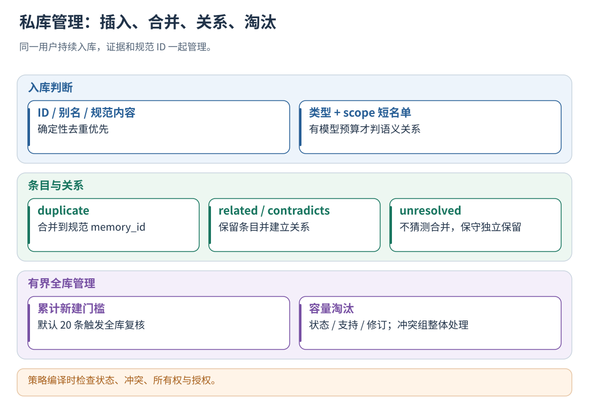
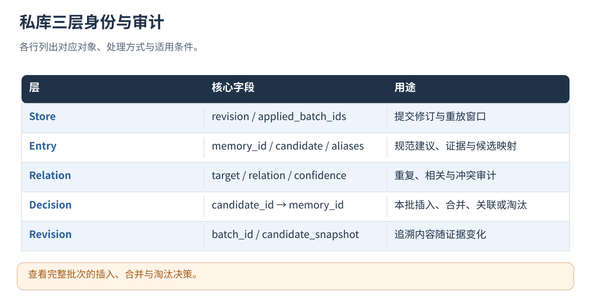

# 13 · 用户私有记忆：持续入库与全库管理

[文档首页](README.md)

## 本章目标

逐步理解同一用户的候选合并、关系管理、全库整理、容量与应用资格。

## 设计思路

用户数据先进入自己的记忆库，保留完整证据与审计关系；记忆保存与应用授权分离。私有库并不因为公共机制开启而变成对所有用户可见。



读图：策略编译时检查状态、冲突、所有权与授权。 [放大 SVG](figures/13-private.svg)。

## 怎样持续入库、判断重复与冲突

### 一条候选怎样找到已有 Memory

核心是 `curate_memory_in_place`。每批先检查结构与身份，随后按以下顺序处理每条候选：

1. batch_id 已应用：走幂等结果，不再把相同批次当作新增证据。
2. candidate_id 或 `source_candidate_ids` 别名已存在：直接合并证据，不调用模型。
3. 规范化后的策略身份完全相同：确定性合并；允许兼容的生成器版本差异，但保留新旧经验契约边界。
4. 其余候选：在同类型、同作用域、同经验契约、可管理状态的历史条目中建立短名单。
5. 没有可比对象：作为独立记忆插入。
6. 有可比对象：若模型启用且可用，判断 DUPLICATE / RELATED / CONTRADICTS / DISTINCT。
7. 按关系和置信度门槛执行合并、关联或独立保存。

新插入的 entry.status 是 CANDIDATE，不自动设为 VALIDATED。
`memory_id` 由规范候选构造，当前具体形式为 `"memory:" + candidate_id`，即常见 `memory:candidate:<hash>`。
发生语义合并后，原 candidate_id 作为 alias 指向同一 memory_id。
批次的 `memory_update.decisions` 记录本次候选最终映射、判断方法、关系、置信度和修订信息。

### 没有向量数据库时怎样选比较对象

`memory_shortlist` 使用的是确定性词面相似度：

```text
text = normalize(trigger_pattern + "\n" + observed_problem + "\n" + proposed_change)
A、B = 两段 text 的字节三元组集合
similarity = 2 × |A ∩ B| / (|A| + |B|)
```

使用 Sørensen–Dice 相似度，三元组按 UTF-8 字节切分。
实现处理空串/短串边界，按相似度降序、memory_id 升序排序，默认取前 8 条。
结构兼容但词面分为 0 的记忆也可能进入短名单；没有一个“低于某分数必然无关”的硬阈值。

短名单只是降低模型输入成本。真正能否合并，由后面的语义判定及结构门槛决定。
词面差异较大的近义记忆可能落在短名单之外；后续全库整理继续处理关系。

### 模型关系判断如何影响入库

记忆整理模型只看到 incoming_candidate 与 memory_options 的具体内容。
返回的已有 memory_id 必须属于当前短名单；DISTINCT 必须返回空 ID。
模型返回关系建议，程序核验后更新 Memory Store、证据与候选状态。

| 结果 | 默认接受门槛 | 入库动作 | 为什么 |
| --- | --- | --- | --- |
| DUPLICATE | confidence ≥ 0.90 | 合并到已有记录，保留来源别名，不新增一条相同策略 | 适用条件与行为本质相同 |
| RELATED | confidence ≥ 0.75 | 独立保存，添加双向相关关系 | 保留各自条件与建议 |
| CONTRADICTS | confidence ≥ 0.75 | 独立保存，添加双向冲突关系 | 不任意选择一方覆盖另一方 |
| DISTINCT | 合法响应 | 独立保存 | 没有可确认的同一策略 |
| 模型不可用、响应错误、预算不足或置信度不够 | 不做语义猜测 | 独立保存并记录未解决/低置信情况 | 保留独立记录，等待后续整理 |

已有 CONTRADICTS 不会被一次 RELATED 判断轻易降级抹掉。
合并时保留规范条目的建议正文，累积证据和别名，再重新计算支持与状态。

“候选的反证证据”与“两个记忆之间的冲突边”是两套机制。
前者来自评测证据匹配，后者来自记忆语义整理；后续经验筛选会同时检查两者。

## 全库整理的触发与步骤

增量入库之外，累计**新插入的记忆条数**达到阈值后触发全库整理，默认阈值为 20。
重复候选合并只更新已有条目，新增计数保持不变。

1. 在可管理条目中找规范化身份相同的记忆，先确定性合并。
2. 合并时保留规范 ID，迁移别名、证据、修订和关系，删除重复记录。
3. 如启用语义整理，为每个可比较条目选择短名单，预检查模型预算和提示词限制。
4. 逐个做关系判断；重复则合并，相关/冲突则维护双向关系，独立则保留。
5. 整理完整结束后才重置新增计数；未完整结束时保留计数，让后续非幂等批次再次尝试。

全库整理遍历可管理条目，并为每个条目构造有界短名单进行比较。
规范条目通常优先保留 VALIDATED，其次按稳定 ID 选择，避免同样输入随机留下不同主键。
语义阶段中途失败可能保留已经完成的有效修改，并记录整理不完整；这不同于元反思阶段整体保留原 seeds 的回退方式。

模型返回 HTTP 429 时，本次入库停止发起新的语义判断请求；并发写入导致的内部重算也保留这个停止状态。
精确去重和保守保存仍照常完成，全库语义整理记录 `http_429`，不清除待整理计数。
下一次非幂等入库可以重新尝试，已经应用的相同批次不会为了重试模型而重复累加证据。

关闭 `enable_memory_semantic_matching` 后可以只做确定性整理。
开启语义整理且存在待比较对象时，需要可用模型；模型缺失时保留待处理状态。

## 记忆怎样淘汰，为什么冲突要成组处理

每次入库都会执行容量控制，幂等重放路径也会检查容量。
算法默认上限为 512 条记忆和 256 MiB Memory Protobuf，在线写入同时受运行时读取上限约束。
`applied_batch_ids` 默认最多保留 4096 项，超过先裁剪旧的批次去重记录。

淘汰算法先将 CONTRADICTS 关系的连通分量组成淘汰组：

```text
A 与 B 冲突，B 与 C 冲突 ⇒ {A,B,C} 是一个组
D 只与 A 相关           ⇒ D 不因为 RELATED 被并入该组
```

这样可以防止只删掉冲突一侧，另一侧突然表现得像“已经没有争议”。
每组按以下维度形成确定性排序键，较弱的组优先淘汰；每个维度取组内最大值：

1. 记忆状态：VALIDATED > CANDIDATE > ARCHIVED > REJECTED/未指定。
2. 候选状态：PROPOSED > CONFLICTED > INSUFFICIENT_SUPPORT > REJECTED_BY_GATE/未指定。
3. 支持用户数。
4. 支持 Run 数。
5. 净支持 Episode 数，按 `max(支持 Episode 数 - 反证数, 0)` 计算。
6. 候选置信度。
7. 最近的 store revision。
8. 稳定 ID，用于打破平局。

按排序逐组删除，直到条目数和字节数符合预算，并清理失效关系。
因冲突必须成组删除，可能一次释放超过当前所需的容量，这是保留争议信息一致性的代价。

revision 记录更新顺序，VALIDATED 作为条目状态参与筛选。
条目内的证据/修订没有各自独立的上述数量上限，主要受总字节预算约束；大条目也可能整体被淘汰。
另外，**记忆容量控制不会清理历史 traces/evaluation 文件**，长期部署仍需单独设置原始产物保留策略。

## 私有工作集与默认开启的公共库是什么关系

每个用户有独立 EvolutionMemoryStore。不同 conversation 和 run 可以累计进同一用户库。
私有文件仅供其所属用户使用；公共 manager 从合格经验提炼公共条目，原私人条目保留在所属用户库中。
公共经验通过公共投影使用，私人证据继续按用户分别积累。




读图：查看完整批次的插入、合并与淘汰决策。 [放大 SVG](figures/13-private-fields.svg)。

## 入库与策略快照的筛选条件

新建记忆通常为 CANDIDATE；其中候选可以是支持不足、存在冲突或已提出的不同状态。
当前在线经验筛选只接受 CANDIDATE/VALIDATED 且 candidate.status=PROPOSED，并继续检查：

1. 所有支持来源属于当前用户，support_user_count=1 且有证据。
2. target_type 为经验注入，符合当前 scoped experience 生成契约。
3. 作用域获准，条件、建议及历史问题满足结构、长度与隐私约束。
4. 没有 contradiction_count/contradiction_evidence，且不处于私库 CONTRADICTS 关系中。
5. 不超快照条数和字节预算；运行时另外检查内容版本授权与词面命中。

记忆经过上述筛选和版本授权后进入模型输入，应用效果通过任务级评测衡量。

## 精确去重与语义匹配的区别

精确规范化处理空白与 ASCII 大小写，语义关系通过短名单模型判断。
结构等价比较 target_type、target_scope、trigger_pattern 和 proposed_change；
模型语义比较先限制类型与 scope，再按文本近似分数取默认 8 条短名单。
模型从同类型、同 scope 的候选短名单中选择 memory_id，程序校验后合并。

同 candidate_id 或已保存别名优先匹配；重复只合并证据和来源别名，保留规范 memory_id。
模型不确定或不可用时保留独立条目，并将关系留待后续整理。
后续全库整理继续按预算和短名单处理剩余关系。

## Agent 实测结果如何自动更新记忆

启用 `policy_evaluation_file` 后，后台评测结果还会回流到记忆管理。依据是固定任务上的真实执行结果，
并结合轨迹中的应用回执核验是否实际使用了经验。配置与运行步骤见[任务评测](19-datasets-and-benchmarks.md)。

管理层维护两层结果：

- `memory/evaluation-state.json`：当前用户的评测反馈镜像，包含私有和公共经验在该用户实验中的表现与报告引用。
- 私有 `EvolutionMemoryEntry.evaluation_feedback`：匹配当前 memory_id 和 content_revision 的摘要，和记忆一起保存到 PB 与 JSON。

| evaluation_feedback 字段 | 含义 |
| --- | --- |
| content_revision | 被评测的经验内容版本；与新内容不匹配的结果不会自动套用 |
| status | 版本支持、待复核、混合结果，或满足单条归因条件后的验证/退化状态 |
| report_ids | 对应 agent-evaluation 下的 job ID，最多保留最近 32 个报告关联 |
| positive_trial_count | 单条经验对照中，候选通过而基线失败的配对次数 |
| negative_trial_count | 单条经验对照中，候选失败而基线通过的配对次数 |

版本通过时，其包含的经验记为 `supported_in_version`；未通过记为 `review_needed`；同时有通过与失败报告记为
`mixed_version_results`。这些是**版本组合层面的观察**，不直接改变条目的 CANDIDATE/VALIDATED 生命周期。
计数与报告按 job ID 幂等，同一评測结果重复刷新不会累加。

自动调整生命周期需要满足以下全部条件：

1. 基线与候选为同级策略，Agent 部署配置、控制规则、跨库关系等保持一致。
2. 二者只有一条获准经验新增或改写，其余获准经验相同。
3. 候选试验的 `advice.applied` 为 applied，且精确引用该 memory_id/content_revision。
4. 同任务、同 repetition 的基线和候选均取得确定的评分结果。

达到 `gate.memory_min_pairs` 次配对改善且没有配对退化，摘要状态为 `validated`，私有条目提升为 VALIDATED；
达到同一门槛的配对退化且没有配对改善，摘要为 `regressed`，私有条目归档为 ARCHIVED，后续候选不再包含它。门槛默认 2，可通过评测配置调整。
两种方向都有证据时记为 `conflicting_trial_results`，保留证据，交由后续整理继续处理，不自动选择方向。
只比较平均时延、多个经验一起变化、同题同为通过、经验未被注入、任务环境错误或评分不确定，都不会触发上述单条升降级。

自动归档保留原始记忆和证据，并通知公共库管理重新检查相关私人来源的可用性。公共经验的试验反馈按用户记录，
不由一个用户的一次版本失败直接改写公共条目。公共信任、跨库冲突和撤回机制继续由[公共管理器](14-shared-memory.md)统一处理。
评测试验轨迹通过 evaluation_trial_id 标记，导入生产学习时会被拒绝，避免把“测试中重述过经验”再次当作独立支持证据。

元数据更新只递增 Memory Store revision，不改变经验正文和 content_revision，因此不会单纯因为写回评测摘要再次评测相同行为版本。
内容改写后的新版本需要新的证据。评测配置/数据集变化会开启新的评测上下文，旧上下文反馈保留审计，但不作为当前新评测结论。

## 字段：Store、Entry、Relation 和更新结果

| 对象 | 字段 | 说明 |
| --- | --- | --- |
| Store | schema_version、store_kind、store_version | 文件类型与兼容版本 |
| Store | revision | 成功批次写入的库修订 |
| Store | applied_batch_ids | 有界批次幂等窗口，默认最多 4096 |
| Store | new_entries_since_full_curation | 自上次完整全库复核后的累计新建数 |
| Entry | memory_id、status、candidate | 规范记忆身份、生命周期与当前建议/证据 |
| Entry | first_batch_id、last_batch_id、observed_batch_ids | 初次、最近及观察过的批次来源 |
| Entry | source_candidate_ids | 已合并候选的别名，便于后续直接去重 |
| Entry | revisions | store_revision、batch_id、candidate_snapshot 的历史 |
| Entry | relations | target_memory_id、relation、confidence、decision_id |
| Entry | evaluation_feedback | 当前内容版本的实测状态、报告引用和配对改善/退化计数 |
| memory_update | revision_before/after、inserted/updated/unchanged/evicted 计数 | 本批对库的实际影响 |
| memory_update.decisions | candidate_id、memory_id、matched_memory_id、action、relation、match_method | 候选对应哪条记忆，为什么插入/合并/关联/淘汰 |
| 决策审计 | considered_matches、模型/请求/响应指纹、错误码、attempts | 用的是哪些比较对象，是否真的完成模型判定 |
| 全库复核审计 | full_curation_triggered/completed、pending_new_entry_count、examined/merged_count | 是否达到触发阈值、是否完整做完 |

一条候选可能在同批先插入，再在容量阶段被淘汰；定位最终状态要读完整 decisions 和最新 Store。
PB 是权威数据，JSON 是可读视图；通过记忆管理入口更新内容。

## 全库复核与淘汰的细节

默认每累计新建 20 条记忆触发一次整理。
先做确定性重复归并和关系修复，再在可用模型/预算内做语义整理。
只有完整复核完成才清零累计计数；部分失败保留待办计数，在后续入库时继续触发。

容量淘汰的比较顺序包括记忆状态、候选状态、支持用户/任务、净支持 Episode、置信度、最近库修订及稳定 ID。
私库按修订顺序管理新旧条目；公共支持按时间 TTL 计算新鲜度。
CONTRADICTS 连通组一起保留或一起淘汰，避免删除反证后让另一条突然变成可用。
超出条数或字节预算都会管理容量；某个冲突组较大时可能一次淘汰多条。

## 私库参数与有效容量

配置在 runtime_config.evolution：

| 参数 | 默认 | 含义 |
| --- | --- | --- |
| max_memory_entries | 512 | 私有工作集条数上限 |
| max_memory_bytes | 268435456 | Pipeline SDK 的默认字节上限 |
| max_applied_batch_ids | 4096 | 精确重放窗口 |
| max_memory_match_candidates | 8 | 每次语义判断的短名单 |
| max_memory_match_prompt_bytes | 262144 | 语义整理请求构造预算 |
| max_memory_update_retries | 3 | 并发提交冲突后的有界重算 |
| full_curation_new_entry_threshold | 20 | 新建记忆累计触发全库复核 |
| min_memory_duplicate_confidence | 0.9 | 自动合并重复门槛 |
| min_memory_relation_confidence | 0.75 | 建立 related/contradicts 门槛 |
| enable_memory_semantic_matching | true | 有模型才执行语义判断 |

统一后台写入上限取 evolution.max_memory_bytes、服务 max_run_bytes 和 shadow_options.max_memory_bytes 的最小值，
随包配置组合下的在线私库读取上限通常为 16 MiB。
详细并发写与重放规则见[存储与恢复](18-storage-and-recovery.md)。

## 故障处理

私库读取与公共管理分别处理故障：公共 worker 隔离受影响用户，继续处理其他用户；
但该用户编译自身策略仍可能因记忆不可读而降级/报错。
PB 提交成功但 JSON 镜像写入失败时记录 memory_json_view_write_failed，恢复时以 PB 和提交记录为准。
工作集按容量维护；原始轨迹、批次与备份由部署方按保留周期管理。

## 实现定位

- `src/evolution_pipeline.cpp::curate_memory_in_place / run_full_store_curation / enforce_memory_capacity`
- `src/shadow_runtime.cpp::compile_shadow_policy`
- `proto/hybrid_evaluation.proto`

---

[文档首页](README.md) · [上一章：Seed、候选、反证与元反思](12-reflection-and-candidates.md) · [下一章：公共与私有协作：晋升、冲突、信任与淘汰](14-shared-memory.md)
