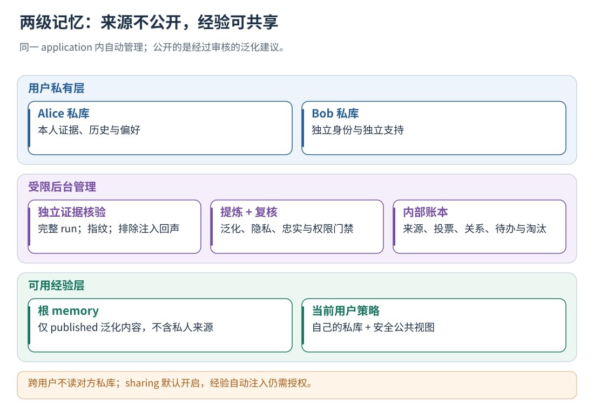
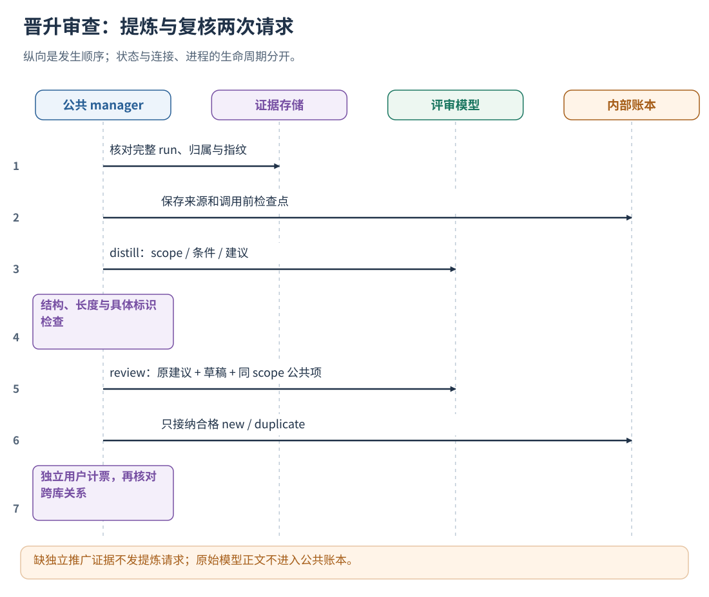
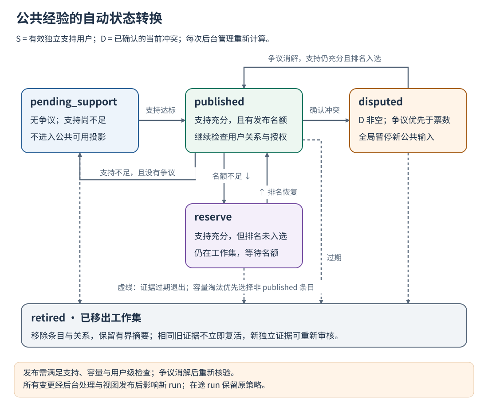
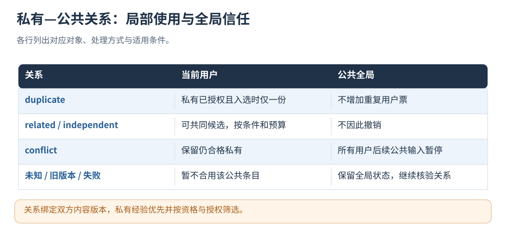
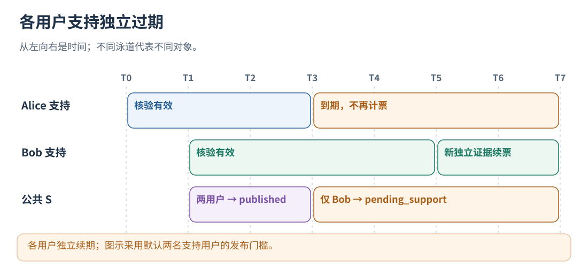

# 14 · 公共与私有协作：晋升、冲突、信任与淘汰

[文档首页](README.md)

## 本章目标

完整掌握默认开启的两级记忆体系、全部管理参数、自动状态机、字段与恢复边界。

## 设计思路

公共库保存经审查的泛化建议。独立支持决定发布资格，已确认冲突触发公共建议暂停，合格私有经验优先使用。




读图：跨用户不读对方私库；sharing 默认开启，经验自动注入仍需授权。 [放大 SVG](figures/14-two-pools.svg)。

## 1. 两级库的职责与默认行为

本机制默认开启。省略 sharing、写 sharing={} 或 enabled=true，都会启用两级管理；
显式 enabled=false 才关闭公共管理与公共经验输入。私库按用户持续入库，不需要额外开启一个私库开关。

| 数据 | 存放位置 | 是否允许跨用户使用 |
| --- | --- | --- |
| 用户私有经验、证据、历史修订 | by-user/<user>/memory/evolution-memory.pb | 仅当前用户 |
| 可用公共经验 | memory/evolution-memory.pb | 同 application、合法 scope、通过用户关系与授权检查后 |
| 公共权威管理账本 | learning/shared-memory.json | 供部署方后台管理 |
| 单用户跨库关系视图 | by-user/<user>/memory/shared-relations.json | 保存该用户的跨库关系 |

HTTP、原生后台与 learn 使用同一套 IntegrationService 管理流程和目录规则。
各入口复用算法、状态协议与存储布局；同一 data_dir 由一个进程持有写入权。
低层 Pipeline SDK 直接操作私库时并不会自动建立公共管理、后台通知或服务身份；端到端使用选择统一入口。

公共管理默认开启。使用语义提炼前配置评测模型；经验自动注入由 auto_approve_experiences 控制，默认 false。
公共状态可以为空、待支持或 waiting_for_model。需要自动注入时由部署方明确授予权限，详见[策略](15-policy-snapshots.md)。

## 2. 私有数据与公共经验的分工

私人记忆保存用户事实、偏好、原始问题和来源关系，公共文件保存提炼后的泛化经验。
公共管理只从合格私人经验抽取 target_scope、trigger_pattern、content，生成经过泛化的新建议。
私人证据留在私库和内部账本；用户可同时使用自己的经验与应用公共经验，不读其他用户的私库。

application_id 划定共享边界，各应用分别维护公共库；
scope 划定同一应用内的策略分区，经验和规则按 scope 筛选。
actor_id 标识执行者，共享权限由应用、用户和 scope 决定。内部字段映射见[协议](05-protocol.md)。

## 3. 自动管理何时启动

一次私库批次提交后，用户被加入去重 FIFO 待办。重复入队不会积累同一用户的无限副本。
重启时账本里已知用户和配置中已有私库的用户重新检查；公共可用投影变化后，已知用户再进入跨库检查队列。

每个实际周期最多处理一个用户；仍有未处理来源或关系则把该用户放回队尾。
周期受 min_interval_ms 和最早支持到期时间约束。无待办、无到期事项时不扫描全库。
模型不可用时继续执行支持撤回、过期与精确关系检查；语义提炼等待模型恢复。

公共管理和私库学习共用后台调度器，但使用不同模型调用预算。关系请求可有界并发，状态提交保持有序。
每条新日志不会立即触发一次全库公共审查；长模型调用也可能延迟后续用户的处理。
结合待办增长速度、单周期耗时和容量限制调整管理频率。

## 4. 第一层门禁：什么私有记忆能作为来源

manager 先为该用户编译私有经验工作集，沿用在线私库的资格检查：

- 当前用户独占的支持证据，support_user_count=1。
- scope 合法，类型为 EXPERIENCE_INJECTION，并满足 scoped experience 结构契约。
- 记忆状态为 CANDIDATE/VALIDATED，候选状态为 PROPOSED。
- 没有反证计数、反证列表或私库内部 CONTRADICTS 关系。
- 条件、建议、来源字段满足长度和隐私校验。
- 不超 shadow_options 限定的可编译工作集与快照大小。

本轮可处理的来源范围由私库条数、快照预算和筛选条件共同决定。
不满足条件的来源不会因为公共机制开启而被强制晋升，也不会获得经验注入权限。

## 5. 第二层门禁：独立证据如何核验

public_evidence 逐条读取候选的 support_evidence，检查对应的受管 run 与实际轨迹文件：

1. 来源 user_id 必须是当前用户，conversation/run 身份有效且能定位同一条受管记录。
2. run 已关闭、采集完整、evaluation_status=completed，且用户/会话归属一致。
3. 候选 source_fingerprint 与受管来源指纹一致，实际轨迹文件的摘要也与保存值一致。
4. 同一个 run/来源指纹只计一次；在线来源默认至少两条不同完整 run，训练来源另按下面的任务组核验。
5. 能核验的来源集合排序后计算 evidence_fingerprint，保存为支持依据。

来源内容指纹与磁盘报告指纹按各自格式计算，由程序核验对应来源。

### 防止“经验回声”成为新证据

包含经验注入回执的轨迹，从独立推广证据中排除。
当前保守排除包括 trajectory-experience、旧 evolution.policy.receipt 标记，
以及标准轨迹中 advice.applied 且成功应用非空 experiences 的记录。

独立证据检查依赖宿主完整记录经验注入回执；接入时需覆盖各个实际注入位置。
当前按整条受影响轨迹保守排除，也可能损失其中与被注入经验无关的有效证据。
同一用户只计一票，用户身份通过宿主鉴权确定。

### 没有独立推广证据时

来源标记 private_only / independent_evidence_missing，不调用公共提炼模型。
合格私人经验仍可按自身条件使用。
诊断时查看 learning/shared-memory.json：last_status=completed（旧版为 processed）、pending_users 为空且 sources 为上述状态，表示管理周期已执行但缺少独立证据，不是公共模型请求失败。completed_with_unresolved 表示仍有未决关系。公共投影可能只包含 application_id，未写出的 experiences 表示空库。
重要区别：跨库冲突审查使用合格私人经验，不额外要求它已经达到 min_source_runs 的公共推广门槛；
用户的合理差异不必先有多次成功 run 才能对公共建议提出冲突。

### 离线训练来源的公共准入

冷启动训练也能提供公共来源，但与真实用户支持分别计数。默认开启 `allow_training_sources`，
经验管理本身不要求配置 `policy_evaluation_file`，也不要求先调用任务裁判。
`learn --training-evaluation REPORT --dataset DATASET` 校验成功后，自动在
`learning/training-datasets/` 登记冻结数据集位置；无需用户额外配置。
每次检查支持时仍重新核对数据集清单和版本，数据被改动或来源不可读时撤回该来源支持。
已有自动训练记录继续兼容从 `policy_evaluation_file` 定位数据集。
程序只接纳已有训练导入流程校验过的无策略基线轨迹，并再次核对：

- 当前冻结数据集中的任务为 `train`、`reviewed`，dataset_version 和 task_version 一致。
- 受管记录为已导入的 L0 `baseline_training`，采集完整、分析成功、来源指纹匹配。
- `run.start` 的 evaluation_trial_id 与训练来源绑定；轨迹具有 passed/failed 结论，或经过正式导入校验的 `uncertain` + `task_assessment_status=not_requested`。后者表示没有请求任务评分，不表示业务通过。
- 没有经验注入回执。失败案例可以提供经验，采集失败或分析失败不能提供支持。

随后仍经过模型提炼、另一请求复核、私有—公共关系核验。训练支持按
`hash(dataset_version + group_id)` 去重，默认一个公共条目至少需要两个独立任务组。
同一道题换用户、重复运行或同组变体都不会增加任务组票；人工测试身份不会增加 supporting_users。
验证集、留出集与带策略候选轨迹不进入这条学习路径。

满足门槛后，条目进入公共投影，供用户自己的经验与公共经验一起编译候选策略。
这不等于策略已取得效果收益：策略仍需原有配对 Agent 评测与发布门槛，才可作为获准版本应用。
关闭 allow_training_sources 会撤回训练支持；冲突、证据过期、来源撤回、容量限制与在线来源共用原有管理机制。




读图：缺独立推广证据不发提炼请求；原始模型正文不进入公共账本。 [放大 SVG](figures/14-review.svg)。

## 6. 第三层门禁：模型提炼与独立请求复核

| 阶段 | 模型看到什么 | 返回内容 | 程序硬检查 |
| --- | --- | --- | --- |
| distill | 原经验 scope、条件、建议 | shareable 和泛化后的三字段 | 保持原 scope；检查字段、长度、秘密与具体标识 |
| review | 原建议、泛化稿、同 scope 的公共工作集及核验来源的任务/执行片段 | decision、match_id、四个审查布尔值、confidence | 只有合格 new/duplicate 才接受 |
| cross relation | 当前用户私有经验和某条公共经验 | relation、confidence | 关系枚举、双方版本、置信度和格式校验 |

三个阶段共用 runtime_config.model，不默认调用另一个供应商。
提炼与复核分为两次请求，可由同一模型完成。

标准轨迹复核最多补充两份来源上下文：当前输入、当前轮标准、约束，以及每份最多四个被引用的
事件片段。单份事件正文预算 4096 字节，截短内容明确标为预览；保留原 run/event 身份。
模型的完成声明标为 `agent_report`，工具执行记录标为 `execution_observation`；执行终态不能
代替业务输出状态。没有看到某项事实不等于未执行，证据不足时保留私有或待审。

私库语义管理会比较同一授权范围内的跨 L1/L2/L3 建议，识别“继续执行”与“应当停止”这类冲突；
跨类型不能作为重复项合并。条件互斥不等于冲突，模型不确定时保留独立条目。经验之间的冲突
使用关系记录，不能伪造成某次真实执行失败的反证。

复核必须同时满足 privacy_safe、generalizable、supported、non_overriding=true，
且 confidence 至少 min_confidence（默认 0.9，最大 1）。缺字段不按“默认通过”处理。
review 的 conflict/reject/uncertain、格式错误或低置信度不会变成新的公共支持。
review 拒绝终止本次提炼候选；已确认的私有—公共 conflict 触发对应公共条目的 disputed 状态。

### 内容、隐私和调用限制

公共条件和建议各最多 4096 字节；不需要具体 URL、邮箱、长账号、IP 或本机路径。
程序用通用秘密检查及保守具体标识规则拦截，并排除正文直接包含当前用户 ID 的情况。
模型进一步审核隐含个人事实、偏好与提示注入，和规则检查共同构成公共提炼审查。

共享模型请求中 prompt+payload 最多 1 MiB，响应正文最多 64 KiB；
每份公共提示词读取上限 32 KiB，还受底层 model 请求/输出预算约束。超限失败，不自动悄悄裁掉需要审查的对比对象。
管理账本只记录调用指纹、次数、状态与最终接受的公共正文，不保存原始模型回复和敏感异常正文。
部署时同时检查配置、宿主日志和外部传输链路中的凭据保护。

## 7. 公共 ID、合并和支持计票

新条目的 memory_id 为 shared- 加 SHA256(application_id、分隔符和三字段规范 JSON)。
公共建议的 ID 绑定其内容与作用域。

如果复核判定 duplicate，只能匹配存在且同 scope 的公共条目，补充来源支持关系，不覆盖原建议正文。
相同规范内容得到同一个 ID；近义关系经过语义比较。

公开资格按 accepted 且未过期来源分别计算真实用户支持与训练任务组支持：

- 每个用户最多一票，与该用户贡献几条近似经验无关。
- 默认至少两个不同用户；每个用户的被接纳来源都需要通过独立 run 核验。
- 同一用户重放日志、重复提交同一候选、重复读取相同文件不会增票。
- 各用户的新证据分别刷新自己的支持来源。
- 训练来源使用独立任务组门槛，不把用户数与任务组数混在一起凑发布门槛。

公共经验的可信度管理使用审查门槛、独立来源支持和争议状态；两类支持与争议分别记录。




读图：后台更新公共状态；已开始的 run 保留原策略快照。 [放大 SVG](figures/14-public-states.svg)。

## 8. 发布状态如何计算

令 S 为新鲜有效支持用户集合，T 为训练任务组集合，D 为已确认当前冲突用户集合。
支持充分指 S 达到 min_supporting_users，或启用训练来源且 T 达到 min_training_groups：

| 状态 | 条件 | 是否进入公开 PB / 新快照 |
| --- | --- | --- |
| pending_support | 没有争议，两类支持均未达到各自门槛 | 不进入 |
| published | 没有争议，支持充分，容量排名在前 max_entries | 可进入公共投影；还需用户关系和授权筛选 |
| disputed | 至少一个 accepted conflict | 全局不进入新公共投影 |
| reserve | 支持充分，但可用集合排名超出上限 | 候补，不进入 |
| retired | 已移出 entries 工作集，记录淘汰摘要 | 不进入，保留有界淘汰摘要 |

可发布集合按 supporting_users + supporting_training_groups、last_evidence_ms、稳定 ID 依次排序；
此求和只用于容量排名，不改变两类独立发布门槛。支持多、新证据新者优先。
默认可发布 64 条，整个候选工作集最多 128 条；发布后按用户关系、适用条件和授权筛选。




读图：关系绑定双方内容版本，私有经验优先并按资格与授权筛选。 [放大 SVG](figures/14-cross-relations.svg)。

## 9. 私有与公共如何去重、共存和冲突

后台对当前合格私有工作集与同 scope 的 published 公共经验逐对核验。
条件和建议完全相同时直接标记 duplicate，不调用模型；其他关系需要模型达到阈值。
关系键包含用户、双方 memory_id 和双方内容版本。

| 关系 | 记忆是否合并为一个物理条目 | 新 run 如何使用 | 公共全局状态 |
| --- | --- | --- | --- |
| duplicate | 否，来源各自管理 | 私有获授权且命中/入选时仅注入私有；否则公共可独立被选择 | 不因此撤销 |
| related | 否 | 允许共同候选，由授权、命中和总预算限制 | 不因此撤销 |
| independent | 否 | 分别按条件检索 | 不因此撤销 |
| conflict | 否 | 保留仍合格的私有，停用公共 | disputed，影响所有用户的后续快照 |
| 未审、低置信度、失败、过期版本 | 否 | 当前用户暂不合用该公共经验，私有继续 | 保留当前全局状态，继续核验关系 |

“私有优先”不恢复已经被私库反证/冲突禁用的条目，也不绕过该私有条目的版本授权。
运行时先过滤授权再排序 top-K，将名额用于获准使用的条目。
没有重复或冲突关系时，私有与公共经验按当前检索相关度排序，相关度相同才优先私有。私有条目不会仅凭来源占满名额。对于两边都命中的重复经验，私有副本继承两者较高的检索分数并优先去重；未获授权的私有副本不阻止公共经验被采用。
不过快照中的跨库安全筛选在最终运行时授权之前进行，尚未核验的合格私有—公共关系仍会保守阻止组合。

新用户满足应用、scope、授权和触发条件后即可使用公共候选；私人证据按该用户的执行轨迹独立积累。

## 10. 用户行为变化、争议撤回与恢复

有效跨库 conflict 经后台处理并发布新视图后，公共经验暂停向所有用户的新 run 提供；
关系和来源重新核验后，按以下条件判断是否恢复。

恢复需要重新满足全部条件：

1. 原私有经验归档、移除、失去资格或内容版本变化，旧关系在该用户管理周期被清理。
2. 不再存在任何其他有效冲突关系。
3. 仍有足够新鲜、已核验的独立支持。
4. 通过当前公共容量排名，并在新用户策略中通过关系、scope 和授权检查。

已经接受的同版本 conflict 不会每个周期无限重复问模型。
更换模型或提示词时保留已确认冲突，恢复条件由来源有效性变化决定。

若某用户的 PB 损坏、文件不可读或授权主体被移除：撤回正向支持，但保留尚未被推翻的冲突，
将该用户的管理任务隔离，继续处理其他用户。已接纳的冲突等待来源有效性变化后重新核验。
账号删除及其衍生数据清理，由部署方的数据保留与删除流程处理。




读图：各用户独立续期；图示采用默认两名支持用户的发布门槛。 [放大 SVG](figures/14-expiry.svg)。

## 11. 证据过期与容量淘汰

max_evidence_age_ms 默认 30 天，以独立证据集合变化或核验更新时间计算。重读相同 evidence_fingerprint 不刷新用户支持；
接纳新的受审来源可以更新对应公共条目的最近证据时间。

两种过期分别处理：

- 来源过期：其用户票或训练任务组支持不再计入 S/T，支持不足会降到 pending_support。
- 公共条目长期没有新证据：移出工作集，reason=evidence_expired。

工作集满时，优先从非 published 条目中按支持少、证据旧选择淘汰对象；有支持的新候选可以积累后替代旧条目。
reserve 条目保留在候补工作集；容量允许且支持有效时可再次进入 published。

retire 会移除条目与其关系，将相关来源标记 retired 并清空 entry_id。
账本保留最近最多 512 条 memory_id/reason/at_ms 摘要以及累计 retired_count。
相同旧证据不会让 retired 来源立即复活；新独立证据可将其重新进入审核。

私库的容量淘汰和修订排序见[私库专章](13-private-memory.md)。

## 12. 全部 sharing 配置

将以下字段合入完整 service 配置：

```json
{
  "sharing": {
    "enabled": true,
    "min_supporting_users": 2,
    "min_source_runs": 2,
    "allow_training_sources": true,
    "min_training_groups": 2,
    "min_confidence": 0.9,
    "max_entries": 64,
    "max_sources": 8192,
    "max_relations": 32768,
    "max_evidence_age_ms": 2592000000,
    "min_interval_ms": 60000,
    "max_model_calls_per_cycle": 8,
    "max_attempts": 2,
    "distill_prompt_file": "prompts/shared-experience-distill.txt",
    "review_prompt_file": "prompts/shared-experience-review.txt",
    "relation_prompt_file": "prompts/cross-memory-relation.txt"
  }
}
```

| 参数 | 默认 | 有效范围/单位 | 作用 |
| --- | --- | --- | --- |
| enabled | true | bool | 缺省开启；false 关闭公共管理与公共输入 |
| min_supporting_users | 2 | 1–256 人 | 一个公共条目的不同支持用户门槛 |
| min_source_runs | 2 | 1–256 条 | 在线来源需要核验的不同 run 数 |
| allow_training_sources | true | bool | 允许经冻结训练任务与轨迹核验的来源；还需 policy_evaluation_file |
| min_training_groups | 2 | 2–256 组 | 单条公共经验的不同训练任务组门槛；跨用户同组只计一次 |
| min_confidence | 0.9 | 0.5–1.0 | 公共复核、非精确跨库关系的最低模型置信度 |
| max_entries | 64 | 1–128 条 | published 上限；总工作集上限为两倍 |
| max_sources | 8192 | 1–65536 条 | 受审私人来源缓存上限 |
| max_relations | 32768 | 1–131072 条 | 跨库关系缓存上限 |
| max_evidence_age_ms | 2592000000 | 1000–31536000000 ms | 有效证据寿命，默认 30 天 |
| min_interval_ms | 60000 | 10–86400000 ms | 公共管理周期间隔 |
| max_model_calls_per_cycle | 8 | 2–64 次 | 每周期逻辑模型请求上限 |
| max_attempts | 2 | 1–4 次 | 来源/关系审核与管理故障的有界尝试约束 |
| distill_prompt_file | prompts/shared-experience-distill.txt | 路径 | 泛化提炼提示词 |
| review_prompt_file | prompts/shared-experience-review.txt | 路径 | 二次审查提示词 |
| relation_prompt_file | prompts/cross-memory-relation.txt | 路径 | 私有—公共关系提示词 |

三个相对提示词路径以 runtime_config 所在目录为基准。
未知配置字段、非法类型和范围会拒绝；降低容量到现存账本之下也可能导致启动校验失败，
启动时按配置核对已有记录，容量问题通过明确状态返回。
管理账本整体还有 256 MiB 硬上限，已知用户与待办用户各最多 256。

## 13. 内部账本与公开 PB 的字段

### 公开视图：SharedExperienceStore

| 字段 | 含义 |
| --- | --- |
| application_id | 公共经验所属应用 |
| revision | 公共可用投影修订 |
| experiences | 仅 published 条目 |
| experiences[].memory_id | 内容绑定的 shared- ID |
| experiences[].target_scope | 经验适用分区 |
| experiences[].trigger_pattern | 可检索条件 |
| experiences[].content | 经过审查的公共建议 |
| user_id、relations | 仅用户特定内存视图可包含；根公共文件不含用户视图 |

公共文件使用 SharedExperienceStore，私有文件使用 EvolutionMemoryStore，读取时选择对应 PB 类型。
单用户 shared-relations.json 保存 CrossMemoryRelation 数组，不保存其他用户的原始建议。

### 权威账本：learning/shared-memory.json

| 字段 | 含义与更新方式 |
| --- | --- |
| schema_version、application_id | 管理协议与应用归属 |
| revision | 公共投影内容变化时递增 |
| entries | 公共工作集：experience、state、supporting_users、supporting_training_groups、disputing_users、last_evidence_ms |
| sources | 以 hash(user + memory_id) 定位的私人来源状态和证据/审查指纹 |
| users | hash(user) 到真实用户 ID 的内部映射 |
| pending_users | 去重的 user_key FIFO |
| relations | 绑定用户和双方内容版本的审查记录 |
| retired、retired_count | 有界淘汰摘要与累计数量 |
| configuration、reviewer_fingerprint | 审查配置/提示词及模型身份签名 |
| next_due_ms、last_cycle_ms | 下次到期和上次管理时间 |
| last_status、last_error、failure_attempts | 最近周期结果、稳定错误码与管理故障次数 |
| model_calls | 公共逻辑模型调用累计数 |
| user_errors | 被隔离用户的管理错误；不公开私人异常正文 |
| evaluation_feedback | GEPA 独立公共经验效果的按用户投影：内容版本、正负独立任务数、门槛与状态；不含私有正文和组合内容 |

sources 常见字段为 user_key、fingerprint、state、attempts、evidence_fingerprint、
last_evidence_ms、entry_id、reason、distill、review，以及 online_verified、training_groups。
online_verified 表示来源满足真实在线 run 门槛；training_groups 保存核验过的任务组摘要，不保存题目正文。
fingerprint 基于 scope、触发条件和建议内容计算，相同用户与相同正文的重复审查保持支持计数不变。

sources 状态包括 pending、private_only、accepted、rejected、failed、withdrawn、retired。
withdrawn 表示资格或来源已失效，rejected 表示审查未通过或达到尝试上限，待支持状态单独记录。

关系记录包含 private_memory_id、private_content_revision、shared_memory_id、shared_content_revision、relation，
外层保存 user_key、state、method，以及模型请求/响应指纹、attempts/transport_attempts、error。
method=exact 表示条件与建议完全相同；method=model 表示通过语义判定。
仅 accepted 状态的关系可用于授权组合。

### 版本字段与用途

private_revision 是私库提交修订；public_revision 是公共可用投影修订；
关系中的双方 content_revision 绑定实际比较内容；run 的 snapshot_id/policy_id 绑定这次固定策略。
用户关系变化可以触发该用户缓存版本变化，即使根 public_revision 没变。
公共内容进入 ShadowExperience 后生成策略内容版本；运行时授权使用该版本。

## 14. 幂等、重试和失败隔离

| 情况 | 当前处理 |
| --- | --- |
| 同内容、同有效来源重复入队 | 复用 accepted 来源和已接受的版本关系，不重复审查 |
| 独立证据不足 | private_only，不调用提炼模型 |
| 未配置/无法取得模型 | waiting_for_model，保留必要待办，不忙等 |
| 明确不通用/未通过复核 | rejected，不发布 |
| 传输、格式或隐私失败 | failed，按配置进行有界重试 |
| 关系失败/不确定 | 当前用户不合用该公共经验 |
| 单个私库不可读 | user_quarantined，撤正向票、保留未消解冲突，其他用户继续 |
| 公共投影写入/管理故障 | failed、暂停新公共快照输入，私人成功提交不跟着变失败 |
| 来源/关系缓存已满 | 记录容量错误；待核验关系保持未授权 |
| 修改提示词/审查配置 | 重新排队正向审核，保留已确认冲突 |
| 原生/HTTP run 已经开始 | 保留旧快照；公共变更只影响之后的 run |

每次模型调用前保存请求指纹与次数。响应到达但结果尚未落盘时发生崩溃，重试可能再次调用供应商并产生费用。
max_model_calls_per_cycle 按逻辑请求计数；底层 model.max_retries 可以产生多次传输尝试。
提炼+复核通常至少消耗两次逻辑请求，剩余预算不足两次时不启动这个来源的提炼；
已通过本地隐私和格式校验的提炼草稿可用于复核重试，不重复提炼；明确拒绝后删除草稿。
跨库关系默认每组最多 8 对、最多 4 个请求并发；每组正文约束为 32 KiB，每项独立校验，
一项缺失/格式错误不丢弃其他有效项。旧部署没有批量提示词时继续使用单项协议。精确重复不调用模型。

跨库关系同时保存纯内容指纹和运行时精确版本。只增加证据或别名时重绑版本，不重新判断；
条件、正文或作用域变化则只失效相关项。提交前重取私库快照，变化项重新排队。
有效 `uncertain` 或低置信结论保存为 unresolved，不当成调用错误反复请求，也不授权公共经验注入。
格式/传输错误按次数重试；批量协议失败的项改用单项修复，达到上限后保留未决。
同一管理周期只加载一次冻结训练集索引和同一轨迹，下一周期重新核验证据，不把过期证明永久缓存。

语义明确 rejected 或已耗尽次数的同内容记录不会因普通重启就获得无限重试。
新正文或审查签名变化可重置审核；新证据能重启 retired/private_only 来源，
已拒绝来源按对应证据与配置变化重新判定。
重试预算耗尽后，同内容同审查器的终态不因新工作或重启再次请求；恢复时只继续未完成且未耗尽的待办。

### GEPA 反馈如何参与公共管理

权威私库保存配对引用，公共台账只保留按用户、公共条目和内容修订归并的计数投影，不另建公共经验库。

- 私有来源被归档、撤回或出现有效冲突时，只撤销该来源的公共支持；其他用户和条目的支持不变。后续常规管理也遵守反馈，不重新算回已经撤销的支持。
- 公共原文独立启停的有效负向题数达到门槛时，条目进入 `disputed`，暂不进入可注入视图；原条目和证据保留。
- 正向效果不新增用户数或训练组数，不绕过原隐私、泛化和跨库关系审核。单次失败、裁判错误、组合失败不直接全局降级成员。
- 公共台账按内容版本保留反证；有界原证据裁剪不等于反证消失。正文修订与过期/淘汰仍由同一管理器负责。

离线 GEPA 只在提交边界短暂申请原库的 `service.lock` 并重读台账。原服务占用该库时，反馈保持 pending，按 `learning.retry_backoff_ms` 等待本用户的提交机会，不覆盖原服务快照，也不暂停其他用户。在线同目录模式沿用当前管理器持有的锁。

顺序为：提交私有 PB/JSON → 同步公共台账和视图 → 标记反馈 committed。中途失败可以重放，已写入的支持票不再次累加。公共投影不是第二份可独立编辑的记忆库。

## 15. 账本、投影与运行时发布

账本是权威记录，根公共 PB/JSON 及用户关系文件是派生投影。
单文件原子提交后发布新的固定内存视图，跨文件恢复按检查点和修订记录协调。
重启根据账本核对旧投影，避免不同内容复用同一个公共 revision。

投影写入失败时 shared_available 变为 false，新 run 暂不用公共经验；
新策略使用 manager 发布的有效投影和版本。
原生 learner 根据用户视图版本变化成对刷新私有＋公共内存，不在每次边界查询时扫描文件。

在途 run 保持固定策略；公共状态更新影响后续 run。已发送请求与业务副作用由宿主管理。
紧急停用通过部署或客户端控制执行，多实例部署需分别下发停用操作。

## 16. 如何观察管理结果

HTTP /v1/invoke 的请求：

```json
{"operation":"memory.status","request_id":"inspect-memory-001"}
```

用当前用户令牌，不带 run_id，不允许指定其他 user_id。
返回 application_id、user_id、private_revision、private_entries、public_revision、public_entries、
cross_relations、sharing_enabled、sharing_status、public_available、retired_public_entries。
private_entries 和 public_entries 按状态统计条目数，零值项可按序列化规则省略。

cross_relations 统计当前用户已接受关系视图；仍在审核/失败的记录在管理账本查看。
public_available 表示公共发布通道可用性；
实际注入还需 sharing_enabled、授权、关系与当前条件均满足要求。

learn 的汇总另有 pending_runs、run_outcomes、shared_pending_users、shared_quarantined_users、
shared_status、shared_next_due_ms、managed_users。原生 invoke 不支持磁盘管理接口 memory.status；
原生模式通过受管结果和本地 metrics 诊断，保持当前进程的目录写入权。

## 17. 一个贯穿全流程的例子

1. Alice 的两个未注入经验的完整视频任务发现缺素材重复请求，产生合格私有建议。
2. 后台提炼并复核，通过后新增公共候选 S；目前只有 Alice 一票，pending_support。
3. Bob 的两个独立任务支持同样建议，复核为 duplicate，增加 Bob 的票；S 达到门槛成为 published。
4. Alice 再运行时，私有建议与 S 重复。若私有获授权并命中，只有私有一份进入上下文。
5. 没有相关私有经验的 Carol 在合法 scope 下可使用 S，但依然需要经验授权与当前条件命中。
6. Dave 的合格私有经验要求直接生成文本分镜，与索取参考图的建议冲突；关系审查确认 conflict。
7. S 进入 disputed，Alice/Bob/Carol/Dave 之后的新 run 均不再获得 S，Dave 的合格私有路径继续。
8. 若 Dave 的旧条件后来被有效的新经验替换，旧关系失效；S 只有在无其他争议且支持仍新鲜时才能恢复。
9. Alice 的支持过期后单独撤回，剩余支持不足时暂停发布。
10. 长期没有新证据的 S 最终退出工作集，保留淘汰摘要；这不删除原轨迹或私人证据。

示例采用两个任务的默认支持门槛，候选还需满足内容、来源和审查条件。
业务冲突也可能来自过宽的 scope 或条件描述，可结合来源调整适用范围。

## 实现定位

- `src/memory/shared_memory.cpp`
- `src/memory/shared_memory.h`
- `src/service/integration_service.cpp::public_evidence / queue_sharing / run_sharing`
- `src/runtime/shadow_runtime.cpp`
- `proto/shadow_policy.proto`

---

[文档首页](README.md) · [上一章：用户私有记忆：持续入库与全库管理](13-private-memory.md) · [下一章：记忆检索、策略快照与版本](15-policy-snapshots.md)
