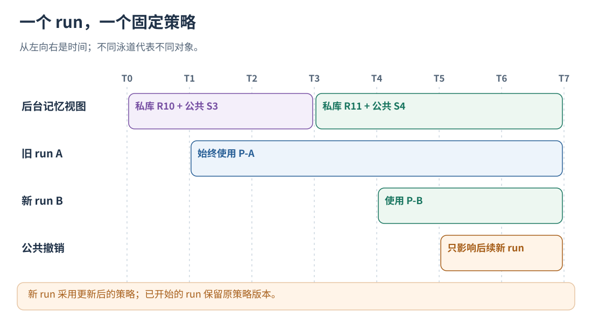
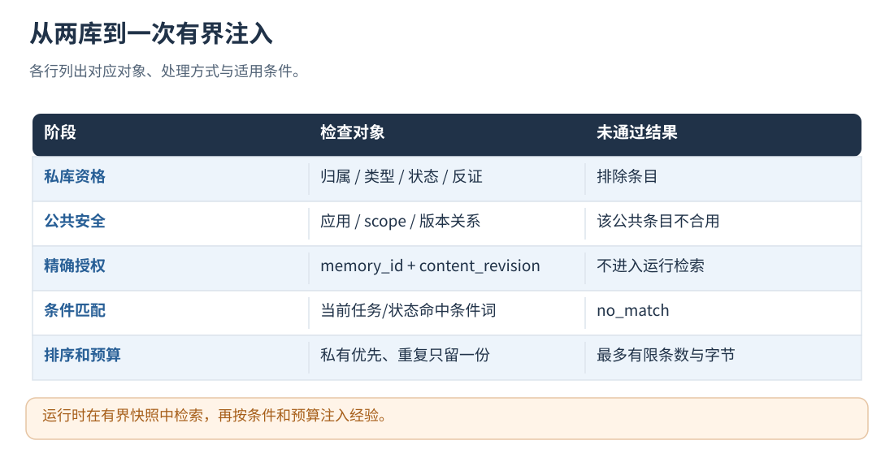

# 15 · 记忆检索、策略快照与版本

[文档首页](README.md)

## 本章目标

区分 memory_id、库 revision、内容版本、快照 ID 和运行策略版本。

## 设计思路

每个 run 冻结当前用户私有库加可用公共库的合格视图，再按精确授权、scope 和当前条件检索。词面检索与模型关系判定是两个阶段，不会每次模型调用都重新审查整个记忆库。



读图：新 run 采用更新后的策略；已开始的 run 保留原策略版本。 [放大 SVG](figures/15-freeze.svg)。

## 怎样把记忆编译成可查询的经验快照

### 启用评测准入后的版本流程

在 service 配置中指定 `policy_evaluation_file` 后，后台先从合格记忆和授权规则编译候选，
在独立 Agent 实例中执行固定任务集，通过准入后登记发布。新 run 从内存中的已发布版本创建本次运行策略；
后台尚未完成时沿用仍兼容的已发布版本，没有可用版本则按 L0 原始逻辑继续，不等待评测。

`agent_version_id` 是可跨 run 比较的行为版本：包含 Agent 部署修订、用户、运行等级、经验及控制规则；
hash 排除本次 run/conversation ID、快照 ID 和记忆库修订等运行或管理元数据。
`policy_id` 仍标识绑定到当前 run 的具体运行策略。两个 run 可以有不同 policy_id、相同 agent_version_id。

候选、父版本、任务报告及发布指针保存在 `data_dir/agent-evaluation/`，重启继续使用相同发布记录。
应用前重新核对等级、规则、经验内容授权与关系；撤权、改写、删除或不兼容关系使旧版本失去后续 run 的应用资格。
未启用此配置时仍按本章原有精确授权路径运行。完整操作见[任务评测](19-datasets-and-benchmarks.md)。

### Memory 不会原样塞进模型

`src/runtime/shadow_runtime.cpp` 的 `compile_shadow_policy` 为当前 Run 筛选经验。
候选类型有多种，但当前自动注入只读取符合新契约的 EXPERIENCE_INJECTION。
RETRY_POLICY、LOOP_STOP_CONDITION 等候选仍可保存、分析，**不会自动翻译成 L2/L3 控制规则**。

每条**私人**经验必须同时通过：

- scope 在当前部署授权范围内。
- 有支持证据，支持用户数为 1，所有支持证据都属于当前用户。
- 类型为 EXPERIENCE_INJECTION，生成器和字段符合新经验契约。
- 无反证，也没有 CONTRADICTS 关系；冲突关系的两端都会被排除。
- entry.status 是 CANDIDATE 或 VALIDATED，且 candidate.status 是 PROPOSED。
- 内容与安全检查通过，并未超过快照容量。

所以一条记忆已写入 PB，但支持不足、类型不对或冲突，快照里没有它，是正常筛选。
entry.status 还是 CANDIDATE，但内部 candidate 已 PROPOSED 时，则可以在满足其他条件后进入快照；不必先自动晋升为 VALIDATED。

被排除原因进入 `excluded_counts`，例如 ownership、target_type、experience_contract、conflict、status、capacity。
它们比“记忆库有几条”更能解释为什么实际没注入。
公共经验通过单独的受信 SharedExperienceStore 输入，不放宽上面的私人归属检查，具体机制见[公共与私有协作：晋升、冲突、信任与淘汰](14-shared-memory.md)。

### 快照保存什么，版本怎样计算

快照保存本次身份、允许的 scope、私人 memory_revision、公共 shared_revision、限制选项和经过筛选的经验。
经验包含 memory_id、条件、行为和检索词项；私人经验保留来源 candidate IDs，公共经验设置 application_shared，
不携带他人的来源 ID 或历史。跨库重复关系只保留入选条目间的、版本一致的关系；容量裁剪同步移除孤立关系。

```text
content_revision = SHA256(该经验除 content_revision 外的稳定序列化内容)
snapshot_id = "shadow-v1:" + SHA256(快照除 snapshot_id 外的稳定序列化内容)
```

在线快照使用 schema_version=2；读取契约时以该字段为准，ID 使用 shadow-v1 前缀。
旧 schema 1 可离线读取，在线使用时转换到 schema 2。

content_revision 不只是建议正文的 hash，来源别名、条件等快照字段变化也可能使它改变。
授权按内容版本精确匹配，版本变化后重新核对授权。
容量不足时，当前实现按 memory_id 稳定遍历后截取，不按收益或置信度挑出全库最优集合。
随包配置最多 128 条经验、256 KiB 快照，并同时检查 Protobuf 与 JSON 的大小。

### 关键词怎样提取

只从 `trigger_pattern` 提取适用条件关键词，不从历史失败描述或建议正文提取。
否则“以前提到过视频失败”容易让所有视频任务误命中一条特定前置条件经验。

- ASCII 字母/数字/下划线组成完整词，转小写；`generate_image` 不拆成 `generate` 和 `image`。
- 英文常见词尾归一成一个词项，例如 `timeouts` → `timeout`；原词与词干不重复计数，`status` 不裁成 `statu`。
- 连续汉字生成 2–4 字候选。计分时优先较长片段，同一片段的子串和重叠窗口只算一次。短双字片段只能补充相邻的具体短语，不能把散落的“文件、需要、结果”等词凑成多个证据。
- 条件里带引号的英文多词短语按完整短语核验；例如没有出现 `No such file or directory` 时，不能只凭 `bash + file` 命中这条写入失败经验。
- 去掉配置中的 stop_terms，保留最多 max_match_terms 项；不部署编码模型或向量数据库。

策略检索使用有界的多粒度词面证据；记忆短名单仍使用字节三元组 Dice，两者用途不同。




读图：运行时在有界快照中检索，再按条件和预算注入经验。 [放大 SVG](figures/15-selection.svg)。

## 怎样检索经验并生成策略

### 检索是确定性的词面匹配

`ShadowRuntime::query_advice` 先核对用户/会话/Run 身份、scope 和输入预算，再检索 `task + state` 的观察内容：

1. JSON 只提取值，不把 `role`、`status` 等字段名算成业务证据；嵌套的 JSON 工具结果也按相同规则处理。
2. 消息结构排除 system/developer 指令和工具定义，保留用户内容、实际调用的名称/参数、工具结果。`<system-reminder>`、既有经验与控制注入块不参与匹配，即使它们放在 user 消息里。
3. 自动打点的消息检索保留最新用户请求，以及最新 assistant 消息与其后的全部工具结果；同批并行返回不会只取最后一条。较早已经消费的结果不再反复触发建议，新出现的相同失败仍可再次匹配。宿主显式提供的 `state` 继续优先使用。
4. 先清洗检索副本，再做 UTF-8 安全的首尾限长，避免截断 JSON 后又把字段名当成普通文本。原始轨迹和实际模型请求不变。
5. 条件中出现带下划线的明确标识时，至少一个该类标识必须出现在观察中；通用 `_error`、`_status`、`_result` 结果标签不能代替它。其他匹配词也须来自包含该标识的观察段落，不能把预算报告的“成功”和下一段建议中的 `generate_image` 拼为图片生成成功。
6. 中文窗口若以“的、了、且、或、当、时、与、把”等虚词开头或结尾，不算独立具体词项。“的文件”与“目录不存在”不能因此组合成写文件失败。

对同 scope、已授权经验计算：

```text
matched_terms = 条件与观察共有的、去除重复和重叠后的独立词项
score = Σ 词项信息权重 × 当前合格经验条件中的逆文档频率权重
```

独立命中数至少为 `min_matched_terms` 才入选，默认 2；至少包含一个具体词项，不能仅靠通用双字词通过。
纯中文命中若仍依赖短片段凑足门槛，还要求不重叠的命中字符数达到 `4 × min_matched_terms`；
“用户需求 + 覆盖”这样的一小段通用描述不能替代完整任务完成条件。已有足量具体词项时不附加该限制。
先按有效授权过滤，再优先私人经验、同类按加权得分、独立命中数降序和 memory_id 升序排列；跨库重复只选一份，
最后受数量与总字节预算约束，随包最多 3 条、4096 字节。未授权的私人经验不会耗掉公共经验的 top-K 名额。
纯 Shadow 查询没有 Runtime 授权概念，仍只提供未应用建议。
这里不使用 memory.confidence、历史收益或余弦距离，也不在在线检索路径调用模型。

命中只说明词面相关。例如“已经提供图片素材”也可能命中包含“缺少图片素材”的词项。
词面检索生成 shadow 建议，再按权限和上下文预算注入。查询次数、经验命中次数和实际应用回执分别统计；注入发生不等于注入有益。
L2/L3 已批准控制来源的结构化判定保持独立，不受 L1 top-K 或词面门槛限制。

### 版本内适用条件改写

GEPA 可在 `RuntimeOptions.experience_overrides` 中同时保存 `content`、可选 `trigger_pattern`、可选 `observed_operations`。
来源 `memory_id/content_revision`、scope 和记忆快照不变；条件变化进入策略版本 hash，随策略导出、融合与离线加载保存。
旧的仅正文改写格式继续有效。模型输出省略条件时继承父版本；空 `trigger_pattern` 恢复来源条件，空操作数组移除该门槛。

`observed_operations` 是最多 16 个操作名的 any-of 条件：当前分支上一批已执行并结束的 action 至少包含其中一个，随后模型请求才可候选注入；词面条件仍需满足。
它不判断操作是否业务成功。操作计划、自然语言建议、未执行/被拒绝的动作不满足条件。没有可靠分支证据时不推测命中。
一般规划、前置澄清类经验可以不带该条件；结果消费类经验可由后台反思生成条件，不要求宿主新增打点。

包根据现有 point 祖先、loop 或显式 stream 隔离观察，成功完成一次模型请求后消费该请求已看到的操作证据。
模型请求期间新完成的动作保留到下次请求；传输失败不消费；同名工具的并发分支互不借用。观察缓存有数量上限，空分支及时释放。
被改写的私有经验有公共重复项时，公共项不会绕过新条件恢复旧正文。上述可选约束只影响 L1，L2/L3 的控制授权和结构条件保持独立。

### 下一阶段：后台编译、在线路由的轻量语义匹配

词面证据不能覆盖所有否定、改写和跨语言表达。后续可采用**后台语义编译 + 在线确定性路由**：模型只在经验入库、内容修订或策略候选生成时运行，不进入 Agent 的请求链；在线不部署编码模型、不查询向量库，也不要求主 Agent 判断经验是否适用。

编译产物随经验内容版本保存在策略快照中，最小字段为：`source_content_revision`、`positive_features`、`negative_features`、`required_facts`、`excluded_facts`、`thresholds` 和 `compiler_version`。正向/反向特征由经验条件及少量正反例离线提炼，支持中英文同义表达、短语和不同权重；事实条件是协议打点已提供的有界结构字段，不从自由文本猜测“工具已成功”或“前提已满足”。编译结果必须通过字段白名单、长度、隐私、来源版本和范围校验，未通过就保持旧版检索或不注入，不把模型输出直接当成可执行规则。

在线查询遵守固定顺序：

1. 先校验用户、私有/公共冲突关系、授权内容版本、目标 scope 和当前策略版本。
2. 已知事实命中 `excluded_facts` 时否决；`required_facts` 缺失时不猜测成立。没有提供所需结构事实的框架保留 L1 的保守检索，不能因此触发 L2/L3 控制。
3. 对有界任务文本和状态文本分字段分词，利用离线倒排表召回候选；计算正向相关分、反向证据惩罚及候选间 margin。短语可提高置信度，否定或反例命中会降低置信度。
4. 只保留同时超过最低分和区分 margin 的候选；接近阈值、正反冲突或语言未知时放弃注入。之后仍执行现有私有优先、去重、top-K 和字节预算。

L1 可使用这一路由选择经验；L2/L3 的拒绝、重排与停止仍由受授权的结构化谓词和真实状态决定，不能由文本相似度单独驱动。策略发布评测应固定覆盖同义改写、否定句、前提已满足、跨语言、跨用户/跨 scope、公共私有冲突，以及未提供结构事实的宿主。对每条路由记录来源修订、编译器版本、命中/否决原因与最终应用回执，使“规则发布但未触发”和误触发都能从轨迹中复核。

这一节是后续路由契约，不属于当前检索修复。将扩展计算移到离线、让在线使用稀疏索引的思路与 [Doc2Query](https://arxiv.org/abs/1904.08375)、[Doc2Query--](https://arxiv.org/abs/2301.03266) 和 [SPLADE-doc](https://arxiv.org/abs/2109.10086) 的索引侧计算方向一致；这里的结构事实门禁与发布评测是本组件额外需要的控制约束。

### 从影子建议到获准策略

`src/runtime/policy_runtime.cpp` 的 `compile_runtime_policy` 将以下内容编译为固定策略：

1. 已验证的 schema 2 经验快照。
2. 用户与可选 conversation 白名单。
3. 宿主已声明能力与请求等级。
4. `approved_experiences` 中的 memory_id + content_revision 精确授权。
5. 外部配置的技能编排规则、动作护栏、循环规则、注入模板与大小限制。

能力按实际边界声明：模型输入、技能编排/动作过滤、循环决定。
策略编译支持 strict 和 downgrade：前者在接入能力不足时拒绝，后者降到宿主已满足的等级。
通用接入的 `model/actions/schedule/loop` 能力会映射为内部策略能力；宿主仍必须正确使用返回值。

`policy_id = runtime-v2:<固定策略内容的 SHA-256>`，包含本次快照与配置。
每次查询在这个策略中决定，不在主链重新读记忆文件或调用模型。

新增实际接入能力后，可用 `trajectory_evolution runtime recompile` 从 stdin 接收
`{"policy": 原完整策略, "options": 新完整选项}`，复用已验证经验快照并生成新的 policy_id。
此操作不调用模型、不改记忆库；不是原版本的原地修改，原评测缓存不能充当新版评测结果。
原策略须通过完整性校验，新选项仍要经过编译校验；部署时仍检查宿主实际能力与授权。

默认 `auto_approve_experiences=false`，没有匹配的版本授权就不注入。
显式开启自动批准时，系统在建立 Run 时为通过快照筛选的经验添加当前版本授权。
该开关自动授权 L1 经验使用；L2 动作规则和 L3 循环规则通过 runtime_options 分别配置。

## 新记忆何时影响下一次执行

当前本地路径的时间顺序：

```text
Run A 开始：从内存记忆 R10 编译策略 P-A，并冻结
Run A 执行：只查 P-A，产生真实调用与应用回执
Run A 结束：先返回业务，后台保存并排队；满足批次条件后评测、反思和入库
后台提交私人记忆 R11；公共管理独立更新公共修订 S，成对刷新私人＋公共内存视图
Run B 开始：从已刷新的 R11 编译 P-B，重新执行筛选和授权
```

如果 Run B 在后台完成前已开始，它仍使用旧记忆，这是有意的低延迟与一致性取舍。
后台更新不替换进行到一半的 Run 的策略，所以回放时可以解释“这轮到底用了哪套规则”。
P-A/P-B 包含运行身份，ID 不同不一定意味着经验正文改变；判断经验内容变化应看 content_revision。

这里有不同的版本概念：私人 memory_revision 和公共 shared_revision 是持久化修订号；policy_id 是本次运行策略快照标识；
memory_version 为进程内缓存失效计数，重启后可重置。
L1–L3 的完整策略快照保存在 runs/<run-id>.json 的 policy 中，本地路径由 writer 异步落盘，
未落盘就崩溃仍可能丢失。GEPA 的实验版本另外同步保存于 `agent-evaluation/<job-id>/search/versions/`，
父子关系、逐题成绩与搜索进度保存在同目录的 `tree.json`；版本行为 ID 不受本次运行身份影响。
已发布的完整策略包可通过 `policy_version_file` 离线加载，详见[GEPA 与版本持久化](24-evolution-and-gepa.md)。

## 公共与私有经验的联合筛选

编译私有工作集先做归属/冲突/状态/契约检查，再接收受信 SharedExperienceStore。
公共条目与当前合格私有条目按双方内容版本核验关系；任何同 scope 必需关系未知时，当前用户暂不合用该公共条目。
快照先保留私有，再加入安全公共经验，条数与 JSON/PB 字节预算都计算，重复关系也计入容量。

运行时过滤实际批准的 memory_id/content_revision 后，才做检索、排序和 top-K。
私有优先决定同次检索的选择次序，各条目的来源和所有权保持独立。
已入选的私有重复项优先；私有项未获授权或未命中时，继续筛选可用公共项。

## 版本定位表

| 版本 | 谁生成/保存 | 何时改变 |
| --- | --- | --- |
| 私库 revision | 私人入库提交，保存在 EvolutionMemoryStore | 成功批次/容量等实际写入 |
| 公共 revision | 公共 manager，保存在账本与投影 | 可用公共经验投影变化 |
| content_revision | 策略编译器，对实际经验内容计算 | 参与内容变化，精确授权需重核 |
| snapshot_id | 影子快照编译器 | 身份、库视图、选项或候选集变化 |
| policy_id | 运行策略编译器 | 快照或运行时授权/规则等变化 |
| 用户内存视图版本 | IntegrationService 的进程内通知 | 私库或该用户公共/关系视图变化 |

用户关系变化不一定增加根公共 revision，但会影响该用户的可编译视图。
公共账本关系中的内容摘要和 ShadowExperience 的 content_revision 使用不同对象计算，
approved_experiences 使用对应经验的策略内容版本。

策略版本固定后，任务输入、网络数据与模型输出仍按各次运行分别记录；
要复现与对照，需同时保存任务集、真实输入、实际模型配置和工具边界。

## 实现定位

- `src/runtime/shadow_runtime.cpp::compile_shadow_policy / ShadowRuntime::query`
- `src/runtime/policy_runtime.cpp::compile_runtime_policy`
- `src/service/local_runtime.cpp`
- `proto/shadow_policy.proto`
- `proto/runtime_policy.proto`

---

[文档首页](README.md) · [上一章：公共与私有协作：晋升、冲突、信任与淘汰](14-shared-memory.md) · [下一章：L1–L3：经验注入、动作约束和循环控制](16-runtime-controls.md)
