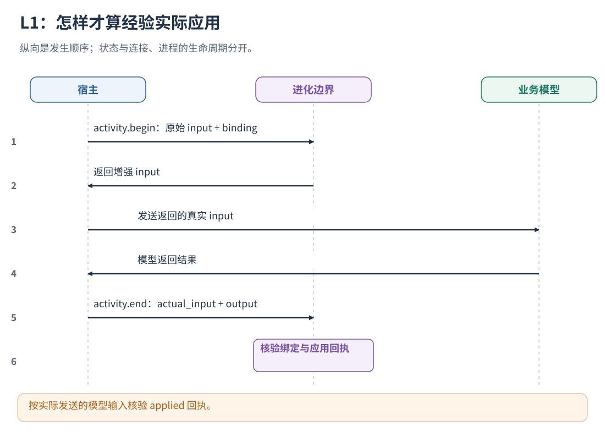
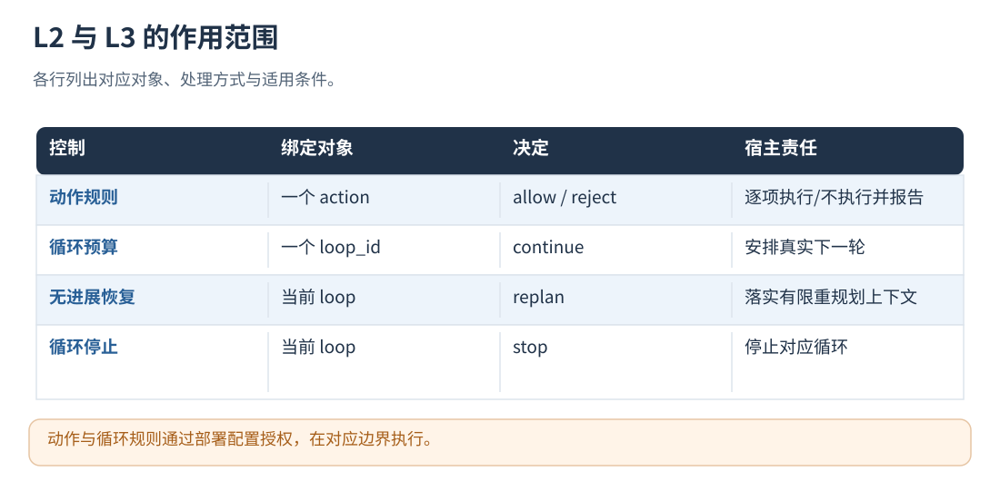

# 16 · L1–L3：经验注入、技能编排和循环控制

[文档首页](README.md)

## 本章目标

理解增强如何真正进入模型输入、动作派发和下一轮决策，以及 applied 怎样被核验。

## 设计思路

模型提供经验内容，部署配置授权策略，宿主在执行边界应用决定并提交回执。每个动作与循环分别维护状态。



读图：按实际发送的模型输入核验 applied 回执。 [放大 SVG](figures/16-applied.svg)。




读图：动作与循环规则通过部署配置授权，在对应边界执行。 [放大 SVG](figures/16-controls.svg)。

## 策略如何作用于 L1、L2、L3

### L1：将获准经验绑定到实际模型输入

处理发生在 `activity.begin(kind=model)`：

1. 查询当前任务和状态相关的经验。
2. 只保留 memory_id 与 content_revision 同时匹配批准项的经验。
3. 用结构化 JSON 放入经验模板，逐条检查 `max_context_bytes`；放不下的条目跳过。
4. 外面加带 policy_id 的经验边界标记，用于识别与回执验证。
5. 根据显式 binding 或包内识别的输入位置注入，返回增强后的参数。

GEPA 改写经验时，版本内的 `experience_overrides.trigger_pattern` 同时用于检索和注入内容的适用条件；未改写时沿用来源记忆条件。正文与条件来自同一冻结版本，导出后也保持一致。经验用于提出执行建议，不能覆盖当前任务明确要求的核验、计算或交付步骤；是否保留这些要求需要通过任务评测验证。

当任务输入是消息数组或 `messages` 封装（也包括序列化的 JSON 字符串），检索 task 只取最后一条有实质内容的 user 消息及其后续消息。上一轮助手的“已完成”等观察不会单独触发新一轮经验；当前用户的引用、本轮未消费的工具结果和显式 state 仍保留。纯提醒或空 user 消息不建立新轮次；无 user 的工具输入、普通文本和未知结构沿用原投影。这里只改变检索视图，不截断模型输入，也不删原始轨迹中的历史。相同处理适用于打点入口和直接 AdviceQuery，不依赖宿主框架或语言。

`src/runtime/request_binding.cpp` 支持两种绑定模式：

- `text`：追加到指定字符串。
- `system_message`：追加到指定消息数组的 system 内容；没有适合位置时创建 system 消息。

宿主语言和模型 SDK 可自行选择；常见格式自动识别，自定义结构通过同一打点的 binding 描述输入位置。
将返回的 input 用于实际发送，并在结束时回报 actual_input。

结束时提供 `actual_input` 和 `executed`。`PolicyRuntime::verify` 重新计算同一次查询应有的增强内容，检查是否真的允许发送、
是否有调用标识、增强内容是否出现在实际绑定位置，以及出现次数等完整性要求。
通过后 `advice.applied` 回执为 applied；有决定但未观察到真实应用为 failed；无增强决定为 rejected。
这些状态用于记录策略应用，业务结果另行保存。
模型请求中的经验内容通过 actual_input 核验，业务效果由后续任务评测衡量。

### L2：技能编排

`schedule_rules` 作用于实际待派发的任务批次。每条规则包含 `before_operation`、`after_operation`、
`require_success`、scope、规则 ID 和经验来源。新生成的规则可以选择 `task_terms`（均须出现在当前 run 的任务文本中），或 `before_argument` / `after_argument` 资源条件；`exclude_terms` 为可选排除条件。不满足条件时保持宿主原计划；旧版未设置条件的手工规则仍按原语义运行。它不生成新技能，也不修改技能参数。

例如原计划同时运行 A、B、C，规则要求 A→B，组件先返回 A、C；观察到 A 完成后才允许 B。
`require_success=true` 时 A 失败会跳过 B，但不取消 C；为 false 时只要求 A 已结束，允许 B 处理失败结果。
同名技能的不同实例保留不同 action_id。原有依赖始终保留；候选依赖形成环时整批退回原计划，并记录 conflict。
当 before_operation 与 after_operation 相同，规则按宿主批次中的原始顺序串行这些实例，不添加自依赖。
这适用于已经有执行证据支持的共享资源顺序约束；多实例本身不代表必须串行，未配置规则的同名实例仍保持原来的并行行为。
无规则、等级低于 L2 或未声明 `schedule` 能力时，不附加进化依赖。
目前这是“已有批次的编排”：只有宿主提出 A、B 后才能重排，不会在新 dialogue 开始时凭用户问题创建技能工作流或跳过 Coordinator 决策。文本条件是本地确定性匹配；候选必须在训练轨迹中产生差异。部署前应让验证集同时覆盖依赖任务和独立任务，检查过度串行化。

协议由 `activity.begin(kind=schedule)`、`schedule.observe` 和 `activity.end` 组成，也可使用统一 point。
prepare 返回 ready；实际派发与完成分别上报 running 和终态。调度 ACK 不作为终态。
包内状态可持久化；依赖等待不占宿主工作槽，也不轮询模型。
只有实际开始/结束顺序满足计划、所有分支结算、跳过分支明确未执行后，才能形成 applied 回执。
只返回计划、仅调整数组顺序或只有派发 ACK，均不能得到该回执。

自动生成的跨操作规则遇到多个同名实例时，通过宿主已有依赖或明确资源身份配对。例如 A1→B1、A2→B2 不会被扩成所有 A→所有 B，A1 失败只阻断需要其成功的 B1；没有配对依据则保留原计划。单一 A/B 配对与显式的同操作串行化仍可直接执行；用户手工配置的基础规则保持其明确指定的语义。

资源条件示例：A 的 `arguments.output` 与 B 的 `arguments.input` 是同一文件/资源 ID，则规则使用 `before_argument="output"`、`after_argument="input"`。仅比较非空、最长 512 字节的字符串值；参数缺失、类型不同或值不等时不连边。可以不设置 `task_terms`，此时不依赖任务使用中文还是英文；同时设置时所有条件都要成立。数据来自现有动作参数，不要求宿主新增语义判断代码。

如果宿主将文件路径放在 `prompt` 等字符串参数中，组件可投影出保留字段 `__evolution_resource`：只提取显式、带目录和扩展名、由空白或引号等中英文标点分隔的完整 ASCII 文件路径；同批至少两个动作引用该路径，且每个动作只有一个共享路径时才提供。两侧规则参数都可指定此字段。投影不改写宿主参数、不访问文件、不调用模型；含 URL 或脱敏占位符的字符串、多共享资源歧义均不用于推断。资源相同只提供配对依据，生产/消费顺序仍需有训练证据和明确规则。不截取 Unicode 路径或紧贴非 ASCII 文字的局部尾段；这类路径可使用原有结构化资源参数。

包含 `<redacted:…>`、`[REDACTED…]` 等脱敏占位符的值不参与资源或重试目标身份比较，避免把原本不同的目标合并；信息不足时不猜测依赖或共享失败预算。

打点查询保留同批动作共享的短字符串：每个动作最多 8 项、每项最多 512 字节、原始参数对象最多 64 项。完整输入仍在原始开始事件中，查询不重复携带长提示词。反思、规则预检和父策略回放使用同一投影；旧轨迹有开始事件时可以恢复这些字段，缺少证据时不猜测。它仍只重排已经提出的同一批任务，不创建未来批次，也不建立跨 run 的等待关系。

异步整批完成型宿主可使用包内 `dispatch/resume_dispatch`，见[接入位置](08-instrumentation.md#异步批量技能编排)。
此模式按 wave 释放任务：同一 wave 中的独立任务仍可并行，下一 wave 等宿主报告当前批次完成。
已声明 `action.filter` 且允许应用 L2/L3 策略时，包会在每一 wave 派发前统一检查动作护栏，包括异步恢复后的 wave，无需宿主另写逐技能检查回调。拒绝项记录为未执行取消，仅阻断要求其成功的后代；独立分支继续。过滤后的 ACK 索引由包映射回原始动作，最终结果保持原请求顺序。全部取消时返回空 accepted 与逐分支原因，不伪造已派发或已执行。L0、仅声明编排能力或 `apply_policy=false` 保持原执行权限。
它不承诺逐分支完成即刻释放后继；需要这种粒度的宿主使用上面的 schedule 点，在现有单任务回调处消费 ready。
若外层另有 action 打点包住派发调用，编排点的 `ref.parent` 应引用该 action 的 `ref.key`；原生接口使用父 action 的开始事件作为 `caused_by`。包据此区分派发封装与实际工作，不通过操作名推测父子关系。父 action 的 ACK 不计为业务成功进展，真实结果按各子任务的终态计入所属 loop。

### 配套能力：逐动作参数护栏

#### 同一目标跨执行实例的重试预算

`repeat_failed_operation` 仍按同一 loop 的操作失败链工作。需要阻止重新启动 worker 后继续重复相同目标时，GEPA 可生成 `repeat_failed_target`，编译为带 `failure_key_arguments` 的 action rule。例如操作 `generate` 的 `output` 参数标识产物目标：

```json
{"memory_id":"已批准经验ID","primitive_id":"repeat_failed_target","operation":"generate","failure_key_arguments":["output"],"max_failed_attempts":2,"reason":"同一目标重复失败后停止再次派发"}
```

目标参数由训练证据提出并验证，不要求宿主再写工具适配器。既有 action 打点负责观察实际参数与结果；运行时只做本地结构化比较，不调用模型。参数必须是 1–4 个标量字段，组合能标识同一业务目标。通用选项、随机调用 ID 和整段自然语言指令不适合作为目标标识。

| 情况 | 计数与执行 |
| --- | --- |
| 同一 run、scope、操作与目标，换 worker/执行实例重试 | 保留已落定失败链；达到阈值才拒绝后续尝试 |
| 不同目标、不同操作、不同 run | 分开计数，不传播失败 |
| 两个并发首次尝试 | 开始时冻结相同计数，不互相当作已知失败后的重试 |
| 同目标成功 | 清除连续失败链 |
| 参数缺失、值为空或不是标量 | 不推断目标身份，不按其他任务的失败拦截 |
| 动作未执行、取消、结果未知、仅收到派发 ACK | 不增加业务失败次数 |
| actual_input 改变了目标参数 | 不把失败算到原计划目标 |

运行态每个 run 最多保存 256 个目标失败键，只持久化其摘要与有界计数。新规则和参数随策略包导出，离线加载使用相同逻辑。L0/L1 不因该规则增加动作拦截。

异步 dispatch 的检查点只检查是否允许派发，不能代表实际执行。目标计数在 schedule 子动作真正进入 running 时取快照，在成功／失败回执到达时结算；因此 L2 没有 loop 点时也能使用目标预算。重复投递同一回执不重复结算。
异步动作事件携带 `attributes.target_scope`，GEPA 的规则预检和父策略回放据此重建同一目标预算，避免运行时已限制重试而回放仍当作零失败。旧轨迹缺少作用域时不从操作名称猜测，也不把未知证据记成实际命中。
业务结果中的明确失败状态、`success=false`、`ok=false`、非零数值 `exit_code` 可用于失败观察；没有明确成功声明时，非空结构化 `error` 也作为失败证据。明确成功且仅附带历史错误的结果不恢复失败链。普通文本不按关键词猜测。这只更新控制侧观察，不改写宿主工作流终态。

L2 首先执行包内的工具契约检查，无需逐工具配置：

1. 模型结束点从 actual_input 的工具定义提取操作名称及 JSON Schema 顶层 required。
2. 支持 function/parameters、input_schema、Responses 扁平工具、functionDeclarations 和旧 functions 形式。
3. 按 Run、scope、执行者和并发分支保存紧凑定义；不保存说明文本作为权限或规则。
4. 对同一分支的动作检查必填键是否存在。required 不等于非空；可选键不会被自动提升为必填。
5. 未观察到定义、同一分支定义冲突、定义格式不合法时记录 unknown，不猜测约束或拒绝业务调用。

只在 L2/L3 且 apply_policy=true 时拦截缺少必填键的动作，L0/L1 保留原执行。
action.start.attributes.contract_check 记录检查状态、缺失键及 enforced；模型 action.end 的
attributes.tool_contracts 记录实际输入中提取的紧凑定义。此检查不调用模型，不进行磁盘或网络请求。
它是顶层 required 检查，不替代工具本身的类型、嵌套字段、权限或业务校验。
缓存最多 128 个分支组，每组最多 64 个操作、每次紧凑定义最多 64 KiB；超限记 unknown，原调用继续。

如另外配置了动作规则，通过契约检查后再按 scope 与 operation 精确匹配：

- `deny=true`：拒绝该动作。
- `required_arguments`：任一指定顶层参数缺失或为空则拒绝。
- 空值包括 null、未设置、空字符串、空数组、空对象；数字 0 或 false 不因为是假值就视为缺失。
- 同一动作首条实际触发的拒绝规则确定 reason/rule_id。

参数护栏本身不重排序、串行化或取消兄弟动作，也不把一个动作拒绝改写成整个任务失败。
通过的动作仍由宿主按原来的串并行关系执行。
显式策略的回执核对被拒绝的 action_id 确实出现在 skipped 集合，并没有出现在 executed 集合。
固定契约拒绝通过 contract_check 和 action.end.executed=false 记录，不伪装成某条经验策略的拒绝。
回执对照控制决定与实际执行情况；业务工具的返回状态单独记录。

#### 配置故障与重复派发预算

两种可学习的动作护栏复用现有 action/dispatch 打点，无需宿主额外写判断器：

| 字段/原语 | 触发和作用范围 | 本规则不影响的部分 |
| --- | --- | --- |
| `terminal_failure`：`terminal_error_codes`、`error_scope_arguments` | 同一 run、执行分支、scope、操作及配置出现指定结构化错误码后，拒绝该分支相同配置的重试；可选配置缺失表示该次调用的默认配置 | 其他执行分支、操作、显式不同配置、其他 run；超时等未列入的错误 |
| `operation_budget`：`max_attempts`、`attempt_key_arguments` | L3 搜索可以提出同一操作的已落定尝试轮数预算，成功与失败都消耗；空目标字段表示该操作在此 run 内共享预算，非空字段按稳定目标隔离 | 未选中的操作/目标及其他 run；未执行、未知终态不扣预算 |

永久配置故障的身份不使用输出文件名，因此换输出路径不会重置它；不同模型/服务参数可以是不同身份。终态错误码从结构化结果读取，并以 `attributes.observed_error_code` 留痕供回放，普通描述文本不直接充当错误码。

终态故障仅在可信 `execution_id` 内传播。一个分支失败后，即使兄弟分支稍晚才调用相同默认模型，也不会继承前者的失败。异步调度子动作使用各自子执行身份，缺少可信身份时不推断整个 run 的配置故障。跨执行实例的同目标重试仍可通过显式 `failure_key_arguments` 约束；该目标预算与终态故障的分支隔离是两项独立能力。

并发首批尝试按一轮结算；普通失败预算成功后清零，并保留成功代次，旧并发失败晚到不恢复旧失败链。显式总尝试预算则不会被成功清零。`operation_budget` 是可评测的执行上限，不是“业务已完成”的证明；生成时仍必须保留必要验收、正常多目标工作和质量要求，默认不会给所有操作加上此预算。

一个已被策略拒绝、且确认未执行的动作不再扣尝试预算，也不伪造工具失败；但会成为循环无新业务进展的证据。同轮其他分支有新结果时仍算进展，存在未完成分支时仍禁止提前停止。这样 L2 拒绝重复派发后，L3 可以收敛，而不是被不断改写的提示词拖入空转。

### L3：有状态的循环收敛控制

每个 loop 保留独立的 `LoopProgress`：执行流、scope、policy_id、轮次、状态指纹、连续无进展次数、重规划次数和上次决定。

GEPA 的 `bounded_recovery_budget` 可在有无效恢复证据时收紧匹配基础规则的 `max_replans`，但不能增加预算。设为 0 时，当前执行分支达到原有无进展阈值后直接 stop，不再附加 replan；不是遇到一次失败就 stop。专用 actor 规则、其他并发分支和 pending 屏障保持独立，导出的版本保存该预算，离线加载无需重新学习。
不会使用一个全局计数器让其他并行 loop 相互影响。

通用边界在 `loop.check` 对 state 做稳定 JSON 序列化并计算 SHA-256，保留原有的连续相同状态判定。
另外，包内在实际 action 结束时记录操作名、实际参数、终态和结果的哈希：同一执行分支的一步中，所有已完成调用都只重复之前见过的输入／输出组合时，累加 `repeated_action_steps`；出现新的组合则清零。结果中的业务 ID、时间戳等字段完整参与哈希，不按字段名删除。最多保留 256 个组合，超出后退回原有状态判定，不把缓存溢出当作停滞。

同步 action 与异步编排结果使用同一条进展统计路径。编排中的实际成功／失败按操作名更新所属 loop；重复回调不重复计数，未执行或未知结果不充当已执行进展。包含成功分支的已结算步骤仍保留成功进展，在途分支仍阻止提前停止；记录失败不等于立即停止整个任务。

重复失败使用每次动作开始时已观察到的失败链长度：两个并发首次尝试各自失败不等于连续重试两次，只有在已知失败之后开始的新尝试才延长失败链。同步工具与异步技能使用相同规则。是否新增文件也不是业务进展的判断条件；读取、核验、修改文本等正常工作保留其实际输入和结果指纹。

两个信号取较大值作为本次 `no_progress`。工具信号补充宿主消息中随机传输 ID 导致的漏检，不覆盖原有状态判定，也不表示理解了业务语义。新的参数或工具结果、独立分支和在途动作均有单独处理；没有已完成动作时仅使用状态判定。重规划消费本次重复计数，后续继续重复才再次累计。
state 仍宜包含与进度有关的稳定事实，例如已完成子任务、已有素材和待满足条件。这两种运行信号与离线评测的“无效 loop”是不同口径。

核心状态机为：

```text
若该 loop 仍有未结束活动：continue，不在此时 stop/replan
若有效等级低于 L3：continue
若重复提交同一 iteration：状态指纹必须一致，不再次累计
否则：
    fingerprint 与前次相同且存在前次轮次 → no_progress += 1
    fingerprint 改变                       → no_progress = 0
    no_progress = max(no_progress, repeated_action_steps)

    max_iterations > 0 且 iteration > max_iterations → stop
    否则 max_no_progress > 0 且 no_progress >= max_no_progress：
        允许 replan 且 replans < max_replans → replan，replans += 1，no_progress = 0
        否则                               → stop
    其他                                   → continue
```

max_iterations=12 时，第 13 次下一轮检查触发上限。
max_no_progress=3 时，首次状态建立基准，之后连续三次相同状态达到门槛。
规则按 scope 精确匹配，仅执行已配置阈值的限制项。
默认已经 stop 的通用 loop 不允许继续 check 或派发新活动；需要新的独立执行时应使用新的循环身份。需要用户可读的最终答复时，可使用下面的一次性收尾模式。

### 停止执行后的一次性收尾

在已有引用式循环打点上增加一个选项：

```json
{"kind":"loop","phase":"guard","ref":{"run":"run-123","key":"round-4"},"loop_id":"main","state":{"stage":"results_received"},"extensions":{"finalize_on_stop":true}}
```

正常 continue/replan 不受影响。真正提交 stop 后，guard 返回 `decision=finalize`，同一 loop 只允许一个后续模型调用生成最终答复，工具／动作和新派发均拒绝。模型打点按已有请求绑定注入收尾提示，并移除顶层 `tools`、`tool_choice`、`functions`、`function_call`、`parallel_tool_calls`；宿主必须把打点返回的请求用于实际调用，不能重用原工具参数。嵌套的非标准工具协议仍需由已接入的动作打点落实拒绝。

收尾调用无论成功还是失败都会消耗这一个名额；第二次模型调用拒绝，下一次循环 guard 返回 stop。状态落盘后仍保留此限制。其他 loop 不受影响。原始 `loop.decision` 仍记录 stop，收尾的 `action.start.attributes.finalizing=true` 便于区分；模型调用和时延照常计入成本。L0 不触发策略停止或收尾改写。

模板默认从 `experience_template_file` 同目录的 `runtime-finalization.txt` 加载，也可在服务配置设置 `finalization_template_file`。修改文本后重新加载服务即可，不需编译。旧部署没有模板时保持原停止行为。通用分离式 `loop.check`／`loop.commit` 接口不改变决策枚举；commit 的 `finalizing` 字段表示可用的收尾名额。

### 异步结果的进展判定

dispatch 使用接入时已有的 `binding.result_output` 提取业务结果参与重复判定，完整回执仍原样保存在轨迹。相同操作、相同参数、相同终态与业务结果，仅更换回执 ID 不算新进展；业务结果、输入参数变化则保留为新观察。结果字段缺失或为 null 时保留原始结果比较，不假设缺失等于重复。

这里是确定性的结构比较，不是自然语言语义去重：同义改写不保证合并，也不会根据一个失败分支直接停止其他仍在执行的分支。

`loop.check` 给建议，`loop.commit` 回报宿主实际采用的决定。
stop 按宿主回报核验；replan 在后续模型活动中核对重规划上下文是否进入请求。
并发模型调用分别验证各自的 actual_input。
stop 作用于对应 loop；其他循环和在途操作继续由宿主调度，副作用通过业务接口处理。
普通模式可由独立的 `replan_on_failure` 规则响应结构化重复失败，但失败次数不并入基础 `no_progress` 阈值。宿主没有采用建议时，重新计算进度也遵守这一分界，避免后续轮次过早触发停止或重规划。

### 激进控制模式

在服务的 `runtime_options` 中设置 `"aggressive_controls": true`，重新编译策略后生效。
该选项写入策略版本和导出包，离线加载时不需要额外配置；默认 false，旧策略保持原行为。

- 来源仍须批准且 revision 一致，但可执行控制不再要求来源经验同时命中 L1 词面检索或 top-k。
- 同一 loop 内，同一操作连续结构化失败，即使修改参数、请求 ID 或报错文本，也形成 `repeated_failure_steps`：首次为 0，第二次为 1。信号在普通模式也采集，供已批准的失败重规划规则使用；只有激进模式将它并入通用无进展阈值。
- 一个结算步骤中有成功动作时不增加此信号；某操作成功后清除它的失败计数。在途动作仍阻止干预，兄弟 loop 的计数相互独立。每个 loop 最多记录 64 种失败操作，超出时不凭空认定新操作停滞。
- GEPA 可以在 `control_learning.min_iterations` 与基础上限之间搜索较低的 `max_iterations`，也可以收紧 `max_no_progress`。这是一种 scope 内分支预算，不是业务语义判断。

例如 `max_no_progress=1`、`no_progress_decision="stop"` 时，第二次同操作失败后，若本步没有成功动作且没有在途活动，下一次检查可停止本分支。
激进设置也可能提前终止原本可以恢复的任务；候选仍须经过质量、无效 loop、时延和真实应用回执评测，不因开启该选项放宽发布门槛。
L0 不应用这些控制，L1 检索方式、用户隔离和宿主硬依赖不变。整个判定不增加在线模型调用。

## 配置规则与学习建议的边界

L1 可使用通过审核的经验正文；L2 schedule_rules、配套 action_rules 和 L3 loop_rules 是结构化规则。
动作和循环控制使用显式配置的机器规则，经验建议通过模型上下文参与决策。
启用 GEPA 后，后台也可在 `control_learning` 授权范围内生成结构化规则；生成规则附带来源经验 revision，
经过真实任务评测后随完整策略发布。手工基础规则仍保留，生成循环限制只能收紧基础边界。
经验通过模型上下文影响选择，动作与循环规则通过确定性控制生效；rule_id 和回执记录具体机制。

多个并发动作各自返回 allow/reject、各自报告 executed 和终态。拒绝一个动作不改写宿主已有依赖图。
各并发循环使用独立 loop_id、计数和状态。

## 回执如何判定与排错

L1 在一次请求中按实际建议正文和 scope 去重：私有/公共记录即使 ID 不同，正文相同也只注入一次，回执只记录实际注入的来源。此去重不做同义推断，也不表示模型一定采纳建议；效果仍以任务执行评测为准。

- 模型：actual_input 必须是实际发出的请求，且保留增强后的绑定位置；仅返回给宿主不算应用。
- 动作：报告是否执行、返回结果以及对 allow/reject 决定的实际处理。
- 循环：check 是建议/授权边界，commit 是宿主真实采纳；未落实的 control 阻止正常 run.end。
- applied 表示宿主上报的执行数据通过策略应用核验。
- 无匹配经验时返回 no_match，模型使用原输入继续执行。

暂停开关和失败降级不追回已发生业务副作用。要全系统紧急停用需要宿主协调所有进程；
set_enabled 控制当前原生客户端，多实例部署分别管理开关。

## 实现定位

- `src/runtime/request_binding.cpp`
- `src/runtime/policy_runtime.cpp::PolicyRuntime::decide / observe`
- `src/runtime/boundary_runtime.cpp`
- `proto/runtime_policy.proto`
- `tests/test_policy_runtime.cpp`

---

[文档首页](README.md) · [上一章：记忆检索、策略快照与版本](15-policy-snapshots.md) · [下一章：自动学习触发、批处理与积压控制](17-learning-scheduler.md)
