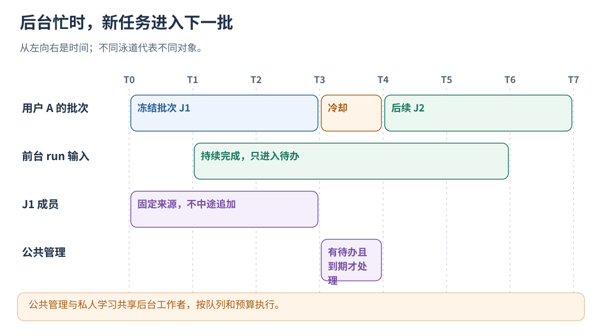
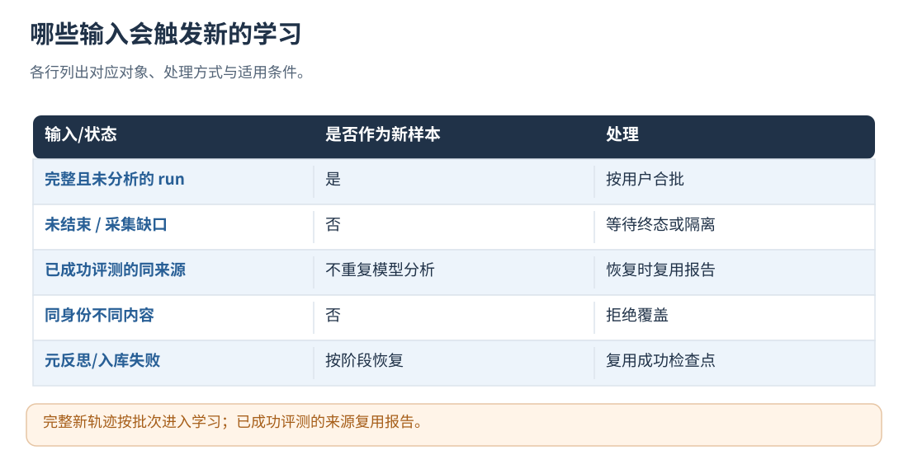

# 17 · 自动学习触发、批处理与积压控制

[文档首页](README.md)

## 本章目标

知道一条轨迹何时被评测，后台忙时如何排队，为什么不会每次 run 都立即进化。

## 设计思路

完整新样本按用户分批，成员固定后保存阶段检查点。私有学习与公共管理共享后台工作者，分别使用预算和冷却配置。



读图：公共管理与私人学习共享后台工作者，按队列和预算执行。 [放大 SVG](figures/17-queue.svg)。

## 自动闭环做了什么

启用 `policy_evaluation_file` 时，在轨迹学习之外另有独立的 **Agent 任务评测工作者**：
它运行冻结版本与任务集，不占用主 Agent 的模型/动作/循环调用链，也不把测试轨迹重新排入学习队列。
只有候选行为版本改变才提交，空队列等待通知；默认两次启动间隔 60 秒，每小时最多 12 个版本作业。
记忆评测摘要的更新不产生新的行为版本。调度、重启去重、取消和报告归档规则见[第 19 章](19-datasets-and-benchmarks.md)。

完整 `run.end` 只将新轨迹加入待学习队列，不再每结束一次就启动一轮进化。
`run.begin`、尚未结束的任务、隔离轨迹和已经完成学习的轨迹不计入新样本。

在自己的服务配置（例如 boundary-service.json）中加入 learning 节，保留原来的其他配置：

```json
{
  "learning": {
    "min_new_runs": 20,
    "max_wait_ms": 600000,
    "min_interval_ms": 60000,
    "max_batch_runs": 32,
    "max_batch_bytes": 33554432,
    "retry_backoff_ms": 60000
  }
}
```

- 按用户分别积累：满 20 条，或最老的新样本已等待 10 分钟，该用户的批次就具备启动条件。
- 同一数据目录一次只运行一个学习批次；前一批结束后至少间隔 60 秒。后台正在运行时，新 run 只排入后续批次。
- 每批最多 32 条，状态和报告的累计大小分别受 32 MiB 上限约束；批次字节预算至少覆盖单 run 上限。
  单轨迹评测、元反思、记忆整理共享 runtime_config 中的 max_model_calls；模型开启时还会按预算缩小批次。
- 最大等待时间决定小批启动资格；实际启动还取决于工作者空闲、冷却和存储状态。
- 空队列不分析、不反思、不重读记忆文件。学习线程等待新任务/到期信号；本地记忆只在组件提交新修订后刷新。
  writer 的 poll_interval_ms 是内存缓冲落盘检查，和全库刷新不同。服务参数修改后重启生效。

满足调度条件后，只处理该批次的新样本：

1. 校验轨迹完整性，区分业务失败和采集失败；后者隔离。
2. 运行确定性分析，可选模型评测具体内容，保留真实证据引用。
3. 生成优化候选，按配置做跨轨迹元反思，筛选支持不足、无证据或冲突建议。
4. 将候选和证据合入该用户的私人库，自动去重、建立关系、周期复核与容量淘汰。
5. 启用 sharing 时，把变更用户加入公共管理待办：提炼、审查、独立来源核验、跨库关系核验与淘汰均在后台自动完成。
6. 新任务从“当前用户私人库＋当前可用公共库”冻结策略快照，按 scope、当前条件和授权选择经验。

成功的单轨迹 evaluation 会保存来源与报告指纹；后续入库重试复用它，不重新调用评测模型。
候选也在入库前保存检查点，入库失败后不重做已成功的候选合成。不同批次通过记忆库累计支持证据，
新报告仍会检查是否反驳已有记忆；不再反复读取“最近 32 条”旧报告。旧配置中的 recent_reports 仅兼容接收，不再控制窗口。

一个样本分析失败，不妨碍同批其他正常样本入库。失败样本保留 failed，不会静默无限重试。
修复原因后，通过现有 HTTP `evaluation.retry` 提交新的 request_id；批次级入库失败会恢复该冻结批次，
单样本错误则单独重新排队。存储/配置级故障按 retry_backoff_ms 退避，重启不会清空已保存的冷却和队列状态。
批次建立前失败时，错误与退避时间记录在 learning/schedule.json 的 last_error 和 retry_after_ms。
`runs/<run_id>.json` 中的 learning 保存 queued_at_ms、job_id、analysis_state、phase 和指纹；
`learning/jobs/<job_id>.json` 记录冻结成员、错误与阶段，供排查，不改变业务状态接口。

注意：模型请求发出后、报告落盘前崩溃，无法仅靠本地文件判断服务商是否已完成或计费。
恢复时标记 analysis_interrupted_unknown_outcome，要求显式重试；不自动重复付费调用。
已完成报告丢失或被修改时同样报错，不把删文件解释为“重新分析”。候选模型阶段中断也采用保守恢复。
这些去重与调度规则同样适用于 `learn` 导入。单独 `evaluate --no-memory` 是诊断性重新分析，可能再次调用模型，但不写记忆。

待学习队列保存小型索引，与活跃业务槽位分开管理；max_stored_runs 限制热存储的运行记录数量。
达到上限时，已发布轨迹且不在待学习/学习中的终态记录自动移入 archive/runs，保留重放与幂等检查。
监控积压、failed 和磁盘容量，并按输入速率调整后台处理能力。
process_evaluations(true)/evaluate_pending() 用于维护阶段提前处理小批次。

候选默认需要两个 Dialogue、两个 Episode 的支持，可通过 evolution 配置调整。
模型评测能看到脱敏限长后的具体内容；元反思处理候选及其证据引用；语义记忆整理主要看候选文本与兼容短名单，
不会把整份原始日志反复发送。模型格式非法或不可用时的处理还受 strict_model 等配置约束。




读图：完整新轨迹按批次进入学习；已成功评测的来源复用报告。 [放大 SVG](figures/17-dedup.svg)。

## 一条轨迹的阶段和幂等键

run 结束后只进入待办；选中用户后冻结 job 的成员和来源指纹。
analysis_state/phase 记录采集发布、单轨迹分析、候选合成、私人入库和批次完成等阶段。
batch_id、candidate_id、memory_id 分别标识证据批次、候选建议和规范记忆条目。

同一完整来源的成功 evaluation 保存指纹供恢复复用；源文件改变会拒绝继续假定它还是原来那份报告。
私库提交成功后把该用户放入公共管理待办，公共失败独立记录，不回滚已经成功的私人证据。

## 分阶段配置预算

| 预算 | 控制对象 | 默认含义 |
| --- | --- | --- |
| learning | 新轨迹批次的条数、字节和启动频率 | 20 条/等待 10 分钟，最多 32 条，批次间隔 60 秒 |
| evaluation.max_model_calls | 单轨迹评测＋元反思＋私库整理 | 批次内共享；耗尽需留下真实未完成/失败说明 |
| sharing.max_model_calls_per_cycle | 公共提炼＋复核＋关系判断 | 默认 8 次逻辑请求，最多一个用户/周期 |

后台正在处理旧批次时，前台新 run 不重启这次学习，也不把自己塞进冻结批次；
新到任务进入对应用户的后续批次，公共管理按共享工作者的可用时间调度。

## 长期运行边界

冷却和待办有持久化记录，重启不会故意清零所有历史进度。
频率降低但平均输入长期大于处理速度时仍会积压；需要减轻模型工作、增加有意义批次或调整部署分片。
当前单 data_dir 不支持多个无协调写入服务横向分担同一队列。

auto_evaluate=false 不会自动替你后台学习；learn --enqueue-only 也只导入待办，
需要之后由被授权的唯一所有者推进。原生 background=false 需要调用方在非业务路径显式推进维护。

## 实现定位

- `src/integration_service.cpp::process_evaluations / observe_queue / run_sharing`
- `src/local_runtime.cpp`
- `tests/test_learning_schedule.py`
- `tests/test_unified_learning.py`

---

[文档首页](README.md) · [上一章：L1–L3：经验注入、动作约束和循环控制](16-runtime-controls.md) · [下一章：目录、持久化、幂等与崩溃恢复](18-storage-and-recovery.md)
