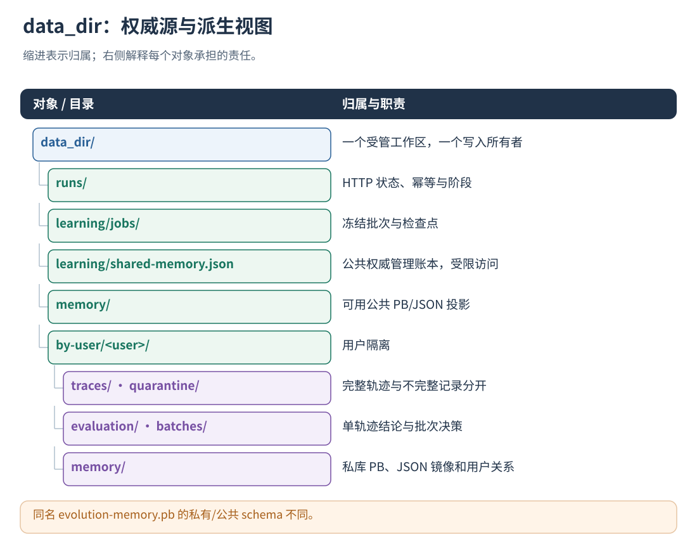
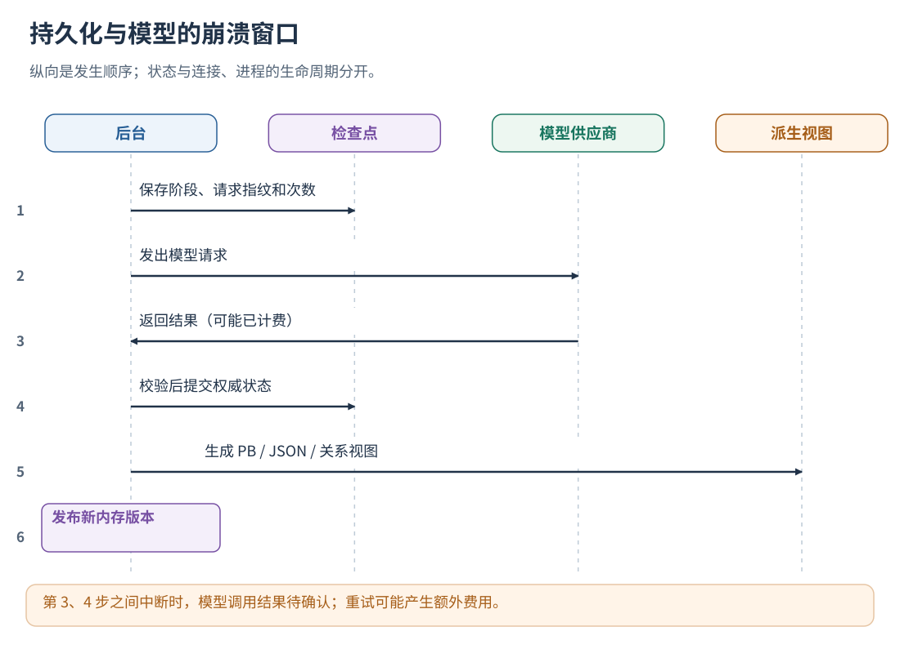

# 18 · 目录、持久化、幂等与崩溃恢复

[文档首页](README.md)

## 本章目标

找到各类产物，了解权威文件、派生视图、原子写与崩溃恢复流程。

## 设计思路

轨迹通过来源、阶段、版本和终态关联；各文件使用原子写入，跨阶段恢复依据检查点和幂等记录执行。



读图：同名 evolution-memory.pb 的私有/公共 schema 不同。 [放大 SVG](figures/18-storage.svg)。

## 输出在哪里

只有一套学习流程：HTTP、本地原生和 `learn` 导入均使用同一配置、队列与目录。
“离线”只是没有运行中的业务 Agent，不再意味着另建一个混合用户的记忆库：

```text
data_dir/
  runs/                           持久化状态与 RPC 幂等记录
  learning/schedule.json          跨重启的批次冷却时间
  learning/jobs/                  冻结批次、阶段检查点和候选 PB
  learning/shared-memory.json     公共库管理账本：支持来源、审查指纹、关系、待办与淘汰
  agent-evaluation/state.json     真实 Agent 评测作业、父版本、发布登记与反馈索引
  agent-evaluation/<job_id>/      冻结候选/基线、每次尝试的完整报告及产物
  memory/                        当前可用公共经验 evolution-memory.pb/.json
  by-user/<user_id>/
    traces/<conversation_id>/     完整标准轨迹
    quarantine/<conversation_id>/ 采集不完整，禁止正常学习
    evaluation/<conversation_id>/ 单轨迹评测 JSON/PB
    batches/<batch_id>/            批次反思与入库结果 JSON/PB
    memory/                       私人 evolution-memory.pb 和可读 JSON
      shared-relations.json       仅当前用户的私库—公共库关系视图
      evaluation-state.json       当前用户的版本评测反馈；私有 PB 同步 evaluation_feedback
    local-runtime/                原生入口发生降级时的计数快照，不包含业务正文
```

目录名进行安全编码。私人 PB 是权威记忆；公共 PB 使用 `SharedExperienceStore`，是管理账本生成的可用投影，
私有库使用 EvolutionMemoryStore。视图由后台维护，learning 目录中的管理账本按内部数据保护。
公共文件只含应用 ID、修订号、经验 ID、作用域、条件与建议，不含用户、会话、来源候选 ID 或私人历史。
HTTP run.end 成功表示收尾已持久化；原生 run.end 仅入内存，后续 run.status.persisted 才表示已写盘。
业务答复独立返回，后台进度通过 HTTP run.status 查询：

| 字段                | 怎么看                                                              |
| ------------------- | ------------------------------------------------------------------- |
| closed              | 任务记录是否结束                                                    |
| capture_complete    | 是否未记录到采集缺口/未知结果               |
| event_count         | 当前保存的事件数                                    |
| evaluation_status   | not_scheduled/pending/running/completed/failed/disabled/quarantined |
| evaluation_error    | 稳定的失败阶段错误码，不回显原始敏感异常                            |
| observed_boundaries | 已观测的模型/动作/循环边界            |
| receipts            | applied/failed/rejected 计数；需结合具体轨迹判断                    |

applied 表示宿主上报的边界数据通过策略应用核验。
无适用策略时可返回 no_match；策略拒绝与业务错误分别记录。

原生 run.status 是有界内存视图，仅包含 run_id、closed、persisted、capture_complete、degraded、evaluation_status，
后台评测状态有刷新延迟，槽位复用后不可查旧 run。详细回执、事件及错误读取后台持久化结果。
`evo.metrics()` 提供 calls、degraded_calls、buffer_bytes、published_runs、persistence_errors、learning_errors、memory_refreshes、enabled；
memory_refreshes 统计启动加载和后续记忆刷新次数。
监控后台故障计数、缓冲区余量和采集状态，及时处理持久化或学习异常。

## 多个后台同时入库怎样避免覆盖

`curate_memory_file` 使用“锁外计算，锁内核对并提交”的乐观更新：

```text
读取权威 PB 为 base
    → 在副本上计算更新（可能调模型）
    → 获取记忆文件锁
    → 重新读取当前 PB
       ├─ 与 base 一致：原子替换 PB，然后更新 JSON 视图
       └─ 已被修改：释放锁，基于新版本重新计划
```

默认最多 3 次更新尝试；相同模型问题可根据请求指纹复用本次更新过程中的响应缓存，调用预算不会因重试无限重置。
不会在等待模型的整个期间占住独占记忆文件锁。

PB 为权威数据，JSON 为可读视图；PB 已提交而 JSON 写入失败时记录视图错误。
trace、evaluation、batch 和 memory 分阶段提交，各自保留恢复记录。
阶段失败后复用已完成产物，通过状态检查、报告复用、批次幂等与原子写入继续恢复。




读图：第 3、4 步之间中断时，模型调用结果待确认；重试可能产生额外费用。 [放大 SVG](figures/18-checkpoint.svg)。

## 幂等窗口与历史保留

保留窗口内重放同一批次，保持记忆条数和独立支持计数不变。
记忆淘汰后，系统按实际保留内容报告批次到 memory_id 的映射及缺失项。
批次去重受 batch_id 历史保留窗口约束；保留的条目继续按候选和证据身份去重。
长期追溯同时保留批次、策略快照和原始轨迹。

## 自动路径怎样组织输出

服务与本地后台使用 data_dir 组织数据：

```text
data_dir/
  runs/<run-id>.json                         运行状态与恢复信息
  learning/schedule.json                    批次冷却检查点
  learning/jobs/<job-id>.json                成员与阶段状态
  learning/jobs/<job-id>.candidates.pb       入库前的冻结候选
  learning/shared-memory.json               公共管理权威账本，仅部署方可读
  memory/evolution-memory.pb                SharedExperienceStore，可用公共投影
  memory/evolution-memory.json              同一公共投影的 JSON
  by-user/<user>/
    traces/<conversation>/<run-id>.trace.json
    quarantine/<conversation>/<run-id>.trace.json
    evaluation/<conversation>/<run-id>.evaluation.json
    evaluation/<conversation>/<run-id>.evaluation.pb
    batches/<batch-hash>/batch.evaluation.json
    batches/<batch-hash>/batch.evaluation.pb
    memory/evolution-memory.pb               当前用户的权威私人记忆
    memory/evolution-memory.json             可读视图
    memory/shared-relations.json             当前用户的版本化跨库关系视图
    local-runtime/<instance>.status.json     本地降级时的数字指标
```

路径组件经过安全编码，上图是逻辑名称。隔离轨迹不会同时作为正常完整样本学习。
learn 导入 SessionLog 后也使用此布局；SessionLog 副本保留 .jsonl。只有不入库的诊断 evaluate 输出允许自选布局。
公共经验通过管理账本 sources/relations 关联用户私库和来源证据，公开投影保留泛化后的内容。

单次 evaluation 回答“这次发生了什么”；batch 回答“形成了哪些候选、怎样入库”；memory 保存可持续维护的当前知识。
追踪一条经验建议按下面的链查找：

```text
应用回执的 memory/content revision
  → 本次固定快照中的经验与来源 candidate IDs
  → batch.memory_update.decisions / memory.source_candidate_ids
  → candidate.support_evidence
  → source 中的运行身份和 evidence_event_ids
  → 原始 trace 事件
```

按业务保留期保存轨迹、批次和关联数据，以支持淘汰后的历史追溯。

## 权威源与失败后的读取顺序

| 数据 | 权威源 | 派生/辅助视图 |
| --- | --- | --- |
| 私库 | evolution-memory.pb | JSON 可读镜像 |
| 公共管理 | learning/shared-memory.json | 根公共 PB/JSON、用户 shared-relations.json |
| HTTP 活跃 run | runs/<run_id>.json | 完成后发布的标准轨迹/评测文件 |
| 原生活跃 run | 当前 LocalRuntime 内存槽 | 开始快照；终态提交后才有完整发布 |
| 学习阶段 | job 与 run.learning 检查点 | Batch/Evaluation 报告和管理状态汇总 |

镜像落后时，根据权威源、检查点与提交修订协调恢复。
公共投影恢复期间暂停新公共快照，由 manager 完成核验与重新发布。

## 崩溃窗口

| 崩溃位置 | 能恢复什么 |
| --- | --- |
| HTTP 状态保存完成、客户端未收到响应 | 同 request_id 重试可读取既有结果 |
| 原生活动执行中、终态未发布 | 已写开始快照可被识别为中断 |
| 模型已收到请求、评测报告未保存 | 有调用/阶段线索，保留未知结果 |
| 私库 PB 已提交、JSON 镜像失败 | 以 PB 为准，记录镜像失败 |
| 公共账本提交、部分投影失败 | 重启按账本协调修订与投影 |

备份/恢复需覆盖完整 data_dir 并与写入者协调，单独复制公共 JSON 无法恢复支持来源和关系。
根据保留策略清理产物，同时保留独立支持核验所需的轨迹、评测、私库和管理账本。

## 实现定位

- `src/service/integration_service.cpp::save / recover_jobs / checkpoint_sharing`
- `src/analysis/evolution_pipeline.cpp::curate_memory_file`
- `src/service/local_runtime.cpp::drain`
- `src/cli/learn_cli.cpp`

---

[文档首页](README.md) · [上一章：自动学习触发、批处理与积压控制](17-learning-scheduler.md) · [下一章：评测集、原始基线与任务验收](19-datasets-and-benchmarks.md)
