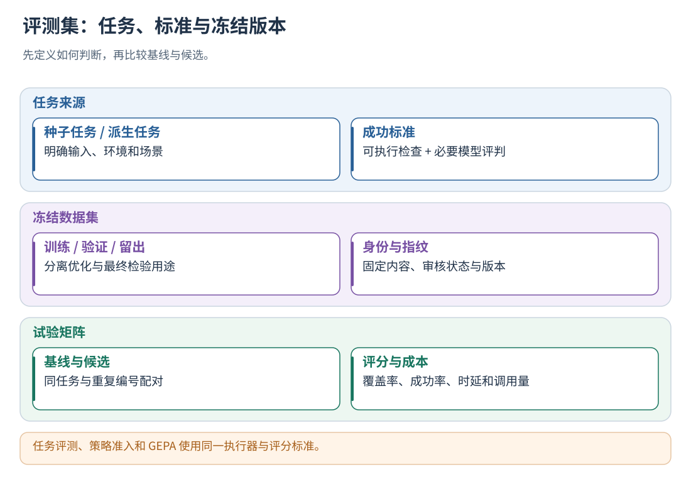
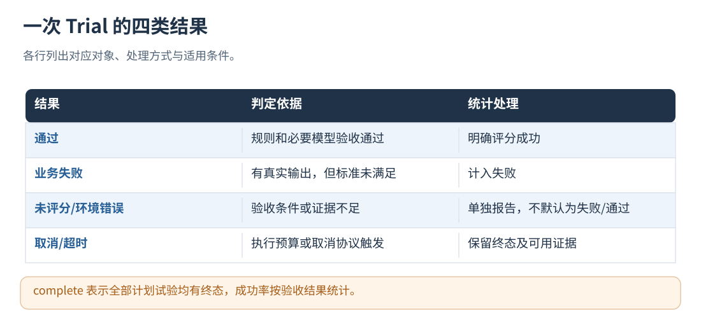

# 19 · 评测集、原始基线与任务验收

[文档首页](README.md)

## 本章目标

构建有标准答案或可检查判分条件的任务集，测基线和候选，不把轨迹诊断当能力评分。

## 设计思路

### 执行依赖的确定性验收

模型评分之外，任务评测会核对真实调度中的成功依赖。数据集 `attributes` 明确提供 `dependency` 和 `stop_on_failure: true` 时，评测检查已观测到的依赖边；`dependency` 为 `independent`、`parallel` 或 `none` 时不据此增加成功约束。调度计划本身明确标记 `require_success=true` 的边，也需要遵守其成功前提。

如果前置动作实际失败，但依赖动作仍实际启动，增加失败检查 `contract.schedule_success`。依赖 skill 启动后自行判断“无需调用工具”，或最后回复写了“已跳过”，不能抵消已发生的错误派发。独立 C 分支仍可继续，跳过而未执行的 B 不算违规。检查同时支持单 run、多 run 和不同事件排列；以批次、动作实例及结构化终态关联，不凭技能名称猜依赖，也不把未知结果算成失败。

此检查不替代完整业务评分：没有声明、没有观测到依赖边或缺乏相关执行证据时，不凭自然语言补出约束。初次评分和仅重评分都使用同一检查；已保存轨迹可以重新验收，不需要重新调用主 Agent。历史 L0 报告导入时也重新核对这些确定性条件；基线缓存记录验收规则版本，避免旧判分口径与新候选混用。

轨迹评测分析已有执行记录；任务评测调用受信宿主运行固定任务，再按预设标准判分。

L4 数据准备复用这个任务评测器：缺少可用经验时，用原 Agent 的无策略版本执行 `train`，
再通过专门的完整性与来源校验进入既有学习队列。普通 `dataset run` 仍只评测，不自行修改记忆；
`val`、`holdout` 以及候选策略的评测轨迹不作为此入口的学习来源。
配置与边界见[自动补充训练](24-evolution-and-gepa.md#经验不足时自动补充训练)。



读图：同一个任务评测器服务离线对照、后台策略准入与 GEPA 多轮候选比较。 [放大 SVG](figures/19-dataset.svg)。

## 在后台评测真实 Agent，并控制策略发布

### 更换评分模型或提示词后，仅重评已有执行

包内示例配置使用 `judge.include_model_requests=false`：评分输入省略明确标为模型活动
（`attributes.semantic=model`）的请求载荷，避免系统提示词、工具定义、重复历史淹没真实执行证据。
模型实际输出、工具实参与返回、任务、状态、产物、事件顺序及并发因果关系仍保留。
完整模型请求继续记录在原始轨迹和 Trial 中；未标语义的活动及自定义工具输入不按字段名猜测删除。
精简视图也省略组件 `custom/policy.query` 诊断中重复的查询、注入上下文、经验列表和策略编号；
其动作/循环决定及独立注入回执保留，业务自定义事件不受影响。
模型输入用 `evidence_view=model_requests_omitted` 标注投影范围。需要核验具体模型请求或提示词注入时设为 true；
已有配置省略该选项时保持原完整请求行为。配置值参与评分上下文指纹，不与另一种视图混用成绩。

已有完整任务报告时，可以只更新模型业务评分和 loop 评审，避免重复执行工具和生成媒体：

```sh
trajectory_evolution dataset run DATASET --config evaluation.json --output-root NEW_OUTPUT --regrade-report PREVIOUS_OUTPUT/report.json
```

`evaluation.json` 中开启 judge，并指定新提示词或模型；数据集、任务选择、重复次数和 Agent
版本须与原报告一致。`parallelism` 此时控制评分请求并发，不启动 Agent。
组件校验原 manifest、任务版本和产物哈希，保留原始轨迹、执行 ID、耗时、用量及确定性检查结果，
重新计算全部模型评分。这里不会重新执行配置中的 command、checks 或产物检查；
若要更换执行环境或确定性验收标准，请使用普通 `dataset run` 重新执行。

新报告的 `configuration.model_only_regrade=true`，`execution_source` 记录来源 run、原配置指纹和报告哈希；
新配置指纹同时绑定来源与本次评分配置。`summary.agent_reexecuted=false`，`regraded_trials`
记录实际尝试重评的数量，评分失败仍明确标为错误。取消后报告 `complete=false`，尚未重评的旧成绩
不写入新报告。原目录不覆盖；新报告不会作为普通同配置执行检查点自动复用，也不自动发布策略或更新记忆。

增加 `--recheck` 可同时在已保存证据上运行当前 `checks`，仍不启动 Agent。相同 ID 的原规则结果被重新计算，
其他原检查继续保留，尤其是产物、隐私和任务预算失败；不重新执行产物采集或生成工具。
此时 `configuration.rechecked_configured_checks=true`、`model_only_regrade=false`，指纹与仅模型重评区分。

### 把可计算的任务限制交给规则检查

例如题目明确限定某操作最多执行一次，可在同一份评测配置中填写：

```json
{"checks":{"task-id":[{"id":"video-attempt-limit","op":"action_count","operation":"generate_video","max":1}]}}
```

`operation` 是接入方实际记录的操作名称；评测器不导入框架模块，也不内置业务工具名称。
`min`、`max` 至少填写一个，均为 0–1000000 的整数；可选 `status` 为 completed、failed 或 cancelled，
限定所计执行的终态。未填 status 时，失败调用也计入次数，不能因为未生成产物而忽略重试。
计数覆盖本题全部 run/轮次，按 `(run_id, execution_id, action_id)` 配对，start/end 不重复计数，
SDK 过滤而明确 `executed=false` 的动作不计入实际调用。

此规则需要完整的标准轨迹、action.start 的操作名称及 action.end 的 `attributes.executed` 布尔观测。
没有轨迹、动作未闭合或缺少执行标记时记为评测错误，不把未知次数当成零。完整轨迹确实没有匹配调用时才为零。
规则失败不能被模型的 passed 覆盖；模型仍可进行独立语义及 loop 评审。规则只能落实题目已有的约束，
不从任意自然语言自动推断次数限制；基线和候选必须使用同一份配置。

### 任务入口绑定（推荐）

已经接入模型、动作、循环和 run 结束打点后，只需再绑定原有的任务接收函数。
绑定放在**依赖初始化完成后、开始接收正常用户请求之前**。它不是另一个 Agent，也不重写调度逻辑。

Python 同步程序，在现有启动位置插入：

```python
from evolution_entry import evaluate

# handle_message 是应用原有的函数，接收一个字符串或 JSON 值。
# initialise_dependencies() 应在这里之前完成，保持应用原有初始化。
if not evaluate(handle_message):
    start_original_server()
```

异步程序在原有事件循环内插入，不创建替代事件循环：

```python
from evolution_entry import aevaluate

if not await aevaluate(handle_message):
    await start_original_server()
```

`handle_message` 可以同步完成任务，也可以只向消息总线投递后返回。其返回值不参与评分；
最终答案取已有 run 结束打点的 `output`。后一轮等待前一轮真实结束且轨迹持久化，
不会因派发函数返回、子进程退出或收到一段流式文本就提前开始。
每轮对应一个逻辑 run，内部任意数量的并发活动仍属于该 run。
后台消费者必须先就绪；如果消费者由事件循环驱动，使用异步封装，不能在该循环内调用阻塞版。

如果 Agent 执行中还要访问自身的 HTTP 接口、接收消息或上传制品，原服务必须与评测同时运行。
这时不要在服务启动前等待 `aevaluate` 完成：在依赖初始化后用
`asyncio.create_task(aevaluate(handle_message))` 启动接收任务，再继续原服务的启动；
服务退出时取消并等待这个任务。例如 FastAPI 的 lifespan 在 `yield` 前创建任务，
在 `finally` 中取消并等待，不能在 `yield` 前直接 `await aevaluate(...)`。
同步服务同理：先启动原有消费者/监听服务，再进入评测接收循环。
组件仍以闭合轨迹为完成依据，后台接收不改变逐题和多轮执行顺序。

在 `evaluation.json` 中配置原本的启动命令和输入格式。下面假设原有处理函数接收
`message/user_id/conversation_id/request_id` 字段：

```json
{
  "id": "baseline",
  "version": "my-agent-revision-1",
  "command": ["python3", "{config_dir}/app.py"],
  "instrumentation_config": "boundary-service.json",
  "entry": {
    "input": {
      "message": {"$eval": "input"},
      "user_id": {"$eval": "user_id"},
      "conversation_id": {"$eval": "conversation_id"},
      "request_id": {"$eval": "run_key"}
    },
    "output_pointer": "/answer"
  },
  "pass_env": ["MY_MODEL_API_KEY"]
}
```

这是完整配置中 `variants` 数组的一项。复制包内 `config/evaluation.json` 后修改即可；
运行命令仍是 `trajectory_evolution dataset run DATASET --config evaluation.json --output-root NEW_OUTPUT`。
`command` 指向原程序的前台启动命令，不要指向会自行脱离进程组的 daemonize 脚本。
原程序所需的配置、工具和数据仍由部署方提供；组件创建工作目录并不等于自动隔离数据库、网络写入或共享文件。
请使用测试账户、测试服务和独立工具目录，不连接生产任务队列。

### 用导出的策略包进行全新对照评测

保持同一个 Agent 启动命令、打点配置和输入绑定，基线不提供策略；策略组只增加发布包路径：

```json
{
  "id": "L3",
  "policy_version_file": "versions/published-version.json",
  "command": ["python3", "{config_dir}/app.py"],
  "instrumentation_config": "boundary-service.json",
  "entry": {"input": {"$eval": "input"}},
  "pass_env": ["MY_MODEL_API_KEY"]
}
```

这是 `variants` 中的一项；`command`、`entry` 应沿用当前 Agent 的正常部署配置。
`policy_version_file` 与内联 `artifact` 互斥，必须配合 `instrumentation_config`；无需填写 `version`，
组件从包中读取并验证。如果填写，必须与包内版本一致。路径相对评测配置文件解析。
包只需一个文件；不需要旧训练任务、历史日志、经验库、反思提示词或旧实验启动材料。
评测会冻结包内容并纳入配置指纹，同路径换成另一份策略不会复用旧检查点。

每个试次使用隔离状态和新的运行身份，策略组通过真实离线加载入口验证宿主权限与运行能力；
L0 不注入策略。评测只运行 Agent 和判分，不搜索、不重新编译历史记忆、不更新经验库。
评分模型配置仅供评测器判分，主 Agent 的模型配置仅供执行，两者都不是策略包的隐藏依赖。
评测失败或策略加载降级仍按失败记录，不作为有效 L3 成绩。

如果原函数只接收一个字符串，使用 `"entry": {"input": {"$eval": "input"}}`。
`$eval` 只替换一个 JSON 值，不执行代码，不做字符串拼接，不导入任何框架模块。
模板中的普通字段名应与原函数输入一致；不要求修改成组件规定的业务字段名。

| 可绑定值 | 含义 |
| --- | --- |
| `input` | 当前轮用户输入 |
| `messages` | 当前轮以前的真实问答，加上本轮用户输入；不包含未来问题或评分标准 |
| `user_id` | 冻结版本所属的测试用户 |
| `conversation_id` | 本次 trial 的独立会话 ID；同题多轮保持一致 |
| `run_key` | 当前输入的业务关联 ID；不同轮次不同 |
| `turn` | 从 0 开始的轮次 |
| `initial_state` | 数据集给定的初始条件；非空时必须显式绑定并由原入口处理 |
| `constraints`、`budget` | 本题执行约束与预算 |

`output_pointer` 是相对 run 结束 `output` 的 JSON Pointer，用于提取后续对话的 assistant 内容；
例如结束输出为 `{"answer":"完成","state":{}}` 时使用 `/answer`。
省略时把整个输出作为内容，结构化对象编码为 JSON 文本；完整输出仍保留在轨迹和评测证据中。
路径不存在会明确报错，不用空字符串继续。输入消息/历史上限为 1 MiB，超限报错，不静默截断。

包自动选择跨进程采集和每输入一条 run，用户不需要再填写 `instrumentation_transport` 或 `run_layout`。
原生 SDK 仅在这种评测模式下转向试验采集端；正常原生执行路径保持不变。
凭据从子进程环境传入，不写入输入消息或评测报告；标准答案、评分 rubric 与 split 不投递给接收函数。
每个 trial 独占一个入口接收者；第二个绑定者被拒绝，避免并发重复消费。
回调异常不会自动重试业务任务，只返回固定错误码；缺 run、缺结束或遗留分支按试验总 timeout 处理。
组件不会根据历史日志猜测或反射调用任意未知函数，用户仍需指出已有的 JSON/文本输入边界。

例如 AgentFlow 的绑定位置是接收用户任务、将其交给原调度系统的入口，而不是某个被派发的
Coordinator/Skill 子进程。子进程只继续使用已有打点。若这个入口尚未暴露成可绑定的 JSON/文本接收函数，
须先在原任务接收边界接入上述封装；仅修改 v1 子进程中的观察打点，不会让它自动收到离线评测题目。

#### 各语言使用同一封装

| 语言 | 插入的包内调用 |
| --- | --- |
| Python | `evaluate(handle_message)` / `await aevaluate(handle_message)` |
| JS / TS | 从 `evolution.mjs` / `evolution.ts` 导入，`await evaluate(handleMessage)` |
| Rust | `trajectory_evolution_client::evaluate(handle_message).await?`；接收器返回 `Result<(), E>` 的 Future |
| Go | `evolution.Evaluate(ctx, handleMessage)`；接收器签名 `func(context.Context, any) error` |
| Java | `Evolution.evaluate(existingReceiver)`；在允许阻塞的线程使用，接收器可以只是异步投递 |
| C# | `await Evolution.EvaluateAsync(HandleMessage)`；接收器签名 `Func<JsonNode?, Task>` |
| C++ | `trajectory_evolution_http::evaluate(existingJsonReceiver)`；包含 `clients/cpp/evaluation_entry.hpp`，链接 `trajectory_evolution_local` |
| C / 其他 FFI 语言 | `te_evaluate(receiver, context)`；包含 `trajectory_evolution/evaluation_entry.h`，回调接收 UTF-8 JSON，返回 0 表示已接收 |

除 C ABI 使用 `0=未启用、1=完成、-1=错误` 外，其他封装以 bool 区分未启用/完成，以异常或 error 表示失败。
封装内部的输入拉取只在评测子进程中发生；生产模式是一次环境标志检查，不增加空闲轮询。
有线程亲和性的程序应在正确线程调用接收器，不能把同步封装放进其唯一事件线程。
对于其他语言，可以通过 C ABI 复用完整投递循环，无需自行编写启动器或评分逻辑。

底层统一协议为 `evaluation.next {consumer,index}` 和 `evaluation.fail {consumer}`，使用同一个认证 `/v1/invoke`。
next 返回 `input/waiting/done/failed`；输入请求可重复取得同轮数据，但业务调用的至多一次由包内顺序封装保证。
接收进程中断后不自动换接收者重放，整次 trial 按失败/超时处理，防止不确定的外部副作用重复执行。

### 兼容：已有 stdin 任务入口

#### 已使用组件打点的旧任务入口

已使用原生 C ABI 或组件 HTTP 打点的 Agent，可在 variant 中配置：

```json
{
  "id": "baseline",
  "version": "my-agent-revision-1",
  "command": ["python3", "{config_dir}/agent_main.py"],
  "instrumentation_config": "boundary-service.json",
  "pass_env": ["MY_MODEL_API_KEY"]
}
```

command 是自己的测试实例入口，接收 stdin JSON 的 task.task_input、followup_inputs、initial_state 等任务数据。
task 的字段为 task_id、task_input、followup_inputs、initial_state、constraints 和 budget；
group_id、split、标准答案和判分规则不传给宿主。需要临时会话标识时可使用顶层 trial_id，不依赖 group_id。
入口执行原有业务代码与 point，无需写版本文件、汇总计数、读取轨迹文件或打印评测响应 JSON。
成功输出取任务 after 的 output；可检查状态放在 output.state，产物声明可放在 output.artifacts。
每个 trial 对应一次完整任务评测，可包含一个或多个真实 run。例如一个三轮对话任务，
宿主可以保留三个独立 dialogue/run；同一次派发里的并发活动仍归入所属 run。

组件负责：

1. 创建该 trial 专属目录、临时服务凭据和冻结版本文件，复制配置并关闭实例内的学习/公共晋升。
2. 将试验配置与凭据放入子进程环境。包内初始化自动使用它们，正常进程不受影响。
3. 执行业务入口，收集完整逻辑 run 的终态；不依赖 stdout 的格式，也不读取线上数据目录。派发进程退出后仍等待异步活动收尾。
4. 校验版本、用户、run 完整性，自动恢复标准轨迹，从真实 action.end / loop.decision 汇总指标。
5. 使用同一规则/模型评分与准入门槛。结束后清理该 trial 的临时工作目录，保存报告与验收通过的产物。

无 artifact 时此模式生成 L0 基线；后台 AgentEvaluationService 会自动提供 L0 或 L1–L3 的冻结 artifact。
instrumentation_config 也进入后台评测配置指纹，修改后旧准入结果不继续沿用。
没有终态快照、版本不符或有采集缺口的试验记为评测错误，不记作能力通过。
异常退出时仍尝试保存已采集的结构化证据：完整、版本一致的单条轨迹保留在 evidence.trace，多条保留在 evidence.traces，
并从实际事件汇总 metrics；不完整轨迹放入 evidence.failure_capture，包含 complete=false 和 validation，
不将部分计数填作完整试验指标。没有可用记录、身份不符或隐私检查未通过时，只记录
failure_evidence_unavailable 警告。原始 stdout/stderr 不作为故障证据保存；试跑原有错误码、超时判定和发布门禁保持不变。

使用 `entry` 的隔离评测中，当前轮打点被拒绝时会及时返回 `evaluation_entry_capture_<错误码>`；已记录采集缺口但未结束的 run 返回 `evaluation_entry_trace_incomplete`。即使根打点未创建成功，也不会在已知采集失败后继续等待整题超时。业务流程的 fail-open 行为不变，普通业务失败不触发此错误；上一轮已结束 run 的迟到异常不污染下一轮。没有采集错误、仅等待异步任务完成时，仍须真实 `run.end` 且落盘后才能推进，接收器返回不能代替 run 结束。

采集模式的轨迹预算与 stdout/stderr 预算分开配置：`max_output_bytes` 继续限制进程输出；`max_trace_bytes` 限制一个 trial 内所有采集 run 文件的总字节数，默认 32 MiB，可配置范围为 128 字节至 64 MiB。超限返回 `evaluation_trace_bytes_limit`，记作评测异常，不截断为一条看似完整的轨迹。此项不会扩大模型输入预算、产物预算或报告预算；长轨迹不会仅因超过 stdout 上限而读取失败。

`instrumentation_transport` 默认为 `native`；使用配置式 HTTP 打点时设置为 `http`，评测器会启动独立的本地临时采集服务，
通过 `TRAJECTORY_EVOLUTION_TRIAL_URL/CONFIG/TOKEN` 指向试验实例，包内配置式客户端自动读取，避免流入生产服务。
完全自定义的远程测试宿主仍可使用下文的任务宿主协议。

多 run 评测按首事件时间、再按 run_id 排序，不使用文件名或目录枚举顺序。每条都必须
属于同一试验、同一用户和同一冻结版本，并具有完整终态。单 run 的原字段不变；多 run 使用：

- `evidence.traces`、`execution_run_ids`：逐条保留真实轨迹及身份，不拼造新 run。
- `evidence.output.turns`、`output.final`：各轮终态输出与最后一轮输出；`state` 取最后一轮。
- `metrics`：对每轮都已观测到的指标求和；任一轮缺失的指标不填零、不发布不完整总计。
- `evidence.trajectory.runs`：逐轮分析；`summary` 保存 run_count 和无效 loop 下界总和。
- `evidence.failure_capture.runs`：异常退出且存在不完整 run 时逐条保存校验结果，不生成全任务指标。

记忆反馈也会检查所有 run 中的实际策略应用回执。各轮调用预算按整项任务合计，
进程超时仍由 trial 的统一截止时间约束，不因多轮而自动延长。

在 variant 中设置 `run_layout: "per_input"` 表示每次输入产生一个 Run，评测器会预先等待
`1 + followup_inputs.length` 个完整 Run。默认 `single` 表示整个任务一个 Run。
这个参数也决定异步派发后的结束条件：前一轮结束、后一轮尚未创建的空隙不会触发提前清理。
缺轮、额外轮次或开放的活动均不能作为完整任务通过验收。

`AgentEvaluationService` 复用本章的任务执行器和判分标准。评测对象是“固定版本下 Agent 的完整执行”，
包括经验注入、动作选择与循环控制的实际效果。轨迹分析负责从过去的执行中提出改进；这里重新运行固定任务，检验改进是否有效。

| 使用位置  | 交给评测器的内容                 | 评测结果的用途                                       |
| --------- | -------------------------------- | ---------------------------------------------------- |
| L0        | 原始 Agent，`policy=null`      | 建立质量、调用次数、时延与无效循环基线               |
| L1        | 冻结的经验快照和精确授权         | 验证增强输入后的任务效果                             |
| L2        | 同时包含动作规则的冻结策略       | 验证放行、拒绝及任务完成情况                         |
| L3        | 同时包含循环规则的冻结策略       | 验证停止、重规划与任务完成情况                       |
| L4 优化器 | 提交一个新的 L1/L2/L3 可执行候选 | 复用同一数据集、执行器、评分器和准入标准进行多轮比较 |

L4 是实验编排的调用方；候选的 `level` 仍是其实际使用的 L0–L3 运行能力。
既有 `dataset run` 保持纯评测模式。自动提交、发布登记、记忆反馈由管理层完成。

### 兼容：自定义完整任务宿主协议

以下为已有外部评测宿主保留的低层协议。新接入使用上面的任务入口绑定，不需要编写下面的程序。

评测宿主是你提供的一个程序，Python、C++、Rust、TypeScript 等均可：从 stdin 读一条 JSON，
运行同一套 Agent 实现，从 stdout 返回一条结果 JSON。调试信息使用 stderr。
测试入口需要准备独立工作目录、测试账户、工具数据和模型调用额度，不连接线上任务队列或业务写入目标。

每次试验都会启动独立子进程。宿主收到的额外字段是：

```json
{
  "version": "agent-version-v1:<64位SHA256>",
  "artifact": {
    "schema_version": 1,
    "agent": {"revision": "my-agent-2026-09-v1"},
    "user_id": "alice",
    "level": "L1",
    "policy": {"说明": "完整 RuntimePolicy，由组件提供；不要手写此示意对象"}
  },
  "evaluation_mode": true
}
```

原有 `task`、`trial_id`、`variant_id`、`repetition` 一并发送。
`task.followup_inputs` 要在同一测试会话内逐轮执行；异步或多 Agent 场景必须等待全部所属分支终态和最终聚合结果，再返回 stdout。
Coordinator 的派发进程退出只意味着派发结束，不能代替整个测试任务结束。

若 Agent 已接入本组件的原生或 HTTP 边界，测试宿主按下面方式加载候选：

1. 在本次工作目录创建 `version.json`，内容为 `{"version": request.version, "artifact": request.artifact, "trial_id": request.trial_id}`。
2. 复制你的服务配置用于测试，将 `evaluation_version_file` 指向该文件，`data_dir` 设为这个目录内的子目录，例如 `state/`。
3. 使用当前试验的用户身份启动测试实例，`run.begin.level` 使用 `artifact.level`；模型、动作、循环插入点继续复用业务实现。
4. 原生模式等待采集队列落盘；HTTP 模式等待整个 run 结束。返回该 run 的完整 trace 和 `run.begin` 返回的 `agent_version_id`。

测试实例会关闭自身的自动学习、公共库管理和候选评测调度，避免评测递归以及测试数据进入生产记忆库。
`evaluation_version_file` 是受信部署配置，生产 API 请求不能指定任意文件路径。
服务数据目录必须位于版本文件所在目录下，并且与该目录不同；不要把生产 `data_dir` 传给测试实例。

返回结果仍使用本章的验收协议，并增加：

```json
{
  "schema_version": 1,
  "trial_id": "收到的trial_id",
  "loaded_version": "run.begin返回的agent_version_id",
  "execution_status": "completed",
  "output": "实际最终答案",
  "state": {"实际验收状态": "由测试设施测得"},
  "metrics": {"llm_calls": 8, "tool_calls": 5, "tokens": 12000, "steps": 10},
  "trace": {"说明": "实际采集的完整trajectory.v1对象"}
}
```

上面的说明对象需替换为真实对象。宿主不接收 rubric、预期答案或判分规则。
`loaded_version` 必须匹配请求；轨迹 `run.start.attributes` 还必须同时包含
`agent_version_id` 和 `evaluation_trial_id`。轨迹保留 Agent 自己的 run ID，无需改成试验 ID。
后台准入强制检查完整轨迹、身份、版本绑定、执行结果一致性和敏感输出。
被测 Agent 的部署修订、模型及工具版本通过 `agent` 描述并由宿主实际加载；更换它们时更新 `agent.revision`。

源码仓库中的接入测试宿主位于 `tests/agent_evaluation_host.py`。它使用真实原生采集与策略接口，
业务模型是确定性测试替身，用于验证版本绑定和管理机制；正式评测应替换为你的 Agent 入口和真实业务模型。

### 第二步：配置固定任务、评分标准与资源预算

先按下文构建并检查已审核的任务集。复制 [evaluation.json](../config/evaluation.json)，配置：

- `variants`：只保留一个受信宿主入口，`command` 为 argv 数组，不经过 shell；管理层自动扩展成基线与候选。
- `checks`：每个任务的确定性验收标准；`judge`：可选模型评分器及预算，复用原有规则优先、模型补充的评分逻辑。
- `splits`、`repetitions`、`max_trials`：固定测试范围和样本规模。候选比较优先使用 val，holdout 留给独立验收。
- `timeout_ms`：可配置的单次宿主超时，同时受任务自身 budget.timeout_ms 约束，使用两者较小值。
- `parallelism`：后台最多 4，建议从 1 开始。`pass_env` 只列测试入口需要的环境变量名，不在 JSON 中保存密钥。
- `resources`：可配置 `nice`、`address_space_bytes`、`cpu_seconds`。未提供时后台使用 nice=10、1 GiB 地址空间、300 CPU 秒；网络等待由 timeout_ms 限制。

例如单机小规模测试可配置：

```json
"resources": {"nice": 10, "address_space_bytes": 2147483648, "cpu_seconds": 600}
```

资源限制在发送任务前应用到测试进程，子进程继承；整棵进程树和外部 GPU/API 资源使用容器或 cgroup、
独立测试服务及额度池管理。评测不在主 Agent 的请求链上执行，但共享机器或共享 API 配额仍会有资源竞争，部署时需要分别分配。

### 第三步：启用自动准入

复制 [agent-evaluation.json](../config/agent-evaluation.json)，修改 dataset、evaluation_config、agent.revision。
相对路径均以所在配置文件的目录为基准。然后在自己的 service 配置中加入：

```json
"policy_evaluation_file": "agent-evaluation.json"
```

如需自动将新合格经验提交为候选，同时设置 `auto_approve_experiences=true`；也可继续使用精确经验授权列表。
这项配置只决定候选包含哪些经验，启用准入后仍须通过任务评测才能发布。
未配置 policy_evaluation_file 的已有部署保持原授权行为，便于兼容升级。

启动同一个 `serve --config ...` 服务，或照常构造原生 LocalEvolution 即可。后台自动完成：

1. 读取各用户的私有加公共合格视图，冻结 L0 至 max_level 的候选。
2. 按“用户＋行为版本＋父版本＋评测配置/数据版本”去重入队。
3. 在独立测试宿主中执行。L0 只运行原始 Agent；其他级别与已发布的同级策略比较，首次与原始 L0 比较。
4. 核验覆盖率、质量、配对样本及可选成本/无效循环目标，记录通过、拒绝或证据不足。
5. 当前最新候选通过且父版本仍一致，才登记为已发布版本；后台刷新供新 run 读取的内存视图。
6. 回写记忆的版本级反馈和满足条件的单条经验评测状态，规则见[私有记忆](13-private-memory.md)。

启用 GEPA 时，第 3 步扩展为训练/验证的多轮搜索和最终留出比较；候选试验不回写生产记忆状态。
其任务去重绑定 seed 与实验上下文，不因发布改变 parent 而反复启动，详见[GEPA 专章](24-evolution-and-gepa.md)。

前台不等待评测结束：请求 L1–L3 时使用仍然兼容的已发布同级版本；尚无合格版本则返回
`level=L0, policy_gate=awaiting_evaluated_policy`，Agent 按原始逻辑继续。
已有 run 固定自己的策略；通过评测的候选只影响后续 run。
已授权经验被删除、改写、撤权或产生不兼容关系时，旧版本不会继续作为新 run 的可用策略。

### 准入指标怎么配置

| gate 字段                  | 默认值 | 处理规则                                                             |
| -------------------------- | ------ | -------------------------------------------------------------------- |
| min_trials                 | 2      | 至少达到此数量的确定评分试验；比较时还要求配对样本充足               |
| memory_min_pairs           | 2      | 单条经验自动验证/归档所需的配对改善或退化次数                        |
| min_coverage               | 1      | 基线与候选的确定评分覆盖率门槛                                       |
| min_pass_rate              | 0.8    | 候选确定评分试验的最低通过率                                         |
| max_pass_rate_drop         | 0      | 相对基线可容忍的通过率下降幅度                                       |
| max_latency_ratio          | 未启用 | 候选平均 Agent 时延 / 基线时延上限                                   |
| max_token_ratio            | 未启用 | 候选平均 token / 基线 token 上限；缺计数时拒绝此项                   |
| min_invalid_loop_reduction | 未启用 | 规则确认无效 loop 下界的下降比例，例如 0.3；缺有效轨迹指标时拒绝此项 |
| require_level_coverage     | false | 显式启用严格覆盖验收：生成规则及本级能力均须有应用证据；默认覆盖情况只作诊断，不阻挡效果达标的候选 |

质量先满足门槛，成本改善不能抵消质量失败。基线无效 loop 为 0 时，候选也需为 0；报告保留原始数值。
L0 用于基线测量，不要求相对自身取得成本或循环改善。
错误、取消和模型评分不确定会降低覆盖率；证据不足为 inconclusive，不计作经验反证。
宿主超时是一次未按预算完成的失败，基础设施不可用应返回 environment_error。
默认按通过率、无效 loop 和时延等已配置效果门槛选择并验收策略，不要求为了达到 L3 而强行触发技能编排。`control_coverage.capabilities` 仍提供各边界的 `queries/triggered/applied`，`unobserved_capabilities` 和 `unobserved_rules` 如实列出未覆盖内容，不会因关闭覆盖门槛被改成已覆盖。GEPA 搜索仍核验新改动的实际应用及相对父策略的决策变化，不把完全未采用改动的随机收益当成新策略收益。

需要专门验收全级能力时，显式设置 `require_level_coverage=true`：缺少生成规则证据以 `generated_control_not_observed` 拒绝，缺少本次最终评测的某级实际应用以 `level_capability_not_observed` 拒绝。不要求每道题触发所有能力；仅查询、生成规则、派发 ACK 或始终 continue 不计实际应用。

报告同时提供总试验数、确定评分数、通过/失败/错误/不确定数量、覆盖率、各变体与分类汇总、
配对胜负、平均/P95 Agent 时延、LLM/工具调用数及 tokens。未知计数不补成 0。
`summary.model_calls` 是评分器自身的模型调用数，`host_reported_metrics.llm_calls` 是 Agent 的模型调用数，两者分别记录。
对于 `evolution.boundary.v1` 轨迹，组件从实际完成的打点重新计算模型、工具、步骤和循环次数；
若宿主另报了不同的计数，使用轨迹计数并记录 `host_metric_mismatch` 警告。
计数覆盖已接入的边界，不推测未打点的内部调用；只有 run 起止记录的 L0 轨迹不能用于衡量内部调用效率。
模型 `after.metrics` 提供实际 usage 后才汇总 tokens，缺失 usage 不用宿主估计值补齐。

### 查看状态、重试与复用接口

管理请求发送到 HTTP `/v1/invoke`，使用当前用户服务令牌；不放在模型、工具或循环的同步链路中：

```json
{"operation":"agent_evaluation.status","request_id":"status-1"}
{"operation":"agent_evaluation.feedback","request_id":"feedback-1"}
{"operation":"agent_evaluation.retry","request_id":"retry-1","job_id":"待重试的64位ID"}
{"operation":"agent_evaluation.cancel","request_id":"cancel-1","job_id":"待取消的64位ID"}
```

`agent_evaluation.submit` 的额外字段是完整 `artifact`，可供候选生成器或 L4 优化器提交。
配置 `gepa_config` 后，这个提交入口自动启动 GEPA，树通过 `agent_evaluation.tree` 查询。
训练小批次使用可选 `evaluation.json.task_ids` 选择指定任务，必须与 `splits` 一致，未知/重复 ID 拒绝。
完整的搜索、预算、验收与恢复说明见[GEPA 专章](24-evolution-and-gepa.md)。
请求不能设置执行命令、文件路径或凭据，也不能跨用户访问任务。`status.jobs` 返回当前管理索引，
`status.publications` 按等级返回已发布 job/version；`feedback` 按 memory_id 和 content_revision 关联试验。
原生热路径 `invoke` 不执行有 I/O 的管理操作。原生部署在管理线程使用 `evo.manage("agent_evaluation.status")`，
重试例如 `evo.manage("agent_evaluation.retry", {"job_id": job_id})`。C++ 使用 `LocalRuntime::manage(JSON)`，
其他语言通过 C ABI `te_local_manage(handle, utf8_json, length)` 调用同一个已有实例，返回字符串用 `te_local_free` 释放。
manage 不执行 Agent 任务本身，但可能等待管理锁及落盘；不要放入 Agent 的同步执行链路。
独立实验编排代码还可以直接使用 `AgentEvaluationService`（头文件 `trajectory_evolution/agent_evaluation.h`），
每个数据目录只由一个管理实例持有，不能在原生运行时之外重复打开相同目录。

默认每次启动评测至少间隔 60 秒、每小时最多 12 个版本评测，后台一次处理一个版本；空队列等待通知。
同用户同级待运行候选被新候选替代时记为 superseded；正在执行的旧候选保留报告，完成后重新核验父版本与最新候选再决定发布。
重启将 running 标为 interrupted，需要显式 retry；error/inconclusive 也可以 retry，成功和业务拒绝不自动重试。
取消会终止正在运行的测试进程组；已经进入模型评分 HTTP 请求时，收尾受评分器 HTTP 超时约束。
取消后不再领取新题。已经执行的结果继续落盘，未启动的题目不生成 Trial；报告与 manifest 的 `complete=false`。
`summary.planned_trials` 为计划总数，`summary.not_started_trials` 为未启动数；评分汇总只统计已执行的 Trial。

后台 `retry` 在新 attempt 中恢复同一任务最近一个带 manifest 的报告。数据集、策略版本、评测配置和模型提示词指纹必须一致：
有效的通过/业务失败题目保留原成绩；Agent 已执行完成但模型评分失败时只重新评分；取消、未执行或没有有效检查点的题目重新运行。
复用保留原 trial/run ID、轨迹、用量及 Agent 耗时，并核验、复制已保存的产物；旧报告和旧成绩不覆盖。
报告记录 `summary.resume_source`（来源 run ID 与报告 SHA-256）、`reused_trials`、`regraded_trials` 和 `regraded_trial_ids`；
`model_calls` 只统计本次 attempt 新发起的逻辑评分调用。取消恢复任务时，已有检查点仍保留在不完整报告中。
报告或产物哈希不匹配、上下文改变时拒绝复用。没有 manifest 的硬崩溃目录不自动视为有效检查点。
C++ 调用方通过 `TaskEvaluationOptions.resume_report` 指定来源；命令行使用
`dataset run DATASET --config evaluation.json --output-root NEW_DIR --resume-report OLD_DIR/report.json`。
两者都要求同一配置与有效 manifest；与 `--regrade-report` 互斥。默认不指定，保持全新执行。

只复核已执行题目的模型评分时，可使用 `--regrade-report OLD_DIR/report.json`，不重新调用 Agent。
来源是暂停后的不完整批次时，必须在新配置的 `task_ids` 显式列出要重评的题目；
所选题目的所有版本、重复编号都必须已经完成执行。缺题、取消或执行失败不能当作可重评轨迹。
不指定 `task_ids` 时仍要求来源批次完整。程序校验 manifest、报告/产物哈希、题目及执行身份，
新目录只保存选中题目的重评，来源报告、轨迹、用量、耗时与试验 ID 保持不变。

`max_jobs` 默认 256，约束内存管理索引；已发布、各级最新和活跃任务保留在索引内，较早终态任务转存 job.json，
完整试验报告继续保留，并维持已完成任务去重。全为受保护任务时返回容量错误。
历史报告属于实验审计资料，磁盘保存周期由部署的归档策略管理，容量告警和处理方法见[运维](21-operations.md)。

### 结果保存在哪里

```text
data_dir/
  agent-evaluation/
    state.json                 # 任务状态、父版本、准入结果、发布登记、反馈索引
    <job_id>/
      candidate.json           # 冻结候选
      baseline.json            # 冻结对照
      job.json                 # 较早终态任务移出活跃索引后的记录
      attempt-1/
        report.json / report.pb / report.md
        results.jsonl
        trials/<trial_id>.json
        artifacts/<trial_id>/
  by-user/<user>/memory/
    evolution-memory.pb        # 记忆状态的权威持久化文件
    evolution-memory.json      # 可读镜像，含 evaluation_feedback
    evaluation-state.json      # 当前用户的完整评测反馈镜像
```

Agent、数据集、评分配置或评分模板变更后重启评测服务，使用新的评测上下文。旧结果保留用于审计，
不会作为新上下文下的准入结果；正在运行的评测前后均检查配置指纹，变更期间完成的结果不发布。

## 构建评测任务集

`dataset` 是同一个程序的离线子命令，借鉴 Hermes 的人工用例、模型出题、历史会话提取三种来源。
它**只构建并冻结任务集，不调用你的 Agent，不修改记忆，不启动 GEPA**。任意语言可以启动此命令，读取 UTF-8 JSONL；
C++ 可使用 `include/trajectory_evolution/dataset.h`，其他语言也可根据 [Protobuf](../proto/evaluation_dataset.proto) 生成读写代码。

### 先生成随包附带的 24 条中文起步任务

在项目根目录运行，不需要 API Key：

```sh
cmake --build build/trajectory-evolution --target trajectory_evolution -j 4
build/trajectory-evolution/trajectory_evolution dataset build \
  --config tools/trajectory_evolution/config/dataset.json \
  --output-root trace_output/datasets/agent-evaluation-starter-v1

build/trajectory-evolution/trajectory_evolution dataset check \
  trace_output/datasets/agent-evaluation-starter-v1
```

如果目标目录已存在，直接执行 `check`，或为新的版本选择新目录；程序**不覆盖**已有目录，且在发出模型请求前就检查。
安装包用户把命令替换为安装后的 `trajectory_evolution`，配置位于 `<prefix>/share/trajectory_evolution/config/dataset.json`。
配置内相对路径以配置文件目录为基准；`--model-config` 和 `--output-root` 的相对路径以命令工作目录为基准。

输出只有以下五个文件，不写入 SessionLog 或在线学习队列：

```text
agent-evaluation-starter-v1/
  manifest.json       # 版本、统计、错误/警告、文件校验值；最后写入的完成标记
  dataset.pb          # 完整任务集和来源信息
  train.jsonl         # 训练任务，每行一条
  val.jsonl           # 搜索验证任务，每行一条
  holdout.jsonl       # 最终留出任务，每行一条
```

随包用例覆盖并发失败隔离、逆序合流、依赖顺序、必要重试、权限失败、循环停止、多轮修改、会话隔离、
图片/视频产物核验、结构化输出、代码测试、幂等提交和隐私边界。默认得到 **14 train / 5 val / 5 holdout**，共 21 个场景组。
起步用例的状态为 `pending`。将声明式初态绑定到测试环境、复核验收标准后，再执行任务评测。

### 想用自己的数据，修改 sources 即可

复制或编辑 [dataset.json](../config/dataset.json)，保留其他配置，只替换 `sources`。三种来源可以混合：

```json
"sources": [
  {"kind": "golden", "path": "my-tasks.jsonl"},
  {"kind": "synthetic", "path": "agent-capabilities.txt", "count": 20, "batch_size": 5},
  {"kind": "traces", "path": "my-traces", "max_files": 100}
]
```

| 来源      | 你提供什么                                                                  | 是否调用模型 | 结果如何处理                                                                             |
| --------- | --------------------------------------------------------------------------- | ------------ | ---------------------------------------------------------------------------------------- |
| golden    | 人工编写或已经导出的任务 JSONL                                              | 否           | 校验任务，保留原有来源与暴露标记，按场景组划分                                           |
| synthetic | Agent 能力说明、技能说明或任务范围文本                                      | 是           | 分批出题；程序设为 pending、训练用途，审核与集合划分由程序管理                           |
| traces    | 标准`.trace.json` / `.trace.pb`，或兼容 SessionLog `.jsonl` 文件/目录 | 是           | 先复用现有规则检查与内容脱敏，再从具体证据提取任务；同用户同会话同组，保守限制为训练用途 |

`traces` 默认每个有效 Run/Dialogue 提取一条任务；同一会话不会拆入不同集合，但本版不自动恢复完整多轮环境。
若要完整多轮用例，应审核 `followup_inputs` 并补齐历史状态。目录超过 `max_files` 会明确报错，不默默抽取部分文件；
不跟随目录里的符号链接。某个文件或任务失败会记录在 `manifest.metadata.issues`，其他有效来源仍保留。

模型出题模板位于 [dataset-system.txt](../config/prompts/dataset-system.txt)，每次构建重新读取，不用编译。
模型连接复用现有 `runtime_config`；也可通过 `--model-config your-runtime.json` 指定已有配置。
其中 endpoint/model_id 非空时优先使用；为空时才读取 `OPENAI_BASE_URL` / `OPENAI_MODEL`，Key 从 `api_key_env` 指定变量读取
（未指定时读取 `OPENAI_API_KEY`）。启动前加载 `.env` 或秘密管理器，凭据通过环境变量提供。
生成输出上限使用 dataset 配置的 `generation_max_output_tokens`，默认 8192；连接超时、总请求超时、thinking 和重试沿用模型配置。
`budget.timeout_ms` 控制测试任务的执行时限；出题模型的 HTTP 超时通过模型配置设置。

`max_model_calls` 限制构建器发起的逻辑模型调用，默认 8；每次调用的传输重试另由 `model.max_retries` 控制。
明确重跑 `build` 会重新调用模型；想复用已经生成的任务，应把对应 JSONL 作为 golden 输入，程序会保留 synthetic/traces 来源。
模型失败、JSON 无效、输出截断或生成数量不足时，构建记录对应错误；manifest 保存错误码，原始模型响应不落盘。

### 自己写一条任务

下面是单条记录的展开形式；保存为 JSONL 时，一行写一个完整对象：

```json
{
  "task_id": "parallel-partial-demo",
  "group_id": "parallel-partial-family",
  "task_input": "并行读取 A 和 B 的销量，汇总可取得的数据并说明缺失项。",
  "followup_inputs": [],
  "expected_behavior": "返回 A 的销量 12，明确 B 权限不足，不把 B 当作零销量，不重复请求 B。",
  "category": "parallel_failure",
  "difficulty": "medium",
  "initial_state": {"A": {"sales": 12}, "B": {"error": "permission_denied"}},
  "constraints": ["只操作隔离的测试数据，不影响其他分支。"],
  "review_status": "pending"
}
```

字段含义：

| 字段                         | 使用方法                                                                                             |
| ---------------------------- | ---------------------------------------------------------------------------------------------------- |
| task_id                      | 可选稳定标识；未填写时程序按任务输入、后续输入、初态生成。每个 ID 对应一个确定任务                   |
| group_id                     | 必填。把同一会话、同一原题的变体、有关联的多 Agent 任务设成相同值，防止分组泄漏                      |
| task_input / followup_inputs | 首轮用户输入与后续用户输入顺序；与验收标准分开保存                                                   |
| expected_behavior            | 用于独立验收的任务成功标准                                                                           |
| category / difficulty        | 自定义能力类别，以及 easy / medium / hard                                                            |
| initial_state                | 声明式初始数据、工具能力、预设错误和缺失条件；宿主负责把它绑定到测试环境，程序不会执行里面的命令     |
| constraints / budget         | 约束与步骤、工具调用、任务时间预算；缺少 budget 时使用配置默认值                                     |
| provenance                   | 来源类型、来源内容哈希、是否已经参与学习，以及可选的生成模型与模板指纹；由构建器补充，重新导入时保留 |
| review_status                | pending 或 reviewed；只有导入方完成检查后才应在源任务中改为 reviewed，模型没有此权限                 |
| split                        | 可选指定 train / val / holdout；同组冲突或已用于学习却指定 val/holdout 会拒绝                        |
| task_version                 | 程序生成的完整任务内容版本；修改输入、标准、预算、来源或划分后会改变                                 |
| attributes                   | 额外业务字段，例如 fixture_status，按统一隐私规则检查                                                |

精确协议见 [JSON Schema](../api/evaluation-task-v1.schema.json)。Protobuf JSON 会省略空数组、false 等默认值，
learning_exposed 省略时使用默认值 false。中文内容按 UTF-8 处理；单个主输入或评分标准最多 32768 字节，
任务序列化后最多 128 KiB，最多 32 条后续输入。超限拒绝，不悄悄截掉问题；轨迹证据则沿用现有脱敏/限长机制，
可能包含截断标记，因此提取的任务仍需复核，尤其是缺失附件、前轮状态和动态工具结果。

真正执行时，只向被测 Agent 发送 task_input 和对应轮次的 followup_inputs；initial_state 交给宿主构建测试环境，
expected_behavior 仅交给评测器；被测 Agent 接收任务输入，测试设施按 initial_state 准备环境。

### 划分、审核与版本的边界

- 使用 `split_seed + group_id` 的 SHA-256 桶按 60/20/20 的目标比例分配；小规模集合可能存在比例偏差，空集合会报告警告。
  新增无关组保持已有组的划分不变；显式 split 优先，并经过同组隔离和学习暴露检查。
- 精确重复输入、后续输入及初态会合并，并合并其场景组；不同评分标准或显式划分冲突会拒绝整个构建。
  近义改写通过共同 group_id 归组。任务用于记忆或经验生成后，将 provenance.learning_exposed 设为 true，
  或在配置中加入 `"learning_groups": ["已见过的组"]`，将整组限制为 train。外部学习使用情况由数据提供方标记。
- 当前生成器保守地将 synthetic/traces 作为已暴露搜索材料；不会因你把它重新导入 golden 而洗掉标记。
  留出集使用独立任务，并保留其来源信息。
- 修改源 JSONL 的审核状态后重建到新目录。用 `dataset check DIR --require-reviewed` 检查是否全量复核完成；
  review_complete 标记任务审核状态；执行评测时另行配置宿主入口。l4_ready 为预留字段，取值 false。
- `dataset_version` 是规范化内容哈希，包含全部任务、划分与构建记录；`manifest.files` 是各文件校验值。
  check 校验 PB、JSONL、元信息和版本的一致性；发布与存储权限由部署环境保护。
- 输出目录仅新建，目录权限 0700、文件 0600；manifest 最后写入。中断可能留下不完整目录，换新目录重试，
  check 会报告不完整目录；构建使用新输出目录，错误输出按凭据保护规则处理。
- 退出码：0 为构建/校验成功，3 为部分任务被拒绝、空任务集或 require-reviewed 未通过，2 为配置/契约/冻结文件错误。
  任务构建完成后使用 dataset run 执行。已知凭据模式、环境密钥和敏感字段在输入检查中拦截；
  上传模型前由数据所有者确认材料使用权限。

构建完成后，可以使用下一节的离线任务评测执行真实任务。它不要求启用进化，也不会写入 Memory。



读图：complete 表示全部计划试验均有终态，成功率按验收结果统计。 [放大 SVG](figures/19-scoring.svg)。

## 执行评测任务，不启用进化

`dataset run` 会加载固定任务集、运行你提供的 Agent 测试入口、检查结果，并生成报告。
支持重复试验、有限并发、规则验收、模型验收和多个显式版本的配对比较；不会改写 Agent、生成记忆或自动发布策略。
这与 `evaluate SESSIONLOG` 不同：后者分析已经存在的日志，本节命令会真正执行任务。

### 先运行随包的真实模型示例

示例是独立工具型 Agent，不依赖 AgentFlow、SessionLog 或已有 Hook。它实际调用文本模型、并行工具和图片生成接口。
示例任务覆盖三个数据源的失败隔离汇总、三轮预算修改，以及图片下载与解码，均带有已审核的验收标准。
核心执行器是 C++；仅这个示例需要 Python 3 和 Pillow（`python3 -m pip install Pillow`）。

在当前终端通过环境变量配置供应商：

```sh
export OPENAI_BASE_URL="https://ark.cn-beijing.volces.com/api/plan/v3"
export OPENAI_MODEL="deepseek-v4-flash"
export ARK_IMAGE_MODEL="doubao-seedream-5.0-lite"
# OPENAI_API_KEY 由你已有的密钥环境提供；程序不自动读取 .env。
```

在项目根目录执行：

```sh
cmake --build build/trajectory-evolution --target trajectory_evolution -j 4

build/trajectory-evolution/trajectory_evolution dataset build \
  --config tools/trajectory_evolution/examples/evaluation-dataset/demo-dataset.json \
  --output-root trace_output/datasets/evaluation-execution-demo-v1

build/trajectory-evolution/trajectory_evolution dataset run \
  trace_output/datasets/evaluation-execution-demo-v1 \
  --config tools/trajectory_evolution/examples/evaluation-dataset/agentplan-evaluation.json \
  --output-root trace_output/evaluation/my-first-evaluation
```

已有同名数据集时跳过 build。每次运行使用新的结果目录，不覆盖旧结果、不自动重跑失败任务。
安装包用户使用安装后的 `trajectory_evolution`，示例位于 `<prefix>/share/trajectory_evolution/examples/evaluation-dataset/`。
示例会消耗订阅额度：每次完整执行至多请求一张图片，文本请求数量随 Agent 的工具轮次变化；评测模型每题一次，
默认最多再进行一次格式修复，因此三题最多六次判分调用，仍受 judge.max_model_calls 的总预算限制。
普通单元测试不调用这些真实服务。

图片接口使用 `POST <OPENAI_BASE_URL>/images/generations`，保留 `/api/plan/v3`；不会回退到 `/api/v3`。
参数按 [火山 Agent Plan 接入视觉模型](https://www.volcengine.com/docs/82379/2375486?lang=zh) 和
[图片生成 API](https://www.volcengine.com/docs/82379/1541523?lang=zh) 的接口形式组织。
示例优先获取 Base64；若返回临时图片 URL，只向允许的 HTTPS 图片域下载，不携带 API Key，也不保存临时签名 URL。
Pillow 完整解码后统一保存 PNG；任务验收只声明图片交付和解码成功，不把尺寸检查当作画面语义评测。

### 换成自己的 Agent：只实现一个测试入口

不需要修改在线主流程或接入本项目的 Hook。提供一个可执行程序：从 stdin 读取一个 JSON 请求，完成整个测试任务后，
只向 stdout 输出一个 JSON 响应。调试信息写 stderr。这个程序可以直接调用 Agent，也可以启动异步任务并等待关联结果。

复制 [evaluation.json](../config/evaluation.json)，替换 `variants[0].command`，并填写自己的版本标识：

| 宿主语言                | command 示例                                       |
| ----------------------- | -------------------------------------------------- |
| Python                  | `["python3", "{config_dir}/my_eval_host.py"]`    |
| TypeScript / JavaScript | `["node", "{config_dir}/dist/eval-host.js"]`     |
| Rust / C++ / Go         | `["{config_dir}/bin/eval-host"]`                 |
| Java                    | `["java", "-jar", "{config_dir}/eval-host.jar"]` |
| C#                      | `["dotnet", "{config_dir}/EvalHost.dll"]`        |

其他语言只要能读写 UTF-8 JSON 并作为进程运行，也使用同一协议，无需语言 SDK。当前 C++ 进程监督实现运行于 Linux。
command 使用参数数组调用，`{config_dir}` 解析为配置文件目录；每次试验使用独立工作目录。
需要的凭据或模型变量通过 `pass_env` **填写变量名**白名单；默认只继承 PATH、LANG、LC_ALL、TZ，不继承整份服务环境。

收到的请求示意如下，字段来自程序，不需要自己构造：

```json
{
  "schema_version": 1,
  "trial_id": "0123456789abcdef0123456789abcdef",
  "variant_id": "baseline",
  "repetition": 1,
  "task": {
    "task_id": "sales",
    "task_input": "汇总销量并生成 report.json。",
    "followup_inputs": ["请标明缺失数据。"],
    "initial_state": {"east": 12, "west": 8},
    "constraints": [],
    "budget": {"max_steps": 16, "max_tool_calls": 32, "timeout_ms": 1800000}
  }
}
```

你的入口需要做四件事：

1. 按 initial_state 准备文件、工具数据或模拟故障。外部数据库等状态需要自己隔离并清理；独立 cwd 不会自动隔离外部服务。
2. 为每个 trial 创建独立会话，依次发送 task_input 和 followup_inputs；重复试验使用各自的会话与固定初态。
3. 等待任务及必要并发分支完成，使用 trial/run 标识关联最终结果。
4. 收集真实结果、环境状态、计数、可选标准轨迹和文件，返回下面的 JSON。

```json
{
  "schema_version": 1,
  "trial_id": "0123456789abcdef0123456789abcdef",
  "execution_status": "completed",
  "output": "已汇总可用数据，总销量20，缺失项已标明。",
  "state": {"verified_total": 20},
  "metrics": {"steps": 3, "tool_calls": 4, "loop_count": 3, "tokens": 1200},
  "artifacts": [{"path": "report.json", "media_type": "application/json"}]
}
```

output 支持任意 JSON 值；state 由宿主测试设施检查后填写。
execution_status 使用 completed / failed / cancelled / environment_error，根据整次执行填写。
执行状态和业务验收独立保存；评测器按标准检查可用结果，并记录执行警告。
environment_error/cancelled 单独记为未完成评分，保留样本与执行原因。

metrics 可省略，缺失不会填零；步骤和工具数有值时执行预算验收，运行中仍由宿主实施这些限制。
可选 trace 使用本包 `trajectory.v1` 标准对象，run_id 必须等于 trial_id，结束状态与最终输出必须与响应一致。
require_trace=true 时缺失或无效轨迹按验收错误处理；false 时可评测黑盒任务的输出。
程序不会自动从 stdout 文本猜测工具、并发关系或循环轮次。

预期答案、train/val/holdout 划分、审核信息和判分规则不会出现在宿主请求中。宿主必须把 initial_state 留给环境准备，
被测模型仅接收任务输入；评测配置、预期标准和结果目录由测试设施管理。
配置的宿主程序应经过部署方审核，工作目录与时间隔离之外的权限约束由部署环境提供。

### 怎样配置规则和模型验收

规则位于配置 `checks`，键是 task_id，`*` 表示对所有选中任务执行；两者合并。

```json
"checks": {
  "sales": [
    {"id": "total", "path": "/artifacts/report.json/json/total", "op": "equals", "value": 20},
    {"id": "missing", "path": "/artifacts/report.json/json/missing", "op": "contains", "value": "north"}
  ]
}
```

path 是相对于 evidence 的 JSON Pointer，支持对象、数组，以及 `~0` / `~1` 转义。
op 支持 exists、equals、contains、at_most、at_least；exists 省略 value，缺失目标按规则失败处理。
每个选中任务需配置显式检查规则或模型验收，并在任务审核时核对成功标准的覆盖范围。

`judge.enabled=false` 为纯规则；true 为规则加模型（无规则时为纯模型）。模型使用本包现有 OpenAI-compatible 适配器，
从 `judge.runtime_config` 或 `--model-config` 读取配置；外置模板是 [task-judge-system.txt](../config/prompts/task-judge-system.txt)。
模型接收任务、后续输入、expected_behavior、constraints 和经检查的具体证据；超过 judge.max_input_bytes 时返回错误。
默认模板分别核对必需动作、实际条件分支和禁止项。题目明确禁止重试时，换参数、模型或协议再次调用也需按禁止项验收；
不能因最终如实报告失败而忽略先前违规。效率评审与业务评分分开，但违反业务禁令仍应判业务失败。
反之，题目允许失败后合规停止的分支时，不因没有成功产物额外判失败。模型理由与证据仍需复核，协议有效不保证语义判断正确。
`judge.share_repeated_text=true` 对事件输入中不少于 512 字节的重复文本做无损引用，降低重复历史消息的评审开销。
第一次出现的完整原文保留在原位置，后续相同输入使用 `{"$evidence_ref":"原文路径"}`；
请求附带 `evidence_text_refs`，每项包含相对于 `evidence` 的 `source` 和引用位置 `paths`，按表填回原文即可恢复证据。
所有输出、工具结果、状态和产物始终直接保留；不生成空值，事件和轮次数量不变。仅引用后更小才采用，仍受请求字节上限约束。
原始轨迹、落盘试验报告和确定性检查不压缩；引用前后均检查隐私。随附配置已启用并配有读取说明，
未指定两个共享选项时，默认启用完整输入共享。显式配置 `share_repeated_text` 时仍保留原行为；
也可用 `judge.share_repeated_inputs=true` 共享事件输入、输出、属性及注入回执中完全相同的大块数组、对象和文字。
实际内容第一次出现时完整保留，后续位置使用引用；事件身份、顺序、顶层最终输出、状态及产物仍直接保留。
这覆盖模型与工具结果同时出现在 action.end、step.end，以及回执重复携带应用信息的情况。
两项显式为 false 可关闭共享；自定义模板需保留引用读取说明。
引用仍使用同一张 `evidence_text_refs` 表，源中可包含其他已登记引用，递归填回即可完整恢复；
源不会在后续被替换，引用无环。自定义模板开启此项时，也需说明数组/对象及嵌套引用的读取方式。
模型请求不带整份 `trajectory` 分析、`loaded_version`、`execution_run_id` 和采集生产者序号；
本地报告仍完整保留。字段清单及并发说明见[评测模型输入](11-evaluation.md#各模型入口的最小输入)。
模型输出包含中文理由、passed/failed/uncertain，以及 allowed_evidence_paths 授权范围内的证据路径。

模型输入还提供 `observed_action_counts`：从原始轨迹按 Run、执行实例、action 配对计算的实际操作次数，
包含失败调用、排除明确未执行的调用；缺少执行标记时为 null，而不是零。它不增加题目的次数限制。
`artifact_provenance=evaluator_after_execution_not_agent_actions` 标明 artifacts 是评测器事后检查，
不能替代题目要求 Agent 自己完成的文件核验。文字验收条件未列成 required_checks，也不因此免除。
逐轮清单按锚点在各 Run 中的观测顺序分配短 ID，多于九轮时补零保持排序；
并发依赖仍看 caused_by，落盘保留原规范轮次 ID。模型先核对标准与执行事实，再逐轮评审，最后汇总 verdict；
只检查输出协议不能保证模型语义正确，关键对照仍应结合具体工具事实复核。
可引用顶层路径或实际存在的子路径，例如 `/output`、`/output/final/response`；程序以未压缩的原始证据验证存在性。
不存在的字段、数组越界、相似名称的其他根路径和仅存在于模型请求中的引用包装仍拒绝。
模型故障、截断、引用错误或预算耗尽记为 error，证据不足记为 uncertain；规则明确失败时直接保留失败结论。
完整 JSON 围栏在移除标记后解析，其余响应按结构要求校验。
格式或引用校验失败时，judge.max_repair_attempts 控制额外修复次数（默认1，可设0关闭，最多3）；每次计入总模型预算，
修复请求使用固定校验错误与原始证据，保持任务执行、产物和验收标准不变。
checks 中的 attempts 记录实际发出的判分请求次数。传输重试仍独立由 runtime.model.max_retries 控制。
JSON 语法失败时，恢复请求的 validation_feedback.json_error 和最终失败报告的
evidence.judge_validation_error.json_error 包含 parser_code、静态 description、字节 offset 与 response_bytes。
这些字段用于区分格式错误，不保存未校验的响应正文；解析标志、Unicode/重复键/深度校验和重试上限不变，恢复成功不残留该诊断。

三个时间/数量预算分开配置：

- `timeout_ms` 与任务 budget.timeout_ms 取较小值，限制宿主进程整体墙钟时间；到期回收本次评测的后代进程，记任务超时失败。
- `budget.max_steps/max_tool_calls` 由宿主在执行中限制，评测器对返回计数再验收；缺少计数明确标记不可观测。
- 模型 HTTP timeout、thinking 和传输重试在 runtime.model 中配置；judge.max_model_calls 控制逻辑评测调用数。

Agent Plan 示例的模型 HTTP timeout 为 30 分钟、thinking 为 disabled、传输重试为 0；均可编辑配置，无需重新编译。
示例 Agent 的 API timeout 由 AF_EVAL_API_TIMEOUT_SECONDS 控制，默认1800秒。

`repetitions` 控制每题重复次数，`parallelism` 控制并发试验数；`variants` 可增加手工准备的第二版 Agent。
所有版本运行同一批选中任务和重复编号，按标识配对，不按完成先后配对。第一版是比较基线。
这只是固定版本对照，不会生成候选、调用 GEPA 或自动发布。模型、工具、初始记忆等外部条件应由宿主固定并体现在 version 标识中。

评测启动的进程由组件 CLI 的私有子进程托管；Linux 下使用 subreaper 回收 double-fork 或另建会话的后台执行器。
超时与取消会先结束本次评测所属的后代，再清理工作目录。该设置不进入主 Agent 或 SDK 宿主进程，
不影响其他进程；使用 SDK 运行离线评测时，需随库一起安装组件 CLI。
不完整的超时轨迹保留在报告的 `failure_capture` 中，不进入经验库，也不会阻挡同批其他合格完整轨迹。

### 评测无效 loop

规则默认只统计明确不可重试、输入相同、存在先后因果关系的重复调用。这是下界，等于 0 不意味着实际没有浪费。
需要评估“前提不足仍尝试、完成后继续执行”等语义浪费时，在现有 `judge` 中增加：

```json
"loop_review_prompt": "prompts/task-loop-review.txt"
```

模型评分必须同时启用。该文件是外置附加模板，接在任务验收模板之后；仍是同一次评分请求，不新增 Agent 调用或前台等待。
组件按 Run、执行实例、loop 和轮次整理真实事件，把同轮的控制、模型、工具步骤合并；并发分支分别计数。
模型通过 `iteration_reviews` 逐轮给出中文依据、`decision=keep/waste/uncertain` 和该轮事件引用；
先说明理由，再判定是否可省去整轮。`complete` 必须覆盖全部已观测轮次且没有 uncertain 决策。
程序从完整评审中的 waste 项生成 `wasted_iterations` 和 count，keep 项保留供复核，不计入浪费。
遗漏轮次、未知轮次、重复计数、缺少本轮引用会被协议校验拒绝。
合理探索、必要收尾、正常错误报告、独立并行工作不能仅因失败或耗时被算作浪费。

每条轮次评审必须引用本轮事件；说明重复原因时，也可引用同一 Run 中本轮开始前的事件。
子任务结果若经 `caused_by` 因果链汇入本轮事件，也可作为附加证据，用于核实派发轮的实际贡献；
这不表示派发时已知结果，也不把子任务轮次合并进父轮计数。
仅引用其他轮次、跨 Run、无因果汇入的后续事件或不存在的事件仍被拒绝。并行任务仅在时间上重叠不构成汇入关系。
该校验核实引用范围，语义结论仍由评审模型判断。
尚未计算的 `loop_review` 不作为证据发给模型；路径恢复反馈列出已通过隐私检查的错误路径，
并由外置提示词要求从已有授权路径中重新选择，不把 JSON 字符串内容或猜测下标当作证据路径。
随附任务评分模板仅从 `allowed_evidence_paths` 选择根级路径，详细事件 ID 和事实写入中文理由；
自定义模板仍可引用真实存在的子路径，程序继续严格检查。路径恢复最终失败时，
`evidence.judge_validation_error` 保存错误代码和经过隐私检查、限长的 `invalid_evidence_paths`，不保存原始模型响应。
可解析且通过隐私检查的上次评分进入 `validation_feedback.previous_response`，用于按原输出定位格式与循环引用错误；
它不是执行证据，不直接成为最终评分，修正结果仍须通过全部校验和原有重试、请求大小上限。
循环引用错误另外通过 `validation_feedback.loop_review_error` 给出未满足的 `constraint`，
以及适用时的 `iteration_review_index`（上次输出数组的零起始下标；兼容旧评审的 `wasted_iteration_index`）。最终失败的检查理由保留该约束代码，
用于区分未知/重复轮次、无本轮锚点、越出允许时序的事件等原因，不放宽任何引用校验。
具体事件引用错误还包含 `reference`：轮次 ID、该轮的 `decision`、`evidence_event_index`、限长的错误事件 ID，以及该轮真实的
`allowed_iteration_event_ids`。模型仍需重新核对引用是否支持结论，不能只换成合法 ID。
最终仍失败时，这份诊断保存在 `evidence.loop_review.validation_error`；不保存未通过校验的判分，
不产生浪费计数，也不增加重试。恢复成功的结果不残留此错误字段。

结果保存在 `evidence.loop_review`：`method=model_review`，`status=complete/uncertain/not_reviewed`；
`observed_iterations` 为可评审轮次数，`wasted_iterations` 保存证据，`count` 由程序去重计数。
`iteration_reviews` 保存新格式的全部逐轮判定。旧自定义评分模板仅返回 `wasted_iterations` 的格式仍可读取，
随附模板使用逐轮格式。整体 uncertain 时保留逐轮说明，但 count 为 null、wasted_iterations 为空，不以局部判定冒作完整统计。
未观测到循环、评审不完整或模型失败时，数量保持 `null`，不会回退为规则的 0。
`invalid_loop_lower_bound` 继续独立保存；`invalid_loop_assessment` 是本次用于优化的口径、均值与观测数。
GEPA 的 loop 目标和后台发布门禁复用这一口径；开启评审后使用模型估计，否则使用规则下界，不混合两者。
任务正确率仍由原来的任务标准独立判定。
显式开启逐轮评审后，规则已经判失败的任务也会调用评分模型以取得效率证据；规则失败仍保持失败，
不会被模型改判成功。未开启时继续跳过这类模型调用。

要求至少下降 30% 时，在 `agent-evaluation.json` 的 `gate` 增加 `"min_invalid_loop_reduction": 0.3`，
并保留 `"max_pass_rate_drop": 0`。未完整观测、口径不同或基线为 0，均不能通过正比例下降门禁。
模板内容纳入评测指纹，修改模板后需重新评测，不复用旧分数。

### 报告在哪里、如何理解

打开结果目录的 **report.md**，它会列出每条任务的执行状态、验收状态和详情链接。

```text
my-first-evaluation/
  started.json        # 启动记录；不是完成标记
  manifest.json       # 所有计划试验都有终态后最后写入，含文件哈希
  report.md           # 人可读报告
  report.json         # 完整报告与逐次证据
  report.pb           # 同一报告的 Protobuf
  results.jsonl       # 每行一次试验，按计划顺序输出
  trials/<trial_id>.json
  artifacts/<trial_id>/<文件哈希>.json 或 .txt 或 .png
```

| 字段                                                        | 含义                                                                    |
| ----------------------------------------------------------- | ----------------------------------------------------------------------- |
| complete                                                    | 所有计划试验都有终态记录，且批次没有被取消                              |
| trial_id / task_id / task_version / variant_id / repetition | 精确关联哪道题、哪版题、哪个 Agent 版本、哪次重复                       |
| execution_status / verdict                                  | 分别记录宿主执行状态与独立验收结果                                      |
| checks                                                      | 每个规则或模型判定的状态、理由与证据路径                                |
| evidence                                                    | 经隐私校验的实际输出、宿主状态、可选轨迹/分析、独立读盘得到的产物事实   |
| evidence.trace / traces                                      | 分别用于单 run 与多 run；同一响应不同时提供两种形式 |
| evidence.execution_run_id / execution_run_ids                 | 冻结版本试验中实际执行的 run 标识，与 trial_id 保持绑定 |
| evidence.runner_error / exit_code                            | 异常退出但取得安全采集证据时保留的运行器错误与进程退出码 |
| evidence.failure_capture                                    | 失败试跑的部分轨迹与结构校验结果；complete=false，不作为完整评测证据 |
| metrics                                                     | 通用边界轨迹按已观测执行重算的步骤、工具、loop 和 token；其他轨迹保留宿主报告值，缺失值保持未观测状态 |
| summary.coverage                                            | 明确 passed/failed 的数量 / 全部计划试验数                              |
| summary.pass_rate                                           | passed / 明确评分数；全部未评分时为 null                                |
| summary.pass_rate_all_trials                                | passed / 全部计划试验数；配合 errors/uncertain 阅读，避免排除故障后虚高 |
| by_variant / by_category / by_split                         | 分 Agent 版本、能力类别、数据集合的相同统计                             |
| invalid_loop_lower_bound                                    | 依据轨迹证据计算的无效 loop 规则下界与观测数                            |
| evidence.loop_review                                        | 可选逐轮模型评审及真实事件引用；未完成的评审不产生数量 |
| invalid_loop_assessment                                     | 优化使用的 method、mean、observations；模型估计与规则下界分开 |
| comparisons                                                 | 相同任务与重复编号的配对胜/负/平、未能比较的数量及通过率差              |

产物由 C++ 从实际工作目录读取，拒绝越界路径、符号链接、缺失文件和超限内容；支持 JSON、文本和 PNG。
除了在 Run 终态声明 `output.artifacts`，也可在评测配置中列出已知的必需文件，无需改 Agent 打点：

```json
{
  "artifacts": {
    "task-id": [{"path": "outputs/report.json", "media_type": "application/json"}]
  }
}
```

键可以是任务 ID 或 `*`，路径相对隔离 trial 的工作目录；两者与终态声明合并，同路径媒体类型必须一致。
`path` 列出必需产物，缺失就是验收失败。动态目录或可选交付分支可改用配置侧的 `pattern`，例如：

```json
{"artifacts":{"*": [{"pattern":"outputs/*/assets/*.png","media_type":"image/png"}]}}
```

`path` 和 `pattern` 二选一。`pattern` 仅支持单层 `*`，不跨目录、不匹配隐藏文件、不支持 `**`、`?`、字符组或转义。
只扫描配置指定的目录，最多 16 层、8192 个目录项、32 个去重后的文件；拒绝匹配到的符号链接。
零匹配不自动判成功或失败，仍依据任务的交付要求和允许的失败分支评分；固定 `path` 仍是必需文件。
按任务区分交付物和故障样本。例如诊断题故意把纯文本写入 `broken.png`，应声明该样本为 `text/plain`，
再把诊断报告声明为 `application/json`；正常生成题才声明 `image/png`。媒体类型由验收配置指定，不由后缀推断。
避免用通用图片规则同时覆盖正常图片交付题和伪图片诊断题，否则会把题目要求的故障样本误判为交付失败。
这些配置不进入被测模型输入。文件依然经过相同的读盘、格式、大小和隐私检查，供规则和模型判分。
产物失败时仍保留已验证的完整轨迹、逐轮分析和指标。
JSON/文本经过隐私门槛后保留。构建时启用 libpng 后，PNG 完成 RGBA 像素解码并标记 `validation: decoded`；
损坏、截断或展开后超过 `min(max_artifact_bytes, 64 MiB)` 的图片验收失败。未启用则标记 `header_only`。
解码不增加模型调用，像素和二进制内容不进入文本评测输入；事实保留尺寸、文件大小、哈希及验证范围。
评测器验证文件可用性，不代替 Agent 的执行动作：若题目明确要求 Agent 自行检查文件，仍需轨迹证明该动作发生。
画面语义、视频、数据库副作用等由受信验收器提供检查结果，可写入 state 后执行对应规则。
原始 stdout/stderr 不落盘，敏感响应不发给模型；工作目录在试验退出后清理，仅保留通过检查的产物。
媒体与编码内容按业务场景增加专项隐私检查；敏感数据在获得所有者授权后于隔离环境中处理。

run 退出码：0 全部通过；1 有明确任务失败；3 有 error/uncertain/取消，需查看报告；2 配置、冻结数据集或持久化错误。
部分任务失败不会取消其他独立试验。Ctrl+C 会终止活动宿主并记录取消；已发出的模型请求仍受其 HTTP timeout 约束。
崩溃或写盘失败时保留 started.json 和已完成 trials；manifest 标记完整提交，需要重试时使用新的输出目录。
原来的 24 条 starter 任务仍为 pending；需要自行绑定宿主并审核后使用，调试可显式加 `--allow-unreviewed`，报告会保留该事实。

完整请求/响应契约见 [评测接口 Schema](../api/task-evaluation-v1.schema.json)，C++ 入口见
`include/trajectory_evolution/task_evaluation.h`，持久化消息为 evaluation_dataset.proto 的 TaskEvaluationReport。

## 评测任务集构建算法

`dataset.cpp` / `dataset_cli.cpp` 提供离线 build/check，与在线 Runtime 和自动学习调度分离。
借鉴 [Hermes Dataset Builder](https://github.com/NousResearch/hermes-agent-self-evolution/blob/main/evolution/core/dataset_builder.py)
的三来源设计，按场景组管理划分、来源、审核与版本：

1. golden 读取人工 JSONL；synthetic 读取能力说明并分批请求模型出题；traces 用现有 Evaluator 的无 adapter 路径
   构造经结构检查、递归脱敏和限长的具体证据，再调用生成模型。准备证据不额外调用一次评价模型。
2. 模型只允许填写问题、后续输入、标准、类别、难度、声明式初态和约束；来源、审核和集合由程序控制。
   所有模型任务 pending，默认训练用途。单文件/单样本失败隔离，错误以稳定代码记录，不把旧回复当正确标签。
3. 对输入、后续输入做空白归一化，再与初态一起计算精确重复指纹；重复案例合并来源与场景组，冲突标准拒绝。
   按任务/会话组而不是事件拆分；SHA-256 桶给出稳定分配，已用于学习的组全部限制为 train。
4. 计算任务内容版本和数据集版本，冻结成三份 JSONL 与一个 PB，最后写 manifest。
   check 复核文件哈希、PB 与 JSONL 内容、同组集合、学习暴露限制和版本；不自动替换旧版本。
5. 审核任务的近重复关系、测试环境和学习暴露状态，确认后记录审核结论。
   随包 24 条中文案例提供测试定义，可按宿主环境绑定后使用。

此处 dataset_version/task_version 是**评测材料版本**，与 memory_version、Memory revision、policy_id 均不同。
build/check 构建和校验任务集，run 执行任务并比较固定版本。
各入口在独立评测目录保存结果。
构建步骤与字段说明见本章前文。

## 任务执行与验收算法

`task_evaluation.cpp` 通过 C++ 库入口和 `dataset run` 提供完整离线评测：

1. 先验证冻结数据集、选中集合、审核状态、版本/重复编号、每题判分覆盖、所有限制和模型配置，再创建输出目录。
   现有目录拒绝覆盖。任务来源中的代码不会被执行，只有操作者配置的受信 command 可以启动。
2. 固定任务×重复×显式版本构成计划。有限工作线程各取一个试验，以不可混淆的 trial_id 关联请求、轨迹、产物和成绩。
   每次新建工作目录，环境按白名单传递。推荐的 `entry` 接入由包负责投递任务、等待 run 结束并汇总结果；宿主绑定现有收消息入口，不需要另写启动器。
   兼容旧有 `stdio` 接入时才约定标准输入为 JSON、标准输出为单个终态 JSON；这不是所有接入方式的共同要求。
3. `evaluation_process.cpp` 使用 posix_spawn 参数数组而非 shell。非阻塞管道同时发送输入、读取输出、排空 stderr，
   约束输出与墙钟时间，超时或取消时清理本地进程组；外部服务的隔离和取消由宿主处理。
4. 校验 trial_id、执行状态、隐私和可选标准轨迹；轨迹必须闭合且与最终响应身份、状态、输出一致。
   用标准分析器计算确定性诊断。无轨迹或缺失内部边界时不推断循环；返回计数标明宿主来源，缺失指标不填零。
5. 收集配置指定的产物，校验路径、大小与媒体类型；JSON 和文本做内容检查，PNG 验证范围记录在 validation 中。
   完整解码、视觉检查与数据库验收等事实，由宿主测试设施产生并写入证据。
6. 规则以 JSON Pointer 读取事实，执行 exists/equals/contains/at_most/at_least；明确规则失败锁定失败。
   启用模型时，只有尚未明确失败的任务才送预设 rubric 和具体证据；复用模型适配器、外置模板与超时配置，不传凭据。
   校验枚举、中文理由和证据路径；模型故障或预算不足记 error，证据不足记 uncertain。
   格式或引用错误在 max_repair_attempts 范围内重新判分，计入总预算并记录 attempts。
   保持原始执行和判分标准，按输出结构严格解析修复结果。
7. 执行状态与业务结果独立保存。预期分支失败可整体通过；缺失/非法产物是验收失败；环境故障是未评分错误。
   一条失败不取消其他试验。每个终态先保存独立 JSON，最后按计划顺序输出 JSONL、JSON/PB、Markdown 和完成 manifest。
8. 分版本/类别/集合统计明确评分覆盖率、通过率、全量试验通过比例、宿主计数和轨迹无效循环下界。
   两版本按 task_id+repetition 配对，报告胜、负、平和因环境等原因无法比较的试验。
   报告用于版本对照与部署决策，策略管理流程见[完整闭环](24-evolution-and-gepa.md)。

评测任务明确提供验收条件。复现实验时同时固定任务集、判分配置、
Agent 版本、模型、工具数据和初始记忆。具体命令与配置见本章前文。

## 实现定位

- `src/evaluation/dataset.cpp`
- `src/evaluation/task_evaluation.cpp`
- `src/evaluation/agent_evaluation.cpp`
- `src/evaluation/agent_evaluation_support.h`
- `src/evaluation/evaluation_process.cpp`
- `proto/evaluation_dataset.proto`
- `config/dataset.json`
- `config/evaluation.json`
- `config/agent-evaluation.json`
- `tests/test_task_evaluation.py`
- `tests/test_agent_evaluation.py`

---

[文档首页](README.md) · [上一章：目录、持久化、幂等与崩溃恢复](18-storage-and-recovery.md) · [下一章：安全、隐私、权限与资源边界](20-security-and-limits.md)
