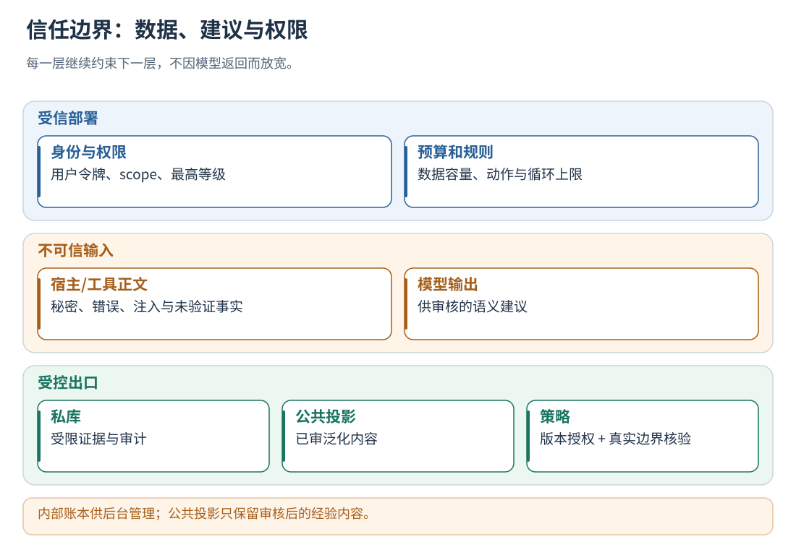
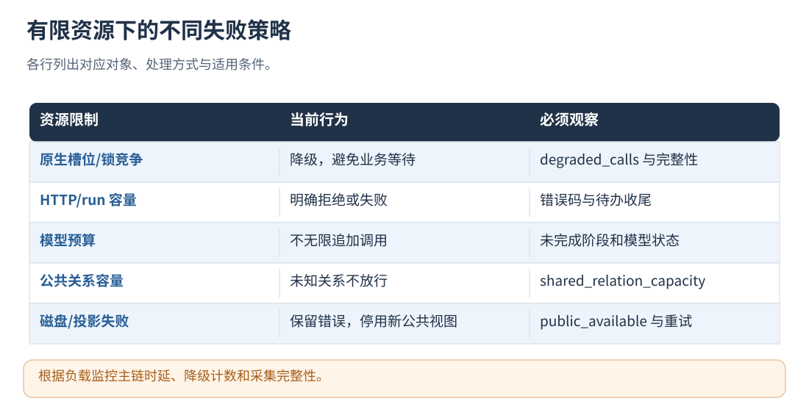

# 20 · 安全、隐私、权限与资源边界

[文档首页](README.md)

## 本章目标

了解秘密扫描、身份信任、模型输入、有限资源与默认保守行为。

## 设计思路

输入内容依次接受身份、结构、敏感字段和语义检查。公共管理账本按内部数据保护，运行资源通过容量限制与降级策略管理。

读图：内部账本供后台管理；公共投影只保留审核后的经验内容。 [放大 SVG](figures/20-trust.svg)。

## 容量与长期运行

| 限制                              | 模板值/说明                                          |
| --------------------------------- | ---------------------------------------------------- |
| max_request_bytes                 | 单请求 1 MiB                                         |
| max_run_bytes                     | 单运行持久化状态 16 MiB                              |
| max_events                        | 单 run 10000 个事件                                  |
| max_active_runs / max_stored_runs | 128 / 10000                                          |
| caused_by                         | 最多 64 个直接原因                                   |
| 策略检索上下文                    | task/state 默认各提取最多 8192 UTF-8 字节；不截断实际业务请求或原始轨迹 |
| max_context_bytes                 | 注入经验/重规划上下文预算，模板 4096 字节            |

HTTP 达到容量时返回错误，原生达到预算时报告降级。二进制媒体和大文件使用稳定引用与必要摘要；凭据从独立环境变量读取。
各参数按允许范围配置；模型输入长度、输出 token、重试次数和单次超时分别受预算约束。
业务副作用去重、远程取消、外部消息的可靠交付、磁盘保留期由部署方负责。

读图：根据负载监控主链时延、降级计数和采集完整性。 [放大 SVG](figures/20-resource.svg)。

## 信任分区

| 分区 | 可以信任什么 | 必须继续验证什么 |
| --- | --- | --- |
| 部署配置/秘密管理 | 管理方授权的身份、scope、模型与规则 | 文件权限、变量加载、参数合法性 |
| 宿主边界上报 | 已鉴权来源提交的数据 | 是否完整、实际参数是否可信、有没有漏报 |
| 业务输入/工具输出 | 作为待分析证据 | 秘密、指令注入、结构、大小和来源 |
| 模型输出 | 候选判断与经验建议 | JSON schema、引用、范围、置信度与隐私 |
| 公共投影 | manager 已接纳的泛化经验 | 当前应用、scope、用户关系、授权与预算 |

Bearer 令牌确定访问主体，服务按用户和应用范围进行授权。
多 Agent 协作保留各自身份，并传递经授权的 run 上下文。

## 隐私处理的层次

接入边界拒绝敏感字段/已知凭据，内容感知评测对正文脱敏限长；
私库与轨迹仍是受限数据，公共提炼再单独做具体标识和语义泛化审查。
来源指纹用于关联和完整性核验；内部 users/source/relations 账本按受限数据设置访问权限与存储保护。

实际模型 Key 与服务用户令牌不放正文、URL、命令参数、公共文件或 Git。
模型错误采用受限诊断信息记录；部署时同时检查宿主调试日志、代理和供应商的数据保留设置。
图片、视频和编码内容按业务场景配置专项隐私检查。

## 文件、进程和网络边界

服务按安全编码组织用户目录，对非法路径、符号链接与大小做检查；
文件路径与用户身份分别校验，工具仅访问经授权的路径。
HTTP 只监听本机；网关与 TLS 由部署方配置。原生库没有独立安全沙箱，继承宿主进程权限。

dataset 执行经部署方信任的宿主程序，并约束工作目录、I/O 和时间预算；需要强隔离时由部署环境提供容器或沙箱。
云端任务取消和数据库、邮件等副作用补偿通过对应业务接口处理。

## 为什么资源限制会影响完整性

原生容量/锁竞争会选择降级，避免主链等待，但可能隔离轨迹；
HTTP 受请求、run、活动和持久化容量限制，失败需要按协议处理。
部署监控应包含降级比例、采集完整性和请求时延。
公共关系缓存满时不把未知关系当作 independent，私库模型关系未知时保守不合并，
两类处理分别记录状态与原因。

## 实现定位

- `src/service/integration_service.cpp::authenticate / safe_data`
- `src/memory/shared_memory.cpp::public_text / gate`
- `src/service/local_support.h`
- `src/analysis/evolution_pipeline.cpp::ensure_safe_evolution_data`
- `src/evaluation/evaluation_process.cpp`

---

[文档首页](README.md) · [上一章：评测集、原始基线与任务验收](19-datasets-and-benchmarks.md) · [下一章：状态查询、排错与长期运行](21-operations.md)
