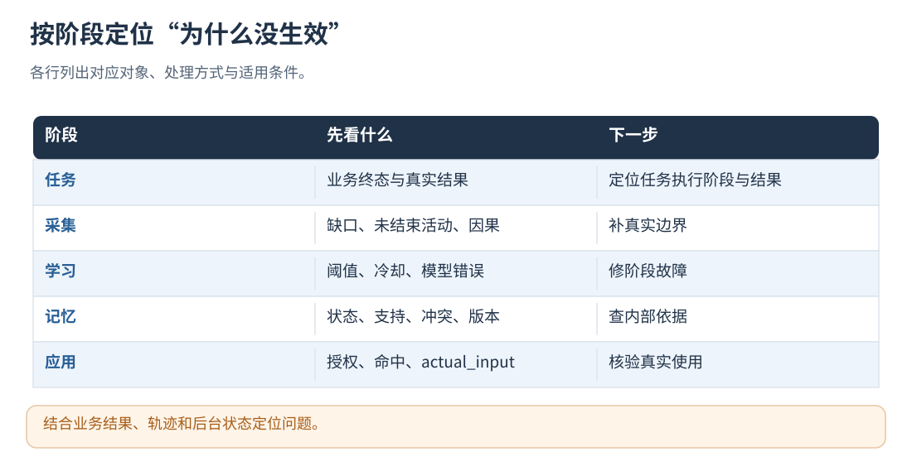
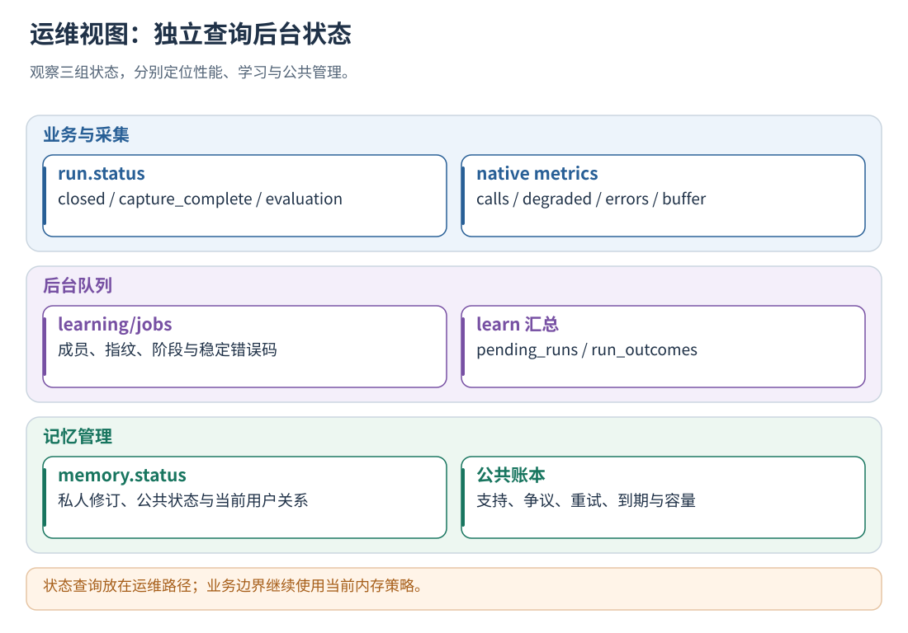

# 21 · 状态查询、排错与长期运行

[文档首页](README.md)

## 本章目标

按症状定位采集、评测、记忆、公共管理或应用阶段，不只检查业务是否答复成功。

## 设计思路

运维分别检查业务结果、采集完整性、记忆管理和策略应用，并持续监控队列、容量、错误与策略版本。

读图：结合业务结果、轨迹和后台状态定位问题。 [放大 SVG](figures/21-diagnosis.svg)。

## 常见情况怎么处理

| 情况                          | 处理方式                                                                      |
| ----------------------------- | ----------------------------------------------------------------------------- |
| 一个工具/模型正常返回业务失败 | activity.end(status=failed)，保留真实结果；其他分支继续                       |
| 动作被拒绝或未执行            | activity.end(status=cancelled,executed=false)，仍要结束记录                   |
| 单活动失联/观测中断           | activity.abort(status=unknown,output=null)，不取消兄弟活动                    |
| 整任务无法再完整收尾          | 先由宿主处理业务取消，再 run.abort(status=unknown,output=...)   |
| 采集 HTTP 超时                | 重试相同 request_id 和内容，或查询已提交操作的 status           |
| 原生接口 degraded=true       | 退回原 Agent 流程，不重试业务副作用；采集缺口隔离，检查 metrics               |
| 隐私拒收或漏掉真实边界        | capture.gap，reason 为 privacy_rejected/observer_unavailable/missing_boundary |
| run.end 返回 409              | 检查未结束活动和未回报控制，按实际结果补齐                       |
| 评测失败                      | 查 evaluation_error，修配置后 evaluation.retry，不重执行业务任务              |
| 没有经验被注入                | 检查 Memory、支持证据、冲突、scope、匹配条件和经验授权                        |

abort 使用 failed、cancelled 或 unknown；未知或缺失的轨迹按采集缺口隔离。
在异常处理路径保存 context、原请求和 request_id；恢复后补齐记录或标记缺口。
HTTP 服务不可达时，宿主可暂停边界或退回原业务流程；回退时记录采集缺口，并隔离受影响的轨迹。
原生方式自动返回降级标记，不等待服务；仍需宿主正确使用回退输入和决定。

采集前移除认证头、API Key、Cookie 和私钥；服务对敏感字段与已知秘密继续检查。
隐私校验失败后先修正内容，再提交请求；评测结果和测试产物按数据权限管理。

读图：状态查询放在运维路径；业务边界继续使用当前内存策略。 [放大 SVG](figures/21-status.svg)。

## 五步排查顺序

1. 看业务真实结果：是否完成、失败或取消，不先用进化状态替代业务判断。
2. 看 run 完整性：活动/控制是否收尾，是否 quarantine，归属与因果是否完整。
3. 看学习状态：样本是否达到批次阈值、冷却是否到期、模型/存储是否失败。
4. 看记忆管理：私库 revision、candidate 状态、公共支持/关系/争议与容量。
5. 看实际应用：快照版本、精确授权、条件命中、增强输入和回执。

## 常见“没有公共经验”的原因

| 症状 | 检查 |
| --- | --- |
| sharing 已开，公共仍为空 | 模型是否配置、候选是否合格、独立 run 是否可核验 |
| pending_support | 不同用户票数与每个来源的 min_source_runs |
| published 但某用户不用 | scope、跨库关系、授权、词面命中、长度预算 |
| disputed | 当前冲突关系是否仍有效 |
| public_available=false | manager/投影错误与重试状态 |
| waiting_for_model | 模型环境、配置、公共待办 |
| 私库已更新但旧 run 不变 | 固定快照，这是设计行为 |

## 长期监控建议

`run_lease_ms` 默认 86400000（24 小时），取值 100–604800000。
每次正常打点刷新租约；长时间没有任何打点或心跳的未完成 run 会收尾为 unknown 并进入 quarantine。
这是采集状态回收，不发送业务取消，也不把未知业务结果写成 failed。
原生实例存活期间由后台写线程回收；HTTP 服务在维护阶段或接收新任务时检查。

`max_stored_runs` 默认 10000，是热记录上限，不再是累计终身运行次数上限。
达到阈值时，已结束且轨迹已发布、不在 pending/running 评测状态的记录移入
`archive/runs/<run_id前两位>/<run_id>.json`，热记录向上限的 75% 回落。
归档保留原 ID、响应缓存与学习状态；旧请求重放、状态查询和失败重试仍可找到原记录。
不自动删除原始轨迹或归档；磁盘保留策略和容量监控仍由部署方配置。

监控 pending/failed/quarantined 数量及增长速度，而不只看一次值；
同时观察模型延迟与调用次数、磁盘增长、公共待办、隔离用户、来源/关系容量和原生 degraded_calls。
HTTP memory.status 返回认证用户的私库与关系统计，以及对应应用的公共统计。

管理查询放在运维路径，业务调用使用当前内存策略；
重试按明确错误、幂等身份和预算执行。

## 安全恢复顺序

先保留并定位真实错误，再修复配置/存储/宿主上报；
使用对应重试入口恢复，核对成功阶段的复用情况；重新评测另行管理输出目录。
不明的模型调用结果要考虑供应商可能已处理/计费；公共有界重试和私人未知结果策略不同，
具体看[公共机制](14-shared-memory.md)和[存储](18-storage-and-recovery.md)。

## 实现定位

- `src/service/integration_service.cpp::learning_status / memory.status`
- `src/service/local_runtime.cpp::metrics`
- `src/cli/learn_cli.cpp`
- `api/openapi.json`

---

[文档首页](README.md) · [上一章：安全、隐私、权限与资源边界](20-security-and-limits.md) · [下一章：测试、验收、扩展与源码阅读](22-testing-and-extension.md)
