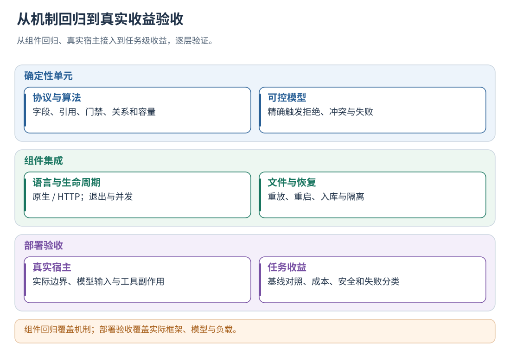
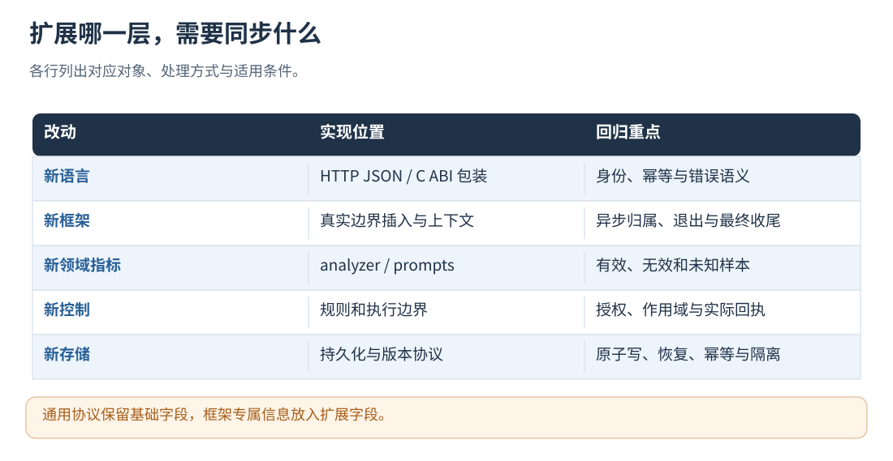

# 22 · 测试、验收、扩展与源码阅读

[文档首页](README.md)

## 本章目标

运行组件回归，制定真实宿主验收，按模块定位要修改的算法与协议。

## 设计思路

按协议、语义、存储、控制与业务效果分层验收。新语言包装复用统一协议，新业务字段通过规则、提示词或分析器扩展接入。



读图：组件回归覆盖机制；部署验收覆盖实际框架、模型与负载。 [放大 SVG](figures/22-tests.svg)。

## 验收

源码用户运行：

```sh
ctest --test-dir build/trajectory-evolution --output-on-failure
python3 tools/trajectory_evolution/api/build_openapi.py --check
```

回归测试使用本地原生/HTTP 入口与可控响应，无需业务模型 Key；供应商和业务场景通过任务评测单独验收。
`TaskEvaluationTests` 同时验证包内任务入口绑定：同步/异步接收、派发后由子进程完成、
常驻程序收尾、C ABI、JS、原生打点转发、多轮历史及会话身份、回调异常、缺失 run/end、
额外 run、未绑定初始条件和缺失结果路径。测试接收器是确定性夹具，不作为真实 Agent 能力成绩。
只运行这部分时使用 `ctest --test-dir build/trajectory-evolution -R TaskEvaluationTests --output-on-failure`。
LocalRuntimeTests 在业务线程禁止文件/网络/睡眠系统调用后完成 40 轮 L3 流程，输出耗时分位数；
LocalLanguageClientTests 覆盖两用户三会话九次任务、真实回执、逆序分支、慢评测、落盘失败、容量和中断恢复。
测试结果在 build/trajectory-evolution/local-runtime.* 与 local-clients.* 下的 test-summary.json。
部署验收使用自身输入规模和并发量，记录调用时延与降级比例。
首次接入至少用自己的程序验证：

1. 两个并发活动逆序结束，按 ID 正确归属。
2. 一个分支失败时另一个继续；未知结果按采集缺口隔离。
3. HTTP 模式发送方退出后，另一进程通过 context 续写；原生模式由仍存活的所有者接收完成回调。
4. 核对实际发送的模型参数与经验内容；参数未采用时记录相应应用状态。
5. 多个独立循环分别 Continue/Replan/Stop，不互相取消。
6. 扩展内容保留、敏感内容拒收；HTTP 超时重试幂等、重启恢复；原生故障时及时降级、缺口隔离。
7. run.end 后评测完成，批次决策可对应到 Memory；无可靠经验时允许空结果。

按宿主的数据和边界契约验证接入，覆盖所使用的语言、运行方式与并发模式。
通过固定任务集对照，评估业务质量、无效 loop、调用次数和时延。




读图：通用协议保留基础字段，框架专属信息放入扩展字段。 [放大 SVG](figures/22-extension.svg)。

## 建议按这个顺序读代码

源码链接相对于组件源码目录；只领取二进制安装包时，需取得配套源码才能打开 src/ 链接，阅读本文本身不依赖这些文件。

| 想理解什么 | 源码与关键入口 |
| --- | --- |
| 日志数据契约 | [trajectory_trace.proto](../proto/trajectory_trace.proto) |
| 通用边界生成事件 | `src/runtime/boundary_runtime.cpp`：begin_activity、end_activity、check_loop、commit_loop |
| 本地主链与后台分离 | `src/service/local_runtime.cpp`：make_run、invoke、后台持久化和 evaluate |
| 自动串起评测与入库 | `src/service/integration_service.cpp`：process_evaluations |
| 因果图与事件校验 | `src/analysis/trace_contract.cpp`：validate_trace |
| 标准轨迹分析 | `src/analysis/trace_analyzer.cpp`：analyze_trace |
| 规则评测与融合 | `src/analysis/hybrid_evaluator.cpp`：assess_rules 及模型评测处理 |
| 具体内容交给模型 | `src/analysis/sessionlog_evaluator.cpp`：make_dialogue_request、evaluate_content |
| 候选、元反思、记忆管理 | `src/analysis/evolution_pipeline.cpp`：synthesize_reports、finalize_candidate、curate_memory_file |
| 新经验契约 | `include/agentflow/trajectory/experience.h` |
| 快照资格与检索 | `src/runtime/shadow_runtime.cpp`：compile_shadow_policy、query_advice |
| 策略和应用回执 | `src/runtime/policy_runtime.cpp`：compile_runtime_policy、decide、verify |
| 任意 JSON 参数绑定 | `src/runtime/request_binding.cpp` |
| 无专用宿主的任务投递 | `src/evaluation/evaluation_entry.h`、`clients/python/evolution_entry.py`、各语言 `evaluate` 封装 |
| 外部配置和模板加载 | `src/model/runtime_config.cpp` |

算法集中在组件目录，AgentFlow Hook 和 SessionLog 作为其中一种集成方式。

## 测试分层与覆盖的含义

| 层 | 现有测试 | 覆盖范围 |
| --- | --- | --- |
| 数据/分析 | StandardTrajectoryTests、TrajectoryHybridEvaluatorTests、SessionLogHybridEvaluatorTests | 格式、结构诊断与评测边界 |
| 策略 | ShadowRuntimeTests、PolicyRuntimeTests | 筛选、版本、授权和实际回执核验 |
| 记忆 | TrajectoryEvolutionTests、SharedMemoryTests、UnifiedLearningTests | 去重、证据、跨库关系、争议、过期、入库与恢复 |
| 生命周期 | LocalRuntimeTests、BoundaryTransportTests、IntegrationDistributedTests | 内存/跨进程边界、并发与收尾 |
| 统一打点 | InstrumentationTests | 原始/准备/实际输入顺序、真实回执、并发逆序、异常分支、缺口隔离和短预算降级 |
| 语言/HTTP | LocalLanguageClientTests、IntegrationLanguageClientTests、IntegrationHttpTests | 实际包装、协议和传输 |
| 批次/验收 | LearningScheduleTests、EvaluationDatasetTests、TaskEvaluationTests | 触发、任务标准、预算与结果统计 |

原生打点压力测试包含四分支同时开始和结束，竞争预算设置为 10 ms；默认 1 ms 及立即降级模式由
LocalRuntimeTests 覆盖。HTTP 超时用本地慢响应服务验证一次尝试，不调用真实业务供应商。
语言包装测试以当前机器实际安装的工具链为准，报告中列明已执行语言；协议一致性检查与真实编译运行分别验收。

可控响应覆盖拒绝、冲突、超时等程序分支；真实模型使用固定任务集验证语义判断。
真实 AgentFlow、其他框架和真实供应商要按自己的部署另跑验收，不继承“所有框架都通过”的结论。

### 模型与长期运行的边界回归

| 场景 | 程序要求 | 回归位置 |
| --- | --- | --- |
| 正文合法但带传输/截断错误 | 评分、元反思、私有匹配及公共审查拒绝采纳 | TaskEvaluationTests、TrajectoryEvolutionTests、SharedMemoryTests |
| SSE 缺结束标记、错误帧、多选项、超大输出 | 不提交局部结果；连续无数据按独立 idle 预算恢复 | TaskEvaluationTests |
| 连续模型调用与并发 | 可复用连接，每个在途调用独占句柄；预算仍有界 | TaskEvaluationTests |
| 精简输入与短响应 | 业务数据可还原、真实证据保留；兼容旧状态描述字段 | SessionLogHybridEvaluatorTests、TrajectoryHybridEvaluatorTests |
| 凭据跨截断点、提示词包含 NUL | 不留下已知凭据前缀；发送内容不在 NUL 处静默截短 | SessionLogHybridEvaluatorTests、TaskEvaluationTests |
| 历史批次数超过活跃容量 | 重启正常，不重新分析已完成报告 | LearningScheduleTests |
| 正在收尾时再收到停止信号 | 保持清理处理器直到后台结束，检查点落盘后退出 | LearningScheduleTests |

历史学习批次保留供追溯，不占待处理任务数量限额；这不等于磁盘无限容量或重启扫描恒定耗时。
部署仍需按第 21 章检查磁盘和历史归档。连续停止测试验证优雅收尾，不覆盖 SIGKILL、宿主断电或外部强制删除文件。

## 如何扩展而不破坏框架无关性

1. 新语言：绑定 C ABI 或实现 HTTP/JSON；保持 request_id、context、失败和终态语义一致。
2. 新框架：识别任务所有者及模型、工具和循环边界，传递上下文；框架专属数据放入 extensions。
3. 新领域指标：在现有标准事件上扩展 analyzer，增加有效/无效/未知三类测试。
4. 新模型判断：更新外置提示词和预算，验证输出 schema、引用及错误处理。
5. 新策略：区分“可表达建议”与“宿主有执行边界”，升级 schema/API 时同步客户端与回归。
6. 新持久化后端：保留版本、幂等、归属和不完整隔离，不仅替换 JSON 文件读写。

每次调整都应回归单用户、多用户、多会话、同名并发活动、逆序返回、进程退出、
模型错误、隐私拒收、容量、重启和旧数据兼容，并检查终态与归因完整性。

## 实现定位

- `CMakeLists.txt`
- `tests/`
- `api/build_openapi.py`
- `include/trajectory_evolution/`
- `include/agentflow/trajectory/`

---

[文档首页](README.md) · [上一章：状态查询、排错与长期运行](21-operations.md) · [下一章：导入历史日志、SDK 与兼容迁移](23-import-and-migration.md)
