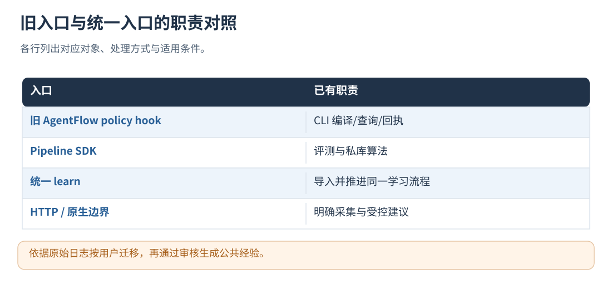

# 23 · 导入历史日志、SDK 与兼容迁移

[文档首页](README.md)

## 本章目标

在同一学习队列中接收已有日志，并判断旧 Hook、CLI 和 SDK 的能力边界。

## 设计思路

在线采集与离线导入共用学习流程。历史日志按用户迁移，公共经验通过提炼与审核生成；已有 Hook 可按所需边界逐步接入统一协议。


读图：learn 与在线服务按单写入者约束使用 data_dir。 [放大 SVG](figures/23-import.svg)。




读图：依据原始日志按用户迁移，再通过审核生成公共经验。 [放大 SVG](figures/23-migration.svg)。

## 已有日志加入同一套学习流程

支持标准 `.trace.json/.trace.pb` 与已有 AgentFlow SessionLog `.jsonl`。
标准轨迹定义见 [trajectory_trace.proto](../proto/trajectory_trace.proto)，`learn` 会识别同一标准轨迹的 JSON/PB 副本。
通用在线接口会替你生成标准轨迹，无需手写内部 step/action 等规范化事件。

```sh
build/trajectory-evolution/trajectory_evolution doctor /你的日志目录/run.trace.json --level L0
build/trajectory-evolution/trajectory_evolution learn /你的日志目录 \
  --config /你的部署目录/boundary-service.json
# 只接收落盘，稍后处理：
build/trajectory-evolution/trajectory_evolution learn /你的日志目录 \
  --config /你的部署目录/boundary-service.json --enqueue-only
# 恢复尚未完成的后台工作，不重新导入：
build/trajectory-evolution/trajectory_evolution learn \
  --config /你的部署目录/boundary-service.json
```

--config 指向服务配置，其中 runtime_config 指向评测与模型配置。
标准轨迹的应用必须匹配 application_id，所有 user_id 必须在 principals 中配置且对应 token 环境变量可用。
旧 SessionLog 没有可靠应用字段，视为由本地操作者绑定到该应用；其 user/conversation/dialogue 仍必须完整，
导入使用来源可核验的身份信息；doctor 进行本地结构检查，策略应用通过运行回执核验。
标准事件可以带可选上下文和 attributes；没有循环身份、轮次和因果证据时不推断循环。
将历史数据转换到对应协议结构后导入。

输出统一为[目录、持久化、幂等与崩溃恢复](18-storage-and-recovery.md)的 data_dir。原日志只读，导入后保存受管副本；来源身份和指纹仍可追溯。
同一身份、同一内容重复导入只复用结果；同一身份内容变了返回冲突，不覆盖、不偷偷再分析。
命令不启动 HTTP、不执行 Agent 业务或工具；只按配置评测、反思、管理记忆。
`learn` 会主动处理不足一个批次的私人待办，公共模型管理仍遵守周期限制；退出码 3 表示存在拒收、失败、隔离或未完成工作。
模型未配置或暂不可用时返回 waiting_for_model，保留后续待办。

同一个 data_dir 只允许一个写入实例。先停止使用此目录的 serve/原生进程再运行 learn，结束后恢复原服务。
若只想诊断日志，不入库，可继续使用 `evaluate 日志目录 --no-memory --output-root 诊断目录 --config 模型配置`；
单文件 evaluate 仍只生成 Evaluation。旧目录模式的自动混合用户入库已移除，不再使用 --memory-out。
含旧版混合用户 memory 的目录不会被自动视作公共库或覆盖；请使用干净的受管目录，从原始日志重新导入。
默认空模型配置使用规则处理。启用模型时遵循[配置、身份与热更新](03-configuration.md)，分别设置评测、元反思和记忆管理阶段的开关。

## 可选 C++ SDK

需要嵌入时可使用[原生入口、内存状态与低延迟](06-native-runtime.md) LocalRuntime；直接调用 Pipeline 等评测方法适用于后台或离线，
同步评测放在后台或维护路径。安装包中的 C++ SDK 使用方式如下：

```cmake
find_package(TrajectoryEvolution 0.1 CONFIG REQUIRED)
target_link_libraries(your_target PRIVATE TrajectoryEvolution::core)
```

公开头文件位于源码的 `include/trajectory_evolution/`，或安装前缀下的同名目录；独立消费示例见
[standalone-consumer](../examples/standalone-consumer/)。配置以显式快照传给下一批 Pipeline，
静态库消费端需要兼容的编译器、Protobuf 和依赖 ABI。

## 已有接法只需注意这些差异

- 旧 SessionLog、CLI、AgentFlow Hook 和 Step 协议保留各自入口。
- 新任务使用 application_id/policy_scopes 和 run/activity/loop 接口；旧 agent_id/actors 保留兼容，冲突配置会拒绝。
- 不在同一 run 中混用新旧可变操作；正在运行的旧任务先按旧协议收尾。
- 旧接口的精确字段仍可查 [兼容 Schema](../api/integration-v1.schema.json)，旧示例代码保留作回归参考，不作为新接入教程。
- 已有 Hook 可继续使用 [AgentFlow 集成代码](../integrations/agentflow/)；同一边界选择一种采集路径。
- 旧经验可继续读取和管理；在线注入使用符合现有契约的经验，可通过重新评测原始日志完成转换。
- 离线输出保留兼容字段，例如 source.dialogue_id 对应标准 run_id；反思中的 skill_orchestration_changes
  在通用输入中表示动作编排建议，宿主可使用自己的活动类型。

## 实现定位

- `src/cli/learn_cli.cpp`
- `src/service/integration_service.cpp::import_file`
- `include/trajectory_evolution/evolution.h`
- `integrations/agentflow/`
- `examples/standalone-consumer/`

---

[文档首页](README.md) · [上一章：测试、验收、扩展与源码阅读](22-testing-and-extension.md) · [下一章：GEPA 多轮搜索、分支重组与完整闭环](24-evolution-and-gepa.md)
