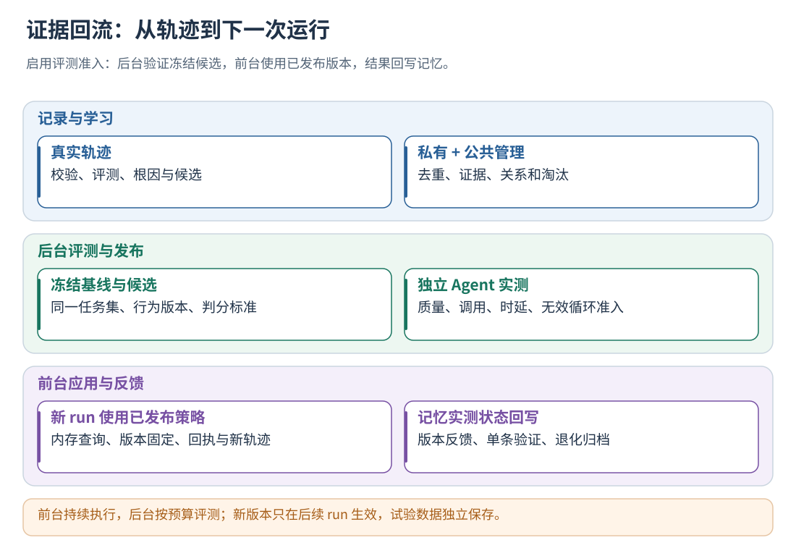
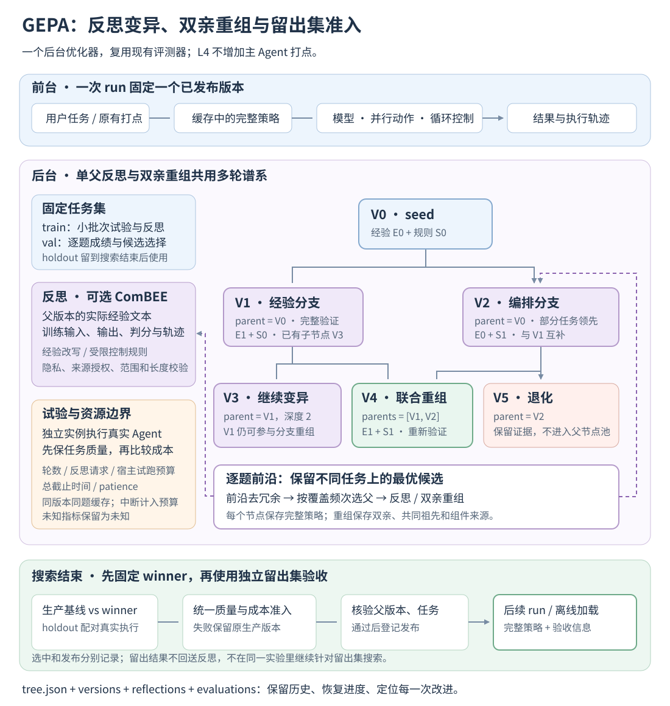

# 24 · GEPA 多轮搜索、分支重组与完整闭环

[文档首页](README.md)

## 本章目标

连接轨迹采集、记忆管理、后台策略评测与策略应用，配置 GEPA 搜索、理解多父进化谱系，并恢复或离线加载完整策略。

## 设计思路

每个 run 使用固定策略，后台根据新轨迹更新记忆。部署授权控制经验和规则的使用范围，执行回执将应用情况带回下一轮评测。



读图：应用回执记录执行情况，任务级对照评估进化收益。 [放大 SVG](figures/24-loop.svg)。

## 从轨迹到下一次运行

1. 宿主在任务、模型、动作和循环边界上报输入、输出、状态与因果关系。
2. 后台将完整的新轨迹按用户合批，执行规则与模型评测。
3. 从评测中提取候选，按配置进行元反思，更新私有记忆、公共经验和跨库关系。
4. 后台从私有与公共视图编译候选，结合部署授权、动作规则和循环规则形成固定行为版本。
5. 启用 policy_evaluation_file 时，独立实例执行固定任务，与基线比较；通过后登记发布，并更新记忆的实测状态。
6. 新 run 使用缓存中的已发布策略；宿主使用增强输入或控制决定，并提交执行回执。已有 run 保持原版本。
7. 新业务轨迹携带策略和应用信息，进入后续评测与学习；隔离评测试验不进入生产学习队列。

各阶段的状态、版本和产物通过来源引用关联。后台处理频率、批次规模和预算见[学习调度](17-learning-scheduler.md)。

## 授权与运行控制

- 部署配置限定 max_level、用户、scope、动作规则、循环预算和最大注入长度。
- auto_approve_experiences 默认 false。通过 runtime_options.approved_experiences 指定获准使用的 memory_id/content_revision；启用自动授权后，合格经验自动进入候选。启用评测准入时，通过任务测试后才发布。
- 每个 run 固定策略快照；新记忆在后续 run 生效。
- activity.end 回报发送参数、动作执行情况和结果；loop.commit 回报采用的循环决定。
- 宿主保留原有权限、安全检查和业务循环上限。

任务级对照复用 [任务评测模块](19-datasets-and-benchmarks.md)。dataset run 单独输出报告，后台 AgentEvaluationService 进一步处理准入、发布和反馈。未配置 policy_evaluation_file 的部署仍使用原精确授权行为。

## 暂停、恢复与故障处理

原生模式使用 `evo.set_enabled(False)`，JavaScript 使用 `evo.setEnabled(false)`，控制当前客户端后续边界的增强。

本地开关通过 epoch 区分切换前后的执行。跨越暂停或恢复的 run 被隔离，恢复后的新 run 重新进入增强流程。已发送请求和已发生的业务副作用，继续由宿主及对应业务接口管理。

出现采集缺口时，宿主按原输入、原动作调度和原循环安全限制继续，记录 degraded，并隔离受影响的轨迹。业务结果与采集状态分别上报。

## 回流信息与评测

新轨迹保存 policy_id、decision_id、memory_id、content_revision 和应用回执，用于关联：

- 当时使用的策略和经验版本；
- 实际发送的模型输入、动作执行情况和循环决定；
- 对应任务的结果、时延、调用次数与资源消耗。

轨迹评测分析单次执行过程，任务对照评测比较固定任务集上的版本表现。

## 贯穿全流程的示例

设用户 alice 在 campaign 会话中要求生成宣传图、视频并查询发布信息。三个分支并发执行，最后汇总。

### 第一次运行：采集与分析

视频分支要求参考图，却连续两次提交相同的缺素材参数：

- 两次返回 INPUT_ASSET_MISSING，错误标记为 non_retryable。
- 执行者、执行流、操作名和 loop_id 相同，轮次从 1 到 2。
- 第二次活动通过 caused_by 关联前次失败。

网络查询和图片生成完成，视频分支返回素材缺失。整个 run 正常收尾，业务结果为 partial。

规则将第二次视频请求识别为 non_retryable_repeat。模型基于参数、错误与图片产物生成带条件的经验：

> 视频任务需要参考图且缺少可访问素材时，先引用已有有效图片或补齐素材，再继续生成。独立的查询任务保持执行。

该候选保存 scope、触发条件和直接证据。假设仅有一个 run、一个 Episode 支持，证据置信度为 0.9，按示例公式得到 0.78，状态为 INSUFFICIENT_SUPPORT。它作为待处理记忆保存，等待新增证据。

### 第二次运行：持续入库

同一用户的另一 run 出现同类问题，形成条件和行为等价的建议。候选 ID 相同则直接合并；表达不同则经过规范化匹配或短名单语义判断。

假设积累到两个 run、两个 Episode 的支持且无反证，候选变为 PROPOSED。随后按记忆冲突、作用域、内容契约和版本授权筛选：

1. 存在冲突：保留在记忆库，等待后续处理。
2. 通过筛选但待授权：形成 shadow 建议。
3. 通过筛选且获授权：后续 run 命中条件时进入模型输入。

alice 的私有经验仅用于 alice。跨用户共享通过公共提炼、独立支持与跨库审查完成，详见[公共与私有协作](14-shared-memory.md)。

### 第三次运行：应用与核验

alice 再次提出类似任务，新 run 固定策略。视频相关模型请求命中经验，宿主发送增强后的 input，再用 actual_input 回报，形成 applied 回执。

若部署配置了 video.generate 的必需参数规则，L2 拒绝缺少 reference_image 的动作。网络查询和图片生成继续按原调度执行。

若视频循环持续无进展，L3 按配置执行 replan，并在预算用尽后停止该循环。最终结果重新进入采集与评测。

使用固定任务集比较基线和候选的任务成功率、平均无效 loop、模型调用次数、token 与时延，跟踪优化目标。



读图：主 Agent 使用固定版本。后台既能从一个父节点反思变异，也能将两个不同分支的改进组合为同一个后代，最后验收一个选定版本。 [放大 SVG](figures/24-gepa.svg)。

## Hermes 思路与本组件的实现

实现参考 [Hermes self-evolution 的技能优化入口](https://github.com/NousResearch/hermes-agent-self-evolution/blob/main/evolution/skills/evolve_skill.py)：冻结初始策略、训练/验证/留出拆分、基于反馈迭代改写、约束校验和最终比较。Hermes 入口使用 DSPy GEPA；本组件用 C++ 实现反思搜索，不要求宿主安装 DSPy 或使用 Python。

父节点选择采用 [GEPA 的逐任务表现前沿思路](https://gepa-ai.github.io/gepa/api/core/optimize/)。这是一套针对本组件受限策略的 GEPA 实现，不是将 Hermes 的代码原样移植：候选是完整 L1–L3 策略，试验复用真实 Agent 执行器与统一评分器，生成内容只改变被授权的策略空间。

L4 是后台优化能力。`max_level`、`instrumentation.level` 和候选的 `level` 仍填写实际需要的 L1、L2 或 L3，不填写 L4。

双亲重组参考 [GEPA MergeProposer](https://github.com/gepa-ai/gepa/blob/main/src/gepa/proposer/merge.py)：选择具有共同祖先的两个不同分支，比较组件变化，再执行真实试验。候选谱系为 DAG；每个节点有一份独立、不可变的完整策略，父版本不会被子版本覆盖。

## 启用 GEPA

前提是已按[任务评测指南](19-datasets-and-benchmarks.md)配置真实宿主命令、评分规则和版本隔离。每个试验由组件启动独立 Agent 实例，使用原有打点采集效果。主 Agent 不等待搜索完成。

1. 复制完整 `config/` 目录到部署目录；保持 `runtime.json` 与它引用的 `prompts/` 相对位置。
2. 在任务集准备非空的 `train`、`val`、`holdout`，全部完成 review；同一任务族/会话保持在同一 split。
3. 在 `runtime.json` 配置自己的反思模型、endpoint、`api_key_env`、thinking 和请求超时。凭据只放环境变量。`gepa.json.runtime_config` 可指向与其他后台模块相同的配置。
4. 在既有 `agent-evaluation.json` 增加：

   ```json
   "gepa_config": "gepa.json"
   ```

5. 服务配置继续使用 `"policy_evaluation_file": "agent-evaluation.json"`。允许的经验通过 `auto_approve_experiences` 或 `runtime_options.approved_experiences` 进入候选。
6. 启动组件。后台提交的 L1–L3 候选有已批准经验时自动进行 GEPA；L0 与无可改写经验的候选仍走原来的单次评测。也可使用既有 `agent_evaluation.submit` 提交冻结候选。

留出任务数 × repetitions 至少满足 `gate.min_trials`。修改配置或提示词不需要重新编译；重启组件建立新实验上下文，避免在同一棵树中混用不同配置的成绩。

省略 `gepa_config` 就保持原评测行为。这里不需要新的宿主 hook、observer、适配器或打点。

## 一次搜索的完整算法

1. **冻结实验上下文。** 保存当前生产基线和记忆编译得到的 seed。上下文绑定任务集版本、宿主 revision、评测配置、反思配置/提示词和控制授权。当前生产基线尚未发布时使用 L0。
2. **评测树根。** 在验证集执行 seed，保存逐题质量与成本。缺乏有效评分或启用目标所需指标时停止，不能把未知成本计成零。
3. **选择父节点或重组分支。** 默认保留逐题最优节点，移除前沿覆盖被更优候选包含的冗余节点，按占据前沿的频次抽样。内部节点和叶节点采用相同资格规则。已有新候选且存在合适双亲时优先尝试重组。
4. **抽取训练小批次与组件。** 默认按 epoch 重新洗牌，末批可短于 minibatch_size，不重复填充题目。父子使用相同任务与 repetitions；每个父节点轮换可改组件，后代继承轮换游标。可以配置同父多个提案、独立采样或 P×N 采样。
5. **生成反思改写。** 模型看到当前实际经验、生成控制规则、选中组件、训练输入、输出、判分与轨迹。失败案例优先。验证与留出任务正文不进入反思。可选满分跳过检查实际质量和 fitness，而非仅检查业务成功。
6. **建立子节点。** 反思节点记录一个父节点；重组节点记录两个父节点、共同祖先、组件来源和冲突。所有候选都经过隐私、来源、范围、长度和控制边界检查，再编译完整策略。相同行为版本记为 duplicate，跳过额外试跑。
7. **小批次筛选。** 反思候选默认要求严格改善，先保质量再看 fitness；可配置不退化接纳。同批提案可全部保留改善者，或按相对各自父版本的平均质量增益、fitness 增益选最佳／Top-K。不同提案的批大小可能不同，使用均值增益比较。
8. **验证并更新前沿。** 被选中的反思提案执行完整验证集。重组候选先在覆盖双方优势与平分任务的验证子集上比较，质量和 fitness 均不低于双方才继续完整验证。同版本、同 split、同上下文的已完成逐题记录复用，只补跑缺题。
9. **停止搜索。** 达到轮数、模型调用数、试验预算、耐心或总时间边界。试验预算预留最终留出集的基线＋候选成本；预算不足不会再启动一个无法负担的试验。
10. **最终验收。** 先固定 winner，再在留出集比较生产基线与 winner。使用原来的质量、覆盖率、配对样本、时延、token、无效循环准入规则。留出失败就保留原生产版本，不把失败详情反馈给反思模型后继续针对同一留出集搜索。
11. **发布。** 只有该用户/等级的任务仍是最新候选、生产父版本未改变且准入通过，才登记新版本。新 run 从缓存取用；已开始的 run 保持原版本。

`accepted` 表示候选已有有效验证成绩，`winner` 表示验证阶段选中；是否生产生效以 `decision.json.published` 为准。
反思变异和双亲重组共用一个谱系，不使用 MCTS 的 UCT 或随机 rollout。节点与边来自实际候选生成和真实试验。

## 双亲如何一起生成后代

例如共同祖先 O 有经验 E0 与编排 S0。A 将经验改为 E1，B 将编排改为 S1。重组可生成同时包含 E1、S1 的 C，并记录 parents=[A,B]。

| 组件 | 祖先 O | 分支 A | 分支 B | 重组 C |
| --- | --- | --- | --- | --- |
| experience:memory-a | E0 | E1 | E0 | E1，来源 A |
| action_rules | S0 | S0 | S1 | S1，来源 B |
| loop_rules | L0 | L0 | L0 | L0 |

A 即使已有其他子节点，也可和叶节点 B 重组。筛选依据是前沿表现，而不是节点是否位于最深一层。

重组规则：

1. 两个候选必须来自同一冻结实验，具有共同祖先，彼此不是祖先与后代；祖先的质量和 fitness 不高于两者。
2. 优先使用较深的共同祖先，固定 seed 使分支抽样可复现。同一双亲／祖先组合只尝试一次。
3. 某组件只有一方改变时采用该方；双方相同时保留共同值；双方改变且内容不同时，优先采用验证质量／fitness 更好一方，平分稳定选择第一方。
4. 至少两个差异组件实际来自不同分支才形成有效重组。仅一条经验且没有其他可变组件时，重组通常不会产生新组合，记录 skipped_merge。
5. 经验按 memory_id 分组件；生成 action_rules 与 loop_rules 各作为一组，保持组内规则顺序。不修改手工规则、授权、来源 revision、scope、触发条件或底座代码。
6. 重组本身不调用反思模型。重新编译后再校验组合授权和总规则数，并重新评测；任何检查失败均保留原父版本。
7. 子集成绩同时满足 quality(C) ≥ quality(A)、quality(B) 以及 fitness(C) ≥ fitness(A)、fitness(B)，才进入完整验证。最终发布仍独立经过 holdout 准入。

为同一个父版本尝试多个方向，并为重组留出节点预算，可在 gepa.json 中设置：

~~~json
{
  "use_merge": true,
  "max_rounds": 16,
  "max_model_calls": 8,
  "max_merge_invocations": 5,
  "sampling_strategy": "same_parent",
  "proposals_per_round": 2,
  "component_selector": "all",
  "proposal_selection": "all_improvements"
}
~~~

以上是需要合入既有配置的字段，不是独立的完整配置文件。允许合并不表示每轮强制合并；没有互补分支时继续反思。达到反思调用数上限后，剩余节点、试验和时间预算仍可用于重组。

## 可优化内容与记忆的关系

| 改写类型 | 生效方式 | 保持不变的边界 |
| --- | --- | --- |
| 经验文本 | `RuntimeOptions.experience_overrides` 按来源 `memory_id/content_revision` 覆盖注入正文 | 来源记忆、触发条件、scope、检索和私有/公共冲突筛选不变 |
| L2 生成规则 | 已开启 `control_learning` 时，复用允许操作与参数白名单生成必需参数规则 | 不新增宿主操作，不扩大作用域，不修改手工规则 |
| L3 生成规则 | 根据已批准经验收紧已有基础循环规则 | 不放松基础上限，遵守配置的最小轮数，不修改宿主业务代码 |

默认每次反思只允许修改轮换选中的组件。component_selector=all 时，可使用 experiences 数组修改多条获选经验，并可同时提交获选控制类别。未提交的控制类别保持原值；提交的类别替换该类完整生成规则。组件越权、格式错误或泄露测试值均记录固定错误码。

`snapshot.experiences` 保存原始来源，`experience_overrides` 保存当前版本的改写。这样能持续解释“这条新指令来自哪条记忆”，而不会把一次试验直接写回私有/公共记忆库。GEPA 的候选与最终组合试验也不自动生成单条记忆的因果正反证。
在线使用时仍核验当前记忆批准状态、内容 revision 和跨库关系；来源失效或权限改变时，旧策略停止生效。

## 评分目标与预算

真实成功/失败由既有规则、模型评分及安全检查决定。逐题 fitness 为：

```text
fitness = task_pass
          - invalid_loop_weight × invalid_loops / (invalid_loop_scale + invalid_loops)
          - token_weight × tokens / (token_scale + tokens)
          - latency_weight × duration_ms / (latency_scale_ms + duration_ms)
```

默认权重为无效 loop `0.2`、token `0.05`、时延 `0`，三个成本权重之和必须小于 `0.5`。
重复试验先在每道题内取平均，整体比较先看任务通过率，再比较 fitness。模型调用数等其他指标继续保留在逐次报告中。
`invalid_loops` 是规则观察到的 `invalid_loop_lower_bound`，并不等于全部业务浪费。
启用非零权重的指标必须可观测；token 应在每次模型结束打点提供 usage，不能只提供一个未经调用记录支撑的汇总数字。

| `gepa.json` 参数 | 默认 | 用途 |
| --- | --- | --- |
| `max_rounds` / `max_model_calls` | 8 / 8 | 非根节点总数 / 反思模型请求预算；重组、跳过和失败也占节点名额；单请求不做隐式传输重试 |
| `max_trials` | 400 | 实际预留的宿主试跑数，包括 repetition、基线和中断后重试 |
| `timeout_ms` | 1800000 | 整棵搜索的墙钟截止时间，重启不清零 |
| `minibatch_size` | 4 | 每轮父子训练任务数，上限为训练集大小 |
| `patience` | 4 | 连续无整体最优改进、且前沿成员不变的批次／重组次数；0 表示不启用，省略字段也不启用 |
| `max_feedback_trials` | 4 | 进入一次反思的训练案例数，失败案例优先 |
| `max_input_bytes` | 65536 | 序列化反思输入上限，不含 system prompt 与传输外壳 |
| `max_experience_bytes` | 2048 | 单条新经验 UTF-8 字节上限，仍受运行时注入总长度约束 |
| `seed` / `min_improvement` | 42 / 0.000001 | 可重复抽样 / 同通过率下的最低 fitness 改进 |

搜索与重组配置：

| 参数 | 默认 | 可选值与行为 |
| --- | --- | --- |
| `candidate_selection_strategy` | pareto | pareto 按前沿覆盖频次；current_best 选整体最优；epsilon_greedy 探索所有有效候选；top_k_pareto 从前沿前 K 名抽样；fair 保留旧的选择次数加权方式 |
| `epsilon` / `top_k` | 0.1 / 5 | epsilon_greedy 的随机探索概率 / top_k_pareto 的候选上限 |
| `frontier_type` | instance | instance 逐题 fitness；objective 整体质量与启用的效率维度；hybrid 两者并集；cartesian 逐题 × 各目标 |
| `prune_dominated` | true | 删除前沿覆盖被不差候选包含的冗余成员，成绩及覆盖相同时保留稳定代表 |
| `component_selector` | round_robin | round_robin 轮换一个组件；all 允许改写所有组件；model_choice 是保留的模型自行选择模式 |
| `minibatch_strategy` | epoch_shuffled | 每个 epoch 重新洗牌；fixed 保留旧固定排列轮转方式 |
| `sampling_strategy` | same_parent | single 单提案；same_parent 同父同批 N 个；independent 每提案独立选父和训练批；pxn 选 P 组父版本、每组 N 个 |
| `proposals_per_round` / `parents_per_round` | 1 / 2 | 上述 N / P；实际总提案上限 8，并受剩余节点、模型预算限制；独立选父允许重复抽到同一版本 |
| `proposal_selection` / `proposal_top_k` | all_improvements / 2 | all_improvements 保留所有改善者；best 只保留增益最大者；top_k 保留增益前 K 个 |
| `acceptance` | strict_improvement | strict_improvement 严格改善；improvement_or_equal 要求平均质量与 fitness 均不退化 |
| `use_merge` / `max_merge_invocations` | true / 5 | 是否重组 / 双亲组合最多尝试数；无效组合、重复、失败也计数 |
| `merge_minibatch_size` | 4 | 从一方领先、另一方领先、平分三组轮流取题；不重复补题，最多取完整验证集 |
| `cache_evaluations` | true | 复用同版本、同 split、同上下文的完成试验；false 允许重新测量随机执行，最终已完成 holdout 在恢复时仍复用 |
| `skip_perfect_score` / `perfect_score` | false / 1 | 每道训练题质量均为 1、fitness 均达到阈值时跳过反思 |
| `target_fitness` | 未启用 | 最优验证质量为 1 且平均 fitness 达标时提前结束搜索；仍执行最终准入 |

多提案模型请求在同一个后台搜索中顺序执行，共用预算；宿主试验继续使用 evaluation 配置的 parallelism。训练批序列和组件选择计划先保存再执行，中断后保留已完成的兄弟提案。

反思案例的单个文本字段通常保留前 2048 字节，任务输入/标准各保留前 4096 字节；数组前 24 项、对象前 32 项，递归深度 12，并标注截断。整包装不下时优先保留输入、标准、输出和检查结果，仍装不下则跳过案例；一个有效案例都放不下就记录错误。模型看到的是具体内容，不只是指纹。

反思单请求的 `runtime.json.model.timeout_ms` 与输出 token 限制独立于整棵树的总预算。任务评测自己的 timeout、repetitions、parallelism、资源限制也继续有效。`max_model_calls` 只统计反思模型，宿主模型/评分模型分别记录在试验报告与评分预算中。

后台沿用一个评测 worker，队列按配置限频；同用户/等级只保留最新待处理候选，运行中的整棵树共用预算。没有待处理任务时阻塞等待通知，不空转刷新。搜索耗时不进入主 Agent 的打点等待路径；部署仍应为后台试验设置适当 CPU、内存和并行限制。

## 可选的分组聚合反思 ComBEE

参考 [GEPA ComBEE](https://gepa-ai.github.io/gepa/guides/combee/)，当训练反馈较多时，先分组提出局部改进，再汇总成一个组件。默认 `reflection_strategy=single`，仍只进行普通单次反思。

启用方式：在 gepa.json 设置 `"reflection_strategy":"combee"`。可选 `duplication_factor` 默认为 2，范围 1–4；`aggregation_prompt_file` 默认读取反思提示词同目录下的 gepa-aggregate.txt，配置相对路径时相对于 gepa.json。两个提示词都属于外部配置，不需编译。

对经过长度限制后实际进入反思包的 n 条反馈：

1. n 少于 4 时使用普通反思。
2. 对每个获选组件，将反馈复制 p 次、按 seed 洗牌，分成 k=floor(sqrt(n)) 组。
3. 每组调用一次反思模型，产生该组件建议；每份建议立即做隐私、授权、范围及长度检查。
4. 将 k 份有效建议、原因和父组件交给汇总模型，产出该组件的完整改写；汇总不接收验证／留出题目。
5. 合成一个候选，继续执行同一套小批次、验证和最终准入。

例如一个组件、4 条反馈、p=2，会产生 2 次分组请求和 1 次汇总请求，总计 3 次模型调用；两个组件则为 6 次。开始前检查整次候选所需的请求数，预算不足就不启动半套分组反思。分组、汇总与失败请求全部占用 max_model_calls，不另开隐藏预算。

复制与打乱可能使某组比原包更大；此时保留输入、标准、输出、检查和指标，标记 evidence_truncated，必要时减少组内记录并标记 feedback_truncated。仍超限则结束该提案，不超出 max_input_bytes。汇总建议同样受输入上限约束。中间结果按节点、组件、阶段分别落盘，恢复时可检查已完成阶段；外部请求结果未知的中断提案记为 interrupted，不猜测其结果或退还已占预算。

## 持久化目录与树字段

```text
data/agent-evaluation/<job-id>/
  seed.json                      初始完整候选
  baseline.json                  当前生产基线或 L0
  candidate.json                 最终接受评测的完整候选
  search/
    tree.json                    多父 DAG、选择状态、预算与评测索引
    versions/0.json               树根完整策略
    versions/1.json …             通过约束的子节点完整策略
    reflections/1.request.json    通过隐私检查的反思输入
    reflections/1.draft.json      通过约束的结构化改写
    reflections/1.combee-0-map-0.request.json   可选分组请求
    reflections/1.combee-0-reduce.draft.json   可选汇总结果
    evaluations/<cache-id>/attempt-1/report.json
    selected-version.json        验证集选中的策略，仍需准入
    decision.json                最终准入及实际发布结果
    published-version.json       已发布版本包：完整策略＋版本 ID＋验收信息
```

| `tree.json` 字段 | 含义 |
| --- | --- |
| `schema_version` / `algorithm` / `context` | 谱系格式 2 / gepa-reflective-dag-v2 / 冻结实验上下文指纹；配置文件自己的 schema_version 仍为 1 |
| `seed_version` / `baseline_version` | 搜索起点 / 生产对照版本的行为 ID |
| `nodes[].id / parents / kind / depth` | 节点序号、父节点数组、seed/reflection/merge、最长父路径深度；根 parents=[]，反思一个父，重组两个父，depth=max(双亲深度)+1 |
| `nodes[].parent` | 保留旧字段，指向 parents 第一项，根为 null；读取完整谱系应使用 parents |
| `nodes[].ancestor / component_sources / conflicts` | 重组的共同祖先 / 每个组件采用的父节点 / 双方独立修改且不同的组件；相同组件的来源稳定记录第一方 |
| `nodes[].tasks / components / component_cursor / batch` | 本节点小批次、允许改写组件、后续轮换游标、所属反思提案批次；重组使用验证子集 |
| `nodes[].version` | 完整策略行为 ID；未形成有效策略的错误节点可缺省 |
| `nodes[].status / reason / error / error_stage` | 候选阶段、反思改动原因、固定错误码与失败阶段 |
| `nodes[].selections / previous_best` | 被选作父节点次数 / 重组创建时的整体最优；多提案批次将 previous_best 保存在 batch |
| `nodes[].screening` | 同一训练小批次上的父子逐题成绩 |
| `nodes[].validation` | 验证集逐题的 fitness、quality、repetitions，以及启用的 loop_efficiency/token_efficiency/latency_efficiency |
| `nodes[].reflection_stages` | ComBEE 已完成的 map/reduce 阶段、组件、文件前缀与反馈数量；普通反思没有此字段 |
| `nodes[].duplicate_of` | 相同行为版本首次出现的节点；重复节点不另行评测 |
| `frontier / frontier_mapping / winner / active` | 当前前沿并集 / 每个任务或目标对应的最优候选 / 验证阶段选中节点 / 尚在处理节点 |
| `batch / reflection_batches / training_batches` | 尚未结束的提案批次及冻结计划 / 已创建批次数 / 已采样的训练批次数；batch 结束后为 null |
| `merge_attempts / merge_due` | 已尝试双亲、祖先和对应节点 / 是否有待尝试的重组机会 |
| `rounds / model_calls / trials_used` | 已占用的预算；中断请求不能假定没有费用 |
| `evaluations` | 按行为版本、任务子集、配置形成的缓存索引，含报告路径、哈希和 attempt；拼接报告有 source_reports，trials_reserved=0，仅补跑缺题 |
| `holdout_started / selected_version` | 是否已冻结最终比较对象 / 选中的完整行为版本 |
| `status / stop_reason / started_ms / finished_ms` | 整棵树的状态、停止原因和毫秒时间戳 |

`versions/*.json` 包含完整 RuntimePolicy，可重算 policy_id 和 agent_version_id。记录文件通过临时文件、fsync 和原子替换发布；目录/文件限制为当前用户可访问，拒绝符号链接路径。

常见分支终态包括 accepted、rejected_minibatch、rejected_merge、duplicate、skipped_merge、skipped_perfect、not_selected、inconclusive、error、interrupted。它们分别保留有效成绩、筛选拒绝、跳过原因、证据缺口或固定错误码；被批次排名淘汰的 not_selected 不运行完整验证。
重组节点的 screening 记录双方与子版本在相同验证子集上的成绩；不是一次训练反思。

## 查看、取消与恢复

HTTP 与原生管理入口使用同样的 operation。原生 Python 示例：

```python
status = evo.manage("agent_evaluation.status")
tree = evo.manage("agent_evaluation.tree", {"job_id": job_id})
evo.manage("agent_evaluation.cancel", {"job_id": job_id})
evo.manage("agent_evaluation.retry", {"job_id": job_id})
```

管理请求携带当前用户身份，只能访问自己的任务与树。HTTP 使用既有 `/v1/invoke`，例如：

```json
{"operation":"agent_evaluation.tree","request_id":"inspect-tree-1","job_id":"从 status 获得的 64 位任务 ID"}
```

进程异常退出后，同上下文中运行中的 GEPA 任务自动重新排队。完整评测缓存通过报告哈希校验后复用；已生成策略从文件恢复。中断于反思调用时无法确认模型是否完成，节点记为 `interrupted`，消耗的预算保留，继续后续轮次。
主动取消不会自动重启；可显式 retry。retry 不重置预算、截止时间或留出集候选。更换数据/模型/宿主 revision/配置后是新实验上下文，不复用旧成绩。

恢复会校验父引用只能指向较早的有效节点、双亲无祖先/后代关系、共同祖先、深度、批次任务和预算。旧单父记录可规范化为 parents，但本次算法指纹升级会为新提交建立新上下文，不把旧算法运行中的试验直接混入新的搜索。已有发布包和离线加载接口保持兼容。
隔离试验只继承显式绑定的标准输入输出，不继承组件服务锁；父服务中断后，已完成缓存仍可恢复，未完成试验重跑时重新占预算。

同一 seed 与上下文完成后不会因为发布改变 parent 而自我触发下一棵树。后续新记忆形成新的 seed 时才进入新搜索。不同 seed 的评测缓存不跨实验共用；目录保留历史树供审计，容量清理由部署的保留策略管理。

## 离线加载预先进化版本

将通过验收且实际发布的 `published-version.json` 作为可信部署文件，连同原部署配置保存。它包含完整策略和来源经验，不需要原来的 memory 数据库。

在组件服务配置中删除 `policy_evaluation_file`，加入：

```json
"policy_version_file": "versions/published-version.json"
```

保持相同 application/user、scope、运行能力与规则边界。组件启动时验证版本哈希和验收标记；新 run 会绑定自己的运行身份，但 `agent_version_id` 仍指向冻结行为版本。使用方式与原有打点相同。

该模式自动关闭轨迹学习、共享管理和后台策略评测，保留正常轨迹采集；没有反思模型请求，也不会把业务 run 标成 evaluation trial。不同用户不会获得这个私有版本，权限或边界不兼容时回到 L0。
这里的离线指进化组件固定版本运行；主 Agent 的模型/工具是否联网由宿主决定。文件是受信部署输入，SHA-256 用于完整性核验，不是签名服务；部署方负责保存、分发和撤销文件。

离线版本冻结了当时的私有/公共经验关系；它不持续接收在线记忆撤回。需要撤销时停用或替换版本文件并重启组件。在线部署继续使用当前记忆状态核验。

## 与上游 GEPA 的逐项对照

对照的是 [GEPA 核心接口](https://gepa-ai.github.io/gepa/api/core/optimize/)、[合并提案实现](https://github.com/gepa-ai/gepa/blob/main/src/gepa/proposer/merge.py)、[提案筛选策略](https://github.com/gepa-ai/gepa/blob/main/src/gepa/strategies/proposal_selection.py) 与 [ComBEE](https://gepa-ai.github.io/gepa/guides/combee/)。Hermes 将技能交给 DSPy GEPA 优化；这里复用其搜索思想，搜索对象换成框架无关的完整策略。

| GEPA 机制 | 本组件对应实现 |
| --- | --- |
| 真实执行反馈驱动改写 | train 的具体任务、输出、检查、轨迹进入外部反思提示词 |
| 逐任务前沿与覆盖去冗余 | instance 前沿、prune_dominated、按占据前沿频次抽样 |
| 多目标与多种父选择 | objective/hybrid/cartesian，以及最优、epsilon、Top-K 等选父方式 |
| 轮换组件与联合改写 | round_robin/all；经验按 ID，生成动作／循环规则按类别 |
| 训练批轮换与满分跳过 | epoch 洗牌、末批不补重复题、可选 skip_perfect_score |
| 同父、独立、P×N 多提案 | 冻结批次计划；all_improvements/best/top_k 筛选改善者 |
| 双亲重组 | 共同祖先、跨分支组件继承、冲突处理、合并子集验证、全验证及双亲谱系 |
| 中间节点继续进化 | 内部节点和叶节点同样参与选父与重组，不限最新一代 |
| 小批次接纳和验证复评 | 严格改善或不退化；质量优先；选中提案才执行完整验证 |
| 相同策略执行缓存 | 精确报告缓存＋逐题补测；版本、split、配置绑定；报告哈希检查 |
| 分组聚合反思 | 可选 ComBEE，分组与汇总调用统一预算、校验、阶段持久化 |
| 请求、试验、时间与停止控制 | 调用数、真实试跑数、截止时间、patience、目标阈值、取消 |
| 搜索状态持久化 | DAG、完整策略、试验、批次计划、阶段与预算可恢复 |
| 最终生产准入 | 在已有统一评测器上冻结 winner，再做独立 holdout；版本发布和离线包 |

保留的实现差异与交付边界：

- 上游可搜索任意字符串组件；本包只改写已批准经验与授权控制规则，手工策略和宿主程序保持原样。通用打点无需改变。
- 上游常以单一总分比较。本包先保任务质量，再优化无效循环、token、时延；多提案按平均增益排序，避免末批较短造成总分偏置。重组子集同时要求质量和 fitness 不低于双亲。组件冲突平分时采用稳定选择。
- GEPA 的自定义 Python callable、DSPy/LangChain 等框架适配器、编码代理提案器不放入交付依赖；对外继续使用统一协议与配置。引入任意宿主代码改写需要另行定义执行授权和隔离契约。
- 模型提案在后台顺序生成，任务试验按配置并行；不额外引入分布式调度系统。模型调用数、试验数和时间是明确预算，供应商金额换算、WandB/MLflow 等可视化服务不作为搜索核心依赖。
- 发布另有用户、记忆 revision、控制权限和生产父版本检查；搜索分数不会直接覆盖记忆正文、越过授权，或将组合收益归因到每条记忆。

## 验证实现

```sh
ctest --test-dir build/trajectory-evolution -R 'GepaSearchTests|GepaStrategyTests|GepaConfigurationTests|PolicyRuntimeTests' --output-on-failure
```

算法测试覆盖内部节点与其他叶节点联合重组、DAG 校验、前沿去冗余、组件冲突和多提案增益排名。集成测试使用本地模型响应 fixture 和实际隔离 Agent 进程，验证一份发布策略同时继承两个分支、合并退化拒绝、逐题缓存、ComBEE、越权／泄露拦截、留出集隔离、预算、取消、中断恢复与离线注入。测试衡量实现行为，业务优化收益需在实际任务集上验收。

## 实现定位

- `src/evolution_pipeline.cpp`
- `src/shared_memory.cpp`
- `src/policy_runtime.cpp`
- `src/task_evaluation.cpp`
- `src/agent_evaluation.cpp`
- `src/gepa_search.cpp`
- `src/gepa_strategy.cpp`
- `src/evaluation_process.cpp`
- `src/control_generation.cpp`
- `src/agent_evaluation_support.h`
- `config/gepa.json`
- `config/prompts/gepa-reflection.txt`
- `config/prompts/gepa-aggregate.txt`
- `proto/runtime_policy.proto`
- `proto/evaluation_dataset.proto`

---

[文档首页](README.md) · [上一章：导入历史日志、SDK 与兼容迁移](23-import-and-migration.md)
