# 通用 Harness 自进化系统设计方案

**文档版本**：V1.0（基于模板 harness_evo_design.md V1.3 填充）
**编制日期**：2026-09-23
**参考实现**：`tools/trajectory_evolution`（自进化引擎）
**配套分析**：`evo-tech-compares.md`（自进化 Agent 技术与框架竞争分析报告）

> 文档说明：本方案描述一套外挂式、低侵入的 Harness 自进化增强系统，基于「采集-评测-反思-记忆-决策-应用-准入」闭环，实现 Harness 自动感知瓶颈、智能生成优化策略、可控执行变更、持续模型迭代。系统不侵入 Harness 核心数据库，通过 OpenAPI、事件监听与统一打点边界对接原生 Harness 平台。本文档章节结构与引擎参考实现逐一对齐，核心设计均可溯源至 `src/`、`docs/`（组件文档 24 个专章）。

## 目录
1. 方案概述
2. 业界洞察
3. 需求分析
4. 总体架构设计
5. 核心功能模块详细设计
6. 核心算法与模型设计
7. 关键技术
8. 技术难点与挑战
9. 数据架构与接口设计
10. 安全与权限设计
11. 性能与高可用设计
12. 测试与准入方案
13. 部署与实施方案
14. 运维与监控体系
15. 风险评估与应对方案
16. 效益分析与未来规划
17. 总结与附录

---

# 1 方案概述

## 1.1 项目背景与现状
传统 Harness 平台的使用痛点：流程固化、人工干预多、故障被动处理、迭代效率低、适配业务场景能力弱。当前自进化 Agent 领域的业界共识已从"微调模型权重"转向"进化 Harness / 工作流 / 技能库"（见第 2 章），核心闭环为：**执行轨迹 → 反思归因 → 变异/补丁 → 评测筛选 → 保留最优**。本系统将该闭环工程化、平台化，落地为可灰度、可回滚、可审计的生产级自进化系统。

## 1.2 核心定义（关键概念）
- **轨迹（Trace）**：一次任务执行的完整打点记录（调用、父子关系、模型请求、工具用量）。
- **Episode**：由轨迹聚合出的单轮/多轮任务片段，是评测与反思的基本单元。
- **经验（Seed/候选）**：反思产出的经验条目及其迭代版本；候选经反证与元反思迭代。
- **策略快照**：记忆检索结果固化为版本化策略，是运行时注入的载体。
- **评测准入**：候选策略在留出集（Holdout）上通过非回归校验后方可发布。
- **能力分级 L0–L4**（全方案主线）：
  - **L0 基线**：真实边界采集、结构校验、规则/模型评测、反思与持续入库（不影响宿主行为）；
  - **L1 经验注入**：将匹配且获授权的经验加入实际模型输入；
  - **L2 技能编排**：在既有任务之间选择先后依赖和并行关系（schedule_rules），保留逐动作参数护栏；
  - **L3 循环控制**：按当前 loop 状态作 Continue/Replan/Stop，并核验宿主实际执行；
  - **L4 进化搜索**：GEPA 多轮反思搜索、多父候选谱系、双亲重组、留出集准入与策略发布。

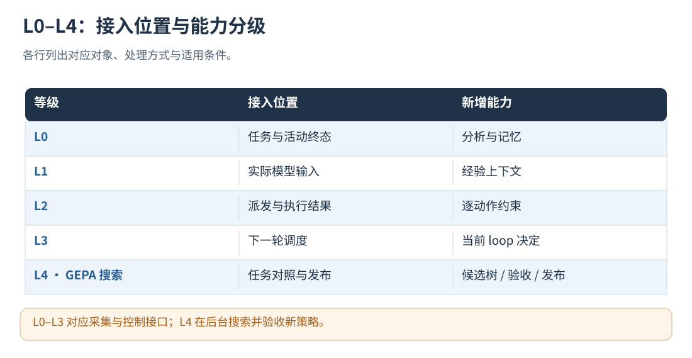

读图：每级只新增能力，不回退已有行为；L0 不影响宿主，L1–L3 受控应用，L4 后台进化。

## 1.3 设计目标与建设原则
**目标**：流程自动化进化、资源智能优化、故障自愈、交付效率迭代提升、适配多业务通用场景、降低运维成本。
**原则**：通用性、可扩展性、高可用、安全可控、低侵入、可观测、可回滚、兼容原生 Harness。

## 1.4 适用范围与受众
适用多项目 CI/CD 交付与 Agent 任务场景；面向研发、流水线管理员、平台运维、架构与测试角色。

## 1.5 术语与缩略语
| 术语 | 说明 |
| ---- | ---- |
| 统一执行边界 | 宿主插入打点（point）的统一接入层，负责上下文关联与轨迹记录 |
| Hybrid Evaluator | 规则 + 模型 Judge 混合评测器 |
| GEPA | 反思式进化搜索算法（Genetic-Pareto），支持多父谱系与双亲重组 |
| Holdout 准入 | 留出集非回归校验，防策略劣化上线 |
| 影子策略 | 与现网策略并行运行、只记录不生效的对照策略 |
| auto_approve | 经验注入授权开关，默认 false |

## 1.6 核心创新点

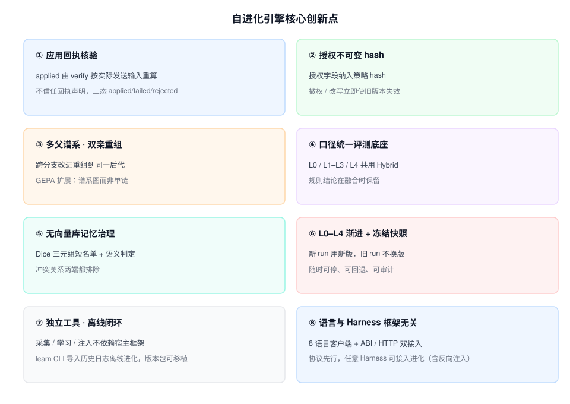

相对业界自进化框架（对标见第 2 章与 `evo-tech-compares.md`），本引擎的八项差异化创新：

1. **应用回执核验（applied-by-verification）**：业界普遍信任"注入了即生效"的回执声明；本引擎由 `PolicyRuntime::verify` 按**实际发送的模型输入**重算应有增强内容并核验出现位置与次数，产出 applied/failed/rejected 三态——注入凭证不再是合规证明。
2. **授权不可变 hash**：经验授权（memory_id + content_revision）、binding 等授权字段纳入策略不可变 hash；撤权、改写、删除或不兼容关系**立即使旧版本失去后续 run 的应用资格**——业界多数框架（DSH、Hermes 等）撤权后旧策略仍可能残留生效。
3. **多父谱系与双亲重组（GEPA 扩展）**：保存候选谱系图而非单链，能把**不同分支的改进重组到同一后代**；叠加失败台账、真实试验筛选与逐题/多目标 Pareto 前沿，样本效率与搜索稳定性优于单链反思改写路线。
4. **口径统一评测底座**：L0 基线、L1–L3 准入、L4 搜索筛选共用同一 Hybrid Evaluator，规则确认的无效结论在融合时保留——避免"观测一套口径、优化另一套口径"导致搜索方向漂移（观测类平台与优化类研究分裂的根源）。
5. **无向量库的确定性记忆治理**：Sørensen–Dice 字节三元组短名单（top-8）+ 模型语义判定（DUPLICATE/RELATED/CONTRADICTS/DISTINCT）+ 冲突两端排除，不依赖外部向量数据库即可私有化部署；保存（CANDIDATE）与应用授权分离。
6. **L0–L4 渐进分级 + 冻结快照**：每个 run 冻结固定策略视图——新 run 用新版本、已开始的 run 不换版；能力可逐级启用、随时可停（`set_enabled` + epoch 隔离）、可回退、可审计，把"自进化"从一次性切换变成可控的渐进工程。
7. **独立工具形态的全链闭环（采集-学习-注入不依赖宿主框架）**：业界框架要么是 Harness 本体（DSH、PenguinHarness）、要么是平台内建模块（openJiuwen RSI 绑 WorkSwarm）、要么是框架内库（Hermes 绑 DSPy/Python）——单看"离线进化"各有部分能力，但本引擎以**独立工具**形态同时做到：统一边界独立采集轨迹、`learn` CLI 导入历史日志离线训练（无需在线会话）、published-version 版本包可移植分发、L1–L3 受控注入回任意宿主并按回执核验。对比报告能力矩阵中"离线进化、版本可移植 ✅"仅本引擎满分——创新性在补齐"观测止步于评测、优化止步于离线"的最后一环，而非任何单点。
8. **语言无关 + Harness 框架无关的接入面**：诚实划界——语言中立的边界打点概念有 OpenTelemetry 先例，非原创概念；但把"协议先行（5 protobuf + 6 JSON Schema + OpenAPI）+ 8 语言薄客户端 + 原生 ABI/HTTP 双接入"应用于**自进化闭环**在 11 个对比框架中唯一（"框架/语言无关接入 ✅"仅本引擎）。真正的门槛在反向注入：对不认识的 Harness 做 L2 参数护栏与 L3 循环控制并核验执行——`activity_types` 语义映射 + 5 种模型请求格式包内识别使非 AgentFlow-Harness 只需打点接入即可获得完整进化能力，换框架不必重写适配器。

> 创新性质说明：①–⑥ 含算法与机制层创新（回执核验、授权 hash、重组搜索等）；⑦⑧ 属**架构范式/组合式工程创新**——单点技术均有先例，但"独立工具 + 语言/框架无关 + 含注入与核验的受控闭环"的完整组合在当前业界框架中无第二例（依据：`evo-tech-compares.md` 6.6 能力矩阵）。

---

---

# 2 业界洞察

## 2.1 行业趋势
1. **从"自动化"到"自主化"**：CI/CD 编排已高度自动化，优化决策仍依赖人工；AIOps 与自愈流水线是平台厂商竞逐方向。
2. **Agent 工程化催生新基建**：轨迹观测、持续评测、经验记忆、自动策略优化成为继"模型-框架"之后的第二层平台基建。
3. **评测先行**：无评测基线的自动化优化不可上线，已是行业方法论共识。
4. **进化对象收敛**：主流框架进化对象已收敛到 Harness（提示词/技能/工具规则）、轨迹树、代码技能、多 Agent 组织四类路线（详见 `evo-tech-compares.md` 第四节）。

## 2.2 代表方案对标（摘自 evo-tech-compares.md）
| 代表 | 进化核心对象 | 借鉴 | 局限（本系统差异化空间） |
| ---- | ---- | ---- | ---- |
| DeepSeek Harness + DSH-Evolve | Harness 补丁迭代、轨迹归因 | 插件式进化、人工闸门、补丁隔离 | 无版本基线管理，token 成本高 |
| openJiuwen RSI | Harness + Artifacts 双维度、原生蜂群 | 四层工程闭环（沙箱/版本/预算/回滚） | 场景锁定，生态绑定 |
| EvoAgentX / SE-Agent | 工作流拓扑 / 轨迹树 | 遗传变异重组、轨迹树搜索 | 工程配套弱，偏学术 |
| Hermes Agent | GEPA 技能进化、三级技能存储 | 边运行边进化、无需离线训练 | 缺全局基线管理 |
| LangSmith / Langfuse | 观测与评测平台 | Trace 数据模型、评测集管理 | 只观测不进化 |
| MemGPT/Letta、Mem0 | 长期记忆 | 分层记忆、检索更新 | 缺信任评分、晋升与授权治理 |
| DGM（Sakana AI） | Agent 自身源码 | 存档采样跳出局部最优 | 场景窄、进化开销极大 |

## 2.3 技术路线选型
| 路线 | 成本 | 可解释性 | 判断 |
| ---- | ---- | ---- | ---- |
| 人工调优 | 低 | 高 | 无法规模化（被替代对象） |
| 规则引擎 | 低 | 高 | 适合确定性护栏场景，保留 |
| RL/RLHF | 极高 | 低 | 生产试错成本不可接受 |
| 程序化提示优化（DSPy 类） | 中 | 中 | 单应用有效，缺生产治理 |
| **反思式进化搜索（GEPA，采用）** | 中 | 中高 | 样本效率高、改写过程可读 |

**选型结论**：采用「反思式进化搜索 + Hybrid 评测 + 两级记忆治理 + Holdout 非回归准入」组合路线，在观测类方案（止步评测）与优化类研究（止步离线实验）之间补上"在线受控进化"环节。

## 2.4 业界实践四点启示
1. **可控性优先于自主性**：业界成熟方案均保留人工在环 → 对应本系统授权/影子/灰度/回滚三重防护。
2. **评测先行** → 对应 L0 是一切的前提。
3. **低侵入是平台级方案普及前提** → 对应统一执行边界"只传业务 ID"设计。
4. **数据治理决定长期效果** → 对应记忆信任评分、淘汰、晋升机制。

---

# 3 需求分析

## 3.1 业务需求
多项目通用交付适配、研发流程自主迭代、交付质量持续优化、业务场景动态适配。

## 3.2 功能需求（按 L0–L4 分级）
| 分级 | 功能需求 | 参照实现 |
| ---- | ---- | ---- |
| L0 | 轨迹采集与校验、Episode 聚合、规则/模型/Hybrid 评测、反思入库 | `src/analysis/`、`src/evaluation/` |
| L0→L1 | 两级记忆（私有/公共）、晋升、冲突、信任、淘汰 | `src/memory/shared_memory.cpp` |
| L1 | 经验注入授权与策略快照下发 | `proto/runtime_policy.proto` |
| L2 | 技能编排（schedule_rules）、逐动作参数护栏 | `src/runtime/orchestration.cpp` |
| L3 | 循环控制（Continue/Replan/Stop）、宿主执行核验 | `src/runtime/policy_runtime.cpp` |
| L4 | GEPA 搜索、双亲重组、Holdout 准入、发布与回滚 | `src/gepa/`、`src/cli/evaluation_supervisor.cpp` |
| 全级 | 多语言客户端、HTTP 服务、learn 导入、权限审计 | `clients/`、`src/service/`、`src/cli/` |

## 3.3 非功能需求
- **性能**：打点不阻塞宿主主链路，评测与学习后台异步执行；
- **安全**：经验注入默认需授权（auto_approve=false），高风险变更人工复核；
- **兼容**：8 语言客户端、三种宿主生命周期、历史日志导入；
- **可观测**：全量轨迹、评测、发布、审计可查询（`docs/21-operations.md`）。

## 3.4 现有系统痛点与改进方向
| 痛点 | 改进方向 | 落点分级 |
| ---- | ---- | ---- |
| 失败后无经验沉淀，同类问题重复发生 | L0 采集评测反思，经验持续入库 | L0 |
| 有效经验无法安全复用 | 授权注入 + 策略快照 | L1 |
| 任务编排靠人工排布 | 技能编排 + 参数护栏 | L2 |
| 长任务跑偏无人干预 | 循环控制 + 执行核验 | L3 |
| 策略优化靠人工试验 | GEPA 后台搜索 + 非回归准入 | L4 |

---

# 4 总体架构设计

## 4.1 整体设计思路
系统基于"采集-评测-反思-记忆-决策-应用-准入"自进化闭环构建，能力按 L0–L4 分级渐进启用：L0 只采集学习不影响宿主；L1–L3 受控应用经验与编排；L4 由 GEPA 后台搜索持续进化策略。低侵入由统一执行边界保证：宿主只传入已有任务 ID/调用 ID/父调用 ID，其余（上下文关联、轨迹记录、并行合流、任务收尾）全部由组件完成。

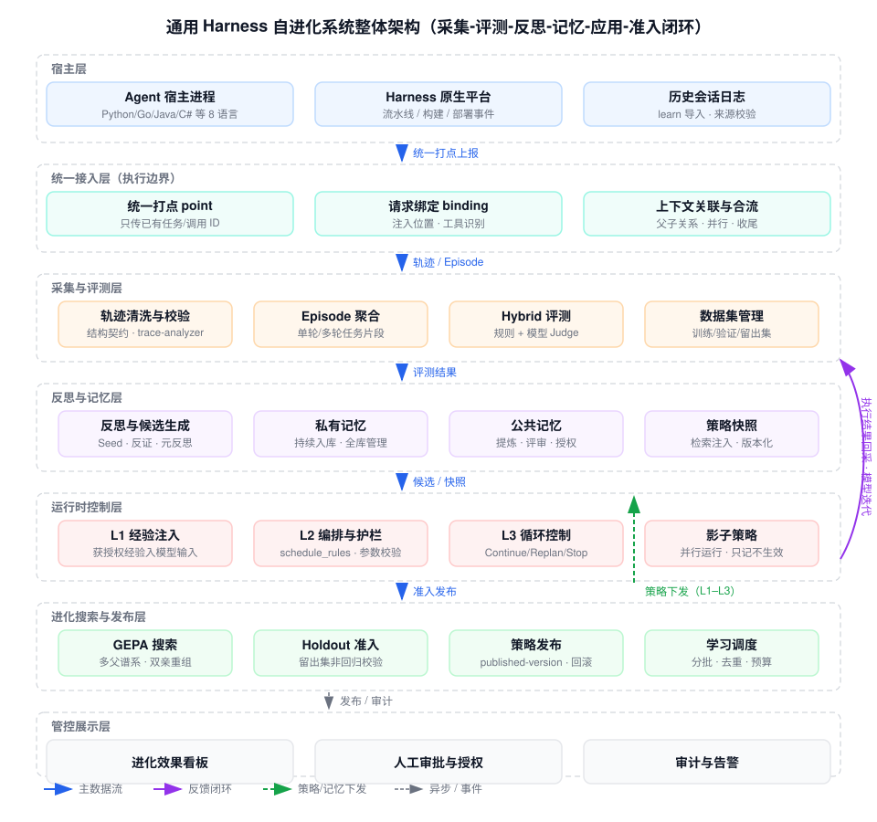

## 4.2 分层架构
| 层 | 职责 | 参照实现 |
| ---- | ---- | ---- |
| 统一接入层（执行边界） | 统一打点、请求绑定、上下文关联、并行合流、任务收尾 | `src/runtime/instrumentation.cpp`、`request_binding.cpp` |
| 采集与校验层 | 轨迹清洗、结构契约校验、Episode 聚合 | `src/analysis/trace_analyzer.cpp`、`trace_contract.cpp` |
| 评测与反思层 | 规则/模型/Hybrid 评测、Seed/候选/元反思 | `src/evaluation/`、`src/analysis/evolution_pipeline.cpp` |
| 记忆与策略层 | 私有/公共记忆、晋升信任淘汰、策略快照与版本 | `src/memory/`、`proto/runtime_policy.proto` |
| 运行时控制层 | L1 注入、L2 编排护栏、L3 循环控制、影子策略 | `src/runtime/policy_runtime.cpp`、`shadow_runtime.cpp` |
| 进化搜索与发布层 | GEPA 搜索、Holdout 准入、发布回滚、学习调度 | `src/gepa/`、`src/cli/evaluation_supervisor.cpp` |
| 管控展示层 | 看板、审批授权、审计告警 | `docs/21-operations.md` |

## 4.3 核心能力闭环与主时序

闭环链路：**打点采集 → 轨迹校验/Episode → Hybrid 评测 → 反思生成候选 → 两级记忆入库与晋升 → L1–L3 受控应用 → 执行结果回采 → GEPA 搜索与留出集准入 → 策略发布**。

自感知/自分析/自决策/自执行/自优化/自修复分别在采集、评测、反思+搜索、运行时控制、GEPA 迭代、循环控制+回滚各环节落地。

**主闭环时序图**：

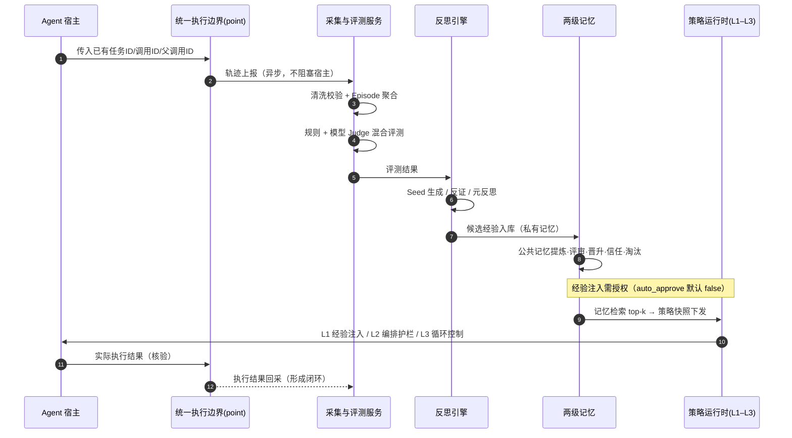

## 4.4 统一执行边界与低侵入接入
- **统一打点协议**：只传已有业务 ID，不新增消息字段、不新增 observer/适配器文件；模型请求注入位置、工具定义、token 用量由组件内识别（`docs/08-instrumentation.md`）。
- **生命周期选型**：常驻进程 → 原生 LocalRuntime（进程内 ABI）；多短进程 → 独立 HTTP 服务；已有日志 → learn 导入（`docs/23-import-and-migration.md`）。
- **多语言客户端**：Python、JS/TS、Rust、Go、Java、C#、C/C++ 均提供调用包装与循环判断（`clients/`）。
- **零开销降级**：未启用评测/学习时，接入代码直接返回，不连接服务、不启动线程。

## 4.5 部署形态
三种形态可组合：进程内原生库（低延迟）、独立常驻服务（跨进程 run）、离线导入（历史学习）。

## 4.6 4+1 视图

### 4.6.1 逻辑视图（静态子系统）
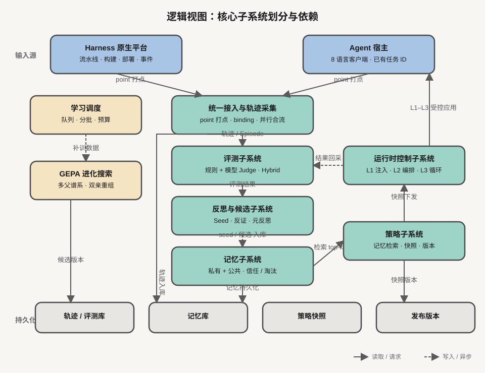

八个子系统：统一接入与轨迹采集、评测、反思与候选、记忆、策略、运行时控制、进化搜索（GEPA+学习调度）、管控审计。核心领域实体：Trace、Episode、评测结果、Seed/候选、私有/公共记忆、策略快照、发布版本、审计。

### 4.6.2 开发视图（工程结构）
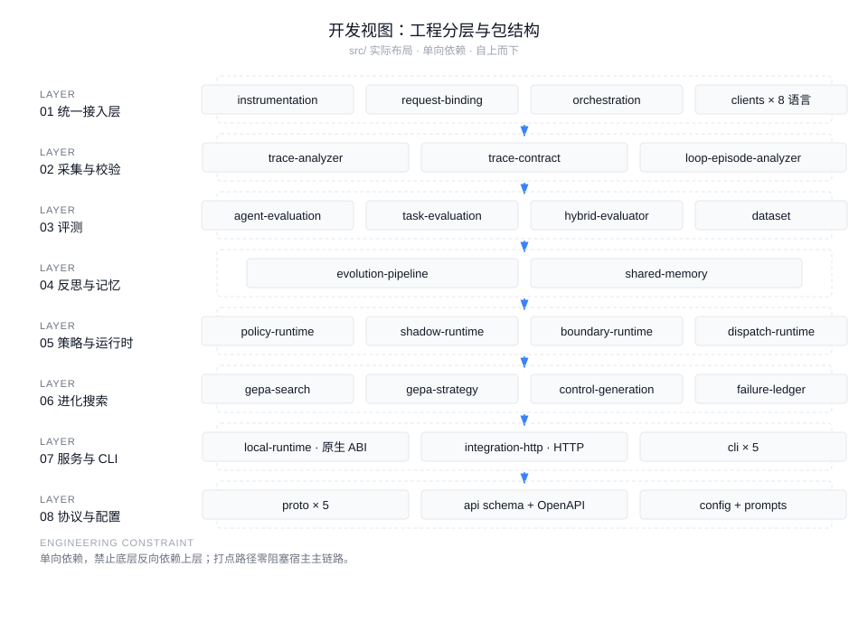

工程分层（`src/` 实际布局）：统一接入（instrumentation/request-binding/orchestration/clients）→ 采集校验（trace-analyzer/trace-contract/loop-episode-analyzer）→ 评测（agent-evaluation/task-evaluation/hybrid-evaluator/dataset）→ 反思记忆（evolution-pipeline/shared-memory）→ 策略运行时（policy/shadow/boundary/dispatch-runtime）→ 进化搜索（gepa-search/gepa-strategy/control-generation/failure-ledger）→ 服务与 CLI → 协议与配置。核心引擎 C++，提供原生 ABI 与 HTTP 双接入面。

### 4.6.3 运行视图（动态运行时）
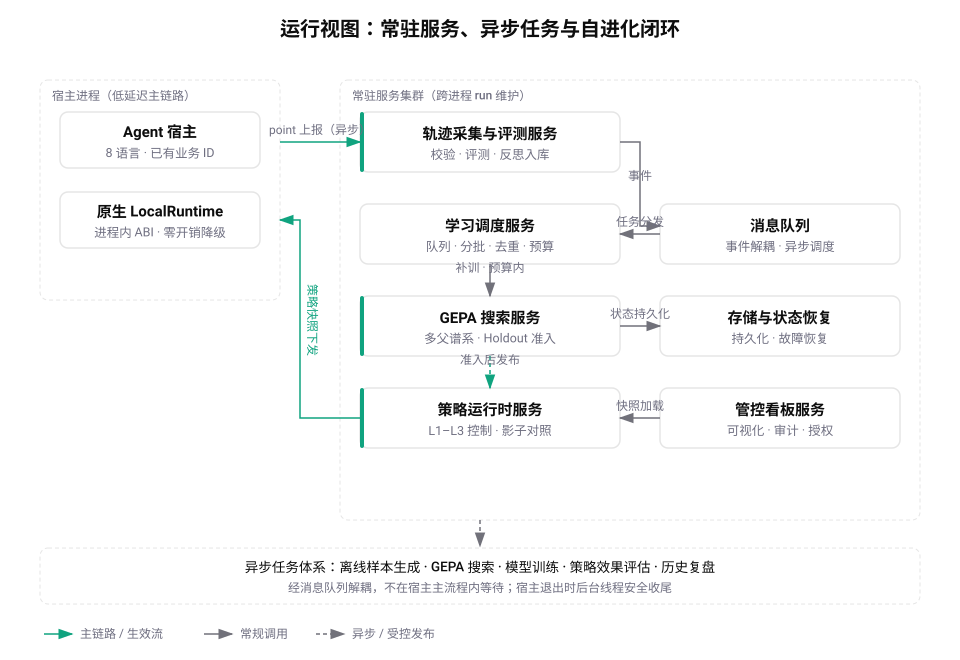

常驻服务：轨迹采集与评测、学习调度、GEPA 搜索、策略运行时、管控看板；异步任务体系（离线样本、GEPA 搜索、训练、效果评估、历史复盘）经消息队列解耦，不在宿主主流程内等待；宿主退出时后台线程安全收尾，跨进程 run 由常驻服务维护。

### 4.6.4 用例视图（+1 核心驱动视图）

**参与角色与边界**：

| 角色 | 能做什么 | 不能做什么 |
| ---- | ---- | ---- |
| 研发用户（Agent 宿主开发者） | 插入统一打点、选择生命周期形态、查看优化记录 | 不能直接修改记忆库/策略版本 |
| 流水线管理员 | 配置部署授权（max_level/scope/动作规则/循环预算/max_context_bytes）、批准经验（approved_experiences）、审批高风险变更、手动回滚 | 不干预宿主业原有权限与安全检查 |
| 平台运维 | 部署与监控、学习调度参数（min_new_runs/预算/冷却）、容灾 | 不参与业务决策 |
| 自进化 Agent（系统内置） | 采集、评测、反思、记忆治理、GEPA 搜索、准入发布（全自动） | 不能绕过授权注入经验、不能执行未准入策略 |
| Harness 原生平台 | 提供流水线/事件 API 与被增强的执行 | 不被共享数据库、不被侵入核心服务 |

**核心业务用例（与真实机制的映射）**：
1. **全维度采集**：宿主在任务/模型/动作/循环边界调用统一打点，组件负责上下文关联与收尾；未启用时零开销直通。
2. **评测与瓶颈识别**：规则确定性诊断 + 模型语义判断 Hybrid 输出统一口径；`non_retryable_repeat` 等规则给出置信度 1.0 的硬证据。
3. **反思与策略生成**：Seed→反证→元反思迭代；经验保存（CANDIDATE）与应用授权分离。
4. **受控自动化执行**：L1 经验注入需 memory_id + content_revision 精确授权并按实际发送输入核验；L2 只加增量约束不删宿主硬依赖；L3 建议与宿主 commit 分离记录。
5. **故障自愈与降级**：采集缺口时宿主按原输入/原调度/原循环限制继续并标记 degraded，隔离受影响轨迹。
6. **进化搜索与准入发布**：GEPA 后台搜索，候选在独立实例固定任务集上评测，留出集非回归准入后登记发布。
7. **观测与审计**：应用回执（applied/failed/rejected）、批次 decisions、发布记录全量可查。
8. **人工干预**：白名单/黑名单、进化开关、阈值、授权审批；`evo.set_enabled(false)` 可整体暂停增强（epoch 隔离）。

**边界声明**：系统所有自进化行为**可观测、可管控、可回滚、可审计**；撤权、改写、删除或不兼容关系立即使旧策略版本失去后续 run 的应用资格。

### 4.6.5 部署视图（物理环境视图）

系统支持三种部署形态，可按宿主生命周期组合选用：

**形态一：进程内原生库（LocalRuntime，常驻进程、主链低延迟）**

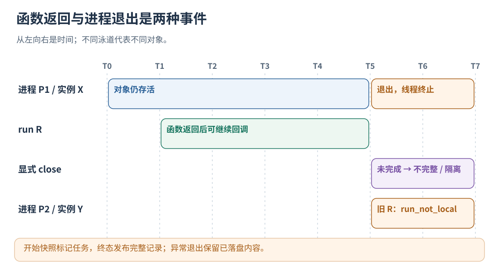

核心引擎以进程内原生 ABI 直接链接宿主（C++ 核心 + 8 语言薄封装）；后台评测学习线程随宿主退出安全结束；资源竞争时组件可降级而宿主不受影响。适用：单实例常驻 Agent、对注入延迟敏感的场景。

**形态二：独立常驻服务（HTTP + 多语言客户端，多短进程共享状态）**

服务持有跨进程 run 状态与记忆；短进程宿主通过 HTTP 客户端接入，打点只传已有业务 ID；8 种语言客户端统一封装（`clients/python|js|rust|go|java|csharp|ts|c`）。适用：Coordinator 派发后退出、多个短进程共同完成任务。代价：通信与持久化开销。

**形态三：离线导入（learn 历史日志学习）**

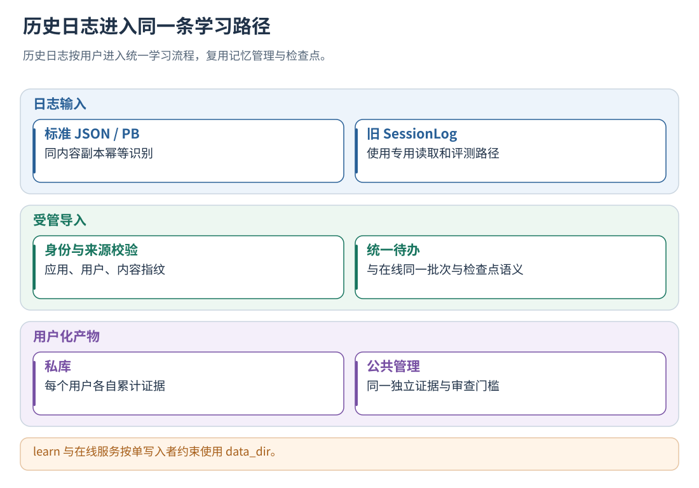

已有历史会话日志经 `learn` CLI 导入：同一身份、来源校验、进入同一学习队列；用于冷启动与历史数据迁移（`docs/23`）。

**集群拓扑与网络**：
- 业务服务集群：采集评测、反思记忆、策略运行时、GEPA 搜索、管控看板（K8s 微服务部署）；
- 数据存储集群：轨迹/评测库、记忆库、策略快照、发布版本、检查点（`data_dir/agent-evaluation/`）；
- 与 Harness 平台经内网 API + 打点边界通信，**不共享数据库**；网络白名单只开放必要端口。

**环境隔离**：开发/测试/预发/生产四套环境；生产默认开启"授权审批 + 灰度发布 + 变更回滚"三重防护；跨暂停/恢复的 run 用 epoch 隔离，恢复后重新进入增强流程。

---

# 5 核心功能模块详细设计

## 5.1 轨迹采集与校验模块（L0）

**模块定位**：将宿主边界上的真实执行事实转化为可分析的标准轨迹，是全部自进化能力的数据地基。

**边界事件协议**：宿主只在实际掌握执行事实的位置调用统一边界接口，组件生成/保存标准事件（入口 `src/service/local_runtime.cpp`、`boundary_runtime.cpp`）：

| 边界事件 | 组件保存的主要内容 |
| ---- | ---- |
| `run.begin` | 用户身份、conversation、run 输入、能力等级声明 |
| `activity.begin` | `step.start`；模型/动作语义另生成 `action.start`，保存原始与准备执行的输入 |
| `activity.end` | 实际输出、执行状态、错误、**真实发送参数**；关闭 action/step 并核对应用回执 |
| `loop.check` | 循环状态与轮次、策略查询与下一步建议（实际执行由 commit 回报） |
| `loop.commit` | 宿主实际选择的 continue/replan/stop，关闭本次控制步骤 |
| `event.record` | 自定义观察（type/data/extensions 及显式关联） |
| `run.end` | 最终输出、业务状态、**采集完整性**，进入后台处理 |

`activity_types` 可把自定义活动映射为 `model`/`action`/`custom`，是数据语义映射，无需每换一个框架就写适配器。只有任务输入输出时也可采集（生成黑盒 Episode），但工具/循环/分支分析需上报内部活动。

**清洗与校验**（`src/analysis/trace_contract.cpp` 的 `validate_trace`）：
- **结构清洗**：解决重复、缺失、错误关联和不完整采集；采集缺口保留为 `unknown` 或隔离记录，不污染统计；
- **内容清洗**：边界入口拒绝已识别的敏感字段/凭据；评测旧日志时做递归脱敏、已知秘密替换与规则过滤；采集前移除非必要个人信息（最小必要原则）；
- **完整性双轴**：业务状态与采集完整性两条轴独立统计（失败≠采集缺失）。

**Episode 聚合**（`src/analysis/loop_episode_analyzer.cpp`）：按 conversation/loop 维度聚合单轮与多轮片段，Episode 与 loop 分别统计，保留原始执行事实。

## 5.2 评测模块（L0）

**模块定位**：对轨迹/Episode 做执行价值判定，输出供反思与准入使用的统一口径结果。

**三层评测**：
1. **规则评测**（`src/analysis/hybrid_evaluator.cpp`）：确定性诊断，如 `non_retryable_repeat`——命中需同时满足：输入指纹/执行者/执行流/loop_id/操作名相同、轮次递增、因果序确认、两次均失败且均标记 `non_retryable`、错误码相同；命中生成置信度 1.0 的诊断。`invalid_loop_lower_bound` 给出有确定性证据的无效轮次下界。规则判定顺序：有 `counts_as_invalid` 诊断 → INVALID（取诊断置信度）；显式评测失败/可疑诊断 → UNCERTAIN；仅失败结果无因果证据 → UNCERTAIN；否则 UNASSESSED。
2. **模型 Judge**：对语义质量打分，输出无效 Episode 数等（与规则下界、总轮次是不同指标，不混用）。
3. **Hybrid 融合**：确定性检查提供结构与指标，模型补充语义判断；**规则确认的无效结论在融合时保留**；评测失败、业务失败、轨迹不完整三者分别记录。

**口径统一**：同一评测底座被 L0 基线、L1–L3 策略准入、L4 搜索筛选共同复用；工具调用计数只统计业务工具（`executed=false` 的拒绝不计入），同名模型与工具分别判重。

**数据集管理**（`src/evaluation/dataset.cpp`、`docs/19`）：训练/验证/留出三分集；任务入口绑定方式接入真实任务接收函数（组件投题、等待真实 run 结束并评分，同步/异步/多轮共用一入口）。

## 5.3 反思与候选生成模块（L0→L4）

**模块定位**：以评测结果为输入，自动产出可入库的经验条目（Seed）并迭代为候选。

**处理流程**（`src/analysis/evolution_pipeline.cpp`）：
1. 取一个 Episode 的轨迹证据 + 评测结果；
2. 反思提示词（`config/prompts/episode-*.txt`、`meta-reflection-*.txt`）生成 Seed：触发模式（trigger_pattern）、观察到的问题（observed_problem）、建议变更（proposed_change）三段结构；
3. 候选迭代：候选经**反证收集**（在后续轨迹中寻找反驳证据）与**元反思**改写；
4. 支持逐题反思与多题聚合反思两种粒度（聚合反思即 GEPA ComBEE 的基础）。

**关键约束**：每条候选保留完整证据与审计关系（来源 candidate_id、生成器版本）；新插入记忆状态为 CANDIDATE，不自动 VALIDATED——经验"保存"与"应用授权"分离。

## 5.4 两级记忆管理模块（L0→L1）

**模块定位**：用户私有记忆持续入库 + 公共记忆跨上下文受控共享，治理记忆规模与质量。

**私有记忆入库**（`src/memory/shared_memory.cpp` 的 `curate_memory_in_place`，按序处理每条候选）：
1. `batch_id` 已应用 → 幂等返回，不重复计证据；
2. `candidate_id`/`source_candidate_ids` 别名已存在 → 直接合并证据，不调模型；
3. 规范化后策略身份完全相同 → 确定性合并（允许兼容的生成器版本差异）；
4. 其余候选在同类型/同作用域/同经验契约的可管理条目中建短名单；
5. 无可比对象 → 独立插入（status=CANDIDATE）；
6. 有可比对象且模型可用 → 判定 DUPLICATE / RELATED / CONTRADICTS / DISTINCT；
7. 按关系与置信度门槛执行合并、关联或独立保存。

**无向量库的短名单**（`memory_shortlist`）：确定性 Sørensen–Dice 词面相似度——对 `normalize(trigger_pattern + observed_problem + proposed_change)` 取 UTF-8 字节三元组集合，`sim = 2|A∩B|/(|A|+|B|)`，降序取前 8 条；短名单只为降模型输入成本，能否合并由语义判定与结构门槛决定。

**公共记忆**（`docs/14`）：语义提炼（需显式配置评测模型）→ 评审 → 授权后跨上下文共享；晋升（经验→技能/策略）、冲突检测、信任评分、淘汰机制控制长期质量。`memory_id` 由规范候选构造（`memory:candidate:<hash>`），语义合并后原 candidate_id 作为 alias 指向同一 memory_id；批次 `memory_update.decisions` 记录映射/判断方法/置信度，全程可审计。

## 5.5 策略快照与检索注入模块（L1）

**模块定位**：把"记忆库"变成"可下发的策略"，是记忆到运行时控制的桥梁。

**策略快照**（`docs/15`、`proto/runtime_policy.proto`）：编译时检查条目状态、冲突、所有权与授权；快照版本化，内容含 memory_id + content_revision——注入与核验按二者同时匹配。

**检索注入**：运行时按当前任务状态检索 top-k 相关经验，生成策略快照下发至宿主边界的策略运行时。

## 5.6 运行时控制模块（L1–L3）

**模块定位**：在不重写宿主调度的前提下，将策略决定落到模型输入、动作派发与循环决策三处执行边界。

**L1 经验注入**（发生在 `activity.begin(kind=model)`，`src/runtime/policy_runtime.cpp` + `request_binding.cpp`）：
1. 查询当前任务相关经验 → 只保留 memory_id 与 content_revision 同时匹配批准项的条目；
2. 结构化 JSON 填入经验模板，逐条检查 `max_context_bytes`，放不下则跳过；
3. 外层加带 policy_id 的经验边界标记（用于回执验证）；
4. 按显式 binding 或包内识别的输入位置注入，返回增强后的参数。两种绑定模式：`text`（追加到指定字符串）、`system_message`（追加 system 消息数组，无合适位置时新建）；支持 function/parameters、input_schema、Responses 扁平工具、functionDeclarations 等常见格式自动识别。

**applied 核验**：结束时宿主回报 `actual_input` 与 `executed`，`PolicyRuntime::verify` 重算同一次查询应有的增强内容，检查是否真的出现在实际绑定位置及出现次数——通过 → `applied`；有决定未观察到应用 → `failed`；无增强决定 → `rejected`。**按实际发送的输入核验，不信任回执声明**。

**L2 逐动作护栏**：
- **参数护栏**（包内自动，无需逐工具配置）：从 `actual_input` 的工具定义提取操作名与 JSON Schema 顶层 `required`（支持 function/parameters、input_schema、Responses 扁平、functionDeclarations、旧 functions 五种形式）；按 Run/scope/执行者/并发分支保存紧凑定义；对同一分支动作检查必填键存在性（required ≠ 非空，可选键不会被提升为必填）；
- **技能编排**（`schedule_rules`，`src/runtime/orchestration.cpp`）：在既有任务间选择先后依赖与并行关系（如 A 完成后才释放 B，无依赖的 C 继续并行）；**宿主原有硬依赖不会被删除**，只做增量约束。

**L3 循环控制**（`loop.check` / `loop.commit`）：按当前 loop 状态输出 Continue / Replan / Stop 建议；宿主 commit 回报实际选择，关闭本次控制步骤；建议与实际执行分离记录，支持核验宿主是否真的执行了建议。

**影子策略**（`src/runtime/shadow_runtime.cpp`、`proto/shadow_policy.proto`）：候选策略与现网策略并行运行、只记录不生效，为灰度与效果对比提供无风险试验环境。

## 5.7 GEPA 自进化搜索模块（L4）

**模块定位**：后台持续搜索更优策略，是系统"越用越好"的引擎（`src/gepa/`、`docs/24`）。

**搜索机制**：
- **多父候选谱系**：保存谱系图而非单链，既能反思改写，也能把不同分支的改进**重组到同一后代（双亲重组）**；
- **反思改写驱动**：以失败台账与评测差异为输入做反思（`gepa-reflection.txt`），生成多个改写提案（`gepa-aggregate.txt` 聚合反思、可选 ComBEE 分组反思）；
- **真实试验筛选**：候选用真实 Agent 试验（复用已有 L1–L3 打点，无需新增宿主打点），经训练/验证集逐题与多目标前沿（Pareto）筛选，失败台账记录无效方向避免重复探索；
- **逐题/多目标前沿**：不同题目上的最优策略可不同，前沿保留多样性候选而非单一最优。

**启用方式**：`agent-evaluation.json` 增加 `"gepa_config": "gepa.json"`，配置训练/验证/留出任务与反思模型即可；支持搜索中断恢复与离线加载已发布版本。

## 5.8 评测准入与策略发布模块（L4）

**模块定位**：防止策略劣化进入生产的最后闸门（`src/cli/evaluation_supervisor.cpp`、`holdout_baseline_cache.h`）。

**准入流程**：
1. 候选在**留出集**（训练/验证从未接触）上与缓存基线做非回归对比；
2. 通过 → 生成 `published-version`（版本化、可灰度下发、可一键回滚）；未通过 → 回退候选并记入失败台账；
3. 准入基线缓存避免重复评测；准入记录全量审计。

**自动补训**（冷启动）：按过滤和授权后的**有效经验数**判断是否充足（而非只判断空库）；不足时从冻结训练集补经验——训练分批、去重、有预算，验证集与留出集不入库。

## 5.9 可视化管控与审计模块（全级）

- 状态查询与排错：run/策略/学习队列状态、经验应用回执（applied/failed/rejected）统计（`docs/21`）；
- 人工干预入口：策略阈值、黑白名单、进化开关、授权审批；
- 审计：经验授权、策略发布回滚、公共记忆提炼评审全量留痕。

## 5.10 模块清单汇总

| 模块 | 核心职责 | 能力分级 | 参照实现 |
| ---- | ---- | ---- | ---- |
| 轨迹采集与校验 | 边界事件协议、清洗校验、Episode 聚合 | L0 | `src/analysis/`、`src/service/` |
| 评测 | 规则/模型/Hybrid 三层评测、数据集管理 | L0 | `src/evaluation/`、`hybrid_evaluator.cpp` |
| 反思与候选生成 | Seed/反证/元反思、候选迭代 | L0→L4 | `evolution_pipeline.cpp` |
| 两级记忆管理 | 私有入库合并、公共治理（晋升/信任/淘汰） | L0→L1 | `src/memory/shared_memory.cpp` |
| 策略快照与检索注入 | 快照版本化、检索 top-k 下发 | L1 | `proto/runtime_policy.proto` |
| 运行时控制 | L1 注入核验、L2 护栏编排、L3 循环控制、影子 | L1–L3 | `src/runtime/` |
| GEPA 自进化搜索 | 多父谱系/双亲重组/真实试验/失败台账 | L4 | `src/gepa/` |
| 评测准入与发布 | Holdout 非回归、published-version、补训 | L4 | `evaluation_supervisor.cpp` |
| 可视化管控与审计 | 看板、干预、审计 | 全级 | `docs/21` |

---

# 6 核心算法与模型设计

## 6.1 算法链路总览

算法按「评测 → 反思 → 记忆治理 → 策略编译 → 搜索 → 准入」六段组织，各段独立演进但共用数据口径：每个 run 使用**固定策略快照**，后台根据新轨迹更新记忆；部署授权控制经验与规则的使用范围；执行回执把应用情况带回下一轮评测。读图：应用回执记录执行情况，任务级对照评估进化收益。

## 6.2 Hybrid 评测算法（规则 × 模型融合）

**输入**：标准轨迹/Episode；**输出**：统一口径的评测结果（业务状态、诊断、无效轮次、模型评分）。

1. **规则层（确定性诊断）**：以 `non_retryable_repeat` 为代表——五条件全满足（同输入指纹/执行者/执行流/loop_id/操作名、轮次递增、因果序确认、两次均失败且 `non_retryable`、错误码相同）→ 置信度 1.0 诊断并引用相关调用/结果事件；`invalid_loop_lower_bound` 给出有证据的无效轮次下界。
2. **规则判定顺序**：有 `counts_as_invalid` 诊断 → INVALID（取诊断置信度）；显式评测失败或可疑诊断 → UNCERTAIN；只有失败结果无因果证据 → UNCERTAIN；否则 UNASSESSED（置信度 0）。
3. **模型层（语义判断）**：模型 Judge 对参数、错误与产物做语义评分，产出无效 Episode 数等——与规则下界、总轮次是**不同指标，不混用**。
4. **融合**：规则确认的无效结论在融合时**保留**；评测失败、业务失败、轨迹不完整分别记录。同一评测底座被 L0 基线、L1–L3 准入、L4 筛选复用，保证全链路口径一致。

## 6.3 反思与候选算法

1. **Seed 生成**：以单 Episode 的轨迹证据 + 评测结果为输入，反思模型产出三段式经验：`trigger_pattern`（触发条件）/ `observed_problem`（观察到的问题）/ `proposed_change`（建议变更），并保存 scope、触发条件与直接证据。
2. **置信度折扣**：支持证据按数量与来源置信度打折——示例：单 run、单 Episode 支持、证据置信度 0.9 → 合成 0.78，状态为 INSUFFICIENT_SUPPORT，作为待处理记忆等待新增证据。
3. **反证收集**：在后续轨迹中主动寻找反驳证据；存在反证或 CONTRADICTS 关系的候选在策略编译时被排除。
4. **元反思**：对候选做改写迭代（`meta-reflection-*.txt`），生成新的候选版本；支持逐题与多题聚合两种粒度（聚合反思是 GEPA ComBEE 分组反思的基础）。

## 6.4 记忆治理算法

1. **入库去重七步法**（`curate_memory_in_place`，见 5.4）：幂等 → 别名合并 → 确定性合并 → 短名单 → 独立插入/语义判定 → 关系执行；新条目一律 CANDIDATE。
2. **无向量库短名单**：Sørensen–Dice 三元组词面相似度 `sim = 2|A∩B|/(|A|+|B|)`（UTF-8 字节三元组，降序 top-8），只降模型输入成本，不做合并裁决。
3. **关系判定**：模型判定 DUPLICATE / RELATED / CONTRADICTS / DISTINCT，按关系与置信度门槛合并、关联或独立保存；`memory_update.decisions` 全量审计。
4. **公共记忆治理**：语义提炼（须配置评测模型）→ 评审 → 授权 → 跨上下文共享；晋升/冲突/信任/淘汰控制长期质量。

## 6.5 策略编译与检索算法

1. **冻结语义**：每个 run 开始时冻结「当前用户私有库 + 可用公共库」的合格视图；新 run 采用更新后的策略，已开始的 run 保留原版本。
2. **编译过滤**（`compile_shadow_policy`，`src/runtime/shadow_runtime.cpp`）：每条私人经验须同时通过——scope 在部署授权内；有支持证据且支持用户数=1、证据全属当前用户；类型为 EXPERIENCE_INJECTION 且符合新契约；无反证、无 CONTRADICTS 关系（冲突两端都排除）；entry.status ∈ {CANDIDATE, VALIDATED} 且 candidate.status = PROPOSED。RETRY_POLICY/LOOP_STOP_CONDITION 等候选可保存分析，但**不会自动翻译为 L2/L3 控制规则**。
3. **两阶段检索**：词面检索缩小候选 → 模型关系判定，不会每次模型调用都重审整个记忆库。
4. **版本双标识**：`agent_version_id` 是可跨 run 比较的行为版本（含部署修订、用户、等级、经验与控制规则；hash 排除 run/conversation ID、快照 ID、记忆库修订等元数据）；`policy_id` 标识绑定到当前 run 的运行策略——两个 run 可以有不同 policy_id、相同 agent_version_id。撤权/改写/删除/不兼容关系使旧版本失去后续 run 的应用资格。

## 6.6 GEPA 进化搜索算法

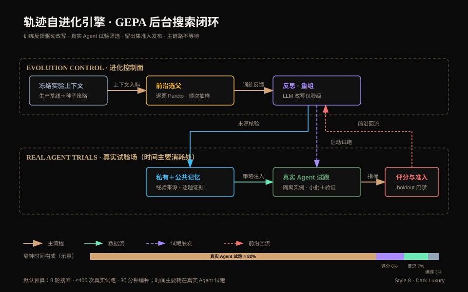

读图：进化控制面驱动「前沿选父 → 反思·重组 → 真实 Agent 试跑 → 评分与 holdout 门禁 → 前沿回流」；墙钟时间主要消耗在真实试跑（≈82%，评分 8%、反思 7%、编译 3%），默认预算 8 轮搜索 · ≤400 次真实试跑 · 30 分钟墙钟，主链路不等待。

1. **多父谱系**：保存候选谱系图而非单链；每个后代可继承单个父代的反思改写，也可把**两个不同分支的改进重组到同一后代（双亲重组）**。
2. **反思改写驱动**：以失败台账与评测差异为输入生成多个改写提案；可选 ComBEE 分组反思（多题聚合）。
3. **真实试验筛选**：候选在真实 Agent 实例上执行固定任务集（复用 L1–L3 打点），训练/验证集逐题评分 + **多目标 Pareto 前沿**保留多样性候选（不同题目上的最优策略允许不同）；失败台账记录无效方向。
4. **准入与发布**：幸存候选在留出集与缓存基线做非回归对比，通过 → 登记 `published-version` 并更新记忆实测状态；未通过 → 回退并记录。候选、父版本、任务报告与发布指针保存在 `data_dir/agent-evaluation/`，重启续用。
5. **恢复与离线加载**：搜索状态持久化，可中断恢复；已发布版本支持离线加载。

## 6.7 学习调度算法

1. **触发**：`run.end` 只把新轨迹加入待学习队列，不再每次 run 结束就启动进化；`run.begin`、未结束任务、隔离轨迹、已学习轨迹不计入新样本。
2. **批处理**：按用户合批，成员固定后保存阶段检查点；`learning` 配置：`min_new_runs:20`、`max_wait_ms:600000`、`min_interval_ms:60000`、`max_batch_runs:32`、`max_batch_bytes:32MB`、`retry_backoff_ms:60000`。
3. **预算与冷却**：私有学习与公共管理共享后台工作者，分别使用预算与冷却配置；Agent 任务评测工作者默认两次启动间隔 60 秒、每小时最多 12 个版本作业，只有候选行为版本改变才提交，空队列等待通知。
4. **隔离**：候选、验证集、留出集轨迹不进入生产学习队列；只有经验不足时的已审核训练任务通过专用报告校验后进入同一队列；记忆评测摘要更新不产生新行为版本。

## 6.8 效果评估指标体系

- **逐题指标**：单任务通过率/失败类型分布；
- **多目标指标**：成功率、时延、调用次数、token/资源消耗的 Pareto 组合；
- **非回归指标**：候选 vs 缓存基线在留出集上的不劣化判据；
- **进化收益指标**：对比 L0 基线的任务级对照提升；
- **健康指标**：applied/failed/rejected 回执分布、策略劣化监测、学习队列积压。

---

# 7 关键技术

**关键技术一览**（详细论述见 7.1–7.10，每项均附示意图）：

| 编号 | 关键技术 | 解决的问题 | 核心机制 | 关键参数 / 实现 |
| ---- | ---- | ---- | ---- | ---- |
| 7.1 | 统一执行边界与低侵入打点 | 业务接入成本高、换框架要重写适配器 | 单一边界打点只传业务 ID；包内识别 5 种模型请求/工具定义格式；未启用时零开销直通 | `activity_types` 映射、binding、`max_context_bytes`；`src/runtime/instrumentation.cpp` |
| 7.2 | 上下文关联与并行合流 | 多轮/并行/跨短进程任务结构还原难 | 父子 ID 还原结构 + `caused_by` 显式因果链；常驻服务按业务 ID 合流；缺口隔离而非伪造 | `run.end` 完整性核对、quarantine；`docs/10` |
| 7.3 | Hybrid 混合评测 | 纯规则覆盖不足、纯模型不可复现 | 规则硬证据（置信度 1.0）+ 模型语义判断融合；规则结论保留；三类失败分别记录；UNCERTAIN 不阻塞学习 | INVALID/UNCERTAIN/UNASSESSED、`non_retryable_repeat` 五条件诊断；`docs/11` |
| 7.4 | 反思式候选生成与元反思 | 经验从轨迹中提炼的质量与可信度 | 三段式 Seed 绑定直接证据；反证收集主动找反驳；元反思迭代；置信度折扣 0.9→0.78→INSUFFICIENT_SUPPORT | trigger_pattern/observed_problem/proposed_change；`docs/12` |
| 7.5 | 两级记忆治理 | 经验入库噪声、跨上下文共享风险 | 私有记忆七步入库 + Sørensen–Dice 字节三元组短名单（无向量库降本）；公共记忆提炼-评审-授权三关；冲突两端编译时同时排除 | 短名单 top-8、DUPLICATE/RELATED/CONTRADICTS/DISTINCT；`curate_memory_in_place`；`docs/13`、`docs/14` |
| 7.6 | 策略冻结、快照与影子对照 | 运行中策略漂移、版本对比不可信 | 每 run 冻结策略视图；`agent_version_id`/`policy_id` 双标识；影子策略只记不生效；撤权即时生效 | approved_experiences 入不可变策略哈希、`PolicyRuntime::verify`；`docs/15`、`docs/16` |
| 7.7 | GEPA 反思式进化搜索 | 经验/配置组合的自动寻优 | 多父谱系 + 双亲重组；真实 Agent 试验筛选；逐题/多目标 Pareto 前沿；失败台账防重复探索；状态持久化可中断恢复 | `data_dir/agent-evaluation/`；`docs/24` |
| 7.8 | Holdout 非回归准入 | 新版本上线即劣化 | 留出集（训练/验证从未接触）+ 缓存基线对比为唯一发布通道；发布记录落盘可重启续用 | holdout_baseline_cache、published-version 指针；`docs/24` |
| 7.9 | 多语言客户端与双接入面 | 多语言栈接入与协议一致性 | C++ 核心原生 ABI + HTTP 服务双接入；协议先行（5 protobuf + 5 JSON Schema + OpenAPI）；8 语言薄封装；pause/resume epoch 隔离 | `LocalRuntime`、`/v1/invoke`；`docs/06`、`docs/07`、`docs/23` |
| 7.10 | 学习调度与自动补训 | 学习触发时机与资源控制 | 队列触发（min_new_runs/max_wait）+ 分批上限 + 重试退避；60s 评测间隔、≤12 版本作业/小时；检查点重启续学；冻结训练集补训 | min_new_runs=20、冷启动按有效经验数判断；`docs/17`、`docs/24` |

## 7.1 统一执行边界与低侵入打点

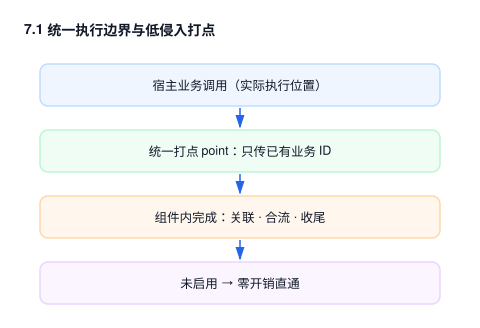

**技术要点**：宿主只在掌握执行事实的位置调用统一边界（`run.begin` / `activity.begin/end` / `loop.check/commit` / `event.record` / `run.end`），传入已有任务/调用/父调用 ID；上下文关联、轨迹记录、策略准备、并行合流、待完成任务收尾全部由组件完成。模型请求注入位置、工具定义、响应 token 用量由包内识别（支持 function/parameters、input_schema、Responses 扁平、functionDeclarations、旧 functions 五种格式），无需维护工具白名单。`activity_types` 提供数据语义映射，换框架不必重写适配器。未启用评测/学习时接入代码直接返回——不连服务、不起线程、不调用任务函数。
**关键参数**：`activity_types` 映射、binding（text/system_message）、`max_context_bytes`。
**参照**：`src/runtime/instrumentation.cpp`、`src/runtime/request_binding.cpp`、`docs/08`。

## 7.2 上下文关联与并行合流

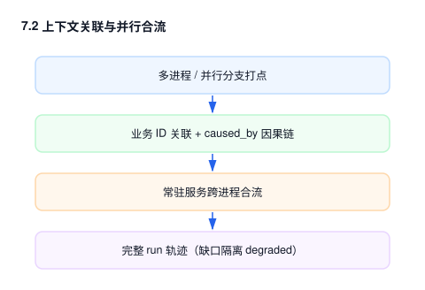

**技术要点**：基于调用父子 ID 还原多轮/多分支/并行任务结构；`caused_by` 显式因果链确认动作先后；跨短进程由常驻服务按业务 ID 合流（Coordinator 派发后退出也可持续维护 run）；`run.end` 核对采集完整性，缺口隔离为 unknown/隔离记录而非丢弃或伪造。
**参照**：`src/runtime/dispatch_runtime.cpp`、`docs/09-async-and-multi-agent.md`。

## 7.3 Hybrid 混合评测

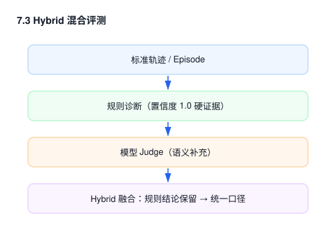

**技术要点**：规则给硬证据（置信度 1.0 的确定性诊断），模型给语义判断；规则确认的无效结论在融合时保留，三类失败（评测失败/业务失败/轨迹不完整）分别记录。评测失败不阻塞学习——UNCERTAIN 保留证据待后续。工具计数只统计业务工具，`executed=false` 的拒绝不计入。
**参照**：`src/analysis/hybrid_evaluator.cpp`、`docs/11`。

## 7.4 反思式候选生成与元反思

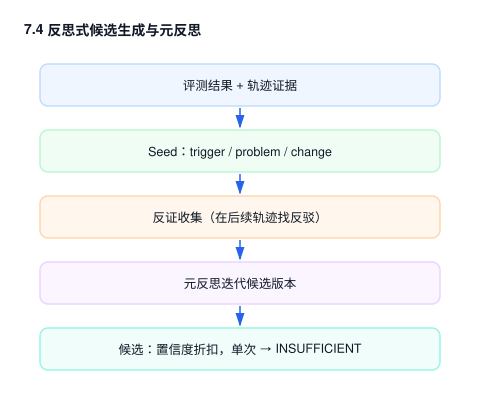

**技术要点**：三段式 Seed（trigger_pattern/observed_problem/proposed_change）绑定直接证据；反证收集机制主动在后续轨迹中找反驳；元反思迭代候选版本；置信度按证据数量与来源折扣（0.9×单证据 → 0.78 → INSUFFICIENT_SUPPORT），杜绝单次成功直接入库生效。
**参照**：`src/analysis/evolution_pipeline.cpp`、`config/prompts/`、`docs/12`。

## 7.5 两级记忆治理

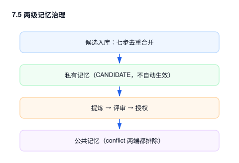

**技术要点**：私有记忆七步入库（幂等/别名/确定性合并/短名单/独立插入/语义判定/关系执行）；无向量库时用 Sørensen–Dice 字节三元组短名单降成本；公共记忆经提炼-评审-授权三关才跨上下文共享；冲突关系两端在编译时**都排除**（宁可损失召回不放错误经验）；批次 decisions 全量审计。
**参照**：`src/memory/shared_memory.cpp`、`docs/13`、`docs/14`。

## 7.6 策略冻结、快照与影子对照

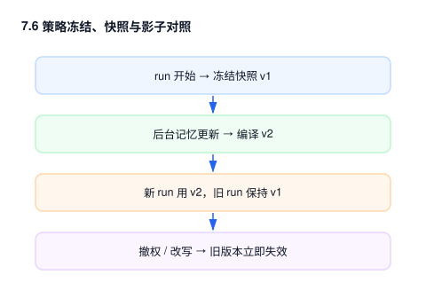

**技术要点**：每个 run 冻结策略视图——新 run 用新版本、已开始的 run 保留原版本，避免运行中策略漂移；`agent_version_id` 与 `policy_id` 双标识支持跨 run 行为对比；影子策略并行运行只记不生效；撤权立即使旧版本失去后续 run 资格。
**参照**：`src/runtime/shadow_runtime.cpp`、`proto/shadow_policy.proto`、`docs/15`。

## 7.7 GEPA 反思式进化搜索

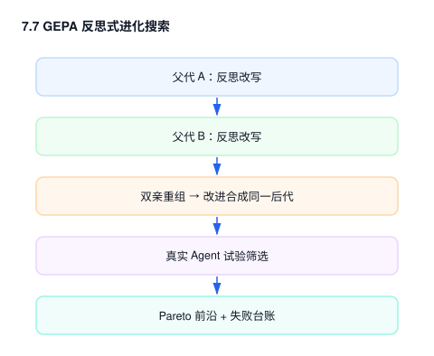

**技术要点**：多父谱系 + 双亲重组（不同分支改进合成同一后代）；真实 Agent 试验筛选而非代理指标；逐题/多目标 Pareto 前沿保留多样性；失败台账防重复探索；状态持久化支持中断恢复与离线加载。
**参照**：`src/gepa/gepa_search.cpp`、`src/gepa/gepa_strategy.cpp`、`docs/24`。

## 7.8 Holdout 非回归准入

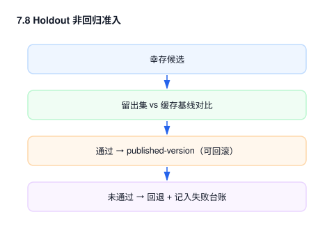

**技术要点**：留出集（训练/验证从未接触）+ 缓存基线的非回归对比是唯一发布通道；准入基线缓存避免重复评测；发布记录（候选/父版本/任务报告/发布指针）落盘 `data_dir/agent-evaluation/` 可重启续用。
**参照**：`src/cli/evaluation_supervisor.cpp`、`src/gepa/holdout_baseline_cache.h`。

## 7.9 多语言客户端与双接入面

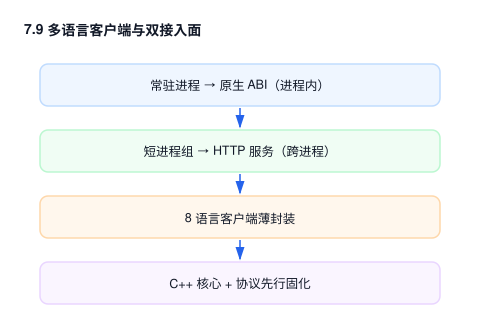

**技术要点**：C++ 核心提供进程内原生 ABI 与独立 HTTP 服务两种接入面；协议先行固化（5 个 protobuf + 5 个 JSON Schema + OpenAPI），8 语言客户端只做薄封装；pause/resume 用 epoch 隔离，跨暂停的 run 被隔离、恢复后重新进入增强流程。
**参照**：`src/service/`、`clients/`、`api/`、`docs/05-07`。

## 7.10 学习调度与自动补训

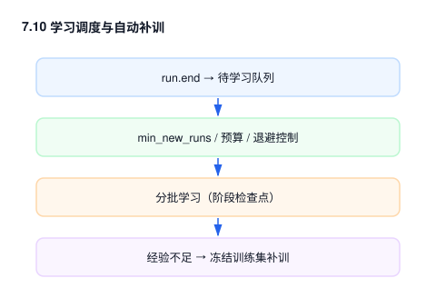

**技术要点**：学习队列触发（min_new_runs/max_wait）、分批上限（runs/bytes）、重试退避；评测工作者 60 秒间隔、每小时 ≤12 版本作业、版本不变不提交；检查点保证重启续学；冷启动按有效经验数判断，冻结训练集补训且验证/留出集永不入库。
**参照**：`docs/17-learning-scheduler.md`、`docs/24`。

---

# 8 技术难点与挑战

## 8.1 难点总览

| 编号 | 难点 | 类别 | 影响面 |
| ---- | ---- | ---- | ---- |
| C1 | 低侵入与轨迹信息完备性的平衡 | 架构 | 接入成本 vs 数据质量 |
| C2 | 跨进程/并行场景轨迹一致性与合流 | 架构 | 复杂任务还原 |
| C3 | 经验/策略质量可靠性（错误经验致宿主劣化） | 算法 | 交付稳定性 |
| C4 | 模型 Judge 评分偏差与评测可信度 | 算法 | 全链路口径 |
| C5 | 记忆规模膨胀与检索精度衰减 | 数据 | 长期运行效果 |
| C6 | GEPA 搜索成本与搜索稳定性 | 算法/成本 | 学习预算 |
| C7 | 多宿主形态与多语言兼容 | 工程 | 通用性 |
| C8 | 自进化过程对主链路的性能干扰 | 性能 | 宿主体验 |
| C9 | 无约束自主变更的生产风险 | 安全 | 生产稳定 |

## 8.2 C1 低侵入与轨迹信息完备性的平衡

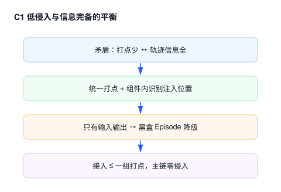

**难点**：打点越少侵入越低，但轨迹越不完整，评测与反思质量越差；打点过密则侵入宿主主链路。
**根因**：不同框架的模型 SDK、工具定义、循环结构各异，通用打点难以同时覆盖。
**应对**：① 统一边界只要求业务 ID，组件内识别常见注入位置与五种工具 Schema 格式；② `activity_types` 做数据语义映射而非代码适配；③ 黑盒降级——只有任务输入输出时生成黑盒 Episode，先支持任务级评测，工具/循环/分支分析随打点完善逐步增强；④ 未启用时零开销直通。
**验证**：接入成本指标（宿主新增代码行数 ≤ 一组打点）；完整性指标（采集完整性轴与业务状态轴独立统计）。

## 8.3 C2 跨进程/并行场景的轨迹一致性与合流

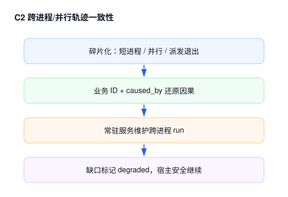

**难点**：多短进程协同、Coordinator 派发后退出、并行分支交错，导致轨迹碎片化、父子关系断裂。
**根因**：进程边界切断内存态上下文；并行分支无全局时钟。
**应对**：① 打点只传已有业务 ID（不新增消息字段），组件按 ID 合流；② 常驻服务持有跨进程 run 状态；③ `caused_by` 显式因果链确认动作先后（替代不可靠的时间戳）；④ `run.end` 核对采集完整性，缺口标记 degraded 并隔离受影响轨迹，宿主按原逻辑安全继续。
**验证**：并行/跨进程用例的轨迹还原率；degraded 轨迹隔离率。

## 8.4 C3 经验与策略质量的可靠性

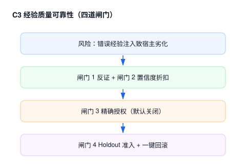

**难点**：错误、过拟合或过时经验注入后直接改变宿主行为；公共记忆还会放大错误影响面——这是自进化系统**最大的劣化来源**。
**应对（四道闸门）**：① 反证收集——后续轨迹中主动寻找反驳，有反证或 CONTRADICTS 的候选编译时排除（冲突两端都排除）；② 置信度折扣——单次证据（0.9→0.78）只能停在 INSUFFICIENT_SUPPORT；③ 授权——`auto_approve_experiences` 默认 false，注入需 memory_id + content_revision 精确匹配批准项；④ 准入——上线前留出集非回归校验，策略快照可一键回滚。
**验证**：错误经验拦截率；published-version 的非回归通过率。

## 8.5 C4 模型 Judge 评分偏差与评测可信度

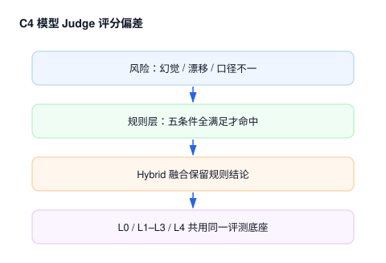

**难点**：纯模型评测存在评分不稳定、幻觉、标准漂移；纯规则覆盖不足；评测口径不一致会让 GEPA 朝错误方向搜索。
**应对**：① 规则层给置信度 1.0 的硬证据（`non_retryable_repeat` 五条件全满足才命中）；② 融合时规则结论保留，模型只做补充；③ 全链路共用同一评测底座（L0/L1–L3/L4 口径一致）；④ 评测失败、业务失败、轨迹不完整分别记录，UNCERTAIN 不武断定罪；⑤ 评测模型显式配置并纳入审计。
**验证**：规则诊断与人工标注一致率；同一轨迹重测稳定性。

## 8.6 C5 记忆规模膨胀与检索精度衰减

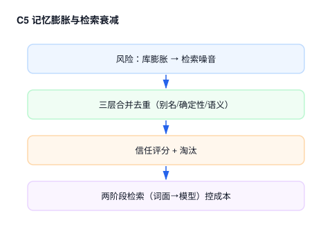

**难点**：长期运行记忆库持续增长，检索噪音上升、陈旧经验干扰决策。
**应对**：① 入库即去重（别名/确定性/语义三层合并）；② 冲突关系两端排除；③ 信任评分与淘汰；④ 两阶段检索（词面短名单 → 模型判定）控制成本；⑤ 编译时状态/契约/证据/授权五重过滤。
**验证**：记忆增长率 vs 检索 top-k 命中率；淘汰条目占比。

## 8.7 C6 GEPA 搜索成本与搜索稳定性

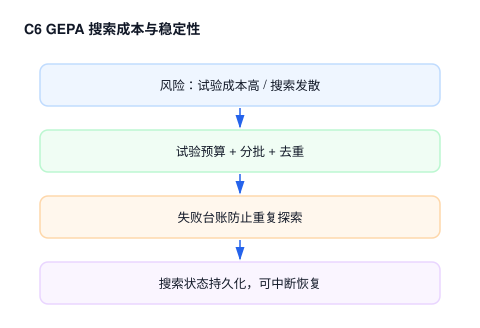

**难点**：多轮反思依赖真实 Agent 试验，算力与 token 成本高；搜索可能发散、震荡或陷入局部最优；中断后需可恢复。
**应对**：① 试验预算与分批去重（评测工作者 60s 间隔、≤12 版本/小时）；② 失败台账记录无效方向防重复探索；③ 多提案筛选 + 逐题/多目标 Pareto 前沿控制候选数量；④ 搜索状态持久化，支持中断恢复与离线加载；⑤ 准入闸门保证搜索波动不外溢到生产。
**验证**：每版本平均试验成本；搜索收敛曲线；恢复后结果一致性。

## 8.8 C7 多宿主形态与多语言兼容

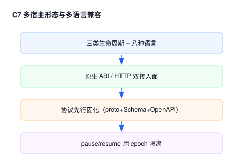

**难点**：常驻进程（低延迟）、短进程组（状态外置）、历史日志（可导入）三类生命周期差异大；八语言接入面维护成本高。
**应对**：① 原生 ABI 与 HTTP 双接入面按需选型；② 协议先行固化（protobuf + JSON Schema + OpenAPI），客户端薄封装；③ learn 导入统一历史数据通道（同一身份、来源校验、同一学习队列）；④ pause/resume 用 epoch 隔离。
**验证**：八语言客户端协议一致性测试（`docs/22`）。

## 8.9 C8 主链路性能干扰

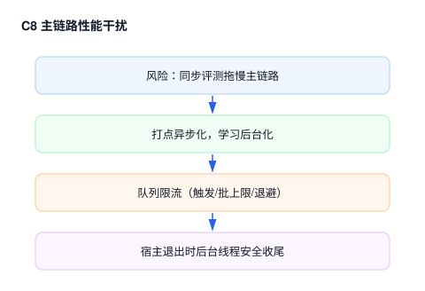

**难点**：采集、评测、策略下发若同步执行会拖慢宿主 CI/CD 主链路。
**应对**：① 打点异步化，评测与学习后台化不等待；② 学习队列限流（min_new_runs 触发、批上限、退避）；③ 资源竞争时组件降级宿主优先；④ 宿主退出时后台线程安全收尾。
**验证**：打点 P99 延迟；主链路开启/关闭增强的吞吐对比。

## 8.10 C9 无约束自主变更的生产风险

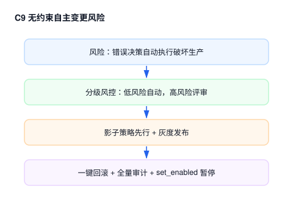

**难点**：决策错误且自动执行会直接破坏生产流水线——业界共识是可控性优先于自主性。
**应对**：① 分级风控：低风险自动生效，高风险变更与经验注入强制授权/人工评审；② 影子策略先行验证；③ 每个 run 固定快照、变更只影响新 run；④ 灰度发布、一键回滚、全量审计三重防护；⑤ `evo.set_enabled(false)` 可整体暂停。
**验证**：生产变更审批覆盖率；回滚演练 MTTR。

## 8.11 未来挑战预判

- **跨业务经验迁移负迁移**：scope 隔离 + 公共记忆授权评审已留接口，需建立迁移前的小规模验证机制；
- **多租户记忆边界**：支持用户数=1、证据归属校验已内建，跨租户共享需新增信任域模型；
- **评测基准演化**：业务变化导致留出集失效，需基准集版本化与定期轮换；
- **多目标冲突**：效率/质量/成本目标互斥时，Pareto 前沿保留多样性但缺乏自动权衡，长期需目标自主管理（见 16.3）。

---

# 9 数据架构与接口设计

## 9.1 数据整体架构与流转

系统的数据生命周期为一条单向主链 + 两条回流支路：**打点 → 标准轨迹 → Episode → 评测结果 → 候选经验 → 记忆库 → 策略快照 → 运行时策略 → 执行回执 → 回流评测**；GEPA 支路从记忆库与评测底座取数，经真实试验与留出集准入产出发布版本，发布版本再回流为运行时策略。

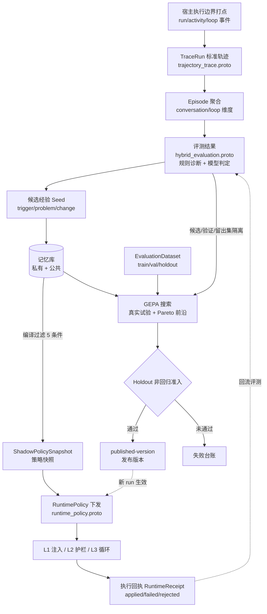

**流转约束**（工程红线）：① 候选、验证集、留出集轨迹**不进入生产学习队列**；② 只有经验不足时的已审核训练任务通过专用报告校验后进入学习队列；③ 每个 run 冻结固定快照，已开始的 run 不换版本；④ 回执是"注入凭证"而非执行凭证——applied 由 `PolicyRuntime::verify` 按实际发送输入重算核验。

## 9.2 核心数据模型定义

全部模型以 protobuf 固化（`proto/`，`package trajectory.evolution.v1`），跨语言一致。以下按域给出关键模型与字段。

### 9.2.1 轨迹模型（trajectory_trace.proto）

| 消息 | 关键字段 | 语义 |
| ---- | ---- | ---- |
| `TraceRun` | `schema_version`、`trace_kind`（必须 = `trajectory.v1`，防误识别旧 JSON）、`identity`、`events[]`、`attributes` | 一次 run 的完整轨迹根 |
| `Identity` | `run_id` / `agent_id` / `user_id` / `conversation_id` | 关联与合流的唯一锚点 |
| `TraceEvent` | `event_id`、`kind`（run.start/end、step.start/end、action.start/end、loop.decision、advice.applied、state.changed、evaluation、custom）、`producer_id`、`sequence`、`timestamp_us`、`actor_id`、`execution_id`、`step_id`、`action_id`、`loop_id`、`iteration`、`caused_by[]`、`operation`、`status`（completed/failed/cancelled/unknown）、`input`/`output`（Value）、`error`、`decision`（continue/replan/stop）、`outcome`、`application`、`attributes` | 最小事件单元；**caused_by 显式因果链**是并行/跨进程还原的凭据；step/action 结束事件必须带 status |
| `ErrorInfo` | `code`、`message`、`retryability`（retryable/non_retryable/unknown） | 规则诊断的输入 |
| `RunOutcome` | `execution_status`（completed/failed/cancelled/unknown）、`business_status`（succeeded/failed/partial/unknown） | **双轴独立**：执行成败 ≠ 业务成败 |
| `Application` | `query_id`、`policy_id`、`policy_revision`、`decision_id`、`status`（applied/rejected/failed）、`reason`、`experiment_id`、`cohort` | 注入回执——注释明确：回执不是合规证明 |
| `CapabilityManifest` | `requested_level`（L0–L4 枚举）、`declared_capabilities[]`、`fallback`（downgrade/strict） | run 开始时的能力声明 |
| `CapabilityCheck` | `capability`、`required_level`、`data_status`、`runtime_status`、`reasons[]` | 能力等级与数据完备性核验结果 |

### 9.2.2 评测模型（hybrid_evaluation.proto）

| 枚举/消息 | 取值与语义 |
| ---- | ---- |
| `SemanticVerdict` | `UNASSESSED` / `USEFUL` / `INVALID` / `NECESSARY_RETRY` / `PREMATURE_STOP` / `UNCERTAIN` |
| `DecisionSource` | `NONE` / `RULE` / `MODEL` / `HYBRID`——每条结论记录来源，规则结论融合时保留 |
| `ModelCallStatus` | `NOT_REQUESTED` / `SKIPPED` / `SUCCEEDED` / `TRANSPORT_ERROR` / `INVALID_RESPONSE`——模型评测失败与业务失败分离 |
| `AggregateStatus` | `UNKNOWN` / `SUCCEEDED` / `FAILED` / `PARTIAL` |
| `DiagnosticEvidence` | `diagnostic_id`、`category`、`counts_as_invalid`、`confidence`、`severity`、`summary`、`observable_cause`、`tool_name`、`error_class`、`evidence_event_ids[]`（引用事件不复制内容） |

**数据安全设计**：持久化报告只存结构证据与已验证结论；原始 prompt、消息、工具负载、凭据**不复制进 protobuf**。

### 9.2.3 记忆与策略快照模型（shadow_policy.proto）

| 消息 | 关键字段 | 语义 |
| ---- | ---- | ---- |
| `ShadowExperience` | `memory_id`、`content_revision`、`target_scope`、`trigger_pattern`、`observed_problem`、`content`、`source_candidate_ids[]`、`match_terms[]`、`application_shared` | 进入策略视图的合格经验；`application_shared` 只能由可信发布路径置位，轨迹无法伪造 |
| `ShadowPolicySnapshot` | `snapshot_id`、`identity`、`memory_revision`、`options`、`experiences[]`、`excluded_counts`（仅聚合计数，被排除用户的 ID/内容不出编译器）、`shared_revision`、`cross_relations[]` | 一个 run 冻结的策略视图 |
| `SharedExperienceStore` | `application_id`、`revision`、`experiences[]`（`PublishedExperience` 公共投影：无来源用户/会话/证据/评审数据）、`relations[]` | 公共记忆库（默认开启） |
| `CrossMemoryRelation` | 私有/公共双侧 `memory_id + content_revision`、`relation`（duplicate/related/conflict/independent，缺省 = 未评审） | 跨库关系；conflict 两端编译时都排除 |
| `ShadowOptions` | `target_scopes[]`、`max_policy_entries/advice_items/advice_bytes/query_bytes/memory_bytes/snapshot_bytes`、`min_matched_terms`、`stop_terms[]` | 全部限额来自配置，协议本身不能开启 Active |

### 9.2.4 运行时策略模型（runtime_policy.proto）

| 消息 | 关键字段 | 语义 |
| ---- | ---- | ---- |
| `RuntimePolicy` | `policy_id`、`snapshot`、`options`、`effective_level` | 绑定到当前 run 的运行策略 |
| `RuntimeOptions` | `requested_level`、`host_capabilities[]`、`fallback`、`allowed_users/conversations[]`、`approved_experiences[]`（memory_id + content_revision 精确授权）、`action_rules[]`、`loop_rules[]`、`experience_template`（恰好一个 `{{experience}}` 占位符）、`max_context_bytes`、`request_context_pointer`（RFC 6901）、`request_context_mode`（text/system_message）、`experience_overrides[]` | 部署授权的全部内容；授权字段纳入**不可变策略 hash** |
| `ActionRule` | `rule_id`、`target_scope`、`operation`、`deny`、`required_arguments[]`、`source_experience` | L2 逐动作规则；生成规则须绑定获准经验 |
| `LoopRule` | `rule_id`、`target_scope`、`max_iterations`、`max_no_progress`、`no_progress_decision`（stop/replan）、`max_replans`、`replan_context` | L3 循环规则；replan 是有界、仅请求侧的上下文补充 |
| `RuntimeQuery` / `RuntimeDecision` | `boundary`（llm/actions/loop）、`execution_id`、`actions[]`、`iteration`、`state_fingerprint`、`previous`；`status`（ready/no_change）、`context`、`experiences[]`、`ActionDecision`（allow/reject + rule_id） | 三处边界的查询与决定 |
| `LoopProgress` | `execution_id`、`iteration`、`fingerprint`、`no_progress`、`replans`、`decision`、`rule_id` | 循环进度——**按执行实例持久化，绝不按技能名** |
| `RuntimeObservation` | `request`（最终序列化请求，非可变 prompt 历史）、`transport_allowed`、`call_id`、`executed/skipped_action_ids`、`loop_decision` | 核验 applied 的输入 |
| `RuntimeReceipt` | `identity`、`application`、`execution_id`、`boundary`、`call_id`、`action_ids`、`experiences` | 执行回执 |

### 9.2.5 评测数据集与任务报告模型（evaluation_dataset.proto）

| 消息 | 关键字段 | 语义 |
| ---- | ---- | ---- |
| `EvaluationTask` | `task_id`、`group_id`（同一会话/场景族必须同一 split）、`task_input`、`followup_inputs[]`、`expected_behavior`、`category`、`difficulty`、`initial_state`（声明式 fixture，构建器**绝不执行**）、`constraints[]`、`budget`、`provenance`、`review_status`（pending/reviewed）、`split`（train/val/holdout）、`task_version` | 评测任务 |
| `TaskProvenance` | `kind`（golden/synthetic/traces——是数据来源不是质量评级）、`source_fingerprints[]`、`learning_exposed`（暴露任务仅限训练 split）、`model_id`、`prompt_fingerprint` | 来源与污染控制 |
| `EvaluationDataset` | `schema_version`、`dataset_kind`、`name`、`dataset_version`、`split_seed`、`split_percent[]`、`tasks[]`、`issues[]` | 数据集版本 |
| `EvaluationTrial` | `trial_id`、`task_id/task_version`、`split`、`variant_id`、`repetition`、`execution_status`、`verdict`（passed/failed/uncertain/error——**执行成功 ≠ 任务成功**）、`checks[]`、`metrics`、`evidence`、`duration_ms` | 单次试验 |
| `TaskEvaluationReport` | `run_id`、`dataset_version`、`evaluator_version`、`config_fingerprint`、`trials[]`、`summary`、`comparisons`、`complete`（所有计划试验有终态记录，不代表全过） | 任务评测报告，准入依据 |

### 9.2.6 记忆库存储表设计（逻辑表）

| 表 | 主键 | 核心列 | 说明 |
| ---- | ---- | ---- | ---- |
| `memory_entry` | `memory_id`（`memory:candidate:<hash>`） | `user_id`、`scope`、`type`、`trigger_pattern`、`observed_problem`、`content`、`content_revision`、`status`（CANDIDATE/VALIDATED/...）、`support_confidence`、`evidence_refs` | 私有记忆；语义合并后原 candidate_id 变 alias |
| `candidate` | `candidate_id` | `memory_id`、`generator_version`、`status`（PROPOSED/...）、`contract_version` | 候选版本链 |
| `memory_relation` | (a_memory_id, b_memory_id) | `relation`（DUPLICATE/RELATED/CONTRADICTS/DISTINCT）、`confidence`、`review_state` | 关系与冲突 |
| `memory_update_batch` | `batch_id` | `decisions[]`（映射/方法/置信度/修订）、`applied` | 幂等与审计 |
| `published_version` | `agent_version_id` | 候选、父版本、任务报告、发布指针 | `data_dir/agent-evaluation/`，重启续用 |

## 9.3 内外接口设计

### 9.3.1 执行边界接口（打点协议）

执行边界接口是业务方 Agent 与自进化引擎之间的**唯一强制触点**：业务代码只在执行边界打点、只传业务 ID，不感知任何评测/反思/记忆内部结构。协议定义为框架中立的 `evolution.boundary.v1`（`api/boundary-v1.schema.json`，标题 *Framework-neutral boundary protocol v1*），采用单端点判别式联合（discriminated union）风格：每个请求是一个 JSON 对象，`operation` 字段作为判别标签，`request_id` 用于幂等与事件去重（服务端以 `hash(request_id)` 派生事件 ID，见 `src/boundary_runtime.cpp` 的 `event.record` 分支）。Schema 顶层 `oneOf` 共 **22 个操作**，可按用途分为六组：

| 分组 | 操作 | 说明 |
|---|---|---|
| 运行生命周期 | `run.begin` / `run.end` / `run.abort` / `run.status` / `run.heartbeat` | 开启/关闭一次执行；`status`/`heartbeat` 供长任务探活 |
| 活动（Activity） | `activity.begin` / `activity.end` / `activity.abort` / `activity.status` | 一次模型调用、工具调用或自定义步骤的进出打点 |
| 循环控制（Loop） | `loop.check` / `loop.commit` / `loop.abort` | L3 能力：迭代前查询策略、迭代后提交实际决策 |
| 自定义事件 | `event.record` | 业务自定义事件，挂到某个 activity 或 control 上 |
| 通用打点 / 降级 | `point`（即 `capture.gap` 语义） | 单点补录：任一生命周期阶段的"既成事实"上报 |
| 评测任务与元信息 | `agent_evaluation.{status,feedback,submit,retry,cancel,tree}`、`contract.describe`、`memory.status` | GEPA 评测作业管理与协议自描述 |

> `contract.describe` 由服务端 `describe_boundary_contract()`（`src/boundary_runtime.cpp`）动态生成：返回协议名、`contract_version=1`、`max_level`、操作清单、各操作必填字段、可选字段、扩展字段名（`extensions`）、策略作用域（`policy_scopes`）、已注册自定义活动类型以及限额（`max_request_bytes` 默认 1 MiB、`max_events` 默认 10000）。仅当配置了 `policy_evaluation_file` 时才追加 6 个 `agent_evaluation.*` 操作——客户端可以先调 `contract.describe` 做能力探测，再决定启用哪些打点。

#### 公共约定

- **必填公共字段**：所有操作都必须携带 `operation` 与 `request_id`；除 `run.begin` 和元信息操作外，还必须携带 `run_id` 定位所属运行。
- **任意 JSON 输入输出**：`input` / `output` / `state` / `data` / `decision` 等载荷字段不限定结构（Schema 层面无类型约束），业务方传什么就采什么。
- **扩展字段**：自定义数据一律放入 `extensions` 对象，不污染协议字段；`extensions(request)` 在服务端被透传进事件属性。
- **契约版本**：`run.begin` 可显式携带 `contract_version`，目前仅接受 `1`，否则返回 `contract_version_not_supported`。
- **生命周期相关校验由服务端执行**：Schema 只描述字段形状；"模型绑定是否齐全（model binding）、`actual_input` 是否与策略声明一致、`executed` 标志、能力等级（capabilities）是否允许该操作"等语义校验全部在服务端完成（见下文"服务端校验职责"）。

#### 关键操作字段定义

**`run.begin`** —— 开启一次运行（服务端 `boundary_begin_request()` 转为内部 `task.begin`，`initialize_boundary_run()` 初始化运行档案并在首个事件属性中写入 `protocol=evolution.boundary.v1`）：

| 字段 | 必填 | 说明 |
|---|---|---|
| `input` | ✔ | 任务输入（任意 JSON）；缺失返回 `run_input_required` |
| `contract_version` | – | 协议版本，默认 1，其他值拒绝 |
| `conversation_id` | – | 会话 ID；缺省时以 `run_id` 兜底 |
| `level` | – | 目标能力等级 `L0`–`L4`，默认 `L0` |
| `capabilities` | – | 本次运行声明使用的能力清单（服务端按等级能力矩阵校验） |
| `extensions` | – | 自定义扩展数据 |

**`activity.begin`** —— 开始一个活动（模型调用/工具调用/自定义步骤）：

| 字段 | 必填 | 说明 |
|---|---|---|
| `run_id` `kind` `name` `input` | ✔ | `kind` 为活动类型；除内置 `model`/`action`/`custom` 外，业务可在配置中注册 ≤128 个自定义类型 |
| `actor_id` `scope_id` | – | 策略作用域身份（参与 L1/L2 经验注入与参数护栏时必填） |
| `stream_id` | – | 流标识；与 `actor_id` 一起需满足标识符规范，否则 `activity_identity_invalid` |
| `state` | – | 进入活动时的上下文状态（供 L1 经验检索与 L2 参数校验） |
| `binding` | – | 模型绑定 `{pointer, mode}`：`pointer` 为指向请求载荷的 JSON Pointer（须以 `/` 开头），`mode` 为绑定模式；缺失返回 `model_binding_required` |
| `control_id` / `caused_by` / `apply_policy` / `extensions` | – | 因果链与策略开关 |

**`activity.end` / `activity.abort`** —— 结束活动（`abort` 不允许以 `completed` 状态收尾，否则 `abort_status_invalid`）：

| 字段 | 必填 | 说明 |
|---|---|---|
| `run_id` `activity_id` `status` `output` | ✔ | `status` 为执行状态；`output` 为活动产出（任意 JSON） |
| `actual_input` | – | **实际生效的输入**：L2 参数护栏改写后业务真实执行的入参，供 `PolicyRuntime::verify` 逐字段比对 applied/failed/rejected |
| `executed` | – | 该活动是否真正执行（被护栏拦截时为 `false`） |
| `error` `metrics` `caused_by` `extensions` | – | 错误对象、指标、因果链 |

**`loop.check`** —— 迭代前策略问询（L3 回环控制入口）：

| 字段 | 必填 | 说明 |
|---|---|---|
| `run_id` `loop_id` `state` | ✔ | `state` 为当前循环状态（进度、中间结果等任意 JSON） |
| `actor_id` `scope_id` `apply_policy` `caused_by` `extensions` | – | 身份与策略开关；返回 `RuntimeDecision`（continue/replan/stop + 回执凭证 `control_id`） |

**`loop.commit` / `loop.abort`** —— 提交本次迭代的实际决策（`abort` 会将运行标记为 `incomplete`）：

| 字段 | 必填 | 说明 |
|---|---|---|
| `run_id` `control_id` `decision` | ✔ | `control_id` 来自 `loop.check` 回执；`decision` 为实际执行的决定，服务端据此核销回执并累计 `LoopProgress` |
| `caused_by` `extensions` | – | — |

**`event.record`** —— 自定义事件（约束：`activity_id` 与 `control_id` 互斥，否则 `event_context_exclusive`；引用不存在对象返回 404）：

| 字段 | 必填 | 说明 |
|---|---|---|
| `run_id` `type` `data` | ✔ | `type` 须为合法标识符；事件属性写入 `type=extension.event`、`event_type`、`data` |
| `activity_id` / `control_id` | –（二选一） | 挂载点；挂到 control 时保留该 control 的显式轮次而非最新兄弟循环（见 `src/boundary_runtime.cpp` 注释） |

**`run.end` / `run.abort`** —— 关闭运行（语义最重的操作，直接决定轨迹是否进入评测队列）：

| 字段 | 必填 | 说明 |
|---|---|---|
| `run_id` `status` `output` | ✔ | 缺失 output 返回 `run_output_required`；`abort` 不允许 `status=completed` |
| `business_status` | – | 业务口径结局：`succeeded` / `failed` / `partial` / `unknown`，其他值返回 `business_status_invalid` |
| `capture_complete` | – | 业务自评采集是否完整；为 `false` 时运行标记 `incomplete` |
| `defer_if_pending` | – | 为 `true` 且仍有未结束活动/未提交 control 时，**不关闭运行**，返回 `{closed:false, pending:true}`，由业务补齐后再调 |
| `caused_by` `extensions` | – | — |

关闭时的服务端收尾逻辑（`dispatch_boundary()` 的 `run.end` 分支）：仍有未结束活动或未观察 control 时，非 abort 直接拒绝（`run_has_pending_activities` / `run_has_unobserved_controls`，HTTP 409）；abort 则强制兜底——活动以 `status=unknown` 关闭、control 以 `decision=stop` 核销，并对未观察的 `replan` 决策补写运行时回执（`replan_observed`）。最终 `evaluation_status`：轨迹不完整 → `quarantined`（隔离，不进学习管道）；完整且 `auto_evaluate`（默认开）→ `pending` 进入评测队列。

**`point`（capture.gap 语义）** —— 单点补录/降级通道：当业务无法在事件发生的当时打点（批处理回放、第三方平台导入、进程崩溃前补录），用 `point` 一次性上报某阶段的既成事实。仅 `phase` 必填，`capture.gap` 与 `evaluation.retry` 两个操作同时存在于 boundary v1 与 integration v1 两份协议中（Schema 描述明确注明共享）。

| 字段 | 必填 | 说明 |
|---|---|---|
| `phase` | ✔ | 补录的阶段（run/activity/loop/event 的某个时刻） |
| `capture_gap` | – | 显式标记本次为补录缺口，轨迹属性留痕 |
| `kind` `name` `input` `output` `status` `business_status` `actual_input` `executed` `decision` `loop_id` `state` `binding` `metrics` `error` `ref` `context` `causes` | – | 与对应正式操作同义；`ref`/`context`/`causes` 用于人工拼接因果链 |

#### 服务端校验职责

Schema 只负责字段形状，以下语义校验全部由服务端完成（`src/boundary_runtime.cpp` / `src/integration_service.cpp`；integration v1 与 invoke v1 在各自 Schema 描述中声明 *"Runtime additionally checks UTF-8 byte limits, credentials, identity ownership, level capabilities and lifecycle preconditions."*）：

| 校验类别 | 具体规则 | 错误码 |
|---|---|---|
| 生命周期前置条件 | 运行已关闭后拒绝除 `activity.status` 外的一切操作；结束/提交前对象必须存在 | `task_already_closed`(409)、`activity_not_found`(404)、`control_not_found`(404) |
| 模型绑定 | `binding.pointer` 必须以 `/` 开头且为合法 JSON Pointer；`binding.mode` 必填 | `model_binding_required`、`binding_pointer_invalid` |
| 身份与归属 | `actor_id`/`stream_id` 标识符合法；身份归属（identity ownership）与凭据（credentials）在 integration/invoke 通道校验 | `activity_identity_invalid`、401/403 |
| 能力等级 | 操作是否在运行声明的 `level`/`capabilities` 允许集内（如 L3 才允许 `loop.check`） | 等级能力矩阵拒绝 |
| 字节限额 | UTF-8 字节上限；单请求 ≤ `max_request_bytes`（默认 1 MiB）、单运行事件数 ≤ `max_events`（默认 10000） | 限额错误 |
| 状态一致性 | `abort` 不得携带 `completed`；`event.record` 上下文互斥；`business_status` 枚举 | `abort_status_invalid`、`event_context_exclusive`、`business_status_invalid` |

配置侧约束由 `validate_boundary_configuration()` 在启动时校验：`query_context.max_task_bytes`/`max_state_bytes` 取值 128–32768；自定义活动类型 ≤128 个且不得占用 `model`/`action`/`custom` 保留名，每个类型的 `semantic` 必须是三者之一，`required_input_paths` ≤64 条且每条为 ≤256 字符的合法 JSON Pointer——这些路径用于强制关键活动必须采集哪些输入字段。

#### 与 integration v1 / invoke v1 的关系

| 协议 | 文件 | 规模 | 定位 |
|---|---|---|---|
| boundary v1 | `api/boundary-v1.schema.json` | oneOf 22 | 框架中立打点协议，新业务接入的首选 |
| integration v1 | `api/integration-v1.schema.json` | oneOf 18 | 面向托管集成的请求面，与 boundary 共享 `capture.gap`、`evaluation.retry` |
| invoke v1 | `api/invoke-v1.schema.json` | oneOf 40 | 兼容超集：中立操作 + 历史兼容操作，服务端同一套 Runtime 校验 |

三套协议在服务端汇入同一个 `dispatch_boundary()` / Runtime 实现（`src/boundary_runtime.cpp`、`src/integration_service.cpp`、`src/local_runtime.cpp`），因此无论业务走哪条通道，落库的 `trajectory.v1` 轨迹结构完全一致（`schema_version=1`、统一 `identity`/`events`/`attributes`），保证后续评测、反思、记忆与 GEPA 搜索对数据来源无感知。

### 9.3.2 HTTP 服务接口（OpenAPI）

| 端点 | 方法 | 用途 |
| ---- | ---- | ---- |
| `/v1/health` | GET | 存活探针 |
| `/v1/invoke` | POST | 统一调用入口（打点上报/策略查询/回执提交，按 boundary 区分 llm/actions/loop） |

完整规范：`api/openapi.json`（`api/build_openapi.py` 生成）。8 语言客户端均封装同一入口；Python 提供 `from evolution_configured import points`，只需 `EVOLUTION_POINT_CONFIG` 环境变量。

### 9.3.3 协议 Schema 清单（api/）

| Schema | 契约对象 |
| ---- | ---- |
| `integration-v1.schema.json` | 打点/集成消息（identity、activity_types、binding） |
| `invoke-v1.schema.json` | 统一调用请求/响应 |
| `evaluation-task-v1.schema.json` / `task-evaluation-v1.schema.json` | 任务评测配置与报告 |
| `boundary-v1.schema.json` | 执行边界事件契约 |
| `openapi.json` | HTTP 服务接口规范 |

### 9.3.4 任务评测入口

宿主把已有任务接收函数交给包内 `evaluate / aevaluate`（同步/异步/多轮共用一入口），组件投题、等待真实 run 结束并评分；未启用评测模式时入口直接返回，不连服务、不起线程（`docs/19`）。

## 9.4 数据存储方案

- **记忆库**：本地持久化（SQLite 类），revision 单调递增，快照记录 `memory_revision`；
- **发布制品**：`data_dir/agent-evaluation/` 保存候选、父版本、任务报告、发布指针与检查点（`docs/18`，重启续用）；
- **隔离**：按 `user_id` 身份与数据目录隔离；`excluded_counts` 只存聚合计数，被排除用户的 ID/内容不出编译器；
- **脱敏**：持久化报告只存结构证据；边界入口拒绝敏感字段；评测旧日志时递归脱敏、已知秘密替换、规则过滤（`docs/20`）。

---

# 10 安全与权限设计

- **经验注入授权**：`auto_approve_experiences` 默认 false；使用公共语义提炼前须显式配置评测模型。
- **分级风控**：低风险策略自动生效；高风险变更与经验注入强制授权/人工评审。
- **限额**：学习与搜索预算限额、请求限流、失败台账与熔断。
- **审计**：策略变更、发布回滚、经验授权全量审计。

---

# 11 性能与高可用设计

- 主链路零阻塞：打点异步化；常驻进程形态主链低延迟，多短进程形态由服务持有状态。
- 后台学习与搜索资源隔离；全局限流、熔断、降级；宿主退出时后台线程安全收尾。
- 高可用：常驻服务主备、状态持久化与恢复（`docs/18`）；未启用评测/学习时零开销直通降级。

---

# 12 测试与准入方案

- 测试类型：功能、性能、兼容性（多语言 × 宿主形态）、自进化专项（L0–L4 逐级验收）、安全。
- **策略准入测试（Holdout 非回归）**：候选策略上线前必须在留出集通过非回归校验；准入基线缓存、准入记录可审计；未通过则回退并记入失败台账（`src/cli/evaluation_supervisor.cpp`、`docs/22`）。

**GEPA 搜索与准入发布时序图**：

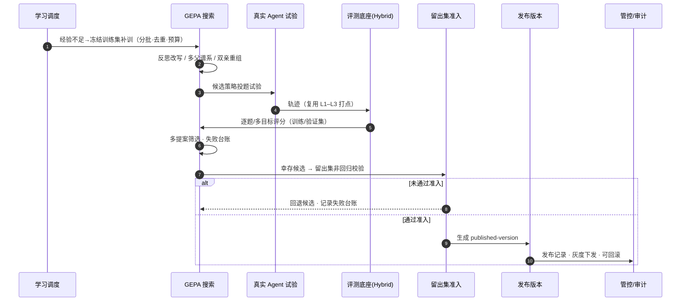

---

# 13 部署与实施方案

按 L0→L4 分阶段实施：
1. **L0 基线**：插入统一打点 → 独立安装构建 → 采集校验评测反思入库（不影响宿主行为）；
2. **L1–L3 受控应用**：启用两级记忆与授权 → 策略快照下发 → 经验注入/编排/循环控制 → 影子策略试运行；
3. **L4 全域进化**：`agent-evaluation.json` 增加 `"gepa_config": "gepa.json"` 启用后台搜索 → 训练/验证/留出集准备 → 留出集准入发布。

生产环境上线顺序：影子验证 → 灰度放量 → 全量，全程可一键回滚。

---

# 14 运维与监控体系

监控打点吞吐、评测通过率、学习队列积压、GEPA 搜索进度、策略发布记录；状态查询与排错见 `docs/21-operations.md`；策略/模型版本管理与历史日志导入迁移见 `docs/23-import-and-migration.md`。

---

# 15 风险评估与应对方案

| 风险 | 等级 | 应对（对应第 8 章难点） |
| ---- | ---- | ---- |
| 候选策略劣化进入生产 | 高 | 留出集非回归准入拦截（C3） |
| 未经授权的经验注入影响宿主 | 高 | 授权默认关闭 + 人工复核（C9） |
| 打点影响主链路性能 | 中 | 异步化 + 零开销降级（C8） |
| 记忆库长期退化 | 中 | 信任/淘汰/晋升治理（C5） |
| 搜索成本失控 | 中 | 预算限额 + 失败台账（C6） |

容错与回滚：策略快照回滚、发布版本回退、影子策略兜底。

---

# 16 效益分析与未来规划

## 16.1 效益
同类问题经验自动复用（减少重复失败）、策略优化从人工周级到后台自动天级、交付质量经非回归准入保障不劣化、全流程可审计降低变更风险。

## 16.2 迭代规划（按 L0–L4）
一期 L0 基线（采集/校验/评测/反思入库）→ 二期 L1–L3 受控应用（注入/编排/循环控制）→ 三期 L4 全域进化（GEPA/准入发布/多业务推广）。

## 16.3 未来规划

规划依据来自竞争分析（`evo-tech-compares.md`，11 个框架对比）的三点判断：① 业界共识已从"微调权重"转向"进化 Harness/工作流/技能库"，参数级内化（SFT/RL）只在闭环稳定、评估信号可靠后才考虑——与本引擎"先受控策略、后权重"的路线一致；② 本引擎的差异化在"窄而深的受控进化"（不碰 Artifacts/源码/拓扑），而 openJiuwen RSI（双维度）、DGM/AgentFactory（代码）、EvoAgentX/CORAL（拓扑）、ADAS（无监督评估）分别代表了四个可拓展方向；③ Evaluator 是所有自进化系统的最大瓶颈，τ²-Bench 等"持续进化防遗忘"基准正在兴起。

**业界趋势 → 本引擎差距 → 规划动作映射**：

| 业界趋势（代表框架） | 本引擎现状（对比报告 6.8 短板） | 规划动作 | 阶段 |
| ---- | ---- | ---- | ---- |
| Harness + Artifacts 双维度进化（openJiuwen RSI） | 只进化策略，不进化交付物 | 交付物版本化评估：对文档/代码类产出做迭代打分与最佳版本留存，仍走 Holdout 准入 | 中期 |
| 代码/技能单元进化（DGM、AgentFactory） | 不改 Agent 源码 | 受限代码技能沙箱：在隔离沙箱中生成/测试可执行技能单元，经人工闸门 + 准入后才入技能库 | 长期 |
| 多 Agent 拓扑进化（EvoAgentX、CORAL） | 保留宿主调度，不进化拓扑 | 编排建议模式：引擎基于轨迹归因给出拓扑调整建议与影子仿真评分，宿主决定是否采纳 | 中期 |
| 无监督/自主评估（ADAS） | 评估依赖规则 + 模型 Judge 配置 | 扩展确定性规则覆盖面、Judge 校准与漂移监控、引入过程奖励信号，逐步降低对人工配置 Judge 的依赖 | 中期 |
| 持续进化防遗忘基准（τ²-Bench 等） | 公开验证空白 | 接入 SWE-bench / GAIA / Terminal-Bench / τ²-Bench 公开基准，发布第三方可复现跑分 | 短期 |
| 递归元进化（EvolveR、ADAS） | 搜索超参与变异算子为固定配置 | 受控元进化：把搜索预算分配、变异算子选择纳入可审计的自调节（超参本身也过准入） | 长期 |
| 平台化工程闭环（openJiuwen RSI 四层架构） | 单机/单服务形态 | 多实例联邦：跨 Harness 实例的公共记忆受控共享与全局基线对齐 | 中期 |

**短期（0–6 月）**——夯实验证与成本：
- 接入公开基准（SWE-bench Verified / GAIA / Terminal-Bench / τ²-Bench），补齐第三方可复现跑分，重点用 τ²-Bench 验证"持续进化不遗忘"；
- ComBEE 分组反思常态化、准入指标多目标化、冷启动补训增强；
- 试验成本优化：扩大逐题成绩缓存复用、minibatch 分层筛选（真实终验不变），把默认 400 trials / 30min 预算的有效吞吐提升一档。

**中期（6–18 月）**——沿对比报告四个差距方向拓展广度：
- 交付物（Artifacts）版本化评估与迭代留存，对标 RSI 双维度但守住准入闭环；
- 编排建议模式：拓扑调整建议 + 影子仿真，不接管宿主调度；
- 规则覆盖扩展与 Judge 校准/漂移监控，降低评估对人工配置的依赖；探索多留出集轮换缓解保守 Holdout 的进化停滞；
- 多业务/多 Harness 实例泛化：公共记忆跨项目受控共享（复用现有四张语义闸门 + 独立用户计票）、基准集版本化、更细粒度护栏；
- 声明式规则/协议扩展机制，降低 C++ 协议层改码重编成本。

**长期（18 月+）**——向"更宽的搜索空间 + 更高的自主性"演进：
- 受限代码技能进化（沙箱生成 + 人工闸门 + Holdout 准入），向 AgentFactory/DGM 的代码技能库方向延伸但保留受控边界；
- 受控元进化：搜索预算、变异算子、反思提示词纳入自调节搜索空间，超参变更同样走非回归准入；
- 评估信号成熟后，探索将稳定策略内化到模型权重（SFT/RL），与业界"闭环稳定后再内化"的共识路径接轨；
- 故障自愈与资源调度纳入统一搜索空间、多目标冲突自主权衡、感知-决策-执行-评估全链路无人化。

## 16.4 模块级迭代优化方向

除 16.3 的路线级规划外，按 `src/` 各模块的现状约束（均有代码/文档依据）梳理可继续迭代优化的具体方向，按优先级分组：

### 高优先级（影响学习质量与验证可信度）

| 模块 | 现状约束（依据） | 迭代优化方向 |
| ---- | ---- | ---- |
| 私有记忆治理（`evolution_pipeline.cpp` 内 curate，3749 行为全仓最大文件） | 词面 Dice 短名单"词面差异较大的近义记忆可能落在短名单之外"（`docs/13`）；模块职责过重 | ① 可选 embedding/ANN 召回后端（保持无向量库为默认，作为可插拔索引）；② 短名单与全库整理增量调度；③ 管线按 stage 拆分（采集/评测/反思/记忆可独立测试替换） |
| Hybrid 评测器（`hybrid_evaluator.cpp`） | 规则编译进内核；Judge 漂移只缓解不消除（对比报告 6.8-2） | ① 规则模式库扩展（更多确定性诊断）；② 规则 DSL 声明式热更新，不重新编译；③ Judge 校准集与漂移监控告警 |
| GEPA 搜索（`gepa_search.cpp` / `gepa_strategy.cpp`） | 反思提案顺序生成、单评测 worker——刻意的稳定性取舍（对比报告 6.8-3） | ① 提案并行生成 + 预算感知调度；② 评测 worker 池化；③ 代理指标预筛（真实终验不变）；④ 失败台账跨实验共享防重复探索 |
| 模型适配层（`model_adapter.cpp`） | 仅 `openai-compatible-http` 一种适配器；供应商忽略 stream 时按普通响应解析 | ① 原生 Anthropic/Gemini 协议适配；② 流式响应采集与 token 精确计量；③ 批处理 API 降本；④ 429/限流的细粒度退避策略库 |
| 公共记忆晋升（`shared_memory.cpp`） | 未核验的私有—公共关系保守阻止组合（`docs/14:218`）；崩溃重试可能重复调用供应商产生费用（`docs/14:388`） | ① 模型请求指纹 + 结果原子落盘，消除重复扣费；② 未核验关系的异步核验通道替代纯保守阻止；③ 晋升计票阈值按业务规模自适应 |

### 中优先级（影响扩展性与接入体验）

| 模块 | 现状约束（依据） | 迭代优化方向 |
| ---- | ---- | ---- |
| 学习调度器（`docs/17:132`） | 单 data_dir 不支持多个写入服务横向分担同一队列 | 队列分片 + 协调者选举；按样本价值（失败率/新颖度）的学习优先级 |
| 原生运行时（`local_runtime.cpp`） | SIGKILL/掉电丢失未落盘尾部（`docs/06:139`）；幂等缓存仅存内存槽位、不支持进程退出后 RPC 重放（`docs/06:114`） | ① WAL 式尾部刷盘策略（可调 durability 档位）；② 幂等缓存可选持久化后端 |
| HTTP 服务（`integration_service.cpp`，2392 行） | 原生 invoke 不支持 `memory.status` 等磁盘管理操作（`docs/07:181`） | ① 双接入面能力对齐；② 多租户隔离与 per-tenant 配额；③ 批量打点接口（batch events）降低高频打点开销 |
| 数据集与基准（`dataset.cpp` / `task_evaluation.cpp` / `sessionlog_evaluator.cpp`） | glob 仅支持单层 `*`（`docs/19:951`）；公开基准未接入 | ① 完整 glob 与数据集版本化；② SWE-bench/GAIA/Terminal-Bench/τ²-Bench 导入器；③ sessionlog 导入格式扩展（主流框架日志 schema 映射） |
| 边界协议（`boundary_runtime.cpp` + `api/*.schema.json`） | 协议扩展需改码重编（对比报告 6.8-4） | ① 声明式字段扩展（extensions 内的强类型注册表）；② 协议版本协商机制；③ 增量/压缩事件传输 |

### 低优先级（体验与生态增强）

| 模块 | 现状约束 | 迭代优化方向 |
| ---- | ---- | ---- |
| 循环诊断（`loop_episode_analyzer.cpp`，2337 行） | 无效循环模式库固定 | 跨 run 模式挖掘：从历史隔离轨迹自动归纳新的无效循环模式，反哺规则库 |
| 控制规则生成（`control_generation.cpp`） | L3 阈值模板固定 | 阈值自学习：按业务历史 run 的循环统计分布推荐初始阈值 |
| 试验编排（`agent_evaluation.cpp` / `evaluation_supervisor.cpp`） | 单机 subreaper 进程模型 | 分布式试验执行器（多机 worker 注册）；试验优先级与抢占 |
| 轨迹契约（`trace_contract.cpp` / `trace_analyzer.cpp`） | 全量 JSON 存储与校验 | 轨迹压缩/列式存储；增量校验；轨迹可视化导出（对接前端调试面板） |
| 8 语言客户端（`clients/`） | 薄封装、手动打点 | 主流框架自动打点适配器（LangChain/AutoGen/自研 Harness 装饰器）；async/streaming 客户端 API |
| 打点识别（`instrumentation.cpp` / `request_binding.cpp`） | 支持 5 种模型请求/工具格式 | 新格式自动发现与告警；多模态输入（图像/音频）采集契约 |

> 取舍原则：所有迭代仍须守住三条不变量——真实 Agent 试验为唯一成绩来源、Holdout 为准入唯一通道、授权字段入不可变策略哈希；任何并行化/代理指标优化只作用于"筛选效率"，不改变"验证口径"。

---

# 17 总结与附录

本方案以真实引擎实现为蓝本：低侵入统一执行边界 + L0–L4 渐进能力分级 + Hybrid 评测 + 两级记忆治理 + GEPA 反思式搜索 + Holdout 非回归准入，形成生产级、可回滚、可审计的自进化闭环，差异化补齐业界"观测止步于评测、优化止步于离线"的中间环节。

**附录**
- A 配图：本文档 `figures/`（扁平图标风架构图、Notion 风开发视图、Claude 风逻辑视图、OpenAI 风运行视图）；组件配图集 `docs/figures/README.md`
- B 数据模型：`proto/`（5 个 protobuf 模型）
- C 接口：`api/*.schema.json` + `api/openapi.json`
- D 配置：`config/`（agent-evaluation、gepa、runtime、shadow 等 + prompts 模板）
- E 竞争分析：`evo-tech-compares.md`（11 个自进化框架对比）
- F 组件文档：`docs/README.md`（24 个专章）
